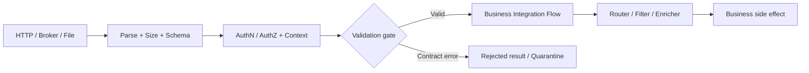
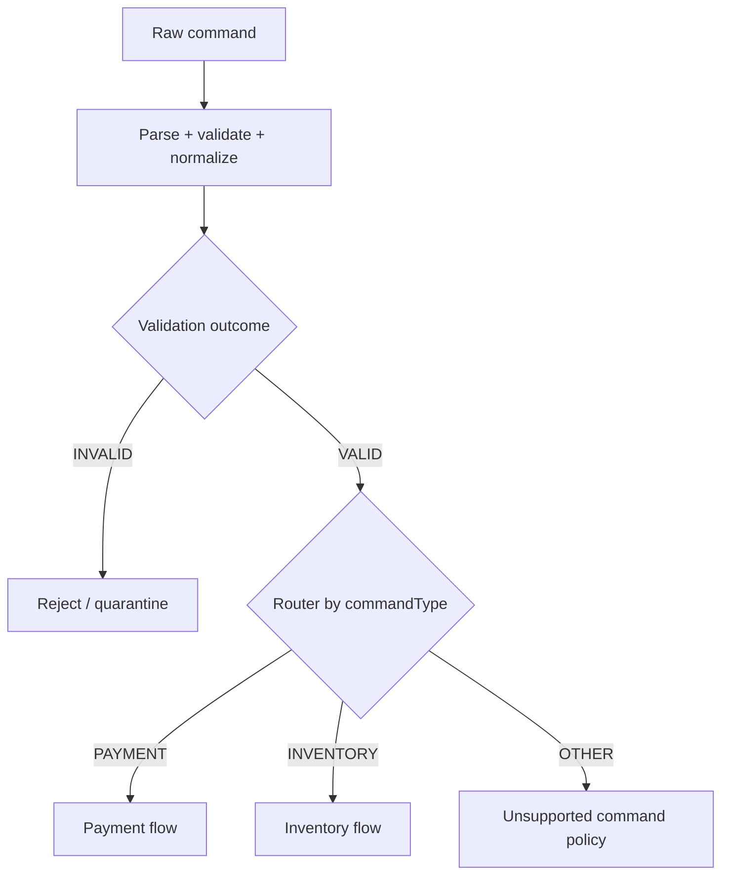
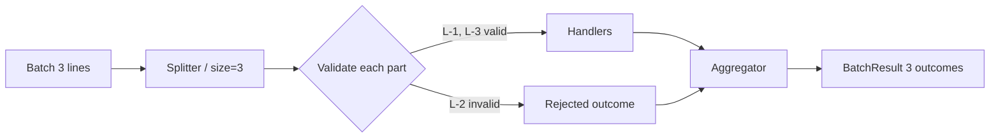
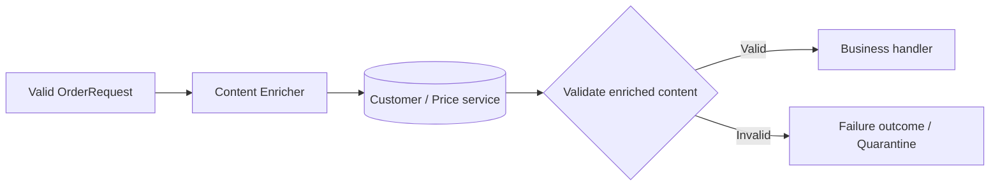
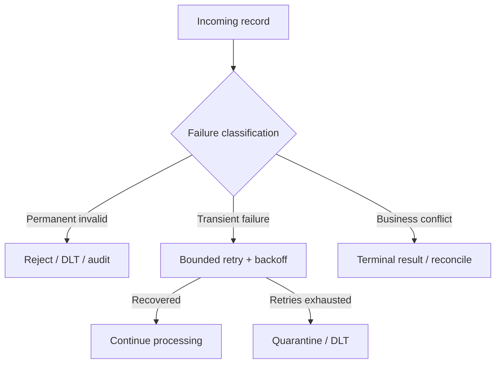

# Validation Before Sending Messages Into a Flow

A system receives order processing requests from REST APIs, AMQP, or Kafka. Some requests are valid, while others are missing an order ID, have `quantity=0`, contain wrong data types, specify an unauthorized tenant, or have payloads that are too large. If those messages go straight to a **Router**, **Transformer**, **Splitter**, **Gateway**, or a handler that writes to a database, errors may surface late: misrouting, triggering side effects before the error is detected, creating message groups that wait forever, or causing the broker to infinitely retry a payload that cannot be fixed by retrying.

**Validation before sending messages into a flow** is the design of a **trusted verification boundary**: data entering the system from the outside world must be parsed, authenticated, and evaluated against the contract before being allowed to reach the **main business flow**. Depending on the source, part of the check happens **before creating a Spring `Message<?>`**, and part happens at the **first endpoint of the Spring Integration flow**; what matters is that the message is not sent to business steps that could cause side effects until it meets the requirements.

This lesson belongs to the **Message filter and validation** chapter of the `SPRING_INTEGRATION_PATTERN` module. Following the goal of learning **Enterprise Integration Patterns with Spring Integration**, we will build loosely coupled, extensible message flows with Router, Filter, Transformer, Splitter, Aggregator, Gateway, retry, error channel, and correlation; while testing valid messages, rejected messages, and infrastructure failures.

> **Core distinction:** **Validation** answers "does the message satisfy the contract to participate in processing?"; **Filter** answers "should this message be allowed to continue on this branch?". An **invalid** message usually needs a rejection result with a reason, whereas a message that is **valid but unsuitable for a branch** can be discarded/rerouted according to policy. Do not treat every `Filter=false` as an exception, and do not use retry to fix permanently malformed data.

## 1. One Input Error Can Break the Entire Flow

Suppose a producer sends:

```json
{
  "tenantId": "TENANT-A",
  "orderId": "ORD-101",
  "sku": "BOOK-02",
  "quantity": -3
}
```

Without input validation:

1. **Router** selects the order processing branch as if it were a normal request.
2. **Content Enricher** calls the Inventory API to check stock for a negative quantity.
3. **Transformer** tries to calculate `totalPrice` from invalid data.
4. The handler may **write invalid state** or throw an exception.
5. The adapter automatically retries the same payload because it sees a technical error.
6. The repeating message never succeeds, yet still consumes consumers, connections, group store entries, and logs.

A design with a validation gate:



**Benefits of early checking:** errors can be returned to the producer before side effects; logs and metrics have clear error codes; downstream steps receive data with declared **invariants**, rather than every handler having to guess nulls/data types/limits.

However, validation **does not turn input into lifelong immutable data**. After enrichment, mapping, calling external systems, or changing business state, some invariants may need to be rechecked.

## 2. Which Boundary Is "Before the Flow" in Spring Integration?

There are three practical locations:

| Location | Example | What can be performed |
| --- | --- | --- |
| **Before creating `Message<?>`** | REST controller, deserializer, adapter parser. | Body/size limits, media type, JSON syntax, authentication, Bean Validation on DTOs. |
| **At the first ingress endpoint** | Spring Integration `IntegrationFlow.from("orders.ingress")` then `.transform(...)`/`.filter(...)`. | Validate payload/headers already converted to a message, route outcomes before business branches. |
| **Right before a side-effect boundary** | Service Activator calling DB/Payment/Inventory, handler publishing to a broker. | Check business state, current permissions, commit conditions, identity/idempotency. |

If `.filter(...)` is used as the first step of an `IntegrationFlow`, the message has **already entered a technical flow** at the input channel. Therefore, "before sending messages into a flow" should be understood accurately as **before entering the business processing flow/branches with side effects**. To reject immediately **before sending to any Integration Channel**, validation must occur in the controller/adapter or an outer ingress layer before calling `send(...)`.

```text
External request
  ├─ Transport/encoding/length check
  ├─ Authentication + authorization
  ├─ Parse DTO + field validation
  └─ Create Message and send to trusted ingress channel
      ├─ Integration validation/normalization gate
      ├─ Router/Filter/Transformer
      └─ Business handler/Outbound Gateway
```

**There is no single `@Valid` directive that runs automatically on every Spring Integration channel.** You must determine which layer triggers Bean Validation, where exceptions are raised, and who is responsible for returning errors to the HTTP caller or broker consumer.

## 3. Five Layers of Input Verification

| Layer | Example | When is it typically checked? |
| --- | --- | --- |
| **Transport/encoding** | Content-Type, payload size, message framing, invalid characters. | Immediately at the HTTP/broker/file adapter. |
| **Syntax & schema** | Valid JSON, required fields, Integer type, schema version. | During deserialization before/at ingress. |
| **Constraint validation** | `quantity > 0`, non-blank `orderId`, SKU length. | Bean Validation/validator near ingress. |
| **Identity & authorization** | Does the caller have permission for `tenantId/orderId`? | Authentication/authorization boundary, before side effects. |
| **Business/state validation** | Unpaid orders cannot be shipped; is stock sufficient? | After fetching the latest state, close to the business operation. |

### 3.1. Schema Validation Differs from Business Validation

A message can be **valid JSON and a valid DTO** yet still violate business rules:

```json
{
  "tenantId": "TENANT-A",
  "orderId": "ORD-101",
  "sku": "BOOK-02",
  "quantity": 500
}
```

`quantity=500` may satisfy `@Positive` yet violate the policy "maximum 100 items per order line". Or the quantity is valid, but the sender's account **is not allowed** to purchase this SKU. Each condition must be defined at the **right layer**:

- DTO contract: positive values, bounded size, required fields.
- Business policy: limits applied per tenant/service plan/version.
- Authorization: the caller has permission to submit this operation.
- Infrastructure: whether the DB/API is able to respond.

Do not return `400 Bad Request` for every infrastructure error; conversely, do not retry `quantity=-3` forever just because the exception was routed into a generic error channel.

### 3.2. Validated Does Not Mean Trusted

A DTO with `@NotBlank tenantId` only proves the field is not empty. It **does not prove** the tenant belongs to the caller. Passing a client-supplied tenant ID into a correlation key, dedup key, or route without verification can mix groups or route data to another tenant.

### 3.3. Check Size Before Parsing Whenever Possible

A 200 MB body or a collection with millions of elements can create memory pressure right during deserialization, **before the validator runs**. Request size, depth, element count, and resources must be bounded at the adapter/API gateway at the infrastructure level. Do not expect `@Size` on a List to always protect against all prior allocation costs.

## 4. Define the Message Contract Before Writing Predicates

Before writing code, answer:

1. Which message types are accepted?
2. Who is allowed to send, and to which business channels?
3. Which metadata is used as the correlation/idempotency key?
4. Which fields are required, and what ranges/formats do they have?
5. Which data errors are **non-retryable** without changing the payload?
6. Which errors require **returning a response**, which require **quarantine**, and which can be **intentionally dropped**?
7. After validation, what guarantees can downstream components rely on?

Example `OrderRequest` contract:

| Field | Rule | Reason |
| --- | --- | --- |
| `tenantId` | Non-empty, must be verified against the authenticated caller. | Data and permission isolation. |
| `orderId` | Non-blank; valid length limits and uniqueness scope. | Routing/correlation/tracing. |
| `sku` | Non-blank; character/length restrictions. | Selecting the right product. |
| `quantity` | Positive Integer, within limits. | Avoiding invalid quantity side effects. |
| `schemaVersion` | A supported version. | Avoiding mis-deserialization during rolling deploys. |
| `operationId` | Stable across retries, not arbitrarily changed. | Idempotent Receiver/command replay. |

The **input contract** should be versioned and tested between producer and consumer. Do not take the fact that a DTO compiles on the JVM as proof that a Python/Node/Kafka producer complies with it.

## 5. Bean Validation: Basic Field Checks

The Java example uses **Jakarta Bean Validation** with a `record`. A compatible implementation is required, typically provided via `spring-boot-starter-validation` in Spring Boot or by configuring a standalone `LocalValidatorFactoryBean` in Spring Framework.

```java
// OrderRequest.java
import jakarta.validation.constraints.NotBlank;
import jakarta.validation.constraints.NotNull;
import jakarta.validation.constraints.Positive;
import jakarta.validation.constraints.Size;

public record OrderRequest(
    @NotBlank @Size(max = 40) String tenantId,
    @NotBlank @Size(max = 64) String orderId,
    @NotBlank @Size(max = 40) String sku,
    @NotNull @Positive Integer quantity
) {}
```

**Why `Integer` instead of `int`?** With `Integer`, a missing/null value can be detected by `@NotNull`. With primitive `int`, some binding processes may supply a default value of `0`; you need to understand the behavior of the JSON deserializer in use.

### 5.1. Bean Validation Only Runs When Invoked

Putting `@NotBlank` on a DTO **does not automatically trigger validation** for every `Message<OrderRequest>` received by an integration flow. An explicit approach:

```java
import jakarta.validation.ConstraintViolation;
import jakarta.validation.Validator;
import java.util.Set;

Set<ConstraintViolation<OrderRequest>> validate(
        Validator validator, OrderRequest request) {
    return validator.validate(request);
}
```

With REST/Spring MVC, `@Valid @RequestBody` can trigger validation during binding according to the MVC configuration. With Spring Integration, you can call `Validator` in a **Transformer/Service Activator at the start of the flow** or use an appropriate validator/selector. **Do not assume `@Valid` placed on any handler method will be automatically invoked by an interceptor**.

### 5.2. Do Not Use Localized Messages as Machine Error Codes

Messages like `"must not be blank"` can change depending on locale/implementation. For reliable producer handling, return an **error code** based on the constraint/domain rule and field path; present human-readable messages at a different layer. Do not return sensitive field values through error messages.

## 6. Design Clear Validation Outcomes

If you only return `true/false`, the system struggles to distinguish a missing SKU from a negative quantity. You can define a **result envelope**:

```java
// ValidationIssue.java
public record ValidationIssue(String field, String code) {}

// ValidationOutcome.java
import java.util.List;

public record ValidationOutcome(
    OrderRequest request,
    List<ValidationIssue> issues
) {
    public ValidationOutcome {
        issues = List.copyOf(issues);
    }

    public boolean accepted() {
        return issues.isEmpty();
    }
}
```

`ValidationOutcome` is a custom application DTO, **not a built-in Spring Integration class**.

### 6.1. A Validation Gate Using `jakarta.validation.Validator`

```java
// OrderValidationGate.java
import jakarta.validation.Validator;
import java.util.ArrayList;
import java.util.Comparator;
import java.util.List;

public final class OrderValidationGate {

    private final Validator validator;

    public OrderValidationGate(Validator validator) {
        this.validator = validator;
    }

    public ValidationOutcome evaluate(OrderRequest request) {
        List<ValidationIssue> issues = new ArrayList<>();

        validator.validate(request).forEach(v -> {
            String field = v.getPropertyPath().toString();
            String code = v.getConstraintDescriptor()
                .getAnnotation().annotationType().getSimpleName();
            issues.add(new ValidationIssue(field, code));
        });

        if (request.quantity() != null
                && request.quantity() > 100) {
            issues.add(new ValidationIssue(
                "quantity", "MAX_PER_ORDER_LINE"));
        }

        issues.sort(Comparator
            .comparing(ValidationIssue::field)
            .thenComparing(ValidationIssue::code));

        return new ValidationOutcome(request, issues);
    }
}
```

**Technical highlights:**

- `validate(request)` checks the constraints declared on the record.
- `quantity > 100` is a simplified business rule illustrating how **schema/field validation** and **domain policy** can work together.
- Only **field + error code** are stored, without storing `getInvalidValue()` or dumping the raw request.
- `evaluate(...)` performs no I/O or side effects, so it can be unit tested independently.
- In production, the "100" policy should be configurable/versioned per contract rather than necessarily hard-coded.

### 6.2. Why an Outcome Instead of an Exception in the Demo?

A validation gate can **return structured error data** so a Router can choose the channel:

```text
OrderRequest
   → evaluate(...)
       ├─ ValidationOutcome(issues=[]) → orders.validated
       └─ ValidationOutcome(issues=[...]) → orders.rejected
```

Advantage: both the valid flow and the rejected flow are **observable business outcomes**, without throwing exceptions for every invalid field. However, for **un-deserializable** payloads, severe security errors, or unavailable metadata systems, a `ValidationOutcome` may not be constructible; a separate error path is needed.

## 7. Java DSL: Validation Before the Main Business Branch

The example below builds **a synchronous ingress flow** consisting of:

1. Receiving `OrderRequest` at `orders.ingress`.
2. Transforming it into `ValidationOutcome`.
3. Using a Router to forward to the accepted/rejected channel.
4. Having tests read results from `QueueChannel`, **without performing DB writes or Inventory calls**.

```java
// OrderValidationConfiguration.java
import org.springframework.context.annotation.Bean;
import org.springframework.context.annotation.Configuration;
import org.springframework.integration.channel.QueueChannel;
import org.springframework.integration.config.EnableIntegration;
import org.springframework.integration.dsl.IntegrationFlow;
import org.springframework.validation.beanvalidation.LocalValidatorFactoryBean;

@Configuration
@EnableIntegration
public class OrderValidationConfiguration {

    @Bean
    LocalValidatorFactoryBean orderBeanValidator() {
        return new LocalValidatorFactoryBean();
    }

    @Bean
    OrderValidationGate orderValidationGate(
            LocalValidatorFactoryBean orderBeanValidator) {
        return new OrderValidationGate(orderBeanValidator);
    }

    @Bean("orders.validated")
    QueueChannel validatedOrders() {
        return new QueueChannel(32);
    }

    @Bean("orders.rejected")
    QueueChannel rejectedOrders() {
        return new QueueChannel(32);
    }

    @Bean
    IntegrationFlow validateOrderIngress(
            OrderValidationGate gate) {
        return IntegrationFlow.from("orders.ingress")
            .transform(OrderRequest.class, gate::evaluate)
            .route(ValidationOutcome.class,
                outcome -> outcome.accepted()
                    ? "orders.validated"
                    : "orders.rejected")
            .get();
    }
}
```

**What does this flow represent?**

- `orders.ingress` is the **technical entry channel**; the incoming message was already created before calling send.
- `.transform(...)` explicitly invokes the gate instead of waiting for validation to happen "magically".
- `.route(...)` selects the channel based on `accepted()`, **without mixing rejected `ValidationOutcome`s into the business queue**.
- The two `QueueChannel`s are for demonstration/testing. In production, the `orders.validated` branch must connect to business handlers, and the `orders.rejected` branch needs error response/audit/quarantine as required.

**API note:** The DSL syntax illustrates common `transform(Class, Function)` and `route(Class, Function)` overloads. When integrating into a real module, verify against the Spring Integration version in use. The snippet has not been tested with Gradle and has no transport configured.

### 7.1. Why Not Forward `OrderRequest` Directly to the Accepted Channel?

The example intentionally forwards **`ValidationOutcome`** so tests can inspect reasons on both branches. If downstream handlers only accept `OrderRequest`, you can add a separate flow:

```text
orders.validated
    → transform(ValidationOutcome::request)
    → orders.business
```

When using a `QueueChannel` as the input to a consumer flow, a **poller** or suitable channel choice is required; do not simply declare `IntegrationFlow.from(QueueChannel)` and expect the consumer to run actively without a polling endpoint. You can replace it with a `DirectChannel` for synchronous forwarding, while `QueueChannel` fits decoupling/buffering points with explicit consumers.

## 8. JUnit 5: Unambiguous Accepted and Rejected Outcomes

### 8.1. Testing Valid Requests

```java
import static org.junit.jupiter.api.Assertions.*;

import org.junit.jupiter.api.Test;
import org.springframework.beans.factory.annotation.Autowired;
import org.springframework.context.ApplicationContext;
import org.springframework.integration.channel.QueueChannel;
import org.springframework.messaging.Message;
import org.springframework.messaging.MessageChannel;
import org.springframework.messaging.support.MessageBuilder;
import org.springframework.test.context.junit.jupiter.SpringJUnitConfig;

@SpringJUnitConfig(OrderValidationConfiguration.class)
class OrderValidationFlowTest {

    @Autowired ApplicationContext context;

    private void send(OrderRequest request) {
        MessageChannel input = context.getBean(
            "orders.ingress", MessageChannel.class);
        assertTrue(input.send(
            MessageBuilder.withPayload(request).build()));
    }

    private QueueChannel accepted() {
        return context.getBean("orders.validated",
            QueueChannel.class);
    }

    private QueueChannel rejected() {
        return context.getBean("orders.rejected",
            QueueChannel.class);
    }

    @Test
    void validRequestGoesOnlyToAcceptedChannel() {
        send(new OrderRequest(
            "TENANT-A", "ORD-101", "BOOK-02", 3));

        Message<?> message = accepted().receive(0);
        assertNotNull(message);
        ValidationOutcome outcome =
            (ValidationOutcome) message.getPayload();

        assertTrue(outcome.accepted());
        assertEquals("ORD-101", outcome.request().orderId());
        assertTrue(outcome.issues().isEmpty());
        assertNull(rejected().receive(0));
    }

    @Test
    void invalidRequestIsRejectedWithReason() {
        send(new OrderRequest(
            "TENANT-A", "ORD-102", "", -5));

        Message<?> message = rejected().receive(0);
        assertNotNull(message);
        ValidationOutcome outcome =
            (ValidationOutcome) message.getPayload();

        assertFalse(outcome.accepted());
        assertTrue(outcome.issues().stream()
            .anyMatch(i -> i.field().equals("sku")));
        assertTrue(outcome.issues().stream()
            .anyMatch(i -> i.field().equals("quantity")));
        assertNull(accepted().receive(0));
    }

    @Test
    void policyLimitIsValidatedBeforeBusinessFlow() {
        send(new OrderRequest(
            "TENANT-A", "ORD-103", "PEN-01", 101));

        ValidationOutcome outcome = (ValidationOutcome)
            rejected().receive(0).getPayload();
        assertTrue(outcome.issues().contains(
            new ValidationIssue(
                "quantity", "MAX_PER_ORDER_LINE")));
        assertNull(accepted().receive(0));
    }
}
```

**Verification:** valid requests only reach `orders.validated`; requests missing a SKU or with negative quantity only reach `orders.rejected` carrying reasons; values exceeding policy also never enter the business branch.

**Test limitations:** does not yet verify HTTP binders, malformed JSON syntax, broker acks, concurrency, authorization, database transactions, or retries. `receive(0)` suits local synchronous flows; if using executors/pollers, wait on conditions with a timeout rather than expecting immediate output.

### 8.2. Testing Type Errors Differs from Testing Constraint Errors

JSON with `"quantity": "not-an-integer"` can **fail right during deserialization**, before `OrderValidationGate.evaluate(...)` runs. Do not write tests calling `new OrderRequest(..., "not-an-integer")` because the Java record expects an `Integer` and will not compile.

To test type/schema errors, send **raw JSON** through the actual HTTP/broker converter and verify the exception/reject path at the adapter.

## 9. Alternative: Filter Returning Only True/False

If the contract only needs pass/drop without a list of field errors, a Message Filter can be used:

```java
// Alternative demonstration flow only; should not declare
// the same input channel as validateOrderIngress().
@Bean
IntegrationFlow filterEligibleOrders(OrderValidationGate gate) {
    return IntegrationFlow.from("orders.filter.in")
        .filter(OrderRequest.class,
            request -> gate.evaluate(request).accepted(),
            spec -> spec.discardChannel("orders.filter.discard"))
        .channel("orders.filter.accepted")
        .get();
}
```

In this flow, the **discard channel receives messages rejected by the Filter** according to Filter endpoint semantics. It does not automatically carry `ValidationOutcome`. If reasons must be returned, use the outcome route in section 7 or create an error event in the discard handler.

Some Filter configurations support **throw exception on rejection**. This is an alternative to `discardChannel`; verify behavior and test for your version. Do not blindly enable "throw on every invalid message" if invalid data is common and the producer needs structured errors it can fix.

### 9.1. How Does a Filter Differ from a Validator?

| Criterion | Validator/Validation gate | Message Filter |
| --- | --- | --- |
| Input | Message/DTO. | Message traveling in an Integration flow. |
| Result | Can be a **detailed set of errors** or an exception. | Usually `true/false` via a predicate. |
| Contract | Schema, fields, and business invariants. | Whether to let the message **pass through a branch**. |
| State | Usually stateless, except for business lookups. | Usually stateless; a selector can be stateful. |
| Side effects | Should be avoided in structural validation. | Should not silently perform side effects in the predicate. |
| Rejection feedback | Can return stable error codes, field paths. | Needs a discard/error route if feedback is needed. |

Do not use an **invisible Filter drop** for a command obligated to return a response/ack/receipt. If a message is filtered out, you must know whether the caller/adapter receives a rejection result or will time out and retry.

## 10. Validation Failure Is Not Always an Exception

There are at least three categories of situations:

| Category | Example | Typical reasonable response |
| --- | --- | --- |
| **Permanent invalid input** | Negative quantity, blank SKU, unsupported schema. | Reject 4xx/error outcome/quarantine, do not retry the same payload. |
| **Unauthorized** | Unauthorized tenant, unauthenticated user. | Unauthorized/forbidden, audit, do not send into business flow. |
| **Infrastructure/transient** | DB validation lookup timeout, config service temporarily offline. | Bounded retry/backoff or fail closed; **do not pretend the data was invalid**. |
| **Business conflict** | Order already finalized, stale version. | Conflict/terminal business result or reconciliation per contract. |

### 10.1. Error Channel Differs from Rejected Channel

In Spring Integration:

- `orders.rejected` can be a **business outcome channel** holding requests rejected with reasons.
- `errorChannel` can receive `ErrorMessage`s from error handling when an exception occurs within an appropriate **adapter/poller/async context**.
- Exceptions in a **synchronous** flow may propagate back to the sender rather than automatically going to an error channel.

Do not rely on "every validation failure goes to the global errorChannel". You must examine **adapter configuration, the errorChannel header, polling/async boundaries, advice, and exception propagation**.

### 10.2. What Should Each Error Do?

```text
Malformatted JSON
   → adapter parse error, 400 / poison message policy

DTO has quantity=-3
   → ValidationOutcome INVALID / 422 or contract-specific 400

Authenticated user cannot access tenant
   → 403 Forbidden / security audit

Inventory DB temporarily unreachable
   → technical error / bounded retry / 503 or async recovery

Order already shipped
   → business conflict, not a syntax error
```

The HTTP statuses listed above are **API contract suggestions**, not default mappings automatically generated by Spring Integration. Brokers may use nack/DLT instead of HTTP responses, which must be explicitly configured.

## 11. HTTP Ingress Scenario: Validate Before `send(...)`

When using a Spring MVC/HTTP controller as the entrypoint, Jakarta Bean Validation can be triggered **before putting the message onto a channel**:

```java
// OrderIngressController.java
import jakarta.validation.Valid;
import org.springframework.http.ResponseEntity;
import org.springframework.messaging.MessageChannel;
import org.springframework.messaging.support.MessageBuilder;
import org.springframework.web.bind.annotation.PostMapping;
import org.springframework.web.bind.annotation.RequestBody;
import org.springframework.web.bind.annotation.RestController;

@RestController
public final class OrderIngressController {

    private final MessageChannel ingress;

    public OrderIngressController(
            @org.springframework.beans.factory.annotation.Qualifier(
                "orders.ingress") MessageChannel ingress) {
        this.ingress = ingress;
    }

    @PostMapping("/orders")
    public ResponseEntity<Void> submit(
            @Valid @RequestBody OrderRequest request) {
        // Authentication/authorization and tenant ownership
        // must be checked at the security/application boundary
        // BEFORE this send(...) call.
        boolean sent = ingress.send(
            MessageBuilder.withPayload(request).build());
        if (!sent) {
            throw new IllegalStateException(
                "Ingress channel did not accept message");
        }
        return ResponseEntity.accepted().build();
    }
}
```

**Important notes:**

- `@Valid` runs when MVC has an appropriate Bean Validation provider/configuration.
- If `quantity` has the wrong JSON type, the error occurs during **HTTP binding/deserialization**; an exception handler is needed to return a safe response.
- This handler cannot prove **business processing is complete** just because `send(...)` returned `true`. Returning `202 Accepted` is appropriate **only if the contract is asynchronous acceptance** with the necessary status/reply mechanisms.
- Because the `orders.ingress` input in the section 7 example is synchronous, a runtime error downstream can propagate back to the controller; contract-based exception mapping is needed.
- Checking **ownership** must not be replaced by `@NotBlank tenantId`.
- In applications using Spring Security, verify principal/claims from an authenticated source rather than trusting a self-declared tenant field as proof.

### 11.1. When Is a Gateway Needed Instead of `send(...)`?

If the caller requires a **synchronous business response** (such as `OrderReceipt`), design a `@MessagingGateway` or a request–reply flow with a reply path and timeout. Do not treat `send() == true` as proof that Payment/Inventory succeeded.

### 11.2. Returning Structured Errors

An application-defined response might look like:

```json
{
  "status": "INVALID",
  "code": "VALIDATION_FAILED",
  "issues": [
    {"field": "sku", "code": "NotBlank"},
    {"field": "quantity", "code": "Positive"}
  ],
  "requestRef": "opaque-ref-001"
}
```

Do not return unvalidated raw JSON, SQL exceptions, stack traces, or sensitive field values. **Standardize the error schema and error codes** so producers know whether to fix the payload or retry.

## 12. Ingress from Kafka, RabbitMQ/JMS, and Files

Each adapter has different points to catch errors before the business flow. Some errors occur **before the message is converted to a DTO**, such as failed deserialization or an oversized message. They cannot be caught by a `.filter(OrderRequest.class, ...)` predicate if the payload has never become an `OrderRequest`.

| Source | Early check | When invalid |
| --- | --- | --- |
| **Kafka consumer** | Deserializer, schema registry/version, size, source authorization. | Reject/quarantine/DLT per error handler; commit offset only after policy is applied. |
| **AMQP/RabbitMQ listener** | Message converter, allowed types, headers, length, auth. | Nack/reject/republish-DLQ per adapter and policy; avoid infinite requeue. |
| **JMS listener** | Converter, property types, delivery metadata. | Rollback/redelivery/DLQ per provider/transaction. |
| **HTTP inbound** | TLS/auth, media type, max body, JSON binding, `@Valid`. | 4xx structured error or 5xx for infrastructure per contract. |
| **File/SFTP poller** | File size/name, encoding, record count, checksum. | Quarantine file, mark batch error, avoid useless infinite re-polling. |

### 12.1. A Poison Message Can Make a Consumer Loop Forever

```text
Kafka record K1:
   schemaVersion=999 (unsupported)
   deserialize/validate fails
   retry same payload
   retry again
   ...
```

This is not a transient failure. A sound strategy:

1. Classify the error as **permanent, non-retryable**.
2. Send the message to **quarantine/DLT** with enough metadata for investigation without exposing secrets.
3. Only commit/ack the record after the poison-message policy decision has been executed according to transport guarantees.
4. Have a **repair + replay** process with clear identity/versioning.

Do not assume "calling `nack` always sends the message to the DLT": behavior depends on the adapter, broker, requeue flag, and dead-letter configuration.

### 12.2. Headers Are Not an Absolute Source of Authority

A message may self-declare:

```text
headers:
  tenantId = ADMIN
  correlationId = group-of-another-customer
  priority = CRITICAL
  contentType = application/json
```

Do not trust those headers as proof of access rights or group identity. Ingress must verify the **publishing source**, tenant binding, schema, and permitted metadata. A schema-valid payload **is not necessarily authorized** to enter the business flow.

## 13. Routers and Dynamic Routers Need Normalized Data

A Router often decides the channel using **payload type**, a business field, or a header. If the routing field has not been validated, a message can fall into the wrong branch, an unintended default route, or cause SpEL to throw an exception.



### 13.1. Validate Before Data-Driven Routing

Suppose `commandType` only allows `PAYMENT` or `INVENTORY`. A payload:

```json
{
  "commandType": "__internal_admin_route__",
  "orderId": "ORD-101"
}
```

should never directly become a channel/bean name for the router to use, even if the string is non-empty. Before routing:

- Validate `commandType` against a defined **allowlist**.
- Map enums/business roles to **fixed internal channels**; never use raw client strings directly as bean names.
- Have an explicit default/error route for unsupported types.
- Check the sender's permission for the command type.
- Do not log the entire untrusted payload when routing fails.

### 13.2. Dynamic Routers Change Configuration Without Dropping Validation

A Dynamic Router can look up destinations from runtime-mutable policies/configs. However, "dynamic" does not mean "accept any destination declared by the producer". A message must pass **schema + source authorization** before routing policy selects a valid destination. If the policy service temporarily errors, that is a **technical failure**—do not automatically conclude the message is invalid.

### 13.3. Every Branch Needs a Meaningful Outcome

If a Router picks a branch with no handler/reply while a Gateway caller is waiting, "message was routed" is not enough. For an unsupported command, there should be a **terminal rejected outcome** or error path. Do not let requests time out just because a branch was not properly handled.

## 14. Filter After Validation: Acceptance or Rejection Policy

Validation and Filter can be used **sequentially** while serving different purposes:

```text
Parsed + validated request:
   {sku="BOOK-02", quantity=3}
       |
       v
Feature Filter:
   onlyPremiumSkusForTenant?
       ├─ true  → processing branch
       └─ false → normal rejection / alternate route
```

A message can be **valid yet not selected for this branch**. For example, a product is not part of a promotional campaign; that is not necessarily a schema error.

### 14.1. Avoid Lumping Every Predicate Into One Unobservable Blob

A predicate like:

```java
// Example illustrating hard-to-maintain logic:
boolean allow(OrderRequest r) {
    return r != null && r.sku() != null
        && !r.sku().isBlank()
        && r.quantity() != null
        && r.quantity() > 0
        && r.quantity() <= 100
        && featureEnabledFor(r.tenantId(), r.sku())
        && inventoryHasStock(r.sku(), r.quantity());
}
```

mixes **schema validation**, **feature gating**, and **I/O to Inventory**. If Inventory times out, the method may return `false` and the user only sees "message rejected", even though the request was completely valid.

A better layering:

1. **Structural validation**: DTO checks, no I/O.
2. **Authorization/policy validation**: permissions and rules against trusted sources.
3. **Routing/filtering**: select the appropriate branch.
4. **Content Enricher/Inventory lookup**: call dependencies with dedicated timeouts, error codes, and retry budgets.
5. **Business commitment validation**: recheck conditions right before the side effect.

### 14.2. Using a Discard Channel Requires Knowing Who Consumes It

If a Filter sends a message to `discardChannel`, there must be a listener/flow reading that channel and deciding:

- Convert into a `NOT_ELIGIBLE` response?
- Store in controlled audit/quarantine?
- Intentionally drop per contract?
- Under what policy is the broker record ACKed?

**A `QueueChannel` used for discard with no consumer** will only accumulate messages. Do not design a "safe" path based solely on naming a channel `discardChannel`.

## 15. Validation in Splitter and Its Impact on Aggregator

A batch contains three lines:

```json
{
  "batchId": "BATCH-101",
  "lines": [
    {"lineId": "L-1", "sku": "PEN-01", "quantity": 2},
    {"lineId": "L-2", "sku": "BOOK-02", "quantity": -5},
    {"lineId": "L-3", "sku": "BAG-03", "quantity": 1}
  ]
}
```

If a Splitter emits three parts with `sequenceSize=3` and a downstream Filter **drops the second part**, the default Aggregator waiting for three results may stay stuck at 2/3 forever.



### 15.1. Two Different Strategies

| Strategy | When to use | What must be guaranteed |
| --- | --- | --- |
| **Validate the whole batch before Splitter** | The batch is an all-or-nothing transaction. | If one line fails, emit no parts at all, avoiding partial side effects. |
| **Validate each part and produce outcomes for invalid ones too** | The batch allows partial success. | Each part produces exactly one terminal result (`SUCCESS`/`REJECTED`), preserving part identity/correlation. |

Do not **mix** strategies: letting valid lines execute side effects only to later discover the entire batch should have been rejected.

### 15.2. Correlation Metadata Must Be Preserved

A part may carry:

```text
correlationId = UUID-BATCH
sequenceNumber = 2
sequenceSize = 3
lineId = L-2
validationStatus = REJECTED
```

For the Aggregator to compute the complete result, the failed line's outcome needs the **correct group key/part ID**. Creating `MessageBuilder.withPayload(new RejectedLine(...)).build()` without preserving related metadata can split the group or lose sequence information.

**Do not use `sequenceNumber` alone as a global identity**, because other batches also have part number 2. And do not use `group.size() == 3` as proof of three **unique** parts when retries/redelivery can create duplicates.

### 15.3. Outcomes Can Have Explicit Types

```java
// Application example DTO, not a framework type.
public record LineOutcome(
    String batchId,
    String lineId,
    String status,
    String errorCode
) {}
```

Rejected lines can produce `LineOutcome(status="REJECTED", errorCode="NON_POSITIVE_QUANTITY")` and send it to the Aggregator. The full batch result will reflect **all parts present though not completely successful**, instead of waiting forever or returning a false success.

## 16. Scatter–Gather and Required Replies

A request may be sent to Pricing and Inventory. If Pricing rejects the SKU due to invalid format without **returning a terminal reply**, Gather will not receive both roles:

```text
Scatter(QuoteRequest)
  ├─ Pricing: invalid → drop
  └─ Inventory: success → reply

Gather waits for PRICING + INVENTORY forever
```

**Solution:** validate the request contract **before Scatter** so meaningless data is not dispatched; if a branch encounters a **business rejection after dispatch**, return a **terminal outcome for that role** with the matching correlation ID, or apply an expiry/partial policy permitted by the contract.

### 16.1. Valid Schema Does Not Replace Dependency Validation

A request may be valid at ingress, yet an external system discovers the **SKU does not exist**. That is a `SKU_NOT_FOUND` business result, not necessarily an unparseable input error. Distinguish:

- **Rejected input**: should not be dispatched.
- **Terminal business reply**: already dispatched, has an outcome to gather.
- **Retryable technical failure**: the external system temporarily cannot produce an outcome.

Misclassifying the error keeps the release strategy from knowing whether to wait.

### 16.2. Dynamic Fan-Out

If a Recipient List only selects Pricing for certain messages, Gather cannot hard-code waiting for `INVENTORY` on every request. Validation can verify that the selected recipient list is **valid**, while the required recipient set must be determined by the **routing/policy contract** for each request, not inferred from incoming message counts.

## 17. Content Enricher and Validation After Fetching Additional Data

Systems sometimes need to enrich a message with external data:



A validated input **does not guarantee the enriched data is valid**. For example:

- The Customer service returns a response missing `accountStatus`.
- Pricing returns `unitPrice < 0` due to bad data.
- Headers from an external adapter do not match the request's correlation.
- Lookup times out and the fallback cache has expired.

Thus a **second validation right after enrichment** may be needed, focusing on the **contract of the added data**. This is not redundant duplication: the data source has changed.

### 17.1. Fail Closed or Fallback?

- For fields **required for payment/authorization**, processing cannot continue without trustworthy data.
- For **optional** information such as recommendation tags, a clear fallback policy can be applied.
- On technical timeouts, do not record "customer not found" when the **service was actually unreachable**.

### 17.2. Do Not Call APIs Inside Arbitrary Bean Validation Constraints

A custom constraint querying a database or network can give validation **unpredictable latency**, cause timeouts, or become non-reproducible in unit tests. Typically keep **Bean Validation pure and deterministic** for fields/schema, and perform state/remote-service checks in a separate **business validation stage** with timeouts, error routing, and instrumentation.

## 18. Validation and Idempotent Receiver: How to Order Them?

For commands with side effects, both **stable operation identity** and **validity checks** are required. These two interact:

```text
Raw request
    → authenticate / tenant ownership
    → parse + validate identity, schema and immutable fields
    → validate same-key payload consistency
    → Idempotency gate / transactional claim
    → business state check
    → business effect + processed marker commit
```

### 18.1. "First Seen" Is Not "Processed"

If Idempotent Receiver marks a key as `SEEN` and a downstream validator then finds invalid data and throws an exception, retries of that message might be blocked even though **no business processing ever happened**.

Conversely, if an operation is already **COMPLETED**, a resent duplicate may need to return the **stored result** instead of re-running state-based business validators against the current state (since the order already changed state on the first run). Therefore, for request–reply commands:

1. Minimal auth and schema/identity checks before trusting the key.
2. Verify that the **same key carries the same canonical payload** (or equivalent contract).
3. If the key is already terminal: return the stored outcome.
4. If new: run state-dependent business validations and side effects.
5. Commit the idempotency record **together with the business effect** whenever possible.

This is a **contract model**, not a fixed ordering for every system. Consider duplicates arriving after schema evolution or permission changes; authorization must not be bypassed just because an operation ID already exists.

### 18.2. A Stable Key Sent with Two Different Payloads

```json
{"operationId":"CAP-101","amount":100000}
```

versus:

```json
{"operationId":"CAP-101","amount":250000}
```

Do not silently merge these as a valid duplicate. Validate **payload fingerprint/operation semantics** and report a conflict. The hash should be based on canonical serialization and scoped by tenant/operation key; hashing does not replace auth or business state checks.

## 19. Retry and Error Handling: Classify Before Redelivery

Validation helps **avoid retrying permanently invalid data**:

| Error | Retry same payload? | Reason |
| --- | --- | --- |
| Malformed JSON/unsupported schema | **No** without fixing payload. | Deserializing the same bytes a second time still fails. |
| `quantity=-3` | **No**. | Condition does not change. |
| Unauthorized tenant | **No** under the same permissions/context. | Authorization failure is not a network timeout. |
| DB validation lookup timeout | Can retry with limits. | Technical transient failure. |
| Concurrent product state change | Depends on business/version policy. | May be a conflict, not just infinite retry. |
| External validator returns 503 | Can retry/backoff. | Not yet known whether data is valid. |
| Committed duplicate | Do not re-execute effect. | ACK/no-op or replay response. |
| Handler throws after DB commit before ACK | Redelivery requires idempotency. | Do not assume an exception means rollback. |

### 19.1. ErrorChannel Does Not Automatically Determine Retryability

An `ErrorMessage` carrying a `Throwable` must be classified; do not just see an exception and requeue. If a poison message keeps returning:



**Do not mark success before quarantine/outcome is persisted according to policy.** For Kafka offsets, RabbitMQ ack/nack, and JMS transactions, understand the exact commit points and adapter semantics.

### 19.2. Avoiding Retry Storms

If the producer, Gateway, broker consumer, and Content Enricher each retry three times, attempts against a downstream dependency can multiply rapidly. You need:

- A clear **retry owner** at each step.
- Max attempts and an end-to-end deadline.
- Backoff, jitter, and rate limiting.
- Distinction between permanently invalid and transient errors.
- A stable idempotency key across redeliveries.
- Metrics for exhausted retries, DLT, and validation failure rate.

## 20. Sensitive Data and Validation Before Logging

Validation typically runs on **untrusted data**. Never dump raw payloads immediately when validation fails because:

- Payloads may contain passwords, access tokens, cookies, addresses, or PII.
- Producers may send very long or malformed strings to blow up logs or inject into log parsers.
- Headers may contain authentication credentials.
- `ConstraintViolation.getInvalidValue()` may contain the secret value itself.

Instead of:

```text
ERROR Validation failed: payload={... full customer profile ...}
```

log in structured form:

```text
event=message_validation_rejected
flow=orderIngress
source=http
schema_version=1
field=quantity
error_code=Positive
message_ref=opaque-ref-001
decision=REJECTED
```

If a request has multiple errors, log the **error count and allowlisted error codes**; do not log raw field values. A request correlation ref is **not an authorization token** and should not become a per-message metric label.

### 20.1. Security Risks at Ingress

- **Cross-tenant routing:** trusting client-supplied `tenantId` without authentication.
- **Arbitrary channel injection:** routing directly by an arbitrary string.
- **Oversized payload/collection:** causing CPU/heap pressure before Bean Validation.
- **Untrusted polymorphic deserialization:** accepting arbitrary types/classes from payloads/headers.
- **Schema downgrade:** client claiming an older version to bypass newer policies.
- **Header spoofing:** self-declaring privileged `correlationId` or `priority`.
- **Validation exception leakage:** returning stack traces, config, SQL, or secrets to the caller.

Verify against **trusted sources and current permissions**, use allowlists/safe parsers, bound resources, and avoid leaking information upon rejection.

### 20.2. What Does Fail Closed Mean?

If the authorization service is unavailable, **do not treat the request as authorized** just because it could not be verified. Depending on the SLA, return a temporary failure and apply bounded retry. Never turn an infrastructure error into a fake `VALID` or `INVALID` to bypass security checks.

## 21. Schema Evolution and Compatibility

A version 1 producer sends:

```json
{
  "schemaVersion": 1,
  "orderId": "ORD-101",
  "quantity": 3
}
```

A version 2 producer adds a required `currency`:

```json
{
  "schemaVersion": 2,
  "orderId": "ORD-101",
  "quantity": 3,
  "currency": "VND"
}
```

If a new consumer suddenly requires `currency` for **every** payload, version 1 messages still sitting in the broker/DLT can become invalid even though they were valid earlier.

### 21.1. Designing Version-Aware Validation

You can:

1. **Explicitly specify supported schema versions**.
2. Parse and validate against the appropriate schema for the version.
3. **Migrate/normalize** into a unified internal DTO.
4. Check business invariants on the internal format.
5. Define reject/quarantine behavior for unsupported versions instead of guessing arbitrarily.

```text
Raw event + version
    → Versioned parser/schema validator
    → Canonical internal DTO
    → Domain validation
    → Trusted business integration flow
```

### 21.2. Backward/Forward Compatibility

| Change | What to consider |
| --- | --- |
| Adding an optional field | Do older consumers ignore or reject unknown fields? |
| Adding a required field | Are there older messages still in the broker/backfill? |
| Changing a numeric type to string | Converters may fail before Bean Validation. |
| Changing order ID canonicalization | Correlation/idempotency keys may change. |
| Changing validation rules | Could retrying/replaying an old event be judged unexpectedly by the new policy? |
| Changing enums/statuses | Does the Router have a default route and error outcome? |

In particular, **validation rules are part of the contract between producer and consumer**. Rolling deployments must test data produced and processed by both versions. An update that "adds `@NotNull`" can prevent messages already waiting in a queue from passing the validation gate.

## 22. Concurrency and State Changing After Validation

Suppose two requests are both valid when checking inventory quantity:

```text
Stock available = 1

Request A: validate stock >= 1 → true
Request B: validate stock >= 1 → true

A reserves 1 item
B reserves 1 item
→ oversell if commit is not protected
```

This is **time-of-check/time-of-use (TOCTOU)**. Validation at ingress does not replace:

- Transactions/locking and optimistic version checks.
- Conditional database updates.
- Idempotent reservation operations.
- State checks right before commit.
- Business invariant constraints in the source-of-truth system.

### 22.1. Conditional Database Update Example

```sql
-- General SQL illustration:
UPDATE inventory
SET available = available - :quantity
WHERE sku = :sku
  AND available >= :quantity;

-- Application must check update count == 1.
-- If 0: insufficient stock or missing record per contract.
```

A valid result at ingress only confirms the message has the **format/conditions sufficient to attempt the operation**. The no-oversell rule must be enforced **atomically at the business state boundary**, not merely by a prior Filter calling Inventory.

### 22.2. Validation, Concurrency, and Idempotency Are Three Distinct Responsibilities

| Responsibility | What does it prevent? |
| --- | --- |
| **Validation** | Contract-violating, unauthorized, or unsuitable data. |
| **Idempotent Receiver** | Repeating side effects for the same operation on redelivery. |
| **Concurrency/transaction guard** | Two different operations contending on state and violating invariants. |

None of these three components replaces the other two.

## 23. Observability: Distinguishing Rejections from Failures

To know whether the validation gate is helping or causing a bottleneck, measure by **reason**:

| Suggested metric | Meaning |
| --- | --- |
| `ingress_messages_received_total` | Messages arriving at the boundary. |
| `ingress_parse_errors_total` | Syntax/deserialization/schema errors before validation. |
| `ingress_validation_accepted_total` | Messages passing the contract. |
| `ingress_validation_rejected_total` | Messages failing fields/rules; grouped by finite codes. |
| `ingress_authorization_denied_total` | Unauthorized messages. |
| `ingress_unsupported_schema_total` | Unsupported version/type. |
| `ingress_validation_latency_seconds` | Validation cost, p95/p99. |
| `ingress_business_policy_errors_total` | Failed policy state/remote lookups. |
| `ingress_quarantined_messages_total` | Messages sent to quarantine for investigation. |
| `ingress_dlt_publish_failures_total` | Failures publishing invalid messages to DLT. |
| `ingress_retry_exhausted_total` | Transient attempts exhausted. |
| `ingress_outcome_delivery_failures_total` | Errors sending accepted/rejected outcomes. |
| `business_side_effects_after_reject_total` | Critical investigation indicator: a rejection that still triggered an effect. |

The metric names above are **design suggestions**, not automatically available out of the box when adding `.filter(...)`. Only use low-cardinality labels such as `flow=orderIngress`, `error_code=Positive`, `source=kafka`. Do not use `orderId`, raw `tenantId`, or per-event correlation IDs as metric labels.

### 23.1. Dashboards Should Distinguish Three Phenomena

1. **High invalid messages:** broken producer contract, incompatible version, or malicious source.
2. **High technical failures:** validator's DB/remote service dependency is failing or overloaded.
3. **High business rejections:** users send valid requests that do not meet current state/quotas.

Lumping all three into one `filter_dropped_total` metric makes investigation and retryability assessment very difficult.

### 23.2. Correlation and Tracing

A request may travel through validation, Router, handlers, Aggregator, and reply. Use trace/correlation metadata to connect steps, but:

- Do not treat client-supplied `correlationId` as a trusted group key without verification.
- Do not equate `traceId` with an idempotency key.
- Do not leak raw IDs or payloads into validation failure logs.
- Do not lose required identity when transforming `OrderRequest` into `ValidationOutcome`.

## 24. Failure Injection and Test Matrix

A meaningful test suite must also verify the **rejection paths**:

| Scenario | Result to prove |
| --- | --- |
| Complete OrderRequest, positive quantity | Goes to accepted, not rejected. |
| Blank SKU | Rejected, stable field code, no side effects. |
| Null/0/negative quantity | Rejected with the right constraint. |
| Quantity exceeds business limit | Rejected per policy, not confused with a schema error. |
| Missing tenant/order ID | Rejected; does not create an empty group key. |
| Wrong JSON type | Parser/converter returns an error before Bean Validator is called. |
| Malformed JSON | Not sent to business channel; follows error response/DLT policy. |
| Oversized request body | Bounded at adapter before large memory pressure. |
| Unsupported schema version | Rejected/quarantined per version policy. |
| Header claiming privileged tenant | Denied by auth before routing/side effects. |
| Router receives unsupported type | Explicit default/error route, no dynamic channel injection. |
| Validator's DB dependency times out | Retryable technical outcome, not treated as INVALID. |
| Filter discard has no consumer | Test catches backlog/missing response. |
| Splitter has one invalid part | All-or-nothing reject or appropriate terminal part outcome. |
| Aggregator has a rejected part | Does not wait forever; appropriate release strategy. |
| Scatter–Gather missing recipient reply | Explicit timeout/partial policy. |
| Duplicate event after rejected attempt | Not wrongly blocked as a business commit. |
| Handler commits then crashes before ACK | Idempotency prevents duplicate side effects. |
| Stock changes after validation | Commit guard prevents overselling. |
| Rolling deploy changes schema | Backward compatibility or proper quarantine. |
| Error publishing rejected event | Does not falsely ACK or lose audit per policy. |
| DLT replay with fixed payload | Preserves proper operation identity/generation. |

### 24.1. Pure Unit Tests for the Validator

Deterministic conditions such as blank fields, negative quantities, and exceeding limits should be tested **without needing a Spring context or broker**:

```java
import static org.junit.jupiter.api.Assertions.*;

import jakarta.validation.Validation;
import org.junit.jupiter.api.Test;

class OrderValidationGateUnitTest {

    @Test
    void validatesFieldsAndBusinessLimit() {
        try (var factory =
                Validation.buildDefaultValidatorFactory()) {
            OrderValidationGate gate =
                new OrderValidationGate(factory.getValidator());

            ValidationOutcome result = gate.evaluate(
                new OrderRequest(
                    "TENANT-A", "ORD-100", "", 101));

            assertFalse(result.accepted());
            assertTrue(result.issues().stream()
                .anyMatch(i -> i.field().equals("sku")));
            assertTrue(result.issues().stream()
                .anyMatch(i -> i.code().equals("MAX_PER_ORDER_LINE")));
        }
    }
}
```

**Note:** `Validation.buildDefaultValidatorFactory()` requires a Jakarta Validation provider on the classpath. This test does not verify HTTP status or broker acks; it only verifies deterministic validation.

### 24.2. Separate Tests by Boundary

- **Unit:** policy/constraint/normalization.
- **Integration flow:** accepted vs rejected channels, no side effects after rejection.
- **Transport test:** converter/parser errors, HTTP response, nack/commit/DLT.
- **Business transaction test:** TOCTOU, idempotency, rollback.
- **Fault injection:** database timeout, full queue, process restart, retries exhausted.
- **Contract test:** producer/consumer and old/new schema versions.

You do not need a single end-to-end test doing everything; tests with clear boundaries speed up diagnosis when failures occur.

## 25. Common Mistakes

### Mistake 1 — "Adding `@NotBlank` means every message gets validated"

**False.** Bean Validation must be triggered at the controller/adapter/validator endpoint. Spring Integration does not automatically validate every payload flowing through every channel.

### Mistake 2 — "Message Filter is all there is to validation"

**False.** Filters usually only decide pass/drop. Validation also covers schema, error reasons, authorization, and business invariants that must be checked deliberately.

### Mistake 3 — "Throw an exception on every bad message so the broker retries"

**False.** Malformed payloads or negative quantities will not become valid on retry. You need a permanent-error policy.

### Mistake 4 — "Filter false means the message was processed successfully"

**Not by default.** If the caller expects a reply or an Aggregator is waiting for a part, silent dropping causes timeouts or incomplete groups.

### Mistake 5 — "A schema-valid DTO means the sender is authorized"

**False.** `tenantId`, `role`, and `correlationId` from the message must be verified against the security context.

### Mistake 6 — "HTTP `send()` returning true means the order is finished processing"

**False.** Usually it only confirms the channel accepted the message; workflow success requires a separate receipt/reply/status.

### Mistake 7 — "Attaching an ErrorChannel sends every exception there"

**False.** Synchronous/async/poller/adapter boundaries have different error behaviors. Verify in practice.

### Mistake 8 — "When a Filter drops a part, Splitter reduces `sequenceSize`"

**False.** The Aggregator may lack a part and get stuck. Emit a rejected outcome or use a pre-split validation/partial policy strategy.

### Mistake 9 — "Ingress validation protects against all race conditions"

**False.** Stock can change after validation; enforce transaction/concurrency guards at commit time.

### Mistake 10 — "Using an HTTP-calling predicate for validation is simplest"

**High risk.** Infrastructure latency/failures get masked as true/false, hindering retries and observability. Separate structural validation from dependency lookups.

### Mistake 11 — "An English error text string is a stable API contract"

**False.** Messages can change by locale/provider. Machine-readable codes are required.

### Mistake 12 — "Log the full payload on validation failure for easier debugging"

**Unsafe.** Raw payloads may hold secrets/PII or be huge. Log minimally.

### Mistake 13 — "A new schema version won't affect old messages in the broker"

**False.** Backlogged/replayed messages may be processed by the new consumer, requiring compatibility/migration.

### Mistake 14 — "If the idempotency key was already seen, drop all retries"

**False.** First-seen does not prove business commit occurred; an earlier attempt may have failed before the side effect.

### Mistake 15 — "External service outputs don't need checking because the request was valid"

**False.** Enrichment/remote replies create a **new data boundary** requiring separate schema/status/trust verification.

## 26. Practice Exercises

**Exercise 1 — Layering validation.** Given a message with `quantity=-3`, a spoofed `tenantId`, and a malformed JSON body, identify which error is caught at the parser, Bean Validator, and authorization layers.

**Exercise 2 — Bean Validation.** Add `@Size`, `@NotNull`, and `@Positive` to `OrderRequest`. Write unit tests for each field and verify stable error codes.

**Exercise 3 — Java DSL.** Run `OrderValidationConfiguration`. Add tests sending valid, invalid, and over-limit requests; verify only the right queue receives the outcome.

**Exercise 4 — Filter vs Validation Outcome.** Write a `.filter(...)` flow using `discardChannel`; explain why the original rejected message does not carry the `ValidationIssue` list.

**Exercise 5 — HTTP ingress.** Add a controller using `@Valid @RequestBody`, an exception handler returning JSON with field/code, and a test verifying `orders.ingress` is not called when binding fails.

**Exercise 6 — Kafka poison message.** Send a record with `schemaVersion=999`; design permanent rejection/DLT and offset handling per the real adapter without infinite reprocessing.

**Exercise 7 — Authorization.** A client sends `tenantId=TENANT-B` while the principal only has TENANT-A access. Verify it does not route to the TENANT-B business flow and leaks no cross-tenant records.

**Exercise 8 — Dynamic routing.** A request declares `commandType="admin.internal"`. Design an allowlist and map to fixed channels instead of using arbitrary strings as destinations.

**Exercise 9 — Splitter/Aggregator.** A three-part batch has one line with negative quantity. Compare all-or-nothing pre-Splitter validation against per-line terminal rejected outcomes after Splitter.

**Exercise 10 — Scatter–Gather.** Pricing receives a valid request but returns `UNKNOWN_SKU`. Design a terminal reply that lets Gather complete, distinguishing it from a network timeout.

**Exercise 11 — Content Enricher.** The Customer API returns a response missing account status. Design post-enrichment validation and explicit fail-closed/fallback policies.

**Exercise 12 — Idempotency.** A message is rejected, then the producer fixes the payload while keeping the same operationId. Define the conflict/retry/generation contract and why a first-seen marker is insufficient.

**Exercise 13 — TOCTOU.** Two valid requests try to reserve an item when stock=1. Write a conditional SQL update and test that only one request commits.

**Exercise 14 — Schema evolution.** Producer v1 has no currency; producer v2 has currency. Design a version-aware parser/validator and a compatibility test against backlogged messages.

**Exercise 15 — Observability.** Propose a dashboard separating field rejects, auth denials, conversion errors, technical timeouts, DLT publish failures, and business conflicts.

**Exercise 16 — Failure injection.** Simulate the validator's DB dependency becoming unavailable and the rejected output queue becoming full. Verify the system does not falsely ACK or continue business processing under the chosen policy.

## 27. Production Readiness Checklist for Validation Gates

| Question | Pass criterion |
| --- | --- |
| Are ingress boundaries defined? | Clear split between checks before creating a message and checks at the start of the business flow. |
| Does the transport have resource limits? | Max body/file/records, depth/size limits, and rate limiting are in place. |
| Are deserializers/schemas versioned? | Contract is tested between producer and consumer. |
| Do DTO constraints actually execute? | `Validator`/`@Valid` is triggered at the right boundary. |
| Are error messages machine-readable? | Stable field paths/codes; no leaked raw values/secrets. |
| Is AuthN/AuthZ enforced before side effects? | Tenant/owner/role verified against trusted context, not just request fields. |
| Is there an allowlist for dynamic routing? | Client strings are never used as arbitrary channel names. |
| Are Filter and Validator distinguished? | Pass/drop differs from INVALID/REJECTED/technical failure. |
| Where do rejected messages go? | Reply/quarantine/audit policy and a consumer for the discard path exist. |
| Are permanent vs transient errors classified? | Poison messages are not retried forever; backoff/DLT used appropriately. |
| Are HTTP/broker adapters tested? | Parser failures, ack/requeue/offset behaviors match deployment. |
| Are Enricher outputs checked? | External replies/added headers are validated against contract. |
| Do Splitter/Aggregator wait on invalid parts? | All-or-nothing or terminal per-part outcome/partial policy is in place. |
| Does Scatter–Gather have clear required roles? | Invalid business outcomes do not vanish and stall groups. |
| Are correlation and idempotency properly scoped? | Invalid headers cannot mix tenants; stable IDs are not altered arbitrarily. |
| Is there a transaction/TOCTOU guard? | Business invariants are enforced at commit, not only at ingress. |
| Does the Gateway have a response contract? | `send()==true` is not mistaken for business completion. |
| Are metrics broken down by error category? | Accepted/rejected/auth/technical/business/expiry are separated. |
| Are privacy controls enforced? | Payloads, tokens, PII, and rejected values are not dumped. |
| Are failure paths tested? | Invalid/missing/oversize/wrong version/timeout/race/retry/restart. |

## Conclusion

**Validation before sending messages into a flow** is the boundary protecting the **business integration flow** from messages that violate the contract or lack permission to participate in processing. In Spring Integration, distinguish **checks at the adapter/controller before creating `Message<?>`** from **validation endpoints at the start of the flow**; Bean Validation must be **triggered explicitly**, while a Filter only decides whether a message passes down a branch.

A reliable design must **distinguish permanent errors from transient failures**, return rejected outcomes with reasons, verify permissions/sources and resource limits, avoid infinite retries of poison messages, and prevent Filters from silently dropping parts of a Splitter–Aggregator or replies of a Scatter–Gather. Beyond ingress, continue **validating enriched data and protecting business invariants at transaction boundaries**, coordinating with Router, Transformer, Gateway, correlation, Idempotent Receiver, retry, error channels, and observability. That way the system can **reject bad data before side effects, explain clearly why it was rejected, and allow retries only for recoverable cases**.
