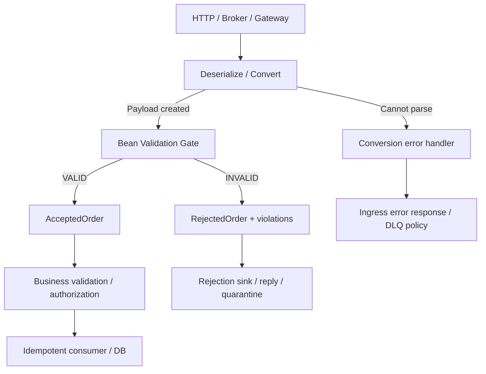
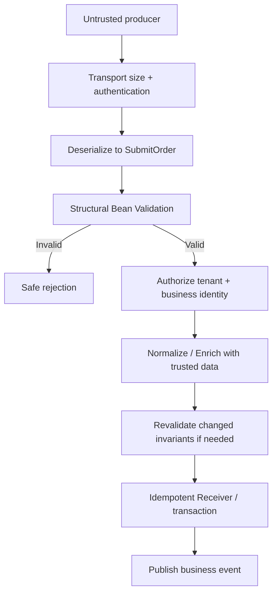

# Bean Validation on Payloads

## 1. Why Validate Payloads Before Sending Messages to Business Logic?

A sales application receives a `SubmitOrder` message from HTTP, a broker, or a Gateway. The payload contains an order ID, a list of product lines, and a customer-submitted total amount. If a line has an empty SKU, a negative quantity, or a total that does not match the lines, letting the message go straight to the consumer can cause database errors, miscalculate charges, or create business effects that must be rolled back.

```text
SubmitOrder:
  orderId = "ORD-105"
  lines = [
    {sku: "SKU-A", quantity: 2, unitPrice: 25.00},
    {sku: "",      quantity: -1, unitPrice: 10.00}
  ]
  declaredTotal = 60.00

Desired outcome:
  - Do not call OrderApplicationService
  - Return REJECTED status with actionable violation codes
  - Preserve trackingId for request/reply correlation
  - Do not swallow the message or infinitely retry the same bad input
```

**Bean Validation** (Jakarta Validation) lets you describe constraints on Java objects using annotations such as `@NotBlank`, `@NotNull`, `@Positive`, and `@Valid`, and then check them using a `Validator`. In Spring Integration, you can place this validation step **before** Transformers with side effects, Service Activators, business Routers, or data-writing Consumers.

This lesson belongs to the **Message filter and validation** chapter of the **SPRING_INTEGRATION_PATTERN** module. The module aims to implement Enterprise Integration Patterns (EIP) with Spring Integration to build loosely coupled, extensible message flows; combining Router, Filter, Transformer, Splitter, Aggregator, Gateway, retry, error channel, and correlation, while testing and observing every processing branch.



**Key takeaway:** Bean Validation verifies the **payload data contract**. It does not replace sender authentication, tenant authorization, external state lookups, or the atomicity of a business transaction.

## 2. Distinguishing Validation, Filter, Conversion, and Authorization

Concepts that are easily confused:

| Layer | Question | Example | Response |
| --- | --- | --- | --- |
| **Message conversion** | Can bytes/JSON be converted into an object? | JSON missing brace, wrong type | Conversion error; no bean exists to validate yet |
| **Bean Validation** | Does the object follow structural/value constraints? | Blank SKU, negative quantity, empty lines | Invalid outcome or validation exception |
| **Content-Based Filter** | Should the message continue based on a criterion? | Accept only `ORDER` event types | Accept/discard/route per contract |
| **Business validation** | Does current business state allow this? | Expired payment, insufficient stock | Business reject or retry depending on cause |
| **Authorization** | Does the principal have permission for the operation? | Tenant A modifying tenant B's order | Deny, security audit |
| **Idempotent Receiver** | Has this event already been processed? | Broker delivers the same eventId twice | Prevent duplicate side effects |
| **Infrastructure error** | Are the DB, broker, or API available? | PostgreSQL timeout | Retry/backoff/error channel per policy |

For instance, `@Positive` checks `quantity > 0` but does **not** tell you whether stock is available. `@NotBlank tenantId` checks that the string is non-empty but does **not** prove the caller is authorized to represent that tenant.

### 2.1. Bean Validation Does Not Run Automatically Just Because Annotations Exist

Simply putting `@NotBlank` on a field does not make Spring Integration automatically reject every bad message. Validation must be **triggered** in one of these ways:

- Calling `jakarta.validation.Validator.validate(payload)` in a validation step.
- Using method validation through a Spring proxy/interceptor when enabled and invoked through the proxy.
- Using an adapter/inbound boundary that supports validation and is configured to run it.

`@Valid` marks **cascaded validation**, but it does not replace calling `Validator`. Nor should you assume that a `@ServiceActivator` method or `IntegrationFlow.handle(...)` is validated just because a parameter carries `@Valid`.

### 2.2. Spring Boot 3+ and the Jakarta Namespace

In Spring Framework 6 / Spring Boot 3 and above, use annotations and interfaces in the **`jakarta.validation.*`** namespace. For example:

```java
import jakarta.validation.Valid;
import jakarta.validation.constraints.NotBlank;
import jakarta.validation.constraints.NotNull;
import jakarta.validation.constraints.Positive;
import jakarta.validation.constraints.Size;
```

Running validation at runtime requires a Jakarta Validation **provider** implementation (commonly Hibernate Validator). With Spring Boot, the convenient dependency is `spring-boot-starter-validation`. Having only the annotation API without a provider can cause errors when initializing the factory.

Systems on Spring Boot 2 / Javax Validation use the `javax.validation.*` namespace; do not randomly mix the two annotation/provider families. Code in this lesson assumes Java 17+ and compatible Spring Boot 3+/Spring Integration versions.

## 3. Bean Validation on Java Records: From Simple Fields to Nested Lists

We model an order consisting of multiple order lines.

### 3.1. Defining `OrderLine`

```java
import java.math.BigDecimal;
import jakarta.validation.constraints.DecimalMin;
import jakarta.validation.constraints.Digits;
import jakarta.validation.constraints.NotBlank;
import jakarta.validation.constraints.NotNull;
import jakarta.validation.constraints.Pattern;
import jakarta.validation.constraints.Positive;

record OrderLine(
        @NotBlank
        @Pattern(regexp = "[A-Z0-9-]{1,32}")
        String sku,

        @Positive
        int quantity,

        @NotNull
        @DecimalMin("0.00")
        @Digits(integer = 12, fraction = 2)
        BigDecimal unitPrice) {}
```

| Annotation | Meaning | What to remember |
| --- | --- | --- |
| `@NotBlank` | Non-null string, not whitespace-only | Use for required codes/names |
| `@Pattern` | Value matches regex | `@Pattern` alone allows null, so pair with `@NotBlank` |
| `@Positive` | Number greater than 0 | With primitive `int`, missing fields default to 0 during deserialization and can be caught |
| `@NotNull` | Must not be null | Does not verify String/collection contents |
| `@DecimalMin("0.00")` | Non-negative value | If unitPrice must be positive, use `"0.01"` or an exclusive rule |
| `@Digits` | Limits integer/fractional digits | Does not replace currency/rounding logic |

**Choose `BigDecimal` for prices** to avoid binary floating-point inaccuracy from `double`. When computing totals, use `BigDecimal.multiply(BigDecimal.valueOf(quantity))` and `add`; do not convert via `double`.

### 3.2. Defining `SubmitOrder` and Nested Validation

```java
import java.math.BigDecimal;
import java.util.List;
import jakarta.validation.Valid;
import jakarta.validation.constraints.DecimalMin;
import jakarta.validation.constraints.Digits;
import jakarta.validation.constraints.NotBlank;
import jakarta.validation.constraints.NotNull;
import jakarta.validation.constraints.Size;

@ConsistentOrderTotal
record SubmitOrder(
        @NotBlank String tenantId,
        @NotBlank String orderId,
        @NotBlank String eventId,

        @NotNull
        @Size(min = 1, max = 100)
        List<@NotNull @Valid OrderLine> lines,

        @NotNull
        @DecimalMin("0.00")
        @Digits(integer = 12, fraction = 2)
        BigDecimal declaredTotal) {}
```

Three independent rules on the list:

1. `@NotNull`: the list itself cannot be null.
2. `@Size(min=1,max=100)`: size within the allowed range.
3. `List<@NotNull @Valid OrderLine>`: each element cannot be null and must be deeply validated against `OrderLine`'s constraints.

If you only put `@Valid` on a field and forget `@NotNull`, a null field **does not automatically produce a violation**: Jakarta Validation generally treats null as valid for many constraints unless `@NotNull` is present.

If you only validate `SubmitOrder` without cascading `@Valid` on the list element, errors like an empty `lines[1].sku` can go undetected when validating the parent object.

### 3.3. Cases Learners Should Try

```text
Case A: lines = null
  -> NotNull

Case B: lines = []
  -> Size

Case C: lines = [null]
  -> NotNull on list element

Case D: lines = [OrderLine(sku="", quantity=-3, unitPrice=null)]
  -> NotBlank / Pattern / Positive / NotNull

Case E: lines = [OrderLine(sku="SKU-A", quantity=2, unitPrice=25.00)]
        declaredTotal = 50.00
  -> valid

Case F: same line, declaredTotal = 40.00
  -> cross-field inconsistency
```

One invalid value can produce **multiple `ConstraintViolation`s**—for example, SKU `""` violates both `@NotBlank` and `@Pattern`. Do not rely on the provider's default violation count or ordering to build an error response protocol; normalize/sort them if your API requires deterministic output.

## 4. Object-Level Constraints: Total Must Match Order Lines

Built-in annotations handle local field constraints. However, the condition:

```text
declaredTotal == sum(line.unitPrice * line.quantity)
```

requires **cross-field validation**. We define a custom type-level annotation.

### 4.1. Creating the Constraint Annotation

```java
import java.lang.annotation.ElementType;
import java.lang.annotation.Retention;
import java.lang.annotation.RetentionPolicy;
import java.lang.annotation.Target;
import jakarta.validation.Constraint;
import jakarta.validation.Payload;

@Target(ElementType.TYPE)
@Retention(RetentionPolicy.RUNTIME)
@Constraint(validatedBy = ConsistentOrderTotalValidator.class)
public @interface ConsistentOrderTotal {
    String message() default "TOTAL_MISMATCH";
    Class<?>[] groups() default {};
    Class<? extends Payload>[] payload() default {};
}
```

In a Java project, a `public` interface typically resides in its own file `ConsistentOrderTotal.java`; here the code is organized by section for readability.

### 4.2. A Side-Effect-Free `ConstraintValidator`

```java
import java.math.BigDecimal;
import jakarta.validation.ConstraintValidator;
import jakarta.validation.ConstraintValidatorContext;

public final class ConsistentOrderTotalValidator
        implements ConstraintValidator<ConsistentOrderTotal, SubmitOrder> {

    @Override
    public boolean isValid(
            SubmitOrder order,
            ConstraintValidatorContext context) {

        if (order == null
                || order.lines() == null
                || order.declaredTotal() == null) {
            return true; // Let @NotNull report missing fields.
        }

        BigDecimal expected = BigDecimal.ZERO;
        for (OrderLine line : order.lines()) {
            // Avoid NPE; OrderLine constraints report their own errors.
            if (line == null
                    || line.unitPrice() == null
                    || line.quantity() <= 0) {
                return true;
            }
            expected = expected.add(
                    line.unitPrice().multiply(
                            BigDecimal.valueOf(line.quantity())));
        }

        if (expected.compareTo(order.declaredTotal()) == 0) {
            return true;
        }

        context.disableDefaultConstraintViolation();
        context.buildConstraintViolationWithTemplate("TOTAL_MISMATCH")
                .addPropertyNode("declaredTotal")
                .addConstraintViolation();
        return false;
    }
}
```

**Why `compareTo` instead of `equals`?** Two `BigDecimal` values `BigDecimal("50.0")` and `BigDecimal("50.00")` are numerically equal but have different scales; `compareTo == 0` performs numerical comparison. If the contract requires a fixed scale per currency, add a dedicated rule.

**Why temporarily return `true` for null child data or invalid quantities?** The goal is to avoid masking root errors with a `NullPointerException` or a noisy `TOTAL_MISMATCH` code. Local constraints report null/quantity errors; the total rule only evaluates when all inputs needed for calculation are valid. When multiple cross-field rules depend on one another, validation groups/group sequences can enforce ordering, but never turn a `ConstraintValidator` into a database query workflow.

### 4.3. Cross-Field Rules Do Not Replace Authorization

Even if the customer-submitted total matches each line's `unitPrice`, **never trust a client-declared `unitPrice` as the authorized billing price**. After Bean Validation, the business service must fetch verified pricing or validate a quote/version from a trusted source. Validation only proves **internal payload consistency against the contract**, not authorization or current data accuracy.

## 5. Initializing Jakarta Validator and Interpreting Results

In a Spring Boot 3+ application with `spring-boot-starter-validation`, a `jakarta.validation.Validator` is typically auto-configured. In plain Spring Framework, you can use `LocalValidatorFactoryBean`:

```java
import org.springframework.context.annotation.Bean;
import org.springframework.context.annotation.Configuration;
import org.springframework.validation.beanvalidation.LocalValidatorFactoryBean;

@Configuration
class BeanValidationConfiguration {
    @Bean
    LocalValidatorFactoryBean jakartaValidator() {
        return new LocalValidatorFactoryBean();
    }
}
```

`LocalValidatorFactoryBean` integrates the Jakarta Validation provider with Spring. This configuration is **an alternative** to Boot autoconfiguration; if Boot already provides a suitable validator, do not register a duplicate bean.

You can invoke it directly:

```java
import jakarta.validation.ConstraintViolation;
import jakarta.validation.Validator;
import java.util.Set;

Set<ConstraintViolation<SubmitOrder>> violations =
        validator.validate(order);

if (violations.isEmpty()) {
    // Data satisfies the active Bean Validation constraints.
} else {
    // Produce outcome / exception according to flow policy.
}
```

**`Validator.validate(...)` returns a `Set<ConstraintViolation>`.** It **does not automatically throw `ConstraintViolationException` simply because the payload is invalid**. That exception appears when the application explicitly throws it or via configured method validation; distinguish it from internal provider errors.

### 5.1. Information Commonly Read from a Violation

```java
violation.getPropertyPath();       // e.g., lines[1].sku
violation.getMessage();            // Interpolated/i18n message
violation.getConstraintDescriptor()
         .getAnnotation().annotationType().getSimpleName();
violation.getInvalidValue();       // May contain sensitive values!
```

In public outputs, use **bounded field paths and stable error codes**; do not log `getInvalidValue()` by default or return raw objects/exceptions to clients. Violation messages may be interpolated by locale and contain data that should not be exposed.

### 5.2. A Validator Is Not a Sanitizer/Fixer

Jakarta Validation by default answers **valid/violated**, and does not automatically:
- Trim all strings.
- Replace an empty SKU with a default SKU.
- Convert currencies or round unit prices.
- Verify tenant permissions.
- Generate a new eventId or preserve a stable ID across retries.

If normalization is desired, place a **pure, approved, and tested** Transformer step before validation (for example, normalizing an SKU code by convention), then validate the **post-normalization object**. Never alter financial values by guessing.

## 6. Designing a Validation Gate: Classify Instead of Losing Messages

A Filter returning only `true/false` may work for simple pass-through decisions, but for malformed input you usually want to keep the **rejection reasons** to reply to a Gateway, write audits, or move to quarantine. We produce an outcome for every deserialized payload.

### 6.1. Typed Outcomes

```java
import java.util.List;

sealed interface ValidationOutcome
        permits AcceptedOrder, RejectedOrder {}

record AcceptedOrder(SubmitOrder order)
        implements ValidationOutcome {}

record ValidationIssue(String fieldPath, String errorCode) {}

record RejectedOrder(
        String trackingId,
        List<ValidationIssue> issues)
        implements ValidationOutcome {
    RejectedOrder {
        issues = List.copyOf(issues);
        if (trackingId == null || trackingId.isBlank()
                || issues.isEmpty()) {
            throw new IllegalArgumentException("Invalid rejection");
        }
    }
}
```

`AcceptedOrder` holds the payload that passed all constraints; `RejectedOrder` **does not contain the raw order payload** and only keeps a trusted tracking ID plus a normalized list of error codes. If business operations need to replay the original for correction, store the payload in a store with access control and retention, and pass a reference ID instead of publishing it onto an unprotected error channel.

### 6.2. A Gate Calling Validator Once and Producing Deterministic Outcomes

```java
import java.util.Comparator;
import java.util.Objects;
import jakarta.validation.Validator;
import org.springframework.stereotype.Component;

@Component
final class OrderValidationGate {

    private final Validator validator;

    OrderValidationGate(Validator validator) {
        this.validator = validator;
    }

    ValidationOutcome classify(SubmitOrder order, String trackingId) {
        Objects.requireNonNull(order, "order");
        if (trackingId == null || trackingId.isBlank()) {
            throw new IllegalArgumentException(
                    "Missing trusted ingress tracking ID");
        }

        var violations = validator.validate(order);
        if (violations.isEmpty()) {
            return new AcceptedOrder(order);
        }

        var issues = violations.stream()
                .map(v -> new ValidationIssue(
                        v.getPropertyPath().toString(),
                        v.getConstraintDescriptor()
                                .getAnnotation()
                                .annotationType()
                                .getSimpleName()))
                .distinct()
                .sorted(Comparator
                        .comparing(ValidationIssue::fieldPath)
                        .thenComparing(ValidationIssue::errorCode))
                .limit(20)
                .toList();

        return new RejectedOrder(trackingId, issues);
    }
}
```

Sorting ensures outputs and tests do not depend on the provider's violation iteration order. Limiting to 20 issues avoids oversized responses; production should add a `truncated` flag or `totalViolationCount` if clients need to know the list was truncated. Do not include `invalidValue` or full Bean Validation exceptions inside `RejectedOrder`.

**A trusted tracking ID source is essential:** an invalid payload may have `eventId=""`, so do not rely solely on a field currently being validated to trace rejections. `trackingId` should be issued at ingress/adapter and passed via a controlled header, scoped by tenant when appropriate.

### 6.3. Errors That Must Not Become a `RejectedOrder`

If `validator.validate(order)` throws because the provider is broken, a custom validator has a bug, or a dependency is missing, that is a **processing/infrastructure failure**, not a confirmed data violation. Do not use `catch(Exception)` to route every exception into the rejected branch and ACK it as "bad payload".

Likewise, JSON that fails to parse into `SubmitOrder` is usually intercepted **before** the gate is called; it requires a conversion-error policy at the inbound adapter.

## 7. Spring Integration: Connecting Transformer, Router, and Handlers

In the example we configure two explicit stages:

```text
orders.raw
  -> OrderValidationTransformer
  -> orders.validation.outcomes
  -> OrderOutcomeRouter
      -> orders.accepted -> OrderApplicationService
      -> orders.rejected -> RejectionSink
```

Messages carrying the raw payload are only allowed into trusted steps of the validation boundary. The rejected branch carries only the sanitized `RejectedOrder`.

### 7.1. Transformer Passing Message Payload to the ValidationGate

```java
import org.springframework.integration.annotation.Transformer;
import org.springframework.messaging.Message;
import org.springframework.stereotype.Component;

@Component
final class OrderValidationTransformer {
    private final OrderValidationGate gate;

    OrderValidationTransformer(OrderValidationGate gate) {
        this.gate = gate;
    }

    @Transformer(
            inputChannel = "orders.raw",
            outputChannel = "orders.validation.outcomes")
    public ValidationOutcome validate(Message<SubmitOrder> message) {
        Object rawId = message.getHeaders().get("ingressTrackingId");
        if (!(rawId instanceof String trackingId)
                || trackingId.isBlank()) {
            throw new IllegalArgumentException(
                    "Missing trusted ingressTrackingId");
        }

        return gate.classify(message.getPayload(), trackingId);
    }
}
```

`@Transformer` processes one message and emits the outcome payload. It has no business side effects. In the example, the incoming `Message<SubmitOrder>` must be constructed by an adapter/producer **whose headers are controlled**; an untrusted caller must not inject arbitrary `ingressTrackingId` or tenant authorization headers that the framework blindly trusts.

**Header propagation warning:** Spring Integration propagates headers across message-producing endpoints. Even though `RejectedOrder` strips the raw payload, an inbound header containing sensitive data can still be copied onto the outcome message. You must **allowlist, strip, or sanitize headers** at the ingress/routing boundary before sending rejected messages to external brokers, logs, or quarantine.

### 7.2. Router Selecting the Branch by Outcome

```java
import org.springframework.integration.annotation.Router;
import org.springframework.stereotype.Component;

@Component
final class OrderOutcomeRouter {

    @Router(inputChannel = "orders.validation.outcomes")
    public String destination(ValidationOutcome outcome) {
        if (outcome instanceof AcceptedOrder) {
            return "orders.accepted";
        }
        if (outcome instanceof RejectedOrder) {
            return "orders.rejected";
        }
        throw new IllegalStateException("Unknown validation outcome");
    }
}
```

`@Router` selects the **channel name**. Having a dedicated rejected branch is better than silently dropping: you can return a 400/422 error to a Gateway or record audit/quarantine entries, and avoid leaving a downstream Aggregator waiting for a missing message without a completion signal.

### 7.3. Business and Rejection Handlers

```java
import org.springframework.integration.annotation.ServiceActivator;
import org.springframework.stereotype.Component;

interface OrderApplicationService {
    void submit(SubmitOrder order);
}

interface RejectionSink {
    void record(RejectedOrder rejection);
}

@Component
final class AcceptedOrderHandler {
    private final OrderApplicationService service;

    AcceptedOrderHandler(OrderApplicationService service) {
        this.service = service;
    }

    @ServiceActivator(inputChannel = "orders.accepted")
    public void accept(AcceptedOrder result) {
        // Bean Validation passed; still need authorization,
        // business rules, and idempotency inside the service.
        service.submit(result.order());
    }
}

@Component
final class RejectedOrderHandler {
    private final RejectionSink sink;

    RejectedOrderHandler(RejectionSink sink) {
        this.sink = sink;
    }

    @ServiceActivator(inputChannel = "orders.rejected")
    public void reject(RejectedOrder result) {
        sink.record(result);
    }
}
```

`OrderApplicationService` and `RejectionSink` are interfaces illustrating separation of responsibilities. The application must provide concrete beans: a business service with transactions/idempotency, and a rejection sink with security, retention, and durability policies. **A `DirectChannel` does not make rejections durable by itself**.

### 7.4. Declaring Channels

```java
import org.springframework.context.annotation.Bean;
import org.springframework.context.annotation.Configuration;
import org.springframework.integration.channel.DirectChannel;
import org.springframework.integration.config.EnableIntegration;
import org.springframework.messaging.MessageChannel;

@Configuration
@EnableIntegration
class OrderMessagingChannels {

    @Bean("orders.raw")
    MessageChannel raw() {
        return new DirectChannel();
    }

    @Bean("orders.validation.outcomes")
    MessageChannel outcomes() {
        return new DirectChannel();
    }

    @Bean("orders.accepted")
    MessageChannel accepted() {
        return new DirectChannel();
    }

    @Bean("orders.rejected")
    MessageChannel rejected() {
        return new DirectChannel();
    }
}
```

Using `DirectChannel` allows unit/integration tests to demonstrate a synchronous processing path. To run the example in a real application, register the `@Component` beans (via component scanning or `@Import`), the Validator provider, and implementations for both interfaces.

**This topology is one-way.** It does not automatically return a response to a waiting Messaging Gateway; if request–reply is needed, design a reply channel/result for both accepted and rejected cases rather than writing to two `void` terminal handlers and expecting the Gateway to receive a response.

## 8. When to Use a Message Filter Directly?

If the business requirement only needs to let one kind of data pass and intentionally **drop** everything else, Spring Integration provides the Filter endpoint. A simple example:

```java
import jakarta.validation.Validator;
import org.springframework.context.annotation.Bean;
import org.springframework.context.annotation.Configuration;
import org.springframework.integration.channel.DirectChannel;
import org.springframework.integration.config.EnableIntegration;
import org.springframework.integration.dsl.IntegrationFlow;
import org.springframework.messaging.MessageChannel;

// Demonstrates the Filter API only; do not wire alongside
// the orders.raw topology from section 7.
@Configuration
@EnableIntegration
class SimpleOrderFilterFlow {

    @Bean("orders.filter.input")
    MessageChannel filterInput() {
        return new DirectChannel();
    }

    @Bean("orders.filter.valid")
    MessageChannel filterOutput() {
        return new DirectChannel();
    }

    @Bean
    IntegrationFlow simplePayloadFilter(Validator validator) {
        return IntegrationFlow.from("orders.filter.input")
                .filter(SubmitOrder.class,
                        order -> validator.validate(order).isEmpty(),
                        spec -> spec.throwExceptionOnRejection(true))
                .channel("orders.filter.valid")
                .get();
    }
}
```

This configuration creates both `orders.filter.input` and `orders.filter.valid`; when running for real, **a consumer must be subscribed to the output channel**. `throwExceptionOnRejection(true)` makes the filter raise an error when the predicate returns false instead of silently discarding by default. It **does not automatically produce a detailed violation list**; therefore, when reasons, audits, or structured responses are needed, use a validation gate/outcome as in sections 6–7.

If the goal is **policy-based filtering** (e.g., accepting only `ORDER` events), a Filter may fit well. If the goal is **validating a payload contract and reporting errors**, collapsing both into a boolean predicate usually loses crucial information.

### 8.1. A Filter Is Not a Validator

```text
Filter predicate:
  input -> true/false

Bean Validator:
  input -> Set<ConstraintViolation<T>>

Validation Gate:
  input + trusted tracking metadata -> Accepted / Rejected(details)
```

A Filter can call a Validator internally, but because it collapses the result into a boolean, you must explicitly choose how rejected messages are handled. In particular, if a Filter sits before an Aggregator, silently dropping items can make the Aggregator wait forever for the initial `sequenceSize`.

## 9. Where Does Validation Belong in a Multi-EIP Pipeline?

The placement of validation affects how much work is performed before detecting an error and how recovery works.

### 9.1. Validate as Close to the Trust Boundary as Possible



This ordering reduces the risk of a malformed payload being used in a Router, Transformer, database query, or HTTP call before being rejected. However, if normalization is an intentional pure step (for example, trimming SKUs per contract), you can normalize **before** validation and then validate the normalized data. Both approaches must clearly specify **which version** of the object is validated.

### 9.2. Validation Is Not Permanently Valid After a Transformer

Suppose `SubmitOrder` was initially valid, but a later Transformer:
- Converts prices using an invalid exchange rate;
- Merges lines incorrectly;
- Builds another DTO while omitting a required field;
- Changes the tenant ID;
- Drops correlation headers.

The `@Valid` pass at ingress **does not prove the new object is still valid**. Additional validation may be needed for outbound models or post-enrichment business invariants. Do not scatter the same heavy validation across every endpoint without reason; clearly identify trust boundaries and points where data acquires a new contract.

### 9.3. Interaction with Splitter and Aggregator

If a batch has 5 elements, 2 are rejected by the validator, and the Aggregator only receives 3 accepted outcomes:

```text
Splitter:   5 input lines, expected sequence size = 5
Validator:  3 accepted, 2 rejected
Aggregator: only sees accepted branch -> receives 3

If Aggregator waits for 5: the group may never complete.
```

There are at least two valid patterns:

1. **Aggregate all outcomes:** both accepted and rejected emit statuses so the Coordinator/Aggregator accounts for all 5 results and reports batch COMPLETED/PARTIAL/FAILED.
2. **Aggregate accepted only:** the Coordinator supplies a trusted `acceptedCount` or explicit completion marker instead of waiting for the original `sequenceSize`.

Never silently `filter(valid)` while forgetting to update the release condition. When a malformed element is rejected, the `sourceIndex` of the remaining items should still be preserved for source reconciliation.

### 9.4. Interaction with a Gateway

If a `@MessagingGateway` is waiting for a reply and a Filter silently drops an invalid request, the caller may only see a **timeout** even though the root cause was an immediate validation failure.

A request–reply design should define:
- The valid branch returns `OrderAcceptedReply` or the corresponding result;
- The invalid branch returns `OrderRejectedReply` containing normalized reason codes;
- Infrastructure errors follow an error path/exception contract;
- Timeouts are reserved for genuine progress issues.

The topology in section 7 uses two `void` terminal handlers and is **not a complete request–reply Gateway implementation**. To support a Gateway, design an explicit reply join/routing step and preserve the reply context per your configuration, rather than sending failure messages to a one-way channel and leaving the caller hanging.

## 10. Different Error Behaviors: Reject, Discard, Throw

When validation fails, there is no single default policy suitable for every domain.

| Policy | Handling | When appropriate | Risk |
| --- | --- | --- | --- |
| **Reject outcome** | Build `RejectedOrder` with error codes and tracking ID | Public APIs, data imports, reconciliation required | Must protect sensitive error details |
| **Audited discard** | Do not forward, but log reason/metric | Intentionally ignored data needing no reply | Easy to lose messages if discard handler is forgotten |
| **Throw validation exception** | Endpoint throws an error | Synchronous ingress returning 4xx or transactional reject | Brokers may retry forever if unclassified |
| **Quarantine** | Store error and input reference for fix/replay | Batch ETL, ingestion contracts | Requires durable storage and access control |
| **Fail whole batch** | Reject all if one element fails | Transactions needing whole-batch integrity | Valid items are not processed |
| **Partial accept** | Process valid items, isolate invalid ones | Large imports with partial-success policy | Needs summary/counts and per-item idempotency |

**Bean Validation violations are usually deterministic data errors.** Retrying the exact same payload under the same schema/rules will not make it valid. Conversely, a database timeout inside `OrderApplicationService` can recover and warrants bounded retry.

### 10.1. `ConstraintViolationException` and `MessageRejectedException`

- When calling `validator.validate(payload)` manually, the result is a set of violations; the application **can explicitly** build an outcome or throw `ConstraintViolationException`.
- Method validation via Spring AOP may throw validation-related exceptions depending on configuration and version.
- A Filter with `throwExceptionOnRejection(true)` typically throws `MessageRejectedException` when the predicate returns false; it does not automatically produce a detailed `ConstraintViolation` report.
- If a custom `ConstraintValidator` has a bug and throws `NullPointerException`, that is **not** a signal that a user-submitted invalid payload was cleanly classified.

Do not use a single `catch (Exception) { return rejected; }` block for validation failures, application bugs, and store outages alike.

### 10.2. Error Channel and Retries Depend on the Endpoint

With a `DirectChannel`, synchronous errors can propagate back to the sender. With a poller, executor, or broker, the error handler may wrap exceptions into an `ErrorMessage` on `errorChannel` depending on configuration.

However, `errorChannel` **does not automatically provide**:
- Durable storage of the input copy;
- A dead-letter queue;
- Classification of permanent vs transient failures;
- Proper ACK/NACK semantics for each broker;
- A reply returned to a waiting Gateway;
- Consumer idempotency.

To prevent malformed messages from causing retry storms, explicitly configure error classification/handling at the inbound adapter along with terminal reject/quarantine policies. An unexpected provider error must not be ACKed as bad input data.

### 10.3. A Practical Error Taxonomy

```text
JSON_PARSE_FAILED        -> conversion error
PAYLOAD_CONSTRAINT_FAIL  -> Bean Validation reject
UNAUTHORIZED_TENANT      -> authorization deny
ORDER_ALREADY_PROCESSED  -> idempotency / stored outcome
OUT_OF_STOCK             -> business rule decision
DB_TIMEOUT               -> transient retry
VALIDATOR_RUNTIME_ERROR  -> application/infrastructure failure
GATEWAY_TIMEOUT          -> request-reply deadline
```

The codes above are **suggested application conventions**, not default exception classes thrown automatically by Spring Integration. An error taxonomy keeps logs, metrics, API responses, and DLQ/recovery consistent.

## 11. `@Validated`, Method Validation, and Proxy Limitations

Spring can support method-level validation:

```java
import jakarta.validation.Valid;
import jakarta.validation.constraints.NotNull;
import org.springframework.stereotype.Service;
import org.springframework.validation.annotation.Validated;

@Service
@Validated
class MethodValidatedOrderService {

    public void submit(@NotNull @Valid SubmitOrder order) {
        // Execute business logic.
    }
}
```

Method validation only takes effect **when the proper interceptor/proxy is configured and the method is called through the proxy**. Common pitfalls:

1. Calling from another method **on the same object** can bypass the Spring AOP proxy (*self-invocation*).
2. Methods invoked via mechanisms that bypass the proxy may not be validated.
3. Not every message handler or Java DSL lambda is automatically AOP-validated.
4. Throwing exceptions at the service layer may cause the broker to retry malformed data if upstream layers do not classify it.
5. If a method takes `Message<SubmitOrder>` and only puts `@Valid` on the message wrapper, do not assume the provider will traverse into the payload without proper type-level cascading.

Therefore, for the purposes of this lesson, an **explicit Validation Gate using `Validator.validate(payload)`** is more observable, easier to test, and less coupled to self-invocation/proxy mechanics. Method validation remains useful as a defensive layer at service boundaries.

### 11.1. Spring Validator Differs from Jakarta Validator

Spring Framework also has `org.springframework.validation.Validator`, which records errors into `Errors`, whereas Jakarta Validation uses `jakarta.validation.Validator`, which returns `Set<ConstraintViolation<T>>`. They can integrate through `LocalValidatorFactoryBean`, but they are **not the same interface**.

In this lesson's examples, all Gate and Unit test code uses `jakarta.validation.Validator`. Watch IDE auto-imports to avoid calling the wrong method or misinterpreting exception types.

## 12. Validation Groups and Contract Changes Across Workflows

A payload may move through multiple states: order creation, order update, approval, completion. Not every constraint applies identically at every step.

### 12.1. Two Example Groups

```java
interface OnCreate {}
interface OnApprove {}
```

An example approval DTO with different constraints:

```java
import jakarta.validation.constraints.NotBlank;
import jakarta.validation.constraints.NotNull;

record ApprovalCommand(
        @NotBlank(groups = {OnCreate.class, OnApprove.class})
        String orderId,

        @NotNull(groups = OnApprove.class)
        String approverId) {}
```

Invoking:

```java
var issuesWhenCreated =
        validator.validate(command, OnCreate.class);

var issuesWhenApproved =
        validator.validate(command, OnApprove.class);
```

**Easy mistake to make:** When calling `validate(bean, OnApprove.class)`, constraints belonging only to the `Default` group **do not run automatically** unless group inheritance/sequences are configured. Switching an entire flow to groups while forgetting `Default` can accidentally skip previously required constraints.

### 12.2. Do Not Use Groups to Silently "Paper Over" Schema Versions

If producer v1 did not send a field that producer v2 requires, define an explicit version contract:
- Select the schema version from a verified source;
- Convert the old version to the new model using explicit rules;
- Validate the converted model;
- Record the version used for audit/replay;
- Reject unsupported versions instead of randomly disabling validation.

Messages from two producer versions should not be handled by turning off arbitrary constraints just to keep the flow green. Doing so can hide severe contract bugs.

### 12.3. Do Cross-Field Rules Need a Database?

A `ConstraintValidator` is best kept **pure, fast, and side-effect-free**. Never query a database for stock levels, user permissions, or order status inside Bean Validation constraints: it couples validation unpredictably to I/O, latency, transactions, and retries.

Separate the layers:

```text
Bean Validation:
  structure, formats, value ranges, internally consistent declared total

Business validation:
  inventory, valid quote, order status, credit limits

Authorization:
  is the principal permitted to submit orders for this tenant?

Idempotent Receiver:
  has this logical event already committed?
```

## 13. Validation and Duplicate Delivery

Suppose a broker delivers two copies of the same event. Both carry valid payloads. If you only validate and call the service, side effects can still execute twice.

```text
Delivery #1 -> Bean Validation PASS -> stock reservation COMMITTED
Delivery #2 -> Bean Validation PASS -> stock reservation may run again
```

**Bean Validation does not make message processing idempotent.** After validation, an Idempotent Receiver or transactional Inbox keyed on a stable business key such as `(consumerName, tenantId, eventId)` is needed.

One reasonable ordering:

1. Deserialize and run basic input checks.
2. Authenticate the tenant and sender source.
3. Validate the payload contract.
4. Check business identity and hash/version if a duplicate is already recorded.
5. Perform an atomic claim + business update according to the idempotency contract.

In systems with events previously processed under an older schema, duplicate logic may need to check the stored snapshot/fingerprint before validating under the new schema—otherwise an event that **already completed validly in the past** could be rejected on replay due to newly changed rules. This rule must be explicitly designed and versioned; no single ordering fits every domain.

### 13.1. Should Validation Failures Record a Dedupe Key?

It depends on the contract:
- If an invalid payload is a terminal rejection and the system must return the **exact same rejection result** on retry, you may store the rejection outcome by event ID and schema version.
- If the input can be corrected and resent with the same event ID, a version/revision policy is needed; do not permanently mark a fixable ID as done.
- For transient validation provider errors, **do not** record them as final data decisions.
- If a payload shares the same key but has different content, treat it as a conflict; never silently return the old rejection.

Do not use a non-transactional "seen IDs" cache in place of a ledger requiring durability.

## 14. Testing Bean Validation and Custom Constraints with JUnit 5

### 14.1. Testing Without a Spring Context

You can bootstrap a provider via the Jakarta Validation API:

```java
import java.math.BigDecimal;
import java.util.List;
import jakarta.validation.Validation;
import jakarta.validation.Validator;
import jakarta.validation.ValidatorFactory;
import org.junit.jupiter.api.Test;

import static org.junit.jupiter.api.Assertions.*;

class SubmitOrderValidationTest {

    private static SubmitOrder validOrder() {
        return new SubmitOrder(
                "tenant-a",
                "ORD-105",
                "evt-order-105",
                List.of(new OrderLine(
                        "SKU-A", 2, new BigDecimal("25.00"))),
                new BigDecimal("50.00"));
    }

    @Test
    void acceptsValidNestedPayload() {
        try (ValidatorFactory factory =
                     Validation.buildDefaultValidatorFactory()) {
            Validator validator = factory.getValidator();

            assertTrue(validator.validate(validOrder()).isEmpty());
        }
    }

    @Test
    void rejectsMalformedLineAndWrongTotal() {
        try (ValidatorFactory factory =
                     Validation.buildDefaultValidatorFactory()) {
            Validator validator = factory.getValidator();

            var invalid = new SubmitOrder(
                    "tenant-a", "ORD-105", "evt-order-105",
                    List.of(new OrderLine(
                            "", -3, new BigDecimal("10.00"))),
                    new BigDecimal("70.00"));

            var errors = validator.validate(invalid);
            assertFalse(errors.isEmpty());

            var paths = errors.stream()
                    .map(v -> v.getPropertyPath().toString())
                    .toList();
            assertTrue(paths.stream()
                    .anyMatch(path -> path.contains("sku")));
            assertTrue(paths.stream()
                    .anyMatch(path -> path.contains("quantity")));
        }
    }

    @Test
    void reportsCrossFieldTotalMismatch() {
        try (ValidatorFactory factory =
                     Validation.buildDefaultValidatorFactory()) {
            var invalid = new SubmitOrder(
                    "tenant-a", "ORD-105", "evt-order-105",
                    List.of(new OrderLine(
                            "SKU-A", 2, new BigDecimal("25.00"))),
                    new BigDecimal("40.00"));

            var errors = factory.getValidator().validate(invalid);
            assertTrue(errors.stream()
                    .anyMatch(v -> "declaredTotal".equals(
                            v.getPropertyPath().toString())));
        }
    }
}
```

These tests illustrate three rule types: valid object, nested violation, and cross-field mismatch. To avoid depending on violation ordering, assert only the **presence** of expected paths/codes rather than asserting "what the first violation is".

### 14.2. Testing Null, Empty, and Over-Limit Cases

Additional cases:

| Input | Expected |
| --- | --- |
| `lines=null` | `NotNull` |
| `lines=[]` | `Size` |
| List with 101 lines | `Size` |
| `lines=[null]` | `NotNull` violation on element |
| SKU with forbidden characters | `Pattern` |
| Quantity = 0 | `Positive` |
| Unit price = null | `NotNull` |
| Unit price with >2 decimal digits | `Digits` |
| Negative `declaredTotal` | `DecimalMin` |
| `declaredTotal` != calculated sum | `ConsistentOrderTotal` |
| `eventId=""` | `NotBlank` |

**To construct a list containing null in tests**, do not use `List.of(null)` because Java throws `NullPointerException` when constructing the list; use `Arrays.asList((OrderLine) null)` or an appropriately built `ArrayList`. Also test deserialization: JSON with a wrongly typed field can be rejected before Bean Validation.

### 14.3. Testing That `ValidationGate` Does Not Leak Raw Payloads

```java
import java.math.BigDecimal;
import java.util.List;
import jakarta.validation.Validation;
import jakarta.validation.ValidatorFactory;
import org.junit.jupiter.api.Test;
import static org.junit.jupiter.api.Assertions.*;

class OrderValidationGateTest {

    @Test
    void invalidPayloadBecomesSanitizedRejectedOutcome() {
        try (ValidatorFactory factory =
                     Validation.buildDefaultValidatorFactory()) {
            var gate = new OrderValidationGate(
                    factory.getValidator());

            var invalid = new SubmitOrder(
                    "tenant-a", "ORD-105", "evt-order-105",
                    List.of(new OrderLine(
                            "", -1, new BigDecimal("25.00"))),
                    new BigDecimal("25.00"));

            ValidationOutcome outcome =
                    gate.classify(invalid, "ingress-track-105");

            assertInstanceOf(RejectedOrder.class, outcome);
            RejectedOrder rejection = (RejectedOrder) outcome;
            assertEquals("ingress-track-105", rejection.trackingId());
            assertFalse(rejection.issues().isEmpty());

            // RejectedOrder record does not hold SubmitOrder
            // or raw invalid field values.
            assertTrue(rejection.issues().stream()
                    .allMatch(issue -> !issue.errorCode().isBlank()));
        }
    }
}
```

Also test that valid payloads produce `AcceptedOrder`, error codes are sorted deterministically, issue counts are capped, and a missing `trackingId` raises an error rather than emitting an untraceable message.

## 15. Integration Testing Across Channels, Transformer, and Router

The unit tests above do not prove that Spring Integration routes valid/rejected messages properly or that the consumer is never called on bad input. An integration test exercising channels and annotations is required.

### 15.1. Test Configuration

Using the example beans from sections 5–7, a test class can register:
- `OrderMessagingChannels` with `@EnableIntegration`;
- `BeanValidationConfiguration` containing `LocalValidatorFactoryBean`;
- `OrderValidationGate`, `OrderValidationTransformer`, and `OrderOutcomeRouter`;
- Both handlers;
- Mock implementations for `OrderApplicationService` and `RejectionSink`.

```java
import org.junit.jupiter.api.AfterEach;
import org.junit.jupiter.api.Test;
import org.springframework.beans.factory.annotation.Autowired;
import org.springframework.beans.factory.annotation.Qualifier;
import org.springframework.context.annotation.Bean;
import org.springframework.context.annotation.Configuration;
import org.springframework.messaging.MessageChannel;
import org.springframework.messaging.support.MessageBuilder;
import org.springframework.test.context.junit.jupiter.SpringJUnitConfig;
import java.math.BigDecimal;
import java.util.List;

import static org.junit.jupiter.api.Assertions.*;
import static org.mockito.Mockito.*;

@SpringJUnitConfig(classes = {
        OrderMessagingChannels.class,
        BeanValidationConfiguration.class,
        OrderValidationGate.class,
        OrderValidationTransformer.class,
        OrderOutcomeRouter.class,
        AcceptedOrderHandler.class,
        RejectedOrderHandler.class,
        OrderValidationFlowIT.TestDependencies.class
})
class OrderValidationFlowIT {

    @Autowired
    @Qualifier("orders.raw")
    MessageChannel input;

    @Autowired
    OrderApplicationService applicationService;

    @Autowired
    RejectionSink rejectionSink;

    @AfterEach
    void resetMocks() {
        reset(applicationService, rejectionSink);
    }

    @Test
    void validOrderReachesBusinessHandler() {
        SubmitOrder order = order(
                "SKU-A", 2, "50.00");

        assertTrue(input.send(
                MessageBuilder.withPayload(order)
                        .setHeader("ingressTrackingId", "track-1")
                        .build()));

        verify(applicationService).submit(order);
        verifyNoInteractions(rejectionSink);
    }

    @Test
    void invalidOrderIsRejectedWithoutBusinessSideEffect() {
        SubmitOrder order = order(
                "", 0, "10.00");

        assertTrue(input.send(
                MessageBuilder.withPayload(order)
                        .setHeader("ingressTrackingId", "track-2")
                        .build()));

        verifyNoInteractions(applicationService);
        verify(rejectionSink).record(argThat(rejection ->
                "track-2".equals(rejection.trackingId())
                        && !rejection.issues().isEmpty()));
    }

    private static SubmitOrder order(
            String sku, int quantity, String total) {
        return new SubmitOrder(
                "tenant-a", "ORD-105", "evt-order-105",
                List.of(new OrderLine(
                        sku, quantity, new BigDecimal("25.00"))),
                new BigDecimal(total));
    }

    @Configuration
    static class TestDependencies {
        @Bean
        OrderApplicationService applicationService() {
            return mock(OrderApplicationService.class);
        }

        @Bean
        RejectionSink rejectionSink() {
            return mock(RejectionSink.class);
        }
    }
}
```

**Interpreting test results:** Because the sample channels are synchronous `DirectChannel`s, mock verification can run right after `send()`. If switched to an `ExecutorChannel`, poller, or broker, use an await/latch with a finite timeout and assert against committed state rather than immediate verification.

### 15.2. Other Important Integration Tests

| Scenario | Assertion |
| --- | --- |
| Valid order | Only accepted handler is invoked |
| Invalid nested field | Business handler not called; issue path present |
| Declared total mismatch | Custom constraint violation code present |
| Missing `ingressTrackingId` | Clear boundary error; does not pass as valid |
| Invalid JSON before deserialization | Conversion error handler runs; gate not called |
| Validator provider error | Infrastructure error, not ACKed as validation rejection |
| Rejection sink unavailable | Do not assume message was saved; retry/recovery |
| Gateway with invalid input | Clear rejection reply/exception, no silent timeout |
| Batch with 2 rejected / 3 accepted | Aggregator/Coordinator still accounts for all 5 |
| Redelivered message | Bean Validation passes but idempotent consumer avoids duplicate processing |
| Payload modified by Transformer | Post-transform validation verifies new invariants |
| Tenant header mismatches trusted principal | Authorization boundary rejects |
| Async adapter and error channel | Distinguishes terminal validation error from transient failure |
| Very large broker payload | Ingress size limit triggers before object construction |

Do not use a test with `@MockBean` or a mocked provider to conclude the entire Bean Validation engine works; include at least one test using the real provider. Similarly, Spring Integration annotation tests must register the actual endpoints rather than merely calling `validate()` directly.

## 16. Performance, Resource Limits, and Data Safety

### 16.1. Validation Can Be Used for Resource Exhaustion Attacks

An external message may contain:
- A list of millions of lines, even though `@Size(max=100)` reports a violation **after** the object has already been deserialized and allocated in memory.
- Very long strings that burn CPU during regex evaluation.
- Deeply nested object graphs or cyclic references.
- Too many violations making processing/sorting/error responses heavy.
- Tokens/PII inside fields that exception logging might accidentally leak.

Layers of defense are needed **before** Bean Validation:
1. Limit request body bytes at HTTP/broker adapters.
2. Limit JSON nesting depth and element counts during parsing if the converter supports it.
3. Use simple regexes and avoid catastrophic backtracking patterns on very long inputs.
4. Enforce input timeouts and rate limits.
5. Cap violations returned to callers.
6. Do not spawn a Thread/Task per error.
7. Monitor Validator latency and invalid message counts.

### 16.2. Fail Fast or Report Multiple Errors?

Two valid policies:

| Approach | Advantage | Trade-off |
| --- | --- | --- |
| Collect multiple violations | Client can fix multiple issues at once | Can use more time/memory |
| Provider/policy fail-fast | Stops on first failure, reduces load | Poorer form feedback; first error not guaranteed deterministic |
| Group/phase validation | Prioritizes basic contract before cross-field rules | Requires clear rule design; easy to miss Default group |

The example in this lesson caps the **response representation** at 20 issues, but the provider may still have computed many violations before the Gate truncates the list. Under truly heavy loads, restrict input size and consider provider-level fail-fast; do not confuse `stream.limit(20)` with bounding the work performed by the Validator.

### 16.3. Security and Log Structure

Log:
- Ingress-generated tracking ID, endpoint name;
- Message type and schema version;
- Violation codes such as `NotBlank`, `Positive`, `ConsistentOrderTotal`;
- Sanitized field paths;
- Violation count and validation duration;
- Trace/correlation ID per security policy.

Avoid logging:
- Full payloads;
- `ConstraintViolation.getInvalidValue()`;
- Raw error messages that may contain user-supplied values;
- Credentials, access tokens, payment card data;
- Unfiltered header maps;
- Request/event IDs as high-cardinality **metric labels**.

If invalid inputs must be reprocessed, store a reference in an access-controlled, encrypted quarantine store with retention instead of pushing raw bodies into metrics/logs.

## 17. Metrics and Operations

| Suggested metric | Meaning |
| --- | --- |
| `validation.requests.total` | Total payloads entering the gate |
| `validation.accepted.total` | Payloads passing validation |
| `validation.rejected.total` | Payloads with violations |
| `validation.rejected.by_constraint` | Distribution of constraint codes within a finite set |
| `validation.duration` | P50/P95/P99 validation duration |
| `validation.conversion.error` | Deserialization errors before the gate |
| `validation.provider.error` | Infrastructure errors inside Validator |
| `validation.rejection.sink.error` | Failures persisting rejection status |
| `validation.gateway.timeout` | Gateways timing out without a reply |
| `validation.batch.partial` | Batches having both accepted and rejected items |
| `validation.payload.too_large` | Inputs exceeding ingress size limits |
| `validation.business.side_effect.before_reject` | Alert metric indicating wrong pipeline ordering |

The metric names above are **application instrumentation suggestions**, not built-in names automatically exported by Spring Integration.

### 17.1. Interpreting Common Symptoms

| Symptom | Likely cause | Investigation path |
| --- | --- | --- |
| Invalid rate spikes after deploy | Contract/schema changed | Compare producer versions and rules |
| Gateway timeouts rise while handlers stay idle | Filter silently dropping | Inspect reject/reply path |
| Aggregator groups stuck | Invalid items dropped without outcomes | Check sequenceSize/release strategy |
| Provider errors rise | Missing dependency/custom validator bug | Check classpath/exception logs |
| Duplicate side effects despite passing validation | Missing idempotency | Inspect event key/transactions |
| High CPU in validation | Oversized payloads/heavy regexes | Inspect ingress limits |
| Rejected sink backlog grows | Quarantine store outage | Check retries and durability |

## 18. Common Design Mistakes

1. **Merely adding `@NotBlank` and assuming Spring Integration validates every payload.**
2. **Using `@Valid` while forgetting `@NotNull`**, allowing nulls to slip past other constraints.
3. **Forgetting cascaded `@Valid` inside a List**, missing child item errors.
4. **Using `@Pattern` alone** and being surprised that null is not flagged as a violation.
5. **Using `double` for money**, causing rounding errors and inexplicable mismatches.
6. **Failing to check cross-field invariants** between totals and lines.
7. **Calling DB/APIs inside a `ConstraintValidator`** and conflating infrastructure errors with invalid data.
8. **Having a Filter silently drop invalid requests**, causing Gateway timeouts.
9. **Having a Filter drop elements while the Aggregator still waits for the original `sequenceSize`**.
10. **Swallowing all exceptions and ACKing them as invalid payloads**, losing transient messages.
11. **Calling `Validator.validate(message)` on the wrapper** when the payload actually needs validation.
12. **Relying on `@Validated` across self-invocation**, bypassing the Spring proxy.
13. **Skipping tenant authorization because `@NotBlank tenantId` passed**, confusing validation with authorization.
14. **Omitting request size limits at ingress**, causing overload before `@Size` ever runs.
15. **Not versioning schemas/rules**, causing previously valid replays to be mysteriously rejected.
16. **Logging `getInvalidValue()`** or raw payloads onto unprotected error channels.
17. **Treating Bean Validation as idempotency**, executing duplicate side effects on broker redelivery.
18. **Returning non-deterministic error lists**, making tests and clients hard to reconcile.
19. **Copying sensitive headers onto rejected messages** even when the payload was stripped.
20. **Using a `void` consumer for the rejected branch** while expecting a request–reply Gateway to receive a result.
21. **Treating all violations as transient errors** and retrying infinitely.
22. **Skipping tests against the real provider** by mocking boolean predicates only.

## 19. Practice Exercises

**Exercise:** Design a pipeline receiving `InvoiceSubmitted` carrying `tenantId`, `eventId`, `invoiceId`, `lineItems`, `declaredTotal`, and `currency`. Some invoices arrive from an HTTP Gateway, others from a broker.

1. Create Java records and constraints for the invoice and line items.
2. Apply `@NotNull`, `@NotBlank`, `@Size`, `@Pattern`, `@Positive`, and `@Digits` where appropriate.
3. Ensure list items are deeply validated using `@Valid` and element `@NotNull`.
4. Create a custom constraint `@ConsistentInvoiceTotal` using `BigDecimal`.
5. Write a `ValidationGate` returning accepted/rejected outcomes without logging invalid values.
6. Design error codes and an ingress-issued tracking ID without depending on an `eventId` that might itself be invalid.
7. Build a Transformer/Router in Spring Integration for both branches.
8. Write a Service Activator persisting rejections with retention/ACL.
9. Define how the Gateway returns validation errors without timing out.
10. For the broker path, distinguish malformed JSON, Bean Validation failures, and DB timeouts.
11. Attach an idempotency key after validation; handle redelivery of a valid invoice.
12. Given a batch of 5 invoices with 2 invalid, describe how the Aggregator/Coordinator must adjust the expected count.
13. Experiment with `@Validated` method validation and self-invocation, noting proxy conditions.
14. Write JUnit tests for null, blank, nested values, total mismatch, and invalid currency.
15. Write an integration test proving invalid invoices never touch the business service.
16. Test an oversized payload and verify ingress size limits run before validation.
17. Design metrics by type/constraint code without using `eventId` as a metric label.
18. Propose a schema versioning workflow so replaying an older event is still interpreted accurately.

**Self-check:** Does Bean Validation run automatically when annotations are present? Does `@Valid` forbid null by itself? Why doesn't `Validator.validate` automatically throw `ConstraintViolationException` on invalid data? Is `@NotBlank tenantId` enough to verify tenant permissions? Why does a Filter dropping invalid messages break Gateways/Aggregators? When the DB times out after validation passes, should the message be treated as malformed? Why is an Idempotent Receiver still needed after validation?

**Bean Validation on payloads** enables Spring Integration flows to catch contract-violating data before executing side effects. An effective implementation defines clear constraints on the model, checks nested and cross-field invariants via Jakarta Validator, turns violations into observable outcomes, and routes to accepted/rejected paths by policy. When properly combined with conversion, authorization, Gateway, Filter, Aggregator, retry, error channels, and idempotency, validation becomes a reliable boundary instead of a silent predicate that loses messages.
