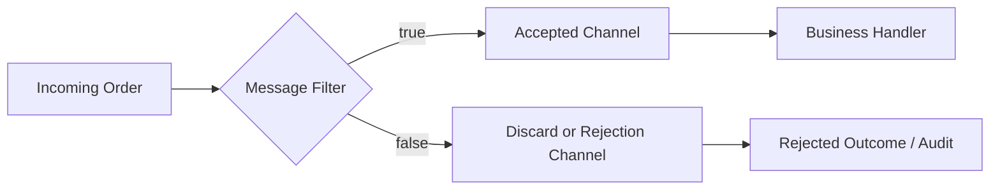
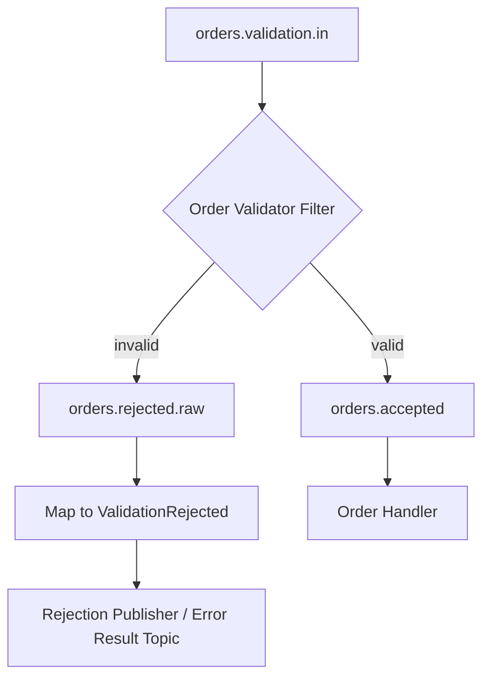
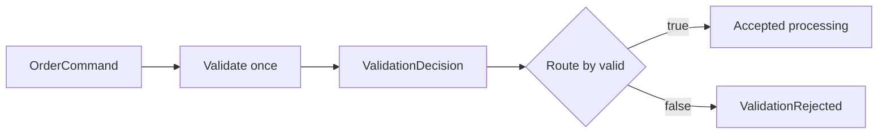
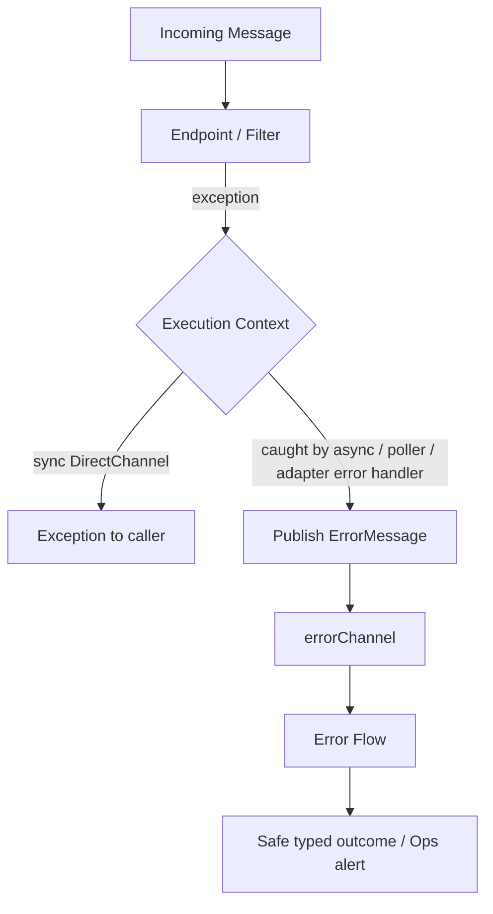
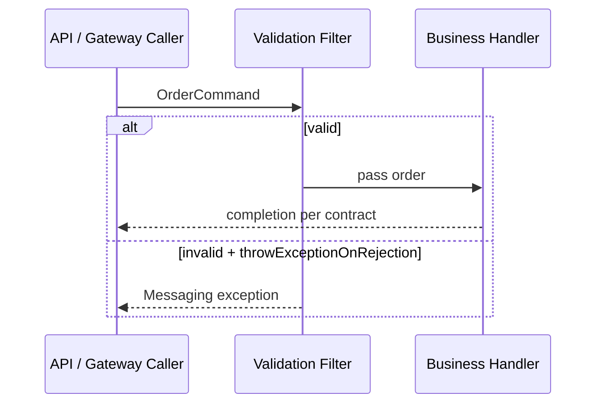
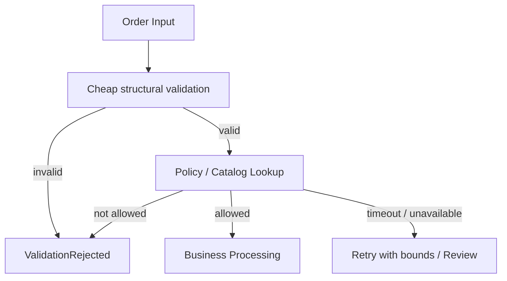
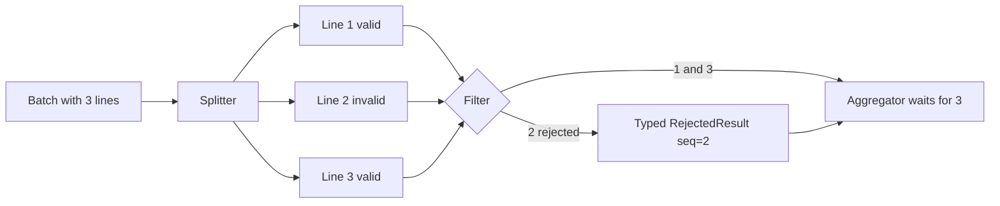
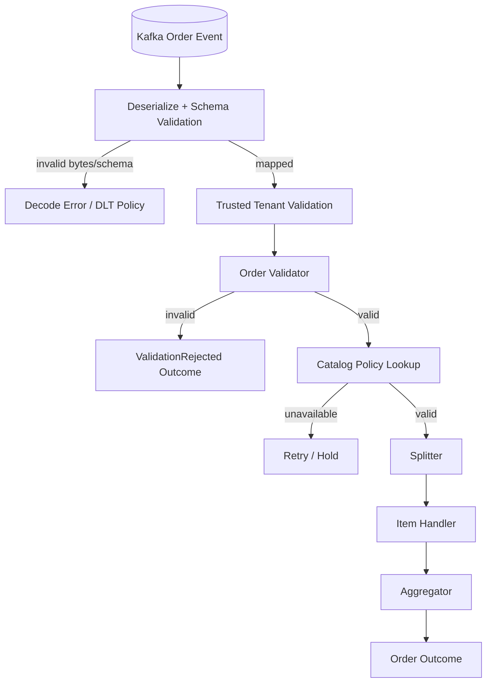

# Error Messages for Validation Failures

In **Enterprise Integration Patterns (EIP)**, a **Message Filter** decides whether a message may continue through a processing flow. A **validation** step can also reject a message, yet unlike dropping unneeded data: when a request is invalid, the producer, client, or operations team usually needs to know **why it was rejected**, **which errors can be fixed**, and **whether the message caused any side effects**.

For example, an `OrderSubmitted` missing a customer ID or having a negative quantity enters the order processing flow. If a Filter drops it silently, the system might report successful receipt while no order was created; a Gateway waiting for a reply may time out; operators cannot tell at which step the message was dropped. If every validation failure is thrown as an infrastructure error, a retry policy may repeatedly redeliver a message that is guaranteed to stay invalid.

The lesson **"Error Messages for Validation Failures"** belongs to the **Message filter and validation** chapter of the **SPRING_INTEGRATION_PATTERN** module. The module's goal is learning to implement Enterprise Integration Patterns with Spring Integration to build loosely coupled, extensible message flows, combining Router, Filter, Transformer, Splitter, Aggregator, Gateway, retry, error channel, correlation, and per-branch testing.

This lesson distinguishes three commonly confused mechanisms:

1. **Message Filter rejection**: the predicate returns `false`. The message may be discarded or routed to `discardChannel`; this **does not automatically emit an `ErrorMessage`**.
2. **Contract-level validation failure**: the application produces a **structured rejection result** (*validation rejection*) so the caller or consumer understands and can fix it.
3. **Exception in a message flow**: when an exception is caught and published by an error-handling mechanism, Spring Integration can send a Spring `ErrorMessage` with a **`Throwable` as its payload** to an error channel.

**Goals after this lesson:** Choose the right error message type, configure Filter/`throw-on-rejection`/error channels, preserve correlation and investigation metadata, classify errors for retryability, and test both synchronous and asynchronous paths.

## 1. What Is a "Validation Failure" in a Message Flow?

A validation failure occurs when a message **does not satisfy the data contract or rules checked at a defined point**.

For example:

```json
{
  "eventId": "evt-101",
  "tenantId": "tenant-a",
  "orderId": "ORD-101",
  "customerId": "",
  "lines": [
    {"sku": "SKU-1", "quantity": -2}
  ]
}
```

The message above fails in two places:

- `customerId` is empty.
- `quantity` must be greater than 0, yet it is -2.

This is typically a **deterministic data error**. If resent verbatim with nothing changed, it is almost certain to remain invalid.

Conversely, if a validator needs to read a configuration table and the database loses connectivity, that is an **infrastructure error while executing validation**, which does not prove the message is invalid. Retry handling for the two situations must differ.

### Classifying Three Main Outcomes

| Outcome | Meaning | Default handling |
| --- | --- | --- |
| `VALID` | Contract satisfied at this check | Continue to Router/handler |
| `INVALID` | Deterministic rule violation | Rejection result, audited discard, or client error |
| `UNKNOWN` / `VALIDATION_UNAVAILABLE` | Cannot verify because validator/dependency failed | Bounded retry, hold, error channel, or recovery |

**Never treat `UNKNOWN` as `VALID` just to keep the system moving faster**, especially for authorization, quotas, fraud checks, or mandatory compliance.

## 2. A Filter Is Not Always an Error Handler

A standard Filter usually works via a predicate:

```text
if predicate(message) == true:
    forward message
else:
    reject/discard message
```



Without configuring a proper discard path, returning `false` may result in the message **not being forwarded**. Sometimes that is appropriate—for example, a Filter dropping telemetry events of no interest. But for an order creation, payment, or registration request, silent dropping is usually a poor contract.

**Important:** A message for which a Filter returns `false` **does not automatically become a Spring `ErrorMessage`**. `discardChannel` typically receives the **original rejected message**, not automatically an `ErrorMessage` wrapping a `Throwable`.

If the sender should receive an error, the application must choose an explicit behavior:

- Route the original message through a discard flow to build a structured `ValidationRejected`.
- Configure the Filter to throw `MessageRejectedException` on rejection.
- Use a validator/Router returning typed `ACCEPTED/REJECTED` outcomes.
- Write audit/hold/DLQ per policy if the message came from a broker.

Each option serves **a different contract and topology**; do not accidentally enable all three in different places and emit multiple error results for one event.

## 3. Distinguishing Error, Rejection, Discard, and Dead-Letter

| Concept | Actual message | Typically used when |
| --- | --- | --- |
| **ValidationRejected** | Application-defined business DTO/event | Data violates contract, caller needs to know errors |
| **Spring ErrorMessage** | Message whose payload is a `Throwable` | An exception is caught and published by framework/error handler |
| **Filter discard** | Original message dropped or sent to discard channel | Filter condition blocks message from continuing |
| **Dead-letter message** | Message with error metadata per broker/adapter | Failed processing needing isolation, investigation, or replay |
| **HTTP 400/422** | API error status and body | Client sent invalid request data |
| **Retry message** | Work scheduled for reprocessing | Transient outage or unknown outcome, safe to retry |
| **Audit event** | Traceability record of a decision | Need proof of who/what rule rejected it |

A Spring `ErrorMessage` is not a pre-formatted JSON object with `errorCode`, `field`, and `correlationId` fields matching your application contract. If an API needs a JSON error body, you must **translate exceptions/validation results into a safe business error**.

Conversely, a `ValidationRejected` carrying all violation fields **is not automatically routed through the global `errorChannel`**. It only goes to whichever channel the application publishes it to.

### Design Rule

**Use typed rejections for expected data errors and `ErrorMessage` for exceptions/infrastructure failures or when intentionally configuring throw-on-rejection.** This is not an absolute law: some systems treat validation failures as mandatory exceptions, in which case you must understand the implications for retry, Gateway, and error channels.

## 4. What Should a Validation Error Message Contain?

A structured rejection result for a producer typically needs:

| Field | Purpose |
| --- | --- |
| `eventId` / `businessRequestId` | Links to the original request, stable across retries |
| `tenantId` | Business scope and permission checks |
| `errorCode` | Machine-readable code, language-independent |
| `violations[]` | Each invalid field/rule |
| `retryable` | Indicates whether **retrying the exact request** is allowed by policy |
| `validationPolicyVersion` | Version of the rule set |
| `rejectedAt` | Server-side inspection timestamp |
| `correlationId` / `traceId` | For tracing if issued by a trusted source |
| `outcome` | For example, `VALIDATION_REJECTED` |
| `nextAction` | FIX_INPUT, CONTACT_SUPPORT, WAIT_FOR_REVIEW... |

Example:

```json
{
  "eventId": "evt-101",
  "orderId": "ORD-101",
  "outcome": "VALIDATION_REJECTED",
  "errorCode": "ORDER_INPUT_INVALID",
  "retryable": false,
  "validationPolicyVersion": "order-v3",
  "violations": [
    {"field": "customerId", "code": "REQUIRED"},
    {"field": "lines[0].quantity", "code": "MUST_BE_POSITIVE"}
  ]
}
```

This is an **application contract we design**, not the default content of a Spring `ErrorMessage`.

Avoid including:

- Entire payloads containing PII/secrets.
- Stack traces, database table names, or internal URLs.
- Raw password/token values in `rejectedValue`.
- Information belonging to another tenant.
- Unstandardized free-text messages like `"Something went wrong, try later"` for every failure.

**Error codes must have stable meanings.** Display messages in Vietnamese/English can be generated in the UI from `errorCode` and should not be the sole way consumers classify errors.

## 5. Designing a Pure Validator with Deterministic Output

A contract validator should be easy to unit test and free of side effects. Example using Java records (Java 17+):

```java
import java.util.List;

record OrderLine(String sku, int quantity) {}

record OrderCommand(
    String eventId,
    String tenantId,
    String orderId,
    String customerId,
    List<OrderLine> lines
) {}

record Violation(String field, String code) {}

record ValidationRejected(
    String eventId,
    String orderId,
    String errorCode,
    String policyVersion,
    boolean retryable,
    List<Violation> violations,
    java.time.Instant rejectedAt
) {
    ValidationRejected {
        violations = List.copyOf(violations);
    }
}
```

Validator:

```java
import java.util.ArrayList;
import java.util.List;

final class OrderValidator {
    static final String POLICY_VERSION = "order-v3";

    List<Violation> validate(OrderCommand order) {
        List<Violation> issues = new ArrayList<>();

        if (order == null) {
            issues.add(new Violation("order", "REQUIRED"));
            return List.copyOf(issues);
        }

        if (blank(order.eventId())) {
            issues.add(new Violation("eventId", "REQUIRED"));
        }
        if (blank(order.tenantId())) {
            issues.add(new Violation("tenantId", "REQUIRED"));
        }
        if (blank(order.orderId())) {
            issues.add(new Violation("orderId", "REQUIRED"));
        }
        if (blank(order.customerId())) {
            issues.add(new Violation("customerId", "REQUIRED"));
        }

        if (order.lines() == null || order.lines().isEmpty()) {
            issues.add(new Violation("lines", "MUST_NOT_BE_EMPTY"));
        } else {
            if (order.lines().size() > 500) {
                issues.add(new Violation("lines", "TOO_MANY"));
            }
            for (int i = 0; i < order.lines().size(); i++) {
                OrderLine line = order.lines().get(i);
                if (line == null) {
                    issues.add(new Violation(
                        "lines[" + i + "]", "REQUIRED"));
                    continue;
                }
                if (blank(line.sku())) {
                    issues.add(new Violation(
                        "lines[" + i + "].sku", "REQUIRED"));
                }
                if (line.quantity() <= 0) {
                    issues.add(new Violation(
                        "lines[" + i + "].quantity",
                        "MUST_BE_POSITIVE"));
                }
            }
        }

        return List.copyOf(issues);
    }

    private static boolean blank(String value) {
        return value == null || value.isBlank();
    }
}
```

In this example:

1. `validate` returns a list of violations, **without throwing exceptions for ordinary invalid data**.
2. `Violation` contains field and error code, **without exposing raw field values**.
3. No database or external API calls happen in the sample validator, so retrying unchanged data will never make it valid.
4. The 500-line limit is an **assumption in this lesson**, not a Spring Integration limit.
5. Data validation **does not replace authentication/authorization**: client-supplied `tenantId` must be verified against the security context.
6. For large payloads, bound size before deserialization or validation loops to prevent DoS.

Returning `List<Violation>` lets APIs, Filters, and unit tests share the validator. However, avoid validating redundantly multiple times; you can validate once at the start of the flow, build an immutable `ValidationDecision`, and route on the outcome.

## 6. Filter Rejecting via `discardChannel`: No `ErrorMessage` Yet

The first configuration demonstrates a Filter acting in its true message-filtering sense. When invalid, a **discard flow** constructs a typed rejection to publish on an application channel. This works well when validation failure is an expected outcome.



### 6.1. Service Contracts

```java
interface OrderHandler {
    void handle(OrderCommand command);
}

interface RejectionSink {
    // e.g., publish rejection event to a topic or outcome store.
    void publish(ValidationRejected rejection);
}
```

### 6.2. Spring Integration Java DSL

```java
import java.time.Instant;
import java.util.List;
import org.springframework.context.annotation.Bean;
import org.springframework.context.annotation.Configuration;
import org.springframework.integration.channel.DirectChannel;
import org.springframework.integration.config.EnableIntegration;
import org.springframework.integration.dsl.IntegrationFlow;
import org.springframework.messaging.MessageChannel;

@Configuration
@EnableIntegration
class FilterValidationConfiguration {

    @Bean("orders.validation.in")
    MessageChannel input() {
        return new DirectChannel();
    }

    @Bean("orders.accepted")
    MessageChannel accepted() {
        return new DirectChannel();
    }

    @Bean("orders.rejected.raw")
    MessageChannel discarded() {
        return new DirectChannel();
    }

    @Bean
    OrderValidator orderValidator() {
        return new OrderValidator();
    }

    @Bean
    IntegrationFlow orderFilterFlow(OrderValidator validator) {
        return IntegrationFlow.from("orders.validation.in")
            .filter(OrderCommand.class,
                command -> validator.validate(command).isEmpty(),
                spec -> spec.discardChannel("orders.rejected.raw"))
            .channel("orders.accepted")
            .get();
    }

    @Bean
    IntegrationFlow acceptedOrderFlow(OrderHandler handler) {
        return IntegrationFlow.from("orders.accepted")
            .handle(OrderCommand.class, (order, headers) -> {
                handler.handle(order);
                return null;
            })
            .get();
    }

    @Bean
    IntegrationFlow rejectedOrderFlow(
            OrderValidator validator,
            RejectionSink sink) {
        return IntegrationFlow.from("orders.rejected.raw")
            .handle(OrderCommand.class, (order, headers) -> {
                List<Violation> violations =
                    validator.validate(order);

                sink.publish(new ValidationRejected(
                    order.eventId(),
                    order.orderId(),
                    "ORDER_INPUT_INVALID",
                    OrderValidator.POLICY_VERSION,
                    false,
                    violations,
                    Instant.now()
                ));
                return null;
            })
            .get();
    }
}
```

**Key takeaways:**

- `orders.rejected.raw` receives the **original message rejected by the Filter**.
- `rejectedOrderFlow` **explicitly constructs** `ValidationRejected`; Spring **does not automatically create an `ErrorMessage`** here.
- Handlers return `null` intentionally because both branches are **one-way endpoints**; do not use this exact setup to promise a structured response to a Gateway.
- `validator.validate` is called twice (in the Filter and discard flow) for simplicity of presentation. For expensive or state-dependent validators, **validate once** and route a `ValidationDecision` to prevent inconsistent double checks.
- `RejectionSink.publish` needs proper error handling, idempotency, or an outbox if recording rejections is a mandatory side effect.
- This example omits `OrderHandler` and `RejectionSink` bean implementations; the application must supply them.

### Watch Out for Null Payloads

Spring `Message` normally requires a non-null payload, yet deserialization/envelope steps may fail **before an `OrderCommand` can be created**. In that case, payload-level validation **will not receive a null `OrderCommand`** in the usual way.

Do not force every deserialization failure into `Violation("order","REQUIRED")`; a separate inbound error handler may be needed to report `INVALID_JSON` or `SCHEMA_DECODE_FAILED` per contract.

## 7. `ValidationDecision`: Validate Once, Then Route

In larger systems, validation may involve multiple rules and lookups. Calling the validator again in both the Filter and the discard handler can yield different results if rule versions or auxiliary data change in between.

A safer model:

```java
import java.util.List;

record ValidationDecision(
    OrderCommand original,
    boolean valid,
    List<Violation> violations,
    String policyVersion
) {
    ValidationDecision {
        violations = List.copyOf(violations);
    }
}

final class OrderValidationService {
    private final OrderValidator validator;

    OrderValidationService(OrderValidator validator) {
        this.validator = validator;
    }

    ValidationDecision decide(OrderCommand command) {
        List<Violation> violations =
            validator.validate(command);

        return new ValidationDecision(
            command,
            violations.isEmpty(),
            violations,
            OrderValidator.POLICY_VERSION
        );
    }
}
```



The workflow layer can route on `ValidationDecision.valid()` using a Router and pass `original` to the business handler, or map a failed decision into `ValidationRejected`. This keeps the **violations set as a snapshot** and eliminates discrepancies between the initial check and error reporting.

**Do not treat a `VALID` decision as authorization** if permissions must be checked right before side effects. A policy may change after a decision is created; design freshness/validity scope if a decision is stored and replayed hours later.

## 8. Filter Throwing an Exception on Rejection: `throwExceptionOnRejection`

Sometimes the contract requires an invalid message to raise an exception—for instance, a synchronous caller needing to know the request was rejected at this step.

In Spring Integration, a Filter offers the **`throwExceptionOnRejection(true)`** option. When the predicate returns `false`, instead of merely discarding, the Filter **throws `MessageRejectedException`** (per the component/version semantics).

```java
import org.springframework.context.annotation.Bean;
import org.springframework.context.annotation.Configuration;
import org.springframework.integration.channel.DirectChannel;
import org.springframework.integration.config.EnableIntegration;
import org.springframework.integration.dsl.IntegrationFlow;
import org.springframework.messaging.MessageChannel;

@Configuration
@EnableIntegration
class StrictValidationConfiguration {

    @Bean("orders.strict.in")
    MessageChannel strictInput() {
        return new DirectChannel();
    }

    @Bean
    IntegrationFlow strictValidationFlow(
            OrderValidator validator,
            OrderHandler handler) {
        return IntegrationFlow.from("orders.strict.in")
            .filter(OrderCommand.class,
                order -> validator.validate(order).isEmpty(),
                spec -> spec.throwExceptionOnRejection(true))
            .handle(OrderCommand.class, (order, headers) -> {
                handler.handle(order);
                return null;
            })
            .get();
    }
}
```

Points to understand:

- An invalid `OrderCommand` causes an **exception** at the Filter.
- With a `DirectChannel` and synchronous caller, the exception can **propagate back to the caller**, possibly wrapped in messaging exceptions.
- **There is no guarantee** that this exception will automatically appear on the `global errorChannel`. On a synchronous call stack, error handling is up to the caller or upstream endpoint.
- When moving to an async channel/executor/poller, an exception may be caught by that thread's error handler and published as an `ErrorMessage`.
- Do not overuse throw-on-rejection if the domain treats invalid input as a normal rejection outcome rather than an exception.

**Do not assume `discardChannel` and `throwExceptionOnRejection(true)` act as two response paths running simultaneously by default.** Verify semantics against your actual configuration and choose one single contract to avoid duplicate error reporting.

## 9. What Is the Actual Structure of a Spring `ErrorMessage`?

Spring `ErrorMessage` is a `Message<Throwable>`. In Spring Integration, it is typically used to carry an exception over an **error channel** when an error-handling mechanism catches the error and creates/publishes an error message.

Conceptually:

```text
ErrorMessage
  payload:
    Throwable / MessagingException
      message/cause
      failedMessage (if attached)
  headers:
    id, timestamp, ... error metadata
  originalMessage:
    may be present depending on constructor/error publisher
```

**The payload of an `ErrorMessage` is a `Throwable`**, not an API-schema `ValidationRejected` object.

If the exception is a `MessagingException`, it may carry **`failedMessage`**, holding the payload and headers of the message that failed. This is very useful for correlation, yet it risks leaking sensitive data if the whole object is logged or exposed externally.

### Where Can an `ErrorMessage` Be Created?



**There is no rule that "every exception goes to `errorChannel`".** The difference lies in whether the exception is thrown on a synchronous call stack or caught by an infrastructure error handler during asynchronous execution.

## 10. Distinguishing `MessageRejectedException` from Infrastructure Failures

`MessageRejectedException` is an appropriate signal when a Filter is configured to throw upon predicate rejection. However, **not every exception at a Filter is a validation failure**.

For example:

- Predicate returns `false` because `quantity <= 0` → likely `INVALID_INPUT`.
- Predicate queries a database and hits `DataAccessResourceFailureException` → **validator unavailable**, unknown whether input is valid.
- Predicate throws `NullPointerException` due to a bug → **programming defect**, must not report `INVALID_INPUT` and drop.
- Predicate checks tenant permissions and fails reaching policy store → may need to fail closed and recover, without assuming the client could fix it by resending the exact request.

### Classification Table

| Exception or outcome | Internal code | Retry exact message? |
| --- | --- | --- |
| Validator returns deterministic violations | `VALIDATION_REJECTED` | No, unless payload/policy is fixed |
| `MessageRejectedException` from Filter rejection | `VALIDATION_REJECTED` if Filter is solely for validation | Usually no |
| Rule database connection failure | `VALIDATION_UNAVAILABLE` | Can retry with limits |
| JSON decode failure | `INVALID_PAYLOAD_FORMAT` | Usually no, input fix required |
| Access denied | `ACCESS_DENIED` | Do not auto-retry; valid permissions needed |
| Bug inside validator | `VALIDATOR_INTERNAL_ERROR` | Do not blame client; alert/fix |
| Timeout with unknown side-effect state | `OUTCOME_UNKNOWN` | Reconcile before retrying |

**Error codes should not be inferred solely from `Throwable.getMessage()` strings.** Use controlled exception types/markers and domain validation decisions. Free-form messages can change across versions or contain sensitive data.

## 11. Async Flows: Exceptions Can Become `ErrorMessage`

An application may place validation on an `ExecutorChannel`. When a Filter throws an exception **on a worker thread**, the executor/message endpoint's error-handling mechanism can publish an `ErrorMessage` to the corresponding error channel.

The example below illustrates configuring channels and handlers. It must be tested against your **actual Spring Integration version** and the error-handling setup of the dispatcher/executor used.

### 11.1. Channels and Executor

```java
import org.springframework.beans.factory.annotation.Qualifier;
import org.springframework.context.annotation.Bean;
import org.springframework.context.annotation.Configuration;
import org.springframework.core.task.TaskExecutor;
import org.springframework.integration.channel.DirectChannel;
import org.springframework.integration.channel.ExecutorChannel;
import org.springframework.integration.config.EnableIntegration;
import org.springframework.messaging.MessageChannel;
import org.springframework.scheduling.concurrent.ThreadPoolTaskExecutor;

@Configuration
@EnableIntegration
class AsyncValidationChannels {

    @Bean("orders.validation.executor")
    TaskExecutor validationExecutor() {
        ThreadPoolTaskExecutor executor =
            new ThreadPoolTaskExecutor();
        executor.setCorePoolSize(2);
        executor.setMaxPoolSize(4);
        executor.setQueueCapacity(100);
        executor.setThreadNamePrefix("validation-");
        executor.initialize();
        return executor;
    }

    @Bean("orders.async.in")
    MessageChannel asyncInput(
            @Qualifier("orders.validation.executor")
            TaskExecutor executor) {
        return new ExecutorChannel(executor);
    }

    @Bean("orders.async.accepted")
    MessageChannel asyncAccepted() {
        return new DirectChannel();
    }

    @Bean("orders.validation.errors")
    MessageChannel validationErrors() {
        return new DirectChannel();
    }
}
```

### 11.2. Validation on a Worker Thread

```java
import org.springframework.context.annotation.Bean;
import org.springframework.context.annotation.Configuration;
import org.springframework.integration.dsl.IntegrationFlow;

@Configuration
class AsyncStrictValidationFlow {

    @Bean
    IntegrationFlow asyncOrderValidation(
            OrderValidator validator) {
        return IntegrationFlow.from("orders.async.in")
            .filter(OrderCommand.class,
                order -> validator.validate(order).isEmpty(),
                spec -> spec.throwExceptionOnRejection(true))
            .channel("orders.async.accepted")
            .get();
    }

    @Bean
    IntegrationFlow processAsyncAccepted(OrderHandler handler) {
        return IntegrationFlow.from("orders.async.accepted")
            .handle(OrderCommand.class, (order, headers) -> {
                handler.handle(order);
                return null;
            })
            .get();
    }
}
```

**These two configurations illustrate a separate async topology**; do not register identically named `orders...` beans alongside the section 6/8 examples in the same `ApplicationContext` without renaming or selecting configurations.

### 11.3. Sending a Message with a Trusted Internal Error Channel

```java
import org.springframework.messaging.Message;
import org.springframework.messaging.MessageChannel;
import org.springframework.messaging.MessageHeaders;
import org.springframework.messaging.support.MessageBuilder;

// Sketch inside a service/fixture with both beans injected:
MessageChannel asyncInput = /* "orders.async.in" */ null;
MessageChannel validationErrors =
    /* "orders.validation.errors" */ null;

OrderCommand command = /* request mapped from a trusted source */ null;

Message<OrderCommand> message = MessageBuilder
    .withPayload(command)
    .setHeader(MessageHeaders.ERROR_CHANNEL, validationErrors)
    .setHeader("businessEventId", command.eventId())
    .build();

asyncInput.send(message);
```

**This snippet illustrates how to construct the message, not a verbatim runnable class**, since variables use placeholders. The error channel header holds an **internal `MessageChannel` object** and should never come from client input, be arbitrarily serialized over Kafka/HTTP/JMS, or be user-selectable. On an inbound adapter, the error channel can be configured on the endpoint itself rather than inside the message.

When an exception occurs on the worker thread, an error publisher **may** use the error channel header or default error channel per framework behavior. Verify in tests that errors actually arrive at `orders.validation.errors` rather than assuming so merely because the bean exists.

## 12. Handling `ErrorMessage` and Converting It to a Safe Report

The error flow must separate **data-attributable validation rejections** from other errors. Do not turn every exception on the same error channel into `ValidationRejected(retryable=false)`.

A consumer can be invoked by a Service Activator receiving `ErrorMessage`:

```java
import java.time.Instant;
import java.util.List;
import org.springframework.integration.MessageRejectedException;
import org.springframework.messaging.Message;
import org.springframework.messaging.MessagingException;
import org.springframework.messaging.support.ErrorMessage;

interface InfrastructureErrorSink {
    void report(String category, String businessEventId);
}

final class ValidationErrorConsumer {
    private final OrderValidator validator;
    private final RejectionSink rejectionSink;
    private final InfrastructureErrorSink infrastructureSink;

    ValidationErrorConsumer(
            OrderValidator validator,
            RejectionSink rejectionSink,
            InfrastructureErrorSink infrastructureSink) {
        this.validator = validator;
        this.rejectionSink = rejectionSink;
        this.infrastructureSink = infrastructureSink;
    }

    public void handle(ErrorMessage error) {
        Throwable failure = error.getPayload();
        MessageRejectedException rejection = findRejection(failure);

        if (rejection == null) {
            // Do not disguise infrastructure errors as input errors.
            infrastructureSink.report(
                "UNCLASSIFIED_VALIDATION_FLOW_ERROR", null);
            return;
        }

        Message<?> failed = rejection.getFailedMessage();
        if (failed == null
                || !(failed.getPayload() instanceof OrderCommand order)) {
            infrastructureSink.report(
                "MISSING_FAILED_MESSAGE", null);
            return;
        }

        List<Violation> violations =
            validator.validate(order);

        if (violations.isEmpty()) {
            infrastructureSink.report(
                "REJECTION_WITHOUT_VIOLATIONS", order.eventId());
            return;
        }

        rejectionSink.publish(new ValidationRejected(
            order.eventId(),
            order.orderId(),
            "ORDER_INPUT_INVALID",
            OrderValidator.POLICY_VERSION,
            false,
            violations,
            Instant.now()
        ));
    }

    private static MessageRejectedException findRejection(
            Throwable failure) {
        Throwable current = failure;
        for (int depth = 0; current != null && depth < 12; depth++) {
            if (current instanceof MessageRejectedException rejected) {
                return rejected;
            }
            current = current.getCause();
        }
        return null;
    }
}
```

This code is an example classifier **on a validation-dedicated error channel**, with these caveats:

1. `ErrorMessage.getPayload()` is a `Throwable`, not directly an `OrderCommand`.
2. `MessageRejectedException` may sit inside the **cause chain**, not necessarily as the outermost exception.
3. `failedMessage` may be absent or carry a different payload type, especially if failure occurred before message mapping finished.
4. The validator is called again to compute violations; for dynamic rules, persist `ValidationDecision` or snapshot the policy version so error reporting does not diverge from the initial decision.
5. `rejectionSink` and `infrastructureSink` are **application-provided output paths** needing idempotency, backpressure, and PII protection.
6. Never log the full `ErrorMessage` because `failedMessage` may contain sensitive payloads.

### Registering the Error Flow

```java
import org.springframework.context.annotation.Bean;
import org.springframework.context.annotation.Configuration;
import org.springframework.integration.dsl.IntegrationFlow;

@Configuration
class ValidationErrorFlowConfiguration {

    @Bean
    ValidationErrorConsumer validationErrorConsumer(
            OrderValidator validator,
            RejectionSink rejectionSink,
            InfrastructureErrorSink infrastructureSink) {
        return new ValidationErrorConsumer(
            validator, rejectionSink, infrastructureSink);
    }

    @Bean
    IntegrationFlow validationErrorFlow(
            ValidationErrorConsumer consumer) {
        return IntegrationFlow.from("orders.validation.errors")
            .handle(consumer, "handle")
            .get();
    }
}
```

As with all standalone examples in this lesson, these configurations **must be assembled into one coherent topology with matching beans**, without stacking alternative flows sharing the same input channels or bean names.

**Note:** If the error flow itself throws an exception, do not assume it will automatically retry forever or be safely forwarded. You need a fallback infrastructure alerting path and monitoring when rejections cannot be published.

## 13. Why Not Manually Publish `ErrorMessage` for Every Data Error?

An application can manually construct an `ErrorMessage`:

```java
import org.springframework.integration.MessageRejectedException;
import org.springframework.messaging.Message;
import org.springframework.messaging.MessageChannel;
import org.springframework.messaging.support.ErrorMessage;

final class ExplicitErrorPublisher {
    private final MessageChannel errors;

    ExplicitErrorPublisher(MessageChannel errors) {
        this.errors = errors;
    }

    void publishValidationRejection(Message<?> failedMessage) {
        MessageRejectedException exception =
            new MessageRejectedException(
                failedMessage, "Order validation rejected");

        ErrorMessage error = new ErrorMessage(exception);

        if (!errors.send(error)) {
            throw new IllegalStateException(
                "Could not publish validation error");
        }
    }
}
```

This is an **explicit choice**, not default Filter behavior. It can be useful in environments where every kind of exception is consumed by a standardized error flow. However:

- `ErrorMessage` carries an exception and can reference the full payload via `failedMessage`.
- If the error channel has subscribers across multiple teams, sensitive data may be exposed.
- If you **both publish manually and throw an exception** that an error handler also publishes, you can emit **two error messages** for a single failure.
- Publishing an `ErrorMessage` does not automatically return an HTTP 422 or `ValidationRejected` to the caller.
- If the requirement is merely to tell the client which fields are wrong, a **typed rejection** is usually easier to test, safer, and more stable.

Choose **one single source of error outcome emission** per validation failure, or add an idempotency key and deduplication if the architecture intentionally has multiple emitters.

## 14. Synchronous vs Asynchronous Flows Affect Who Receives Errors

The same Filter can be placed inside two very different topologies:

### 14.1. Synchronous Flow with `DirectChannel`/Gateway



If the Filter throws an exception and it propagates back to the caller, the API layer can **catch the validation failure type** and map it to a 400/422 error body per contract. Do not expect a caller to both receive a synchronous exception and wait for an `ErrorMessage` on another channel without an explicit design.

A Gateway **expecting a reply** backed only by a Filter dropping messages with no reply can hit a `reply timeout` or `ReplyRequiredException` depending on configuration. That is a poor way to report invalid field errors.

### 14.2. Asynchronous Flow via Executor or Broker

When a message is accepted into a queue/executor, the producer may receive a **transport-level ACK** before validation even runs.

```text
Producer -> Broker ACK accepted
          -> Consumer validation
             -> INVALID
             -> typed rejection event / error channel / DLQ
```

In that situation, **ACK does not mean the data was accepted by business logic**. If the client needs the outcome, there must be an outcome store, callback, reply topic, or query API keyed by `businessEventId`.

Do not try to return `HTTP 422` on an HTTP request that already received `202 Accepted` and closed its connection earlier. Validation results must be delivered through a contract-supported channel.

## 15. Error Channel Differs from Discard Channel

Here is a practical comparison:

| Property | Filter `discardChannel` | `errorChannel` |
| --- | --- | --- |
| When used | Filter rejects message via predicate | An error is caught/published by an error handler |
| Typical message received | **Rejected original input message** | **`ErrorMessage`** wrapping a `Throwable` |
| Exception required? | No | Usually carries an exception/cause |
| Violations included? | No, unless constructed | Does not automatically carry business violations |
| Auto-retries? | No | No; retries require configuration/advice/transport |
| Auto-replies to Gateway? | No | Not by default |
| Sensitive data to protect? | Yes, original payload | Yes, `failedMessage`/stack trace |

If the business wants all invalid inputs routed to a **rejection topic**, a discard flow or typed Router works without throwing exceptions. If the system wants a unified error pipeline, you can configure throw-on-rejection and ensure the right **error publisher** exists in that execution context.

**Never name a channel `errorChannel` in code and assume messages sent to it automatically become `ErrorMessage`s.** A channel name does not transform payload types.

## 16. Handling Validation After Deserialization, Schema, and Bean Validation

Validation spans multiple layers; execution point determines whether a Spring message already exists.

| Layer | Example | Timing |
| --- | --- | --- |
| Transport/protocol | Required headers, size limits | Before payload mapping |
| Deserialization | Malformed JSON syntax, invalid types | While constructing object |
| Schema | Missing fields, JSON Schema/Avro type/range | Before or during mapping |
| Bean Validation | `@NotBlank`, `@Positive`, `@Valid` | After object exists |
| Business validation | Discontinued SKU, order limits | Against current policy |
| Authorization | Is actor allowed to create orders for tenant? | At trust boundary and before side effects |
| Infrastructure validation dependency | Catalog service unavailable | May result in `UNKNOWN` |

**Do not expect `.filter(OrderCommand.class, ...)` to catch JSON that cannot even deserialize into `OrderCommand`**. That error happens in the inbound mapper, which usually has its own error-handling path.

### Using Jakarta Bean Validation When Appropriate

Example DTO:

```java
import jakarta.validation.Valid;
import jakarta.validation.constraints.NotBlank;
import jakarta.validation.constraints.NotEmpty;
import jakarta.validation.constraints.Positive;
import java.util.List;

record ValidatedOrderLine(
    @NotBlank String sku,
    @Positive int quantity
) {}

record ValidatedOrder(
    @NotBlank String eventId,
    @NotBlank String tenantId,
    @NotBlank String orderId,
    @NotBlank String customerId,
    @NotEmpty List<@Valid ValidatedOrderLine> lines
) {}
```

To run Bean Validation, the application must have a **Jakarta Validation provider** and invoke `Validator.validate(...)` at the right spot (or have matching integration configuration). **Putting annotations on a record does not guarantee every Spring Integration Filter runs validation.**

When mapping `ConstraintViolation<?>` to a client-facing DTO, map to **field path + controlled error code**, without logging or echoing sensitive field values.

## 17. Domain Validation Failure vs Infrastructure Validation Unavailable

A real-world validator may need to call an external source to check whether a product is active or whether a tenant is enabled for a service.



When the external source fails:

- Do not turn a timeout into `SKU_NOT_FOUND` when you do not know whether the SKU exists.
- Do not silently fall back to stale cache for mandatory policies unless the contract permits it.
- Use timeouts, bounded retries, circuit breakers, and backpressure tailored to the error type.
- Provide a `VALIDATION_UNAVAILABLE` or `PENDING_REVIEW` outcome if SLA requires it.
- If a fallback is used, record the version/age/source of the data applied.

An exception inside a validator may be a `MessageHandlingException` or infrastructure exception rather than a `MessageRejectedException` from Filter rejection. The error flow must classify **by cause and context** before deciding whether to retry.

## 18. Why Retrying the Wrong Error Type Amplifies Load?

Suppose an event has `quantity=-2`. The consumer retries 5 times, the broker redelivers 3 times, and an operator replays twice. Without fixing the data, none of these attempts help.

```text
quantity=-2
    -> validate
    -> REJECTED
    -> retry same payload
    -> REJECTED
    -> retry same payload
    -> REJECTED
```

For **deterministic, time-invariant** validation failures, you usually want to:

1. Record a rejection outcome with an idempotency key.
2. Not retry infinitely.
3. Inform the producer/caller which fields need fixing.
4. Move to quarantine or DLT if the contract and transport require investigation.
5. Reprocess only after an **intentional correction/reprocess**.

For validation dependent on mutable data—for example, a limit policy updated 5 minutes later—retrying can make sense, provided `TEMPORARILY_UNAVAILABLE` is distinguished from `NOT_ALLOWED`. **Never collapse both into `INVALID`**.

### Inbound Adapter Retry vs In-Handler Retry

- If failure happens **before ACK**, the broker may redeliver the entire event.
- If retry advice wraps the **entire flow**, previously successful steps ahead of the validator may re-execute.
- If you retry only the timed-out **external lookup**, you do not necessarily replay the whole workflow.
- If a rejection event was already published but ACK was lost, the rejection event may be republished; idempotency is needed at the outcome sink.

**Place cheap, deterministic validation before side effects** to limit the blast radius of retries. Never execute a side effect like deducting inventory before checking whether the quantity is valid.

## 19. Correlation and Business Event IDs in Error Messages

An asynchronously emitted error must be reliably linked back to the original message.

| Metadata | Role |
| --- | --- |
| `businessEventId` | Stable identifier across retries/redeliveries |
| `orderId` | Identifies the business order |
| `tenantId` | Permission scope and data isolation |
| `correlationId` | Connects messages within a workflow |
| `traceId` | Execution path observability when tracing is enabled |
| `validationPolicyVersion` | Explains which rule set was applied |
| `rejectionId` | Idempotency key for the rejection event if needed |
| `failedStage` | e.g., ORDER_SCHEMA_VALIDATION, ORDER_POLICY_VALIDATION |
| `rejectedAt` | Timestamp when server made the decision |

**Spring Message ID is not a stable business event ID.** Transformers and adapters may allocate new messages. If `ErrorMessage` carries `failedMessage`, extract a business ID issued by a trusted source instead of using a randomly generated ID and asking the producer to correlate it.

### Do Not Copy Every Header from the Error Message to Client Responses

Headers may contain `replyChannel`, `errorChannel`, internal objects, trace baggage, or sensitive data. Copy only an **allowlist** of contract-approved fields after scope verification.

When messages arrive via HTTP/Kafka/JMS, header contents also depend on inbound/outbound mappers. Do not assume `correlationId` or Java `MessageChannel` references survive intact across transports.

## 20. Security: Error Messages Can Leak More Than Normal Payloads

Validation errors frequently reference the **offending input**. That is precisely where secrets leak most easily.

### Common Risks

- Exception messages directly concatenating `password`/`apiKey` into strings.
- `ErrorMessage` holding `failedMessage` with an entire personal profile.
- Logging `error.getPayload().toString()` dragging in the entire serialized input.
- DLQs retaining sensitive payloads beyond allowed retention windows.
- A global error channel letting too many teams' subscribers read every error.
- HTTP responses returning stack traces and internal file paths.
- A `rejectedValue` field containing auth tokens or card data.
- Metric tags containing emails, customer IDs, or raw message text.

Safeguards:

- Return **field paths and error codes**, omitting raw values unless necessary.
- Restrict access to error channels/DLQs/outcome stores.
- Scope by tenant/flow; never let clients choose internal error channels.
- Encrypt sensitive data at rest with proper retention/purge policies.
- Never embed full messages inside exception descriptions.
- Use structured logging with PII filtering, access control, and auditing.

**Using `MessageRejectedException` does not automatically protect secrets.** It can retain `failedMessage` for debugging. Error handlers must treat both the message and exception as **sensitive data**, never forwarding them verbatim to public support or monitoring tools.

## 21. Validation in Splitter, Aggregator, and Scatter-Gather

### 21.1. Filtering an Item After a Splitter

A batch has three items. Splitter produces messages with `sequenceNumber=1..3`, `sequenceSize=3`. If a Filter silently drops item 2, a downstream Aggregator may wait forever after receiving only 1 and 3.



So the Aggregator knows **every item has a result**, the discard flow can emit `ItemResult(status=REJECTED)` preserving the right `batchId`/`itemId`/`sequenceNumber`. Only do this if the release contract permits **"all responses received"** even with failed items.

If the entire batch must abort whenever one item is invalid, validate **before the Splitter** and reject the whole batch instead of continuing and holding unneeded partial results.

### 21.2. Resequencer and Filtered Elements

A Resequencer requires the full sequence. If `seq=2` is dropped by a Filter, messages 1 and 3 may never be released in full-release mode. You need a typed `SKIPPED/REJECTED` result, controlled manifest adjustment, or a dedicated timeout/gap policy.

**Do not blindly decrement `sequenceSize` from 3 to 2** just to release the group; a late `seq=2` could trigger fresh errors.

### 21.3. Scatter-Gather and Non-Replying Branches

A supplier subflow filtered out may **return no reply**. Gatherer sees only A and C, waits for B, and times out. If the business considers B processed-but-inapplicable, branch B can return `NOT_APPLICABLE` instead of staying silent.

Common thread: **validation rejections often need to be represented as an outcome with identity/correlation**, not just by deleting the message from a flow awaiting a fixed count.

## 22. Kafka, JMS, HTTP: Each Transport Needs Its Own Contract

### HTTP Request-Reply

If validating immediately upon HTTP receipt before asynchronous processing, map `ValidationRejected` to HTTP `400 Bad Request` or `422 Unprocessable Content` per API contract. `403 Forbidden` is for authorization and should not be turned into `400` just to unify errors.

If the API already returned `202 Accepted` to enqueue the message, late validation results require another channel: webhook, status resource, or rejection event. Never assume you can send back an HTTP error over an already-closed connection.

### Kafka/AMQP/JMS Consumers

When an invalid event arrives:

- You may **ACK/commit** after successfully persisting the rejection outcome/quarantine, per contract.
- You may route the message to a **DLQ/DLT** if isolation and controlled reprocessing are needed.
- Never infinitely retry guaranteed schema-invalid messages.
- For temporary infrastructure failures, apply suitable retry/backoff and observe consequences.
- If publishing the rejection event and committing the source offset span two systems, use idempotency/outbox to prevent duplicates or lost outcomes.

**Spring Integration `errorChannel` is not the same as Kafka DLT/JMS DLQ.** An error channel is an in-application messaging channel; dead-lettering and offset/ack are transport/adapter semantics that require dedicated configuration.

### A Kafka-Specific Detail

An invalid message read from a partition still occupies an offset position. Simply letting exceptions escape so the consumer keeps retrying the same record can block subsequent records depending on consumer/error-handler policy. Decisions to skip, seek, send to DLT, and commit must align with ordering needs and prevent data loss.

Never treat "published an `ErrorMessage`" as proof that the offset was committed or the input was ACKed.

## 23. Idempotency for Rejection Events

A message may be redelivered after its validation rejection was already published. Emitting a brand-new `ValidationRejected` event each time can cause downstream consumers to send duplicate emails or tickets.

Use a **stable rejection identity**, for example:

```text
(tenantId, businessEventId, validationStage, policyVersion)
```

If the application allows corrections of the same business event, define a generation/version so you know whether an older rejection is still current.

| Situation | Policy |
| --- | --- |
| Exact duplicate under same rule version | Do not emit duplicate rejection side effects |
| Same event, approved payload change | Treat as a new revision/command per contract |
| Rule version changed | Can revalidate per permitted workflow |
| Rejection outcome persisted but ACK lost | Replay only confirms existing outcome |
| One stage invalid, another stage unrun | Do not assume every validation stage failed |
| Delivering rejection to external callback | Include idempotency key/status reconciliation |

A rejection is also **a business outcome worth persisting and observing** in critical flows. Consider storing `rejectionId`, `businessEventId`, `policyVersion`, and publish status rather than merely logging "invalid".

## 24. Observability for Validation Failures

Suggested metrics:

```text
validation_messages_total{flow="orders",outcome="valid"}
validation_messages_total{flow="orders",outcome="invalid"}
validation_messages_total{flow="orders",outcome="unavailable"}
validation_violations_total{flow="orders",code="REQUIRED"}
validation_violations_total{flow="orders",code="MUST_BE_POSITIVE"}
validation_errors_published_total{flow="orders",type="typed_rejection"}
validation_errors_published_total{flow="orders",type="error_message"}
validation_rejection_publish_failures_total{flow="orders"}
validation_duration_seconds{flow="orders"}
validation_deadletter_total{flow="orders",reason="invalid_schema"}
```

These are **suggested metric names**, not metrics auto-generated by Spring Integration. Use only bounded-cardinality labels: flow, code, outcome, and policy version when version count is small.

Never use `eventId`, `orderId`, email, or tokens as metric labels.

A safe log entry:

```json
{
  "event": "order_validation_rejected",
  "businessEventId": "evt-101",
  "tenantScope": "tenant-a",
  "failedStage": "ORDER_INPUT_VALIDATION",
  "validationPolicyVersion": "order-v3",
  "violationCodes": ["REQUIRED", "MUST_BE_POSITIVE"],
  "outcome": "REJECTED",
  "retryable": false
}
```

Do not log the entire `OrderCommand` or `ErrorMessage` just because they are convenient to print.

### Recommended Alerts

- Sudden spike in validation invalid rate after producer/schema changes.
- Rise in validation unavailable while many messages are still marked valid.
- Rejection outcome publish failures or growing backlog.
- Unhandled `ErrorMessage` accumulation on the global error channel.
- High retry rate on non-retryable errors.
- A tenant/producer continuously sending invalid requests (pair with rate limiting).
- Rising Aggregator timeouts after adding a Filter discard.
- Error flow throwing exceptions itself or creating an error-publishing loop.

## 25. Unit Testing Validators and Filter Behavior

A validator test should verify **violations**, not just assert that an exception was thrown.

```java
import static org.junit.jupiter.api.Assertions.*;
import java.util.List;
import org.junit.jupiter.api.Test;

class OrderValidatorTest {
    private final OrderValidator validator =
        new OrderValidator();

    @Test
    void reportsAllKnownInvalidFields() {
        OrderCommand invalid = new OrderCommand(
            "evt-101", "tenant-a", "ORD-101", "",
            List.of(new OrderLine("SKU-1", -2)));

        List<Violation> issues = validator.validate(invalid);

        assertTrue(issues.contains(
            new Violation("customerId", "REQUIRED")));
        assertTrue(issues.contains(
            new Violation("lines[0].quantity",
                "MUST_BE_POSITIVE")));
    }

    @Test
    void validOrderHasNoViolations() {
        OrderCommand valid = new OrderCommand(
            "evt-102", "tenant-a", "ORD-102", "CUS-7",
            List.of(new OrderLine("SKU-1", 2)));

        assertTrue(validator.validate(valid).isEmpty());
    }
}
```

Additional tests needed:

- Missing lines, null inside lines, count exceeding limit.
- Tenant header mismatching trusted identity.
- Business rules changing while validation is running.
- Validator's external dependency timing out: **must not** fabricate invalid violations.
- Deserialization error before an `OrderCommand` exists.

### Unit Tests Do Not Prove `ErrorMessage` Publishing

Even when `OrderValidator` and `MessageRejectedException` pass unit tests, you must still test the real topology: do channels work, what does `discardChannel` receive, does `ErrorMessage` reach the error flow, and does the caller receive the expected outcome?

## 26. Integration Testing: Discard Flow and Strict Flow

### 26.1. Filter Discard Case

With `FilterValidationConfiguration`, inject `orders.validation.in`, mocked `OrderHandler`, and mocked `RejectionSink`. Send an invalid order:

```java
// Sketch inside a Spring test fixture with mock beans.
input.send(MessageBuilder.withPayload(invalidOrder).build());

verify(orderHandler, never()).handle(any());
verify(rejectionSink, times(1)).publish(
    argThat(rejection ->
        rejection.errorCode().equals("ORDER_INPUT_INVALID")
        && !rejection.retryable()
        && rejection.violations().stream().anyMatch(v ->
            v.code().equals("MUST_BE_POSITIVE"))));
```

This snippet is **only an illustrative assertion fragment**, not a standalone runnable JUnit class: it requires a Spring context, mock sink, wired channels, and test fixture.

**Expectation:** the invalid message **never** reaches the accepted handler; the discard flow receives the original input and emits exactly one typed rejection. It **does not** require an `ErrorMessage` on the error channel.

### 26.2. Filter Throw-on-Rejection on `DirectChannel`

```java
import static org.junit.jupiter.api.Assertions.*;
import org.junit.jupiter.api.Test;
import org.springframework.messaging.MessageChannel;
import org.springframework.messaging.MessagingException;
import org.springframework.messaging.support.MessageBuilder;

class StrictFilterBehaviorTest {
    MessageChannel strictInput; // inject bean "orders.strict.in"

    @Test
    void rejectedInputPropagatesMessagingException() {
        OrderCommand invalid = new OrderCommand(
            "evt-103", "tenant-a", "ORD-103", "",
            java.util.List.of(new OrderLine("SKU-1", -1)));

        assertThrows(MessagingException.class, () ->
            strictInput.send(
                MessageBuilder.withPayload(invalid).build()));
    }
}
```

This is a **sketch requiring injection**. Depending on version and wrappers, the exact exception type/cause should be asserted specifically after running the test; the goal is verifying the **synchronous error path**, not claiming an `ErrorMessage` was sent to `errorChannel`.

Do not run `@SpringBootTest` with overlapping bean names from all three alternative configurations without isolating test contexts.

## 27. Integration Testing `ErrorMessage` in Async Flows

An important test must observe both **input dispatch** and **error flow receipt of `ErrorMessage`**.

### 27.1. Test Steps

1. Initialize `AsyncValidationChannels`, `AsyncStrictValidationFlow`, and `ValidationErrorFlowConfiguration` with mocked `RejectionSink` and `InfrastructureErrorSink`.
2. Send an invalid `OrderCommand` to `orders.async.in`, attaching the **trusted internal `errorChannel`**.
3. Use `CountDownLatch`/Awaitility with a finite deadline to wait for the mock sink to receive the rejection.
4. Assert `ValidationRejected.errorCode=ORDER_INPUT_INVALID` and `retryable=false`.
5. Assert the accepted `OrderHandler` was never called.
6. Send a valid order; assert the accepted handler receives it and no rejection occurs.
7. Make the validator throw an infrastructure exception; assert the **infrastructure path** runs without creating a false rejection.
8. Test missing or wrong error header: observe where the error publisher actually sends `ErrorMessage` and fallback behavior.
9. Test an error occurring while the consumer handles `ErrorMessage`: ensure no infinite retry loop forms.
10. Test that raw failed payloads are not logged and duplicate error events are not emitted on redelivery.

### 27.2. Waiting Pattern with a Latch

```java
import java.util.concurrent.CountDownLatch;
import java.util.concurrent.TimeUnit;
import java.util.concurrent.atomic.AtomicReference;

// Sketch inside a Spring integration test.
CountDownLatch latch = new CountDownLatch(1);
AtomicReference<ValidationRejected> captured =
    new AtomicReference<>();

// Fake/spy RejectionSink runs:
// captured.set(rejection);
// latch.countDown();

// After sending invalid OrderCommand with trusted errorChannel:
boolean received = latch.await(5, TimeUnit.SECONDS);
assertTrue(received);
assertEquals("ORDER_INPUT_INVALID",
    captured.get().errorCode());
```

Use a latch/await with a finite deadline; **never just `Thread.sleep` and hope the executor finished**. In `@AfterEach`/context cleanup, shut down the executor and release tasks. If a test fails to receive `ErrorMessage`, check the **execution context and error handling** before patching the problem by arbitrarily adding a global error channel.

**Without testing, never assert that any async setup always automatically routes exceptions to the same error channel.** Verify against the actual version, adapter, executor, and message headers.

## 28. Complete Test Matrix

| Scenario | Expectation |
| --- | --- |
| Valid message | Proceeds to accepted handler, no error emitted |
| Single invalid field | One typed rejection with right code |
| Multiple invalid fields | Returns all violations per policy |
| Filter `false` with discard channel | Original message goes to discard, no automatic `ErrorMessage` |
| Filter `false` with throw-on-rejection | Exception thrown per sync semantics |
| `DirectChannel` throws exception | Caller handles it; do not expect automatic global `ErrorMessage` |
| `ExecutorChannel` catches exception | Error handler/error channel receives it when properly configured |
| JSON deserialization fails | Inbound error path, do not pretend DTO validator ran |
| Validation dependency times out | `VALIDATION_UNAVAILABLE`/bounded retry |
| Domain rule rejects | `VALIDATION_REJECTED`/no blind retry |
| Missing `businessEventId` | Reject or generate ID per trusted ingress policy |
| Two tenants with same `orderId` | No mixed correlation/authorization |
| Message contains tokens/PII | Error outputs/logs do not leak raw values |
| Rejection event publish fails | Recovery/outbox/alert; do not falsely ACK per contract |
| Kafka redelivery of invalid event | Rejection side effects are deduplicated |
| Filter drops a split item | Aggregator/Resequencer notified per policy |
| Error flow throws exception | Does not create an infinite loop |
| Rule version changes | Reprocess per explicit policy version/generation |
| Gateway needs reply while Filter drops | Test no-reply timeout and replace with typed response when suitable |
| Missing/forged `errorChannel` header | Client cannot control internal channels |
| Async worker thread hangs | Timeout/bulkhead prevents infinite waiting |
| Valid request dropped by post-validation Filter | Do not conflate business filtering with validation failure |

**Each topology must test its own semantics.** A pure Java validator test suite alone does not prove Filter, Router, Gateway, executor, or error channel behavior.

## 29. Common Mistakes

**"Filter returning false means Spring automatically emits an `ErrorMessage`."** False. By default that is rejection/discard behavior; the error pipeline only runs on an exception or explicit publish.

**"`discardChannel` contains a `Throwable`."** Not by default. It typically receives the original message; mapping is needed to emit a typed rejection.

**"Global `errorChannel` catches every exception."** No. Synchronous exceptions can propagate to the caller, and async error handlers must be configured appropriately.

**"Just set the `errorChannel` header from the HTTP request."** No. Clients must never select internal destination channels.

**"`ErrorMessage` is the `ValidationRejected` JSON."** No. Spring `ErrorMessage` has a `Throwable` payload; API DTOs must be designed and converted explicitly.

**"Every `MessageRejectedException` means invalid fields."** Not if the Filter handles multiple duties; classify by stage and policy.

**"Validator timeout means invalid input."** No. That is an unverified state requiring appropriate retry/recovery.

**"Keep retrying invalid input until it eventually passes the Filter."** For deterministic rules, retrying only wastes load.

**"HTTP `202 Accepted` means validation succeeded."** Not if validation runs asynchronously after the server accepts the request.

**"Dropping one invalid item won't affect the Aggregator."** It can stall the group until timeout due to a missing result.

**"Logging `ErrorMessage` verbatim is harmless."** `failedMessage` and stack traces can expose sensitive payloads.

**"Spring Message ID is enough to correlate error events across brokers."** No; a stable business event ID is required.

**"A published error result is exactly-once."** Broker redelivery and lost ACKs can cause duplicates; idempotency/outbox is needed.

**"A filter at the flow start replaces authorization at side effects."** Permissions and data can change; enforce checks at the trust boundary and point of effect per policy.

## 30. Exercise: Validation Errors in a Kafka Order Ingestion Flow

A system receives `OrderSubmitted` via Kafka, creates an order, splits each line to check inventory, and aggregates results. Requirements:

- `customerId` must have a value.
- Each line must have `sku` and `quantity > 0`.
- Message tenant must be verified against the producer.
- Catalog Service may time out.
- Producers sometimes send duplicates due to retries.
- Order rejections must include an error code and violated field list.
- An invalid message must never trigger order-creation side effects.
- A syntactically invalid JSON record may fail to map into `OrderCommand`.
- When an item is rejected by a Filter, the Aggregator must not wait forever for the missing result.
- Error channel and DLQ may be used, but their roles must be distinct.



Design and explain:

1. Where are the boundaries between JSON decode error, validation failure, and authorization denied?
2. When do you use `discardChannel` vs `throwExceptionOnRejection(true)`?
3. If using `ExecutorChannel`, how is `ErrorMessage` created and routed to the error channel? How would you test it?
4. Design the `ValidationRejected` schema so callers know which fields failed without exposing raw PII.
5. If Catalog Service times out, should `SKU_NOT_FOUND` be emitted? Why or why not?
6. Which error codes should have `retryable=false`?
7. If the producer already received a broker ACK yet validation fails, through what channel does it learn the result?
8. If inbound JSON fails to parse, how do you record an audit entry without `OrderCommand.eventId`?
9. If a Filter drops one line after Splitter, how does Aggregator avoid missing-sequence deadlock?
10. How do you deduplicate rejection events upon Kafka redelivery?
11. If publishing to the rejection sink fails, how should offsets/ACKs be handled so outcomes are not lost?
12. Are `errorChannel` and Kafka DLT the same thing?
13. Is a client-supplied tenant header enough for authorization? What data is needed from the security context?
14. How do you test synchronous exceptions without falsely claiming an automatic `ErrorMessage`?
15. What metrics/alerts are needed when invalid input rates rise after a schema change?

**Pass criteria:** Clear error classification, invalid messages never reach business side effects, validation rejections are structured and correlated, infrastructure failures have sensible retry/recovery, `ErrorMessage` follows Spring Integration semantics, sync/async paths are tested, and no data leaks occur.

## 31. Production Readiness Checklist for Validation Error Flows

- [ ] Distinguish Filter discard, typed `ValidationRejected`, and Spring `ErrorMessage`.
- [ ] Every validation stage clearly defines error types and retryability.
- [ ] Stable error codes exist, not just free-text messages.
- [ ] Violations contain field/code only, not secrets or full payloads.
- [ ] Cheap, deterministic validation runs before side effects whenever possible.
- [ ] Tenant and permissions are verified from a trusted source.
- [ ] Do not accept client-controlled `errorChannel`/`replyChannel`.
- [ ] `discardChannel` has a handler/observability if the domain needs to know about rejections.
- [ ] `throwExceptionOnRejection` is enabled only when the contract requires exceptions.
- [ ] Synchronous flows catch/map exceptions properly without assuming `ErrorMessage` emission.
- [ ] Asynchronous flows have verified error publishers/error channels.
- [ ] Error flows distinguish validation rejections from infrastructure failures.
- [ ] Handling is defined for deserialization/schema errors before DTO creation.
- [ ] Typed outcomes or status APIs exist for asynchronously ACKed requests.
- [ ] Rejection events carry stable `businessEventId`/`correlationId` and idempotency.
- [ ] Deterministic validation failures are not retried indefinitely.
- [ ] DLQ/DLT and `errorChannel` have separate roles and configurations.
- [ ] Validation does not cause Splitter/Aggregator/Resequencer to miss expected replies unintentionally.
- [ ] Error flow behavior is defined when broker/database/rejection sink is unavailable.
- [ ] `ErrorMessage`/`failedMessage` are never logged verbatim to unauthorized destinations.
- [ ] Metrics exist for valid/invalid/unavailable outcomes and rejection publish failures.
- [ ] Tests cover sync, async, Filter discard, exceptions, duplicates, PII, and broker replay.
- [ ] Java DSL and error handling have been verified against the actual Spring Integration version.

## Takeaways

**Error messages for validation failures** must be designed around the **semantics of the failure**, not just channel names. In Spring Integration, a **Filter rejecting a message** can discard or forward the original message to a discard channel **without automatically generating an `ErrorMessage`**. If `throwExceptionOnRejection(true)` is configured, the Filter can throw `MessageRejectedException`; synchronous exceptions usually propagate back to the caller, whereas asynchronous ones may be converted by an error handler into a Spring **`ErrorMessage`** on a configured error channel.

For expected data errors, prefer a **typed rejection** with `errorCode`, `violations`, `businessEventId`, and policy version without broadcasting sensitive failed payloads. For infrastructure failures or indeterminate outcomes, use dedicated retry/hold/recovery mechanisms rather than mislabeling them as invalid input. Thoroughly test **Filter, discard flow, Gateway, error channel, transport, correlation, and idempotency** so bad messages are handled transparently, systems avoid blind retries, and consumers receive safe, actionable information.
