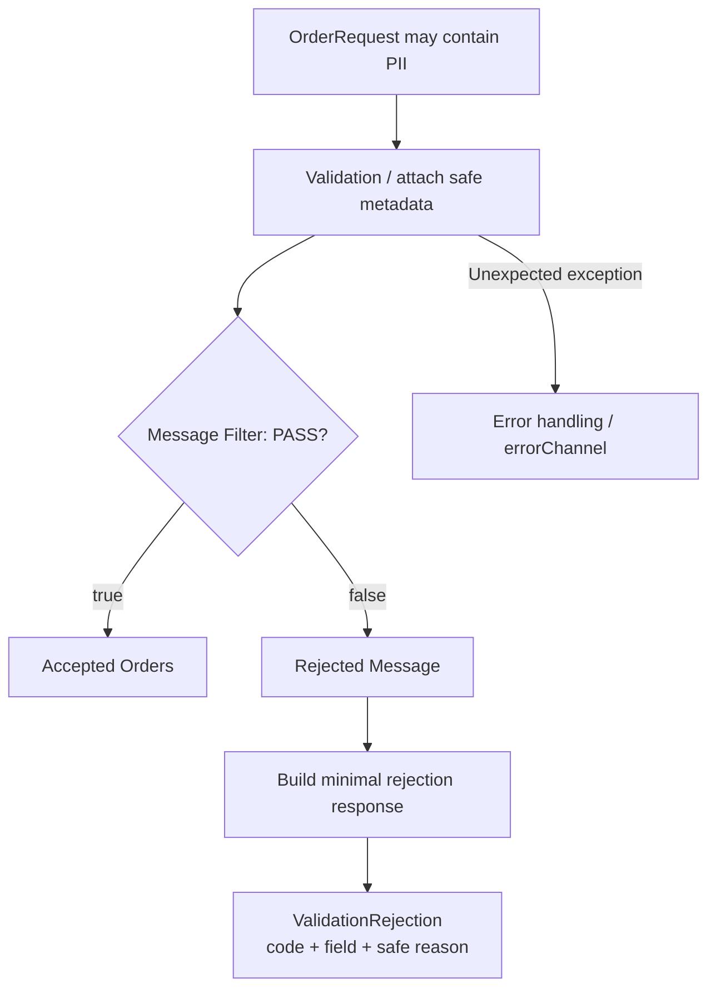
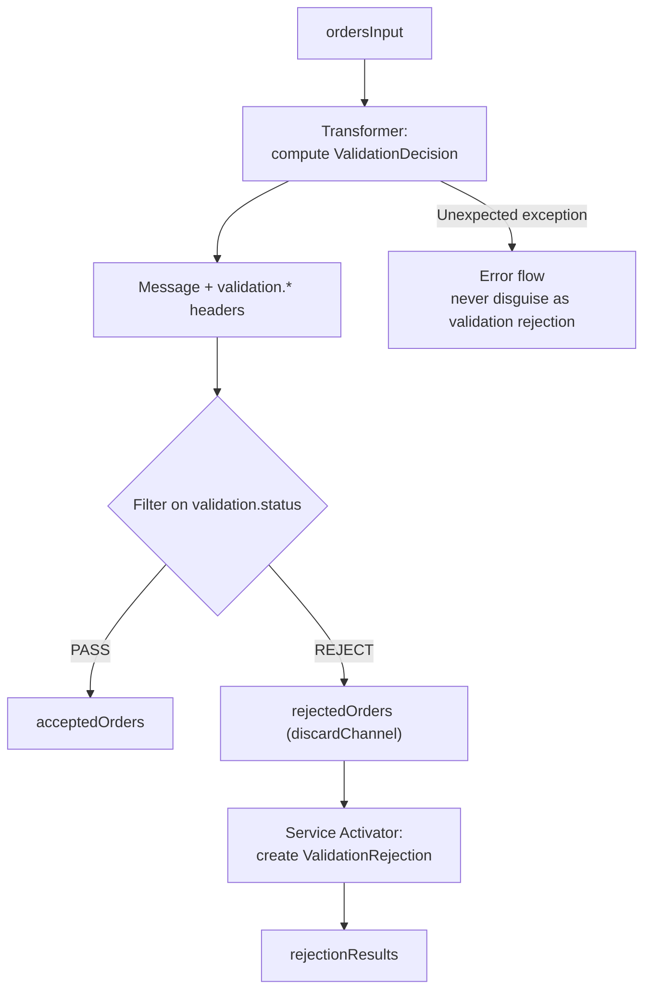
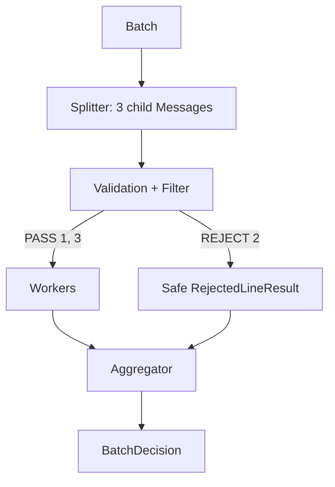
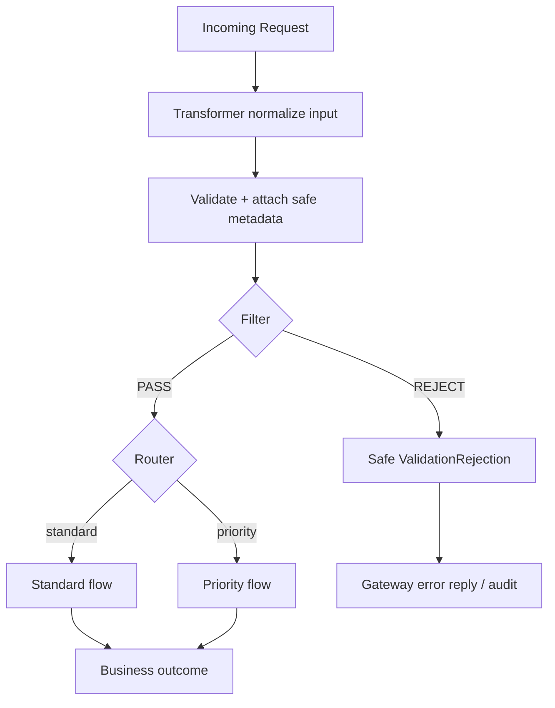

# Preserving Errors and Reasons in Safe Metadata

In an integration system, a `Message Filter` is commonly used to let valid Messages proceed and block Messages that fail criteria. For instance, an order missing an order ID, having an empty line list, or carrying an invalid quantity should not enter inventory reservation. However, if a Filter simply returns `false` and drops the Message, operators and callers cannot tell **why the request was rejected**, making retries and investigations difficult.

A useful solution is attaching **structured, safe validation metadata** before the Filter decides: validation status, a standardized error code, the offending field name, and a concise reason from an allowed catalog. When the Filter routes the Message to the rejection branch, downstream components can read this metadata to build a response, write audits, or record metrics **without logging the full payload or raw exceptions**.

Yet Spring Integration headers can travel across many processing steps, adapters, and external systems. Putting customer emails, access tokens, payment data, stack traces, or full user payloads into headers risks leaking them into logs, brokers, traces, or dead-letter queues. Therefore, the goal is not merely "keeping errors", but **preserving enough reason to act while minimizing and controlling exposed data**.

The lesson **Preserving Errors and Reasons in Safe Metadata** belongs to the **Message filter and validation** chapter of the `SPRING_INTEGRATION_PATTERN` module. The module focuses on implementing Enterprise Integration Patterns with Spring Integration to build loosely coupled, extensible flows using Router, Filter, Transformer, Splitter, Aggregator, Gateway, retry, error channel, and correlation, while testing and observing processing branches. This lesson guides you through designing a **metadata contract**, building a validation–filter–reject flow, distinguishing business errors from infrastructure failures, protecting sensitive data, and verifying behavior with JUnit.

## 1. From a Boolean-Only Filter to an Explainable Filter

Consider a Message carrying an order payload:

```json
{
  "tenantId": "tenant-7",
  "requestId": "req-1001",
  "orderId": "",
  "customerEmail": "customer@example.test",
  "lines": [
    {"sku": "BOOK-01", "quantity": 2}
  ]
}
```

`orderId` is blank, so the Message must not continue. A plain Filter:

```java
return order.orderId() != null && !order.orderId().isBlank();
```

returns `false`, yet fails to express **which error**, **which field**, or **how to respond to the caller**.

Instead of dumping full error details into logs, you can construct a Message with attached metadata:

```text
payload:
  OrderRequest(... customerEmail="customer@example.test" ...)

headers:
  validation.status = REJECT
  validation.code   = ORDER_ID_REQUIRED
  validation.field  = orderId
  validation.reason = Order ID is required
  requestId         = req-1001
```

**Important note:** the payload above still contains the email. Safely designed metadata **does not automatically make the payload safe**. If the Message is routed to a dead-letter queue, logs, or external brokers, you still need separate policies controlling payload handling, header propagation, access permissions, and retention.



These three branches carry distinct meanings: **valid to process**, **expected validation rejection**, and **unexpected execution failure**.

## 2. Three Kinds of Information That Should Not Be Mixed

| Category | Example | Purpose | Appropriate placement |
| --- | --- | --- | --- |
| **Business data** | `orderId`, `customerEmail`, `lines` | Order processing | Payload with proper access controls |
| **Safe validation metadata** | `ORDER_ID_REQUIRED`, `orderId`, `REJECT` | Explain validation decision | Controlled headers or envelope |
| **Technical diagnostic details** | SQL exception, stack trace, internal endpoint | Debugging/incident ops | Secured internal logs/error store, not broadcast arbitrarily |

An *error code* can go into headers or responses to guide routing and feedback. A **raw exception** is rarely suitable as metadata propagated across multiple systems.

### 2.1. `reasonCode` Differs from `exception.getMessage()`

`reasonCode="ORDER_ID_REQUIRED"` is bounded, stable, documentable, and measurable.

`exception.getMessage()` may contain:

- Input data values like emails, phone numbers, or access tokens.
- Table names, column names, SQL, or database internals.
- Internal URLs, service addresses, or account identities.
- Very long client-crafted strings.
- Details that vary across library versions, environments, or deployments.

Therefore, **never use an arbitrary exception message as a safe reason in headers**. If users need friendly messages, translate `reasonCode` through a controlled catalog at the response layer.

### 2.2. Business Error Codes Are Not Technical States

| Situation | Classification | Should auto-retry? |
| --- | --- | --- |
| Blank `orderId` | `VALIDATION_REJECTED` | Usually no; caller must fix |
| Empty `lines` | `VALIDATION_REJECTED` | Usually no |
| A line with `quantity <= 0` | `VALIDATION_REJECTED` | Usually no |
| Validator database temporarily down | `TECHNICAL_FAILURE` | Possibly, with limits |
| Parser hits malformed payload | `INVALID_REQUEST_FORMAT` at ingress or contract error | Depends on policy, never fake PASS |
| Validator code throws `NullPointerException` | Implementation bug | Needs error flow/investigation |

Never catch every `Exception` and convert it into `REJECT` with a fake business code. Doing so hides infrastructure outages and can cause improper ACKs.

## 3. Minimal Validation Metadata Contract

A proposed design uses four header fields:

| Header | Type | Example value | Constraints |
| --- | --- | --- | --- |
| `validation.status` | `String` | `PASS`, `REJECT` | Allowlisted values |
| `validation.code` | `String` | `ORDER_ID_REQUIRED` | Server-controlled code |
| `validation.field` | `String` | `orderId` | Schema field name, contains no value |
| `validation.reason` | `String` | `Order ID is required` | Short catalog string, no input interpolation |

Adding a **trusted** `requestId` or `correlationId` helps trace decisions, though those are **processing attempt identifiers**, not error reasons.

Serializable metadata example:

```json
{
  "validation.status": "REJECT",
  "validation.code": "LINE_QUANTITY_INVALID",
  "validation.field": "lines.quantity",
  "validation.reason": "Every line quantity must be positive",
  "requestId": "req-1001"
}
```

**The table and JSON represent an application-level contract proposal, not default Spring Integration header names.** When mapping across brokers or HTTP, explicitly specify names, types, versions, and forwarding rules.

### 3.1. When Validation Succeeds

You do not need a verbose `reason` on valid Messages. However, to keep tests simple, you can use:

```text
validation.status = PASS
validation.code   = NONE
validation.field  = NONE
validation.reason = Validation passed
```

These are fixed constants that leak no data. In larger systems, you can trim this to `status=PASS` or omit metadata on success, as long as the **Filter contract stays consistent**.

### 3.2. Do Not Put Unbounded Error Lists in Headers

If a batch has 100,000 invalid records, copying every error into `MessageHeaders` causes:

- Bloated heap usage and Message size.
- Exceeded broker/transport header size limits.
- Data exposure if formatters accidentally include invalid values.
- High-cardinality metrics and unmanageable logs.

Choose a **primary error code** or a bounded set of codes, while storing lengthy detailed reports in an access-controlled location referenced by a `reportId`.

## 4. Error Catalog: Stable, Bounded, and PII-Free

Example error catalog:

| `validation.code` | `validation.field` | `validation.reason` | Caller action |
| --- | --- | --- | --- |
| `ORDER_ID_REQUIRED` | `orderId` | `Order ID is required` | Supply order ID |
| `LINES_REQUIRED` | `lines` | `At least one order line is required` | Send line list |
| `LINE_SKU_REQUIRED` | `lines.sku` | `Every line must have an SKU` | Check SKU |
| `LINE_QUANTITY_INVALID` | `lines.quantity` | `Every line quantity must be positive` | Fix quantity |
| `REQUEST_ID_REQUIRED` | `requestId` | `Request ID is required` | Supply request identifier |
| `TENANT_ID_REQUIRED` | `tenantId` | `Tenant ID is required` | Verify tenant info |

Key rules:

1. **Codes must be produced by server code**, never copied verbatim from client input.
2. **Reasons must come from a static catalog**, never concatenating `email`, tokens, or line item contents.
3. **Fields must be allowlisted field names**, never arbitrary client-supplied JSONPaths.
4. **Lengths must be bounded**; enforce at creation time or at the Message-sending boundary.
5. **Catalogs need versioning/compatibility policies** when multiple systems consume the same metadata.

### 4.1. Never Turn Reasons Into Input Echoes

**Avoid** creating:

```java
String reason = "Invalid email: " + request.customerEmail();
```

because `customerEmail` will enter the header and may be written into traces, retry stores, or logs.

**Prefer**:

```java
String code = "CUSTOMER_EMAIL_INVALID";
String reason = "Customer email is invalid";
```

If you need to point to the offending line, use a **bounded integer index** in a dedicated response rather than stuffing the line's entire content into a header. Bounds must apply to the index as well.

## 5. Two Error-Preservation Models: Metadata on the Message vs Dedicated Rejection Result

### 5.1. Metadata on the Original Message

A Transformer or validation step can keep the payload intact and attach `validation.*` fields before the Filter runs.

```text
Message<OrderRequest> + validation headers
                   |
                   v
                 Filter
          +--------+--------+
          |                 |
       accepted           rejected
```

Advantage: the rejection branch can inspect **why** the Message was filtered out; tracing correlation/headers naturally flow across endpoints in the same flow.

Drawback: the **rejected Message still carries the original payload**, which may hold sensitive data. Never log `Message.toString()` or forward the raw Message to low-privilege audit systems.

### 5.2. Minimal Rejection Result

After the Filter routes the Message to `discardChannel`, a handler can construct:

```json
{
  "requestId": "req-1001",
  "orderId": null,
  "errorCode": "ORDER_ID_REQUIRED",
  "field": "orderId",
  "safeReason": "Order ID is required"
}
```

Now the output holds only the data needed by the caller or rejection handler. You can even **omit `orderId` if unnecessary or considered sensitive**. Never blindly copy every header and the full original payload into rejection results.

### 5.3. Choosing a Model by Trust Boundary

| Situation | Recommendation |
| --- | --- |
| Validation and Filter in the same JVM | Can pass safe metadata on the original Message |
| Returning validation responses over HTTP | Convert to a safe DTO, restricting exposed fields |
| Publishing rejections to an external broker | Allowlist headers + minimal payload or encryption |
| Audit/analytics | Store code/field/status, limit identifiers and retention |
| Complex failure investigation | Write to access-controlled internal logs, link via trace/request ID |

## 6. Fitting EIP Chain: Validate → Attach Metadata → Filter → Handle Reject

An easily testable flow:



Because a Filter typically evaluates only a predicate, computing errors **once** upfront avoids:

```text
filterPredicate checks rule set A
discardHandler recomputes rule set B
```

If the two steps differ in logic or depend on mutable data, the error code may no longer match the real decision.

**Contract in this lesson:** the validation step creates metadata; the Filter reads only `validation.status`; the discard branch uses the already-generated `validation.code/field/reason` to build the rejection result.

## 7. Domain Model for the Java 17+ Example

An order with line items and a customer email included specifically to demonstrate **not leaking PII into metadata**.

```java
package example.integration;

import java.util.List;

public final class OrderValidationModel {

    private OrderValidationModel() {
    }

    public record Line(String sku, int quantity) {
    }

    public record OrderRequest(
            String tenantId,
            String requestId,
            String orderId,
            String customerEmail,
            List<Line> lines) {
    }

    public record ValidationDecision(
            boolean valid,
            String code,
            String field,
            String safeReason) {
    }

    public record ValidationRejection(
            String requestId,
            String orderId,
            String errorCode,
            String field,
            String safeReason) {
    }
}
```

`OrderRequest` permits nulls in the example to **illustrate validation**, so the record does not enforce everything in its constructor. In a real application, you can place validation at ingress/DTOs and use a record holding only validated data, while avoiding **throwing exceptions without an explicit error-response policy**.

`ValidationRejection` omits `customerEmail`, line item details, and internal exceptions. Even so, `orderId` and `requestId` remain identifiers requiring access control rather than being public data by default.

## 8. Pure Validation Logic: Returning Error Codes from the Catalog

A validator should not call external services just to return a boolean when enforcing basic structural rules.

```java
package example.integration;

import example.integration.OrderValidationModel.*;

public final class OrderValidator {

    private OrderValidator() {
    }

    public static ValidationDecision validate(OrderRequest request) {
        if (request.tenantId() == null
                || request.tenantId().isBlank()) {
            return reject("TENANT_ID_REQUIRED",
                    "tenantId", "Tenant ID is required");
        }

        if (request.requestId() == null
                || request.requestId().isBlank()) {
            return reject("REQUEST_ID_REQUIRED",
                    "requestId", "Request ID is required");
        }

        if (request.orderId() == null
                || request.orderId().isBlank()) {
            return reject("ORDER_ID_REQUIRED",
                    "orderId", "Order ID is required");
        }

        if (request.lines() == null || request.lines().isEmpty()) {
            return reject("LINES_REQUIRED",
                    "lines", "At least one order line is required");
        }

        for (Line line : request.lines()) {
            if (line == null || line.sku() == null
                    || line.sku().isBlank()) {
                return reject("LINE_SKU_REQUIRED",
                        "lines.sku", "Every line must have an SKU");
            }

            if (line.quantity() <= 0) {
                return reject("LINE_QUANTITY_INVALID",
                        "lines.quantity",
                        "Every line quantity must be positive");
            }
        }

        return new ValidationDecision(
                true, "NONE", "NONE", "Validation passed");
    }

    private static ValidationDecision reject(
            String code, String field, String reason) {
        return new ValidationDecision(false, code, field, reason);
    }
}
```

Every `code`, `field`, and `safeReason` in the validator comes from **application-defined constants**. Neither `request.customerEmail()` nor `line.sku()` is ever interpolated into the returned reason.

### 8.1. Why Return a `ValidationDecision` Instead of Throwing an Exception?

Errors like `ORDER_ID_REQUIRED` and `LINES_REQUIRED` are **expected outcomes from invalid input**. Returning `ValidationDecision` lets the Filter pick the reject branch without turning every bad input into a technical error requiring retry.

Conversely, if the validator hits a programming bug or an unavailable dependency, it must not silently fabricate a `ValidationDecision(valid=false)` that misrepresents the failure. Let such errors flow through your **technical error policy**.

### 8.2. Why Return Only the First Error?

This is a demo policy that keeps metadata size predictable. In APIs requiring multiple errors, build a **size-bounded** list of `ValidationIssue(code, field)` in a rejection response or access-controlled error report. Never dump an unbounded error list into headers.

### 8.3. Business Rules Changing After Validation

For instance, inventory may change after checking `quantity > 0`. `PASS` metadata only proves **validation succeeded at check time under the chosen rule set**; it does not replace inventory checks or authorization right before side effects. Never treat a `PASS` header as a pass-through ticket skipping downstream checks.

## 9. Spring Integration: Transformer Attaching Safe Metadata

We use `@Transformer` to produce a Message preserving the payload while adding validation headers.

```java
package example.integration;

import org.springframework.context.annotation.Bean;
import org.springframework.context.annotation.Configuration;
import org.springframework.integration.annotation.Filter;
import org.springframework.integration.annotation.ServiceActivator;
import org.springframework.integration.annotation.Transformer;
import org.springframework.integration.channel.DirectChannel;
import org.springframework.integration.channel.QueueChannel;
import org.springframework.integration.config.EnableIntegration;
import org.springframework.messaging.Message;
import org.springframework.messaging.MessageChannel;
import org.springframework.messaging.PollableChannel;
import org.springframework.messaging.support.MessageBuilder;

import example.integration.OrderValidationModel.*;

@Configuration
@EnableIntegration
public class SafeValidationFilterConfiguration {

    public static final String STATUS = "validation.status";
    public static final String CODE = "validation.code";
    public static final String FIELD = "validation.field";
    public static final String REASON = "validation.reason";

    @Bean
    public MessageChannel ordersInput() {
        return new DirectChannel();
    }

    @Bean
    public MessageChannel taggedOrders() {
        return new DirectChannel();
    }

    @Bean
    public PollableChannel acceptedOrders() {
        return new QueueChannel(20);
    }

    @Bean
    public MessageChannel rejectedOrders() {
        return new DirectChannel();
    }

    @Bean
    public PollableChannel rejectionResults() {
        return new QueueChannel(20);
    }

    @Transformer(
            inputChannel = "ordersInput",
            outputChannel = "taggedOrders")
    public Message<OrderRequest> attachValidationMetadata(
            Message<OrderRequest> input) {

        ValidationDecision decision =
                OrderValidator.validate(input.getPayload());

        return MessageBuilder.fromMessage(input)
                .setHeader(STATUS, decision.valid() ? "PASS" : "REJECT")
                .setHeader(CODE, decision.code())
                .setHeader(FIELD, decision.field())
                .setHeader(REASON, decision.safeReason())
                .build();
    }

    @Filter(
            inputChannel = "taggedOrders",
            outputChannel = "acceptedOrders",
            discardChannel = "rejectedOrders")
    public boolean isValidated(Message<OrderRequest> input) {
        Object status = input.getHeaders().get(STATUS);

        if ("PASS".equals(status)) {
            return true;
        }
        if ("REJECT".equals(status)) {
            return false;
        }
        throw new IllegalStateException(
                "Missing or unknown server validation status");
    }

    @ServiceActivator(
            inputChannel = "rejectedOrders",
            outputChannel = "rejectionResults")
    public ValidationRejection createRejection(
            Message<OrderRequest> input) {
        OrderRequest request = input.getPayload();
        return new ValidationRejection(
                request.requestId(),
                request.orderId(),
                requiredHeader(input, CODE),
                requiredHeader(input, FIELD),
                requiredHeader(input, REASON));
    }

    private static String requiredHeader(
            Message<?> input, String headerName) {
        Object raw = input.getHeaders().get(headerName);
        if (!(raw instanceof String value)
                || value.isBlank()
                || value.length() > 100) {
            throw new IllegalStateException(
                    "Invalid server validation metadata: " + headerName);
        }
        return value;
    }
}
```

### 9.1. Analyzing Each Endpoint

1. `ordersInput` receives `Message<OrderRequest>`.
2. `@Transformer` runs validation once, sets the **four headers** from the catalog, and preserves the payload.
3. `@Filter` inspects only `validation.status`. `PASS` proceeds to `acceptedOrders`.
4. On `REJECT`, the Filter routes the **rejected Message** to `rejectedOrders` via `discardChannel`.
5. `@ServiceActivator` on the reject branch constructs the minimal `ValidationRejection` DTO and sends it to `rejectionResults`.
6. Missing or unknown statuses are never treated as `PASS`: the code throws a configuration/contract error for the error flow to handle.

**Retain or strip payload fields according to downstream permissions.** This example keeps `OrderRequest` inside the Message sent to `rejectedOrders` so the handler can read `requestId` and `orderId`, yet **does not forward the raw payload to `rejectionResults`**.

### 9.2. Why Place a Transformer Before the Filter?

If all validation lives inside a boolean predicate, a `false` result usually lacks structured reasons. Splitting into:

```text
ValidationDecision → metadata → Filter → rejection result
```

computes metadata once and makes it easy to inspect which headers travel with which Message.

Another option is creating a `ValidatedOrder` containing both the order and `ValidationDecision` inside the payload, then filtering on the envelope's decision. That fits transports where headers are not preserved; no single choice fits every system.

### 9.3. Filter Rejection Modes

In the example, the Filter has `discardChannel="rejectedOrders"` to receive Messages failing the predicate. Without a configured discard channel or response mechanism, filtered-out Messages may **never produce a reply** for the caller.

Another mode is **throwing an error on rejection** (such as `throwExceptionOnRejection` on Filter configurations), though throwing an exception does not automatically build a `ValidationRejection` with safe code/field metadata. Choose deliberately between **business rejection** and **technical exception**.

### 9.4. Which Headers Are Trustworthy?

Here `validation.status` is **recomputed and overwritten by the server** on the Message. If an external client sends `validation.status=PASS`, never allow the client to steer the Filter's decision. You should:

- Strip `validation.*` headers arriving from untrusted boundaries.
- Run validation in server-side code.
- Allow only authorized endpoints to attach/modify validation metadata.
- Treat validation headers as **check results**, not access credentials or security signatures.

If a Message has crossed an untrusted adapter, re-verify critical attributes before side effects instead of blindly trusting headers.

## 10. Demo: Sending One Valid Order and One Rejected Order

A small application using the configured channels:

```java
package example.integration;

import java.util.List;

import org.springframework.context.annotation.AnnotationConfigApplicationContext;
import org.springframework.messaging.Message;
import org.springframework.messaging.MessageChannel;
import org.springframework.messaging.PollableChannel;
import org.springframework.messaging.support.MessageBuilder;

import example.integration.OrderValidationModel.*;

public class SafeValidationDemo {

    public static void main(String[] args) {
        try (var context = new AnnotationConfigApplicationContext(
                SafeValidationFilterConfiguration.class)) {

            MessageChannel input = context.getBean(
                    "ordersInput", MessageChannel.class);
            PollableChannel accepted = context.getBean(
                    "acceptedOrders", PollableChannel.class);
            PollableChannel rejected = context.getBean(
                    "rejectionResults", PollableChannel.class);

            OrderRequest good = new OrderRequest(
                    "tenant-7", "req-good", "ORD-1001",
                    "person@example.test",
                    List.of(new Line("BOOK-01", 2)));

            OrderRequest bad = new OrderRequest(
                    "tenant-7", "req-bad", "",
                    "person@example.test",
                    List.of(new Line("BOOK-01", 2)));

            input.send(MessageBuilder.withPayload(good).build());
            input.send(MessageBuilder.withPayload(bad).build());

            Message<?> acceptedMessage = accepted.receive(0);
            Message<?> rejectedMessage = rejected.receive(0);

            if (acceptedMessage == null || rejectedMessage == null) {
                throw new IllegalStateException("Missing expected output");
            }

            System.out.println(
                    acceptedMessage.getHeaders().get(
                            SafeValidationFilterConfiguration.STATUS));

            ValidationRejection result =
                    (ValidationRejection) rejectedMessage.getPayload();
            System.out.println(result.errorCode());
            System.out.println(result.safeReason());
        }
    }
}
```

Expected output:

```text
PASS
ORDER_ID_REQUIRED
Order ID is required
```

The demo intentionally **avoids printing the raw payload**, email, full Message, or unrelated headers. In real applications, logging should pass through redaction/allowlist configurations rather than relying on developers always remembering to avoid `toString()`.

`DirectChannel` runs the sample handlers synchronously; the output `QueueChannel`s hold Messages for tests to read. With async/broker channels, `send()` completing does not prove the business handler finished; use bounded waits, correlation, and appropriate error handling.

## 11. JUnit 5: Successful Validation Produces No Errors

A unit test calling `OrderValidator.validate(...)` directly is helpful, yet it does not prove the Filter routed to the right channel. The integration test below verifies **routing and metadata**:

```java
package example.integration;

import static org.junit.jupiter.api.Assertions.*;

import java.util.List;

import org.junit.jupiter.api.Test;
import org.springframework.context.annotation.AnnotationConfigApplicationContext;
import org.springframework.messaging.Message;
import org.springframework.messaging.MessageChannel;
import org.springframework.messaging.PollableChannel;
import org.springframework.messaging.support.MessageBuilder;

import example.integration.OrderValidationModel.*;

class SafeValidationFilterIntegrationTest {

    @Test
    void validOrderPassesWithSafePassMetadata() {
        try (var context = new AnnotationConfigApplicationContext(
                SafeValidationFilterConfiguration.class)) {

            MessageChannel input = context.getBean(
                    "ordersInput", MessageChannel.class);
            PollableChannel accepted = context.getBean(
                    "acceptedOrders", PollableChannel.class);
            PollableChannel rejected = context.getBean(
                    "rejectionResults", PollableChannel.class);

            OrderRequest valid = new OrderRequest(
                    "tenant-7", "req-1", "ORD-1001",
                    "private@example.test",
                    List.of(new Line("BOOK-01", 2)));

            assertTrue(input.send(
                    MessageBuilder.withPayload(valid).build()));

            Message<?> message = accepted.receive(0);
            assertNotNull(message);
            assertEquals(valid, message.getPayload());
            assertEquals("PASS", message.getHeaders().get(
                    SafeValidationFilterConfiguration.STATUS));
            assertEquals("NONE", message.getHeaders().get(
                    SafeValidationFilterConfiguration.CODE));
            assertNull(rejected.receive(0));
            assertNull(accepted.receive(0));
        }
    }
}
```

This tests the validator, transformer, and filter together in the same application context. It verifies that valid Messages **arrive at the right output channel**, not merely that a predicate returned `true`.

In flows with executors or brokers, an immediate `receive(0)` may return null before the handler finishes. Use a finite timeout and proper test synchronization instead of relying on `Thread.sleep`.

## 12. JUnit 5: Safe Errors Travel Through the Discard Channel

An even more important test proves that a Message containing an email **never copies that email into validation metadata or the rejection result**.

```java
// Place this method inside SafeValidationFilterIntegrationTest.
@Test
void invalidOrderProducesSafeRejectionWithoutEmailInMetadata() {
    try (var context = new AnnotationConfigApplicationContext(
            SafeValidationFilterConfiguration.class)) {

        MessageChannel input = context.getBean(
                "ordersInput", MessageChannel.class);
        PollableChannel accepted = context.getBean(
                "acceptedOrders", PollableChannel.class);
        PollableChannel rejected = context.getBean(
                "rejectionResults", PollableChannel.class);

        String privateEmail = "secret+customer@example.test";
        OrderRequest invalid = new OrderRequest(
                "tenant-7", "req-2", "",
                privateEmail,
                List.of(new Line("BOOK-01", 2)));

        assertTrue(input.send(MessageBuilder.withPayload(invalid).build()));
        assertNull(accepted.receive(0));

        Message<?> output = rejected.receive(0);
        assertNotNull(output);
        assertInstanceOf(ValidationRejection.class, output.getPayload());

        ValidationRejection result =
                (ValidationRejection) output.getPayload();
        assertEquals("req-2", result.requestId());
        assertEquals("ORDER_ID_REQUIRED", result.errorCode());
        assertEquals("orderId", result.field());
        assertEquals("Order ID is required", result.safeReason());

        // Validation response does not carry customerEmail.
        assertFalse(result.toString().contains(privateEmail));
        assertFalse(result.safeReason().contains(privateEmail));
        assertNull(rejected.receive(0));
    }
}
```

This test proves the **rejection DTO was built from the catalog without containing the email**. It **does not prove every header on every Message or broker adapter is clean**. To test a transport boundary, instrument/spy that specific adapter and assert fields after header mapping or serialization.

### 12.1. Testing That the Server Overwrites Untrusted Headers

Add a case:

```java
// Illustrative method to place in the same test class from section 11.
@Test
void clientSuppliedPassHeaderCannotBypassValidation() {
    try (var context = new AnnotationConfigApplicationContext(
            SafeValidationFilterConfiguration.class)) {

        MessageChannel input = context.getBean(
                "ordersInput", MessageChannel.class);
        PollableChannel accepted = context.getBean(
                "acceptedOrders", PollableChannel.class);
        PollableChannel rejected = context.getBean(
                "rejectionResults", PollableChannel.class);

        OrderRequest invalid = new OrderRequest(
                "tenant-7", "req-3", "",
                "secret@example.test",
                List.of(new Line("BOOK-01", 2)));

        assertTrue(input.send(
                MessageBuilder.withPayload(invalid)
                        .setHeader(
                                SafeValidationFilterConfiguration.STATUS,
                                "PASS")
                        .setHeader(
                                SafeValidationFilterConfiguration.CODE,
                                "NONE")
                        .build()));

        assertNull(accepted.receive(0));
        Message<?> output = rejected.receive(0);
        assertNotNull(output);
        assertEquals(
                "ORDER_ID_REQUIRED",
                ((ValidationRejection) output.getPayload()).errorCode());
    }
}
```

Because `@Transformer` **recomputes** and `setHeader` overwrites with server-decided values, a client-supplied `PASS` header cannot sneak an invalid Message past the Filter. At real ingress boundaries, strip client-sent validation headers altogether before entering internal flows.

## 13. Unit Tests: The Catalog Does Not Interpolate Input Data

Pure tests can verify the validator for each error code:

```java
package example.integration;

import static org.junit.jupiter.api.Assertions.*;

import java.util.List;

import org.junit.jupiter.api.Test;

import example.integration.OrderValidationModel.*;

class OrderValidatorTest {

    @Test
    void missingOrderIdUsesConstantReason() {
        String sensitive = "secret+person@example.test";

        ValidationDecision result = OrderValidator.validate(
                new OrderRequest(
                        "tenant-7", "req-4", "", sensitive,
                        List.of(new Line("BOOK-01", 2))));

        assertFalse(result.valid());
        assertEquals("ORDER_ID_REQUIRED", result.code());
        assertEquals("orderId", result.field());
        assertEquals("Order ID is required", result.safeReason());
        assertFalse(result.safeReason().contains(sensitive));
    }

    @Test
    void negativeQuantityUsesStableCode() {
        ValidationDecision result = OrderValidator.validate(
                new OrderRequest(
                        "tenant-7", "req-5", "ORD-1001",
                        "person@example.test",
                        List.of(new Line("BOOK-01", -3))));

        assertFalse(result.valid());
        assertEquals("LINE_QUANTITY_INVALID", result.code());
        assertEquals("lines.quantity", result.field());
    }

    @Test
    void validRequestHasPassStatus() {
        ValidationDecision result = OrderValidator.validate(
                new OrderRequest(
                        "tenant-7", "req-6", "ORD-1001",
                        "person@example.test",
                        List.of(new Line("BOOK-01", 1))));

        assertTrue(result.valid());
        assertEquals("NONE", result.code());
    }
}
```

**Unit tests guarantee the rule set and catalog are stable**, while integration tests guarantee the Filter and discard channel receive the right Messages. Testing metadata propagation across transports or log redaction requires separate tests at real boundaries.

## 14. Technical Errors: `errorChannel` Differs from `discardChannel`

This distinction is vital in Spring Integration:

| Path | Cause | Typical payload | Meaning |
| --- | --- | --- | --- |
| `acceptedOrders` | Filter predicate returns `true` | `OrderRequest` | Allowed to proceed |
| `rejectedOrders` | Filter predicate returns `false` | Message tagged with validation metadata | Expected rejection |
| `rejectionResults` | Handler converts discard into DTO | `ValidationRejection` | Safe reason for reply/audit |
| `errorChannel` (if configured) | Handler/adapter raises an exception | `ErrorMessage` carrying the failure | Technical incident requiring handling |

Never forward an `ErrorMessage` wrapping a `Throwable` onto a public validation-result channel. A `Throwable` may expose stack traces, nested causes, SQL, internal host addresses, or raw input values inside exception messages.

### 14.1. Synchronous Errors

In a flow using `DirectChannel`, exceptions from a handler typically propagate back to the caller through `send()` or a Gateway. They are not necessarily converted automatically into an `ErrorMessage` on `errorChannel`.

### 14.2. Asynchronous Errors

With a poller, executor, or inbound adapter, exceptions occurring on another thread can be routed to a configured error flow. The initial `send()` may succeed as soon as the Message enters a queue, without proving downstream validation or side effects completed.

### 14.3. How to Return Safe Technical Error Codes

At a **trusted error boundary**, map classified exceptions to codes such as:

```text
DEPENDENCY_TIMEOUT
VALIDATION_SERVICE_UNAVAILABLE
INTERNAL_PROCESSING_ERROR
```

Return only **allowlisted codes** and a generic message when the caller lacks permission to view details. Keep raw exceptions in access-controlled internal logs/error stores linked via `requestId` or trace ID. Never interpolate `exception.getMessage()` directly into metadata or responses.

## 15. Validation, Retry, Dead-Letter, and ACK Policy

The chosen branch impacts whether a broker should redeliver a Message:

| Outcome | Retry same payload? | Common handling |
| --- | --- | --- |
| Validation `REJECT` due to invalid data | Usually no | Return error, quarantine/audit as needed |
| Temporary DB connection error | Possibly | Bounded retry with backoff |
| Validation service unavailable | Possibly | Retry or circuit breaker |
| Unparseable schema-invalid payload | Depends on contract | Reject/DLQ with minimal reason |
| Unexpected programming bug | Do not retry infinitely | Investigate, bounded retry, or DLQ |

A broker Message ACKed early before validation runs can lose redelivery if the business service crashes. Conversely, endlessly redelivering a Message that **definitely violates the schema** creates a poison message loop.

**Discard does not mean ACK.** Input acknowledgment, transaction commit, and routing to `discardChannel` depend on the specific adapter/consumer and transaction configuration. Designs must clearly state who is responsible for ACKing, when it occurs, and whether it happens only after rejection outputs are durably persisted/delivered.

### 15.1. Is Putting the Full Payload Into a Dead-Letter Queue Safe?

Do not assume it is safe merely because validation metadata is safe. The original payload may still hold emails, addresses, account numbers, or sensitive attachments. Before sending to a DLQ:

1. Define which payloads may be retained.
2. Encrypt data and restrict access.
3. Do not retain uncontrolled raw headers.
4. Enforce retention/deletion policies.
5. Enforce access-controlled replay mechanisms.

A DLQ is not exempt from security requirements.

## 16. Do Not Break Correlation and Sequence When Filtering Messages

A Message from a Splitter may carry:

```text
correlationId = batch-attempt-01
sequenceNumber = 2
sequenceSize = 3
```

If validation finds line 2 invalid and the Filter **drops the Message outright** without emitting a corresponding outcome, a downstream Aggregator may receive only lines 1 and 3 while waiting forever for all three parts.



If business logic expects an outcome per line, the rejection branch can produce a **`RejectedLineResult`** preserving the valid group key and sequence number alongside a safe `errorCode`, feeding it into the same aggregation mechanism.

### 16.1. Not Every Case Requires Keeping Rejected Messages

For a pipeline that simply processes events matching a predicate **without expecting N total results**, discarding may be the exact right design. However, explicitly distinguish **event filtering** from a group awaiting all parts emitted by a Splitter.

### 16.2. Business Metadata and Validation Metadata Serve Different Purposes

- `correlationId` identifies the group.
- `sequenceNumber` identifies position within the group.
- `validation.code` explains why an element failed criteria.
- `requestId` traces the invocation.

Never use `validation.code` as the correlation key when aggregating **results of differing error types belonging to the same request**.

## 17. Filter, Router, Transformer, Gateway, and Content Enricher

A flow may combine:



### 17.1. Transformer

A Transformer can normalize payloads prior to validation, while avoiding dropping `requestId`, `tenantId`, or essential correlation metadata. When a Transformer creates a new Message, test actual header propagation instead of assuming every header survives across adapters.

### 17.2. Router

A Router picks where valid Messages go. **Never route on raw exception strings**; if branching on rejected results, route on `validation.code` from a controlled catalog.

### 17.3. Content Enricher

An Enricher can fetch extra info from external systems, such as customer profiles. Failures calling the enrichment service must be classified as **technical failures** per contract, not written into `validation.reason` as exception text. Nor does pre-enrichment validation metadata prove that subsequently enriched data is valid.

### 17.4. Gateway

A request-reply Gateway normally expects one reply per request. If a Filter drops the Message without sending a rejection result back along the reply path, the Gateway may time out.

Ensure a **safe reply** exists for validation failures, or define an explicit exception/response contract. In async processing, identify the request so rejection outcomes return to the right caller/request.

### 17.5. Idempotent Receiver

A retried/redelivered Message may hit the exact same validation error multiple times. When persisting audits per receipt, distinguish **one business event** from **multiple deliveries** so duplicates are not counted as separate independent requests.

## 18. Header Propagation and Transport Boundaries

Within a single JVM, Message headers can travel with the Message across endpoints. Across HTTP, Kafka, AMQP, or storage, **each adapter/header mapper enforces its own rules** on allowed names, types, and exported contents.

### 18.1. Allowlist Headers

Example policy for an outbound adapter:

```text
Allowed outbound validation headers:
  validation.status
  validation.code
  validation.field
  requestId (if permitted)

Not exported:
  validation.reason (if internal-only)
  security credentials
  raw exception or stack trace
  full headers dump
  internal replyChannel/errorChannel object
```

This is an **illustrative policy**, not universal configuration syntax across all adapters. Use the header-mapping mechanism specific to your transport/library.

### 18.2. Convert to a DTO/Envelope When a Stable Contract Is Needed

If receiving systems do not support Spring Integration header types or require schema versioning, move metadata into the payload:

```json
{
  "schemaVersion": 1,
  "requestId": "req-1001",
  "status": "REJECTED",
  "error": {
    "code": "ORDER_ID_REQUIRED",
    "field": "orderId"
  }
}
```

This response payload intentionally **omits** `customerEmail`, raw requests, and stack traces. For public-facing errors, `requestId` should be unguessable or access-controlled before revealing associated details.

### 18.3. Never Use Validation Headers as Security Principals

A `validation.status=PASS` header can be forged by an untrusted producer or Message interceptor. It is not proof of authentication or authorization. Enforce permissions using a verified security context at the proper trust boundary, never a client-declarable string.

## 19. Logging: Preserve Reasons Without Exposing Data

A structured log might record:

```json
{
  "stage": "order-validation-filter",
  "requestId": "req-1001",
  "validationStatus": "REJECT",
  "errorCode": "ORDER_ID_REQUIRED",
  "field": "orderId",
  "flow": "rejection",
  "businessOperation": "CREATE_ORDER"
}
```

**Do not** log:

```text
Rejected message: Message[payload=OrderRequest(
  customerEmail=secret+person@example.test,
  paymentToken=...
), headers=...]
```

In practice, many logging frameworks eagerly call `toString()` on objects. Consequently, even convenient Java records created for demos must not be logged wholesale in environments carrying customer data.

### 19.1. Safe Logs Do Not Mean Losing Investigation Capability

A solid model maintains two tiers:

- **General operational logs:** status, errorCode, field, and controlled request/correlation IDs.
- **Restricted-access diagnostic store:** technical details sufficient for debugging, with redaction, encryption, audited access, and retention.

When support staff investigate failures, they query the privileged system using `requestId` instead of requiring full payloads in general logs.

### 19.2. Restrict Data at the Platform Layer

If a tracing tool automatically captures all Message headers, clean handler code alone is insufficient. Configure **observability hooks, tracing instrumentation, header mappers, DLQ serializers, and logging appenders** to strip sensitive fields.

## 20. Metrics: Error Codes Can Be Tags, User Values Must Not

Suggested metrics:

| Metric | Goal |
| --- | --- |
| `validation.messages.total` | Total Messages validated |
| `validation.accepted.total` | Messages passing |
| `validation.rejected.total` | Messages rejected |
| `validation.technical_failure.total` | Errors executing validation |
| `validation.rejection.delivery_failure` | Errors delivering rejection results |
| `validation.duration` | Validation duration |
| `validation.missing_metadata.total` | Messages reaching Filter missing expected headers |
| `validation.unknown_code.total` | Error codes outside the catalog |
| `validation.discard.total` | Messages routed via discard branch |

Metric names are **instrumentation suggestions**, not a complete built-in list emitted automatically by Spring Integration/Micrometer.

### 20.1. Cardinality

Tags that are safe when bounded to a fixed set:

```text
status = PASS | REJECT
code   = ORDER_ID_REQUIRED | LINES_REQUIRED | ...
flow   = validation | rejection
```

Avoid tags like:

```text
email
orderId
requestId
exceptionMessage
rawFieldValue
```

Those can spawn millions of distinct time series and leak sensitive data. `validation.reason` should also stay out of tags even when catalog-driven; `validation.code` is stabler and easier to manage.

## 21. Multi-Error Handling and Bounded Issue Lists

A single request can fail multiple checks simultaneously:

```text
orderId missing
lines[0].sku missing
lines[1].quantity invalid
```

Picking only the first error keeps flows simple, while a UI form may want to display multiple issues at once.

A safe response model:

```json
{
  "status": "REJECTED",
  "errors": [
    {"code": "ORDER_ID_REQUIRED", "field": "orderId"},
    {"code": "LINE_SKU_REQUIRED", "field": "lines.sku"},
    {"code": "LINE_QUANTITY_INVALID", "field": "lines.quantity"}
  ],
  "hasMoreErrors": false
}
```

For production readiness:

- Cap the **error count**, e.g., maximum 10 or 20 per API contract.
- Cap total response size.
- Emit only `code` and `field` from the catalog.
- If line positions are needed, allow a bounded numeric `lineIndex`.
- Never return `rejectedValue`, raw JSON bodies, or stack traces.
- Define deterministic ordering among errors.

When errors exceed the cap, return `hasMoreErrors=true` and/or an access-controlled `validationReportId`. Never cram a huge error list into a single header.

## 22. Defending Against Errors from Untrusted Sources

A sender might deliberately pass:

```text
validation.status = PASS
validation.code = NONE
validation.reason = "passed"
```

while sending a bad payload. Or they might send huge strings, newlines, or lookalike internal header names to corrupt logs or transports.

Principles:

1. **Never trust validation headers at ingress**; strip or overwrite them.
2. **Never echo raw input into reasons**; use catalog codes and messages.
3. **Validate header lengths and types** when crossing trust boundaries.
4. **Never use exception strings as metric names or router keys**.
5. **Never mix tenants** when storing audits or returning rejection replies.
6. **Never let callers read another request's raw errors** via request ID alone.
7. **Never route secrets into unprotected discard/dead-letter paths**.

### 22.1. Framework-Generated Metadata

Spring Messaging provides Message IDs and timestamps, while Spring Integration adds correlation/sequence metadata in relevant patterns. These fields help observability yet **do not replace** `validation.code`. Never assume `MessageHeaders.ID` is a stable business key across redeliveries.

### 22.2. Validation Does Not Mean Authorization

An order with a schema-valid payload may still belong to another tenant or come from an unauthorized sender. Enforce authorization using a trusted security context and business rules; never mark `PASS` and skip authorization in downstream endpoints.

## 23. Test Checklist for Safe Metadata

| Scenario | What to verify |
| --- | --- |
| Valid payload | Goes to `acceptedOrders`, status PASS, no rejection |
| Missing `orderId` | Goes to discard, code `ORDER_ID_REQUIRED` |
| Empty line list | Code `LINES_REQUIRED` |
| Blank SKU | Code `LINE_SKU_REQUIRED` |
| Zero/negative quantity | Code `LINE_QUANTITY_INVALID` |
| Client sends `validation.status=PASS` | Server overwrites it; still REJECTs bad input |
| Payload holds email/token | Absent from validator-generated metadata |
| Unknown/missing validation status at Filter | Never silently PASSes; routes to technical error flow |
| Exception inside validator | Not disguised as a validation rejection |
| Async handler failure | Errors observed at right layer, not via `send()` |
| Headers across Kafka/AMQP/HTTP | Only allowlisted headers are mapped/exported |
| Retrying invalid messages | No infinite retries; clear ACK/DLQ policy |
| Splitter with one rejected child | Aggregator never hangs unexpectedly for missing part |
| Gateway receives invalid input | Appropriate rejection/error response, no infinite wait |
| Logs/traces | Full Messages and sensitive data are not recorded |
| Metric labels | Only bounded enums/codes used as tags |

**Unit tests on `OrderValidator` alone are insufficient** to prove safe metadata in production. Log/trace boundaries, error flows, serializers, header mappers, brokers, DLQs, and API responses must all be tested against the real system.

## 24. Common Design Mistakes

| Symptom | Cause | Fix |
| --- | --- | --- |
| Caller only sees timeouts on bad input | Filter discards without replying | Emit explicit rejection result or error response |
| Unclear why Message was dropped | Predicate returns only boolean | Build `ValidationDecision` with code/field |
| Emails/tokens appear in logs | Input interpolated into reason/header or full Message logged | Use safe catalog, redaction, and separate audit |
| Infinite retries on permanent validation error | Rejection confused with technical exception | Classify errors, never retry poison inputs |
| DB failure returned as `ORDER_ID_REQUIRED` | Catching `Exception` and mis-mapping | Keep technical failures separate |
| Client passes `PASS` header to bypass Filter | Trusting ingress metadata | Recompute server-side, strip untrusted headers |
| Aggregator never completes | Filter dropped a child from the group | Emit rejected child result or adjust release policy |
| Broker rejects Message for oversized headers | Putting all errors in metadata | Cap error counts/bytes, use reportId |
| Metric series cardinality explodes | Tagging with requestId/email/free-form reasons | Tag only with finite status and catalog codes |
| Raw exceptions leak through API | Returning `ErrorMessage`/`Throwable` directly | Safe code-based error mapper |
| Correlation key lost | Transformer/adapter stripped headers | Test propagation and schemas/envelopes |
| Wrong tenant receives rejection | Trusting client-supplied `tenantId` | Trusted authorization and tenant context |
| Audits retain data too long | No retention/deletion rules | Define data lifecycle and access controls |
| Data still leaks from discard queue | Only metadata was sanitized while payload stayed intact | Sanitize payloads and guard boundaries |

## 25. Implementation Checklist

- **Define validation contract:** separate PASS/REJECT from technical failures.
- **Use an error catalog:** finite, consistent codes, fields, and safe reasons.
- **Never copy raw exception messages:** avoid stack traces, SQL, tokens, internal URLs.
- **Never interpolate input values:** especially emails, addresses, and payment info.
- **Bound metadata:** header count, length, types, and versions.
- **Generate metadata at trusted boundaries:** strip/overwrite client-sent validation headers.
- **Compute validation once:** prevent Filter and rejection handler from applying divergent rule sets.
- **Route explicitly:** PASS to accepted channel, REJECT through discard/response, exceptions to error policy.
- **Never log full Messages:** guard both payloads and headers.
- **Preserve correlation/sequence:** especially when Filters sit between Splitter and Aggregator.
- **Design retry/ACK:** validation rejections differ from DB timeouts.
- **Use minimal DTOs externally:** never send raw `OrderRequest` to lower-privilege systems.
- **Bound error lists:** never put large validation reports into headers.
- **Monitor with low-cardinality metrics:** status/errorCode instead of email/requestId.
- **Test security boundaries:** header mappers, serializers, DLQs, tracing, and audits.
- **Write JUnit unit and integration tests:** validator, routing, metadata, header injection, and zero PII leakage.

## 26. Practice Exercise: Three Errors, One Safe Response

A system receives:

```json
{
  "tenantId": "tenant-7",
  "requestId": "req-9001",
  "orderId": "",
  "customerEmail": "private.person@example.test",
  "paymentToken": "secret-token-must-not-leak",
  "lines": [
    {"sku": "", "quantity": -2}
  ]
}
```

Requirements:

1. List the business errors while **never** placing email/token into metadata.
2. Pick the priority `validation.code` if only one error can be kept.
3. If multiple errors may be returned, cap at three items containing only `code` and `field`.
4. Determine whether the Message goes to `acceptedOrders` or `rejectedOrders`.
5. Design logs/metrics with zero PII values and low cardinality.
6. Explain why a database connection failure occurring after validation must not be labeled `ORDER_ID_REQUIRED`.

A reasonable output if prioritizing `orderId` checks:

```json
{
  "validation.status": "REJECT",
  "validation.code": "ORDER_ID_REQUIRED",
  "validation.field": "orderId",
  "validation.reason": "Order ID is required"
}
```

If returning multiple errors, you can include `LINE_SKU_REQUIRED` and `LINE_QUANTITY_INVALID` in a **bounded** response. `customerEmail` and `paymentToken` never appear in metadata or responses; they must still be protected wherever raw payloads are retained downstream.

---

**Preserving errors and reasons in safe metadata means keeping exactly the information needed to decide, respond, and operate—not everything the system knows about the failure.** When validation produces catalog error codes, Filters act on explicit decisions, reject branches return minimal DTOs, and error flows stay separate from business errors, a Spring Integration system can both explain why a Message was rejected and prevent data leaks across headers, logs, brokers, and downstream branches.
