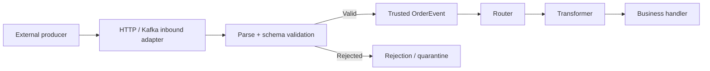
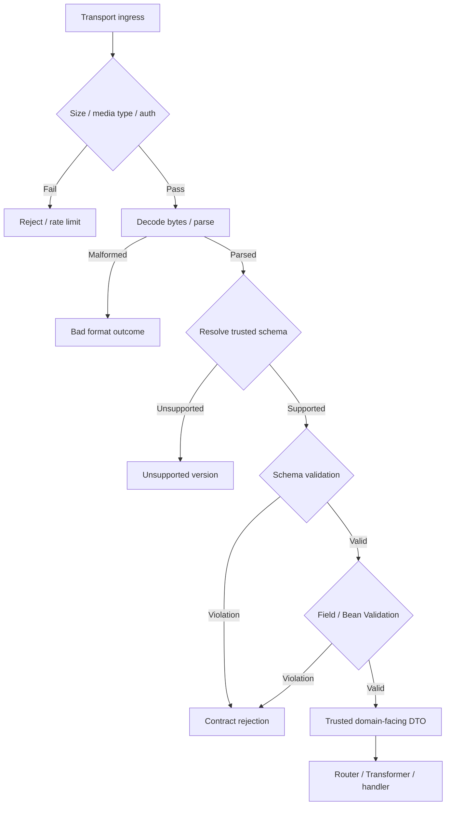
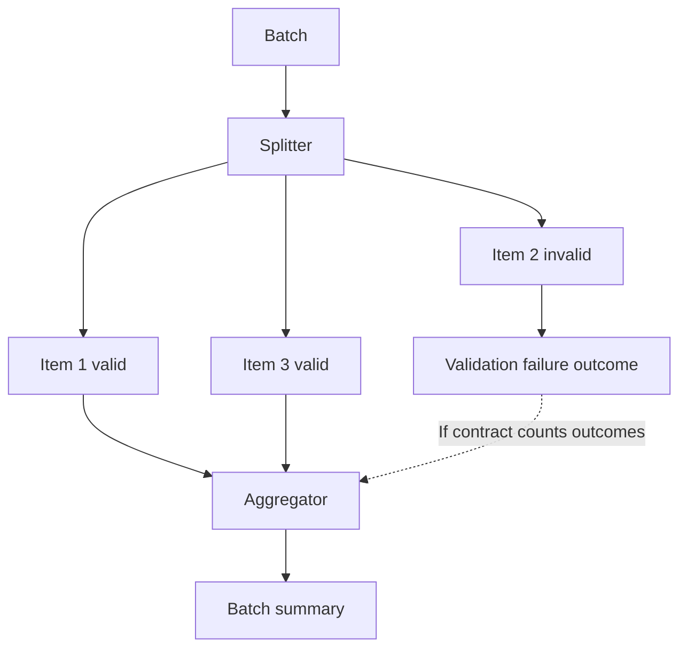
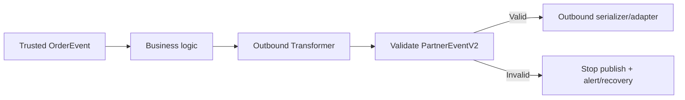
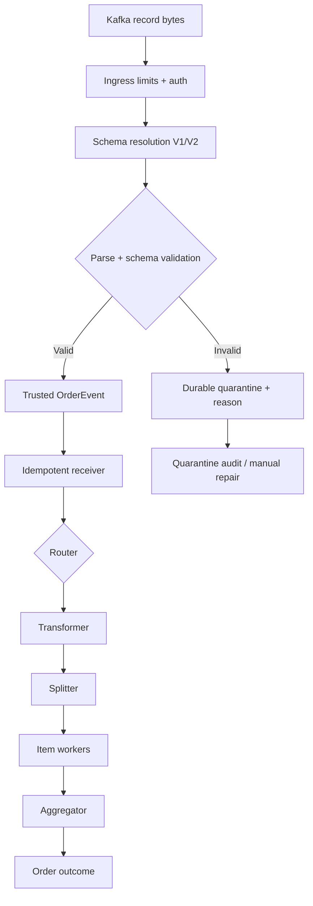

# Schema Validation at the Boundary

An `IntegrationFlow` may contain dozens of Routers, Transformers, Filters, Splitters, Aggregators, and Gateways, yet **not every endpoint should have to guess whether data is valid**. If a JSON message with wrong fields, a mismatched version, or out-of-range values travels deep into the system before being caught, errors can surface as `ClassCastException`, stalled groups, infinite retries, misrouted branches, or irreversible business side effects.

**Schema validation at the boundary** is the practice of verifying the *data contract right at the entry or exit boundary of a system or component*, before a message is treated as trusted data. The boundary may be an HTTP Gateway, a Kafka/AMQP inbound adapter, a file poller, a webhook, a message from another service, or an outbound payload prepared for a partner. This is the topic of this lesson in the **Message filter and validation** chapter of the `SPRING_INTEGRATION_PATTERN` module: learning to implement Enterprise Integration Patterns with Spring Integration to build loosely coupled, extensible message flows; coordinating Router, Filter, Transformer, Splitter, Aggregator, Gateway, retry, error channel, correlation, and testing/observing each processing branch.

**Learning goals:**

- Distinguish **decoding/parsing**, **schema validation**, **Bean Validation**, **business validation**, and **Filter**.
- Identify where to enforce the producer/consumer contract instead of scattering the same checks across the entire flow.
- Design JSON schemas with versioning, required fields, data types, size bounds, and unknown-field rules.
- Wire a boundary check into Spring Integration Java DSL, routing valid and invalid outcomes to two observable branches.
- Choose appropriate handling: returning HTTP errors, rejecting events with reasons, quarantine/DLQ, or bounded retries.
- Protect correlation/sequence, idempotency, security, and schema compatibility as the system evolves.
- Write unit/integration tests for valid schemas, malformed structure, wrong versions, wrong types, missing fields, oversized payloads, and multi-message scenarios.

## 1. Where Is the Boundary in a Message Flow?

Consider a system receiving order events from a partner:



A boundary can be viewed as a **contract checkpoint** between two parties. One side emits data in an agreed-upon representation; the other side accepts data only when it satisfies that agreement.

Boundaries do not necessarily coincide with **process boundaries**. In a large application, an internal module may expose its own channels/DTOs. If data between two modules is converted to a different contract, that boundary may also apply validation; however, there is no need to repeat the entire schema check at every hop once input is validated and messages cannot be tampered with or spoofed.

**Goal:** Move data from *untrusted bytes/envelopes* into *contract-verified objects* before performing routing, aggregation, and side effects.

### Wrong vs Right Examples

**Error-prone design:**

```text
Kafka bytes
  -> Router reads payload.orderType
  -> Transformer casts amount to long
  -> Handler calls payment
  -> Check whether amount is positive
```

If bad data is only caught near the end of the flow, payment may already have started.

**Cleaner design:**

```text
Kafka bytes
  -> Size/content-type limit
  -> JSON parse
  -> Schema version + structural validation
  -> Semantic field validation
  -> Authenticated context binding
  -> Router / Transformer / business handler
```

**This does not mean all business rules belong at the boundary.** Checks like "has the order already been paid?" depend on database state and belong in later business layers; the boundary only needs to guarantee the message **has the structure, version, and field constraints** needed for downstream code to operate safely.

## 2. Five Kinds of Checks Often Lumped Together as "Validation"

| Check layer | Question | Example failure | Where should it live? |
| --- | --- | --- | --- |
| **Transport/size** | Can bytes be received safely per protocol? | 100 MiB body exceeds quota, wrong Content-Type. | Ingress adapter/gateway, before large allocations or parsing. |
| **Parsing/deserialization** | Can bytes be decoded into a document/object? | JSON missing brace, encoding error. | Decoder/serializer at the boundary. |
| **Schema/contract** | Are fields, types, version, and cardinality right? | `quantity` is a string, missing `eventId`, unknown field. | Schema validator/registry/decoder. |
| **Field/semantic** | Are field values valid? | `quantity=-1`, unsupported `currency`. | Bean Validation or policy validator post-parse. |
| **Business rule/eligibility** | Should this work be accepted right now? | Order already canceled, customer over limit. | Business service, intentional Filter/Router. |

Overlaps can exist: JSON Schema also expresses `minimum`, `pattern`, `enum`; Bean Validation also checks `@NotBlank`, `@Positive`. What matters is **deciding the source of truth** for each constraint and testing so the two rule sets never drift apart.

### Validation Is Not Synonymous with Filter

A `Filter` in Enterprise Integration Patterns decides **whether a message proceeds or is excluded**. **Schema validation** decides **whether a message satisfies the input contract**.

- A structurally invalid JSON message usually needs **reasoned rejection/quarantine**, not silent dismissal as "uninteresting".
- A valid event outside a supported geographic region may be **audited and skipped by a Filter**.
- A valid message violating a business invariant may need a **business rejection** rather than a transport schema error.

Using `Filter` to implement validation is topologically viable, provided `discardChannel`, errors, and responses are defined—never simply return `false` and lose track of the event.

## 3. Payload, Envelope, and Headers: Verify the Right Layer

A Spring message has a **payload** and **headers**. Over a broker or HTTP, the payload may be bytes/strings while headers carry coordination metadata.

Example envelope:

```json
{
  "schemaVersion": 1,
  "eventId": "evt-1001",
  "orderId": "ORD-42",
  "lines": [
    {"sku": "SKU-A", "quantity": 2},
    {"sku": "SKU-B", "quantity": 1}
  ]
}
```

A Spring message after decoding might look like:

```text
payload = OrderEvent(version=1, eventId=evt-1001, ...)
headers:
  contentType   = application/json
  traceId       = trace-42
  correlationId = group-42       (if needed by flow)
  tenantId      = authenticated tenant context
  replyChannel  = internal reply channel (if any)
```

**Never treat every header as trustworthy.** External clients can supply `tenantId`, `role`, `correlationId`, or `replyChannel`. Successful parsing **neither authenticates the source nor grants data access**. Headers used for authorization must come from an authenticated context or be re-established at ingress.

### Payload Schema vs Envelope Schema

Two common choices exist:

1. **An envelope containing version and business payload:** The schema defines `eventId`, `eventType`, `schemaVersion`, and `data` together.
2. **An event payload carrying a version field:** The schema defines fields directly; transport metadata is verified separately.

Either way, you must know the **schema version corresponding to the payload**. Never rely on an untrusted version header to deserialize a payload into an arbitrary object.

## 4. Designing an Explicit JSON Schema Contract

Suppose a producer emits `OrderSubmittedV1` events. Using JSON Schema Draft 2020-12 as an example:

```json
{
  "$schema": "https://json-schema.org/draft/2020-12/schema",
  "$id": "https://contracts.example.invalid/order-submitted/v1",
  "title": "OrderSubmittedV1",
  "type": "object",
  "additionalProperties": false,
  "required": ["schemaVersion", "eventId", "orderId", "lines"],
  "properties": {
    "schemaVersion": {
      "const": 1
    },
    "eventId": {
      "type": "string",
      "minLength": 1,
      "maxLength": 128
    },
    "orderId": {
      "type": "string",
      "minLength": 1,
      "maxLength": 128
    },
    "lines": {
      "type": "array",
      "minItems": 1,
      "maxItems": 100,
      "items": {
        "type": "object",
        "additionalProperties": false,
        "required": ["sku", "quantity"],
        "properties": {
          "sku": {
            "type": "string",
            "minLength": 1,
            "maxLength": 64
          },
          "quantity": {
            "type": "integer",
            "minimum": 1,
            "maximum": 10000
          }
        }
      }
    }
  }
}
```

The `example.invalid` domain is strictly an **illustrative identifier**, requiring no web access. In real systems, schemas should have **stable identifiers/versions** managed in a contract repository or schema registry accessible to teams.

### Why Do These Keywords Matter?

| Keyword | Contract | Rejected cases |
| --- | --- | --- |
| `type: object` | Root payload must be an object. | `[]`, `"hello"`, `null`. |
| `required` | Essential fields must be present. | Missing `eventId` or `lines`. |
| `additionalProperties: false` | Rejects unrecognized fields in this version. | Unrecognized `isAdmin: true`. |
| `const: 1` | Message belongs to schema version 1. | `schemaVersion=9`. |
| `minItems: 1` | Order has at least one line. | `lines=[]`. |
| `maxItems: 100` | Caps batch size in the contract. | 100,000 lines. |
| `minimum/maximum` | Valid quantity per line. | 0 or huge numbers. |

**`additionalProperties: false` is an intentional compatibility choice**, not always the best rule. If older consumers must accept newer producers adding optional fields, an overly strict schema can break compatible changes. Unknown-field policies must be agreed upon between producers and consumers.

### JSON Schema Does Not Check All Semantics Automatically

A schema can guarantee `quantity` is a positive integer, yet it cannot know whether the **SKU exists in the current catalog** or whether **`orderId` is permitted** when checking a business database is required. Those checks belong in business services.

## 5. Valid and Invalid Message Examples

**Valid under V1:**

```json
{
  "schemaVersion": 1,
  "eventId": "evt-1001",
  "orderId": "ORD-42",
  "lines": [
    {"sku": "SKU-A", "quantity": 2}
  ]
}
```

**Wrong type:**

```json
{
  "schemaVersion": 1,
  "eventId": "evt-1002",
  "orderId": "ORD-43",
  "lines": [
    {"sku": "SKU-A", "quantity": "2"}
  ]
}
```

Here `"2"` is a **string**, not an **integer**. A deserializer with *coercion* enabled might convert it to `2`; if the contract demands exact JSON types, **validate schema before mapping or disable unwanted coercion**. Never let a parser silently "fix" bad data and claim the input matched the schema.

**Missing required field:**

```json
{
  "schemaVersion": 1,
  "orderId": "ORD-44",
  "lines": [
    {"sku": "SKU-A", "quantity": 2}
  ]
}
```

Missing `eventId` undermines deduplication and event traceability. Never auto-generate a new `eventId` for malformed data if the contract requires the producer to supply a stable identity.

**Unexpected field under strict V1:**

```json
{
  "schemaVersion": 1,
  "eventId": "evt-1003",
  "orderId": "ORD-45",
  "lines": [
    {"sku": "SKU-A", "quantity": 2}
  ],
  "extraFlag": true
}
```

If the V1 schema specifies `additionalProperties: false`, the message is rejected. If the contract permits extensions, define explicit versioning/namespacing and handling rules; never guess that `extraFlag` is an authorized feature.

## 6. Validating at Ingress in a Safe Order

An ingress validation pipeline should be designed so errors are caught **before expensive steps or side effects**.



**Recommended order:**

1. **Transport gate:** verify authentication, media type, and quota/body-size limits before reading/decompressing large payloads.
2. **Parse:** verify encoding/syntax; handle duplicate JSON keys or trailing tokens per policy.
3. **Schema selection:** resolve version/message type from a valid source and select the right contract.
4. **Schema validation:** verify shape, fields, types, constants, and bounds.
5. **DTO mapping/Bean Validation:** construct strongly typed objects and enforce additional field constraints if needed.
6. **Trusted context:** attach verified tenant/identity and internal trace/correlation policies.
7. **Business validation:** once shape is safe, look up DB/domain state as required.

**Never place all validation in a final handler after steps that already wrote to a DB, sent emails, or called payments.**

## 7. Validation Differs Between HTTP Gateways and Brokers

| Criterion | HTTP/Gateway inbound | Kafka/AMQP inbound |
| --- | --- | --- |
| Caller | Direct client waiting for a response. | Producer may not wait for consumer processing. |
| Bad payload | Can return 4xx per API contract. | Needs audited reject/quarantine/DLQ. |
| Retry | Client retries or gateway/proxy retries. | Broker redelivery, consumer retry/requeue. |
| Metadata | HTTP headers, auth context, content-type. | Broker headers, key/offset/delivery metadata. |
| Confirmation | HTTP response/acceptance. | Consumer ACK/commit, per adapter/transaction. |
| Permanent schema error | Usually tell client not to retry exact bytes forever. | **Never** requeue the poison message indefinitely. |
| Temporary error | Can return 503/retry. | Backoff/retry per consumer policy. |

Schema violations are mostly **data errors that will not self-heal by repeating identical payloads**. If a consumer nacks/requeues invalid JSON endlessly, it creates a **poison-message loop** that can block partitions/queues. Route it to quarantine or an error flow with enough context for repair/replay.

Conversely, if the schema registry is temporarily unreachable, that may be a **transient infrastructure failure**, completely different from a message failing a known schema.

### Which HTTP Status Codes to Use?

You can use `400 Bad Request` for malformed JSON, `415 Unsupported Media Type` for unsupported Content-Types, `422 Unprocessable Content` for content constraint validation, and `409 Conflict` for idempotency conflicts. However, these are **API contract choices**, not universal default mappings provided by Spring Integration. Gateways/controllers must translate error codes to matching responses without leaking stack traces.

## 8. Schema Registries and Version Identification

Schemas may be embedded in the application, hosted in a registry, or published as versioned artifacts.

```text
Event: OrderSubmitted
  schema v1
  schema v2
  schema v3

Consumer supports:
  v1, v2

Incoming version:
  v3  -> reject/park as UNSUPPORTED_SCHEMA_VERSION
```

### Use Event Name + Version Instead of Version Alone

`schemaVersion=2` alone is insufficient when a system handles multiple event types. An envelope can use:

```json
{
  "eventType": "OrderSubmitted",
  "schemaVersion": 2,
  "eventId": "evt-2001",
  "data": {
    "orderId": "ORD-200",
    "lines": []
  }
}
```

This example only illustrates **identification**; `lines=[]` may still be rejected if the `OrderSubmitted` contract requires at least one line.

During real validation, map `(eventType, schemaVersion)` or a stable schema ID to the **exact schema**; never build Java class names from external strings and enable uncontrolled polymorphic deserialization.

### Registry Outage Differs from Unsupported Schema

| State | Behavior |
| --- | --- |
| Supported schema version safely cached | Can validate using verified/pinned cached copy. |
| Version outside supported set | Reject/quarantine; never guess mappings. |
| Registry temporarily failing and schema uncached | Bounded retry/buffer or fail closed per policy. |
| Producer silently mutates a published schema ID | Broken contract governance; enforce immutable schemas/versions. |
| Schema updated with new fields | Verify compatibility before rollout. |

Schema caches must be pinned to versions/hashes; never let a V1 schema **silently change** between two incoming messages without migration management and observability.

## 9. JSON Schema, Avro, and Protobuf: Same Goal, Different Checkpoints

**JSON Schema** describes JSON shape and constraints, usually validating a `JsonNode`/document before DTO mapping. **Avro** and **Protocol Buffers** use binary contracts/schema-generated types; partial type checking occurs during deserialization, yet semantic field validation and version compatibility still require management.

| Technology | What is checked at boundary? | What not to assume |
| --- | --- | --- |
| JSON + JSON Schema | Fields, types, required, enums, bounds, schema version. | Parser auto-validates schema; unknown JSON fields always rejected. |
| JSON + Bean Validation | Annotation checks on DTO after parsing. | Parser disables type coercion; constraints ran on raw JSON. |
| Avro | Writer/reader schema, codec, compatibility rules. | Schema resolver always succeeds; business logic is auto-valid. |
| Protobuf | Decoder/generated message, field numbers, evolution policy. | Required-like business fields are guaranteed valid values. |
| XML + XSD | XML structure and types/namespaces per XSD. | XML parser is safe without XXE/entity-expansion protections. |

**Pick one authoritative contract and test your serializer/deserializer on the system's exact version.** Avoid conflicting contracts—e.g., a schema registry declaring a field optional while Bean Validation marks it `@NotNull`—unless that layering is intentional and documented.

## 10. Java 17+ DTOs and Bean Validation

Modeling the event from JSON Schema V1:

```java
import java.util.List;

import jakarta.validation.Valid;
import jakarta.validation.constraints.Max;
import jakarta.validation.constraints.Min;
import jakarta.validation.constraints.NotBlank;
import jakarta.validation.constraints.NotEmpty;
import jakarta.validation.constraints.Size;

record OrderLine(
        @NotBlank @Size(max = 64) String sku,
        @Min(1) @Max(10_000) int quantity
) {}

record OrderEvent(
        @Min(1) int schemaVersion,
        @NotBlank @Size(max = 128) String eventId,
        @NotBlank @Size(max = 128) String orderId,
        @NotEmpty @Size(max = 100)
        List<@Valid OrderLine> lines
) {}
```

The annotations use **Jakarta Bean Validation** and operate when a Jakarta Validation provider such as Hibernate Validator is present. In modern Spring Boot/Spring Framework applications, match dependencies to your version; never mix legacy `javax.validation` with `jakarta.validation` on Spring 6+.

### Schema and Bean Validation Are Not Identical

On `quantity`, the DTO uses primitive `int`. If JSON omits `quantity`, a mapper may default it to `0` or fail depending on configuration. Bean Validation `@Min(1)` catches `0`, yet **does not prove the field was present in JSON**. JSON Schema `required` explicitly verifies presence.

With `"quantity":"2"`, a coercion-permitting mapper can turn the string into an integer before Bean Validation runs. Thus you need **JSON-tree schema checks or strict deserializer settings** when the contract requires exact types.

## 11. Designing Typed Validation Results, Not Just `true/false`

A `valid` boolean suffices for a Filter, yet lacks details for debugging, quarantine, and client error responses.

```java
import java.util.List;

record ValidationIssue(
        String path,
        String code
) {}

record BoundaryVerdict(
        boolean accepted,
        OrderEvent event,
        List<ValidationIssue> issues
) {
    BoundaryVerdict {
        issues = List.copyOf(issues);
    }

    static BoundaryVerdict pass(OrderEvent event) {
        return new BoundaryVerdict(true, event, List.of());
    }

    static BoundaryVerdict reject(
            String path, String code) {
        return new BoundaryVerdict(
                false, null,
                List.of(new ValidationIssue(path, code)));
    }

    static BoundaryVerdict reject(
            List<ValidationIssue> issues) {
        return new BoundaryVerdict(false, null, issues);
    }
}
```

This contract is **application code**, not a built-in Spring Integration type. Normally you also add `eventId`/audit reference **when readable and verified**, schema version/ID, ingress source, timestamp, and a finite reason code. Never include full user payloads or stack traces in `ValidationIssue`.

### Failing Data May Not Be Trustworthy

If JSON fails to parse, an `eventId` inside it cannot be considered verified. Use an independent **ingress audit ID** for logs/quarantine; attach business IDs only after required fields and scopes have been verified.

## 12. Example Parser and Validation Gate at the Boundary

The example below shows an **in-JVM boundary gate**: byte-size check, JSON parsing, structural checks, DTO mapping, and Bean Validation. The code uses Jackson and Jakarta Validation; **the Java shape checks are an illustrative subset**, not a complete JSON Schema Draft 2020-12 engine.

### 12.1. Minimal Shape Checker

```java
import java.util.ArrayList;
import java.util.List;

import com.fasterxml.jackson.databind.JsonNode;

final class OrderV1ShapeGate {

    List<ValidationIssue> check(JsonNode json) {
        List<ValidationIssue> issues = new ArrayList<>();

        if (json == null || !json.isObject()) {
            return List.of(new ValidationIssue("$", "ROOT_NOT_OBJECT"));
        }

        JsonNode version = json.path("schemaVersion");
        if (!version.isIntegralNumber()
                || version.intValue() != 1) {
            issues.add(new ValidationIssue(
                    "$.schemaVersion", "UNSUPPORTED_VERSION"));
        }

        requireText(json, "eventId", issues);
        requireText(json, "orderId", issues);

        JsonNode lines = json.path("lines");
        if (!lines.isArray()
                || lines.isEmpty()
                || lines.size() > 100) {
            issues.add(new ValidationIssue(
                    "$.lines", "INVALID_LINES"));
            return issues;
        }

        for (int index = 0; index < lines.size(); index++) {
            JsonNode line = lines.get(index);
            String path = "$.lines[" + index + "]";

            if (!line.isObject()) {
                issues.add(new ValidationIssue(
                        path, "LINE_NOT_OBJECT"));
                continue;
            }

            requireText(line, "sku", issues, path);
            JsonNode quantity = line.path("quantity");

            if (!quantity.isIntegralNumber()
                    || quantity.longValue() < 1
                    || quantity.longValue() > 10_000) {
                issues.add(new ValidationIssue(
                        path + ".quantity", "INVALID_QUANTITY"));
            }
        }

        return issues;
    }

    private static void requireText(
            JsonNode node,
            String field,
            List<ValidationIssue> issues) {
        requireText(node, field, issues, "$");
    }

    private static void requireText(
            JsonNode node, String field,
            List<ValidationIssue> issues, String path) {
        JsonNode value = node.path(field);
        if (!value.isTextual() || value.textValue().isBlank()) {
            issues.add(new ValidationIssue(
                    path + "." + field, "REQUIRED_STRING"));
        }
    }
}
```

This checker does not replace a full JSON Schema validator: it **does not fully enforce `additionalProperties`, length constraints, all JSON number representations, or every JSON Schema keyword**. In production, use a standard JSON Schema library, load the versioned schema from section 4, and map library errors into `ValidationIssue`s with stable codes.

### 12.2. Boundary Service

```java
import java.util.List;
import java.util.Set;

import com.fasterxml.jackson.core.JsonProcessingException;
import com.fasterxml.jackson.databind.ObjectMapper;
import com.fasterxml.jackson.databind.JsonNode;

import jakarta.validation.ConstraintViolation;
import jakarta.validation.Validator;

final class OrderBoundaryService {
    private static final int MAX_BODY_BYTES = 64 * 1024;

    private final ObjectMapper mapper;
    private final Validator beanValidator;
    private final OrderV1ShapeGate shapeGate =
            new OrderV1ShapeGate();

    OrderBoundaryService(
            ObjectMapper mapper, Validator beanValidator) {
        this.mapper = mapper;
        this.beanValidator = beanValidator;
    }

    BoundaryVerdict inspect(byte[] bytes) {
        if (bytes == null || bytes.length == 0
                || bytes.length > MAX_BODY_BYTES) {
            return BoundaryVerdict.reject(
                    "$", "BODY_SIZE_INVALID");
        }

        try {
            JsonNode root = mapper.readTree(bytes);

            List<ValidationIssue> shape = shapeGate.check(root);
            if (!shape.isEmpty()) {
                return BoundaryVerdict.reject(shape);
            }

            OrderEvent event = mapper.treeToValue(
                    root, OrderEvent.class);

            Set<ConstraintViolation<OrderEvent>> violations =
                    beanValidator.validate(event);

            if (!violations.isEmpty()) {
                List<ValidationIssue> issues = violations.stream()
                        .map(v -> new ValidationIssue(
                                v.getPropertyPath().toString(),
                                "FIELD_CONSTRAINT_VIOLATION"))
                        .sorted(java.util.Comparator.comparing(
                                ValidationIssue::path))
                        .toList();
                return BoundaryVerdict.reject(issues);
            }

            return BoundaryVerdict.pass(event);

        } catch (JsonProcessingException ex) {
            // Do not expose parser exceptions or raw payloads to callers.
            return BoundaryVerdict.reject(
                    "$", "JSON_PARSE_OR_MAPPING_FAILED");
        }
    }
}
```

**Practical limitations of the example:**

- Checking `bytes.length` inside the service is **insufficient** against DoS if the adapter already buffered a huge request in RAM. **Enforce body-size limits at ingress** before allocation.
- `ObjectMapper` needs clear policies on **unknown fields, numeric coercion, duplicate keys, trailing tokens, and polymorphic typing**. Broad coercion can cause mapped objects to diverge from the schema.
- The parser may throw other runtime errors for stream/nesting limits; the boundary needs non-leaking error classification.
- Full JSON Schema must be validated with a **standard validator**; `OrderV1ShapeGate` is minimal code so learners can clearly see the boundary.
- Never auto-retry malformed messages on parse errors; retry only when the cause is transient infrastructure trouble.
- `Validator` is the Jakarta Validation API, requiring a real provider in the application context.
- If violations are numerous, cap the **returned issue count** to avoid huge responses and high-cardinality logs.

## 13. Spring Integration Java DSL: Valid and Rejected Branches

A clean approach is having the boundary service return a typed **`BoundaryVerdict`**, then routing it to the right channel. The rejected path **is never silently dropped**.

```java
import com.fasterxml.jackson.databind.ObjectMapper;
import jakarta.validation.Validation;
import jakarta.validation.Validator;

import org.springframework.context.annotation.Bean;
import org.springframework.context.annotation.Configuration;
import org.springframework.integration.channel.DirectChannel;
import org.springframework.integration.channel.QueueChannel;
import org.springframework.integration.config.EnableIntegration;
import org.springframework.integration.dsl.IntegrationFlow;

@Configuration
@EnableIntegration
class OrderBoundaryFlowConfig {

    @Bean
    DirectChannel rawOrders() {
        return new DirectChannel();
    }

    @Bean
    QueueChannel acceptedOrders() {
        return new QueueChannel();
    }

    @Bean
    QueueChannel rejectedOrders() {
        return new QueueChannel();
    }

    @Bean
    ObjectMapper orderObjectMapper() {
        return new ObjectMapper();
    }

    @Bean
    Validator orderBeanValidator() {
        return Validation.buildDefaultValidatorFactory()
                .getValidator();
    }

    @Bean
    OrderBoundaryService orderBoundaryService(
            ObjectMapper orderObjectMapper,
            Validator orderBeanValidator) {
        return new OrderBoundaryService(
                orderObjectMapper, orderBeanValidator);
    }

    @Bean
    IntegrationFlow orderBoundaryFlow(
            OrderBoundaryService boundaryService) {
        return IntegrationFlow.from("rawOrders")
                .handle(byte[].class, (payload, headers) ->
                        boundaryService.inspect(payload))
                .route(BoundaryVerdict.class,
                        verdict -> verdict.accepted()
                                ? "VALID" : "REJECTED",
                        mapping -> mapping
                                .channelMapping("VALID", "acceptedOrders")
                                .channelMapping("REJECTED", "rejectedOrders"))
                .get();
    }
}
```

In this example, **both channels receive `BoundaryVerdict` payloads**, not `OrderEvent` directly. Downstream on `acceptedOrders` can use `.transform(BoundaryVerdict::event)` or read `verdict.event()`. This helps when auditing/tracing is needed, though it means **downstream contracts must expect the right type**.

`QueueChannel` is only for inspecting messages in tests. In production, the rejected route typically leads to **error mapping, a quarantine writer, or a DLQ publisher**, while the valid route leads to business processing. Never mistake an in-memory `QueueChannel` for a persistent queue.

### Compile/Version Notes

Java DSL APIs may vary in overloads or generic inference across Spring Integration/Spring Framework versions. Examples here are for learning; **Gradle/build verification has not been run at STEP 4**. When integrating into a project, verify `IntegrationFlow`, `route`, Jakarta Validation provider, Jackson config, and exact dependency packages.

## 14. Pure Java Tests: Parser, Schema, Semantic Constraints

For `OrderBoundaryService`, test basic failure cases before wiring Spring. Every test should assert **meaningful reason codes**, not just `accepted=false`.

```java
import static org.junit.jupiter.api.Assertions.*;

import java.nio.charset.StandardCharsets;

import com.fasterxml.jackson.databind.ObjectMapper;
import jakarta.validation.Validation;
import org.junit.jupiter.api.Test;

class OrderBoundaryServiceTest {

    private final OrderBoundaryService service =
            new OrderBoundaryService(
                    new ObjectMapper(),
                    Validation.buildDefaultValidatorFactory()
                            .getValidator());

    private static byte[] utf8(String text) {
        return text.getBytes(StandardCharsets.UTF_8);
    }

    @Test
    void acceptsValidV1Event() {
        byte[] bytes = utf8("""
            {
              "schemaVersion": 1,
              "eventId": "evt-101",
              "orderId": "ORD-101",
              "lines": [{"sku": "SKU-A", "quantity": 2}]
            }
            """);

        BoundaryVerdict verdict = service.inspect(bytes);

        assertTrue(verdict.accepted());
        assertEquals("evt-101", verdict.event().eventId());
        assertTrue(verdict.issues().isEmpty());
    }

    @Test
    void rejectsStringQuantityWithoutCoercion() {
        BoundaryVerdict verdict = service.inspect(utf8("""
            {
              "schemaVersion": 1,
              "eventId": "evt-102",
              "orderId": "ORD-102",
              "lines": [{"sku": "SKU-A", "quantity": "2"}]
            }
            """));

        assertFalse(verdict.accepted());
        assertTrue(verdict.issues().stream()
                .anyMatch(i -> "INVALID_QUANTITY".equals(i.code())));
    }

    @Test
    void rejectsMissingEventId() {
        BoundaryVerdict verdict = service.inspect(utf8("""
            {
              "schemaVersion": 1,
              "orderId": "ORD-103",
              "lines": [{"sku": "SKU-A", "quantity": 1}]
            }
            """));

        assertFalse(verdict.accepted());
        assertTrue(verdict.issues().stream()
                .anyMatch(i -> i.path().contains("eventId")));
    }

    @Test
    void rejectsUnsupportedSchemaVersion() {
        BoundaryVerdict verdict = service.inspect(utf8("""
            {
              "schemaVersion": 9,
              "eventId": "evt-104",
              "orderId": "ORD-104",
              "lines": [{"sku": "SKU-A", "quantity": 1}]
            }
            """));

        assertFalse(verdict.accepted());
        assertTrue(verdict.issues().stream()
                .anyMatch(i -> "UNSUPPORTED_VERSION".equals(i.code())));
    }

    @Test
    void rejectsMalformedJson() {
        BoundaryVerdict verdict = service.inspect(
                utf8("{ \"eventId\":"));

        assertFalse(verdict.accepted());
        assertTrue(verdict.issues().stream()
                .anyMatch(i -> "JSON_PARSE_OR_MAPPING_FAILED"
                        .equals(i.code())));
    }
}
```

**This JUnit suite accurately demonstrates the minimal checker logic**, yet does not replace running against a real JSON Schema engine. Malformed JSON tests should not expect a valid business `eventId`.

### Testing Byte Size Limits

```java
@Test
void rejectsOverSizedDocumentBeforeParsing() {
    byte[] large = new byte[64 * 1024 + 1];

    BoundaryVerdict verdict = service.inspect(large);

    assertFalse(verdict.accepted());
    assertEquals("BODY_SIZE_INVALID",
            verdict.issues().get(0).code());
}
```

The limit above is **64 KiB in the example**. Production must enforce limits at transport ingress based on payload size, compression/decompression, system load, and real requirements.

## 15. Integration Test: Invalid Messages Do Not Leak Into Business Branches

Unit tests only check a single method. Integration tests must initialize **Spring Integration channels + flow** and verify valid messages enter `acceptedOrders` while invalid ones enter `rejectedOrders`.

```java
import static org.junit.jupiter.api.Assertions.*;

import java.nio.charset.StandardCharsets;

import org.junit.jupiter.api.Test;
import org.springframework.beans.factory.annotation.Autowired;
import org.springframework.beans.factory.annotation.Qualifier;
import org.springframework.integration.channel.QueueChannel;
import org.springframework.messaging.Message;
import org.springframework.messaging.MessageChannel;
import org.springframework.messaging.support.MessageBuilder;
import org.springframework.test.annotation.DirtiesContext;
import org.springframework.test.context.junit.jupiter.SpringJUnitConfig;

@SpringJUnitConfig(OrderBoundaryFlowConfig.class)
@DirtiesContext(classMode = DirtiesContext.ClassMode.AFTER_EACH_TEST_METHOD)
class OrderBoundaryFlowTest {

    @Autowired @Qualifier("rawOrders")
    MessageChannel input;

    @Autowired @Qualifier("acceptedOrders")
    QueueChannel accepted;

    @Autowired @Qualifier("rejectedOrders")
    QueueChannel rejected;

    private static Message<byte[]> json(String text) {
        return MessageBuilder.withPayload(
                text.getBytes(StandardCharsets.UTF_8)).build();
    }

    @Test
    void validEventOnlyReachesAcceptedChannel() {
        assertTrue(input.send(json("""
            {
              "schemaVersion": 1,
              "eventId": "evt-201",
              "orderId": "ORD-201",
              "lines": [{"sku": "SKU-A", "quantity": 2}]
            }
            """)));

        Message<?> result = accepted.receive(1_000);
        assertNotNull(result);
        BoundaryVerdict verdict =
                (BoundaryVerdict) result.getPayload();

        assertTrue(verdict.accepted());
        assertEquals("evt-201", verdict.event().eventId());
        assertNull(rejected.receive(0));
    }

    @Test
    void invalidEventIsQuarantinedByRouteNotDropped() {
        assertTrue(input.send(json("""
            {
              "schemaVersion": 1,
              "eventId": "evt-202",
              "orderId": "ORD-202",
              "lines": [{"sku": "SKU-A", "quantity": -4}]
            }
            """)));

        Message<?> result = rejected.receive(1_000);
        assertNotNull(result);
        BoundaryVerdict verdict =
                (BoundaryVerdict) result.getPayload();

        assertFalse(verdict.accepted());
        assertFalse(verdict.issues().isEmpty());
        assertNull(accepted.receive(0));
    }
}
```

This test assumes **synchronous `DirectChannel`** and in-JVM `QueueChannel`s. When moving to brokers/executors, timing and error handling change; tests need bounded waits, real stores/DLQs, and state resets after each case.

**Do not merely assert `rejected.receive() != null` and consider isolation complete.** Production must verify quarantine records are durably persisted/ACKed properly with reasons, replay policies, and retention; that goes beyond this demo.

## 16. Schema Error, Filter Discard, and `errorChannel`

Three handling mechanisms serve different purposes:

| Mechanism | Example | Meaning |
| --- | --- | --- |
| **Structured rejection** | Returning `BoundaryVerdict` with `INVALID_QUANTITY`. | Data was classified as violating the contract. |
| **Filter discard** | Valid event, yet `region != supported`. | Message does not fit this flow's purpose; intentional skip. |
| **Exception + error channel** | Schema registry timeout or handler throws. | Execution failure requiring retry/monitoring/recovery. |

Some Spring Integration endpoints use `Filter` and `discardChannel`, with an option to throw on rejection. Yet **a `false` is not automatically an error payload**. For schema-invalid messages requiring audits, route to a **quarantine channel or handler** with full reasons rather than dropping silently.

### Do Not Assume Exceptions Automatically Enter `errorChannel`

In **synchronous flows** over `DirectChannel`, exceptions can propagate back to the caller as appropriate messaging exceptions. With **pollers/executors/broker listeners**, an error handler or `errorChannel` can receive `ErrorMessage` when configured properly. Never assume every `IllegalArgumentException` from a handler turns into a DLQ record automatically.

When designing recovery, determine:

1. Who owns the error and decides whether to retry?
2. Does `ErrorMessage` carry sufficient origin/audit IDs?
3. May raw messages be stored considering PII/retention regulations?
4. When quarantine writes fail, does the source ACK or retry?
5. Are poison-message loops prevented?

## 17. Fail-Fast and Quarantine: Which Errors Get Retried?

| Error category | Example | Appropriate handling |
| --- | --- | --- |
| **Malformed data** | Invalid JSON syntax. | Reject/quarantine; never infinitely retry same bytes. |
| **Schema violation** | Missing `eventId`, wrong quantity type. | Reject with reason; producer must fix. |
| **Unsupported version** | Producer V3, consumer knows V1/V2. | Park/quarantine; upgrade consumer or roll back producer. |
| **Schema service outage** | Registry temporarily unreachable. | Backoff retry or use verified cached versions. |
| **Authentication failure** | Invalid token, tenant mismatch. | Reject/fail closed, security audit. |
| **Business validation failure** | Order already canceled. | Domain rejection; may be a normal outcome. |
| **Downstream timeout** | DB or external API unresponsive. | Retry per idempotency and deadline; never mislabel `BAD_SCHEMA`. |
| **Quarantine storage failure** | DLQ/DB write fails. | Dedicated recovery policy; avoid ACKing and losing data. |

Separating **permanent** from **transient** failures is especially critical with Kafka/AMQP. A schema-invalid message will not heal itself even after 10,000 redeliveries. Conversely, permanently dropping a valid event during a registry outage causes data loss.

### What Should a Good Quarantine Record Contain?

```json
{
  "auditId": "ingress-audit-001",
  "source": "orders-topic",
  "eventType": "OrderSubmitted",
  "schemaVersion": 1,
  "reasonCode": "INVALID_QUANTITY",
  "observedAt": "2026-11-21T10:00:00Z",
  "payloadReference": "secure-quarantine-ref"
}
```

This is an **illustrative application schema**. `payloadReference` can point to a secured store; you do not have to copy entire raw messages into DLQs or logs. Emit `eventId` only after validating it, and never trust strings from unparsed payloads as reliable IDs.

## 18. Validation Related to Router and Transformer

A Router often reads a few fields to pick a channel:

```text
OrderSubmittedV1 -> validate -> route by orderType
```

If `orderType` has the wrong type or falls outside the enum, routing before validating can drop messages onto unintended default channels. Always validate **before using fields for routing decisions**.

A Transformer can produce contract-breaking output even from valid input:

```text
Validated OrderSubmittedV1
   -> Transformer
   -> PaymentInstructionV2
```

At the `PaymentInstructionV2` boundary going to another system, **outbound validation** may be needed to check the serializer and consumer contract. Never assume "input valid" ⇒ "output valid", because mapping logic can drop fields, shift currency units, or fabricate bad data.

### Ordering Normalization and Validation

Some values can be normalized prior to validation—e.g., trimming whitespace or canonicalizing currency codes. This is safe only when the contract explicitly specifies **allowed normalizations**. Never silently coerce `quantity: "2"` to `quantity: 2` if the schema forbids strings, unless a gateway holds **explicit versioned compatibility responsibility** and logs the fix.

**Transparency matters:** transforming legacy data requires an explicit **adapter/anti-corruption layer**, not hidden Jackson conversions that trick producers into thinking any shape is valid.

## 19. Splitter/Aggregator: Validation Can Drop Child Messages

Suppose an `OrderBatch` is split by a Splitter into three items. Afterward, one item fails schema or field validation and is excluded:

```text
Batch B-42
  seq=1 / size=3 -> valid
  seq=2 / size=3 -> invalid, discarded
  seq=3 / size=3 -> valid
```

If the Aggregator waits for `sequenceSize=3`, it may **never receive all three items**.



There are at least three policies:

1. **Reject the whole batch before splitting:** the batch schema checks every element before emitting anything, suited when one bad item invalidates the entire request.
2. **Failure-as-result:** if items can fail independently, emit `ItemRejected` preserving the proper `correlationId` and `sequenceNumber`/identity so the Aggregator collects all **outcomes**.
3. **Partial release:** the Aggregator uses group timeouts/release policies returning incomplete results with explicit status, never treating missing parts as success.

**Never use a `Filter` to drop an item and assume the group will complete.** Validation and Aggregator release strategies are separate responsibilities.

### Correlation Headers Are Not Trusted Schema Data

`correlationId`, `sequenceNumber`, and `sequenceSize` drive topology grouping and routing. When arriving from external sources, verify and map them before use. A client must never supply a group key to merge another tenant's data into the same Aggregator group.

## 20. Validation and Idempotent Receiver: Check Before or After Dedup?

A schema-invalid event may be redelivered multiple times. A tricky question is **whether to record an idempotency key before validating**.

**If you mark the key "seen" before validation**, an invalid event can lock that key even after the producer fixes and resends it under a valid policy. **With no dedup**, the same poison message can spawn thousands of quarantine records. Separate:

- **Transport delivery ID:** identifies redeliveries of the exact same record when needed.
- **Business event ID:** trusted only after schema and identity validation succeed.
- **Quarantine key:** identifies a failing payload to cap quarantine entries with separate retention.
- **Business processed receipt:** marks completion after business state commits per policy.

Example:

```text
Raw message
  -> size/parse/schema validation
  -> if invalid: quarantine with audit/fingerprint + poison-loop guard
  -> if valid: idempotency key -> business handler
```

This is a common model, yet for huge or hostile payloads, **rate limits, authorization, and size gates** must run **before parsing/schema checks**.

### Never Invent a New Business ID for Failed Events

If a producer omits `eventId`, **never generate one and process it as valid** when the contract requires producers to maintain identity across retries. Doing so can cause redeliveries/repairs to spawn unintended duplicate work. Reject/quarantine and reissue only under traceable policy.

## 21. Gateway and Replies: Invalid Messages Still Need Answers

In a request–reply Gateway, if a boundary Filter **drops** an invalid message, the caller may time out without knowing why.

```text
Client -> Gateway -> schema validation
                        |
                        +-- valid -> business handler -> reply
                        |
                        +-- invalid -> structured error reply
```

An API usually translates `BoundaryVerdict.issues()` into a stable-schema response:

```json
{
  "errorCode": "VALIDATION_FAILED",
  "auditId": "req-audit-112",
  "violations": [
    {
      "path": "$.lines[0].quantity",
      "code": "INVALID_QUANTITY"
    }
  ]
}
```

Never return stack traces, SQL exceptions, or raw PII-bearing messages. If a request field is a secret/token, **`path/code`** is usually enough; never log or echo `rejectedValue` unredacted.

If a Gateway returns `202 Accepted` simply because the message entered a queue, the contract must state **accepted for processing**, without claiming downstream business validation and execution have completed.

## 22. Schema Evolution: Changing Contracts Without Breaking Old Consumers

A V2 producer wants to add an optional `sourceChannel` field. A V1 consumer enforcing strict `additionalProperties: false` may reject every V2 message even though the new field does not affect old logic.

| Change | Compatibility risk |
| --- | --- |
| Adding optional field | Strict older consumers may reject unknown fields. |
| Adding required field | Older producers omit it → newer consumers reject. |
| Changing string to integer | One side's parser/contract no longer matches. |
| Adding new enum value | Older Routers may not recognize the new value. |
| Changing field meaning/units | Schema still passes while business logic breaks. |
| Removing required field | Older consumers may lack needed data. |
| Changing ID or correlation | Idempotency/Aggregator may break even if structure parses. |

### Backward and Forward Compatibility Must Define Direction Clearly

An easy way to remember:

- **Backward compatibility (new reader reads old writer):** newer consumers continue processing data from older producers.
- **Forward compatibility (old reader reads new writer):** older consumers continue processing data from newer producers.

Exact terminology can vary across tools/schema registries, so contracts must explicitly document **who is reader/writer and which versions must read which versions**.

### Safe Change Rollout Plan

1. Create a new schema/version **without silently mutating published V1**.
2. Write compatibility tests for every supported direction.
3. Have consumers support both V1/V2 or provide upcasters/adapters during transition.
4. Only after consumers are ready, canary-roll producers to V2.
5. Monitor `UNSUPPORTED_VERSION`, `UNKNOWN_FIELD`, and schema rejection rates.
6. Preserve rollback capability; never delete V1 decoders while V1 messages remain in brokers/DLQs for replay.

**Schema versions do not replace business policy migrations.** If `amount` semantics shift from VND to cents, bump the version/field name or define explicit conversion rather than changing values under the same shape.

## 23. Validation at Outbound Boundaries

Data coming out of a business service may be transformed into messages sent to partners:



Outbound validation protects **other consumers**, especially when mapping code, schema versions, or feature flags change.

For instance, a Transformer might:
- Convert amounts into the wrong unit.
- Drop `eventId`, preventing remote consumers from deduplicating.
- Emit an enum value the partner does not yet support.
- Produce 101 items when the partner caps batches at 100.
- Drop correlation/reply metadata needed for Scatter–Gather.

You do not always need a full JSON Schema validator on every internal hop. Yet before **public APIs, broker event contracts, or partner adapters** with strict guarantees, outbound contract testing/validation is a valuable defense.

**Never publish an invalid event and rely on consumers rejecting it to catch bugs.** If outbound validation fails, halt publishing, audit, and fix the transformer; retries help only when the cause is genuinely transient.

## 24. Performance and Resource Limits of Schema Validation

Schema validation costs CPU, allocations, data structures, and sometimes registry lookups. At high throughput, optimize **without sacrificing safety**.

Approaches:

- **Cache compiled schemas by ID/version** rather than parsing/compiling schemas per message.
- **Enforce size limits at ingress** before buffering whole requests in RAM.
- Bound **nesting depth, array length, number size, and string length**.
- Check decompression limits to prevent compression bombs.
- Pick a parser/deserializer supporting a **strict duplicate-key policy** when required by contract.
- Avoid unsafe polymorphic type resolution on untrusted inputs.
- Avoid synchronous remote schema-registry lookups per message when safe caching works.
- Apply **rate limiting/backpressure** so floods of invalid messages cannot starve CPUs or quarantine stores.
- Cap `ValidationIssue` counts and apply redaction to avoid giant logs.

### Is Rejecting Early Truly Cheaper?

Reading a 100 MiB request into a byte array in the web server and only then checking `bytes.length` **is not early rejection** in resource terms. Configure max request sizes, stream limits, or decoder limits at gateways/proxies/containers at the right boundary. An inner Spring Integration handler cannot reclaim memory already spent upstream.

## 25. Security: Valid Schema Does Not Mean Safe Input

**Schema validation is a defensive layer, not an authentication or authorization mechanism.**

Critical concerns:

1. **Trusted identity:** never trust `tenantId`/`role` just because they are schema-valid strings; verify against the principal or trusted metadata.
2. **Mass assignment:** block unknown JSON fields from binding to sensitive internal fields; control unknown fields and mappings.
3. **Type coercion:** never coerce strings to numbers/booleans when the contract mandates exact types.
4. **Deserialization safety:** disable dangerous polymorphic default typing on untrusted inputs; never load classes by name from payloads.
5. **Parser limits:** guard against deep nesting, huge arrays, and oversized numbers exhausting resources.
6. **Secrets/PII:** never log raw JSON of events holding personal data, accounts, or tokens.
7. **Replay:** schema-valid messages replayed repeatedly still require an Idempotent Receiver.
8. **Cross-tenant correlation:** a type-valid `correlationId` can still attempt to mix data across tenants.
9. **Schema supply chain:** registries/schema artifacts need integrity checks, publish permissions, and version immutability.
10. **Quarantine privacy:** failing payloads may hold secrets; quarantine stores need dedicated retention and access control.

**A "VALID" message only means it passed defined checks**, not that the operation is authorized to do anything.

## 26. Observability: Seeing Schema Rejections and Root Causes

If a producer deploys V3 before consumers support it, schema failures can spike suddenly. You need visibility by **schema ID/version, source, code, and outcome** without logging message contents.

| Illustrative metric | Meaning |
| --- | --- |
| `boundary_message_received_total{source}` | Messages entering the boundary. |
| `boundary_validation_pass_total{schema}` | Messages passing contract checks. |
| `boundary_validation_reject_total{reason}` | Messages rejected by finite error group. |
| `boundary_validation_duration_seconds` | Parse + validation latency. |
| `boundary_unsupported_version_total{eventType}` | Incompatible producer/consumer rollout. |
| `boundary_schema_registry_error_total` | Registry unavailable/mismatch. |
| `boundary_quarantine_write_total{outcome}` | Quarantine write successes/failures. |
| `boundary_replay_total{outcome}` | Replays of fixed/authorized messages. |
| `boundary_oversized_message_total` | Payloads exceeding limits. |
| `boundary_unknown_field_total{schema}` | Out-of-contract extensions detected in strict mode. |

These names are **application-defined instrumentation suggestions**, not metrics guaranteed by the framework. Never put raw `eventId`, `orderId`, unverified tenant IDs, or rejected field values in metric labels due to high cardinality and data-leak risks.

A structured log:

```text
auditId=ingress-1001
eventType=OrderSubmitted
schemaVersion=1
stage=SCHEMA_VALIDATION
outcome=REJECTED
reasonCode=INVALID_QUANTITY
source=partner-orders
traceId=trace-1001
```

Logs omit the raw body. For unparsed messages, fields like `eventType`/`schemaVersion` are untrusted; use `UNKNOWN` or verified transport sources rather than guessing from broken contents.

### Recommended Alerts

- Rising rejection rate after a producer deployment.
- `UNSUPPORTED_VERSION` spikes during canary/rollout.
- Rising schema-registry lookup latency/errors.
- Persistent quarantine/DLQ backlog.
- Unusual `INVALID_JSON` spikes from a specific source.
- Business handlers receiving bad data despite boundary passes—indicating missing contract checks or a post-boundary transformer corrupting the schema.

## 27. Pre-Production Boundary Test Matrix

| Case | Input/scenario | Minimum assertion |
| --- | --- | --- |
| VALID-01 | V1 JSON with four main fields and valid item. | Pass, accurate DTO, enters valid channel. |
| VALID-02 | Two items in one event. | Pass, cardinality preserved. |
| PARSE-01 | JSON missing closing brace. | Rejected `JSON_PARSE_OR_MAPPING_FAILED`, zero business side effects. |
| PARSE-02 | Two root JSON documents/trailing tokens. | Strict parser policy rejects per contract. |
| PARSE-03 | Duplicate critical JSON keys. | Deterministic parser/validator outcome, no blind "last wins". |
| SHAPE-01 | `quantity` is string `"2"`. | Rejects wrong JSON type. |
| SHAPE-02 | Missing `eventId`. | Rejects missing required field, never invents identity. |
| SHAPE-03 | Unknown field in strict V1. | Rejects per `additionalProperties: false`. |
| SHAPE-04 | Root is `null` or array. | Rejects non-object root. |
| FIELD-01 | Blank `sku`. | Rejects field constraint. |
| FIELD-02 | Negative or zero `quantity`. | Rejects with stable reason. |
| FIELD-03 | Huge/overflowing `quantity`. | Rejects without silent overflow. |
| SIZE-01 | Exceeds body size limit. | Rejected before parsing / quota enforced at transport. |
| SIZE-02 | 101 items when max is 100. | Rejected per schema. |
| VERSION-01 | Unsupported `schemaVersion=9`. | Quarantines/rejects unsupported version. |
| VERSION-02 | Both V1 and V2 supported. | Proper decoder/upcaster per version. |
| COMPAT-01 | Producer adds optional field. | Strict/tolerant behavior matches contract. |
| SECURITY-01 | Client spoofs `tenantId`. | Auth context wins, no privilege escalation. |
| SECURITY-02 | Deeply nested objects/arrays. | Parser/size/nesting guards trigger. |
| ERROR-01 | Schema registry outage. | Retries/fails closed per policy; never marks payload bad. |
| ERROR-02 | Quarantine write fails. | Does not ACK and lose message when durability is required. |
| RETRY-01 | Poison message redelivered repeatedly. | Bounded/quarantined, no retry storm. |
| IDEMP-01 | Valid event redelivered with same ID. | No duplicate side effects; receipt checked. |
| SPLIT-01 | One invalid item in batch. | Whole-batch reject or failure-as-result/partial per policy. |
| GATEWAY-01 | Invalid payload from caller. | Explicit error reply, not merely request timeout. |
| OUTBOUND-01 | Transformer drops required field. | Blocks publish, triggers alert/recovery. |
| LOAD-01 | High rate of invalid messages. | Backpressure/metrics/limits prevent resource exhaustion. |

**Do not test only `Validator.validate(dto)` and assume all of ingress is safe.** Test transport, parsers, schema engines, mapping, routing/rejection, error handling, and quarantine persistence whenever production requires those properties.

## 28. Case Study Exercise: Partner Sending Order Events via Kafka

**Context:** A logistics partner sends `OrderSubmitted` over Kafka. Your system runs three replicas receiving millions of events daily. The producer runs V1 and is preparing V2. Some records have bad `quantity`, some contain unknown fields, and some carry huge JSON. After validation, a Router branches by order type, a Transformer builds allocation requests, a Splitter splits lines, and an Aggregator collects outcomes. Events may be redelivered.



### Design Requirements

1. **Contract:** write V1 and V2 schemas specifying required/optional fields, unknown fields, enums, size bounds, and versioning.
2. **Source of truth:** choose a schema registry or versioned artifacts; who can publish schemas and when do consumers load updates?
3. **Ingress limits:** enforce size/nesting guards before large allocations and cap item counts.
4. **Validation pipeline:** define boundaries across parsing/schema/Bean Validation/business eligibility.
5. **Error taxonomy:** assign codes for malformed JSON, unsupported versions, invalid quantities, registry outages, and authentication failures.
6. **Transport recovery:** commit broker ACK/offset only after quarantine succeeds; what if quarantine is unavailable?
7. **Idempotency:** events missing/corrupting `eventId` must not get auto-assigned IDs; replays of valid events check receipts.
8. **Security:** where does tenant identity come from, and can raw Kafka headers authorize actions?
9. **Splitter/Aggregator:** does one invalid item reject the whole batch or emit `ItemRejected` so the Aggregator never hangs?
10. **Compatibility:** how does a V1 consumer handle V2; run canary/rollback when unknown fields spike.
11. **Outbound contract:** where is the schema of `InventoryAllocationRequested` validated?
12. **Tests:** run `VALID`, `MALFORMED`, `WRONG_TYPE`, `EXTRA_FIELD`, `OLD_VERSION`, `FUTURE_VERSION`, `OVERSIZED`, `DUPLICATE`, `QUARANTINE_FAILED`, and `LOAD` cases.

### Self-Assessment Questions

**Q1:** If JSON parses successfully, does it match the schema? **Not yet.** Valid syntax does not prove required fields exist, types/versions match, or constraints hold.

**Q2:** Can post-mapping Bean Validation completely replace JSON Schema for checking `quantity` is an integer rather than a string? **Do not assume so.** Mappers can coerce types; check shape on JSON or enforce strict deserializer settings.

**Q3:** A Filter returns `false` on a schema-invalid message; is Kafka error handling complete? **No.** You need discard/quarantine, ACK/error policies, and auditing.

**Q4:** Does a valid schema mean client-supplied `tenantId` is trustworthy? **No.** Authorization depends on a trusted authentication context.

**Q5:** A post-Splitter item is rejected by validation while the Aggregator expects three messages. What can happen? **The group lacks a result and stalls until expiry**, unless failure-as-result or a partial/release policy exists.

**Q6:** An old consumer uses `additionalProperties: false` and a new producer adds an optional field. Is compatibility guaranteed? **No.** The old consumer may reject it; test compatibility per reader/writer.

**Q7:** During a temporary schema registry outage, should all messages be marked `INVALID_SCHEMA` and permanently dropped? **No.** That is an infrastructure failure eligible for retries or verified cached schemas per policy.

**Q8:** Does `send()` to a `DirectChannel` returning `true` prove business side effects committed? **Not for every topology**, especially with downstream executors/brokers; verify explicit milestones.

## 29. Boundary Schema Validation Implementation Checklist

- [ ] Official schemas/versions exist, clearly defining producer/consumer/reader/writer roles.
- [ ] Size/encoding/nesting limits enforced at ingress before parsing large inputs.
- [ ] Parser handles duplicate keys, trailing tokens, and numeric coercion per policy.
- [ ] Checks cover **required fields, JSON types, cardinality, enums, ranges, and unknown fields**.
- [ ] Single source of truth for contracts, avoiding conflicts between Bean Validation and JSON Schema.
- [ ] Raw external headers are never used as principal/tenant/role authorities.
- [ ] Validated DTOs are clearly defined for downstream Routers/Transformers/handlers.
- [ ] Invalid data routes to rejection/quarantine with reasons, never silently dropped.
- [ ] Permanent data errors are separated from transient registry/store failures.
- [ ] ACK/retry/DLQ designed to avoid data loss or poison-message loops.
- [ ] Gateways return explicit errors/replies on invalid input.
- [ ] Valid events connect to an Idempotent Receiver once identity is trusted.
- [ ] Splitter/Aggregator handle invalid items without stalling groups.
- [ ] Outbound contract validation exists at critical event export boundaries.
- [ ] Schema evolution/compatibility tests, rollout, and rollback plans are in place.
- [ ] Metrics track pass/reject/unsupported/registry errors/quarantine without leaking PII.
- [ ] Tests cover nested/oversized inputs, duplicate keys, concurrency, retries, and failure injection.
- [ ] Content is self-contained, example code scope is clearly noted; technical QA and compilation are performed in a separate step.

## Summary

- **Schema validation at the boundary** turns *untrusted bytes* into verified DTOs before Routers, Filters, Transformers, Splitters, Aggregators, or side-effecting handlers consume them.
- Distinguish **transport limits → parsing → schema → field/Bean Validation → business rules**. Syntactically valid JSON is not necessarily schema-valid; a parsed DTO does not prove exact JSON types if coercion is enabled.
- **Invalid messages must not vanish silently**: HTTP/Gateways need meaningful errors; brokers need reasoned reject/quarantine/DLQ, policy-aligned ACK/retry, and separation of poison data from temporary outages.
- **Schema versions and compatibility** must be tested for the exact consumers and producers; never mutate old contracts silently, and never trust unknown fields or security-sensitive headers simply because their types match.
- **Validation does not replace authentication, idempotency, or Aggregator release policies**. Valid messages can still be replayed; an excluded invalid item can leave a group hanging forever without failure-as-result or partial policies.
- Use **Spring Integration Java DSL** to separate observable valid/rejected channels; test parsers/services, real flows, quarantine, timeouts, schema evolution, outbound mappings, and load limits before deployment.
