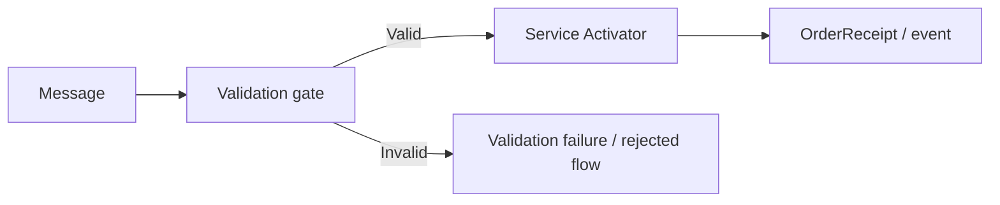
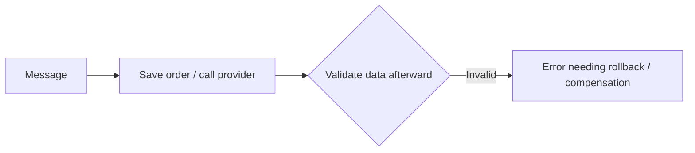
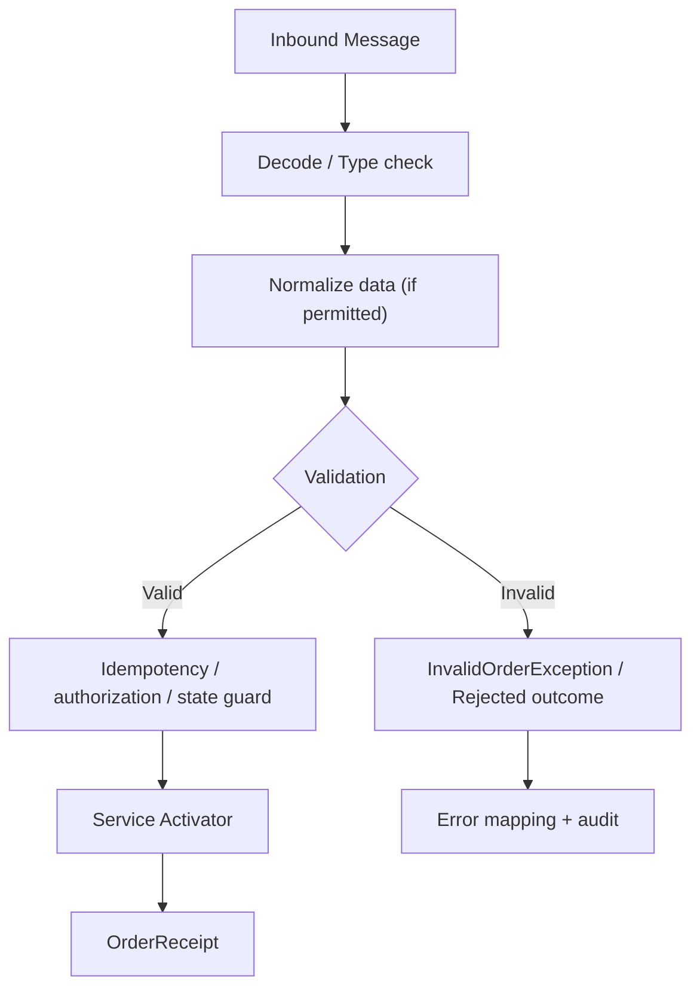
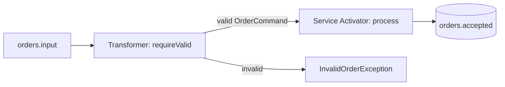
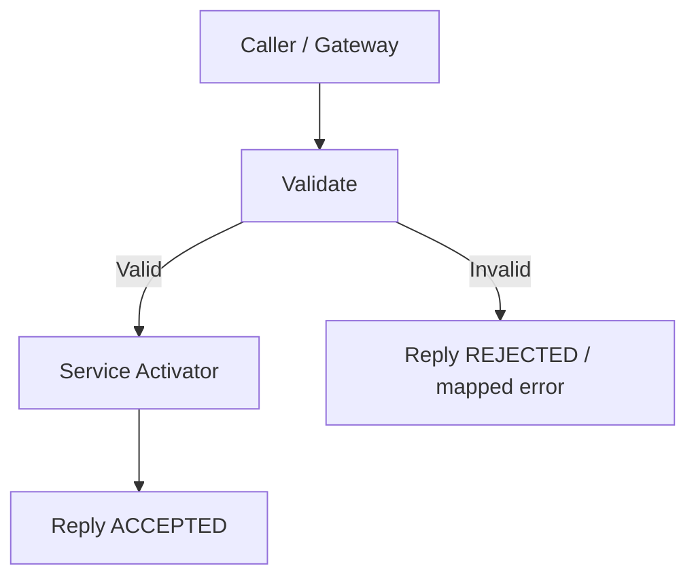
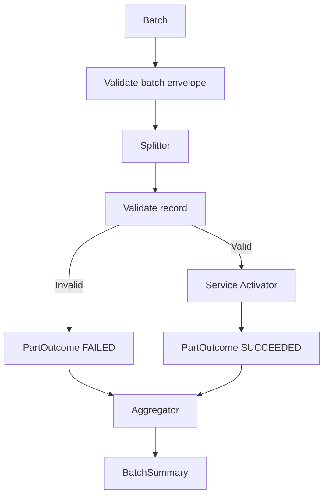

# Validation Before a Service Activator in Spring Integration

## Learning Goals

A system receives order messages from an API or broker. Each message carries an order ID, customer ID, amount, and currency. A `Service Activator` writes the order to a database, reserves inventory, or calls a payment system. If a message with `amount=-100`, `orderId=""`, or an unsupported currency reaches the handler, the system may persist invalid state or trigger hard-to-reverse side effects.

The solution is placing a **validation gate before the Service Activator**. The gate inspects data and lets only valid messages proceed; invalid messages are rejected with clear reasons or routed into a dedicated handling flow. Placing validation *before* side-effecting steps avoids starting a transaction only to later discover the payload was invalid.

This lesson belongs to the **Message filter and validation** chapter of the **SPRING_INTEGRATION_PATTERN** module. The module focuses on implementing Enterprise Integration Patterns with Spring Integration to build loosely coupled, extensible message flows; practicing Router, Filter, Transformer, Splitter, Aggregator, Gateway, retry, error channel, correlation, and testing/observing each processing branch.

After this lesson, you will be able to:

1. Distinguish **schema validation**, **business validation**, **authorization**, **Filter**, and **Service Activator**.
2. Structure an `input → validate → service activator → output` flow using Java DSL.
3. Test that invalid payloads are blocked **before** the handler causes side effects.
4. Use Jakarta Bean Validation when DTO constraints need enforcement.
5. Know when to use `.filter(...)` + `discardChannel` vs when to return detailed validation errors.
6. Propagate `correlationId` and tracing metadata across validation, error flows, and handlers.
7. Design consistent responses for Gateways, brokers, retries, and batch/Splitter/Aggregator flows.
8. Avoid common pitfalls: swallowing exceptions, silent drops, checking after commit, trusting client headers, or infinitely retrying bad data.

---

## 1. Why Must Validation Precede the Service Activator?

A **Service Activator** is an endpoint that invokes a method/handler to execute business logic. It may or may not return a reply; either way, the handler is typically where **side effects** happen: DB writes, HTTP calls, event publishing, state updates.

Recommended diagram:



Anti-pattern diagram:



In the second diagram, even when an error is caught, an HTTP call to a provider or an email already sent may **not be rollable**. Early validation reduces risk, yet **business invariants** still need checking inside the service/transaction whenever state can change concurrently.

### Essential Rules

- **Validate before side effects** for conditions checkable from the input.
- **Do not treat flow-entry validation as the final defense** for inventory, quotas, balances, or permissions. Those conditions can change before commit.
- **Do not conflate bad data with transient infrastructure failures.** Invalid data does not become valid after a few retries.
- **Do not silently drop requests expecting replies.** When a Gateway/HTTP caller waits for a response, return an explicit error or rejection outcome rather than an inexplicable timeout.

## 2. Distinguishing the Validation Steps

A message may require multiple layers of checks:

| Layer | Example | Where is it usually placed? |
| --- | --- | --- |
| **Transport/schema** | JSON parse fails, missing required field, wrong payload type | Inbound adapter/decoder |
| **Bean Validation** | `@NotBlank`, `@Positive`, `@Pattern` | Validation endpoint before service |
| **Cross-field validation** | `currency=VND` with invalid decimal precision | Pure Java validator/policy |
| **Business eligibility** | Locked order, customer excluded from campaign | Filter or policy service |
| **Authorization** | Is caller permitted to create orders for this tenant? | Trust boundary before handler plus service check |
| **Stateful invariant** | Sufficient stock/limit at commit time? | Service + DB transaction/locking |
| **Idempotency** | Has this command already executed? | Idempotent receiver/ledger before side effects |
| **Output validation** | Does reply have valid status code/format? | After handler or at outbound adapter |

A validation gate handles much of **input validation**, yet cannot replace every layer.

### How Does a Filter Differ from a Validator?

| Aspect | Message Filter | Validator/validation stage |
| --- | --- | --- |
| Core question | "Should this message proceed?" | "Does the payload match the contract, and if not, where did it fail?" |
| Typical result | `true/false` | Error list, exception, or typed outcome |
| Rejection reason | May lack detailed reasons | Can return error codes/field paths |
| Failure path | Discard, throw, or drop | Rejected response/error/quarantine |
| Best fit | Out-of-scope events, simple predicates | Data, field, and cross-field constraints |
| Risk | Silent drops causing timeouts or missing Aggregator parts | Unmapped exceptions at async boundaries |

In Spring Integration, a **Filter** can implement a simple validation rule. However, when you want to return *multiple errors with field paths*, a dedicated **validation stage** is usually easier to test and explain.

## 3. A Concrete Input Contract

Suppose the application receives:

```json
{
  "orderId": "ORD-101",
  "customerId": "CUST-42",
  "amount": 125000,
  "currency": "VND"
}
```

We define illustrative constraints:

1. `orderId` is non-empty and matches `[A-Za-z0-9_-]+`.
2. `customerId` is non-empty and matches the same pattern.
3. `amount` must be present and greater than 0.
4. `currency` must be `VND` or `USD`.
5. Currency precision rules should follow the contract if applicable (for example, `VND` rejects fractional digits in this exercise).
6. Header `traceId` is for tracing and must never decide whether the caller is authorized.

A decision table:

| Input | Valid? | Suggested error code |
| --- | --- | --- |
| `ORD-101, CUST-42, 125000, VND` | Yes | — |
| `"", CUST-42, 125000, VND` | No | `ORDER_ID_REQUIRED` |
| `ORD-101, "", 125000, VND` | No | `CUSTOMER_ID_REQUIRED` |
| `ORD-101, CUST-42, -100, VND` | No | `AMOUNT_NOT_POSITIVE` |
| `ORD-101, CUST-42, null, VND` | No | `AMOUNT_REQUIRED` |
| `ORD-101, CUST-42, 125000, EUR` | No | `UNSUPPORTED_CURRENCY` |
| `ORD!101, CUST-42, 125000, VND` | No | `ORDER_ID_INVALID_FORMAT` |

This table is a policy **for this exercise**, not a universal payment standard. Real systems must account for currency types, minor units, rounding, field lengths, and business requirements.

## 4. Input Path Before Invoking the Handler



Distinguish two kinds of "pre-checks":

- **Static checks**: does the payload satisfy schema and basic constraints? Performed before the service runs.
- **State checks**: does the customer still have permission, is the order a duplicate, is DB stock sufficient? Checked at commit time—typically in the Service Activator/service transaction—to avoid **time-of-check/time-of-use** races.

When normalizing (e.g., trimming whitespace or uppercasing currency), document it explicitly in the contract. Never auto-trim fields where whitespace matters, such as signatures or fixed-width records.

## 5. Structured Validation Error Model

Instead of throwing `IllegalArgumentException("Bad input")`, create an error object identifying field and code.

```java
public record FieldViolation(
    String field,
    String code
) {}
```

Example error list:

```json
{
  "code": "INVALID_ORDER",
  "violations": [
    {"field": "orderId", "code": "ORDER_ID_REQUIRED"},
    {"field": "amount", "code": "AMOUNT_NOT_POSITIVE"}
  ]
}
```

Benefits:

- Clients can fix multiple fields in one pass.
- Logs/metrics can group by low-cardinality error codes.
- User-facing messages can be localized without changing error codes.
- Tests can assert against structure instead of brittle message strings.
- Raw user input values do not need to enter exceptions or logs.

**Never automatically expose stack traces, SQL messages, or sensitive data** externally. Public error messages differ from internal diagnostic details in logs/audits.

## 6. Java DSL Demo: Validate → Service Activator

We use Java 17 and Spring Integration Java DSL. The setup includes:

- `orders.input`: receives `OrderCommand`.
- **Validation stage**: a Transformer returns the checked payload or throws `InvalidOrderException`.
- **Service Activator**: processes only validated payloads and returns `OrderReceipt`.
- `orders.accepted`: `QueueChannel` for tests to read replies.
- `OrderService.calls()`: counter verifying **the handler does not run when invalid**.



### Complete Configuration Example

```java
import java.math.BigDecimal;
import java.util.ArrayList;
import java.util.List;
import java.util.Set;
import java.util.concurrent.atomic.AtomicInteger;
import java.util.regex.Pattern;

import org.springframework.context.annotation.Bean;
import org.springframework.context.annotation.Configuration;
import org.springframework.integration.channel.DirectChannel;
import org.springframework.integration.channel.QueueChannel;
import org.springframework.integration.config.EnableIntegration;
import org.springframework.integration.dsl.IntegrationFlow;
import org.springframework.messaging.MessageChannel;
import org.springframework.messaging.PollableChannel;

@Configuration
@EnableIntegration
public class OrderIngressValidationConfig {

    public record OrderCommand(
        String orderId,
        String customerId,
        BigDecimal amount,
        String currency
    ) {}

    public record OrderReceipt(
        String orderId,
        String status
    ) {}

    public record FieldViolation(
        String field,
        String code
    ) {}

    public static final class InvalidOrderException
            extends RuntimeException {

        private final List<FieldViolation> violations;

        public InvalidOrderException(
            List<FieldViolation> violations
        ) {
            super("INVALID_ORDER");
            this.violations = List.copyOf(violations);
        }

        public List<FieldViolation> violations() {
            return violations;
        }
    }

    public static final class OrderGuard {

        private static final Pattern SAFE_ID =
            Pattern.compile("[A-Za-z0-9_-]+");

        private static boolean validId(String value) {
            return value != null
                && SAFE_ID.matcher(value).matches();
        }

        public OrderCommand requireValid(OrderCommand order) {
            List<FieldViolation> errors = new ArrayList<>();

            if (order == null) {
                throw new InvalidOrderException(
                    List.of(new FieldViolation(
                        "payload", "PAYLOAD_REQUIRED")));
            }

            if (order.orderId() == null
                    || order.orderId().isBlank()) {
                errors.add(new FieldViolation(
                    "orderId", "ORDER_ID_REQUIRED"));
            } else if (!validId(order.orderId())) {
                errors.add(new FieldViolation(
                    "orderId", "ORDER_ID_INVALID_FORMAT"));
            }

            if (order.customerId() == null
                    || order.customerId().isBlank()) {
                errors.add(new FieldViolation(
                    "customerId", "CUSTOMER_ID_REQUIRED"));
            } else if (!validId(order.customerId())) {
                errors.add(new FieldViolation(
                    "customerId", "CUSTOMER_ID_INVALID_FORMAT"));
            }

            if (order.amount() == null) {
                errors.add(new FieldViolation(
                    "amount", "AMOUNT_REQUIRED"));
            } else if (order.amount()
                    .compareTo(BigDecimal.ZERO) <= 0) {
                errors.add(new FieldViolation(
                    "amount", "AMOUNT_NOT_POSITIVE"));
            }

            if (order.currency() == null
                    || order.currency().isBlank()) {
                errors.add(new FieldViolation(
                    "currency", "CURRENCY_REQUIRED"));
            } else if (!Set.of("VND", "USD")
                    .contains(order.currency())) {
                errors.add(new FieldViolation(
                    "currency", "UNSUPPORTED_CURRENCY"));
            }

            if (!errors.isEmpty()) {
                throw new InvalidOrderException(errors);
            }

            return order;
        }
    }

    public static final class OrderService {
        private final AtomicInteger invocations =
            new AtomicInteger();

        public OrderReceipt process(OrderCommand order) {
            invocations.incrementAndGet();

            // Demo: no real DB writes and no real HTTP calls.
            return new OrderReceipt(
                order.orderId(), "ACCEPTED");
        }

        public int calls() {
            return invocations.get();
        }
    }

    @Bean
    OrderGuard orderGuard() {
        return new OrderGuard();
    }

    @Bean
    OrderService orderService() {
        return new OrderService();
    }

    @Bean("orders.input")
    MessageChannel input() {
        return new DirectChannel();
    }

    @Bean("orders.accepted")
    PollableChannel accepted() {
        // Test sink; no background consumer attached.
        return new QueueChannel();
    }

    @Bean
    IntegrationFlow validatedOrderFlow(
        OrderGuard guard,
        OrderService service
    ) {
        return IntegrationFlow.from("orders.input")
            // Stage 1: validate, pass OrderCommand through.
            .transform(OrderCommand.class, guard::requireValid)

            // Stage 2: Service Activator that may cause side effects.
            .handle(OrderCommand.class,
                (order, headers) -> service.process(order))

            // Stage 3: reply channel for testing.
            .channel("orders.accepted")
            .get();
    }
}
```

### Why Use a Transformer as the Validation Gate?

In the flow above, `.transform(OrderCommand.class, guard::requireValid)` calls a Java method:

- When valid, it **returns the same payload** to continue.
- When invalid, it **throws an exception**. The downstream Service Activator **is never called**.
- The framework builds the new message from the Transformer's result, preserving relevant headers under this DSL pattern.
- Validation creates no orders, calls no payment APIs, and performs no business side effects.

This differs from `.filter(...)`, which mainly makes a boolean **accept/reject** choice. Using a Transformer is not about reshaping data—it is about **putting rich-error validation into an explicit, testable stage**.

### Synchronous Semantics Note

The example uses `DirectChannel`, so validation errors can **propagate back to the `send(...)` call**. Do not claim exceptions automatically travel to `errorChannel` unless appropriate error handling is configured.

In poller, executor, or broker flows, exceptions typically occur on their processing thread; configure error routing, retry/ack, and quarantine explicitly.

## 7. Integration Testing: Invalid Inputs Must Not Reach the Service Activator

This is the core test. Do not merely assert the message was rejected; assert **the handler caused zero side effects**.

```java
import static org.assertj.core.api.Assertions.assertThat;
import static org.assertj.core.api.Assertions.assertThatThrownBy;

import java.math.BigDecimal;

import org.junit.jupiter.api.Test;
import org.springframework.beans.factory.annotation.Autowired;
import org.springframework.beans.factory.annotation.Qualifier;
import org.springframework.messaging.Message;
import org.springframework.messaging.MessageChannel;
import org.springframework.messaging.PollableChannel;
import org.springframework.messaging.support.MessageBuilder;
import org.springframework.test.annotation.DirtiesContext;
import org.springframework.test.context.junit.jupiter.SpringJUnitConfig;

@SpringJUnitConfig(OrderIngressValidationConfig.class)
@DirtiesContext(
    classMode = DirtiesContext.ClassMode.AFTER_EACH_TEST_METHOD)
class OrderValidationFlowTest {

    @Autowired
    @Qualifier("orders.input")
    MessageChannel input;

    @Autowired
    @Qualifier("orders.accepted")
    PollableChannel accepted;

    @Autowired
    OrderIngressValidationConfig.OrderService service;

    private OrderIngressValidationConfig.OrderCommand order(
        String orderId, BigDecimal amount, String currency
    ) {
        return new OrderIngressValidationConfig.OrderCommand(
            orderId, "CUST-42", amount, currency);
    }

    @Test
    void validMessageReachesServiceExactlyOnceInThisFlow() {
        var command = order(
            "ORD-101", new BigDecimal("125000"), "VND");

        assertThat(input.send(
            MessageBuilder.withPayload(command)
                .setHeader("traceId", "trace-101")
                .setHeader("sourceId", "api-order")
                .build()
        )).isTrue();

        Message<?> reply = accepted.receive(2_000);

        assertThat(reply).isNotNull();
        assertThat(reply.getPayload()).isEqualTo(
            new OrderIngressValidationConfig.OrderReceipt(
                "ORD-101", "ACCEPTED"));

        assertThat(service.calls()).isEqualTo(1);
        assertThat(accepted.receive(0)).isNull();

        // Headers propagate across endpoints for tracing.
        assertThat(reply.getHeaders().get("traceId"))
            .isEqualTo("trace-101");
    }

    @Test
    void invalidOrderIdNeverCallsService() {
        var command = order(
            "", new BigDecimal("100"), "VND");

        assertThatThrownBy(() ->
            input.send(MessageBuilder.withPayload(command).build()))
            .isInstanceOf(RuntimeException.class);

        assertThat(service.calls()).isZero();
        assertThat(accepted.receive(0)).isNull();
    }

    @Test
    void nonPositiveAmountNeverCallsService() {
        var command = order(
            "ORD-102", new BigDecimal("-1"), "VND");

        assertThatThrownBy(() ->
            input.send(MessageBuilder.withPayload(command).build()))
            .isInstanceOf(RuntimeException.class);

        assertThat(service.calls()).isZero();
        assertThat(accepted.receive(0)).isNull();
    }

    @Test
    void unsupportedCurrencyNeverCallsService() {
        var command = order(
            "ORD-103", new BigDecimal("50"), "EUR");

        assertThatThrownBy(() ->
            input.send(MessageBuilder.withPayload(command).build()))
            .isInstanceOf(RuntimeException.class);

        assertThat(service.calls()).isZero();
        assertThat(accepted.receive(0)).isNull();
    }

    @Test
    void twoDifferentValidMessagesAreBothProcessed() {
        var first = order(
            "ORD-201", new BigDecimal("10"), "USD");
        var second = order(
            "ORD-202", new BigDecimal("20"), "USD");

        assertThat(input.send(
            MessageBuilder.withPayload(first).build())).isTrue();
        assertThat(input.send(
            MessageBuilder.withPayload(second).build())).isTrue();

        assertThat(accepted.receive(2_000)).isNotNull();
        assertThat(accepted.receive(2_000)).isNotNull();
        assertThat(service.calls()).isEqualTo(2);
        assertThat(accepted.receive(0)).isNull();
    }
}
```

**Scope of conclusions:** within this Spring context, invalid payloads are stopped before the Service Activator and valid payloads proceed once. The test **does not prove exactly-once** under broker redeliveries or retries; `OrderService` only increments a counter and constructs a DTO without committing real business state.

`@DirtiesContext` isolates the counter and queue between tests. That is a testing convenience, not a production requirement.

### Direct Unit Tests for the Validator

No Spring context is needed to test individual rules:

```java
import static org.assertj.core.api.Assertions.assertThat;
import static org.assertj.core.api.Assertions.assertThatThrownBy;

import java.math.BigDecimal;

import org.junit.jupiter.api.Test;

class OrderGuardTest {

    private final OrderIngressValidationConfig.OrderGuard guard =
        new OrderIngressValidationConfig.OrderGuard();

    @Test
    void returnsSameCommandWhenValid() {
        var order = new OrderIngressValidationConfig.OrderCommand(
            "ORD-1", "CUST-1",
            new BigDecimal("100"), "VND");

        assertThat(guard.requireValid(order)).isSameAs(order);
    }

    @Test
    void reportsMultipleFieldViolations() {
        var order = new OrderIngressValidationConfig.OrderCommand(
            "", "", new BigDecimal("-100"), "XYZ");

        assertThatThrownBy(() -> guard.requireValid(order))
            .isInstanceOf(
                OrderIngressValidationConfig.InvalidOrderException.class)
            .satisfies(error -> {
                var violations =
                    ((OrderIngressValidationConfig.InvalidOrderException)
                        error).violations();

                assertThat(violations)
                    .extracting(
                        OrderIngressValidationConfig.FieldViolation::code)
                    .containsExactly(
                        "ORDER_ID_REQUIRED",
                        "CUSTOMER_ID_REQUIRED",
                        "AMOUNT_NOT_POSITIVE",
                        "UNSUPPORTED_CURRENCY");
            });
    }

    @Test
    void nullAmountIsReportedWithoutNullPointerException() {
        var order = new OrderIngressValidationConfig.OrderCommand(
            "ORD-2", "CUST-2", null, "VND");

        assertThatThrownBy(() -> guard.requireValid(order))
            .isInstanceOf(
                OrderIngressValidationConfig.InvalidOrderException.class);
    }
}
```

Unit tests catch rule defects fast; integration tests verify **endpoint ordering** and that the Service Activator is never called.

## 8. Alternative: Message Filter Before the Service Activator

When only a simple predicate is required, a Filter is concise:

```java
import java.math.BigDecimal;

import org.springframework.context.annotation.Bean;
import org.springframework.integration.dsl.IntegrationFlow;

@Bean
IntegrationFlow filterBeforeService(
    OrderIngressValidationConfig.OrderService service
) {
    return IntegrationFlow.from("orders.filter.input")
        .filter(
            OrderIngressValidationConfig.OrderCommand.class,
            order -> order.amount() != null
                && order.amount().compareTo(BigDecimal.ZERO) > 0,
            endpoint -> endpoint
                .discardChannel("orders.filter.rejected"))
        .handle(
            OrderIngressValidationConfig.OrderCommand.class,
            (order, headers) -> service.process(order))
        .channel("orders.filter.accepted")
        .get();
}
```

This is an **alternative configuration snippet**; `orders.filter.input`, `orders.filter.rejected`, and `orders.filter.accepted` must be declared. Do not wire two flows to the same input channel expecting both to receive every message: on a `DirectChannel`, multiple subscribers share dispatch per channel rules rather than broadcasting automatically.

### What Gets Sent to the Discard Channel?

With `MessageFilter`, when the predicate returns `false` and `discardChannel` is set, the rejected message goes down the discard path. **A discarded message does not automatically carry a list of field errors** if the predicate only returned a boolean.

You can:

- Use the predicate for clear rules and count rejections.
- Route discarded messages to a flow attaching `reasonCode`/quarantine per policy.
- Use the validation stage from section 6 when detailed error lists are required.
- For requests needing replies, wire a path returning `ValidationRejected` rather than dropping into a `QueueChannel` with no consumer.

### `throwExceptionOnRejection`

Another option:

```java
.filter(
    OrderIngressValidationConfig.OrderCommand.class,
    order -> order.amount() != null
        && order.amount().signum() > 0,
    spec -> spec.throwExceptionOnRejection(true))
```

When the predicate is `false`, the Filter throws `MessageRejectedException` per configuration. In synchronous flows, callers receive the exception; in asynchronous flows, the endpoint/adapter's error mechanism handles it.

**Do not enable `throwExceptionOnRejection(true)` merely to "see errors"** without deciding how exceptions map to responses or DLQs at the corresponding boundary.

## 9. Filter, Validator, and Router: Choosing the Right Pattern

| Requirement | Appropriate pattern/structure |
| --- | --- |
| Drop messages not belonging to this flow's scope | Filter |
| Simple data check where invalid items may be discarded | Filter + discard channel |
| Need to return multiple field errors | Validation stage + typed exception/outcome |
| Invalid messages go to repair or quarantine branch | Validation outcome + Router |
| Branch by valid order type | Router **after validation** |
| Convert input payload to canonical DTO | Transformer/normalizer then Validator |
| Invoke side-effecting business logic | Service Activator **after validation** |
| Protect stateful invariants at commit | Service transaction/DB constraints |
| Block duplicate commands | Idempotent receiver/ledger, not a schema validator |

### Why Should Routers Follow Validation?

If an invalid/malicious payload carries `currency="ADMIN"` or a spoofed `tenantId` header, a Router running before validation could dispatch the message to an inappropriate branch. At untrusted boundaries, verify routing inputs first.

That does not mean **every Router** must sit after all checks: an ingress Router can select decoders by trusted content type. However, routing with privilege/resource implications requires validated, authenticated data.

## 10. Jakarta Bean Validation Instead of Manual Rules

The section 6 example avoids Bean Validation dependencies to stay self-contained. In real applications, you can declare Jakarta constraints on the DTO.

```java
import java.math.BigDecimal;

import jakarta.validation.constraints.NotBlank;
import jakarta.validation.constraints.NotNull;
import jakarta.validation.constraints.Pattern;
import jakarta.validation.constraints.Positive;

public record ValidatedOrder(
    @NotBlank String orderId,
    @NotBlank String customerId,
    @NotNull @Positive BigDecimal amount,
    @NotBlank @Pattern(regexp = "VND|USD") String currency
) {}
```

A reusable gate backed by `jakarta.validation.Validator`:

```java
import java.util.Set;

import jakarta.validation.ConstraintViolation;
import jakarta.validation.ConstraintViolationException;
import jakarta.validation.Validator;

public final class BeanValidationGuard {

    private final Validator validator;

    public BeanValidationGuard(Validator validator) {
        this.validator = validator;
    }

    public ValidatedOrder requireValid(ValidatedOrder order) {
        if (order == null) {
            throw new IllegalArgumentException("NULL_ORDER");
        }

        Set<ConstraintViolation<ValidatedOrder>> errors =
            validator.validate(order);

        if (!errors.isEmpty()) {
            throw new ConstraintViolationException(errors);
        }

        return order;
    }
}
```

Use it in a flow following the same pattern:

```java
.transform(
    ValidatedOrder.class,
    beanValidationGuard::requireValid)
.handle(
    ValidatedOrder.class,
    (order, headers) -> orderService.processValidated(order))
```

This is an **illustrative integration snippet** requiring `Validator`, `BeanValidationGuard`, and service beans. In Spring Boot, `spring-boot-starter-validation` typically provides the provider; outside Boot, configure `LocalValidatorFactoryBean` and a Jakarta Validation provider.

### What Bean Validation Does Not Do Automatically

- Does not enforce tenant-based authorization policies.
- Does not guarantee `@Valid` on a DTO applies at every Spring Integration endpoint.
- Does not guarantee balances/inventory stay valid until commit time.
- Does not map `ConstraintViolationException` into HTTP responses or broker rejections.
- Does not compute idempotency keys or handle redeliveries.
- Does not repair bad data once a payload enters a handler.

**Validation must actually be invoked** inside the flow or via configured and tested Method Validation. Simply annotating a record with `@NotBlank` does not prove handlers will automatically reject bad messages.

### When Are Validation Groups Needed?

A DTO shared across CREATE and UPDATE may carry differing rules:

- CREATE: `orderId` might be server-generated, while `customerId` is required.
- UPDATE: `orderId` is required, other fields may be patches.
- CANCEL: `amount` is not necessarily present.

Use Jakarta Validation groups or split DTOs per command. Splitting DTOs often avoids cramming too many state-dependent rules into one class.

## 11. Cross-Field Validation and Data Normalization

Single-field annotations do not cover every constraint. Examples:

- `currency=VND` with fractional digits in `amount`.
- `deliveryMode=PICKUP` with a non-zero shipping fee.
- `startAt > endAt`.
- A field required only when another field holds a certain value.

A cross-field validation helper:

```java
import java.math.BigDecimal;

static boolean validMoney(
    BigDecimal amount,
    String currency
) {
    if (amount == null || currency == null
            || amount.signum() <= 0) {
        return false;
    }

    if ("VND".equals(currency)) {
        return amount.stripTrailingZeros().scale() <= 0;
    }

    if ("USD".equals(currency)) {
        return amount.scale() <= 2;
    }

    return false;
}
```

This policy is a **simplified example**; do not substitute it for every system's money/minor-unit rules. In practice, model amounts using a `Money` value object or normalized integer minor units with explicit rounding policies.

### Normalize Before or After Validation?

A transparent pipeline:

```text
Raw Input
  -> Structural validation
  -> Normalize per contract (if allowed)
  -> Business input validation
  -> Service Activator
```

Whether `"usd"` gets normalized to `"USD"` is a contract decision, not an accidental code detail.

If original evidence must be retained, store raw inputs in a protected audit store and forward only the normalized DTO to the Service Activator.

## 12. Error Channel Does Not Replace Rejected/Discard Channels

Spring Integration has distinct concepts:

| Handling path | When used | Typical payload |
| --- | --- | --- |
| Message Filter `discardChannel` | Predicate rejects message | Excluded message |
| Exception from Validator | Rule fails during execution | Cause such as `InvalidOrderException` |
| `errorChannel` | Endpoint/adapter error handling when configured | `ErrorMessage` wrapping `Throwable` |
| Dead-letter/quarantine | Data cannot be processed automatically | Controlled payload/metadata, rejection reason |
| Business rejection output | Validation fails yet protocol needs a reply | `ValidationRejected`/`OrderRejected` |

**Never assume every exception automatically enters `errorChannel`.**

### Synchronous Flows

```text
Caller
  -> DirectChannel
     -> Validation Transformer throws
        -> exception propagates to Caller
```

For direct callers, exceptions may arrive wrapped in a `MessagingException`. Tests should verify the handler did not run and inspect root causes via the exact mechanism rather than assuming the top-level exception type never wraps.

### Asynchronous Flows

```text
Broker / Poller / Executor
  -> Worker thread
     -> Validation fails
        -> error flow / retry / nack / DLQ
```

Identify the exact adapter, executor, poller, and error channel. Some setups wrap errors into `ErrorMessage` while others pass exceptions to adapter error handlers; no single rule fits every topology.

### When Structured Error Replies Are Needed

At an HTTP/Gateway boundary, map to:

```json
{
  "requestId": "REQ-42",
  "status": "REJECTED",
  "errorCode": "INVALID_ORDER",
  "violations": [
    {"field": "amount", "code": "AMOUNT_NOT_POSITIVE"}
  ]
}
```

Returning this response requires an **error-handling/mapping component** matching the adapter. It **does not appear automatically** just because a Validation Transformer throws `InvalidOrderException`.

## 13. Preventing Gateway Timeouts When Validation Fails

A `@MessagingGateway` or HTTP caller may await a reply:



If you write:

```java
.filter(OrderCommand.class, OrderValidationPolicy::isValid)
```

and drop invalid messages by default **without replying**, the Gateway can wait until timeout—even though the client only needed to know which field failed.

Two options:

**A. Fail fast with an exception:** the validation stage throws `InvalidOrderException`, and the Gateway/adapter maps it to a contract error.

**B. Explicit outcome:** the validator always returns a `ValidationOutcome`, and a Router directs accepted/rejected branches so both emit clear replies.

Example outcome contract:

```java
public record ValidationOutcome<T>(
    T value,
    java.util.List<String> errorCodes
) {
    public boolean valid() {
        return errorCodes.isEmpty();
    }
}
```

With outcomes, clearly define:

- When valid, invoke the Service Activator on `value`.
- When invalid, skip the service and produce `OrderRejected`.
- Which branch holds `replyChannel`/returnAddress back to the caller.
- Never emit **both a success and an error reply** for the same request.
- Under async processing, define when acknowledgments vs terminal results are returned.

**Choose an explicit contract** rather than letting failing messages vanish silently.

## 14. Brokers, Retries, and Permanently Invalid Data

Brokers typically support redelivery when consumers fail or do not ACK. If a payload is permanently malformed:

```text
Receive invalid order
-> Validation fails
-> NACK/retry
-> Receive same invalid order
-> Validation fails again
-> ...
```

That is a **poison message loop**. Repeated identical deliveries will never turn `amount=-1` into valid data.

### Error Classification

| Category | Example | Typical appropriate action |
| --- | --- | --- |
| Permanent validation | Missing orderId, negative amount | Reject/DLQ/quarantine; never retry forever |
| Unauthorized | Tenant/service lacks permission | Deny/audit; never auto-retry as transient |
| Schema mismatch | Producer sent incompatible version | Quarantine/contract fix |
| Transient infrastructure | DB timeout, network unavailable | Bounded retry/backoff |
| Concurrency conflict | Optimistic locking failure | Conditional retry/reload state |
| Unknown provider result | Payment sent but response lost | Reconcile/idempotency; never retry blindly |

### Where to Place `RetryAdvice`

If `RetryAdvice` wraps the Validation Transformer as well, invalid payloads get validated **multiple times pointlessly**. You can:

1. Validate **before** infrastructure-retry boundaries begin.
2. Wrap retries only around the Service Activator where needed.
3. Classify exceptions so `InvalidOrderException` is non-retryable.
4. Keep handler side effects idempotent across retries.

In real flows, advice/transaction ordering and boundaries depend on the endpoint. Write integration tests with real retry policies rather than guessing interceptor order.

## 15. Authorization Is Not Checking the Format of `tenantId`

Suppose a message contains:

```text
headers.tenantId = "shop-b"
payload.orderId  = "ORD-42"
```

Checking that `tenantId` is alphanumeric **does not prove** the sender belongs to tenant B. Structural validation gates and **authorization** have separate responsibilities.

- Tenant identity must come from an authenticated principal or service identity.
- Client payloads and headers are untrusted inputs.
- Payload tenants can be cross-checked against trusted identity.
- If using server-verified headers attached at ingress, document their provenance clearly.
- Services still enforce object/operation permissions at transaction boundaries.

### Policy Example

```java
public record VerifiedPrincipal(
    String subject,
    String tenantId
) {}

static boolean allowedForTenant(
    VerifiedPrincipal actor,
    String targetTenant
) {
    return actor != null
        && actor.tenantId() != null
        && actor.tenantId().equals(targetTenant);
}
```

This is an **illustrative policy only**; never construct `VerifiedPrincipal` from self-declared client JSON and treat it as authenticated.

### Async Boundaries

Thread-local `SecurityContextHolder` may not propagate automatically across Kafka listeners, pollers, or executors. For async processing, propagate verified service identities or consumer contexts explicitly instead of assuming "the earlier thread was logged in".

## 16. Validation and Idempotent Receiver: Ordering Affects Outcomes

A command may be redelivered by a broker. Separate:

- **Validation:** are command format and business inputs valid?
- **Idempotency:** has this logical command already committed?
- **Service processing:** execute the side effect or return the cached result?

If an idempotency selector **records keys before the validator**, an invalid command can claim the key. A corrected resend reusing the same key could then be treated as a duplicate—which might be right or wrong depending on the contract.

A commonly sound ordering:

```text
Decode
  -> Authenticate/authorize
  -> Validate schema + canonical fields
  -> Compute stable idempotency key and fingerprint
  -> Business ledger (new/in-progress/completed/conflict)
  -> Service Activator
  -> Commit effect + result
```

**Note:** Message-layer Idempotent Receivers may claim keys *before handler commit*. They do not automatically form a transaction with business writes. When "the same command must never cause two effects" is mandatory, use a ledger, unique constraints, or idempotent external APIs.

### Retrying a Command Whose Payload Changed

Two requests sharing an idempotency key with different amounts:

```text
KEY=CAP-42 amount=125000
KEY=CAP-42 amount=999000
```

Even though both **pass schema validation**, this may be an **idempotency key conflict**. Never let "passed validator" turn them into two valid charges under the same key.

## 17. Validation Before Splitter, Filter, and Aggregator

### Pre-Splitter Validation

When the input is a batch holding multiple lines/records:

1. Validate the **batch envelope**: source ID, charset, record count limit, business tenant.
2. Split into elements.
3. Validate **each element** before its per-record Service Activator.
4. Emit a `PartOutcome` for every part if an Aggregator awaits a summary.



### Trap: Filter Discards Leaving the Aggregator Waiting Forever

```text
Splitter produces N=3, sequenceSize=3.
Part #1 -> accepted.
Part #2 -> invalid, Filter discards with no outcome.
Part #3 -> accepted.

Aggregator receives 2/3.
```

If the release strategy relies on `sequenceSize=3`, the group may never finish. Solutions:

- Validate/filter **before the Splitter** if policy allows excluding parts from the count.
- Or turn invalid parts into `PartOutcome(status=FAILED or SKIPPED)` preserving correlation/sequence so the Aggregator receives all items.
- Or use a custom release/timeout policy accounting for expected counts explicitly.

Never alter `sequenceSize` piecemeal on individual messages after splitting.

### Router After Validation

Once records are valid, a Router can pick `STANDARD` or `REVIEW` handlers. Invalid records route to quarantine/repair flows instead of routing on corrupted fields first.

## 18. Correlation and Tracing Validation Failures

A flow may attach:

```text
correlationId = shop-a|ORD-101|run-1
traceId       = trace-8a...
sourceId      = order-api
messageId     = current message UUID
```

Each ID serves a distinct purpose:

| Field | Purpose |
| --- | --- |
| `correlationId` | Links messages belonging to a workflow/group |
| `traceId` | Tracks spans, call chains, and latency |
| `sourceId` | Identifies where the message originated |
| `messageId` | Distinguishes individual message instances |
| `orderId` | Business entity identifier |
| `validationCode` | Categorizes errors without logging raw inputs |

When a message is rejected:

```text
event=validation_rejected
correlationId=shop-a|ORD-101|run-1
sourceId=order-api
code=AMOUNT_NOT_POSITIVE
stage=pre_service_activator
```

If a payload is too broken to **compute `correlationId`**, use trusted transport offsets, request IDs, or ingress IDs to trace the event. Never lump all correlation-less messages into an `UNKNOWN` group.

### Preserving Headers When Transforming

Spring Integration normally propagates headers when a Transformer returns a payload. However, when constructing a new `Message<?>` manually or crossing Kafka/JMS/HTTP, verify header mappings/allowlists. Never blindly forward `replyChannel`, `errorChannel`, or sensitive headers across process boundaries.

### Do Not Turn Error Messages Into Data Leaks

`ErrorMessage` can reference exceptions and original/failed messages. When serializing to DLQs or logs, strip/redact sensitive data, stack traces, internal channel objects, and secrets.

## 19. Does Validation Have Performance Costs?

A pure Java validator is usually fast. Yet validation may involve:

- Complex regexes.
- DB lookups.
- Dynamic schema checks.
- External auth/config API calls.
- Large record collections.

Design principles:

1. Run **cheap checks** before expensive ones.
2. Keep rules **deterministic** whenever possible for easy testing and retries.
3. Bound payload sizes, nesting depths, and violation counts.
4. Avoid regexes prone to catastrophic backtracking on untrusted inputs.
5. Avoid network calls inside a Filter predicate unless failure/retry semantics are clear.
6. When checking uniqueness/state in a DB, recheck at **transaction commit**.
7. Never write validation logs containing huge raw payloads.
8. Monitor `validation_duration` and rejection rates to spot broken producer contracts.

### A Filter Is Not a Circuit Breaker

If a Service Activator calls an unresponsive API, an upstream `isValid(order)` predicate cannot mitigate that downstream outage. You need retries/backoff, timeouts, bulkheads/circuit breakers, and error flows at the proper layer.

## 20. Coexistence of Message-Level and Service-Level Validation

In multi-entry architectures:

```text
HTTP adapter ----\
Kafka listener ---+--> Validation gate --> Service Activator
Batch import -----/
```

Validating in one flow **is insufficient** if another API invokes the service bean directly. For critical domains, enforce:

- **DTO/contract validation at every ingress** for clear producer feedback.
- **Domain invariants inside services/domain models** that cannot be bypassed.
- **DB constraints and transactions** for correctness across concurrent workers.
- **Authorization at trust boundaries and services** for sensitive resources.
- **Idempotency where side effects commit** for at-least-once delivery.

This is not "wasteful duplicate checking". Each layer protects a different **scope and point in time**.

### A Time-of-Check/Time-of-Use Example

```text
T1 validation queries DB: remainingStock=1.
T2 Workers A and B both pass validation.
T3 Worker A reserves 1 unit.
T4 Worker B also attempts to reserve 1 unit.
```

Only a proper transaction, lock, or unique constraint protects inventory. "Passed validation before Service Activator" never justifies skipping stock checks when writing.

## 21. Response Patterns When Validation Fails

| Integration style | Invalid outcome to design |
| --- | --- |
| HTTP request/response | 4xx with error codes and field violations, no stack traces |
| Messaging Gateway | Mapped exception or typed rejection reply, never silent |
| Kafka/AMQP event consumer | Quarantine/DLQ with error codes; ACK/NACK per policy |
| File batch import | Per-record `FAILED` outcome and full summary |
| Interactive UI | Displayable field-level errors |
| Fire-and-forget event | Rejection log/audit and dead-letter if replay is needed |
| Long-running workflow | Terminal `ValidationRejected` event carrying correlation ID |

When an inbound request must produce an **observable** success or failure, silent dropping is usually wrong. When a message is merely a notification "outside our criteria of interest", Filter discard can be the clean, intended behavior.

### HTTP Responses: Avoid Inferring Status Codes from Exception Class Names

An `InvalidOrderException` is purely an internal exception. Returning HTTP 400/422 requires an appropriate adapter/controller error mapper; naming an exception does not create automatic HTTP mappings.

## 22. Common Coding Mistakes

### Wrong: Calling the Service Before Validating

```java
// Wrong: side effects can occur before detecting the error.
.handle(OrderCommand.class, (order, headers) -> {
    var receipt = orderService.process(order);
    guard.requireValid(order);
    return receipt;
})
```

Fix:

```java
.transform(OrderCommand.class, guard::requireValid)
.handle(OrderCommand.class, (order, headers) ->
    orderService.process(order))
```

### Wrong: Logging and Letting It Pass Anyway

```java
// Wrong: invalid data still enters the Service Activator.
try {
    guard.requireValid(order);
} catch (RuntimeException ex) {
    log.warn("invalid");
}
return order;
```

If data is meant to be accepted with a warning, make that an **explicit policy** rather than an accidental `catch` block.

### Wrong: Null-Unsafe Filters

```java
// Wrong: amount==null throws NullPointerException.
.filter(OrderCommand.class, order ->
    order.amount().signum() > 0)
```

Fix:

```java
.filter(OrderCommand.class, order ->
    order != null
        && order.amount() != null
        && order.amount().signum() > 0)
```

In Spring Messaging, a `Message<?>` payload itself is normally non-null, yet **fields inside the payload** can definitely be null. Predicates must handle them cleanly rather than turning data errors into framework crashes.

### Wrong: Making Every Validation Failure Retryable

```text
INVALID_ORDER -> Retry 10 times -> Still Invalid.
```

Classify permanent validation failures and return rejections or move to data-repair areas.

### Wrong: Relying on `@Valid` by Faith

Merely putting annotations on a DTO without a Jakarta Validation provider, Method Validation, or explicit `validator.validate(...)` at the boundary **does not guarantee** constraints are enforced.

## 23. Observability and Measurement

Dashboards should separate **incoming messages**, **pre-service rejections**, and **executed business operations**.

| Suggested metric | Meaning |
| --- | --- |
| `validation_received_total{source}` | Total messages entering the validation stage |
| `validation_passed_total{type}` | Payloads passing the validator |
| `validation_rejected_total{code}` | Rejections grouped by error code |
| `validation_duration_seconds{type}` | Validation duration |
| `service_activator_invoked_total{operation}` | How many times the handler ran |
| `service_activator_success_total` | Successful operations |
| `service_activator_failure_total{reason}` | Failures occurring after validation passed |
| `validation_quarantined_total` | Payloads routed to quarantine |
| `validation_retry_misclassified_total` | Validation failures retried against policy |
| `batch_validation_failed_parts_total` | Invalid batch parts |
| `validation_contract_version_total{version}` | Distribution of schema/policy versions |
| `validation_dead_letter_total` | Messages sent to DLQ |

These are **application-definable metrics**, not exact names automatically emitted by Spring Integration. Use Micrometer/Observation, structured logging, and tracing according to your project setup.

Never use high-cardinality `orderId`, `requestId`, or `correlationId` as metric tags. Keep them in access-controlled logs and audits.

### Difference Between Rejections and Service Failures

```text
validation_received=1000
validation_passed=970
validation_rejected=30
service_invoked=970
service_succeeded=965
service_failed=5
```

These numbers are **illustrative** for a simple single-pass flow with no retries. With redeliveries or parallel fan-outs, counters can exceed unique business commands; never assume `passed == invoked` in every topology.

### Logs Should Be Structured

```text
event=validation_rejected
traceId=trace-42 correlationId=order-42
stage=pre_service_activator field=amount code=AMOUNT_NOT_POSITIVE

event=service_activator_completed
traceId=trace-43 correlationId=order-43
operation=createOrder outcome=SUCCEEDED
```

Never log passwords, tokens, card details, full customer payloads, or SQL stack traces into general logs.

## 24. Troubleshooting Table

| Symptom | Cause | Check/fix |
| --- | --- | --- |
| Handler still runs on negative amounts | Validation placed after handler or exception swallowed | Move gate ahead of Service Activator |
| Invalid requests hang until caller timeout | Filter drops silently | Return typed rejection or map exceptions |
| Filter emits no field errors | Boolean predicate lacks error list | Use structured validator/outcomes |
| Negative-amount errors retry forever | Error handler treats every exception as transient | Permanent error classification + DLQ |
| Bean Validation annotations have no effect | `Validator` never called or provider missing | Configure/test explicit validation |
| `DirectChannel` exceptions skip `errorChannel` | Synchronous propagation, no error flow configured | Handle at caller/gateway or proper error flow |
| Reject queue grows with nobody reading it | `discardChannel` has no consumer | Add consumer, retention, and backpressure |
| Null amount causes NPE | Predicate skips null check | Null-safe validation |
| Spoofed client tenant accepted | Only checked header format | AuthN/AuthZ on trusted identity |
| Valid record hits negative stock | State changed post-validation | Check/lock inside transaction |
| Batch Aggregator never releases | Filter discarded a part breaking sequence | Emit `FAILED`/`SKIPPED` outcome or adjust policy |
| Correlation disappears | Transformer/adapter dropped headers | Verify header propagation and contract tests |
| One valid command creates two orders | Broker retry without idempotency | Business key + ledger/unique constraint |
| Validation latency spikes suddenly | Expensive regex/API lookup or huge payload | Bound inputs and track latency |
| Error flow leaks PII | Logged raw input/exception | Redaction and access control |
| Tests pass yet production fails | Sync demo vs async production | Test real pollers/brokers/retries |

## 25. Practice Exercises

### Exercise 1 — Writing the Validation Gate

Implement `OrderGuard.requireValid(...)` for `orderId`, `customerId`, `amount`, and `currency`. Verify a multi-error payload returns **all error codes** in one pass.

### Exercise 2 — Valid Input Reaches Handler

Run `OrderIngressValidationConfig` and send a valid `OrderCommand`. Assert `OrderReceipt.status=ACCEPTED` and `OrderService.calls()==1`.

### Exercise 3 — Invalid Inputs Cause Zero Side Effects

Send negative amounts or blank `orderId`. Assert `OrderService.calls()==0` and `orders.accepted` has no replies. Verify the exception reaches the synchronous caller.

### Exercise 4 — Filter with `discardChannel`

Switch from Transformer to `MessageFilter` checking positive amounts. Send an invalid message; confirm it goes to `orders.filter.rejected` instead of the handler. Compare field-error reporting capabilities.

### Exercise 5 — Gateway

Place a Gateway in front of the flow and send an invalid message. Observe behavior when the Filter drops silently; then replace with exception mapping or typed rejection so the caller never times out.

### Exercise 6 — Bean Validation

Apply `@NotBlank`, `@Positive`, and `@Pattern` on a DTO with a configured `Validator`. Write tests for each constraint and compare with the manual guard.

### Exercise 7 — Cross-Field Policy

Require `VND` to have zero fractional digits in this exercise. Send `amount=12.5, currency=VND` and verify a dedicated error code without silent rounding.

### Exercise 8 — Retry Classification

Simulate an invalid payload alongside a handler throwing a DB timeout. Test that permanent errors go to quarantine while transient errors get bounded retries; ensure side effects remain safe under retries.

### Exercise 9 — Authorization

Send a message carrying a client-supplied `headers.tenantId`. Show why regex validation cannot verify tenant ownership. Use an authenticated ingress principal to check authorization and block cross-tenant input.

### Exercise 10 — Splitter/Aggregator

Split a three-part batch with one invalid part. Replace Filter discard with `PartOutcome(FAILED)` preserving sequence/correlation and confirm the Aggregator releases the complete summary.

### Exercise 11 — Idempotency

Deliver the same valid command twice to simulate broker redelivery. Observe the guard passes both; add an idempotency key/unique ledger so effects commit only once.

### Exercise 12 — Correlation and Logging

Add `traceId`/`correlationId` to inputs, verify header propagation, and ensure rejection/success logs are searchable without leaking sensitive payloads.

### Exercise 13 — Contract Versions

Simulate producer v1 sending integer amounts and producer v2 sending amounts with new currency/precision rules. Select decoders/validators by valid version and test schema mismatches.

### Exercise 14 — Validator Performance

Create payloads with very long ID strings and many records. Measure validation duration, enforce size caps, avoid catastrophic regexes, and prevent errors from generating millions of log entries.

## 26. Implementation Checklist

1. **Is validation placed before the Service Activator and the very first side effect?**
2. Do payloads match expected DTO types, schemas, and versions?
3. Are required fields, formats, lengths, amounts, and currencies validated?
4. Are cross-field rules and domain invariants covered where needed?
5. Are normalization rules agreed upon with producers and clients?
6. When invalid, does the application **throw**, **discard**, or **return a typed rejection**?
7. When a Gateway/HTTP caller awaits a reply, does the invalid path respond clearly?
8. Does `MessageFilter` configure `discardChannel`/`throwExceptionOnRejection` properly?
9. If using Jakarta Bean Validation, is a real validator invoked with a provider present?
10. Do tests confirm the **Service Activator is never called** on invalid payloads?
11. Are permanent validation errors separated from transient infrastructure errors for retry handling?
12. Are correlation/trace/source metadata preserved across Transformers, Routers, and adapters?
13. Is tenant/authorization checked against a trusted principal rather than client headers?
14. Does the service recheck stateful conditions at transaction commit?
15. Are side effects idempotent when messages are redelivered?
16. For Splitter/Aggregator, do invalid parts emit terminal outcomes or fit release policies?
17. Do error flows/DLQs enforce redaction, quotas, active consumers, and replay workflows?
18. Are input sizes, error counts, and validation costs bounded?
19. Do metrics/logs distinguish rejections, service invocations, and service failures?
20. Have sync, async, broker redelivery, timeout, and concurrency cases been tested against the real topology?

### Key Takeaways

**Validation before a Service Activator** is the boundary stopping bad data **before** it causes business effects. In Spring Integration, a clean, testable approach is `.transform(OrderCommand.class, guard::requireValid)` before `.handle(...)`: valid payloads proceed, invalid payloads throw from the validator. When only a boolean accept/reject is needed, use `.filter(...)` with `discardChannel` or `throwExceptionOnRejection` per contract.

Yet validation never replaces **authorization, idempotency, transactions, and stateful invariant checks**. Reliable systems separate **rejections due to bad input** from **retries due to infrastructure errors**, avoid Gateway timeouts caused by silent drops, preserve correlation for debugging, and produce terminal outcomes for batch items when Aggregators await full groups.

The goal is not just "did the message pass the Filter?", but **was invalid data stopped before side effects, was the failure clearly explained to the sender, and are all paths testable and observable?**

### References

- [Spring Integration Reference — Message Filter](https://docs.spring.io/spring-integration/reference/filter.html)
- [Spring Integration Reference — Service Activator](https://docs.spring.io/spring-integration/reference/service-activator.html)
- [Spring Integration Reference — Transformer](https://docs.spring.io/spring-integration/reference/transformer.html)
- [Spring Integration Reference — Java DSL](https://docs.spring.io/spring-integration/reference/dsl.html)
- [Spring Integration Reference — Error Handling](https://docs.spring.io/spring-integration/reference/error-handling.html)
- [Spring Integration Reference — Aggregator](https://docs.spring.io/spring-integration/reference/aggregator.html)
- [Jakarta Bean Validation — Specification](https://jakarta.ee/specifications/bean-validation/)
- [Spring Framework — Validation](https://docs.spring.io/spring-framework/reference/core/validation/beanvalidation.html)
