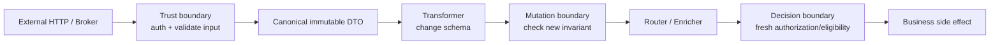
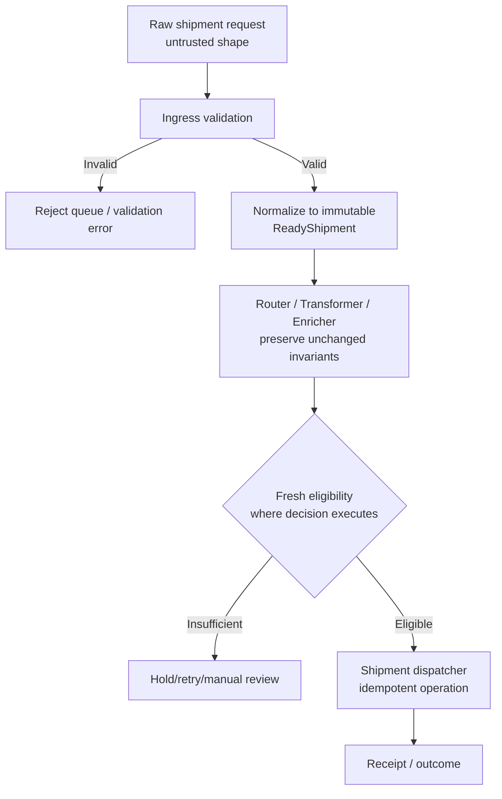
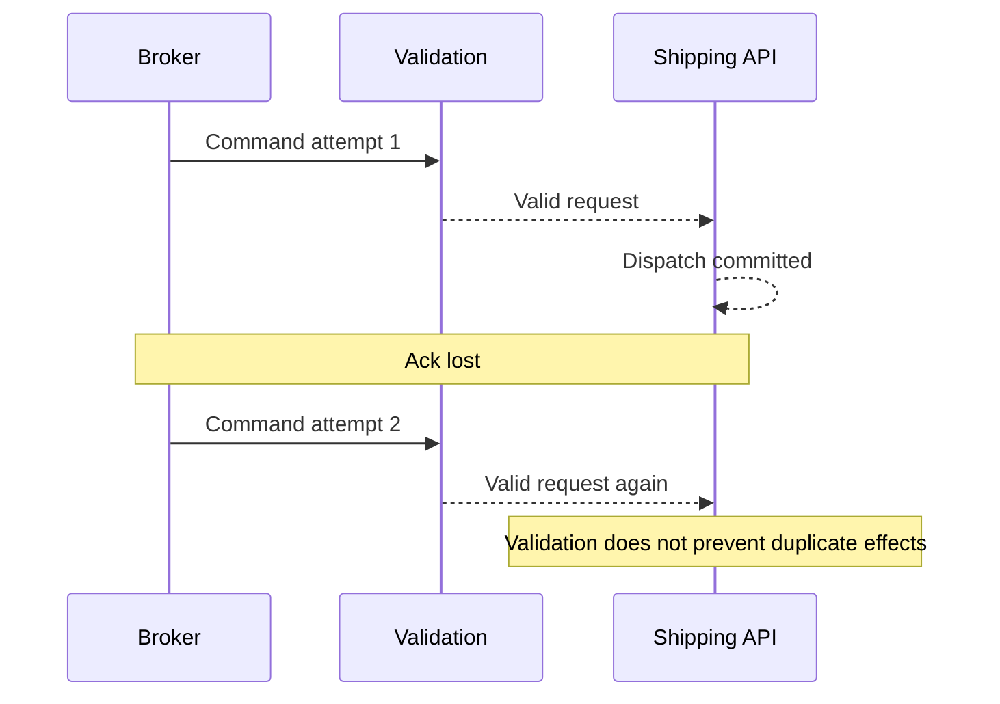

# Do Not Arbitrarily Revalidate at Every Step

## 1. The Problem: More Filters Does Not Automatically Mean Safer

A system receives shipping requests over HTTP, normalizes the data, chooses a processing branch, checks delivery feasibility, and calls a shipping service. Wanting "maximum safety", the development team writes:

```text
HTTP Inbound
   ↓
Filter: valid orderId?
   ↓
Transformer: convert input to DTO
   ↓
Filter: valid orderId?
   ↓
Router: choose STANDARD or EXPRESS
   ↓
Filter: valid orderId, valid country?
   ↓
Content Enricher: look up delivery hub
   ↓
Filter: valid orderId, valid country, valid weight?
   ↓
Gateway: send to Shipping Service
   ↓
Filter: valid orderId, valid country again?
```

At first glance, the system has many layers of defense. Yet this design suffers from at least five problems:

1. **Pointless repeated checks:** the exact same immutable `orderId` is checked repeatedly even though nothing changed it.
2. **Easy contradictions:** each Filter may end up using a different regex version, country list, or threshold rule.
3. **Increased latency and coupling:** if validation hits a database or API, multiple steps call the same source to verify the same fact.
4. **Wrong decision point:** checking account status at the start of the flow and trusting that result forever, even though the command may sit queued for a long time before executing side effects.
5. **Hard error handling:** Filter A drops messages silently, Filter B throws exceptions, Filter C sends to a discard channel; operators cannot tell where or why data was rejected.

Conversely, removing all checks after ingress is also wrong: data can be **mutated**, **reconstructed from external sources**, **cross trust boundaries**, or **expire over time**.

Core principle of this lesson:

> **Validate an attribute where it enters or changes, and recheck conditions that depend on fresh state right before consequential decisions. Never copy the same check into every endpoint just to feel safe.**

The lesson **"Do Not Arbitrarily Revalidate at Every Step"** belongs to the **Message filter and validation** chapter of the **SPRING_INTEGRATION_PATTERN** module. The module teaches implementing Enterprise Integration Patterns with Spring Integration to build loosely coupled, extensible message flows; practicing Router, Filter, Transformer, Splitter, Aggregator, Gateway, retry, error channel, and correlation, along with testing and observing processing branches.

### Learning Goals

After this lesson, you will be able to:

- Distinguish **data validation**, **authentication**, **authorization**, **business rules**, and **branch selection via Filter**.
- Identify *trust boundaries*, *mutation boundaries*, and *decision boundaries*—the three legitimate reasons to check.
- Design normalized, immutable DTOs with clear invariants without re-running the same regex at every step.
- Use Spring Integration Java DSL to validate at ingress, transform safely, and verify dynamic conditions right before operations.
- Distinguish `discardChannel`, exceptions, error channels, retries, and dead-letter handling.
- Write JUnit tests proving bad data stops, valid data is not arbitrarily rechecked, and business conditions can change.
- Avoid stale validation, header spoofing, duplicate side effects, and fan-out/fan-in failures.

## 2. Validation, Authentication, and Filter Are Not the Same Thing

The word "validation/verification" is sometimes used loosely to mean both **checking data** and **verifying the sender**. In integration systems, keep these concepts distinct:

| Concept | Question | Example | Where performed |
| --- | --- | --- | --- |
| **Authentication** | Who sent the request? | Token/mTLS confirming a service | Trusted ingress and security boundaries |
| **Authorization** | Is the actor allowed to do this? | Can Tenant A process order O-204? | Before accessing resources or side effects |
| **Structural validation** | Does data match schema/format? | `weightGrams` is positive within range | At data ingress or schema-change boundaries |
| **Semantic/domain validation** | Is the data business-valid? | Country code supported per contract | When constructing domain models or making decisions |
| **Dynamic eligibility** | Can this run right now? | Stock available, user not locked | Close to operations depending on current state |
| **Filter** | Should the message continue per a predicate? | Only eligible orders enter shipping branch | Endpoints designed to select accept/reject |
| **Router** | Which branch should the message take? | EXPRESS → priority channel | Once trusted routing facts exist |
| **Idempotent Receiver** | Has this operation already been applied? | Retry with same `shipmentRequestId` | Near side-effect boundaries, paired with store/recovery |

A `MessageFilter` in Spring Integration makes an **accept/reject decision via a predicate**. It can perform a simple validation check, yet **does not automatically replace** a validation layer returning error lists, authentication, or system authorization.

Specifically:

- "Is the input formatted properly?" is a relatively stable question for an immutable payload.
- "Is the order still authorized to dispatch right now?" can change over time.
- "Has this command already been dispatched?" requires idempotency/transactions, not regex rechecks.

## 3. Three Types of Boundaries That Decide Whether Revalidation Is Needed



### 3.1. Trust Boundary — Where Data Becomes Trusted

Every untrusted data source must be verified upon entering the system: HTTP bodies, partner broker messages, webhooks, CSV files, callbacks, or replies from external services.

Typically required here:

1. Authenticate the source and actor permissions.
2. Check schema, version, size, format, and required fields.
3. Normalize data representations per contract.
4. Construct an **internal typed DTO** carrying proven invariants.
5. Protect trusted-source fields such as `tenantId`, `principal`, and `permissions`.

If a message passed validation in Service A and travels to Service B over a broker with no provenance/tamper guarantees, Service B must still treat it as **a new ingress**. A self-declared `validated=true` flag proves nothing.

### 3.2. Mutation Boundary — Where Invariants Can Break

If a Transformer converts `amountCents` to `BigDecimal`, applies an exchange rate, merges multiple results, or updates `shippingAddress`, **changed attributes must be verified against the new data type's contract**.

You do not need to re-run every `orderId` check just because a Transformer changed `weightGrams`, provided `orderId` stayed untouched, immutable, and within the same trust scope.

### 3.3. Decision Boundary — Where Facts Can Go Stale

Checks on stock, account status, quotas, KYC, limits, delivery capacity, or resource permissions can turn **stale** if a flow waits too long.

Therefore, verify eligibility and authorization at the **point where the decision executes**. Still, avoid calling the same API to check state in every intermediate Filter; instead, define freshness lifetimes, ownership, deadlines, and atomic claim/transaction mechanisms where needed.

## 4. Matrix: Where to Check, and When Can You Keep Trusting?

| Fact/condition | First check | When to recheck? | What not to do |
| --- | --- | --- | --- |
| `orderId` format | Ingress | When read from a new source or ID changes | Regex after every Transformer when ID is unchanged |
| `weightGrams` in range | During parse/normalize | After recomputing weight or converting units | Reparse String in every Filter |
| `currency` and money scale | Ingress/domain constructor | When currency/amount is recalculated | Have every Router guess rounding |
| `tenantId` | Trusted authentication boundary | When a new service boundary must authenticate | Trust client `tenantId` header |
| Order read permission | Before accessing order | When switching actor/resource or at sensitive ops | Treat client `isAuthorized` as proof |
| Inventory | When deciding to reserve | Close to commit or inside atomic reservation/TX | Check repeatedly yet never lock |
| KYC/lock status | Relevant policy boundary | Near sensitive actions per freshness contract | Cache APPROVED forever |
| Idempotency key | When receiving business command | When claiming/committing the same operation | Generate fresh UUID on retry or use Message ID |
| `correlationId` | When creating/receiving group | When adapters reconstruct or source is untrusted | Group by unverified headers |
| Remote service reply | When reply crosses boundary | Always—if schema/provenance/version may differ | Trust every reply just because request was valid |
| Internal immutable `ValidatedOrder` | On construction | When creating new instance from untrusted source/schema | Deserialize straight from client into "trusted" record |

This table does not mean checking at ingress allows **dropping all runtime invariants**. Checks belonging to **type contracts**, **resource-layer authorization**, and **database constraints** can remain as defense-in-depth. What to avoid is copying **the exact same expensive/async logic** into every step of one flow without reason.

## 5. Anti-Pattern: Every Endpoint Revalidates Itself

Example to avoid:

```java
// Illustrates an anti-pattern only; not a recommended configuration.
@Bean
IntegrationFlow repeatedValidationFlow() {
    return IntegrationFlow.from("orders.in")
        .filter(OrderCommand.class,
            order -> validationService.fullCheck(order))
        .transform(OrderCommand.class,
            this::normalize)
        .filter(OrderCommand.class,
            order -> validationService.fullCheck(order))
        .route(OrderCommand.class, this::chooseRoute)
        .filter(OrderCommand.class,
            order -> validationService.fullCheck(order))
        .handle(shippingGateway)
        .get();
}
```

Why is this wrong?

- `fullCheck()` may hit the network/DB; calling it three times triples load on dependencies per request.
- External state can change between calls; two Filters can return conflicting answers with no single decision contract.
- If a Router/Transformer changes the payload type, later Filters may cast wrongly.
- One endpoint throws, another discards—behavior depends on ordering and position.
- When updating rules, it is easy to forget one Filter, causing branches to disagree.
- Running the same check three times does not protect side effects; **check-then-act still races**.

### Dynamic Condition Race Example

```text
10:00:00  Filter A: stock=1 → allow
10:00:01  Filter B: stock=1 → allow
10:00:02  Another worker reserves the last item
10:00:03  Gateway: submit shipment → stock=0
```

Repeating checks **does not create atomicity**. For contended resources, you need **atomic reservations**, database constraints, optimistic locks, transactions, or APIs with matching preconditions/idempotency.

## 6. Better Design: Validate Once per Trust/Versioned Contract



A reliable approach:

1. **Centralize the input contract:** one single owner for a message type's schema/syntax.
2. **Normalize into meaningful types:** String `weightGrams` → int; String `mode` → enum.
3. **Keep data immutable:** downstream steps cannot accidentally mutate verified values.
4. **Separate static invariants from dynamic eligibility:** each is checked at the right time.
5. **Every rejection has an explicit outcome:** never drop messages silently.
6. **Revalidate intentionally:** only when data, schema, or trust state actually changes.
7. **Make decisions observable:** who rejected, which rule version, which request, retryable vs permanent.

"Validate once" here **does not mean the whole system checks once and trusts forever**. It means **never pointlessly repeating a stable invariant within the same trust scope**.

## 7. Example Data Model

The lesson uses a raw shipping request, a tenant-authenticated envelope, a normalized DTO, and a receipt.

```java
record RawShipment(
    String orderId,
    String countryCode,
    String weightGrams,
    String shippingMode) {}

record TrustedIncomingShipment(
    String authenticatedTenantId,
    RawShipment raw) {}

enum ShippingMode {
    STANDARD,
    EXPRESS
}

record ReadyShipment(
    String tenantId,
    String orderId,
    String countryCode,
    int weightGrams,
    ShippingMode mode) {}

record ShipmentReceipt(
    String tenantId,
    String orderId,
    String outcome) {}
```

**Assumptions of the example:**

- `TrustedIncomingShipment` is **constructed only by an authenticated adapter**. HTTP clients must never pass `authenticatedTenantId` directly.
- `orderId` is a non-blank ASCII code up to 40 characters.
- `countryCode` must be `VN` or `SG` per the **demo contract**. In production, supported countries may belong to a versioned policy separate from structural validation.
- `weightGrams` arrives as a positive integer string up to 25,000 g.
- `shippingMode` belongs to enum `STANDARD` or `EXPRESS`.
- `ReadyShipment` is an immutable record; downstream stages only read it.
- Checking intake capacity at the dispatcher is **dynamic eligibility**, not repeating `orderId` format checks.

If data was already parsed from JSON by a schema-validating framework, still define where typed messages are constructed and how errors return; the example does not mandate keeping weight as a String in every application.

## 8. Structural/Semantic Validator at Ingress

Define a contract in **one ingress boundary**, instead of copying expressions into Routers or handlers.

```java
final class ShipmentIngressContract {

    boolean valid(TrustedIncomingShipment incoming) {
        if (incoming == null
                || incoming.raw() == null
                || blank(incoming.authenticatedTenantId())) {
            return false;
        }

        RawShipment raw = incoming.raw();

        if (blank(raw.orderId())
                || !raw.orderId().matches("[A-Z0-9-]{1,40}")
                || !("VN".equals(raw.countryCode())
                    || "SG".equals(raw.countryCode()))
                || !("STANDARD".equals(raw.shippingMode())
                    || "EXPRESS".equals(raw.shippingMode()))) {
            return false;
        }

        String rawWeight = raw.weightGrams();

        if (rawWeight == null
                || !rawWeight.matches("[0-9]{1,5}")) {
            return false;
        }

        int grams;
        try {
            grams = Integer.parseInt(rawWeight);
        } catch (NumberFormatException ex) {
            return false;
        }

        return grams > 0 && grams <= 25_000;
    }

    private static boolean blank(String value) {
        return value == null || value.isBlank();
    }
}
```

### Why Check Overflow During Parsing?

The five-digit regex currently fits in `int`, yet keeping controlled parsing keeps the contract clear if rules change. Never call `Integer.parseInt()` carelessly and let an accidental exception decide whether a message is rejected.

### Why Not Query Inventory Here?

The input contract determines whether a message is **structurally qualified** to enter internal flows. Inventory or shipping capacity can change while the message sits in a queue or retries; check it near reserve/dispatch with proper consistency.

### What If Multiple Validation Errors Must Be Returned?

A boolean `valid()` only separates pass from fail. When an API must return all field errors, use a model like:

```java
record FieldError(
    String field,
    String code) {}

record ValidationResult<T>(
    T value,
    java.util.List<FieldError> errors) {

    boolean valid() {
        return errors.isEmpty();
    }
}
```

You can transform `RawShipment` into `ValidationResult<ReadyShipment>` and use a Router to split accepted/rejected branches with typed errors. **Never stash error lists in static fields or `ThreadLocal`s** for a Filter to read back, as that state breaks under concurrency/async.

## 9. Transformer Building the Normalized DTO

Once the validator guarantees input schema, a Transformer converts data into types downstream components can use directly.

```java
final class ShipmentNormalizer {

    ReadyShipment normalize(TrustedIncomingShipment incoming) {
        RawShipment raw = incoming.raw();

        return new ReadyShipment(
            incoming.authenticatedTenantId(),
            raw.orderId(),
            raw.countryCode(),
            Integer.parseInt(raw.weightGrams()),
            ShippingMode.valueOf(raw.shippingMode()));
    }
}
```

With a **synchronous** Filter → Transformer pair, inputs reaching the normalizer have already passed validation. You do not need to re-run `ShipmentIngressContract.valid()` here: typed conversions build on the established invariants.

**Limitation:** if another caller invokes `normalize()` directly with unvalidated input, it can throw. When exposing a public API reusable outside the flow, expose a `parseAndValidate()` entrypoint returning `ValidationResult` or throwing typed exceptions so callers never forget the two-step contract. Alternatively, enforce core invariants in `ReadyShipment`'s constructor/factory.

### Trust Does Not Automatically Come from a DTO Name

Naming something `ReadyShipment` provides zero security. If an external adapter deserializes JSON directly into `ReadyShipment` and sends it onto an internal channel without verification, it **bypassed the validation boundary**.

A trustworthy model must pair with **channel/API permissions**, allowed message types, trusted adapters, and tenant authorization.

## 10. Dynamic Eligibility: Conditions Meaningful Only at Processing Time

For instance, a dispatcher can pause intake when the shipping carrier is down. That is a **dynamic condition**, unlike checking whether `weightGrams` has the right format.

```java
import java.util.concurrent.atomic.AtomicBoolean;

final class ShippingAvailability {

    private final AtomicBoolean open =
        new AtomicBoolean(true);

    boolean canAccept(ReadyShipment shipment) {
        // Demo: reads current operational state.
        // Production: needs tenant, route, quota, deadline,
        // and atomic reservation under contention.
        return open.get();
    }

    void setOpen(boolean value) {
        open.set(value);
    }
}
```

For a valid shipment, `open=false` does not make `ReadyShipment` malformed data. It only means the command **cannot execute right now** and should be held/retried safely or marked `HOLD` per business rules.

Never combine `validFormat` and `canAccept` into a single boolean `isValidOrder` and call it at every step. The two checks have **different lifetimes and error policies**.

### Note on Check-Then-Act

In the example, `open.get()` merely simulates a toggle; it does not guarantee state will not change right after the check. For quotas, stock, and contended resources, real systems need **atomic reserve/commit**, database constraints, optimistic locks, or remote APIs enforcing conditions in one operation.

## 11. Handler Simulating Side Effects

To avoid hitting a real shipping service in tests, use a handler counting dispatch attempts:

```java
import java.util.concurrent.atomic.AtomicInteger;

final class FakeShipmentDispatcher {

    private final AtomicInteger attempts =
        new AtomicInteger();

    ShipmentReceipt dispatch(ReadyShipment shipment) {
        attempts.incrementAndGet();

        return new ShipmentReceipt(
            shipment.tenantId(),
            shipment.orderId(),
            "SIMULATED_ACCEPTED");
    }

    int attempts() {
        return attempts.get();
    }
}
```

This handler makes **no** HTTP calls, writes no database rows, and proves no real delivery. It only lets tests assert:

- Invalid raw input is blocked before the handler.
- Valid input with open availability runs the handler.
- Valid data with closed operations does not call the handler.

A production pipeline also needs **idempotency keys**, timeouts, error channels, and retries/reconciliation for real side effects, covered later.

## 12. Spring Integration Java DSL: Checking at the Right Boundaries

Below is a complete flow illustrating:

1. Structural/semantic Filter at ingress.
2. Transformer into typed immutable DTO.
3. **Dynamic eligibility** Filter where the decision executes.
4. Service Activator performing the simulated action.
5. Two discard channels separating **invalid input** from **on hold**.

```java
import org.springframework.context.annotation.Bean;
import org.springframework.context.annotation.Configuration;
import org.springframework.integration.channel.DirectChannel;
import org.springframework.integration.channel.QueueChannel;
import org.springframework.integration.config.EnableIntegration;
import org.springframework.integration.dsl.IntegrationFlow;

@Configuration
@EnableIntegration
public class ShipmentValidationFlowConfig {

    @Bean
    ShipmentIngressContract shipmentIngressContract() {
        return new ShipmentIngressContract();
    }

    @Bean
    ShipmentNormalizer shipmentNormalizer() {
        return new ShipmentNormalizer();
    }

    @Bean
    ShippingAvailability shippingAvailability() {
        return new ShippingAvailability();
    }

    @Bean
    FakeShipmentDispatcher fakeShipmentDispatcher() {
        return new FakeShipmentDispatcher();
    }

    @Bean("shipment.raw.in")
    DirectChannel rawInput() {
        return new DirectChannel();
    }

    @Bean("shipment.invalid")
    QueueChannel invalidInput() {
        return new QueueChannel();
    }

    @Bean("shipment.on-hold")
    QueueChannel onHold() {
        return new QueueChannel();
    }

    @Bean("shipment.receipts")
    QueueChannel receipts() {
        return new QueueChannel();
    }

    @Bean
    IntegrationFlow shipmentFlow(
            ShipmentIngressContract contract,
            ShipmentNormalizer normalizer,
            ShippingAvailability availability,
            FakeShipmentDispatcher dispatcher) {

        return IntegrationFlow.from("shipment.raw.in")
            .filter(TrustedIncomingShipment.class,
                contract::valid,
                spec -> spec.discardChannel("shipment.invalid"))
            .transform(TrustedIncomingShipment.class,
                normalizer::normalize)
            .filter(ReadyShipment.class,
                availability::canAccept,
                spec -> spec.discardChannel("shipment.on-hold"))
            .handle(ReadyShipment.class,
                (shipment, headers) ->
                    dispatcher.dispatch(shipment))
            .channel("shipment.receipts")
            .get();
    }
}
```

The two Filters here **do not** repeat the same rule:

- Filter 1: checks **input format/contract** before creating the internal DTO.
- Filter 2: checks **dynamic operational conditions** close to the handler.

If you insert Routers, Header Enrichers, or Wire Taps between these two Filters without altering input invariants, there is no need to copy Filter 1 into every stage.

### Why Not Put Everything in One Ingress Filter?

Because `availability::canAccept` changes over time. A message may wait in a queue long after ingress; checking dynamic eligibility at HTTP receipt is insufficient for final execution. Still, for contended resources, pre-dispatch checks **must be paired with atomic operations**.

### Discard Channels Are Not Durable Queues

`QueueChannel` in the example is for observing test outputs; it does not guarantee survival across restarts. Whenever a rejected or `HOLD` request matters, use durable failure records, broker/workflow stores, or typed replies per contract.

### Overload/API Notes

The Java DSL patterns here target modern Spring Integration and Java 17+ (records). When integrating into a real project, check `filter(payloadType, predicate, endpointConfigurer)`, `transform(payloadType, transformer)`, and `handle(payloadType, handler)` overloads against your dependency versions. STEP 6 will perform technical review and compilation checks; this lesson does not run a build per STEP 4 instructions.

## 13. JUnit: Bad Data Rejected Once, Valid Data Processed

Uses JUnit 5, Spring Test, and AssertJ.

```java
import static org.assertj.core.api.Assertions.assertThat;

import org.junit.jupiter.api.BeforeEach;
import org.junit.jupiter.api.Test;
import org.springframework.beans.factory.annotation.Autowired;
import org.springframework.beans.factory.annotation.Qualifier;
import org.springframework.integration.channel.QueueChannel;
import org.springframework.messaging.Message;
import org.springframework.messaging.MessageChannel;
import org.springframework.messaging.support.MessageBuilder;
import org.springframework.test.context.junit.jupiter.SpringJUnitConfig;

@SpringJUnitConfig(ShipmentValidationFlowConfig.class)
class ShipmentValidationFlowTest {

    @Autowired
    @Qualifier("shipment.raw.in")
    MessageChannel input;

    @Autowired
    @Qualifier("shipment.invalid")
    QueueChannel invalid;

    @Autowired
    @Qualifier("shipment.on-hold")
    QueueChannel onHold;

    @Autowired
    @Qualifier("shipment.receipts")
    QueueChannel receipts;

    @Autowired
    ShippingAvailability availability;

    @Autowired
    FakeShipmentDispatcher dispatcher;

    @BeforeEach
    void resetDynamicPolicy() {
        availability.setOpen(true);
    }

    private TrustedIncomingShipment request(
            String orderId,
            String weight) {

        return new TrustedIncomingShipment(
            "tenant-A",
            new RawShipment(
                orderId, "VN", weight, "STANDARD"));
    }

    private void send(TrustedIncomingShipment payload) {
        assertThat(input.send(MessageBuilder
            .withPayload(payload)
            .setHeader("requestId",
                "req-" + payload.raw().orderId())
            .build())).isTrue();
    }

    @Test
    void acceptedInputProducesOneReceipt() {
        int before = dispatcher.attempts();

        send(request("O-204", "1200"));

        Message<?> result = receipts.receive(1_000);
        assertThat(result).isNotNull();

        ShipmentReceipt receipt =
            (ShipmentReceipt) result.getPayload();
        assertThat(receipt.orderId()).isEqualTo("O-204");
        assertThat(receipt.tenantId()).isEqualTo("tenant-A");
        assertThat(receipt.outcome())
            .isEqualTo("SIMULATED_ACCEPTED");

        assertThat(invalid.receive(0)).isNull();
        assertThat(onHold.receive(0)).isNull();
        assertThat(dispatcher.attempts() - before).isEqualTo(1);
    }

    @Test
    void invalidWeightIsRejectedBeforeDispatcher() {
        int before = dispatcher.attempts();

        send(request("O-205", "-1"));

        Message<?> rejected = invalid.receive(1_000);
        assertThat(rejected).isNotNull();
        assertThat(rejected.getPayload())
            .isInstanceOf(TrustedIncomingShipment.class);

        assertThat(receipts.receive(0)).isNull();
        assertThat(onHold.receive(0)).isNull();
        assertThat(dispatcher.attempts() - before).isZero();
    }

    @Test
    void validDataCanBeOnHoldWithoutBecomingInvalid() {
        int before = dispatcher.attempts();
        availability.setOpen(false);

        send(request("O-206", "1000"));

        Message<?> held = onHold.receive(1_000);
        assertThat(held).isNotNull();
        assertThat(held.getPayload())
            .isInstanceOf(ReadyShipment.class);
        assertThat(((ReadyShipment) held.getPayload())
            .weightGrams()).isEqualTo(1000);

        assertThat(invalid.receive(0)).isNull();
        assertThat(receipts.receive(0)).isNull();
        assertThat(dispatcher.attempts() - before).isZero();
    }

    @Test
    void eligibilityMayChangeBetweenTwoRequests() {
        int before = dispatcher.attempts();

        availability.setOpen(false);
        send(request("O-207", "900"));
        assertThat(onHold.receive(1_000)).isNotNull();

        availability.setOpen(true);
        send(request("O-208", "900"));
        assertThat(receipts.receive(1_000)).isNotNull();

        assertThat(dispatcher.attempts() - before).isEqualTo(1);
    }

    @Test
    void unsupportedMethodIsInvalidAtIngress() {
        int before = dispatcher.attempts();

        send(new TrustedIncomingShipment(
            "tenant-A",
            new RawShipment(
                "O-209", "VN", "1200", "DRONE")));

        assertThat(invalid.receive(1_000)).isNotNull();
        assertThat(receipts.receive(0)).isNull();
        assertThat(dispatcher.attempts() - before).isZero();
    }
}
```

**Fixture note:** `ApplicationContext` and `QueueChannel`s may be reused across test methods. These tests drain expected messages and reset `availability` in `@BeforeEach`. For parallel tests, isolate contexts/fixtures instead of sharing queues, and never depend on JUnit execution order.

**What the tests prove:** bad input is blocked, valid input is normalized before dispatch, and dynamic `HOLD` conditions are not confused with validation failures.

**What the tests do not prove:** real authentication, distributed queues, atomic stock reservations, idempotency on broker redeliveries, or infrastructure data changing mid-transaction. Those require dedicated tests at their respective boundaries.

## 14. Unit Testing the Contract and Normalizer

Separating rules from flows lets you test invariants directly without booting a Spring context for every case.

```java
import static org.assertj.core.api.Assertions.assertThat;

import org.junit.jupiter.api.Test;

class ShipmentIngressContractTest {

    private final ShipmentIngressContract contract =
        new ShipmentIngressContract();

    private final ShipmentNormalizer normalizer =
        new ShipmentNormalizer();

    private TrustedIncomingShipment incoming(
            String orderId,
            String country,
            String weight,
            String mode) {

        return new TrustedIncomingShipment(
            "tenant-A",
            new RawShipment(orderId, country, weight, mode));
    }

    @Test
    void validRawDataNormalizesIntoTypedPayload() {
        TrustedIncomingShipment request = incoming(
            "O-204", "VN", "1200", "STANDARD");

        assertThat(contract.valid(request)).isTrue();

        ReadyShipment ready = normalizer.normalize(request);
        assertThat(ready.orderId()).isEqualTo("O-204");
        assertThat(ready.weightGrams()).isEqualTo(1200);
        assertThat(ready.mode())
            .isEqualTo(ShippingMode.STANDARD);
    }

    @Test
    void invalidWeightsAreRejectedAtOneBoundary() {
        assertThat(contract.valid(
            incoming("O-204", "VN", "0", "STANDARD")))
            .isFalse();

        assertThat(contract.valid(
            incoming("O-204", "VN", "25001", "STANDARD")))
            .isFalse();

        assertThat(contract.valid(
            incoming("O-204", "VN", "12.5", "STANDARD")))
            .isFalse();
    }

    @Test
    void missingTenantAndBadCountryAreRejected() {
        TrustedIncomingShipment missingTenant =
            new TrustedIncomingShipment(
                "", new RawShipment(
                    "O-204", "VN", "1200", "STANDARD"));

        assertThat(contract.valid(missingTenant)).isFalse();
        assertThat(contract.valid(
            incoming("O-204", "US", "1200", "STANDARD")))
            .isFalse();
    }

    @Test
    void orderIdHasAStableCanonicalDomain() {
        assertThat(contract.valid(
            incoming("O-204", "VN", "1200", "EXPRESS")))
            .isTrue();

        assertThat(contract.valid(
            incoming(" o-204 ", "VN", "1200", "EXPRESS")))
            .isFalse();
    }
}
```

### Why Don't Validator Unit Tests Replace Transport Contract Tests?

An inbound HTTP adapter may deserialize wrong types, drop a header, or ignore `Content-Type`. Unit testing `ShipmentIngressContract` will never catch adapter bugs.

You need **real ingress** integration tests proving:

- Oversized JSON is rejected before uncontrolled memory allocation.
- Unknown JSON fields are ignored, rejected, or forwarded per schema policy.
- Tenant comes from the authenticated principal rather than client-controlled body/headers.
- DTOs are constructed through the proper validated factory/mapper.
- Messages from partner brokers carry valid versions and provenance.

## 15. Type-Level Validation: Preserving Invariants Instead of Rechecking

A clean design lets DTO constructors/factories enforce invariants:

```java
record PositiveGrams(int value) {

    PositiveGrams {
        if (value < 1 || value > 25_000) {
            throw new IllegalArgumentException(
                "Weight must be between 1 and 25000 g");
        }
    }
}
```

Once a payload carries `PositiveGrams`:

- Routers do not need to reparse weight strings.
- Transformers cannot mutate it in place because the record is immutable.
- If a business step recalculates weight, it constructs **a new `PositiveGrams`**; the constructor guards the new invariant.
- If data is deserialized directly bypassing the trusted factory, external boundaries still need schema/type validation.

**Distinguish two defensive layers:** constructors enforce local object invariants, while ingress verifies **origin, permissions, protocol, and resource limits**. Never skip authentication just because a DTO is strongly typed.

### The "Validated" State Can Be Lost

These actions can invalidate earlier assumptions:

- Converting an immutable DTO into a `Map<String,Object>` and mutating fields unchecked.
- Serializing to JSON, sending across an untrusted queue, and deserializing in another service.
- Enriching from an external reply and overwriting a core business field.
- Merging payloads from different tenants or schema versions.
- Changing units of measurement or calculation formulas.
- Sharing a mutable object across multiple subscribers/workers.

When those happen, identify **which attributes need revalidation**, rather than running every validator just because "the message passed through a Transformer".

## 16. Conditional Revalidation After a Transformer

One Transformer may only change representation:

```text
Raw amount "19.95" USD
    ↓ controlled parse/normalize
Money(USD, 19.95)
```

Another Transformer may change **meaning**:

```text
Amount 19.95 USD
    ↓ apply exchangeRate
Amount 485000 VND
```

The two cases are not equivalent.

| Change | Required validation |
| --- | --- |
| String → validated enum | Correctness of mapping/new schema |
| Date/time String → `Instant` | Parse + timezone/effective-time contract |
| Currency conversion | Currency pair, exchange rate/version, rounding, amount invariant |
| Splitter splitting 100 lines | Each line has valid ID/sequence; no need to recheck order ID on every part if trusted |
| Aggregator merging multiple results | Correlation, unique part count, currency/consistency across results |
| Content Enricher adding profile | Reply provenance, freshness, and tenant scope of added data |
| Router picking branch | Routing inputs are trustworthy; no need to rerun entire input contract |
| Gateway to external system | Authorization, outbound schema, PII data minimization |
| External response entering flow | Check **a new trust boundary** |
| Retries | Preserve business ID, check changed values/timeout state |

### Rechecking Invariants Differs from Re-Authenticating

You may need to re-verify **permission to perform an action** even if the user authenticated at ingress. Access rights can change, tokens can be revoked, and resource states can shift.

However, that does not mean **repeating full token introspection in every Filter**. Follow security architecture: proper token caching/validation, policy enforcement points at right boundaries, and re-authorization right before sensitive side effects.

## 17. When to Authorize Actor and Resource Permissions

Example:

```text
09:00:00  User authenticates and requests a refund.
09:00:01  Job enters queue, awaiting processing.
09:15:00  Actor's refund permission is revoked.
09:20:00  Worker processes the job.
```

A check asking "can actor refund?" at 09:00 may no longer hold at 09:20, depending on business policy.

Ask:

1. Does authorization evaluate against **request-time permissions** or **execution-time permissions**?
2. Does the token/job carry delegated authority with bounded lifetime and scope?
3. Who can revoke permissions, and when do revocations take effect?
4. Must entity/resource state be checked right before commit?
5. If the policy service is unavailable, fail closed or allow processing under a signed snapshot?
6. Are policy version and decision timestamp audited?

Do not cram these questions into a payload regex Filter. They belong in an **authorization/decision service** with its own contract.

## 18. Error Handling: Invalid, Rejected, and Unavailable Are Not the Same

In Spring Integration Filter, multiple options exist when a predicate returns `false`:

- Route the message to a configured `discardChannel`.
- Throw an exception if configured with `throwExceptionOnRejection(true)`.
- Under some configurations, drop the message without returning a business result to the caller.

**Do not assume a Filter automatically produces HTTP 400 or routes all errors into the global `errorChannel`.** Behavior depends on the endpoint, channel, adapter, and error-flow design.

| Outcome | Example | Category | Handling |
| --- | --- | --- | --- |
| `INVALID_INPUT` | Negative weight, bad schema | Permanent validation | Return structured reason, no infinite retries |
| `UNAUTHORIZED` | Wrong tenant, missing role | Security | Deny/audit, never leak cross-tenant data |
| `NOT_ELIGIBLE` | Route unsupported | Business decision | Hold/reject per policy |
| `TEMPORARILY_UNAVAILABLE` | Shipping service down | Transient | Bounded retry/backoff/deadline |
| `INTEGRITY_CONFLICT` | Same ID, different payload | Integrity | Quarantine/manual review |
| `DUPLICATE_COMPLETED` | Command already committed | Idempotency | Return persisted result/ACK |
| `UNKNOWN_OUTCOME` | Remote commit unclear after timeout | Reconciliation | Never blindly resend under a new key |

Do not collapse everything into `validationFailed=true`. For example, `TEMPORARILY_UNAVAILABLE` is not invalid input; repeating input validation will never fix the network.

### Filter Discard Should Not Be Mistaken for Success

If a Gateway awaits a reply and a Filter silently discards, the caller may time out even though the message was "handled properly" by being rejected. For request–reply APIs, return a **typed rejection outcome** or throw an exception mapped by the adapter to a clear response.

With async brokers, define ACK/retry/DLQ and auditing for rejected events. A discard channel only works if **its consumer actually processes rejections** and persists or replies per contract.

## 19. When Multiple Field Errors Are Needed: A Typed Validation Stage

A boolean Filter fits the simple question "should it continue?". For APIs needing detailed feedback, build a dedicated stage:

```java
record Rejection(
    String requestId,
    String errorCode,
    java.util.List<String> invalidFields) {}

record ValidationEnvelope<T>(
    T accepted,
    Rejection rejected) {

    static <T> ValidationEnvelope<T> ok(T value) {
        return new ValidationEnvelope<>(value, null);
    }

    static <T> ValidationEnvelope<T> reject(
            Rejection reason) {
        return new ValidationEnvelope<>(null, reason);
    }

    boolean isAccepted() {
        return accepted != null && rejected == null;
    }
}
```

Then use a Router reading `isAccepted()` to split into two flows:

```text
Raw message
    ↓ Validator/Transformer → ValidationEnvelope
    ↓ Content-Based Router
       ├─ accepted → typed business flow
       └─ rejected → structured error handler
```

Advantage: preserves multiple field errors, rule version, and rejection source. Trade-off: adds models/flows to maintain. Do not introduce this structure if a simple Filter suffices.

**Watch out for sensitive data:** error lists should hold field/error codes, never raw document numbers, financial details, or tokens.

## 20. A Validation Policy Has a Version and an Owner

When one rule appears in multiple endpoints, the issue is not only execution count, but also **who owns the rule**.

For example:

```text
Rule: weight <= 25 kg

Ingress Filter:       <= 25 kg
Router expression:    <= 20 kg
Fulfillment handler:  <= 30 kg
```

Three places make three conflicting decisions. The system needs a versioned **contract/policy owner**:

```text
ShipmentInputContract:
  schemaVersion = shipment-v2
  maxWeightGrams = 25000
  acceptedCountries = VN, SG
  shippingModes = STANDARD, EXPRESS
```

Some rules are **structural** (numbers must be positive) and stay stable long-term. Others are **business policies** (service supports up to 25 kg) and vary by tenant/warehouse/region. Separate them into distinct modules/interfaces instead of dumping everything into `fullValidate()`.

### Policy Rollouts Across Multiple Instances

If instance A runs `shipment-v2` and instance B runs `shipment-v3`, the same request might pass on A and fail on B. Define:

- Is the version pinned at ingress or on the event?
- Do retries of the same request retain the old policy version?
- Should workflows re-evaluate under the new policy?
- What are the overlap window and backward compatibility during rolling deployments?
- Are decision and policy version audited?

Never solve this by **"validating at every endpoint to be sure"**: that makes outcomes depend even more arbitrarily on which instance processed which hop.

## 21. Caching Validation Results: When Is It Safe?

Expensive checks can be optimized, provided you know which data is safe to cache.

| Kind | Safe to cache? | Conditions |
| --- | --- | --- |
| Order ID format | Usually unnecessary | Negligible cost; use typed invariants |
| Valid schema | Can preserve via immutable DTO | Never trust external `validated=true` |
| Currency scale | Inside value object | Checked on construction |
| Tenant authentication | Depends on security architecture | Signature, token expiry, revocation contract |
| Inventory availability | Cache only if domain tolerates staleness | Never replaces atomic reservation |
| Customer status | Depends on freshness and policy | Never cache sensitive status indefinitely |
| Address lookup | Cacheable by version/TTL | Authoritative source and permissions |
| KYC/transaction risk | Very cautious | Fail-closed or signed approved snapshot |

A `validationPassedAt` field does not mean validity lasts forever. For time-sensitive checks, explicitly record `asOf`, `policyVersion`, `expiresAt`, and provenance.

## 22. Repeated Validation in Splitter, Aggregator, and Scatter-Gather

### Splitter: Batch-Level vs Part-Level Validation Differ

```text
Order batch:
  100 lines
   ↓
Batch validation: order owner, schema, max line count
   ↓
Splitter
   ↓
Line validation: lineId, quantity, item SKU
```

You do not need to re-verify the entire order's signature 100 times if parts stay inside the trusted scope and preserve provenance. However, each line can have its own invariants, and whenever a part comes back from an **external worker**, that is a new trust boundary.

An anti-pattern: a validator calls the customer service for the whole order and then calls it again for each line → N+1 remote calls. Instead, enrich/validate at the batch level before the Splitter, preserve an immutable snapshot, and check only per-line attributes downstream.

### Aggregator: Validate Invariants of the Combined Result

Input validation of each part **does not prove** the group was assembled correctly:

- Does the correlation key include tenant/workflow/revision?
- Did all expected unique parts arrive?
- Are there duplicate or conflicting results?
- Do currencies match before summing?
- Did an external responder return a malformed schema?

This is **new validation at a mutation/composition boundary**, not pointless repetition. Never rerun the `orderId` regex 100 times in place of checking correlation.

### Scatter-Gather: Verify Each Responder's Identity

Two identical payloads from two different providers are two valid results; two replies from the same provider may be a duplicate. Validation at the gatherer checks **responder identity, expected plan, reply schema, and deadline**, not just the original request's structural validity.

### Resequencer: Validate Sequence Metadata

A domain-valid part can still carry duplicate `SEQUENCE_NUMBER`, gaps, or mismatched `SEQUENCE_SIZE`. A Resequencer needs grouping contracts and deduplication by business part identity—**not** repeating `RawShipment.valid()`.

## 23. Idempotency Cannot Be Replaced by Repeated Validation

Suppose a message passes every validator, the handler calls the shipping service and commits, and the broker loses the ACK and redelivers the same message.



Both attempts passing validation is **correct**, because the payload is valid. What needs protection is the **business operation**:

```text
idempotencyKey = (tenantId, DISPATCH, shipmentRequestId)
```

In production:

1. Maintain a stable operation ID across retries.
2. Track `PROCESSING`/`COMPLETED`/result in an appropriate ledger.
3. Pass the same idempotency key to remote APIs when supported.
4. If remote outcome is unclear, reconcile before launching a new operation.
5. Never ACK/drop duplicates just because a marker exists before the side effect committed.
6. Ensure ledger retention covers broker redeliveries and DLQ replays.

**Checking that data is valid does not mean the operation has never run.**

## 24. Retries Should Not Re-Run Unrelated Rules

An async flow may retry due to a Shipping API 503. Two options exist:

**Retry the whole pipeline from ingress:** reparse input, revalidate schema, re-normalize, re-enrich, and call the API again.

**Retry from a checkpoint before the failed operation:** reuse the immutable `ReadyShipment`/snapshot, recheck **still-dynamic eligibility**, and call the API with the same idempotency key.

The second option cuts load and reduces divergence, provided:

- Snapshots/checkpoints are trustworthy and survive restarts.
- Tenant/authorization is still verified per policy at execution time.
- Facts that can go stale are refreshed per contract.
- Operation IDs remain unchanged.
- Validation is never skipped across a new trust boundary.

**You cannot say "already validated" to skip checks when replaying from an untrusted source.** Conversely, you do not need to call an expensive external validator three times within one attempt when nothing changed.

### Permanent vs Transient Failures Need Separate Error Policies

| Failure | Example | Retry input validation? |
| --- | --- | --- |
| Permanent schema invalid | Negative weight, bad format | No |
| Unsupported schema version | Consumer incompatible | Park in DLQ/quarantine awaiting upgrade, no infinite loop |
| Access denied | Wrong tenant | No |
| DB capacity temporarily unavailable | Cannot query live state | Bounded retry of that lookup/decision |
| Remote API timeout | Unclear if committed | Reconcile/idempotent retry |
| Duplicate message | Operation already completed | Return outcome/ACK, do not re-execute |
| Conflicting payload | Same ID, mutated content | Reject/audit |
| Stale policy decision | Expired snapshot | Refresh dynamic rule at decision boundary |

## 25. Security and Revalidation at Trust Boundaries

**"Do not arbitrarily revalidate"** does not mean relaxing security or skipping required checks:

- Every service must authenticate senders when crossing trust domains.
- Never trust a client-sent `authenticated=true` header.
- Never let senders pick `tenantId` or `correlationId` to join another tenant's group.
- Never treat data validation as proof of authorization.
- Never store tokens/raw PII in discard queues or DLQs unless authorized.
- Never log entire invalid payloads just for debugging.
- Bound message size, part count, JSON nesting depth, and upload sizes at ingress.
- Check content type/schema version before complex deserialization.
- For webhooks, verify signatures, timestamps, and replay policies at the boundary.
- Verify provenance of enrichment data; never trust external replies just because the internal request was valid.
- At side-effect boundaries, guard transactions, authorization, and idempotency proportional to risk.

An internal **validated DTO** might be serialized to JSON, sent over a broker, and return from a partner. Upon return, **never trust a type name or boolean flag alone**; re-verify provenance and critical invariants under the new boundary's contract.

## 26. Observability: Track Rejection Reasons Instead of Counting Filters

A dashboard bragging "12 validation steps" proves nothing about quality. Track **invalid input rates, failing rules, latency, eligibility holds, and side effects**.

Suggested event:

```text
event=shipment_input_rejected
requestRef=req-204
tenantScope=tenant-A
stage=INGRESS_VALIDATION
schemaVersion=shipment-v2
ruleCode=INVALID_WEIGHT_GRAMS
retryable=false
```

And another event:

```text
event=shipment_on_hold
requestRef=req-205
stage=DISPATCH_ELIGIBILITY
policyVersion=shipping-capacity-v4
reason=SERVICE_UNAVAILABLE
retryable=true
```

These are **illustrative application schemas**, not logs auto-generated by Spring Integration. Omit raw tokens, PII, phone numbers, full addresses, or sensitive payloads from logs by default.

| Suggested metric | Meaning |
| --- | --- |
| `validation.requests.total{stage}` | Requests checked at a boundary |
| `validation.rejected.total{ruleCode}` | Most frequent schema/domain failures |
| `validation.duration{stage}` | Cost of validation |
| `eligibility.hold.total{reason}` | Dynamic business conditions blocking execution |
| `validation.policy.version{version}` | Tracks rule-version rollouts |
| `validation.remote.calls.total{source}` | Detects redundant API revalidation |
| `filter.discard.total{channel}` | Messages discarded per endpoint |
| `filter.exceptions.total{reason}` | Predicate/transform/handler errors |
| `business.dispatch.attempts.total` | Side-effect execution attempts |
| `business.idempotency.hits.total` | Duplicates caught |
| `business.unknown.outcome.total` | Remote outcomes needing reconciliation |

Avoid high-cardinality `requestId`/`orderId` metric labels. Use access-controlled traces/logs to investigate specific requests.

### Signs of Needless Duplicate Validation

- One message triggers multiple calls to the same policy API for the exact same DTO.
- CPU/latency scales linearly with endpoint count even when data is unchanged.
- Two Filters running different rule versions disagree on the same request.
- Duplicates/retries spike validation counts while the actual failure sits in outbound HTTP.
- Downstream misses messages with zero rejection records because a Filter silently discarded them.

## 27. Practical Troubleshooting

| Symptom | Possible cause | Fix |
| --- | --- | --- |
| Same order fails step 3 after passing step 1 | Duplicated rules with drifted versions | Single owner/schema and contract tests |
| High latency despite fast business handler | Multiple Filters hitting DB/APIs | Split static/dynamic checks, reuse immutable DTO |
| Filter drops message and caller times out | Discard lacks explicit reply | Result/error flow per Gateway contract |
| Invalid message vanishes | Predicate=false with no discard configured | Durable reject flow/audit when needed |
| Valid input dispatches when out of stock | Eligibility checked too early, no atomic reserve | Check/commit at same resource boundary |
| Client spoofs `validated=true` | Trusting client fields/headers | Trusted ingress and server-side validation |
| Partner data bypasses validator | Backdoor channel or direct typed deserialization | Control ingress paths and channel permissions |
| Validator treats network errors as "invalid" | Collapsing transient failures into boolean | Typed results/exceptions and retry policy |
| `orderId` regex runs 100 times | Splitter copies batch rules to every part | Validate batch invariants before splitting |
| Aggregator computes wrong total despite valid parts | Missing group/currency/correlation checks | Validate composition boundary |
| New service returns altered schema | External response unvalidated | Contract/provenance/version checks |
| Duplicate side effects despite Filters passing | Missing idempotency | Stable business operation key + ledger |
| Exception skips global `errorChannel` | Sync `DirectChannel` or missing error handler | Check runtime thread/adapter |
| Rule change during rollout flips retry outcomes | Policy version not pinned/recorded | Versioned decisions and replay contract |
| Tenant A sees Tenant B's data | Trusting unverified headers/correlation | Trusted identity + boundary authorization |

## 28. Recommended Test Matrix

| Scenario | Correct outcome |
| --- | --- |
| Valid raw input | Converts to typed DTO, handled per eligibility |
| Invalid `orderId` format | Rejected at ingress; dispatcher not called |
| Negative/0/over-limit weight | Rejected at ingress |
| Non-contractual decimal weight | Rejected without silent parsing/rounding |
| Mode outside enum | Rejected at ingress |
| Missing authenticated tenant | Denied/rejected at ingress |
| Valid typed DTO when availability is closed | Routed to `HOLD`, not marked `INVALID` |
| Availability flips between two requests | Decision matches state at decision boundary |
| Message crosses Router without payload mutation | Static validator does not rerun needlessly |
| Transformer creates new amount violating invariant | Fails at mutation/new value-object boundary |
| Content Enricher returns wrong-tenant profile | Rejects new data at boundary |
| Splitter creates multiple parts | Each part checks its own invariants without repeating batch checks |
| Aggregator mixes currencies/tenants | Composition rejected |
| Consumer receives spoofed external "validated" message | Revalidated at trust boundary |
| Retry of remote 503 | Preserves stable operation ID; no new command created |
| Broker redelivery after commit | Idempotent downstream avoids double effects |
| Store/DB availability unknown | Never marks input invalid |
| Gateway calls discarding Filter | Explicit rejection reply or clear deadline |
| Concurrent reservations on stock=1 | Atomic reservation prevents overselling |
| Policy rollout v2/v3 | Policy version/replay tested |
| Invalid input containing PII | Error flow never logs raw data |
| Header mapping drops tenant/correlation | Fails safe at boundary |
| Validation audits | Records rule code, version, stage without leaking secrets |

## 29. Practice Exercises

### Exercise 1 — Mark the Three Boundary Types

Diagram HTTP → Parser → Filter → Transformer → Router → Enricher → Gateway. Mark **trust**, **mutation**, and **decision boundaries**. For `orderId format`, `weight positive`, `shipping service available`, and `tenant authorization`, state where each belongs and explain why it should not be copied into every endpoint.

### Exercise 2 — Refactor Repeated Validation

Given a flow with three Filters calling a DB-backed `fullValidate(order)`, refactor into an input contract, immutable DTO, and one well-timed decision check. Run 1,000 requests and compare DB call counts before and after without weakening concurrency protection.

### Exercise 3 — Java DSL with Two Rejection Channels

Run `ShipmentValidationFlowConfig`. Send valid input, bad weight, unsupported country, invalid mode, and valid input when shipping is closed. Assert payloads in each channel and `FakeShipmentDispatcher.attempts()`.

### Exercise 4 — Typed Error Result

Replace the ingress boolean Filter with `ValidationResult<ReadyShipment>` holding `FieldError`s. Use a Content-Based Router to split `accepted` and `rejected`. Write a test ensuring two simultaneous field errors are both reported without leaking sensitive data.

### Exercise 5 — Transformer Mutating Invariants

A Transformer converts `weightKg` to `weightGrams`; an input overflows or exceeds limits. Design a `PositiveGrams` value object so validation runs upon constructing the new data—without re-running the `orderId` regex.

### Exercise 6 — Authorization After Queue Delay

An order waits 20 minutes. The actor's dispatch permission is revoked after ingress authentication. Define whether policy checks request-time or execution-time permissions, the right enforcement point, and behavior when the policy service is unavailable.

### Exercise 7 — Filter and Gateway Timeouts

A request–reply Gateway sends a message into a Filter with `discardChannel`. Callers receive no reply on rejection. Design an explicit rejection response or exception mapping, and test that timeouts no longer happen due to silent Filter discards.

### Exercise 8 — Splitter/Aggregator

A batch has 100 order lines. Validate batch owner and schema once, and line quantity per part. At the Aggregator, verify correlation, distinct line IDs, and currency before totaling. Explain why this is not pointless duplicate validation.

### Exercise 9 — Retry and Idempotency

The broker redelivers the same dispatch command after the remote service committed but the ACK was lost. Explain why repeated validation cannot prevent duplicate side effects. Design a stable `shipmentRequestId`, idempotency ledger, and reconciliation when remote state is unknown.

### Exercise 10 — Untrusted External Replies

A Content Enricher receives `CustomerProfile` from an external service after `orderId` was validated at ingress. Write a separate contract for the reply: tenant match, schema version, data freshness, and required fields—without re-running the entire order input validator.

### Exercise 11 — Testing Policy Rollouts

Version A caps weight at 20 kg; Version B caps at 25 kg. Messages in the same workflow traverse both instances. Decide which policy version governs an execution, where to pin the version, and how to stop retries from unpredictably flipping outcomes.

### Exercise 12 — Production Observability

Design metrics and a runbook separating `INVALID_INPUT`, `NOT_ELIGIBLE`, `STORE_UNAVAILABLE`, `DUPLICATE_COMPLETED`, and `UNKNOWN_OUTCOME`. When a message disappears, determine whether it was discarded by a Filter or failed in a handler.

**Completion criteria:** learners can explain **the reason behind every check**, **which invariants are guaranteed**, **which data/source changes require revalidation**, **explicit reject/error paths**, and **why critical operations still need authorization plus idempotency/transactions**.

## 30. Production Readiness Checklist

- [ ] Distinguished validation, authentication, authorization, and dynamic eligibility.
- [ ] Every ingress has an explicit contract/schema/version and owner.
- [ ] Tenant and security context are authenticated at trusted boundaries.
- [ ] External `validated=true` messages/headers are never trusted.
- [ ] Normalized data is represented with typed immutable DTOs/value objects where appropriate.
- [ ] The same raw fields are not reparsed in every Filter/Transformer.
- [ ] Revalidation runs only on mutated attributes or new trust boundaries.
- [ ] Dynamic state is checked near decision/commit per freshness policy.
- [ ] Sensitive check-then-act paths use atomic reservations/transactions/preconditions.
- [ ] Structural and business rules are owned, versioned, and tested separately.
- [ ] Input errors, unauthorized, ineligible, and transient errors yield distinct outcomes.
- [ ] Filter discards are handled so important messages never vanish silently.
- [ ] Gateways/request–reply flows have explicit rejection reply paths.
- [ ] `MessageGroup`/Scatter-Gather validate correlation and distinct parts separately.
- [ ] External enrichment/replies undergo provenance/schema/freshness validation.
- [ ] Retries preserve stable business IDs and checkpoints without re-executing side effects.
- [ ] Side-effect consumers enforce idempotency and crash recovery.
- [ ] Validation metrics track stage/rule/version without exposing PII.
- [ ] Tests cover positive/negative, concurrency, replay, timeout, and cross-tenant scenarios.
- [ ] DSL/API compatibility verified during build/QA stages.

## 31. Summary

**Do not arbitrarily revalidate at every step** does not mean weakening security or skipping needed checks. It means placing each check **right where data enters, mutates, or drives a consequential decision**:

- **Ingress/trust boundary:** authenticate sources, check formats, versions, and tenants, and construct trusted internal DTOs.
- **Mutation/schema boundary:** check invariants affected by new data or transformations.
- **Decision/side-effect boundary:** verify authorization, eligibility, and mutable state preconditions.
- **Replay/retry boundary:** preserve operation identity, idempotency, and recovery; never substitute repeated validation for idempotency.

In Spring Integration, `MessageFilter` is a message-selection tool, not a mandate to put Filters at every hop. Combining **Filter**, **Transformer**, **Router**, **Gateway**, **error/discard handling**, **content enrichment**, and **idempotent receivers** under clear contracts yields flows that are cleaner, less coupled, and easier to test.

**Revalidate only for a concrete, testable reason; never repeat checks merely because a message crossed one more endpoint.**

## References

- [Spring Integration Reference — Message Filtering](https://docs.spring.io/spring-integration/reference/filter.html)
- [Spring Integration Reference — Message Transformation](https://docs.spring.io/spring-integration/reference/transformer.html)
- [Spring Integration Reference — Java DSL](https://docs.spring.io/spring-integration/reference/dsl.html)
- [Spring Integration Reference — Message Routing](https://docs.spring.io/spring-integration/reference/router.html)
- [Spring Integration Reference — Error Handling](https://docs.spring.io/spring-integration/reference/error-handling.html)
- [Spring Integration Reference — Messaging Gateways](https://docs.spring.io/spring-integration/reference/gateway.html)
- [Spring Integration Reference — Idempotent Receiver](https://docs.spring.io/spring-integration/reference/handler-advice/idempotent-receiver.html)
- [Spring Integration Reference — Aggregator](https://docs.spring.io/spring-integration/reference/aggregator.html)
- [Enterprise Integration Patterns — Message Filter](https://www.enterpriseintegrationpatterns.com/patterns/messaging/Filter.html)
- [Enterprise Integration Patterns — Content-Based Router](https://www.enterpriseintegrationpatterns.com/patterns/messaging/ContentBasedRouter.html)
- [Enterprise Integration Patterns — Idempotent Receiver](https://www.enterpriseintegrationpatterns.com/patterns/messaging/IdempotentReceiver.html)

The illustrative examples use Java 17+, Spring Integration Java DSL, and JUnit 5/AssertJ. The dispatcher flow only simulates side effects and performs no real deliveries or financial transactions. When integrating into a project, verify framework overloads/versions, schema/validation contracts, security boundaries, transactions, timeouts, and retry/error behavior. This lesson belongs to STEP 4 NEW; running builds, infrastructure tests, and technical Content QA are carried out in separate phases.
