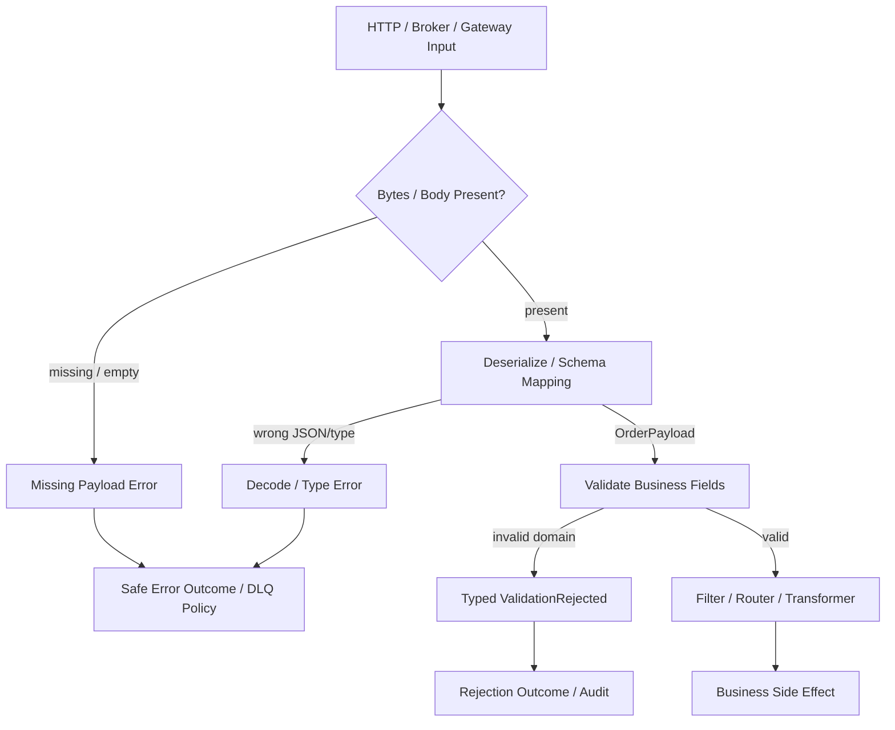
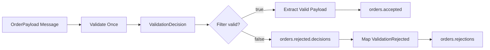
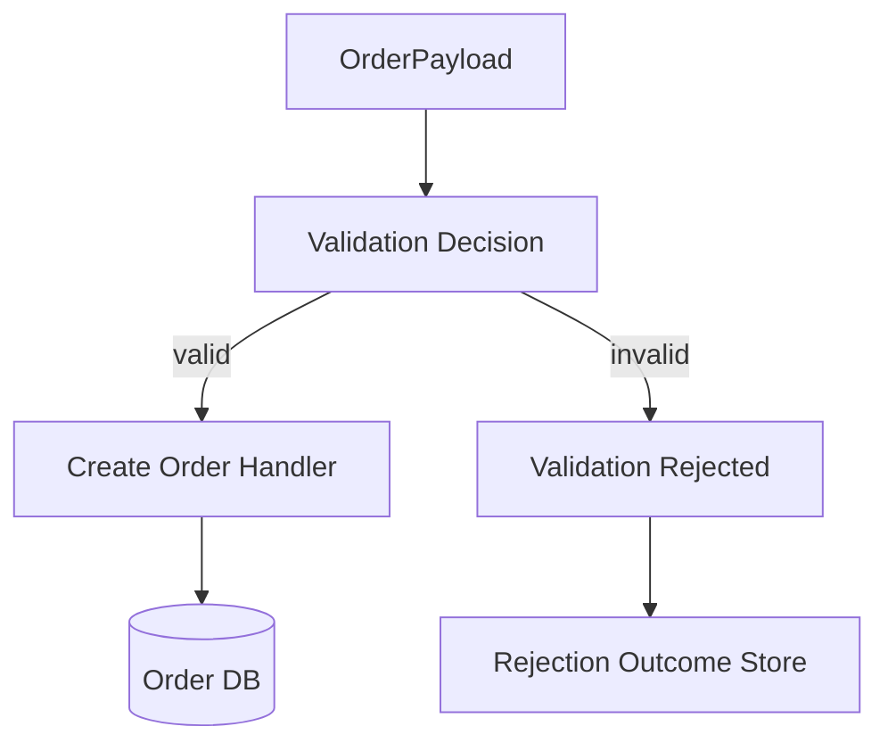
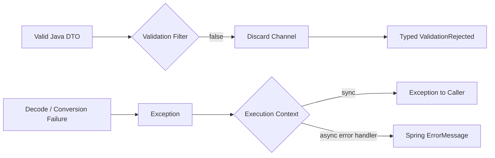
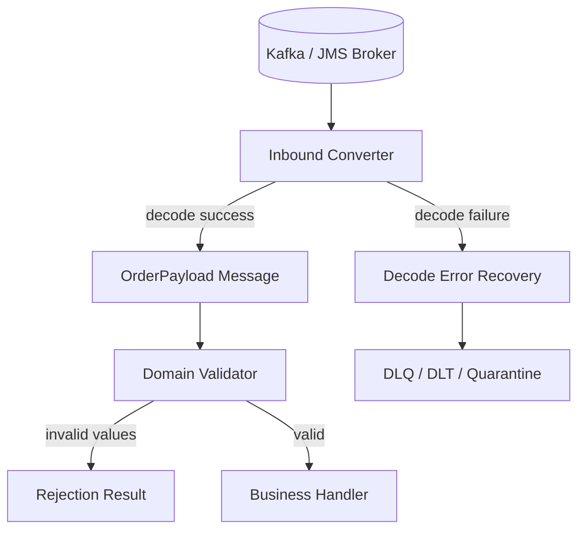
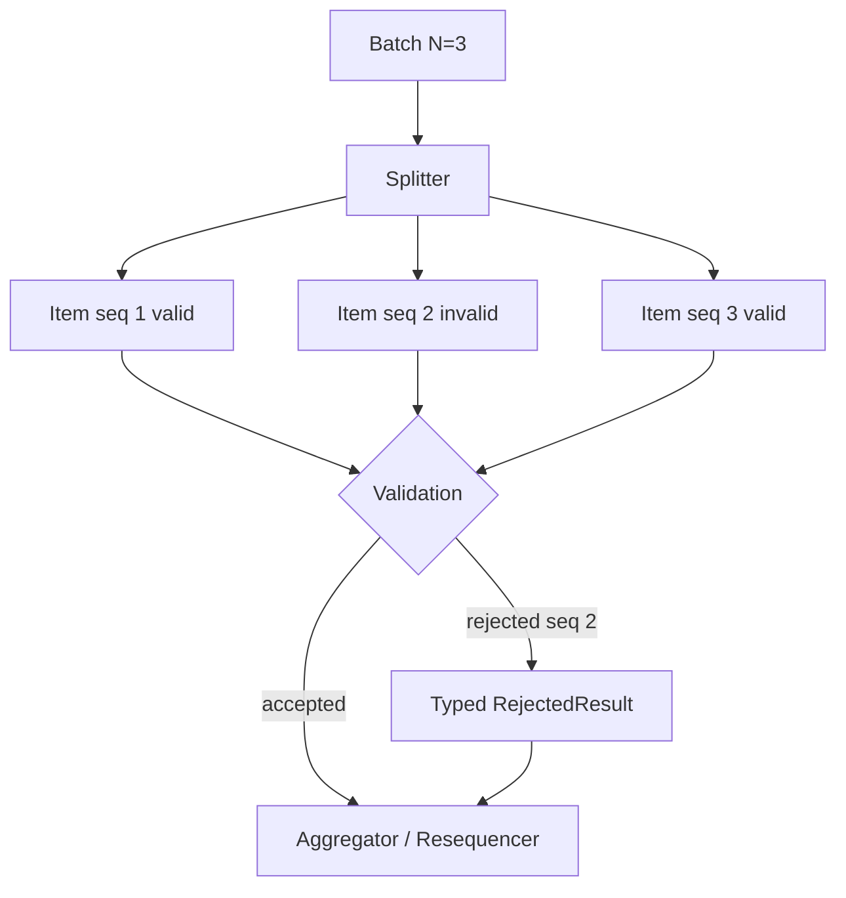
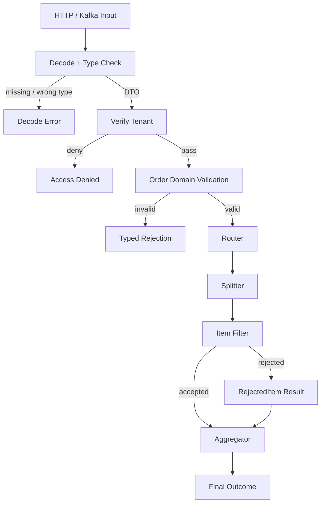

# Testing Missing, Wrong-Type, and Out-of-Range Payloads

An integration system may run smoothly when producers send well-formed messages yet fail unpredictably upon receiving a **missing payload**, **wrong-type payload**, or **correctly typed payload with out-of-range values**. All three are casually referred to as "validation failures" in everyday discussion, yet they arise at **different technical layers**, requiring distinct test assertions and handling strategies.

For example, a system receives `OrderSubmitted` to pass to a Router, Filter, Transformer, Splitter, and Aggregator:

- A request with no body, or JSON `null`: there may **not even be a valid DTO/message** for a Filter to process.
- JSON with `lines` as a string instead of an array: the decoder may **fail to map it to the Java type**.
- JSON maps cleanly yet `quantity=-2`: the DTO exists, yet **violates business rules**.

If you only write one test checking `validator.validate(order)` with `quantity=-2`, you **have not verified** deserialization, ingress, Filter, discard flows, error channels, or prevention of side effects. Conversely, throwing a single generic exception at every layer makes it hard for producers to know whether to fix data or retry during infrastructure outages.

The lesson **"Testing Missing, Wrong-Type, and Out-of-Range Payloads"** belongs to the **Message filter and validation** chapter in the **SPRING_INTEGRATION_PATTERN** module. The module teaches implementing Enterprise Integration Patterns with Spring Integration to build loosely coupled, extensible message flows, combining Router, Filter, Transformer, Splitter, Aggregator, Gateway, retry, error channel, correlation, and testing processing branches.

**Goal:** build an explicit input contract, stratify error categories, write unit/parameterized/integration tests with JUnit 5 and Spring Integration, inspect accepted/rejected/error outputs accurately, and ensure bad data never reaches side effects. Code snippets are learning examples for Java 17+, Jackson, JUnit 5, and Spring Integration Java DSL; verify actual APIs against your project's versions in the subsequent Content QA cycle.

## 1. Three Error Categories That Must Be Identified Separately

| Category | Example | Detection point | Desired outcome |
| --- | --- | --- | --- |
| **Missing payload** | Empty HTTP body; JSON `null`; missing required field | Transport/decoder or DTO validator | No business command created; structured missing-data error |
| **Wrong type** | `lines` is a string; `quantity` is an object; payload is `String` instead of `OrderPayload` | JSON/schema/Java type conversion | Handler does not run; properly classified decode/type error |
| **Out-of-range value** | `quantity=-2`, `currency="XYZ"`, empty list | Domain validator/Filter | Typed rejection with field/code; zero side effects |

Distinguish **missing the entire payload** from **missing a field inside the payload**:

- At HTTP/JMS/Kafka ingress, the body can be empty, bytes invalid, or JSON root `null`. The decoder/inbound adapter must handle this before reaching a Java-typed Filter.
- Once mapped to `OrderPayload`, a field like `customerId` can be `null` or blank. That is a *field-level validation* failure.
- In Spring Messaging, standard implementations like `GenericMessage` and `MessageBuilder.withPayload(...)` **forbid `null` payloads**. Therefore, a test calling `MessageBuilder.withPayload(null)` cannot prove a Filter catches null payloads; it tests **message construction or the ingress boundary**.

### Defining "Properly Tested"

A scenario is complete only when you know:

1. Which **input** enters the system, and through which boundary.
2. Which **component** is responsible for detecting the error.
3. Whether the **error path** is rejection, exception, or dead-letter.
4. Whether **observable outputs** carry accurate codes/correlation without leaking data.
5. Whether **side effects** were blocked.
6. Whether **retry/ACK** behavior matches the error type.

Do not stop at checking a log message like `"validation failed"`.

## 2. Where Errors Are Detected in a Spring Integration Flow

A request may pass through multiple stages before reaching a Filter.



**Responsibility boundaries**:

- **Transport:** body presence, content-type format, size limits, producer authentication.
- **Decoder/schema:** whether bytes map to the right DTO type and fields match expected types.
- **Validator:** whether rightly typed values satisfy rules.
- **Filter/Router:** whether a checked DTO is allowed down a branch.
- **Handler:** executes side effects only once mandatory preconditions pass.

An error occurring **before** a Spring `Message<OrderPayload>` exists cannot be expected to reach a downstream `Filter<OrderPayload>`. It needs error handling right at the decoder/inbound adapter or a dedicated envelope.

## 3. Consistent JSON Contract Used Throughout This Lesson

We choose an order input that is simple yet covers all constraint types:

```json
{
  "requestId": "req-101",
  "tenantId": "tenant-a",
  "customerId": "CUS-42",
  "currency": "VND",
  "lines": [
    {"sku": "SKU-1", "quantity": 2}
  ]
}
```

Assumptions in this lesson:

- `requestId`, `tenantId`, and `customerId` are required and non-blank.
- `currency` accepts only `VND` or `USD`; case-sensitive in this illustrative contract.
- `lines` must contain at least one element and at most 100 elements.
- Each line has a non-blank `sku`; `quantity` is an integer from 1 to 10,000.
- Never trust client-body `tenantId` for authorization without cross-checking a trusted principal/provenance.
- Never assume a schema-valid input is already **authorized** or checked against inventory.

To separate **missing** from **wrong type**, the DTO uses `Integer` rather than `int` for quantity. Primitive `int` may default to `0` when omitted during mapping, erasing the signal that the field was actually absent.

### Java DTO

```java
import java.util.List;

record OrderLine(String sku, Integer quantity) {}

record OrderPayload(
    String requestId,
    String tenantId,
    String customerId,
    String currency,
    List<OrderLine> lines
) {}
```

These Java records are used in the tests. **Default record constructors do not auto-validate** fields, so Jackson can build an `OrderPayload` with `lines=null` unless the decoder/creator/schema enforces constraints beforehand.

A correctly typed DTO does not automatically mean valid data.

## 4. Missing-Payload Matrix

| Input data | Valid `OrderPayload` exists? | Where to test? | Outcome |
| --- | --- | --- | --- |
| HTTP body absent | No | HTTP adapter/controller boundary | `MISSING_BODY` or HTTP 400 per contract |
| Zero-length body | No | Input/JSON parser | `EMPTY_BODY` or decode error |
| Whitespace-only body | No JSON object | Decoder | `INVALID_JSON`/`EMPTY_BODY` per policy |
| JSON root `null` | Decoder may return Java `null` | Decoder guard | `ROOT_PAYLOAD_NULL` |
| JSON `{}` | DTO created with null fields | Domain validator | Multiple `REQUIRED` violations |
| JSON missing `customerId` | DTO has null field | Domain validator | `customerId: REQUIRED` |
| `lines:null` | DTO has null lines | Domain validator | `lines: REQUIRED` |
| `lines:[]` | DTO has empty list | Domain validator | `lines: MUST_NOT_BE_EMPTY` |
| `MessageBuilder` null payload | Cannot build Spring Message | Message constructor unit test | Fails at message-creation boundary |

**Do not lump all of these into `INVALID_JSON`.** Body `{}` is syntactically valid JSON yet violates the contract; a strict decoder with ingress schema validation shifts the detection boundary earlier. Tests must match your **chosen policy**, never hardcoding an assumption that every Jackson setup shares identical coercion/defaults.

### Important Observation

`Message<OrderPayload>` does not naturally represent "no body". To carry empty-body cases through a message flow, use an **explicit envelope** such as `InboundPayload(rawBytes, contentType, requestId)`, rather than trying to construct a `Message<?>` with a null payload to trick the type system.

## 5. Wrong-Type Payload Matrix

The JSON inputs below are **syntactically valid** yet violate data types:

```json
{
  "requestId": "req-102",
  "tenantId": "tenant-a",
  "customerId": "CUS-42",
  "currency": "VND",
  "lines": "not-an-array"
}
```

```json
{
  "requestId": "req-103",
  "tenantId": "tenant-a",
  "customerId": "CUS-42",
  "currency": "VND",
  "lines": [
    {"sku": "SKU-1", "quantity": {"value": 2}}
  ]
}
```

Cases to test:

| Case | Expectation |
| --- | --- |
| JSON root is an array instead of object | Decoder/type checker rejects per contract |
| `lines` is a string instead of list | Type mapping fails |
| `quantity` is an object instead of integer | Type mapping fails |
| `quantity="abc"` | Type mapping fails |
| `quantity="2"` | **Depends on Jackson coercion policy**; configure strict mode to reject |
| `currency=123` | Depends on scalar coercion policy |
| Raw Spring payload is `String` in a flow expecting `OrderPayload` | Blocked at ingress/type boundary; never mislabeled as domain violation |
| `Content-Type` mismatches format | Inbound adapter/decoder handles per policy |

**Wrong type differs from out-of-range value.** A string `"abc"` cannot be compared against the integer range `1..10,000` before decoding. The domain validator takes responsibility only once an object has the required types and structure.

### Jackson Can Auto-Coerce Types

Some Jackson configurations convert `"2"` into integer `2`, or numbers into strings. When an API requires **strict typing**, disable coercion appropriately and write tests proving that setting—instead of blindly assuming JSON with a numeric string gets rejected.

## 6. Out-of-Range Value Matrix

Once the decoder produces `OrderPayload`, these cases belong to **business/domain range validation**:

| Field | Value | Expected violation |
| --- | --- | --- |
| `requestId` | `null` or blank string | `REQUIRED` |
| `customerId` | `""` | `REQUIRED` |
| `currency` | `"XYZ"` | `UNSUPPORTED_CURRENCY` |
| `currency` | `"usd"` | `UNSUPPORTED_CURRENCY` if policy is case-sensitive |
| `lines` | `null` | `REQUIRED` |
| `lines` | `[]` | `MUST_NOT_BE_EMPTY` |
| `lines` | 101 elements | `TOO_MANY_ITEMS` |
| `lines[0]` | `null` | `REQUIRED` |
| `lines[0].sku` | blank string | `REQUIRED` |
| `lines[0].quantity` | `null` | `REQUIRED` |
| `lines[0].quantity` | `0` | `OUT_OF_RANGE` |
| `lines[0].quantity` | `-2` | `OUT_OF_RANGE` |
| `lines[0].quantity` | `10001` | `OUT_OF_RANGE` |
| `lines[0].quantity` | `1` or `10000` | Valid at boundary |

For `min <= value <= max` checks, test **both boundary sides** (`0, 1, 10000, 10001`), not just a single negative number.

For prices, dates, exchange rates, or enums, domain tests may also require precision, timezone, overflow, and conversion rules. Never tweak rules solely to fit test data without versioning the policy.

## 7. Writing a Pure, Side-Effect-Free Validator

A validator should return a **structured list of errors**, without coupling normal input checks to infrastructure exceptions.

```java
import java.util.List;

record FieldViolation(String path, String code) {}

record ValidationDecision(
    OrderPayload payload,
    List<FieldViolation> violations,
    String policyVersion
) {
    ValidationDecision {
        violations = List.copyOf(violations);
    }

    boolean valid() {
        return violations.isEmpty();
    }
}

record ValidationRejected(
    String requestId,
    String errorCode,
    List<FieldViolation> violations,
    String policyVersion,
    java.time.Instant rejectedAt
) {}
```

```java
import java.util.ArrayList;
import java.util.List;
import java.util.Set;

final class OrderValidator {
    static final String POLICY_VERSION = "order-validation-v1";

    private static final Set<String> CURRENCIES =
        Set.of("VND", "USD");

    ValidationDecision decide(OrderPayload payload) {
        if (payload == null) {
            throw new IllegalArgumentException(
                "Null payload is not an OrderPayload");
        }

        List<FieldViolation> issues = new ArrayList<>();

        required(issues, "requestId", payload.requestId());
        required(issues, "tenantId", payload.tenantId());
        required(issues, "customerId", payload.customerId());

        if (blank(payload.currency())) {
            issues.add(new FieldViolation("currency", "REQUIRED"));
        } else if (!CURRENCIES.contains(payload.currency())) {
            issues.add(new FieldViolation(
                "currency", "UNSUPPORTED_CURRENCY"));
        }

        List<OrderLine> lines = payload.lines();
        if (lines == null) {
            issues.add(new FieldViolation("lines", "REQUIRED"));
        } else if (lines.isEmpty()) {
            issues.add(new FieldViolation(
                "lines", "MUST_NOT_BE_EMPTY"));
        } else {
            if (lines.size() > 100) {
                issues.add(new FieldViolation(
                    "lines", "TOO_MANY_ITEMS"));
            }

            for (int i = 0; i < lines.size(); i++) {
                OrderLine line = lines.get(i);
                String path = "lines[" + i + "]";

                if (line == null) {
                    issues.add(new FieldViolation(path, "REQUIRED"));
                    continue;
                }

                required(issues, path + ".sku", line.sku());
                if (line.quantity() == null) {
                    issues.add(new FieldViolation(
                        path + ".quantity", "REQUIRED"));
                } else if (line.quantity() < 1
                        || line.quantity() > 10_000) {
                    issues.add(new FieldViolation(
                        path + ".quantity", "OUT_OF_RANGE"));
                }
            }
        }

        return new ValidationDecision(
            payload, issues, POLICY_VERSION);
    }

    private static void required(
            List<FieldViolation> issues,
            String path, String value) {
        if (blank(value)) {
            issues.add(new FieldViolation(path, "REQUIRED"));
        }
    }

    private static boolean blank(String value) {
        return value == null || value.isBlank();
    }
}
```

Explanation:

- `OrderValidator.decide` **assumes a Java `OrderPayload` already exists**. It is not a JSON decoder.
- `payload == null` signals a clear programming/boundary error; in well-typed message flows, a null payload cannot become a Spring Message.
- When a field is null, the validator emits `REQUIRED`; when properly typed yet out of domain bounds, it emits `OUT_OF_RANGE`/`UNSUPPORTED_CURRENCY`.
- `issues` omits raw input values to prevent leaking PII/tokens in rejections.
- `ValidationDecision` keeps a snapshot of violations and `policyVersion` so downstream components do not need to revalidate.
- The example performs no DB/API lookups; validators with external dependencies must distinguish **UNKNOWN/UNAVAILABLE** from rejected data.

This simple structure keeps unit tests fast and deterministic without starting Spring.

## 8. Building Typed Rejections Consumers Understand

An out-of-range message needs an explanation of **why** it was blocked:

```json
{
  "requestId": "req-101",
  "errorCode": "ORDER_VALIDATION_FAILED",
  "policyVersion": "order-validation-v1",
  "violations": [
    {"path": "customerId", "code": "REQUIRED"},
    {"path": "lines[0].quantity", "code": "OUT_OF_RANGE"}
  ],
  "rejectedAt": "2026-11-21T06:00:00Z"
}
```

Typed DTOs help downstream distinguish failures:

- `MISSING_PAYLOAD`: no valid body/message arrived.
- `INVALID_PAYLOAD_TYPE`: parser or type adapter failed to map the object.
- `ORDER_VALIDATION_FAILED`: rightly typed object yet out-of-domain data.
- `VALIDATION_UNAVAILABLE`: unable to validate due to infrastructure dependency outage.
- `ACCESS_DENIED`: actor lacks permission; handle via separate security path.

**Do not stuff full stack traces** into validation rejections. Nor should you return `retryable=true` for `quantity=-2` and let the broker resend it endlessly.

### Mapping Decisions to Rejection Outcomes

```java
import java.time.Clock;
import java.time.Instant;

final class ValidationRejectionMapper {
    private final Clock clock;

    ValidationRejectionMapper(Clock clock) {
        this.clock = clock;
    }

    ValidationRejected reject(ValidationDecision decision) {
        if (decision.valid()) {
            throw new IllegalArgumentException(
                "Cannot reject a valid decision");
        }

        return new ValidationRejected(
            decision.payload().requestId(),
            "ORDER_VALIDATION_FAILED",
            decision.violations(),
            decision.policyVersion(),
            Instant.now(clock)
        );
    }
}
```

`requestId` itself may be missing on an invalid DTO. In real systems, use a **transport-generated request ID** issued at trusted ingress instead of reading a blank request ID from the payload and pretending correlation succeeded.

## 9. Unit Tests Distinguishing Missing Fields from Out-of-Range Values

Start with JUnit 5 and already-typed objects:

```java
import static org.junit.jupiter.api.Assertions.*;
import java.util.List;
import org.junit.jupiter.api.Test;

class OrderValidatorTest {

    private final OrderValidator validator = new OrderValidator();

    private OrderPayload order(
            String customerId,
            String currency,
            List<OrderLine> lines) {
        return new OrderPayload(
            "req-101", "tenant-a",
            customerId, currency, lines);
    }

    @Test
    void missingCustomerProducesRequiredViolation() {
        var result = validator.decide(order(
            null, "VND",
            List.of(new OrderLine("SKU-1", 1))));

        assertFalse(result.valid());
        assertTrue(result.violations().contains(
            new FieldViolation("customerId", "REQUIRED")));
    }

    @Test
    void nullLinesIsDifferentFromEmptyLines() {
        var missing = validator.decide(
            order("CUS-1", "VND", null));
        var empty = validator.decide(
            order("CUS-1", "VND", List.of()));

        assertTrue(missing.violations().contains(
            new FieldViolation("lines", "REQUIRED")));
        assertTrue(empty.violations().contains(
            new FieldViolation(
                "lines", "MUST_NOT_BE_EMPTY")));
    }

    @Test
    void wrongDomainValueProducesDomainViolation() {
        var result = validator.decide(order(
            "CUS-1", "XYZ",
            List.of(new OrderLine("SKU-1", -2))));

        assertTrue(result.violations().contains(
            new FieldViolation(
                "currency", "UNSUPPORTED_CURRENCY")));
        assertTrue(result.violations().contains(
            new FieldViolation(
                "lines[0].quantity", "OUT_OF_RANGE")));
    }

    @Test
    void validPayloadHasNoViolations() {
        var result = validator.decide(order(
            "CUS-1", "VND",
            List.of(new OrderLine("SKU-1", 1))));

        assertTrue(result.valid());
        assertEquals(List.of(), result.violations());
    }
}
```

These tests **exclude Jackson and Spring Integration**, so they prove domain validator policy rather than wrong-type decoding or channel routing.

### Testing Multiple Violations in One Pass

An input with two errors should return both errors, unless the contract deliberately specifies fail-fast. Do not write a validator returning only the first error and assert "rejected is enough"; producers may end up fixing one field per round-trip.

## 10. Parameterized Tests for Domain Boundaries

JUnit 5 parameterized tests reduce boilerplate and clarify boundaries.

```java
import static org.junit.jupiter.api.Assertions.*;
import java.util.List;
import org.junit.jupiter.params.ParameterizedTest;
import org.junit.jupiter.params.provider.CsvSource;

class QuantityDomainTest {

    private final OrderValidator validator = new OrderValidator();

    @ParameterizedTest
    @CsvSource({
        "0, false",
        "1, true",
        "2, true",
        "10000, true",
        "10001, false",
        "-1, false"
    })
    void quantityRespectsInclusiveBounds(
            int quantity, boolean expectedValid) {
        var payload = new OrderPayload(
            "req-quant", "tenant-a", "CUS-1", "VND",
            List.of(new OrderLine("SKU-1", quantity)));

        boolean valid = validator.decide(payload).valid();

        assertEquals(expectedValid, valid);
    }
}
```

**Points to note**:

- Boundaries `1` and `10,000` are valid.
- Boundaries `0` and `10,001` are invalid.
- `quantity=null` is a **missing field**, needing a separate test since `CsvSource` with primitive `int` cannot express null in the same way.
- For `BigDecimal`, test precision, scale, negative values, huge numbers, and `NaN` handling if floating-point types appear.
- For dates/times, test UTC, timezones, and `now == deadline` using `Clock`.

## 11. Testing Missing Body, JSON `null`, and Empty JSON Objects

Use Jackson to illustrate a decoder boundary. Never let JSON root `null` reach Spring `MessageBuilder`.

```java
import com.fasterxml.jackson.core.JsonProcessingException;
import com.fasterxml.jackson.databind.ObjectMapper;

record DecodeOutcome(
    OrderPayload payload,
    String errorCode
) {
    boolean success() {
        return payload != null && errorCode == null;
    }
}

final class OrderJsonDecoder {
    private final ObjectMapper mapper;

    OrderJsonDecoder(ObjectMapper mapper) {
        this.mapper = mapper;
    }

    DecodeOutcome decode(String rawJson) {
        if (rawJson == null || rawJson.isBlank()) {
            return new DecodeOutcome(null, "MISSING_PAYLOAD");
        }

        try {
            OrderPayload result =
                mapper.readValue(rawJson, OrderPayload.class);

            if (result == null) {
                return new DecodeOutcome(
                    null, "ROOT_PAYLOAD_NULL");
            }

            return new DecodeOutcome(result, null);
        } catch (JsonProcessingException ex) {
            // Never return full Jackson exceptions to clients:
            // they may leak data snippets or schema details.
            return new DecodeOutcome(
                null, "INVALID_PAYLOAD_TYPE_OR_JSON");
        }
    }
}
```

In production, if you need to separate `INVALID_JSON_SYNTAX` from `INVALID_PAYLOAD_TYPE` precisely, classify Jackson exception subtypes and add schema validation. This lesson uses one combined code in the sample decoder to focus on the **boundary**; do not conclude every parse failure is a wrong-type error.

### Testing the Decoder

```java
import static org.junit.jupiter.api.Assertions.*;
import com.fasterxml.jackson.databind.ObjectMapper;
import org.junit.jupiter.api.Test;

class OrderJsonDecoderTest {

    private final OrderJsonDecoder decoder =
        new OrderJsonDecoder(new ObjectMapper());

    @Test
    void emptyBodyIsRejectedBeforeMessageConstruction() {
        assertEquals("MISSING_PAYLOAD",
            decoder.decode("").errorCode());

        assertEquals("MISSING_PAYLOAD",
            decoder.decode("  ").errorCode());
    }

    @Test
    void jsonNullRootIsRejected() {
        var outcome = decoder.decode("null");

        assertFalse(outcome.success());
        assertEquals("ROOT_PAYLOAD_NULL",
            outcome.errorCode());
    }

    @Test
    void emptyJsonObjectCanMapButFailsDomainValidation() {
        var outcome = decoder.decode("{}");

        assertTrue(outcome.success());
        assertFalse(new OrderValidator()
            .decide(outcome.payload()).valid());
    }

    @Test
    void wrongCollectionTypeFailsDecode() {
        String json = """
            {
              "requestId":"req-1",
              "tenantId":"tenant-a",
              "customerId":"CUS-1",
              "currency":"VND",
              "lines":"not-a-list"
            }
            """;

        assertFalse(decoder.decode(json).success());
    }

    @Test
    void wrongQuantityTypeFailsDecode() {
        String json = """
            {
              "requestId":"req-1",
              "tenantId":"tenant-a",
              "customerId":"CUS-1",
              "currency":"VND",
              "lines":[{"sku":"S","quantity":{"n":2}}]
            }
            """;

        assertFalse(decoder.decode(json).success());
    }
}
```

Key finding: JSON `{}` can build a DTO with null fields; **do not expect the decoder to reject it automatically** unless the contract enforces required fields right at the schema layer.

## 12. Testing Strict Type Coercion with Jackson

If the contract mandates that `quantity` must be an actual JSON integer rather than string `"2"`, configure coercion and test it explicitly.

Example for Jackson 2.x:

```java
import com.fasterxml.jackson.databind.MapperFeature;
import com.fasterxml.jackson.databind.json.JsonMapper;

final class StrictJsonConfiguration {
    static JsonMapper mapper() {
        return JsonMapper.builder()
            .disable(MapperFeature.ALLOW_COERCION_OF_SCALARS)
            .build();
    }
}
```

```java
import static org.junit.jupiter.api.Assertions.*;
import org.junit.jupiter.api.Test;

class StrictCoercionTest {

    @Test
    void numericStringIsNotAcceptedAsInteger() {
        var decoder = new OrderJsonDecoder(
            StrictJsonConfiguration.mapper());

        String json = """
            {
              "requestId":"req-1",
              "tenantId":"tenant-a",
              "customerId":"CUS-1",
              "currency":"VND",
              "lines":[{"sku":"S","quantity":"2"}]
            }
            """;

        assertFalse(decoder.decode(json).success());
    }
}
```

**Version limitation:** Jackson offers fine-grained coercion APIs per data type, and versions may alter behavior. If your app uses Jackson 3, polymorphic DTOs, or custom deserializers, configure and test on your actual version. Crucially, **never write a test claiming "numeric string fails type check" while your real `ObjectMapper` is silently coercing it into a number**.

In particular, decoding tests must use the **exact `ObjectMapper` instance/configuration used by the inbound adapter**, rather than instantiating a default mapper in tests and assuming production is strict.

## 13. Testing That Spring Messages Cannot Be Created with Null Payloads

A very common mistake in tests:

```java
MessageBuilder.withPayload(null).build();
```

Spring Messaging `MessageBuilder`/`GenericMessage` normally rejects null payloads before any Filter runs. Never use that snippet as a fixture expecting the Filter to emit `FieldViolation("payload","REQUIRED")`.

### Unit Testing the Message Creation Boundary

```java
import static org.junit.jupiter.api.Assertions.*;
import org.junit.jupiter.api.Test;
import org.springframework.messaging.support.MessageBuilder;

class SpringMessageContractTest {

    @Test
    void nullPayloadCannotCreateOrdinarySpringMessage() {
        assertThrows(IllegalArgumentException.class, () ->
            MessageBuilder.withPayload((Object) null)
                .build());
    }
}
```

If a framework version throws a different subtype/exception on a given overload, align your test with your dependency's actual contract. The core lesson holds: **null cannot reach `Filter<OrderPayload>` via ordinary message construction**.

To test missing payloads end-to-end, send a **bodyless request through the HTTP adapter**, or send an **inbound envelope with empty raw bytes** through the decoder, and assert the corresponding failure on the **inbound error path**.

## 14. Type-Safe Filter: Forwarding Only Valid DTOs

Once decoded into `OrderPayload`, a Filter can enforce domain rules and route accordingly.

To avoid validating twice, we **transform into `ValidationDecision` and Filter on the decision**. Rejected messages travel to a discard flow receiving the same decision already holding violations.



**This is a post-deserialization boundary**, not the path for raw JSON or null payloads. Only send type-checked `OrderPayload`s from ingress into the input channel.

### Spring Integration Java DSL Configuration

```java
import java.time.Clock;
import org.springframework.context.annotation.Bean;
import org.springframework.context.annotation.Configuration;
import org.springframework.integration.channel.DirectChannel;
import org.springframework.integration.channel.QueueChannel;
import org.springframework.integration.config.EnableIntegration;
import org.springframework.integration.dsl.IntegrationFlow;
import org.springframework.messaging.MessageChannel;
import org.springframework.messaging.PollableChannel;

@Configuration
@EnableIntegration
class OrderValidationFlowConfiguration {

    @Bean("orders.validation.in")
    MessageChannel validationInput() {
        return new DirectChannel();
    }

    @Bean("orders.accepted")
    PollableChannel acceptedOrders() {
        // For observation/testing; in-memory queue is non-durable.
        return new QueueChannel();
    }

    @Bean("orders.rejected.decisions")
    MessageChannel rejectedDecisions() {
        return new DirectChannel();
    }

    @Bean("orders.rejections")
    PollableChannel rejectionOutcomes() {
        return new QueueChannel();
    }

    @Bean
    OrderValidator orderValidator() {
        return new OrderValidator();
    }

    @Bean
    ValidationRejectionMapper rejectionMapper() {
        return new ValidationRejectionMapper(Clock.systemUTC());
    }

    @Bean
    IntegrationFlow orderValidationFlow(OrderValidator validator) {
        return IntegrationFlow.from("orders.validation.in")
            .transform(OrderPayload.class, validator::decide)
            .filter(ValidationDecision.class,
                ValidationDecision::valid,
                spec -> spec.discardChannel(
                    "orders.rejected.decisions"))
            .transform(ValidationDecision.class,
                ValidationDecision::payload)
            .channel("orders.accepted")
            .get();
    }

    @Bean
    IntegrationFlow rejectedDecisionFlow(
            ValidationRejectionMapper mapper) {
        return IntegrationFlow.from("orders.rejected.decisions")
            .transform(ValidationDecision.class,
                mapper::reject)
            .channel("orders.rejections")
            .get();
    }
}
```

Explanation:

1. `orders.validation.in` accepts strictly `OrderPayload`.
2. `transform` runs the validator **once** and builds `ValidationDecision`.
3. The Filter only reads `valid()` from the saved decision, avoiding divergence across two checks.
4. If `valid=false`, `discardChannel` receives a **message holding `ValidationDecision`**, not an `ErrorMessage`.
5. The discard flow converts it into typed `ValidationRejected` for tests to inspect on `orders.rejections`.
6. If `valid=true`, the flow unwraps the valid payload and sends it to `orders.accepted`.
7. Both `QueueChannel`s are in-JVM testing tools; production uses service handlers, brokers, or outcome stores.

**Do not claim this flow runs end-to-end on raw `String` payloads.** Sending the wrong type into `orders.validation.in` will raise a conversion/type exception at the typed transformer; do not expect `ValidationRejected` output unless an explicit type-guard layer sits ahead of it.

### Version Note

Java DSL overloads `transform(Class, ...)`, `filter(Class, ..., spec)`, and channel configs must be verified against your Spring Integration version. Do not blindly flip `.filter(...)` to `throwExceptionOnRejection(true)` assuming the discard flow behaves identically.

## 15. Integration Test: Valid Proceeds, Invalid Is Blocked

Tests must **boot a real Spring context** for endpoints, not merely call `OrderValidator`.

```java
import static org.junit.jupiter.api.Assertions.*;
import java.util.List;
import org.junit.jupiter.api.Test;
import org.springframework.beans.factory.annotation.Autowired;
import org.springframework.beans.factory.annotation.Qualifier;
import org.springframework.integration.config.EnableIntegration;
import org.springframework.messaging.Message;
import org.springframework.messaging.MessageChannel;
import org.springframework.messaging.PollableChannel;
import org.springframework.messaging.support.MessageBuilder;
import org.springframework.test.context.junit.jupiter.SpringJUnitConfig;

@SpringJUnitConfig(OrderValidationFlowConfiguration.class)
class OrderValidationFlowIntegrationTest {

    @Autowired
    @Qualifier("orders.validation.in")
    MessageChannel input;

    @Autowired
    @Qualifier("orders.accepted")
    PollableChannel accepted;

    @Autowired
    @Qualifier("orders.rejections")
    PollableChannel rejected;

    private OrderPayload order(int quantity, String currency) {
        return new OrderPayload(
            "req-101", "tenant-a", "CUS-1", currency,
            List.of(new OrderLine("SKU-1", quantity)));
    }

    @Test
    void validOrderGoesOnlyToAcceptedChannel() {
        assertTrue(input.send(MessageBuilder
            .withPayload(order(2, "VND")).build()));

        Message<?> approved = accepted.receive(1_000);
        assertNotNull(approved);
        assertTrue(approved.getPayload()
            instanceof OrderPayload);

        assertNull(rejected.receive(50));
    }

    @Test
    void invalidDomainProducesTypedRejectionNotAccepted() {
        assertTrue(input.send(MessageBuilder
            .withPayload(order(-2, "XYZ")).build()));

        assertNull(accepted.receive(50));

        Message<?> outcome = rejected.receive(1_000);
        assertNotNull(outcome);

        ValidationRejected rejection =
            (ValidationRejected) outcome.getPayload();

        assertEquals("ORDER_VALIDATION_FAILED",
            rejection.errorCode());
        assertTrue(rejection.violations().contains(
            new FieldViolation(
                "lines[0].quantity", "OUT_OF_RANGE")));
        assertTrue(rejection.violations().contains(
            new FieldViolation(
                "currency", "UNSUPPORTED_CURRENCY")));
    }
}
```

**Test scope:** illustrates the happy path and domain rejections across Spring Integration. `@SpringJUnitConfig` requires `spring-test` and properly wired beans. In a Spring Boot project, adapt to Boot test fixtures; do not mix two test contexts sharing channel names without isolation.

### Avoiding Cross-Test State Contamination

`QueueChannel` retains messages until read. When tests share an `ApplicationContext`, **drain produced outputs**, use distinct request IDs, and reset stores/mocks as needed. Running parallel tests on a shared queue can cause Test A to consume Test B's output.

Asserting only `send(...) == true` **is insufficient**, since it only indicates the channel accepted delivery per its semantics, not that handlers completed side effects.

## 16. What to Test When a Wrong-Type Payload Hits an Internal Channel?

Suppose an internal producer sends:

```java
input.send(MessageBuilder
    .withPayload("not-an-OrderPayload")
    .build());
```

Two valid designs exist, and you must pick clearly:

1. **Typed ingress contract:** only `OrderPayload` may enter the channel. A wrong-type producer is a programming/contract bug; integration tests assert an **exception at handler/type conversion** with neither accepted nor rejected outcomes; infrastructure error handling applies per execution context.
2. **Tolerant envelope boundary:** input accepts `Message<?>` or an intermediate envelope; the first step checks `payload instanceof OrderPayload`, emits a structured `INVALID_PAYLOAD_TYPE` on mismatch, and forwards only valid objects into the typed flow.

**Do not assume Spring automatically converts any `String` to `OrderPayload`.** If a custom converter is registered, behavior changes; tests must verify the real conversion service.

### Checking Type Before Entering the Domain Flow

A simple Java type boundary example:

```java
record TypeCheckResult(
    OrderPayload payload,
    String errorCode
) {
    boolean accepted() {
        return payload != null && errorCode == null;
    }
}

final class OrderPayloadTypeGuard {
    TypeCheckResult check(Object value) {
        if (value instanceof OrderPayload order) {
            return new TypeCheckResult(order, null);
        }
        return new TypeCheckResult(
            null, "INVALID_PAYLOAD_TYPE");
    }
}
```

Test:

```java
import static org.junit.jupiter.api.Assertions.*;
import org.junit.jupiter.api.Test;

class OrderPayloadTypeGuardTest {

    private final OrderPayloadTypeGuard guard =
        new OrderPayloadTypeGuard();

    @Test
    void rejectsUnexpectedJavaPayloadType() {
        var result = guard.check("wrong-java-type");

        assertFalse(result.accepted());
        assertEquals("INVALID_PAYLOAD_TYPE",
            result.errorCode());
    }

    @Test
    void acceptsCorrectJavaPayloadType() {
        var result = guard.check(new OrderPayload(
            "req-1", "tenant-a", "CUS-1", "VND",
            java.util.List.of(
                new OrderLine("SKU-1", 1))));

        assertTrue(result.accepted());
    }
}
```

The type guard takes `Object` because it sits at the boundary. Inside the typed domain flow, avoid turning every handler into `instanceof` checks once ingress guarantees the type.

## 17. What Does Bean Validation Help With, and What Does It Not Do Automatically?

Jakarta Bean Validation provides common annotations:

```java
import jakarta.validation.Valid;
import jakarta.validation.constraints.Max;
import jakarta.validation.constraints.Min;
import jakarta.validation.constraints.NotBlank;
import jakarta.validation.constraints.NotEmpty;
import java.util.List;

record ValidatedLine(
    @NotBlank String sku,
    @Min(1) @Max(10_000) Integer quantity
) {}

record ValidatedOrder(
    @NotBlank String requestId,
    @NotBlank String tenantId,
    @NotBlank String customerId,
    @NotBlank String currency,
    @NotEmpty List<@Valid ValidatedLine> lines
) {}
```

Strengths:

- Concisely expresses common constraints on Java types.
- Runs `Validator.validate(...)` and maps `ConstraintViolation`s to field/code pairs.
- Combines with validation groups across stages.

However:

- **Annotations do not auto-run** just because a DTO enters a Spring Integration `Filter`.
- `@NotEmpty` on `lines` does not enforce all business rules (the 100-item cap or currency allowlist must be added).
- `@Min`/`@Max` **do not replace `@NotNull`** when a field is truly required: per Bean Validation specs, many constraints allow null so they compose with `@NotNull`.
- Annotations cannot catch unparseable JSON **before a DTO exists**.
- Validation does not prove the payload's tenant is authorized.

### Testing the Validator Provider

```java
import static org.junit.jupiter.api.Assertions.*;
import jakarta.validation.Validation;
import jakarta.validation.Validator;
import org.junit.jupiter.api.Test;

class BeanValidationExampleTest {

    @Test
    void rejectsMissingCustomer() {
        try (var factory =
                Validation.buildDefaultValidatorFactory()) {
            Validator validator = factory.getValidator();

            ValidatedOrder dto = new ValidatedOrder(
                "req-1", "tenant-a", "",
                "VND", java.util.List.of(
                    new ValidatedLine("SKU-1", 2)));

            assertFalse(validator.validate(dto).isEmpty());
        }
    }
}
```

The test requires a **Jakarta Validation provider** on the classpath. Without a provider, factory initialization errors do not prove DTO validity or invalidity. Across framework versions, match factory lifecycle/closing to the real API.

## 18. Testing Both Filter and Side Effects Together

In production, an invalid payload must never slip past validation to call the order-creation service.



With a Mockito-based test (sketch):

```java
// Fixture: Spring context wiring a mock business handler
// behind the accepted channel and a mock rejection sink.
//
// Send invalid:
//   quantity = -2
//
// Assertions:
verify(orderService, never()).createOrder(any());
verify(rejectionSink, times(1)).publish(argThat(
    result -> result.errorCode()
        .equals("ORDER_VALIDATION_FAILED")));

// Send valid:
verify(orderService, times(1)).createOrder(any());
```

The flow example in section 14 used `QueueChannel` to observe outputs rather than invoking a handler. When writing business side-effect tests, attach a handler that **actually consumes accepted messages**; otherwise Mockito `never()` can pass simply because no endpoint was wired rather than because the Filter blocked it.

**Strong tests assert both:** invalid input triggers zero side effects, and valid input triggers the side effect. This prevents false confidence from broken topologies or unregistered handlers.

## 19. Testing Error Channel and Discard Channel with Accurate Semantics

Do not confuse them:

- Filter's `discardChannel` receives the **rejected message** per Filter semantics; in our example, it receives `ValidationDecision`.
- Spring's `ErrorMessage` wraps a `Throwable` payload, published by an error handler when an exception occurs.
- Sending `ValidationRejected` to a channel named `orders.rejections` does not automatically turn it into an `ErrorMessage`.



### Errors on `DirectChannel`

On a synchronous call stack, exceptions propagate back to the caller of `send(...)`. Never write tests assuming "send a wrong type and the global `errorChannel` is guaranteed to receive an `ErrorMessage`" when **no error publisher exists**.

### Errors Across `ExecutorChannel`/Pollers

When an exception is caught by a worker/poller error handler, Spring Integration can publish an `ErrorMessage` to the configured error channel. Tests must exercise the **exact execution context** and observe that channel rather than extrapolating from direct validator unit tests.

### Error Classification Test Matrix

| Input | Handling path |
| --- | --- |
| Rightly typed DTO, wrong quantity | Typed rejection/discard, no exception needed |
| Wrong-type message on typed ingress | Contract/type exception or type-rejection boundary |
| Unparseable JSON | Inbound decoder error, usually before Filter |
| Validator calls DB and DB times out | Infrastructure error; bounded retry/recovery |
| Filter `false` with `throwExceptionOnRejection=true` | `MessageRejectedException` per configuration |
| Filter `false` with `discardChannel` | Rejected message enters discard flow |

**Never treat an error channel as a catch-all bucket that auto-retries everything.** That causes deterministic failures to replay infinitely.

## 20. Gateway and API Contracts: Never Report Field Errors as Timeouts

In a request-reply Gateway, callers may expect:

```json
{
  "requestId": "req-101",
  "status": "REJECTED",
  "errorCode": "ORDER_VALIDATION_FAILED",
  "violations": [
    {"path": "lines[0].quantity", "code": "OUT_OF_RANGE"}
  ]
}
```

If a Filter drops the message without emitting a reply, the Gateway **waits until reply timeout expires**. The client sees only "timeout" without knowing `quantity` was wrong. To prevent this:

- For synchronous APIs, validate at ingress and **return a structured error response**.
- For request-reply Gateways, design both accepted and rejected branches to **return replies** under a shared contract whenever callers await responses.
- For `202 Accepted` APIs enqueueing to brokers, expose async validation outcomes via an outcome topic, status API, or webhook.
- Never turn `MessageRejectedException` into a generic HTTP 500 if the contract calls for 400/422 on invalid input.
- When infrastructure errors occur, never return 422 "invalid input" just because the request could not be processed.

**Transport ACK is not a successful validation outcome.** A Kafka producer seeing its message accepted onto a topic still does not know whether consumers will accept the business payload.

## 21. Testing Missing Data at HTTP Ingress

In applications with HTTP endpoints, tests can send:

- No request body.
- Empty body.
- `Content-Type: application/json` with body `null`.
- JSON `{}`.
- Valid JSON missing fields.
- JSON with wrong scalar types.
- Domain-invalid JSON.

### Illustrative HTTP Test Shapes

```java
// Conceptual examples with MockMvc in Spring Web:
//
// mockMvc.perform(post("/orders")
//     .contentType(MediaType.APPLICATION_JSON))
//     .andExpect(status().isBadRequest());
//
// mockMvc.perform(post("/orders")
//     .contentType(MediaType.APPLICATION_JSON)
//     .content("{\"lines\":\"not-a-list\"}"))
//     .andExpect(status().isBadRequest());
//
// mockMvc.perform(post("/orders")
//     .contentType(MediaType.APPLICATION_JSON)
//     .content("{\"requestId\":\"r\",\"tenantId\":\"t\","
//         + "\"customerId\":\"c\",\"currency\":\"VND\","
//         + "\"lines\":[{\"sku\":\"S\",\"quantity\":-2}]}"))
//     .andExpect(status().isUnprocessableEntity());
```

These are **sketches**. Returning 400/422 depends on your controller/advice and API contract; Spring Web does not automatically return 422 for every domain-invalid DTO. Tests must wire explicit endpoints and error mappings before expecting those statuses.

If a module uses Spring Integration without Spring MVC, test at the **HTTP inbound gateway/decoder** or construct an integration fixture with raw bodies, rather than adding Spring MVC to production just to run examples.

## 22. Testing JSON Parsing with Kafka/JMS Differs from HTTP

When a broker delivers raw bytes or serialized payloads, errors can happen right inside the inbound adapter or converter:



Tests must verify:

1. Are schema-invalid payload bytes recorded as a **decode error**?
2. Does that message block the consumer partition/queue endlessly via retries?
3. Are retries on deterministic decode errors bounded?
4. Does the system retain sensitive payloads in DLQs longer than allowed?
5. Are ACKs/offsets committed only after rejection/quarantine succeeds per contract?
6. Is an event missing `requestId` assigned a transport ID for auditing?
7. Do redeliveries produce duplicate rejection events?
8. Do valid messages behind it keep progressing per ordering policy?

**Spring Integration `errorChannel` differs from Kafka DLT or JMS DLQ.** An in-app `ErrorMessage` does not prove the broker committed an offset, ACKed, sought past the record, or moved it to a dead-letter topic.

For wrong-type messages converted directly into exceptions by a Kafka converter, never assert `OrderValidator.decide` was called—it likely **never ran**.

## 23. Access Control and Wrong-Type Data Can Be Attacks

Wrong-type inputs are not always innocent mistakes:

- Clients sending lists with hundreds of thousands of entries to exhaust validator memory.
- Deeply nested objects attempting to breach recursion limits.
- Forged `tenantId` or `replyChannel` headers trying to redirect data.
- Huge strings designed to bloat error logs.
- JSON fields stuffed with tokens, passwords, or card numbers.
- Payloads crafted for polymorphic deserializers lacking a strict type allowlist.

When testing those scenarios:

- Cap request sizes at **transport/decoder** before allocating big DTOs.
- Cap field/list counts and JSON nesting depth where exposed.
- Never return raw exception messages in public responses.
- Map violations strictly to **field path + code**, never echoing raw secrets.
- Cross-check tenant/actor against a trusted security context.
- Never let clients specify internal `errorChannel`, `replyChannel`, or correlation scopes.
- For logs, emit audit IDs and controlled metadata instead of full `failedMessage` dumps.

**"Wrong-type" testing should include ingress security testing**, not just class-cast checks.

## 24. Multi-Tenant and Correlation Testing

If two tenants both use `requestId=req-101`, a rejection for tenant A must never be reported to tenant B.

```text
tenant-a / req-101 / INVALID_QUANTITY
tenant-b / req-101 / VALID
```

Test:

1. Producer A sends an invalid-value DTO with authenticated tenant A.
2. Producer B sends a valid DTO with the exact same business request ID.
3. Outcome A must be a rejection scoped to A; B must be accepted.
4. Never forward A's raw payload into B's error handler or notifications.
5. Never key an outcome store solely on `requestId` if IDs are only unique per tenant.
6. If a client message claims tenant B in the payload while the principal belongs to A, reject via **authorization**, never lump it into `customerId: REQUIRED`.

**Field syntax validation does not replace permission checks.** Invalid-domain tests and cross-tenant authorization tests should have distinct contracts and codes.

## 25. Validation with Splitter, Aggregator, and Resequencer

Suppose a Splitter emits N items with `sequenceNumber=1..N`. If a Filter drops a wrong-type or out-of-range item, a downstream Aggregator may wait forever.



**Testing plan**:

- An item with invalid `quantity` after Splitter must cause zero side effects for that item.
- If batch policy requires "results for every item", the rejection branch must emit `ItemResult(status=REJECTED)` preserving the right correlation/sequence/part ID instead of deleting the message without a trace.
- Release strategies count **unique part IDs**; a duplicate of item 1 must never substitute for item 2.
- If the batch must fail fast, validate the whole batch before Splitter or have a coordinator cancel/hold remaining branches.
- If a Resequencer expects `seq=2`, never arbitrarily decrement `sequenceSize` just because that item was rejected.
- Group timeouts must be tested separately, never used to mask missing results dropped by a Filter.
- When a rejection event is redelivered, the Aggregator must not release twice or emit corrupt partial results.

**A correctly functioning Filter can still break the whole pipeline** if discard impacts on sequence/correlation are left undesigned.

## 26. Testing Retries, Idempotency, and Error Sinks

Out-of-range data like `quantity=-2` will not become valid after identical retries. Conversely, if a validator calls Catalog Service and it times out, the failure may be transient.

| Cause | Retry exact message? | Test focus |
| --- | --- | --- |
| Missing required field | Usually no | Single typed rejection, no loop |
| Permanent wrong JSON type | Usually no | Decode error/quarantine, ACK per policy |
| Out-of-range quantity | Usually no | Zero side effects executed |
| Catalog Service timeout | Bounded retry possible | Prevent fail-open, preserve correlation |
| Outcome store/sink failure | Appropriate recovery | Do not ACK "rejection saved" before persistence |
| Downstream ran side effect then lost ACK | Never blindly retry | Idempotency/reconciliation |
| Authorized reprocess with fixed payload | Yes, under new generation | Never confuse with duplicate |

### Rejection Events Also Need Deduplication

A rejection outcome can carry an idempotency key shaped like:

```text
(tenantId, requestId, validationStage, policyVersion)
```

If the consumer redelivers the same invalid message, the rejection sink must not send endless emails/tickets or insert duplicate independent rows. Use unique constraints/outboxes or outcome stores per requirements.

**Do not equate business event IDs with Spring `MessageHeaders.ID`.** Framework-generated Message IDs can change after transforms or transport hops, making them unreliable for deduplication across retries in general topologies.

## 27. Recommended End-to-End Test Matrix

| ID | Input | Layer | What to assert |
| --- | --- | --- | --- |
| T01 | Missing HTTP body | Ingress | `MISSING_BODY`/400 per contract; zero side effects |
| T02 | Empty body | Decoder | `MISSING_PAYLOAD` |
| T03 | JSON `null` | Decoder | `ROOT_PAYLOAD_NULL` |
| T04 | JSON `{}` | Validator | Multiple `REQUIRED` violations |
| T05 | Missing customer ID | Validator | `customerId` `REQUIRED` |
| T06 | `lines` null | Validator | `lines` `REQUIRED` |
| T07 | `lines` empty | Validator | `MUST_NOT_BE_EMPTY` |
| T08 | `lines` is String | Decoder | `TYPE_ERROR`; typed Filter never runs |
| T09 | `quantity` is object | Decoder | `TYPE_ERROR` |
| T10 | `quantity` is `"2"` | Strict decoder | Reject when coercion is forbidden |
| T11 | `quantity` null | Validator | `REQUIRED` |
| T12 | `quantity` 0 | Validator | `OUT_OF_RANGE` |
| T13 | `quantity` 1 | Validator | Accepted |
| T14 | `quantity` 10000 | Validator | Accepted |
| T15 | `quantity` 10001 | Validator | `OUT_OF_RANGE` |
| T16 | `currency` XYZ | Validator | `UNSUPPORTED_CURRENCY` |
| T17 | Two domain errors simultaneously | Validator/Filter | Both violations present |
| T18 | Payload is Java `String` | Type boundary | Rejected/exception per contract |
| T19 | `MessageBuilder` null payload | Message boundary | Message cannot be created |
| T20 | Invalid DTO into Filter flow | Spring Integration | Only rejected output, nothing accepted |
| T21 | Valid DTO into Filter | Spring Integration | Accepted output and handler invoked |
| T22 | Async typed transformer fails | Error handler | `ErrorMessage` per tested topology |
| T23 | Catalog timeout | Dependency validator | `UNAVAILABLE`, bounded retry |
| T24 | Producer A spoofs tenant B | Authorization | `ACCESS_DENIED`, no mixed groups |
| T25 | Filter drops one split item | Aggregator | `RejectedResult` carries right part ID |
| T26 | Duplicate invalid event | Outcome store | Rejection side effects not duplicated |
| T27 | Error sink fails | Retry/outbox | Rejection outcome not lost |
| T28 | Oversized payload | Transport | Blocked before large allocations |
| T29 | Secret inside invalid field | Error mapping | Secret value not echoed/logged |
| T30 | Versioned schema | Compatibility | Old-version messages follow policy outcomes |

You do not need all 30 scenarios in a single test class; split into **decoder tests**, **validator unit tests**, **Spring Integration flow tests**, and **transport/contract tests**. Each layer has its own speed and responsibility.

## 28. Negative Tests Must Assert Absence of Wrong Outputs

A test suite can pass by asserting only that a rejection arrived **without checking the accepted channel**. When a flow is misconfigured, both branches can fire at once.

For an invalid DTO, assert:

```text
rejection count == 1
accepted count  == 0
business side effect == 0
rejection.errorCode == ORDER_VALIDATION_FAILED
rejection.violations contains expected paths
```

For a valid DTO:

```text
accepted count == 1
rejection count == 0
business side effect == 1 (when handler is wired)
```

**Do not use a tiny negative wait as your sole proof** in asynchronous flows. With executors/brokers, results may arrive after the assertion; use latches/awaits with reasonable deadlines and observe completed processing state.

If a test message appears on neither channel, check endpoint subscriptions, exceptions, or dropped routes rather than assuming "the validator rejected cleanly".

## 29. Data-Driven Table Testing Instead of Duplicate Code

Organizing test cases cleanly:

```text
name                         payload         expected_stage   expected_code
missing-body                 ""              DECODER          MISSING_PAYLOAD
null-root                    "null"          DECODER          ROOT_PAYLOAD_NULL
wrong-lines-type             lines="abc"     DECODER          TYPE_ERROR
missing-customer             customer=null   DOMAIN           REQUIRED
zero-quantity                quantity=0      DOMAIN           OUT_OF_RANGE
too-large-quantity           quantity=10001  DOMAIN           OUT_OF_RANGE
unsupported-currency         currency="XYZ"  DOMAIN           UNSUPPORTED_CURRENCY
valid-min-bound              quantity=1      ACCEPTED         NONE
valid-max-bound              quantity=10000  ACCEPTED         NONE
```

Use `@MethodSource` to construct inputs per layer and assert matching stage and code. **Do not force every case through one method** when input types or boundaries differ: one test passes raw JSON, another passes DTOs.

Suggested structure:

- `OrderJsonDecoderTest`: raw bytes, JSON syntax, type mapping, and coercion.
- `OrderValidatorTest`: DTO field-level/domain rules.
- `OrderValidationFlowIntegrationTest`: accepted vs rejected paths.
- `OrderPayloadTypeGuardTest`: wrong Java types at ingress.
- `TransportErrorContractTest`: HTTP statuses, broker ACK/DLT, error channels.
- `OrderWorkflowSafetyTest`: side effects, Splitter/Aggregator, retry/idempotency.

Splitting tests by boundary surfaces failures right where fixes belong, instead of debugging a long integration test wondering whether Jackson, the Filter, or the broker broke.

## 30. Observability and Test Data

Suggested metrics:

```text
validation_requests_total{stage="decode",result="missing_payload"}
validation_requests_total{stage="decode",result="wrong_type"}
validation_requests_total{stage="domain",result="invalid"}
validation_requests_total{stage="domain",result="valid"}
validation_violations_total{code="OUT_OF_RANGE"}
validation_rejections_published_total{flow="orders"}
validation_rejection_sink_failures_total{flow="orders"}
validation_decode_duration_seconds{flow="orders"}
validation_domain_duration_seconds{flow="orders"}
```

These are **illustrative metric names**, not metrics auto-generated by Spring Integration. Never use `requestId`, `customerId`, or raw payloads as metric labels.

A safe log entry:

```json
{
  "event": "order_validation_failed",
  "requestId": "req-101",
  "stage": "DOMAIN",
  "policyVersion": "order-validation-v1",
  "violationCodes": ["UNSUPPORTED_CURRENCY", "OUT_OF_RANGE"],
  "outcome": "REJECTED"
}
```

For missing/wrong-type inputs, `requestId` may not be readable from the payload yet. Use a **system-issued** transport/ingress correlation ID instead of dumping the full body to locate the request.

**Log-safety tests** matter just as much as rejection tests: an input carrying a dummy token must never leak that token in exceptions, structured logs, traces, or rejection DTOs.

## 31. Exercise: Testing Validation in an Order Processing Flow

A service receives `OrderPayload` from HTTP and Kafka. When valid, the flow uses a Router to pick a warehouse, a Splitter to split lines, a Filter to exclude ineligible items, and an Aggregator to collect results. Constraints:

- Missing request bodies must be stopped at ingress.
- Wrong-type JSON `quantity: {}` must never reach domain handlers.
- DTOs with negative quantities must produce `ORDER_VALIDATION_FAILED` with exact field paths.
- Self-declared client tenants must be verified against authenticated identities.
- Zero order-creation side effects before validation and authorization pass.
- When a post-Splitter item is rejected by the Filter, the Aggregator must never wait forever for a missing result.
- Broker redeliveries occur and can duplicate rejection events.
- Catalog Service may time out; distinguish timeouts from invalid SKUs.
- Producers query rejection outcomes by request ID, not Spring Message ID.
- Error channels may store exceptions, yet must never log PII-bearing payloads.



**Practice requirements:**

1. Write three fixture sets: raw bytes/JSON, mapped DTOs, and Spring Messages.
2. Explain why `MessageBuilder.withPayload(null)` cannot test a Filter catching null.
3. How does testing `lines:"text"` differ from testing `lines:[]`?
4. How can `quantity:"2"` behave differently under a default `ObjectMapper` vs a strict mapper?
5. Write unit tests for `quantity=0, 1, 10000, 10001`.
6. Write a test with missing `customerId` and assert `REQUIRED`.
7. Write an integration test verifying invalid DTOs only reach the rejection channel.
8. When a raw `String` payload enters a typed channel, choose a type guard or a contract exception.
9. Design outcomes for synchronous APIs and async `202 Accepted`.
10. If Catalog times out, what are the error code and retry policy?
11. Which test proves a Filter dropping an item never leaves the Aggregator waiting forever?
12. How do you prevent duplicate rejections caused by broker redeliveries?
13. How do you verify no orders are created on wrong-type or out-of-range inputs?
14. How do you test multi-tenancy and spoofed headers?
15. Which tests guarantee error outputs omit tokens and PII?

**Pass criteria:** coverage across every boundary, accurate separation of missing/type/domain failures, infrastructure outages never mislabeled as invalid input, side effects blocked, correlation preserved, duplicate rejections prevented, and integration tests proving accepted/rejected paths.

## 32. Checklist When Writing Validation Tests

- [ ] Distinguished **missing root payload**, **missing field**, **wrong type**, and **wrong domain value**.
- [ ] Did not assume Spring `Message` supports null payloads.
- [ ] Missing raw payloads tested at ingress/decoder, not only at the Filter.
- [ ] JSON `{}` distinguished from empty bodies and JSON `null`.
- [ ] Strict coercion tested if the API mandates exact JSON types.
- [ ] `ObjectMapper` in tests matches the inbound adapter's real configuration.
- [ ] DTO uses wrapper `Integer` when distinguishing null from `0` is needed.
- [ ] Pure validator returns structured violations without creating side effects.
- [ ] Tested null/empty/blank strings, empty lists, null list items, and null quantities.
- [ ] Tested `min-1`, `min`, `max`, and `max+1`.
- [ ] Tested multiple simultaneous field errors in one input.
- [ ] Tested Spring Integration accepted and rejected channels.
- [ ] Included assertions for **zero side effects** on invalid inputs.
- [ ] Included assertions that valid inputs still get processed.
- [ ] Tested wrong Java payload types right at the boundary.
- [ ] Did not confuse discard flows/typed rejections with Spring `ErrorMessage`.
- [ ] Tested synchronous errors and async error handlers matching the real topology.
- [ ] Gateways/APIs return matching contract responses instead of timing out on invalid fields.
- [ ] Broker decode errors have clear ACK/DLT/retry policies.
- [ ] Unavailable validation dependencies handled differently from invalid domains.
- [ ] Rejection events carry stable business request IDs and idempotency when needed.
- [ ] Tenant/provenance and permissions tested separately.
- [ ] Post-Splitter Filters do not break sequences/results unexpectedly.
- [ ] Never echo/log raw secrets, PII, or full `ErrorMessage`s.
- [ ] Unit tests use parameterized cases; integration tests isolate channels/stores.
- [ ] Verified Java DSL, Jackson, and test dependencies against project versions before production.

## Takeaways

**Testing missing, wrong-type, and out-of-range payloads** must start at the **exact boundary where each failure arises**: missing bodies and JSON root `null` belong at ingress or the decoder, wrong data types belong at parsing/conversion, while rightly typed DTOs with invalid quantities/currencies belong to domain validators and Filters.

In Spring Integration, a Filter running after Spring Message construction **cannot replace a JSON decoder or directly test a null root payload**. Use explicit DTO contracts, deliberately configured mappers, side-effect-free validators, Filters or Routers emitting typed rejections with field/error codes, and integration tests confirming invalid messages **never reach accepted handlers**.

**A valuable test suite proves not only that errors were detected, but also that the system triggered no wrong side effects, avoided blind retries, preserved correlation, and leaked no sensitive data when reporting failures.**
