# Normalizing Payloads from Multiple Sources with Normalizer in Spring Integration

> **Chapter:** Normalizer  
> **Lesson:** Normalizing payloads from multiple sources  
> **Module:** `SPRING_INTEGRATION_PATTERN` — practicing Enterprise Integration Patterns with Spring Integration to create loosely coupled and extensible message flows; combining Router, Filter, Transformer, Splitter, Aggregator, Gateway, retry, error channel, and correlation when processing heterogeneous data.

## 1. The Problem: Three Sources Sending the Same Event in Three Formats

An e-commerce system needs to receive order information from three sources:

- **Web Checkout** emits JSON where prices are already integers in the smallest currency unit; timestamps are ISO 8601 UTC.
- **B2B Partner** emits JSON where prices are decimal strings, field names differ, and timestamps carry a `+07:00` offset.
- **Legacy System** emits individual CSV rows where VND prices are integer dong and timestamps use `yyyy-MM-dd HH:mm:ss` in Vietnam time.

Although the data describes the same kind of order, each source has different structures and semantics:

```json
// Web Checkout (illustrative; remove comment for real JSON)
{
  "tenantId": "shop-01",
  "orderId": "ORD-101",
  "eventId": "WEB-9001",
  "amountMinorUnits": 12345,
  "currency": "USD",
  "occurredAt": "2026-11-21T08:30:00Z",
  "customerId": "C-11"
}
```

```json
{
  "partnerTenant": "shop-01",
  "externalOrderRef": "ORD-102",
  "eventUuid": "PARTNER-9002",
  "grossAmount": "123.45",
  "currencyCode": "usd",
  "eventTimeWithOffset": "2026-11-21T15:30:00+07:00",
  "buyerRef": "C-12"
}
```

```text
# Legacy CSV row (comma-separated, column order per contract):
shop-01,ORD-103,CSV-9003,450000,2026-11-21 15:30:00,C-13
```

If every downstream handler checks `grossAmount`, `amountMinorUnits`, `amountVnd`, and three timestamp styles on its own, code becomes duplicated, hard to change, and prone to miscalculating money or time.

**Normalizer** is the approach of bringing different representations into **a single unified data contract** before they travel deeper into the processing pipeline.

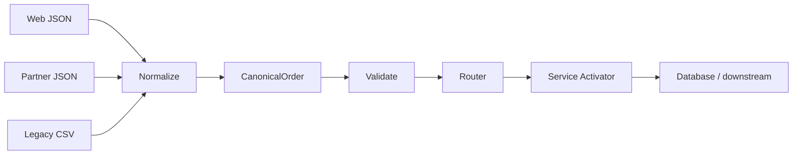

### Learning Objectives

After this lesson, you will be able to:

1. Distinguish **Normalizer Pattern**, **Transformer**, **Content Enricher**, **Filter**, and **Adapter**.
2. Design a minimal canonical payload with clear semantics and explicit versioning.
3. Normalize fields, currencies, timestamps, IDs, and data types from multiple sources.
4. Use Java records and Spring Integration Java DSL to connect multiple input flows to one channel.
5. Test that three sources produce the same **canonical type**, without confusing “same type” with “same business event”.
6. Identify validation errors, unknown schemas, duplicates, and retries.
7. Preserve business correlation, source provenance, idempotency identity, and required headers.
8. Handle schema evolution, multi-tenant security, observability, and asynchronous operation.

## 2. What Is Normalizer in Enterprise Integration Patterns?

**Normalizer** (often called *Canonical Data Model Normalization*) standardizes multiple representations of the same kind of data into one **canonical format** so subsequent steps process them uniformly.

For example:

```text
WebOrderV1           ┐
PartnerOrderV2       ├── Normalize ──> CanonicalOrder
LegacyCsvOrderV1     ┘
```

After the normalizer, downstream components do not need to know which source a record came from in order to compute totals, route, or write to the DB — except for decisions that genuinely depend on the source.

### What Tasks Does a Normalizer Perform?

- Renaming fields: `externalOrderRef` → `orderId`.
- Converting formats: decimal string → integer minor units.
- Converting timezones: offset/local time → `Instant`.
- Normalizing enums/codes: `"usd"` → `"USD"`.
- Normalizing identity: establishing `sourceSystem`, `sourceEventId`, and namespace.
- Checking invariants: valid amount, supported currency, parseable timestamp.
- Preserving provenance: knowing which source and schema version were converted.
- Producing a consistent, immutable payload.

### What Should a Normalizer NOT Do?

- Do not guess critical missing data without an approved rule.
- Do not silently round monetary amounts with invalid precision.
- Do not alter business identity just to “fit” a model.
- Do not send emails, write ledgers, or call a PSP as a side effect of a mapping function.
- Do not hide schema errors inside a half-valid payload.
- Do not assume all records with the same `orderId` are duplicates without considering namespace/source/version.
- Do not treat self-declared client values as verified metadata.

A good Normalizer is a **clear data boundary** that can be called repeatedly with the same input and produce stable results.

## 3. How Does Normalizer Relate to Spring Integration?

Spring Integration implements EIPs via channels, endpoints, adapters, transformers, routers, filters, and message handlers.

**Normalizer is a canonicalization pattern/architecture**; in a Spring Integration application, it is usually implemented with **one or more Transformers/MessageHandlers**, not necessarily a Java endpoint literally named `Normalizer`.

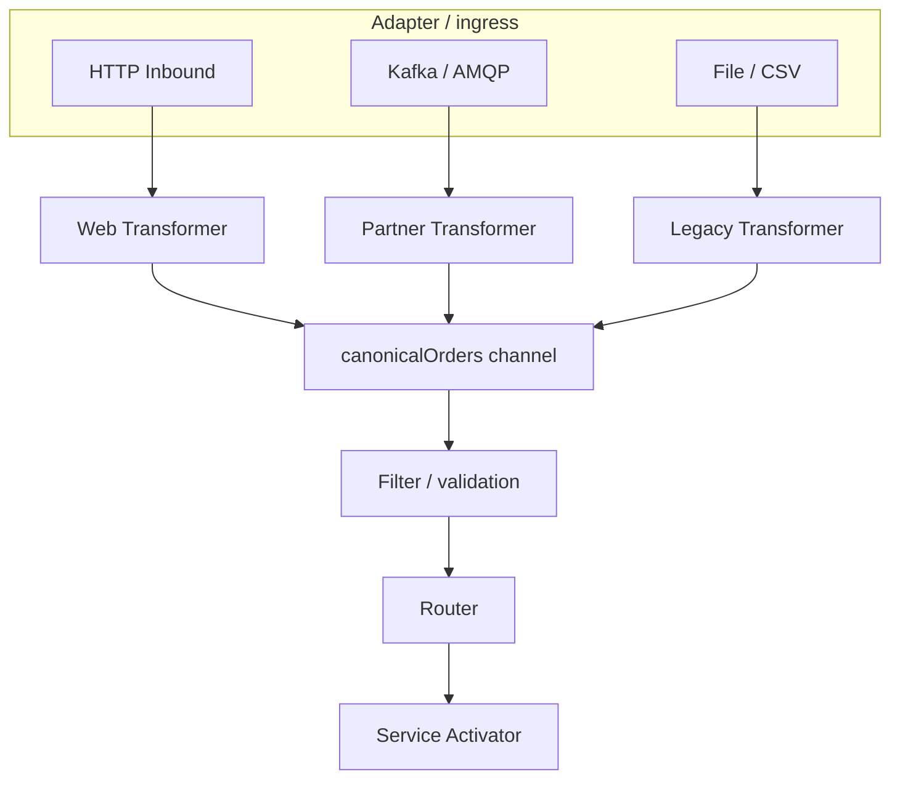

### Distinguishing Commonly Confused Components

| Component | Question It Answers | Example |
| --- | --- | --- |
| **Adapter** | How do we receive/send data over transport? | HTTP, Kafka, AMQP, file |
| **Deserializer** | How do we parse bytes into a schema-backed object? | JSON → `PartnerOrderV2` |
| **Normalizer** | How do we map equivalent schemas to one canonical contract? | `PartnerOrderV2` → `CanonicalOrder` |
| **Transformer** | How do we convert a payload from one form to another? | Convert `String` to `BigDecimal`, build record |
| **Content Enricher** | What additional data is needed from a secondary source? | Look up customer tier from CRM |
| **Filter** | Should we continue processing this message? | Drop out-of-scope records |
| **Router** | Which branch should receive the message? | Retail order → retail handler |
| **Aggregator** | Which messages are grouped and when is the group complete? | Combine line-item results |
| **Gateway** | What is the request/reply interface between caller and flow? | Submit order processing, wait for `OrderResult` |

A normalizer **can use Transformers** internally. They are naturally complementary, not mutually exclusive EIPs.

### Canonical Model Does Not Mean Every Source Has All Information

One source may send only customer ID; another includes customer name. If the canonical contract asks for customer name yet a source lacks it, you must decide:

1. Is the field truly required?
2. Does the contract allow `null`/`Optional` or an `UNKNOWN` state?
3. Is lookup via a Content Enricher permitted?
4. Which source is authoritative when data conflicts?
5. Should a missing field fail/quarantine or be processed partially?

Never plug `"UNKNOWN"` into every missing field if downstream consumers will mistake it for real data.

## 4. Why Do We Need a Canonical Data Model?

With three input schemas and four business handlers, making every handler support every schema can require up to **3 × 4** mapping/branching groups.

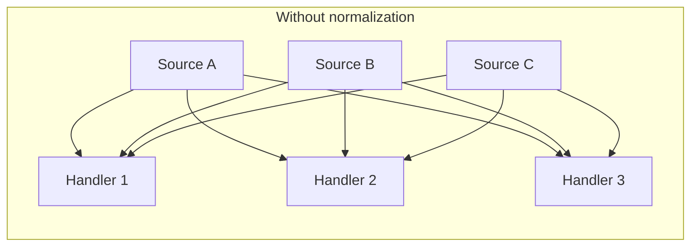

With a canonical schema, each source maps **once** and each handler processes one structure:

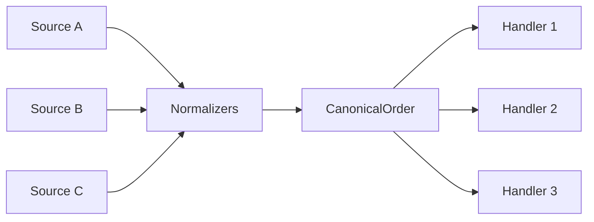

### Benefits

- Add new sources without modifying every downstream handler.
- Currency, timestamp, and identity rules sit at one testable boundary.
- Consumers rely on one canonical schema rather than partner-specific field names.
- Easier to track mapping error rates by source and schema version.
- Reduces coupling between EIP workflows and transport/source formats.

### Costs and Limitations

- The canonical model can grow too large if it tries to serve every domain.
- Canonical schema changes require migration and compatibility policies.
- Different domains should not be forced into a single artificial unified record.
- Mapping loses source-specific details unless provenance or extension fields are stored.
- An upstream change can break normalization; schema monitoring is required.

**Architectural recommendation:** scope canonical models to a *bounded context* (e.g., order intake), not a system-wide DTO with hundreds of optional fields.

## 5. Three Sources: Same Purpose, Different Data Types

### 5.1. Web Checkout V1

```java
package example.integration;

public record WebOrderV1(
    String tenantId,
    String orderId,
    String eventId,
    long amountMinorUnits,
    String currency,
    String occurredAt,
    String customerId
) {}
```

For example, `amountMinorUnits=12345`, `currency=USD` means **123.45 USD** because USD has two decimal places in the example contract.

### 5.2. Partner B2B V2

```java
package example.integration;

public record PartnerOrderV2(
    String partnerTenant,
    String externalOrderRef,
    String eventUuid,
    String grossAmount,
    String currencyCode,
    String eventTimeWithOffset,
    String buyerRef
) {}
```

Partner sends the string `grossAmount="123.45"`. Converting via `double` or default rounding can break reconciliation requirements. Use `BigDecimal`, verify scale, and convert cleanly to minor units.

### 5.3. Legacy CSV V1

```java
package example.integration;

public record LegacyCsvOrderV1(
    String tenant,
    String orderNumber,
    String recordKey,
    String amountVnd,
    String localCreatedAt,
    String customerCode
) {}
```

Legacy uses `amountVnd="450000"` (whole Vietnamese dong) and `localCreatedAt="2026-11-21 15:30:00"`. Under the assumed contract, this time is in `Asia/Ho_Chi_Minh`.

**Never assume** all monetary amounts have two decimal places: VND and USD differ in this example model. Other currencies/precisions require declared rules rather than letting formatters guess.

### About the Java Files

Each `public record` in this lesson is a **separate `.java` file** in a Java 17+ project. They are shown together for readability. If your project uses an older Java version or a different Spring Integration version, adjust the syntax during technical QA.

## 6. CanonicalOrder: A Unified Model with Provenance

Choose a canonical record with clear meaning:

```java
package example.integration;

import java.time.Instant;

public record CanonicalOrder(
    String tenantId,
    String orderId,
    String customerId,
    long totalMinorUnits,
    String currency,
    Instant occurredAt,
    String sourceSystem,
    String sourceEventId,
    int sourceSchemaVersion,
    int canonicalSchemaVersion
) {
    public CanonicalOrder {
        if (tenantId == null || tenantId.isBlank()
                || orderId == null || orderId.isBlank()
                || customerId == null || customerId.isBlank()
                || sourceSystem == null || sourceSystem.isBlank()
                || sourceEventId == null || sourceEventId.isBlank()
                || currency == null || currency.isBlank()
                || occurredAt == null) {
            throw new IllegalArgumentException(
                "CanonicalOrder is missing required field(s)");
        }

        if (totalMinorUnits < 0
                || sourceSchemaVersion <= 0
                || canonicalSchemaVersion <= 0) {
            throw new IllegalArgumentException(
                "CanonicalOrder has invalid values/version");
        }
    }
}
```

### Field Group Meanings

| Field | Semantics | What Not to Confuse It With |
| --- | --- | --- |
| `tenantId` | Verified business namespace | Implicit access permission |
| `orderId` | Order identifier within tenant | Unique ID of each delivery event |
| `customerId` | Customer per canonical contract | Always present in every domain |
| `totalMinorUnits` | Integer in specified minor units | Decimal string or floating point |
| `currency` | Normalized currency code | Automatically valid currency exponent/precision |
| `occurredAt` | Event instant on UTC timeline | Local time string without a zone |
| `sourceSystem` | Trusted source name | Arbitrary client-supplied string |
| `sourceEventId` | Source-side event ID | `MessageHeaders.id` |
| `sourceSchemaVersion` | Source format version | Canonical schema version |
| `canonicalSchemaVersion` | Canonical contract version | Application release version |

### Why Keep sourceSystem/sourceEventId?

With multi-source data, the same `orderId` may appear in both Web and Partner, either because systems forward events or because they are two separate business events. Provenance helps:

- Track which source produced the event.
- Scope idempotency via `(tenant, sourceSystem, sourceEventId, operationType)`.
- Investigate conflicting data between two sources.
- Replay using the exact right schema/parser when needed.
- Compute normalization error metrics per source.

**The Normalizer does not perform deduplication itself.** The canonical record carries enough information for a downstream Idempotent Receiver to decide.

## 7. Normalization Contract: More Than Field Renaming

For the same meaning “order priced at 123.45 USD at 08:30 UTC”:

| Source | Original Field | Rule | Canonical |
| --- | --- | --- | --- |
| Web | `amountMinorUnits=12345` | Validate currency and range | `totalMinorUnits=12345` |
| Partner | `grossAmount="123.45"` | `BigDecimal`, USD scale=2, exact conversion | `totalMinorUnits=12345` |
| Legacy | `amountVnd="450000"` | VND scale=0, exact conversion | `totalMinorUnits=450000` |
| Web | `occurredAt="...Z"` | Parse ISO offset | `Instant` |
| Partner | `eventTimeWithOffset="...+07:00"` | Parse offset then convert to UTC | `Instant` |
| Legacy | `localCreatedAt="yyyy-MM-dd HH:mm:ss"` | Parse with contract zone | `Instant` |
| Partner | `currencyCode="usd"` | Trim and uppercase with `Locale.ROOT` | `"USD"` |
| All sources | Schema-specific ID | Validate, keep source identity | `sourceEventId` |

**Fields such as money, time, and identity require dedicated rules.** Identical field names do not guarantee identical semantics.

### An Easily Missed Currency Error Example

```text
Partner: grossAmount = "123.456"
Currency: USD
Contract: USD has at most 2 decimal places

Correct: reject / quarantine with reason INVALID_MONEY_SCALE.
Wrong: silently round to 123.46 when upstream forbids it.
```

If the business has an official rounding policy, name the policy explicitly, version it, and test edge cases. Never use `double`, multiply by 100, and cast to `long` by default.

## 8. Time Contract: Same Instant, Three Different Representations

Three strings:

```text
2026-11-21T08:30:00Z          (UTC)
2026-11-21T15:30:00+07:00     (offset +07)
2026-11-21 15:30:00           (local time Asia/Ho_Chi_Minh)
```

under the lesson's source rules all describe one point in time:

```text
Instant = 2026-11-21T08:30:00Z
```

### Distinguishing Three Concepts

- **Instant:** a point on the UTC timeline, carrying no display timezone.
- **OffsetDateTime:** local date-time + specific UTC offset.
- **LocalDateTime:** date/time with no zone or offset; cannot determine an `Instant` without an external contract.

For legacy CSV, you must **apply the zone defined by the source**; never use `ZoneId.systemDefault()` because two servers in different timezones will normalize to two different instants.

### Do Not Guess Timezones

If a source sends `2026-11-21 15:30:00` with no documentation of its zone, the system cannot know whether it is Vietnam time or UTC. You need a source contract, channel configuration, or trusted enrichment.

### DST and Nonexistent/Ambiguous Local Times

Some timezones observe daylight saving time, creating repeated or nonexistent local times. When receiving local date-times from such a zone, you need an explicit reject/resolve policy. This lesson uses `Asia/Ho_Chi_Minh` for legacy, and the sample date has no DST issue, yet production must not apply that rule blindly to all sources.

## 9. Invariants to Check Before and After Normalization

### Before Normalization

- Can source schema/version be identified?
- Is the payload parseable with valid field types?
- Is tenant/source identity authenticated?
- Is the event ID empty or forged?
- Is the currency supported?
- Is the amount valid per source rules?
- Does the timestamp have an explicit zone/offset or contract?
- Are enum/state values within published sets?

### After Normalization

- Is the payload a valid `CanonicalOrder`?
- Is the currency properly normalized?
- Is `totalMinorUnits` non-negative and within `long` range?
- Is `occurredAt` a valid `Instant`?
- Do `sourceSystem` and `sourceEventId` retain provenance?
- Is `canonicalSchemaVersion` set consistently?
- Are message headers for correlation/tracing preserved properly?
- Are anomalies flagged rather than silently producing a wrong object?

### Rule for Preserving Purity

A Normalizer should have the property:

```text
normalize(input, sourceContract)
    = canonicalOutput
```

for the same input and source contract version, independent of call count, thread, wall-clock time, or fluctuating configuration.

When conversion rules change, record `normalizationPolicyVersion` or `canonicalSchemaVersion` when deterministic replay and accurate auditing are needed.

## 10. Writing SourceOrderNormalizer in Java 17+

We write a pure Java class with three mapping methods. Since the three sources have different schemas, each method takes the **exact source type** and returns the same `CanonicalOrder` type.

```java
package example.integration;

import java.math.BigDecimal;
import java.time.Instant;
import java.time.LocalDateTime;
import java.time.OffsetDateTime;
import java.time.ZoneId;
import java.time.format.DateTimeFormatter;
import java.util.Locale;
import java.util.Set;

public final class SourceOrderNormalizer {

    private static final int CANONICAL_VERSION = 1;

    private static final ZoneId LEGACY_ZONE =
        ZoneId.of("Asia/Ho_Chi_Minh");

    private static final DateTimeFormatter LEGACY_DATE_TIME =
        DateTimeFormatter.ofPattern("uuuu-MM-dd HH:mm:ss");

    private static final Set<String> SUPPORTED_CURRENCIES =
        Set.of("USD", "VND");

    public CanonicalOrder fromWeb(WebOrderV1 web) {
        String currency = normalizeCurrency(web.currency());

        return new CanonicalOrder(
            required(web.tenantId(), "tenantId"),
            required(web.orderId(), "orderId"),
            required(web.customerId(), "customerId"),
            web.amountMinorUnits(),
            currency,
            parseOffsetDateTime(
                web.occurredAt(), "occurredAt"),
            "WEB_CHECKOUT",
            required(web.eventId(), "eventId"),
            1,
            CANONICAL_VERSION);
    }

    public CanonicalOrder fromPartner(PartnerOrderV2 partner) {
        String currency =
            normalizeCurrency(partner.currencyCode());

        return new CanonicalOrder(
            required(partner.partnerTenant(), "partnerTenant"),
            required(
                partner.externalOrderRef(), "externalOrderRef"),
            required(partner.buyerRef(), "buyerRef"),
            decimalToMinorUnits(
                partner.grossAmount(), currency),
            currency,
            parseOffsetDateTime(
                partner.eventTimeWithOffset(),
                "eventTimeWithOffset"),
            "PARTNER_B2B",
            required(partner.eventUuid(), "eventUuid"),
            2,
            CANONICAL_VERSION);
    }

    public CanonicalOrder fromLegacy(LegacyCsvOrderV1 legacy) {
        return new CanonicalOrder(
            required(legacy.tenant(), "tenant"),
            required(legacy.orderNumber(), "orderNumber"),
            required(legacy.customerCode(), "customerCode"),
            decimalToMinorUnits(legacy.amountVnd(), "VND"),
            "VND",
            parseLegacyLocalTime(
                legacy.localCreatedAt()),
            "LEGACY_CSV",
            required(legacy.recordKey(), "recordKey"),
            1,
            CANONICAL_VERSION);
    }

    private static String required(String value, String field) {
        if (value == null || value.isBlank()) {
            throw new IllegalArgumentException(
                "Missing field: " + field);
        }
        return value.trim();
    }

    private static String normalizeCurrency(String currency) {
        String normalized = required(currency, "currency")
            .toUpperCase(Locale.ROOT);

        if (!SUPPORTED_CURRENCIES.contains(normalized)) {
            throw new IllegalArgumentException(
                "Unsupported currency: " + normalized);
        }

        return normalized;
    }

    private static int scaleFor(String currency) {
        return switch (currency) {
            case "USD" -> 2;
            case "VND" -> 0;
            default -> throw new IllegalArgumentException(
                "Unsupported currency: " + currency);
        };
    }

    private static long decimalToMinorUnits(
            String decimal,
            String currency) {

        BigDecimal amount = new BigDecimal(
            required(decimal, "decimal amount"));

        // longValueExact rejects fractional minor units
        // and out-of-range long values; never rounds automatically.
        long minorUnits = amount
            .movePointRight(scaleFor(currency))
            .longValueExact();

        if (minorUnits < 0) {
            throw new IllegalArgumentException(
                "Amount must be non-negative");
        }

        return minorUnits;
    }

    private static Instant parseOffsetDateTime(
            String raw,
            String field) {

        return OffsetDateTime.parse(required(raw, field))
            .toInstant();
    }

    private static Instant parseLegacyLocalTime(String raw) {
        LocalDateTime local = LocalDateTime.parse(
            required(raw, "localCreatedAt"),
            LEGACY_DATE_TIME);

        return local.atZone(LEGACY_ZONE).toInstant();
    }
}
```

### Reviewing the Technical Decisions

**1. Multiple source types, one result type.** `fromWeb`, `fromPartner`, and `fromLegacy` each own one task, avoiding one giant method with dozens of `if (sourceType...)` branches.

**2. No side effects.** All methods return a new DTO; no API calls, no DB updates. This lets mappings be tested in isolation.

**3. No binary floating point for money.** `BigDecimal` with `longValueExact` rejects amounts that cannot be represented exactly in minor units.

**4. Independent of host timezone.** CSV local time explicitly binds `ZoneId.of("Asia/Ho_Chi_Minh")` per contract.

**5. Do not trust arbitrary currencies.** The example allowlists `USD`/`VND` and their scales. Production manages a currency/exponent table based on business policy, versions, and trusted sources.

**6. Preserve source provenance.** The canonical payload carries `sourceSystem`, `sourceEventId`, and source schema version.

**7. Does not authenticate tenants on its own.** `tenantId` in the example is assumed verified before entering the flow. Real systems compare it against the authenticated principal/route/source identity; a record constructor never replaces authentication.

### Cases Requiring Additional Policy

- Partner sends `amount="123.450"` for USD: converts accurately to 12345 minor units; if the schema forbids more than two decimal places even with trailing zeros, check `BigDecimal.scale()` before conversion.
- `amount="123.456"` USD: `longValueExact` throws; never round automatically.
- `amount="1E3"`: `BigDecimal` parses scientific notation; if the source protocol forbids it, validate lexically before parsing.
- Currencies whose exponent changes or non-fiat tokens: use versioned mappings rather than forcing them into the demo's USD/VND table.
- Missing `customerId`: the code rejects it. If a flow allows missing values, design the canonical contract for it instead of inventing placeholders.
- Correction/refund events: do not assign negative `totalMinorUnits` and reuse `CanonicalOrder` if the contract states order totals are non-negative; create explicit event types and semantics.

## 11. Unit Tests: Three Different Sources All Return CanonicalOrder

Use JUnit 5 to test mappings per source. No Spring context is needed for these pure functions.

```java
package example.integration;

import static org.junit.jupiter.api.Assertions.*;

import java.time.Instant;

import org.junit.jupiter.api.Test;

class SourceOrderNormalizerTest {

    private final SourceOrderNormalizer normalizer =
        new SourceOrderNormalizer();

    @Test
    void webOrderUsesAlreadyNormalizedMinorUnits() {
        WebOrderV1 input = new WebOrderV1(
            "shop-01", "ORD-101", "WEB-9001",
            12_345L, "USD",
            "2026-11-21T08:30:00Z", "C-11");

        CanonicalOrder order = normalizer.fromWeb(input);

        assertEquals("ORD-101", order.orderId());
        assertEquals(12_345L, order.totalMinorUnits());
        assertEquals("USD", order.currency());
        assertEquals(
            Instant.parse("2026-11-21T08:30:00Z"),
            order.occurredAt());
        assertEquals("WEB_CHECKOUT", order.sourceSystem());
        assertEquals("WEB-9001", order.sourceEventId());
        assertEquals(1, order.sourceSchemaVersion());
        assertEquals(1, order.canonicalSchemaVersion());
    }

    @Test
    void partnerDecimalAndOffsetNormalizePrecisely() {
        PartnerOrderV2 input = new PartnerOrderV2(
            "shop-01", "ORD-102", "PARTNER-9002",
            "123.45", "usd",
            "2026-11-21T15:30:00+07:00", "C-12");

        CanonicalOrder order =
            normalizer.fromPartner(input);

        assertEquals(12_345L, order.totalMinorUnits());
        assertEquals("USD", order.currency());
        assertEquals(
            Instant.parse("2026-11-21T08:30:00Z"),
            order.occurredAt());
        assertEquals("PARTNER_B2B", order.sourceSystem());
        assertEquals(2, order.sourceSchemaVersion());
    }

    @Test
    void legacyCsvVndAndVietnamTimeNormalize() {
        LegacyCsvOrderV1 input = new LegacyCsvOrderV1(
            "shop-01", "ORD-103", "CSV-9003",
            "450000", "2026-11-21 15:30:00", "C-13");

        CanonicalOrder order =
            normalizer.fromLegacy(input);

        assertEquals(450_000L, order.totalMinorUnits());
        assertEquals("VND", order.currency());
        assertEquals(
            Instant.parse("2026-11-21T08:30:00Z"),
            order.occurredAt());
        assertEquals("LEGACY_CSV", order.sourceSystem());
        assertEquals("CSV-9003", order.sourceEventId());
    }
}
```

The tests prove that different source formats converge to:

- The same `CanonicalOrder` type.
- The same minor-unit monetary representation.
- The same `Instant` time type.
- The same uppercase currency rule.
- Provenance retained for auditing/debugging.

**Do not misunderstand:** the three inputs in the example are **three different orders** (`ORD-101`, `ORD-102`, `ORD-103`). They share the same **canonical schema**, not necessarily the same payload or idempotency key.

## 12. Testing Semantic Equivalence

A stronger test constructs **representations of the same business facts** and compares relevant canonical fields. Source provenance intentionally differs.

For example, the same order ID and USD amount across Web and Partner:

```java
@Test
void webAndPartnerRepresentSameBusinessFacts() {
    WebOrderV1 web = new WebOrderV1(
        "shop-01", "ORD-SAME", "WEB-E1",
        12_345L, "USD",
        "2026-11-21T08:30:00Z", "C-1");

    PartnerOrderV2 partner = new PartnerOrderV2(
        "shop-01", "ORD-SAME", "PARTNER-E9",
        "123.45", "usd",
        "2026-11-21T15:30:00+07:00", "C-1");

    CanonicalOrder a = normalizer.fromWeb(web);
    CanonicalOrder b = normalizer.fromPartner(partner);

    assertEquals(a.tenantId(), b.tenantId());
    assertEquals(a.orderId(), b.orderId());
    assertEquals(a.customerId(), b.customerId());
    assertEquals(a.totalMinorUnits(), b.totalMinorUnits());
    assertEquals(a.currency(), b.currency());
    assertEquals(a.occurredAt(), b.occurredAt());

    // Different provenance is expected: never discard source identity!
    assertNotEquals(a.sourceSystem(), b.sourceSystem());
    assertNotEquals(a.sourceEventId(), b.sourceEventId());
}
```

**Goal of the test:** confirm that canonicalization preserves **business meaning** for comparable cases. Never force two events from different sources into the same `sourceEventId` just to satisfy `record.equals(...)`.

### Testing Determinism

```java
@Test
void sameSourceInputProducesSameCanonicalPayload() {
    WebOrderV1 source = new WebOrderV1(
        "shop-01", "ORD-1", "EV-1",
        1_000L, "USD",
        "2026-11-21T00:00:00Z", "C-1");

    CanonicalOrder first = normalizer.fromWeb(source);
    CanonicalOrder second = normalizer.fromWeb(source);

    assertEquals(first, second);
}
```

Because the normalizer reads no clock, system timezone, or thread state, identical inputs consistently produce equal outputs. This property is highly valuable during retries and replays.

## 13. Error Tests: Inaccurate Amounts, Ambiguous Timezones, Missing Schema Fields

A good normalizer **never turns invalid input into a fake valid canonical payload**.

### 13.1. USD with Too Many Fractional Digits

```java
@Test
void rejectsFractionalMinorUnitWithoutRounding() {
    PartnerOrderV2 input = new PartnerOrderV2(
        "shop-01", "ORD-ERR", "PARTNER-E3",
        "123.456", "USD",
        "2026-11-21T15:30:00+07:00", "C-12");

    assertThrows(ArithmeticException.class, () ->
        normalizer.fromPartner(input));
}
```

The exception can be translated into an `INVALID_MONEY_SCALE` error code at the error-handling boundary. Do not expose raw exception strings externally if they may contain sensitive data.

### 13.2. Unsupported Currency

```java
@Test
void rejectsUnsupportedCurrency() {
    PartnerOrderV2 input = new PartnerOrderV2(
        "shop-01", "ORD-ERR", "PARTNER-E4",
        "123.45", "XYZ",
        "2026-11-21T15:30:00+07:00", "C-12");

    assertThrows(IllegalArgumentException.class, () ->
        normalizer.fromPartner(input));
}
```

### 13.3. Offset Time Missing Offset

```java
@Test
void rejectsPartnerTimestampWithoutOffset() {
    PartnerOrderV2 input = new PartnerOrderV2(
        "shop-01", "ORD-ERR", "PARTNER-E5",
        "123.45", "USD",
        "2026-11-21T15:30:00", "C-12");

    assertThrows(
        java.time.format.DateTimeParseException.class,
        () -> normalizer.fromPartner(input));
}
```

### 13.4. Negative Web Amount

```java
@Test
void rejectsNegativeWebAmount() {
    WebOrderV1 input = new WebOrderV1(
        "shop-01", "ORD-ERR", "WEB-E6",
        -1L, "USD",
        "2026-11-21T08:30:00Z", "C-11");

    assertThrows(IllegalArgumentException.class, () ->
        normalizer.fromWeb(input));
}
```

### 13.5. Malformed Legacy Timestamp

```java
@Test
void rejectsMalformedLegacyDate() {
    LegacyCsvOrderV1 input = new LegacyCsvOrderV1(
        "shop-01", "ORD-ERR", "CSV-E7",
        "450000", "21/11/2026 15:30", "C-13");

    assertThrows(
        java.time.format.DateTimeParseException.class,
        () -> normalizer.fromLegacy(input));
}
```

### What Else Should Be Tested?

| Input | Expected Outcome |
| --- | --- |
| `grossAmount="1.2.3"` | Invalid decimal |
| `grossAmount="NaN"` | Invalid decimal |
| `grossAmount` exceeding `Long.MAX_VALUE` in minor units | Overflow/reject |
| Negative amount | Reject per order total contract |
| Currency `usd` | Normalize to `USD` |
| Empty currency | Reject |
| Empty source event ID | Reject |
| Partner local time missing offset | Reject |
| Legacy local time per contract | Parse with declared zone |
| JSON with unexpected field type | Deserialization error before normalizer |
| Unsupported source schema version | Quarantine/migration policy |
| Tenant mismatch with verified identity | Security rejection before normalizer |

Validation tests should run fast at the unit level; parsers, adapters, error routing, and multi-threaded behavior need separate integration tests.

## 14. Spring Integration Java DSL: Three Input Flows, One Canonical Output

We use three independent `DirectChannel`s and one `QueueChannel` holding canonical outputs for testing.

```java
package example.integration;

import org.springframework.context.annotation.Bean;
import org.springframework.context.annotation.Configuration;
import org.springframework.integration.channel.DirectChannel;
import org.springframework.integration.channel.QueueChannel;
import org.springframework.integration.config.EnableIntegration;
import org.springframework.integration.dsl.IntegrationFlow;
import org.springframework.messaging.MessageChannel;

@Configuration
@EnableIntegration
public class OrderNormalizationConfiguration {

    @Bean
    public MessageChannel webOrdersInput() {
        return new DirectChannel();
    }

    @Bean
    public MessageChannel partnerOrdersInput() {
        return new DirectChannel();
    }

    @Bean
    public MessageChannel legacyOrdersInput() {
        return new DirectChannel();
    }

    @Bean
    public QueueChannel canonicalOrders() {
        return new QueueChannel();
    }

    @Bean
    public SourceOrderNormalizer sourceOrderNormalizer() {
        return new SourceOrderNormalizer();
    }

    @Bean
    public IntegrationFlow normalizeWebOrders(
            SourceOrderNormalizer normalizer) {

        return IntegrationFlow.from("webOrdersInput")
            .transform(WebOrderV1.class, normalizer::fromWeb)
            .channel("canonicalOrders")
            .get();
    }

    @Bean
    public IntegrationFlow normalizePartnerOrders(
            SourceOrderNormalizer normalizer) {

        return IntegrationFlow.from("partnerOrdersInput")
            .transform(
                PartnerOrderV2.class, normalizer::fromPartner)
            .channel("canonicalOrders")
            .get();
    }

    @Bean
    public IntegrationFlow normalizeLegacyOrders(
            SourceOrderNormalizer normalizer) {

        return IntegrationFlow.from("legacyOrdersInput")
            .transform(
                LegacyCsvOrderV1.class, normalizer::fromLegacy)
            .channel("canonicalOrders")
            .get();
    }
}
```

### Flow Explanation

- Each input channel accepts the **exact source DTO** deserialized per contract.
- Each Transformer handles one source schema and produces `CanonicalOrder`.
- All flows converge into `canonicalOrders` so downstream consumes a single format.
- `QueueChannel` supports integration tests via `receive(timeout)`.
- The code configures no real HTTP/Kafka/File adapters; those are **outside ingress steps**.
- These examples omit authentication, persistent brokers, transactions, DLQs, and retry advice.

This is a direct way to implement Normalizer using Spring Integration Java DSL. If a project uses another version where the `transform(Class, GenericTransformer)` overload differs, adjust during technical QA for actual dependencies.

### Why Not Send Every Source Through One Initial Channel?

You can use a shared channel and route by type/header, but that raises the risk of misidentifying a message's source or schema:

```text
rawInput
   -> trustedSourceType router
   -> source-specific deserializer/normalizer
   -> canonicalOrders
```

With a few sources, separating three ingress flows makes **schema boundaries clearer**. With many sources, a registry of normalizers and controlled routing works well, provided source identity remains immutable and mappings are tested per version.

## 15. JUnit 5: Three Sources Converging into One QueueChannel

```java
package example.integration;

import static org.junit.jupiter.api.Assertions.*;

import java.time.Instant;
import java.util.Set;

import org.junit.jupiter.api.Test;
import org.springframework.beans.factory.annotation.Autowired;
import org.springframework.beans.factory.annotation.Qualifier;
import org.springframework.integration.channel.QueueChannel;
import org.springframework.messaging.Message;
import org.springframework.messaging.MessageChannel;
import org.springframework.messaging.support.MessageBuilder;
import org.springframework.test.annotation.DirtiesContext;
import org.springframework.test.context.junit.jupiter.SpringJUnitConfig;

@SpringJUnitConfig(OrderNormalizationConfiguration.class)
@DirtiesContext(
    classMode = DirtiesContext.ClassMode.AFTER_EACH_TEST_METHOD)
class OrderNormalizationFlowTest {

    @Autowired
    @Qualifier("webOrdersInput")
    private MessageChannel web;

    @Autowired
    @Qualifier("partnerOrdersInput")
    private MessageChannel partner;

    @Autowired
    @Qualifier("legacyOrdersInput")
    private MessageChannel legacy;

    @Autowired
    @Qualifier("canonicalOrders")
    private QueueChannel canonical;

    @Test
    void normalizesThreeDifferentSourcesIntoCanonicalOrders() {
        WebOrderV1 a = new WebOrderV1(
            "shop-01", "ORD-101", "WEB-9001",
            12_345L, "USD",
            "2026-11-21T08:30:00Z", "C-11");

        PartnerOrderV2 b = new PartnerOrderV2(
            "shop-01", "ORD-102", "PARTNER-9002",
            "123.45", "usd",
            "2026-11-21T15:30:00+07:00", "C-12");

        LegacyCsvOrderV1 c = new LegacyCsvOrderV1(
            "shop-01", "ORD-103", "CSV-9003",
            "450000", "2026-11-21 15:30:00", "C-13");

        assertTrue(web.send(
            MessageBuilder.withPayload(a).build()));
        assertTrue(partner.send(
            MessageBuilder.withPayload(b).build()));
        assertTrue(legacy.send(
            MessageBuilder.withPayload(c).build()));

        Message<?> out1 = canonical.receive(1_000);
        Message<?> out2 = canonical.receive(1_000);
        Message<?> out3 = canonical.receive(1_000);

        assertNotNull(out1);
        assertNotNull(out2);
        assertNotNull(out3);

        assertInstanceOf(
            CanonicalOrder.class, out1.getPayload());
        assertInstanceOf(
            CanonicalOrder.class, out2.getPayload());
        assertInstanceOf(
            CanonicalOrder.class, out3.getPayload());

        CanonicalOrder webOrder =
            (CanonicalOrder) out1.getPayload();
        CanonicalOrder partnerOrder =
            (CanonicalOrder) out2.getPayload();
        CanonicalOrder legacyOrder =
            (CanonicalOrder) out3.getPayload();

        assertEquals("ORD-101", webOrder.orderId());
        assertEquals(12_345L, webOrder.totalMinorUnits());

        assertEquals("ORD-102", partnerOrder.orderId());
        assertEquals(12_345L, partnerOrder.totalMinorUnits());

        assertEquals("ORD-103", legacyOrder.orderId());
        assertEquals(450_000L, legacyOrder.totalMinorUnits());
        assertEquals("VND", legacyOrder.currency());

        assertEquals(
            Set.of("WEB_CHECKOUT", "PARTNER_B2B", "LEGACY_CSV"),
            Set.of(
                webOrder.sourceSystem(),
                partnerOrder.sourceSystem(),
                legacyOrder.sourceSystem()));

        assertEquals(
            Instant.parse("2026-11-21T08:30:00Z"),
            legacyOrder.occurredAt());

        assertNull(canonical.receive(0));
    }
}
```

**Test scope:** the three input sources are sent synchronously in order Web → Partner → Legacy; since `DirectChannel` transforms directly and the output is a `QueueChannel`, ordered assertions match the demo configuration.

**If you add an `ExecutorChannel` or broker**, global order across sources is no longer guaranteed. Tests should collect a **set** of canonical outputs and index by `sourceEventId`/`orderId`, rather than assuming Web always finishes first.

### Why @DirtiesContext?

The test holds queues and application state; starting a fresh context after each test prevents outputs from leaking between tests. In larger suites, dedicated reset/fixtures can be used; this is a simple choice for a learning example.

## 16. Testing Header Propagation and Correlation

A Transformer in Spring Integration typically preserves/copies appropriate message headers. However, adapters, custom `MessageBuilder` usage, or serialization boundaries can strip important metadata.

Testing a business correlation ID:

```java
@Test
void preservesBusinessCorrelationThroughNormalizingFlow() {
    WebOrderV1 input = new WebOrderV1(
        "shop-01", "ORD-201", "WEB-9201",
        20_000L, "USD",
        "2026-11-21T08:30:00Z", "C-21");

    Message<WebOrderV1> message = MessageBuilder
        .withPayload(input)
        .setHeader("businessCorrelationId", "order:ORD-201")
        .setHeader("traceMarker", "trace-abc")
        .build();

    assertTrue(web.send(message));

    Message<?> output = canonical.receive(1_000);
    assertNotNull(output);
    assertInstanceOf(
        CanonicalOrder.class, output.getPayload());

    assertEquals(
        "order:ORD-201",
        output.getHeaders().get("businessCorrelationId"));
    assertEquals(
        "trace-abc",
        output.getHeaders().get("traceMarker"));
}
```

This method goes inside `OrderNormalizationFlowTest` from the previous section.

### Do Not Copy All Headers Unconditionally

`replyChannel` and `errorChannel` may be internal channel objects. When crossing HTTP/broker boundaries or persisting messages, those objects may not serialize or may become invalid after a restart.

Decide explicitly:

- Which business headers are allowed to flow across steps?
- Which technical headers are meaningful only inside the JVM?
- Which headers must be rebuilt from current authentication?
- Which source headers are untrusted?
- Do `correlationId` and `sequenceNumber` come from a Splitter or from a client?
- When a Transformer returns `Message<?>` instead of a payload, what is the header merge precedence?

Canonicalization **does not automatically manage** the entire message envelope. Test both payload and metadata whenever workflows use Aggregator, Gateway, or tracing.

## 17. From JSON/CSV Bytes to Source DTOs: Parser vs. Normalizer

The Java DSL example starts at source DTOs rather than raw bytes. This is an intentional separation of concerns:

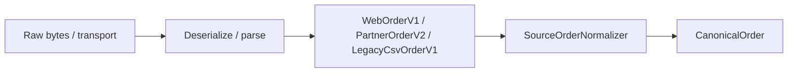

### JSON Adapter

The adapter receives JSON payloads and uses a serializer/message converter to construct `WebOrderV1` or `PartnerOrderV2`. Failures at parse time (e.g., an object where a number was expected) are **deserialization errors**, not normalizer business errors.

### CSV Parser

A CSV row can contain commas inside quoted fields, newlines, escapes, and varying encodings. **Do not use `line.split(",")` for general CSV**; use a parser library supporting the source contract's RFC/dialect and validate column counts and schemas.

For example:

```text
"shop-01","ORD-103","CSV-9003","450000",
"2026-11-21 15:30:00","Customer, East"
```

Using `String.split(",")` splits the customer name in the last column incorrectly.

### Large Files

For multi-million-row CSV files, use a streaming reader, Splitter, and backpressure so the entire file is not loaded into RAM; each row is parsed into a source DTO and normalized independently.

**Do not open other files in this worker to implement a real parser**; this document only describes the architecture and code to apply in a project during implementation.

## 18. Where Is the Source Determined? Never Trust Only a Client-Sent sourceType

A common anti-pattern lets clients freely send:

```json
{
  "sourceType": "TRUSTED_PARTNER",
  "tenantId": "shop-01",
  "payload": { "orderId": "ORD-1" }
}
```

and lets the Router trust `sourceType` to choose a deserializer/normalizer with partner privileges.

A client could then impersonate a privileged source.

### Trustworthy Design

- HTTP route + authentication determine source/client identity.
- Kafka topic and producer identity/ACL determine the source.
- File directories/feeds are bound to owners through an intake process.
- Partner schema version is tied to verified connections/credentials.
- In the canonical envelope, `sourceSystem` is set by the normalizer from the trusted branch, never copied arbitrarily from input strings.

```text
Verified ingress identity
  -> Select source parser/normalizer
  -> Validate payload claims against verified tenant
  -> CanonicalOrder(sourceSystem from trusted configuration)
```

**Payload normalization does not replace authorization.** Compare `tenantId` from the payload against the authenticated principal/tenant mapping before saving or forwarding to business handlers.

### Authorization Tests Must Be Separate from Mapping Unit Tests

In the simple example, the normalizer reads `tenantId` from the source DTO. Testing `fromWeb(...)` cannot prove tenant authentication. Production ingress integration tests should simulate:

```text
authenticated tenant = shop-01
payload tenant = shop-02
expected = reject / security error
```

Do not use the same `CanonicalOrder` object to legitimize a payload arriving from a different tenant.

## 19. Normalization Error Handling: Keep Corrupted Data Out of the Main Flow

Many distinct failure types get wrongly lumped into one `catch (Exception)` block:

| Stage | Example | Error Type | Suggestion |
| --- | --- | --- | --- |
| Transport | Kafka/HTTP connection failure | Infrastructure | Retry/backoff per adapter |
| Deserialization | Malformed JSON, CSV missing column | Input/schema | Reject/quarantine, do not retry forever |
| Schema version | Partner sends unsupported V3 | Compatibility | Select new parser or replayable DLQ |
| Semantic validation | Negative amount, unknown currency | Data contract | Reject with reason |
| Money conversion | USD has 3 decimals not exact | Data contract | Never round blindly |
| Time conversion | Timestamp without offset | Data contract | Reject/enrich from authoritative source |
| Tenant check | Payload claims different tenant than principal | Security | Reject and audit |
| Downstream | DB timeout after normalization | Infrastructure/business | Retry with idempotency |
| Output serialization | Canonical DTO incompatible with consumer | Schema/deploy | Rollback/migration |

### Note on Spring Integration Error Channels

On a synchronous `DirectChannel`, an exception from a Transformer may return to the caller of `send(...)`. After an asynchronous endpoint or inbound adapter, errors may flow to `errorChannel`/`ErrorMessage` depending on configuration. **Do not assume every Java error automatically lands on the global `errorChannel` in every topology.**

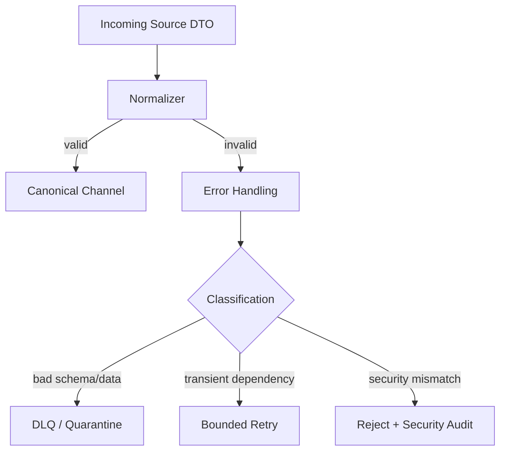

### What Should a Failed Payload Retain?

A failure envelope may record:

```java
public record NormalizationFailure(
    String sourceSystem,
    String sourceEventId,
    String reasonCode,
    String messageReference,
    String correlationId,
    String parserVersion
) {}
```

Avoid writing entire raw payloads containing PII, access tokens, or sensitive data into uncontrolled logs or DLQs. If raw input replay is needed, use an authorized store and record a `messageReference`, checksum/version, TTL, and retention policy.

### Structured Error Codes

For example:

```text
INVALID_SCHEMA
UNSUPPORTED_SOURCE_VERSION
INVALID_CURRENCY
INVALID_MONEY_SCALE
INVALID_TIMESTAMP
TENANT_MISMATCH
MISSING_REQUIRED_FIELD
PAYLOAD_TOO_LARGE
```

This is far easier to measure and use for retry/recovery than inspecting free-form `e.getMessage()`.

## 20. Never Retry Deterministic Data Errors Forever

If a Partner message has `grossAmount="123.456"` and the USD contract requires exact minor units, retrying the same payload will always fail.

```text
Input unchanged
  -> fromPartner()
  -> ArithmeticException
  -> retry same input
  -> same ArithmeticException
  -> ...
```

This is **non-retryable** unless an external dependency changes or an explicit policy migration happens. Blind retries clog queues, raise consumer lag, and delay valid messages.

### Retry Classification

- **Retryable:** metadata service/DB unavailable if the normalizer genuinely depends on it, or transport timeout.
- **Non-retryable:** unsupported currency, schema missing required field, malformed timestamp, tenant mismatch.
- **Reprocessable after correction:** partner emits a newly supported schema version or an operator fixes/approves the mapping.
- **Uncertain outcome:** if execution already crossed a side-effect boundary after normalization, check idempotency before replaying.

When a pure normalizer performs no I/O, most mapping errors are deterministic given the input and policy version. That makes retry classification straightforward.

## 21. Normalizer and Idempotent Receiver: Two Steps with Different Goals

Two JSON records can have different formats yet describe the same business event; conversely, two identical-looking normalized payloads can be **two valid independent events**.

```text
Web event E-1:
  orderId=ORD-100
  total=12345

Partner event E-9:
  orderId=ORD-100
  total=12345
```

The Normalizer only produces canonical records. It does not decide on its own whether `E-1` and `E-9` are the same operation.

### Transport Event Idempotency Key

```text
(tenantId, sourceSystem, sourceEventId, operationType)
```

This key detects when a source resends **the same event**. Because `sourceSystem` provides its own namespace, identical event IDs from two different sources will not collide wrongly.

### Business Uniqueness May Differ

If two sources both report that an order was created, a business DB constraint may require:

```text
(tenantId, orderId, businessOperation)
```

to prevent creating two real orders while still keeping audit records of both events. Choosing one or both levels of idempotency depends on the business contract.

### Where to Place the Idempotent Receiver?

A typical flow looks like:

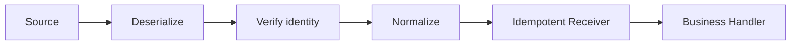

Benefit: downstream keys share a consistent schema. However, if raw messages are huge or deserialization is expensive, you can reject coarse replays at ingress **using a verified ID** before the normalizer, while still enforcing business-effect idempotency downstream.

**Never use `MessageHeaders.id` as a business idempotency key:** across redeliveries or when a Transformer builds a new message, the Spring Message ID can change.

## 22. Correlation: Normalizing Payloads Must Not Arbitrarily Alter Group Keys

A system may receive individual `OrderLine`s from multiple sources and aggregate them by order after the normalizer.

```text
Partner:
  order_ref = ORD-101
  line_no   = 2

Web:
  orderId   = ORD-101
  lineIndex = 1

Canonical:
  tenantId
  orderId
  lineIndex
```

An Aggregator's `CorrelationStrategy` might use:

```text
GroupKey(tenantId, orderId, workflowRunId)
```

The Normalizer must preserve/normalize identity at the right scope. If a source calls `externalOrderRef` the **partner-side** order ID, it is not guaranteed to match the internal `orderId`; use an authoritative mapping rather than assuming two strings match.

### Business Correlation vs. Technical Correlation

| Field/Header | Role |
| --- | --- |
| `sourceEventId` | Identifies logical input event at source |
| `orderId` | Order identifier in canonical domain |
| `businessCorrelationId` | Cross-service tracing |
| `correlationId` | `MessageGroup` key inside an endpoint |
| `workflowRunId` | Separates processing/replay runs |
| `MessageHeaders.id` | Identifies a single Spring Message |

A normalizer should not overwrite Splitter/Aggregator `correlationId` unless it understands the grouping contract. To group by content, use a custom `CorrelationStrategy` at the appropriate endpoint or attach a verified header in a separate step.

## 23. Post-Normalizer Routing Is Simpler, Yet Still Needs Business Rules

Without normalization, a Router might have to write:

```text
Web:     currency == "USD"
Partner: currencyCode.lowercase() == "usd"
Legacy:  always "VND"
```

After normalization, the Router only needs:

```text
CanonicalOrder.currency == "USD" -> usdOrders
CanonicalOrder.currency == "VND" -> vndOrders
```

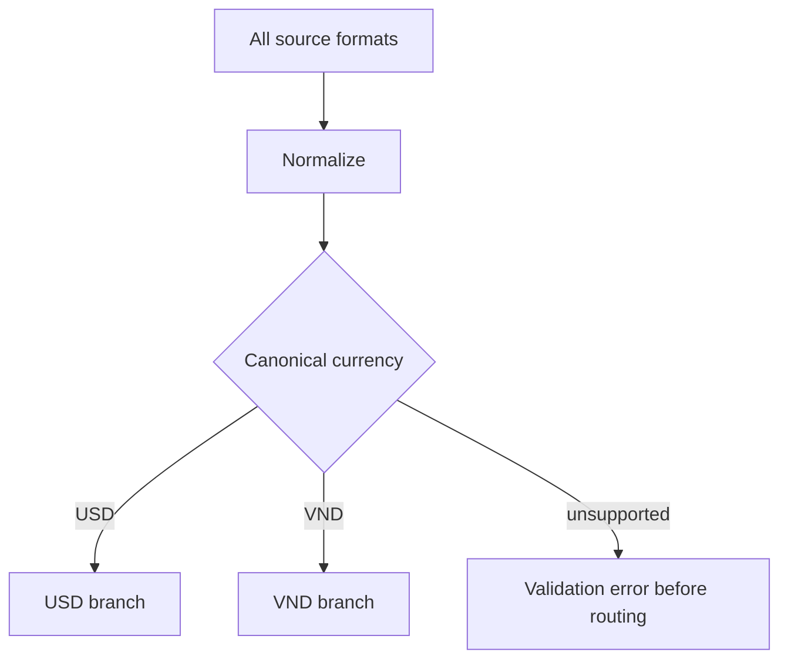

An illustrative Java DSL snippet:

```java
// Attach after the canonical channel in a separate flow
// when canonicalOrders is a DirectChannel in a real application.

IntegrationFlow routeCanonicalOrders() {
    return IntegrationFlow.from("canonicalOrders")
        .route(CanonicalOrder.class,
            CanonicalOrder::currency,
            spec -> spec
                .channelMapping("USD", "usdOrders")
                .channelMapping("VND", "vndOrders"))
        .get();
}
```

**Do not plug this flow verbatim onto the `QueueChannel canonicalOrders` from section 14 without adjusting the topology.** `QueueChannel` is for testing; in production, use a `DirectChannel` or an appropriate broker/adapter to feed the Router.

### Do Not Confuse Routing with the Normalizer's Job

The Normalizer supplies the valid `currency`; the Router decides which handler receives it. A source-specific business rule (for example, orders from Partner need review) can still inspect `sourceSystem` explicitly; canonicalization does not mean deleting all provenance.

## 24. Content Enricher: Look Up Only What Sources Do Not Provide

Suppose a business handler needs `customerTier`, while the three sources provide only `customerId`. That is a job for a **Content Enricher**, not necessarily something to place inside the Normalizer.

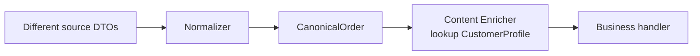

### When to Enrich Before Normalization?

Sometimes normalization cannot run without authoritative metadata:

- Partner `externalOrderRef` needs mapping to an internal order ID.
- Tenant is missing from the payload and determined from the connection.
- Currency is absent from the record and comes from source feed config.
- Local timestamp requires a timezone from source configuration.

In those cases, run a **source-specific enrichment/verification step before the normalizer**. What matters is identifying trusted data sources and version policies.

### When to Enrich After Normalization?

When lookups use normalized canonical fields (`customerId`, `tenantId`, `currency`), enriching after normalization avoids duplicating mapping code across every source.

### Limits of Pure Mapping

If the Normalizer has to call multiple DBs/APIs to fill missing fields, the code is no longer pure, deterministic, and fast per input. Split it into two stages with separate checkpoints and tracing:

```text
Validate source
  -> Enrich authoritative context
  -> Normalize deterministically
  -> Enrich business domain
```

Never let network errors from an Enricher masquerade as “invalid payload”.

## 25. Splitter and Aggregator: Normalize Parts Before Combining

A partner may send a batch of N order lines where each line's payload differs from Web's format.

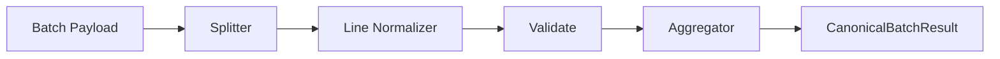

If the Splitter attaches:

```text
correlationId = group-101
sequenceNumber = 1..N
sequenceSize = N
```

then the Transformer/Normalizer must **preserve the appropriate technical headers** so the Aggregator knows which group each line belongs to and when the group is complete.

### Common Bug: Filter Drops a Child Before the Aggregator

Suppose N=3, line 2 is invalid and the normalizer throws an error, so the Aggregator receives only lines 1 and 3.

```text
Splitter emits: 1/3, 2/3, 3/3
Normalizer:
  1 -> valid
  2 -> INVALID_MONEY_SCALE (not forwarded)
  3 -> valid
Aggregator sees:
  1/3, 3/3 -> group never complete
```

Solutions depending on contract:

- Produce a `NormalizedLineOutcome(status=FAILED, index=2)` so the Aggregator receives outcomes for all three children.
- Or fail the whole batch, stop/clean up the group, and report a structured error.
- Or design partial aggregation with explicit missing indices and deadlines.
- Never decrement `sequenceSize` on remaining children because metadata will become inconsistent.

### Difference Between Normalize and Aggregate

- Normalize turns each contribution into a **common format**.
- Aggregate decides **which contributions belong together** and **when the final result is ready**.

Never turn a simple pure normalizer into a stateful aggregator without an explicit requirement.

## 26. Request-Reply Gateway: Canonical Output and Contracted Errors

A Gateway can accept a specific input type and return a canonical order or business result:

```text
Caller
   |
   v
OrderGateway.submit(...)
   |
   v
Source normalization flow
   |
   v
CanonicalOrder or ValidationFailure
   |
   v
Gateway reply / error
```

If the caller is waiting for a reply:

- When the Normalizer produces a valid `CanonicalOrder`, the downstream flow can process it and return a business result.
- Validation failures need a defined error/response contract instead of letting callers time out with no reason.
- Gateway `replyChannel`/`errorChannel` are metadata for the current request, not source business IDs.
- Across adapters/brokers, use proper reply mapping instead of arbitrarily serializing Spring `MessageChannel` objects.
- For long-running work, return `ACCEPTED/PENDING` and complete asynchronously.

### Why Not Use One Gateway for Every Unknown Raw Type?

You can, yet the API should declare explicit types, schemas/versions, or envelope protocols. If a Gateway accepts arbitrary `Object`s and guesses types from overlapping field names, runtime errors and ambiguity rise. Place validation/deserialization at ingress before business logic sees canonical objects.

## 27. Schema Evolution: When Partner Upgrades from V2 to V3

The Normalizer must evolve when source schemas change, yet downstream does not have to change at the same time.

```text
Partner V2 ----> fromPartnerV2() ---┐
                                    +--> CanonicalOrder V1
Partner V3 ----> fromPartnerV3() ---┘
```

### Types of Changes

| Upstream Change | Risk | Response |
| --- | --- | --- |
| Added optional field | Old consumer may still parse | Define unknown-field policy |
| Renamed field | Old parser/mapper breaks | Versioned adapter |
| Amount changed from string to integer | Wrong scale/money meaning | Schema contract + tests |
| Timezone changed | Time shift, ordering skew | Versioned time policy |
| Currency exponent changed | Wrong monetary calculation | Canonical policy version |
| OrderId meaning changed | Identity collision | New mapping/migration |
| Required field removed | Validation fails | Fail/negotiated migration |
| Added event type in another domain | Canonical model does not fit | New event type / bounded context |

### Versioning Strategy

Use at least two independent version values:

```text
sourceSchemaVersion = 2
canonicalSchemaVersion = 1
```

When the canonical contract actually changes (e.g., `amount` used to allow negatives and no longer does), manage compatibility with downstream. Never change semantics while keeping the same version number, or replays will produce unexplained different results.

### Incremental Migration

During a transition period, both V2 and V3 normalizers can run simultaneously and produce Canonical V1. Later, upgrade to Canonical V2 with compatibility tests.

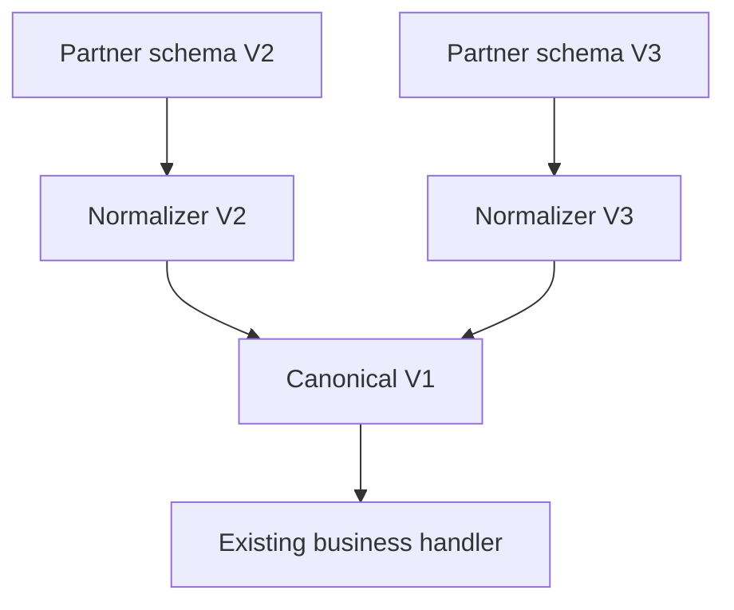

You can monitor the share of V2 inputs remaining before deprecating support. Never delete the old parser while brokers/DLQs can still replay V2 data within the retention window.

## 28. Selecting Schema Version Based on Trusted Data

A JSON message may contain `"schemaVersion": 3`. However, if the client is not authorized to emit schema V3, you cannot trust a self-reported value alone to invoke a higher-privileged parser.

A sound architecture:

1. Authenticate producer/connection identity.
2. Restrict the list of schema versions allowed for that producer.
3. Read version via protocol: registry ID, envelope type, trusted header, or endpoint.
4. Deserialize the matching source DTO.
5. Normalize using the rules for that version.
6. Record parser and schema version provenance/metrics.

### Where Should Unknown Versions Go?

```text
Partner sends schemaVersion=9
Supported versions=[2,3]

-> UNSUPPORTED_SOURCE_VERSION
-> Quarantine/DLQ with reference
-> Alert + owner
-> No false CanonicalOrder
```

Do not try to parse a new version as an old version and silently drop fields that carry new semantics—especially around money, identity, authorization, and payment states.

## 29. Canonicalization and Data Loss: What to Keep, What to Drop?

Not every source field belongs in the canonical record. For example, Partner includes `campaignCode` and `partnerInternalNote`; Web has neither.

### Design Principles

- Fields serving shared business logic: include in canonical schema with clear semantics.
- Fields only for tracing/audit: keep in separate provenance/envelope metadata.
- Source fields needed for reconciliation: store raw source reference or proper mapping metadata.
- Unnecessary sensitive fields: do not propagate onto every channel.
- Fields with no semantic equivalent: never force them into a vaguely similar field with a different meaning.

### Raw Data Retention

If replay is needed after a normalizer mapping fix, retain raw input or a reference to it under security/retention policy. When Canonical V1 is derived from Source V2, storing `sourceEventId` and `sourceSchemaVersion` lets you locate the record for inspection.

One way to organize it:

```text
Raw source record (restricted storage)
   |
   +-- sourceEventId / checksum / schemaVersion
   |
   v
Normalizer
   |
   v
CanonicalOrder + provenance
```

Never log full raw payloads containing PII just to “make debugging easier”. Log error codes and reconcilable references paired with appropriate data retention.

## 30. Concurrent Normalization: Never Use a Mutable Global “currentSource”

Suppose three input flows execute on three threads. An anti-pattern is storing the active source in a static variable:

```java
// Anti-pattern: never share global mutable state across messages.
static String currentSource;

void beforeNormalize(String source) {
    currentSource = source;
}

CanonicalOrder normalize(Object payload) {
    // If another thread overwrites currentSource before it is read,
    // a Web payload can be treated as Partner.
    return mapBySource(currentSource, payload);
}
```

Under concurrency, `currentSource` can be overwritten by another thread. Instead, each source normalizer has an **explicit function/type**, or source identity is an immutable parameter/verified message envelope.

### Concurrency-Friendly Normalizer

`SourceOrderNormalizer` in this lesson uses only constants and local variables, holding no per-request mutable state. It can be a singleton bean safely at the method-logic level **provided any future collaborators are also thread-safe**.

Do not assume every custom mapper, `ObjectMapper`, or date formatter is automatically thread-safe; verify each dependency's documentation and configuration before sharing instances.

### No Need to Lock the Whole Pipeline

When each normalize call is a pure function, different messages normalize in parallel without a `synchronized` lock wrapping the method. Unnecessary locking hurts throughput and cannot replace validation or correlation.

## 31. Testing Concurrent Submissions from Three Sources

A good test asserts the **set of canonical outputs** rather than enforcing a global arrival order across three concurrent sources.

Add the method below to `OrderNormalizationFlowTest` from section 15:

```java
@Test
void concurrentSourcesStillProduceThreeIndependentOrders()
        throws Exception {

    var sourceInputs = java.util.List.of(
        (Runnable) () -> web.send(MessageBuilder
            .withPayload(new WebOrderV1(
                "shop-01", "ORD-W", "WEB-E1",
                1_000L, "USD",
                "2026-11-21T08:30:00Z", "C-W"))
            .build()),

        (Runnable) () -> partner.send(MessageBuilder
            .withPayload(new PartnerOrderV2(
                "shop-01", "ORD-P", "PARTNER-E2",
                "25.00", "USD",
                "2026-11-21T15:30:00+07:00", "C-P"))
            .build()),

        (Runnable) () -> legacy.send(MessageBuilder
            .withPayload(new LegacyCsvOrderV1(
                "shop-01", "ORD-L", "CSV-E3",
                "450000", "2026-11-21 15:30:00", "C-L"))
            .build())
    );

    var pool = java.util.concurrent.Executors
        .newFixedThreadPool(3);

    var ready = new java.util.concurrent.CountDownLatch(3);
    var start = new java.util.concurrent.CountDownLatch(1);
    var futures = new java.util.ArrayList<
        java.util.concurrent.Future<?>>();

    try {
        for (Runnable submit : sourceInputs) {
            futures.add(pool.submit(() -> {
                ready.countDown();

                if (!start.await(
                        5, java.util.concurrent.TimeUnit.SECONDS)) {
                    throw new IllegalStateException("Start timeout");
                }

                submit.run();
                return null;
            }));
        }

        assertTrue(ready.await(
            5, java.util.concurrent.TimeUnit.SECONDS));
        start.countDown();

        for (var future : futures) {
            future.get(5, java.util.concurrent.TimeUnit.SECONDS);
        }

        var received = new java.util.HashMap<
            String, CanonicalOrder>();

        for (int i = 0; i < 3; i++) {
            Message<?> m = canonical.receive(2_000);
            assertNotNull(m);

            CanonicalOrder order =
                (CanonicalOrder) m.getPayload();

            assertNull(received.put(order.orderId(), order));
        }

        assertEquals(
            java.util.Set.of("ORD-W", "ORD-P", "ORD-L"),
            received.keySet());

        assertEquals(
            1_000L,
            received.get("ORD-W").totalMinorUnits());

        assertEquals(
            2_500L,
            received.get("ORD-P").totalMinorUnits());

        assertEquals(
            450_000L,
            received.get("ORD-L").totalMinorUnits());

        assertNull(canonical.receive(0));
    } finally {
        start.countDown();
        pool.shutdownNow();
    }
}
```

### What This Test Proves

- Three source flows can receive concurrently inside one JVM.
- The normalizer uses no shared mutable `currentSource`.
- Web/Partner/CSV payloads do not cross-contaminate mappings.
- Each output has the right `orderId` and amount.
- The test does not assume a global order across independent sources.

### What This Test Does NOT Prove

- Kafka/AMQP adapters work properly after a restart.
- Multiple pods receive raw events concurrently.
- Message delivery/ack is exactly once.
- Inbound transport enforces authorization/tenant isolation.
- Canonical schema stays compatible across deployed versions.
- DB side effects commit the right number of times.

Those requirements need integration/end-to-end tests with real infrastructure and failure injection.

## 32. Performance and Backpressure: Fast Normalization Is Not Enough If Ingress Overloads

A Normalizer usually needs to run fast, yet sources can emit high traffic:

```text
Web: 500 msg/s
Partner: 200 msg/s
Legacy import: 10,000 msg/s (batch spike)
Total: 10,700 msg/s
```

These numbers are illustrative only, not benchmarks.

If everything dumps into one channel/consumer with no backpressure, a batch import spike can delay real-time order events.

### Mitigations

- Bound concurrency and queue depth per source.
- Use bounded executors and explicit rejection policies.
- Separate ingestion rate limits for partner and legacy import.
- Cap payload/row sizes.
- Avoid slow I/O inside the normalizer unless necessary.
- For large CSVs, use streaming parsers and controlled batching.
- Ensure schema errors are never retried endlessly and consuming resources.
- Track source error metrics and normalization success rates by source version.
- Use bulkheads where needed so one failing source cannot stall the entire system.

### Canonical Channel Is Both Convergence Point and Potential Bottleneck

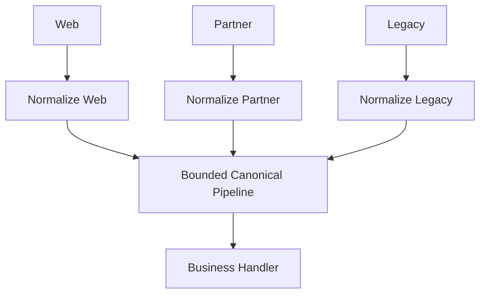

Sharing one canonical schema **does not require** funneling all traffic into a single JVM or physical queue. You can partition by tenant/order while keeping the same schema to scale horizontally.

## 33. Observability: Measuring Which Source Sends Bad Data

If logs say only “normalization failed”, operations teams struggle to see whether the bug is in Partner V2 or Legacy CSV.

Log non-sensitive fields:

```text
stage=NORMALIZATION_STARTED
sourceSystem=PARTNER_B2B
sourceSchemaVersion=2
sourceEventId=PARTNER-9002
businessCorrelationId=order:ORD-102

stage=NORMALIZATION_COMPLETED
sourceSystem=PARTNER_B2B
canonicalSchemaVersion=1
currency=USD
resultType=CanonicalOrder

stage=NORMALIZATION_REJECTED
sourceSystem=PARTNER_B2B
sourceSchemaVersion=2
reasonCode=INVALID_MONEY_SCALE
messageReference=raw:...
```

These logs illustrate application logging, not verbatim Spring Integration output.

### Suggested Metrics

| Metric | Meaning |
| --- | --- |
| `normalize.received` | Number of source records received |
| `normalize.success` | Number of canonical messages created |
| `normalize.failed` | Number of records that failed normalization |
| `normalize.latency` | Latency per source/schema |
| `normalize.invalid_money` | Scale/currency errors |
| `normalize.invalid_timestamp` | Timestamp errors |
| `normalize.unknown_version` | Source sent unsupported schema version |
| `normalize.tenant_mismatch` | Identity/security errors |
| `normalize.output_size` | Canonical message size |
| `normalize.retry_count` | Actual retry attempts |
| `normalize.dlq_backlog` | Errors waiting for handling |
| `canonical.consumer_lag` | Backlog downstream of convergence |

Useful labels: `sourceSystem`, `schemaVersion`, `reasonCode` (small fixed value sets). Avoid placing high-cardinality `orderId`, `eventId`, `customerId`, or `tenantId` in metric labels; use logs/traces with appropriate security policies.

### Do Not Confuse Normalization Success with Business Success

```text
RECEIVED:
  adapter received the message

PARSED:
  raw bytes valid per source schema

NORMALIZED:
  CanonicalOrder constructed

PROCESSED:
  business handler finished

COMMITTED:
  DB/external side effect confirmed
```

A message can normalize cleanly and still be rejected by a business handler or rolled back in the DB. Dashboards should track distinct milestones instead of reporting revenue/completed orders from normalization metrics alone.

## 34. Common Mistakes

### 34.1. Renaming Fields While Ignoring Semantics

`grossAmount` may include tax, whereas `amountMinorUnits` may not. If the two fields have different meanings, you cannot map both into `totalMinorUnits` without a defined policy or lookup.

### 34.2. Using double for Money

Binary floating-point numbers have representation error; multiplying and casting to `long` can lose the smallest unit. Use `BigDecimal` and exact conversion.

### 34.3. Using the Server's Default Timezone

The same local time gets parsed differently across machines. Use the offset/zone from the source contract.

### 34.4. Trusting Self-Reported Source from Payload

An attacker can select a trusted partner's normalizer or spoof a tenant. Source identity comes from verified ingress.

### 34.5. Assigning Default Values to Required Fields Without Recording a Reason

For example, replacing an empty `customerId` with `"UNKNOWN"` causes the DB to treat it as a real user. Use a contracted optional/unknown state or reject.

### 34.6. Dropping Provenance

Without `sourceSystem` or `sourceEventId` after normalization, replay, debugging, and deduplication become difficult.

### 34.7. Using canonicalSchemaVersion Instead of sourceSchemaVersion

When Partner V3 throws errors, you won't know which parser was used if only Canonical V1 was recorded. Store both.

### 34.8. Letting Downstream Handlers Know Every Source DTO

Adding a new source forces updates to many handlers, throwing away the benefit of a Canonical Data Model.

### 34.9. A Single Normalizer with Mutable currentSource

Concurrent messages can be attributed to the wrong source. Use pure mapping functions per type and trusted context.

### 34.10. Testing Only a Single-Source Happy Path

Misses VND currency, offset times, malformed schemas, multi-source interleaving, or lost metadata.

### 34.11. Dropping a Child Before an Aggregator Without Reporting

The group waiting on a fixed `sequenceSize` will miss an element. Design a failure outcome or partial/expiry policy.

### 34.12. Treating Normalization as Idempotency

Two canonical records with matching business fields are not necessarily duplicates; and one logical event can replay under different Message IDs. Use dedicated keys for an Idempotent Receiver.

### 34.13. Retrying Non-Retryable Validation Errors

Input `amount="abc"` will fail forever unless the data changes. Quarantine it with a reason code and owner.

### 34.14. Changing Canonical Schema Without Considering Replay

Historical payloads may evaluate differently under new rules; use versioning and migration/compatibility tests.

### 34.15. Not Distinguishing JSON Parser from Normalizer

Malformed JSON belongs at the deserialization boundary; semantic mismatches after parsing belong to normalizer/domain validation.

### 34.16. Assuming Demo QueueChannel Is a Persistent Broker

`QueueChannel` in learning configs is for testing and provides no durability or cross-process guarantees by default.

## 35. Hands-On Exercise: Intaking Three Order Sources

**Context:** `SPRING_INTEGRATION_PATTERN` receives order events from a web checkout, a B2B partner, and a legacy CSV import. All three must feed one order-recording handler, though source schemas, currencies, and timestamps differ.

### Part A — Canonical Model

1. Create an immutable `CanonicalOrder` with order ID, tenant, customer ID, amount minor units, currency, `Instant`, and provenance.
2. Define source DTOs for Web V1, Partner V2, and CSV V1.
3. Document each source contract: amount unit, timestamp, identity, schema version.
4. Never use system default timezone; select source timezone per documentation.
5. Identify which source provides required fields and which fields need enrichment.

### Part B — Normalizer

6. Write `SourceOrderNormalizer.fromWeb`.
7. Write `fromPartner` using `BigDecimal` and exact conversion.
8. Write `fromLegacy` parsing VND/timezone per contract.
9. Make no DB/external API calls inside pure mappings.
10. Set `sourceSystem` and `sourceEventId` explicitly.
11. Validate currency allowlist, non-negative amounts, overflow, and missing fields.
12. Intentionally send a USD decimal with 3 non-zero fractional digits and verify rejection.

### Part C — Spring Integration

13. Create three `DirectChannel` source inputs.
14. Create three source-specific Transformer flows.
15. Route all three into one `canonicalOrders` channel.
16. Test that all three outputs are `CanonicalOrder`.
17. Test that the business correlation header is preserved.
18. Add a Router based on canonical currency.
19. Add an Idempotent Receiver keyed by source event ID and business action.
20. Add an error flow classifying invalid data vs. transient failures.
21. Use a Content Enricher to look up customer tier after canonicalization.
22. If using Splitter/Aggregator, preserve correlation/sequence metadata.

### Part D — Edge Cases and Operations

23. Send Web/Partner/Legacy inputs concurrently without asserting global arrival order.
24. Verify identical business facts from Web/Partner yield equal canonical business fields.
25. Verify source provenance still differs.
26. Test malformed JSON, CSV quoting/escaping, and unsupported schema versions.
27. Test tenant mismatch against verified ingress.
28. Test partner upgrading schema to V3 while canonical stays V1.
29. Measure normalization latency/error rate by source version.
30. Design a DLQ/quarantine with source owner, raw reference, and replay policy.
31. Test canonical schema evolution and backward compatibility with older consumers.
32. Evaluate backpressure when legacy CSV imports spike.

### Expected Results Table

| Input | Canonical Output/Behavior |
| --- | --- |
| Web 12345 minor USD | `totalMinorUnits=12345`, `currency=USD` |
| Partner "123.45" usd | `totalMinorUnits=12345`, `currency=USD` |
| Legacy "450000" VND | `totalMinorUnits=450000`, `currency=VND` |
| Partner `15:30+07` | `occurredAt=08:30Z` |
| Legacy `15:30` in Asia/Ho_Chi_Minh | `occurredAt=08:30Z` |
| Partner "123.456" USD | Reject invalid money precision |
| Partner timestamp without offset | Reject or follow another contract; never guess |
| Unknown currency/schema | Structured error/quarantine |
| Two sources with identical business facts | Consistent canonical business fields |
| Two distinct `sourceEventId`s | Distinct provenance; deduplicate separately |
| Three sources sent concurrently | Three valid CanonicalOrders, nondeterministic arrival order |
| Invalid CSV child before Aggregator | Failure outcome/batch error, no infinite wait |
| Payload tenant differs from principal | Security rejection |
| Client retries same logical event | Downstream idempotency, no repeated effect |

## 36. Self-Assessment Questions

**Question 1.** How does Normalizer differ from Transformer?

*Normalizer is a pattern that brings different source formats to a single canonical contract. In Spring Integration, a normalizer is commonly implemented using dedicated Transformers per source.*

**Question 2.** Why is `BigDecimal` better than `double` when converting amount strings to minor units?

*Because decimal precision must be preserved and amounts not exactly representable in minor units must be rejected. `longValueExact` catches fractional remainder loss or overflow.*

**Question 3.** Can a legacy local timestamp be parsed with `ZoneId.systemDefault()`?

*No. Results depend on the server; use the timezone declared and verified in the source contract.*

**Question 4.** When Web and Partner yield a `CanonicalOrder` with identical business fields, can we conclude they are the same event?

*No. You need provenance, source IDs, business identity, and idempotency policy; two independent events can carry identical data.*

**Question 5.** Why should both `sourceSchemaVersion` and `canonicalSchemaVersion` be preserved?

*To know which parser/rule version was used and manage compatibility between sources and downstream when schemas change.*

**Question 6.** After the Normalizer, does a Gateway automatically receive the business processing result?

*No. The Normalizer produces the canonical payload; the downstream handler/reply flow must return the business response per the Gateway contract.*

**Question 7.** If one part is rejected before an Aggregator, what can happen?

*The Aggregator may never receive enough contributions and wait indefinitely. You need a failure result, batch error, or timeout/partial policy.*

**Question 8.** Why shouldn't a concurrent test of three sources assert that Web always arrives before Partner?

*Because under parallel processing, arrival/completion order across independent sources is not guaranteed. Assert the output set and each item's identity.*

**Question 9.** Why not trust a client-supplied `sourceType`?

*Because a client can spoof a source/tenant to pick a privileged parser/flow. Source identity must come from authenticated ingress.*

**Question 10.** Is a malformed JSON error a normalizer error?

*Usually it is a deserialization error prior to the normalizer; error taxonomy should distinguish parse failures from semantic validation failures.*

## 37. Production Deployment Checklist

- **Canonical scope:** one bounded context and clear semantics, not a mega-DTO.
- **Source contracts:** mappings for fields, amount units, currencies, timezones, and schema versions.
- **Schema versions:** preserve both source version and canonical version.
- **Trust boundary:** verify tenant/source from principal/connection, not self-reported input.
- **Validation:** mandatory fields, amount range, money scale, timestamp, enum values.
- **Money:** `BigDecimal`/exact conversion, no blind rounding or `double`.
- **Time:** canonical `Instant`, trusted source timezone/offset.
- **Identity:** namespaced order/customer IDs; never automatically merge external/internal IDs.
- **Provenance:** `sourceSystem`, `sourceEventId`, parser/version, and trace context.
- **Purity:** keep normalizer free of side effects and external I/O.
- **Idempotency:** downstream keys on logical event/business action, not Message ID.
- **Correlation:** do not overwrite technical group headers arbitrarily.
- **Routing:** use canonical fields while keeping intentional source-specific rules.
- **Enrichment:** separate source lookup from domain enrichment at the proper boundary.
- **Errors:** distinguish parse, validation, security, transport, and business failures.
- **Retry:** never retry deterministic data errors indefinitely.
- **DLQ:** store safe references, reason codes, and replay policies.
- **CSV:** real parser supporting quoting/escaping and encoding.
- **Concurrency:** stateless mappings, bounded queues, and backpressure.
- **Transport:** header mappers/serializers/versions tested end-to-end.
- **Schema evolution:** V2/V3 compatibility and regression tests.
- **Observability:** success/failure/latency by source/version; avoid PII/high-cardinality labels.
- **Tests:** per-source, semantic equivalence, edge cases, concurrent flows, retry, and replay.
- **Security:** distrust raw payloads, enforce data retention and provenance controls.

## 38. Conclusion

**Normalizing payloads from multiple sources** is more than renaming JSON fields. It is defining a **unified canonical contract** for data, currency units, time, identity, versioning, and provenance so that Router, Filter, Transformer, Splitter, Aggregator, Gateway, or Service Activator steps do not have to understand every upstream format.

In Spring Integration, Normalizer is typically implemented through **source-specific Transformer flows** feeding a single channel of `CanonicalOrder`. Mapping functions should be pure, validate explicitly, and be tested at two levels: unit tests for each source's rules, and integration tests proving all three sources converge cleanly—even under concurrent processing.

Finally, design thoroughly for **error handling, schema evolution, tenant security, correlation, idempotency, retry, and observability**. When these contracts are clearly defined and tested, adding a new source or upgrading a source version has minimal impact on downstream business logic, making the EIP pipeline easier to extend and more reliable.
