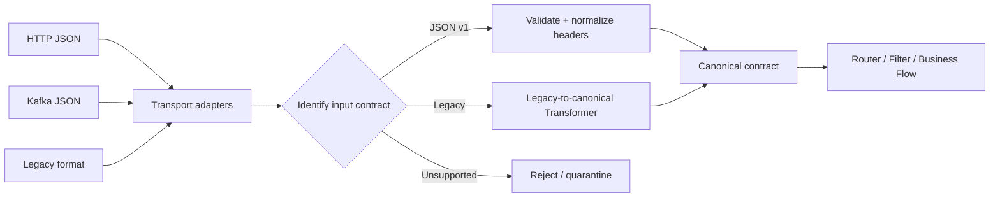
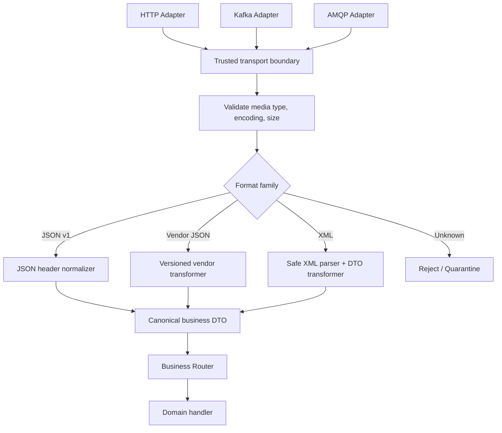
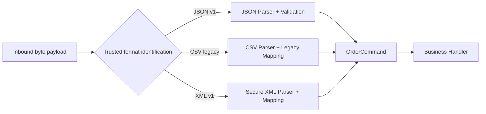
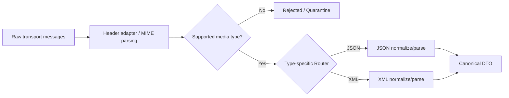
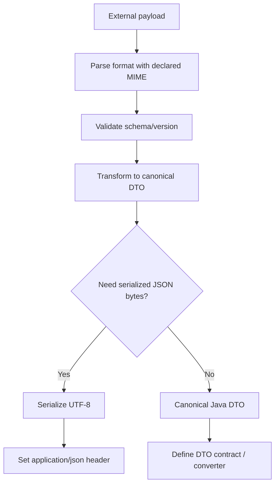

# Normalizing Headers and Content Types

An order integration system receives the same event type from multiple sources: a REST API sends JSON with header `Content-Type: application/json; charset=UTF-8`, a Kafka producer sends `contentType=application/json`, an AMQP adapter passes the media type as a string, and a legacy service sends `application/vnd.company.order+json`. Payloads and headers may differ in type, casing/formatting, and metadata even though all represent **the same business domain**. If unstandardized messages enter a Router, Transformer, or consumer directly, the system can misroute messages, parse with the wrong charset, lose correlation IDs, or accidentally treat a client-supplied header as trusted information.

The **Normalizer** pattern in **Enterprise Integration Patterns (EIP)** brings different representations into **a unified message contract**. Typically, a Normalizer includes a **Router that identifies the input type**, one or more **Transformers that convert the data**, and a **canonical output** that downstream components can process without knowing the source system. In Spring Integration, we can implement a Normalizer using `IntegrationFlow`, `Transformer`, `Message Filter`, `Header Enricher`, and clearly named channels.

The lesson **“Normalizing Headers and Content Types”** belongs to the **Normalizer** chapter in the `SPRING_INTEGRATION_PATTERN` module. Aligned with learning how to implement Enterprise Integration Patterns with Spring Integration to build loosely coupled, extensible message flows, it focuses on header contracts, MIME types, encoding, trust boundaries, Router/Filter/Transformer, correlation, retry/error channels, Gateways, Splitter/Aggregator, JUnit 5 testing, and monitoring processing branches.

> **Core idea:** Normalization **is not simply renaming `Content-Type` to `contentType`**. You must know what format the payload is actually in, which source supplied each header, which metadata must be preserved, and whether the **output** format has truly been converted or merely relabeled. A message bearing the `application/json` header while containing XML or an unserialized Java object **does not magically become valid JSON**.

## 1. The Problem: Same Meaning, Different Technical Form

Three producers might send:

```text
HTTP Producer:
  Content-Type: application/json; charset=UTF-8
  X-Request-ID: req-101
  Body: {"orderId":"ORD-101","quantity":2}

Kafka Producer:
  contentType (header bytes): application/json
  event_id: evt-101
  Value: {"orderId":"ORD-101","quantity":2}

Legacy Adapter:
  payloadFormat: JSON
  encoding: utf8
  message_body: {"orderId":"ORD-101","quantity":2}
```

If downstream code must inspect `Content-Type`, `contentType`, `payloadFormat`, and `encoding` for each producer, it becomes coupled to **transport details**. When adding a new source, multiple handlers must change instead of just the ingress integration layer.

The goal of a Normalizer is to produce one contract, for example:

```text
Normalized inbound envelope:
  body: byte[] containing validated UTF-8 JSON
  headers.contentType: MimeType(application/json)
  headers.schemaVersion: 1
  trusted correlation / tenant context: issued or verified by ingress
```

Afterward, a **JSON-to-domain Transformer** can convert the bytes into an `OrderCommand`, and business handlers work exclusively with the canonical DTO.



### 1.1. Which Decisions Make Up Normalization?

| Decision | Question to Answer |
| --- | --- |
| **Content detection** | Does the message claim JSON, XML, CSV, Protobuf, or Java DTO? |
| **Header mapping** | How does the adapter map HTTP `Content-Type` to Spring `contentType`? |
| **Canonical media type** | Does downstream expect `application/json` or a versioned vendor media type? |
| **Content encoding** | Are the payload bytes actually UTF-8, UTF-16, or gzip-compressed? |
| **Schema/version** | Even as JSON, is this event v1 or v2? |
| **Trusted metadata** | Where do tenant, correlation, operation ID, and source identity come from? |
| **Payload conversion** | Do we only normalize headers, or must we parse/serialize into another format? |
| **Failure contract** | When content type/charset is unsupported, do we reject, quarantine, or retry? |

**A normalized message must have a testable contract.** Do not merely write “convert everything to a standard” without specifying what that standard is.

## 2. How Normalizer Differs from Transformer, Filter, and Router

Normalizer is a **composite pattern**, not necessarily a built-in class or endpoint named `Normalizer` for every message format.

| Pattern/Component | Role | Inside a Normalizer |
| --- | --- | --- |
| **Router** | Chooses a branch based on format/type/source. | Selects JSON, XML, legacy adapter, or unsupported. |
| **Transformer** | Changes payload or message representation. | JSON bytes → canonical DTO; legacy DTO → canonical DTO. |
| **Header Enricher** | Adds/modifies metadata by rule. | Sets canonical `contentType`, schema version, trusted source. |
| **Filter/Validator** | Blocks data violating the contract. | Prevents invalid messages from entering business flow. |
| **Normalizer** | Combines the steps above to emit one contract. | All valid branches converge on one canonical channel/type. |
| **Content-Based Router** | Routes by business data. | Typically sits **after** payload normalization. |
| **Aggregator/Resequencer** | Combines or orders messages. | Must preserve correlation/sequence when normalizing parts/replies. |

**Example:** A Router that merely sends XML to `xml.in` and JSON to `json.in` is not a Normalizer if the two output branches still emit two unaligned payload types. You need Transformers to bring them to **a single output contract**.

### 2.1. Where Should Normalization Happen?

```text
External bytes / transport headers
    → Authentication + source validation
    → Deserialize/parse + normalize format/header
    → Validate canonical DTO
    → Business routing / processing
```

Placing it at **trusted ingress** keeps downstream handlers from having to understand each transport. However, **do not blindly strip business metadata** when normalizing a message that already passed through a Splitter or Aggregator. At an external boundary, strict header allowlisting is appropriate; inside an internal flow, preserve the trusted technical headers already in use.

## 3. What Does `Content-Type` Mean?

A media type typically has the form:

```text
type/subtype; parameter=value
```

For example:

| Value | Meaning / What to Check |
| --- | --- |
| `application/json` | JSON content per contract. |
| `application/json; charset=UTF-8` | JSON with a declared charset. |
| `application/xml` | XML; **cannot be relabeled as JSON**. |
| `text/csv; charset=UTF-8` | CSV text; requires a parser and dialect contract. |
| `application/octet-stream` | Bytes with unspecified schema; never assume JSON. |
| `application/vnd.company.order+json` | Vendor media type with JSON structure; may carry its own semantics/version. |
| `application/cloudevents+json` | Structured CloudEvents JSON; **does not mean** the body is directly an `OrderCommand`. |
| `text/plain; charset=ISO-8859-1` | Text declared as Latin-1; cannot blindly decode as UTF-8. |

In HTTP, the wire header is usually written `Content-Type`. In Spring Messaging, the standard header name is **`MessageHeaders.CONTENT_TYPE`**, commonly **`contentType`** internally. Its value may be a `MimeType`, a `String`, or represented differently after an adapter or serialization. Do not mistake differences in value type for two different business types.

### 3.1. Content Type Does Not Guarantee Valid Bytes

A producer could send:

```text
contentType = application/json
payload     = <order><id>ORD-101</id></order>
```

The header claims JSON, yet the bytes are XML. If the Normalizer only rewrites the header and forwards the message, the JSON parser will fail downstream. You must parse/validate the format before declaring the message conforms to the canonical contract.

Conversely, valid JSON bytes with `contentType=application/octet-stream` **must not automatically pass** if the contract requires producers to declare the format properly. **Do not sniff untrusted data to bypass metadata errors** unless a controlled legacy compatibility path is explicitly designed.

### 3.2. MIME Types Can Be Parsed Structurally

Spring Framework provides `org.springframework.util.MimeType` and `MimeTypeUtils`:

```java
import org.springframework.util.MimeType;
import org.springframework.util.MimeTypeUtils;

MimeType json = MimeTypeUtils.parseMimeType(
    "application/json; charset=UTF-8");

System.out.println(json.getType());    // application
System.out.println(json.getSubtype()); // json
System.out.println(json.getCharset()); // UTF-8
```

**Do not use exact string equality** like `"application/json".equals(rawHeader)`, because charset parameters and casing can vary while still representing valid JSON. At the same time, do not accept all `application/*` via wildcards, because XML, protobuf, or binary payloads cannot be parsed as JSON.

### 3.3. Media Type and Schema Version Are Two Different Concepts

`application/json` only indicates **format**. Two JSON payloads:

```json
{"schemaVersion":1,"orderId":"ORD-101","quantity":2}
```

and

```json
{"schemaVersion":2,"order":{"id":"ORD-101"},"lines":[{"sku":"PEN-01","qty":2}]}
```

are both JSON, yet they do **not share the same business schema**. The Normalizer needs to know **which parser/schema transformer** to invoke. If using a versioned vendor media type, normalize to `application/json` only when **the version semantics** are preserved/validated elsewhere.

## 4. Content Type vs. Charset and Content Encoding

### 4.1. Charset Governs How Bytes Decode into Characters

`application/json; charset=UTF-8` may declare UTF-8, yet the header is only a claim. If the bytes are invalid:

```text
Producer claims UTF-8
Bytes contain malformed sequence
→ Decoder must raise an error rather than silently inserting replacement characters
```

In Java, some ways of constructing a `String` from `byte[]` **substitute malformed bytes with replacement characters**, altering identifiers or signatures. At boundaries requiring valid UTF-8, use a decoder with `CodingErrorAction.REPORT` or a controlled parser.

### 4.2. Content Encoding Is Another Layer

`Content-Encoding: gzip` indicates the bytes may be **compressed**, not directly parseable as JSON. A gzip payload **must not** be sent to a JSON parser just because `Content-Type=application/json`.

```text
Wire:
  Content-Type: application/json
  Content-Encoding: gzip
  compressed bytes

Trusted adapter:
  verify size/limit
  decompress with bound
  parse JSON
  normalize media type and metadata
```

Compression introduces **decompression bomb** risks; bound both compressed and decompressed sizes, JSON depth, record counts, and deadlines.

### 4.3. Do Not “Fix” Bad Bytes by Relabeling

| Current State | Header Fix Alone? | What to Do? |
| --- | --- | --- |
| Valid UTF-8 JSON, String header `application/json;charset=utf-8` | Possible, once validated. | Parse media type and set canonical header. |
| Valid JSON, missing header | Do not assume by default. | Reject or apply a compatibility rule for a trusted source. |
| XML payload, header `application/xml` | **No.** | Parse XML and transform to canonical DTO/JSON if contracted. |
| Java `OrderCommand` object, header `application/json` | Does not match actual bytes. | Serialize before claiming wire JSON, or define an explicit in-memory representation. |
| Gzip bytes, content type JSON | **No.** | Decompress safely, then parse. |
| JSON with unsupported charset | No. | Reject or decode and re-encode accurately per policy. |
| Vendor-specific `+json` | Only if contract permits. | Preserve vendor semantics/schema version and map explicitly. |

**Takeaway:** Header normalization and **payload transformation** may be separate steps, yet the output state must be internally consistent.

## 5. Header Normalization: Prioritize Integrity and Trusted Sources

Headers generally fall into two groups:

1. **Protocol/transport metadata:** HTTP headers, AMQP properties, Kafka headers, JMS properties.
2. **Spring Messaging/internal metadata:** `MessageHeaders.ID`, `MessageHeaders.TIMESTAMP`, `MessageHeaders.CONTENT_TYPE`, correlation, sequence, reply/error channels, etc.

Across adapters, **not every header maps verbatim**. Headers can be renamed, converted to `byte[]`, blocked by a mapper, or regenerated. Therefore, a Normalizer needs an explicit **header mapping contract**.

### 5.1. Example Mapping Table

| Source | External Value | Canonical Header/Field | Rule |
| --- | --- | --- | --- |
| HTTP | `Content-Type` | `contentType` = `MimeType` | Parse and validate against allowlist. |
| HTTP | `X-Request-ID` | `requestRef` (opaque) | Use as correlation only if verified/registered. |
| Kafka | `contentType` bytes | `contentType` = `MimeType` | Decode with proper charset and parse MIME. |
| AMQP | `contentType` property | `contentType` = `MimeType` | Mapped by adapter; never use for auth. |
| Legacy | `payloadFormat=JSON` | `contentType=application/json` | Only via an allowlisted compatibility path. |
| Trusted ingress | Authenticated tenant | `trustedTenantId` | Derived from security context; do not trust self-reported payloads. |
| Trusted workflow | Business operation ID | `operationId` | Keep stable across retries of the same operation. |

**No single default mapper covers every transport.** In Kafka, headers are often bytes; in HTTP, Strings; AMQP uses specialized properties. Test the **real adapter** alongside the configured converter and header mapper.

### 5.2. Headers Are Not Proof of Authorization

Example client message:

```text
X-Tenant-ID: ADMIN
X-Role: APPROVER
correlationId: another-tenant-group
replyChannel: internal.secretChannel
```

If the Normalizer copies all headers onto internal messages, a downstream Router/Gateway could trust forged values. Enforce an **allowlist**, type/length limits, and **server-side trusted context** for control values.

Technical headers like `replyChannel`, `errorChannel`, `correlationId`, or `priority` demand special caution. **Never let an untrusted source choose an internal bean or channel name.**

### 5.3. Immutable Message Headers and Building a New Message

Spring `Message<?>` is fundamentally designed as a **payload/header snapshot**; never mutate header maps directly. To modify contents:

```java
import org.springframework.messaging.Message;
import org.springframework.messaging.MessageHeaders;
import org.springframework.messaging.support.MessageBuilder;
import org.springframework.util.MimeTypeUtils;

Message<?> normalizeContentTypeOnTrustedMessage(
        Message<?> trustedMessage) {
    return MessageBuilder.fromMessage(trustedMessage)
        .setHeader(MessageHeaders.CONTENT_TYPE,
            MimeTypeUtils.APPLICATION_JSON)
        .build();
}
```

**Warning about this snippet:** it only illustrates the API for updating a header when a message **is already trusted and its payload is verified JSON**; it is not a validator and must not run on arbitrary payloads. `fromMessage(...)` preserves many original headers: suitable for a **trusted internal branch**, yet potentially **unsafe at external ingress**. At external ingress, building a new message from the payload and **copying only allowlisted headers** is generally safer.

### 5.4. Do Not Confuse Technical IDs with Correlation

When constructing a new message, `MessageHeaders.ID`/`TIMESTAMP` can change depending on how it is built. Never use them as business idempotency keys when producers have a stable `eventId`/`operationId`, and never copy an unverified external caller's `correlationId` directly into an Aggregator.

## 6. Designing the Canonical Contract Before Implementing

This learning example chooses:

```text
Accepted input:
  payload: byte[] (UTF-8 JSON)
  contentType: "application/json" or
               "application/json; charset=UTF-8"
  body schemaVersion: 1
  body orderId: non-blank String
  body quantity: positive int <= 100

Normalized output:
  payload: byte[] preserving parsed & verified UTF-8 JSON
  headers.contentType: MimeType(application/json)
  headers.schemaVersion: Integer(1)
  DO NOT copy arbitrary external headers
```

Because the output **is still JSON `byte[]`**, the `application/json` header accurately describes the representation. A subsequent Transformer can convert `byte[] → OrderCommand`. If you want a canonical **DTO**, define a separate DTO contract and consider removing/updating headers describing wire representation.

### 6.1. Why Not Accept `application/*+json` by Default?

`application/vnd.company.order+json` may contain valid JSON, yet its **schema semantics** do not automatically match `application/json` for `OrderCommand`. Similarly, CloudEvents structured JSON carries **envelope metadata** and a `data` field rather than direct order fields. To support it, add a tested **versioned Transformer branch**.

### 6.2. Header Normalization Is Not Full JSON Canonicalization

A payload:

```json
{"orderId":"ORD-101","quantity":2}
```

and:

```json
{
  "quantity": 2,
  "orderId": "ORD-101"
}
```

have identical business meaning yet **different bytes**. Setting the same `application/json` header **does not make the byte arrays equal**. If downstream requires signatures, hashing/dedup, or deterministic serialization, define an explicit **canonical JSON serialization** (field ordering, whitespace, numeric formatting, Unicode normalization, duplicate-key handling) and version the contract appropriately.

## 7. Recommended Processing Flow for Multi-Source Systems



**Note:** The diagram shows a complete multi-format system. For easy testing, the code below first implements the **JSON v1 branch over `byte[]`**. XML and vendor formats need dedicated parsers/Transformers; never route them to the same output while skipping actual conversion.

### 7.1. Pre-Router Checklist

1. Did the adapter **parse transport headers** properly?
2. Does the message come from a trusted source/protocol within quota?
3. Is the content type supported?
4. Do charset and content encoding follow policy?
5. Can the payload be parsed according to the declared format?
6. Are schema version and required fields valid?
7. Which headers are permitted into the canonical flow?
8. If validation fails, how will the consumer **ack/retry/quarantine**?

### 7.2. Rejections Must Follow a Contract

Example application result:

```json
{
  "status": "REJECTED",
  "errorCode": "UNSUPPORTED_CONTENT_TYPE",
  "requestRef": "opaque-req-101"
}
```

This is not an automatic Spring Integration response. Over HTTP it might map to `415 Unsupported Media Type`, while unparseable payloads map to `400`; over Kafka/AMQP, define an explicit reject/DLT/ack policy. Connection failures to a schema registry or DB are **transient technical failures**, not permanent unsupported types.

## 8. Java: A Safe Content-Type Normalizing Transformer at Ingress

The example builds a **JSON header normalizer** accepting `Message<?>` and verifying that:

- The payload is actually a `byte[]`.
- Its size is within the demo bounds.
- `contentType` is a `MimeType` or valid `String` and **matches `application/json`**.
- Any declared charset is UTF-8.
- The bytes are valid UTF-8 and parse into a JSON object.
- Schema version, order ID, and quantity satisfy the contract.
- The output preserves only the **verified `byte[]`** and **internally issued canonical headers**; no arbitrary external headers are copied.

### 8.1. Exception Carrying a Stable Error Code

```java
// InvalidInboundMessageException.java
public final class InvalidInboundMessageException
        extends RuntimeException {

    private final String code;

    public InvalidInboundMessageException(String code) {
        super(code);
        this.code = code;
    }

    public String code() {
        return code;
    }
}
```

Real systems may need an error hierarchy separating **permanent input errors** from **transient infrastructure errors**. This demo throws only for contract violations; never include raw headers, full JSON bodies, or secrets inside exception messages.

### 8.2. Implementation Using Spring Integration's `Transformer`

```java
// JsonHeaderNormalizer.java
import com.fasterxml.jackson.databind.JsonNode;
import com.fasterxml.jackson.databind.ObjectMapper;
import java.io.IOException;
import java.nio.ByteBuffer;
import java.nio.charset.CharacterCodingException;
import java.nio.charset.CodingErrorAction;
import java.nio.charset.StandardCharsets;
import java.util.Arrays;
import org.springframework.integration.transformer.Transformer;
import org.springframework.messaging.Message;
import org.springframework.messaging.MessageHeaders;
import org.springframework.messaging.support.MessageBuilder;
import org.springframework.util.MimeType;
import org.springframework.util.MimeTypeUtils;

public final class JsonHeaderNormalizer implements Transformer {

    private static final int MAX_BYTES = 16 * 1024;
    private final ObjectMapper mapper;

    public JsonHeaderNormalizer(ObjectMapper mapper) {
        this.mapper = mapper;
    }

    @Override
    public Message<?> transform(Message<?> incoming) {
        if (!(incoming.getPayload() instanceof byte[] source)) {
            throw new InvalidInboundMessageException(
                "PAYLOAD_MUST_BE_BYTES");
        }
        if (source.length == 0 || source.length > MAX_BYTES) {
            throw new InvalidInboundMessageException(
                "INVALID_PAYLOAD_SIZE");
        }

        MimeType type = parseContentType(
            incoming.getHeaders().get(MessageHeaders.CONTENT_TYPE));

        if (!"application".equalsIgnoreCase(type.getType())
                || !"json".equalsIgnoreCase(type.getSubtype())) {
            throw new InvalidInboundMessageException(
                "UNSUPPORTED_CONTENT_TYPE");
        }
        if (type.getCharset() != null
                && !StandardCharsets.UTF_8.equals(type.getCharset())) {
            throw new InvalidInboundMessageException(
                "UNSUPPORTED_CHARSET");
        }

        ensureUtf8(source);

        JsonNode tree;
        try {
            tree = mapper.readTree(source);
        } catch (IOException ex) {
            throw new InvalidInboundMessageException("INVALID_JSON");
        }

        if (tree == null || !tree.isObject()) {
            throw new InvalidInboundMessageException(
                "EXPECTED_JSON_OBJECT");
        }
        JsonNode version = tree.path("schemaVersion");
        JsonNode orderId = tree.path("orderId");
        JsonNode quantity = tree.path("quantity");

        if (!version.isInt() || version.intValue() != 1) {
            throw new InvalidInboundMessageException(
                "UNSUPPORTED_SCHEMA_VERSION");
        }
        if (!orderId.isTextual() || orderId.asText().isBlank()
                || orderId.asText().length() > 64) {
            throw new InvalidInboundMessageException(
                "INVALID_ORDER_ID");
        }
        if (!quantity.isInt() || quantity.intValue() < 1
                || quantity.intValue() > 100) {
            throw new InvalidInboundMessageException(
                "INVALID_QUANTITY");
        }

        // At an external boundary: do not copy all raw headers.
        // Build a fresh snapshot and attach validated headers.
        return MessageBuilder
            .withPayload(Arrays.copyOf(source, source.length))
            .setHeader(MessageHeaders.CONTENT_TYPE,
                MimeTypeUtils.APPLICATION_JSON)
            .setHeader("schemaVersion", 1)
            .build();
    }

    private static MimeType parseContentType(Object value) {
        if (value instanceof MimeType mimeType) {
            return mimeType;
        }
        if (value instanceof String raw) {
            try {
                return MimeTypeUtils.parseMimeType(raw);
            } catch (IllegalArgumentException ex) {
                throw new InvalidInboundMessageException(
                    "INVALID_CONTENT_TYPE");
            }
        }
        throw new InvalidInboundMessageException(
            "MISSING_CONTENT_TYPE");
    }

    private static void ensureUtf8(byte[] bytes) {
        try {
            StandardCharsets.UTF_8.newDecoder()
                .onMalformedInput(CodingErrorAction.REPORT)
                .onUnmappableCharacter(CodingErrorAction.REPORT)
                .decode(ByteBuffer.wrap(bytes));
        } catch (CharacterCodingException ex) {
            throw new InvalidInboundMessageException(
                "INVALID_UTF8");
        }
    }
}
```

**Exact explanation:**

1. `parseContentType(...)` accepts **String or `MimeType`**, decoupling from how an adapter represents the header while rejecting unexpected types.
2. Only `application/json` is supported in this example. `application/vnd...+json` is rejected **intentionally** until a schema-specific branch is implemented.
3. `ensureUtf8(...)` validates the byte sequence and fails on invalid UTF-8 instead of inserting replacement characters.
4. `ObjectMapper.readTree(...)` verifies the payload parses as JSON; `JsonNode` checks enforce the schema/demo invariants.
5. Output preserves the verified JSON bytes and sets `MessageHeaders.CONTENT_TYPE` to canonical `MimeType` `application/json`.
6. `Arrays.copyOf(...)` creates a copy to avoid sharing a mutable byte array that could be altered later.
7. The code **does not copy correlation, replyChannel, security headers, or arbitrary adapter headers**. That is safe for **untrusted ingress**, yet **insufficient** for flows needing verified workflow correlation. Trusted metadata/allowlisting must be added at the internal adapter layer.

**Version scope:** This is illustrative code for modern Java, Jackson, and Spring Integration. Verify Spring/Jackson versions, dependencies, and converters in your actual project before production use. The STEP 4 NEW lesson did not execute Gradle or Content QA.

### 8.3. Two Different Levels of Strictness

The example checks **valid JSON and fields of interest**; it does **not** yet validate full schemas, unknown fields, duplicate JSON keys, maximum nesting, Unicode normalization, or digital signatures.

For sensitive boundaries:

- Configure Jackson to **fail on duplicate fields/trailing tokens** if required by contract.
- Bound nesting depth, token counts, element counts, and payload size at the parser/adapter.
- Define an **unknown-field policy** and schema version.
- Verify signatures/checksums before altering bytes when producers sign payloads.
- Do not re-serialize a payload and validate an old signature against modified bytes.

**Do not claim this normalizer is a complete JSON canonicalizer.** It primarily normalizes **header representation** and enforces declared invariants.

## 9. Spring Integration Java DSL: Placing the Normalizer Before the Business Flow

```java
// JsonNormalizerConfiguration.java
import com.fasterxml.jackson.databind.ObjectMapper;
import org.springframework.context.annotation.Bean;
import org.springframework.context.annotation.Configuration;
import org.springframework.integration.channel.QueueChannel;
import org.springframework.integration.config.EnableIntegration;
import org.springframework.integration.dsl.IntegrationFlow;

@Configuration
@EnableIntegration
public class JsonNormalizerConfiguration {

    @Bean
    ObjectMapper normalizerObjectMapper() {
        return new ObjectMapper();
    }

    @Bean
    JsonHeaderNormalizer jsonHeaderNormalizer(
            ObjectMapper normalizerObjectMapper) {
        return new JsonHeaderNormalizer(normalizerObjectMapper);
    }

    @Bean("orders.json.normalized")
    QueueChannel normalizedJsonQueue() {
        return new QueueChannel(16);
    }

    @Bean
    IntegrationFlow normalizeJsonIngress(
            JsonHeaderNormalizer jsonHeaderNormalizer) {
        return IntegrationFlow.from("orders.raw.json.in")
            .transform(jsonHeaderNormalizer)
            .channel("orders.json.normalized")
            .get();
    }
}
```

**Flow:**

```text
orders.raw.json.in
    → JsonHeaderNormalizer
        ├─ invalid content-type / UTF-8 / JSON / schema
        │    → exception (per sync/async/error handling)
        └─ valid
             → Message<byte[]> with MimeType(application/json)
             → orders.json.normalized
```

This is an **internal test-oriented flow**; `QueueChannel` holds output for easy test inspection. There is no downstream consumer, HTTP/Kafka adapter, dedicated error channel, durable queue, or transaction. Never treat `MessageChannel.send(...) == true` as proof that a business handler finished processing.

**About `Transformer`:** `JsonHeaderNormalizer` implements the contract taking a `Message<?>` and returning a new `Message<?>`. When a transformer returns a message, it controls the outbound headers and payload; therefore, test that **raw headers are not copied** and metadata is reissued cleanly.

### 9.1. Should You Use `Header Enricher` Instead of a Transformer?

If the payload **was already validated by a trusted adapter** and merely lacks a canonical header, a Header Enricher may suffice:

```java
// DSL pseudocode for an already-validated internal message:
// .enrichHeaders(h -> h.header(
//     MessageHeaders.CONTENT_TYPE,
//     MimeTypeUtils.APPLICATION_JSON))
```

However, **never** slap an `application/json` header onto arbitrary bytes while skipping parsing. `Header Enricher` handles metadata; a `Transformer` or converter is needed when changing or verifying representation.

### 9.2. If the Output Is an `OrderCommand` Java Object

After `orders.json.normalized`, you can deserialize into a canonical DTO:

```java
// OrderCommand.java
public record OrderCommand(
    int schemaVersion,
    String orderId,
    int quantity
) {}
```

```java
// Example conversion in a dedicated layer with error handling:
import com.fasterxml.jackson.databind.ObjectMapper;
import java.io.IOException;

OrderCommand toOrderCommand(
        byte[] verifiedJsonBytes, ObjectMapper mapper)
        throws IOException {
    return mapper.readValue(
        verifiedJsonBytes, OrderCommand.class);
}
```

**Do not equate a DTO with wire JSON.** If the output is already `Message<OrderCommand>`, document the contract as a **Java object payload**; `contentType=application/json` is only meaningful if an outbound converter/adapter is explicitly configured to serialize it. Never let an AMQP/Kafka adapter guess payload bytes from a header that contradicts the Java type.

## 10. JUnit 5: String and MimeType Headers Must Be Treated Equally

Unit tests target the Transformer directly, verifying behavior without depending on HTTP/Kafka adapters.

```java
// JsonHeaderNormalizerTest.java
import static org.junit.jupiter.api.Assertions.*;

import com.fasterxml.jackson.databind.ObjectMapper;
import java.nio.charset.StandardCharsets;
import org.junit.jupiter.api.Test;
import org.springframework.messaging.Message;
import org.springframework.messaging.MessageHeaders;
import org.springframework.messaging.support.MessageBuilder;
import org.springframework.util.MimeTypeUtils;

class JsonHeaderNormalizerTest {

    private final JsonHeaderNormalizer normalizer =
        new JsonHeaderNormalizer(new ObjectMapper());

    private static byte[] json() {
        return """
            {"schemaVersion":1,"orderId":"ORD-101","quantity":2}
            """.getBytes(StandardCharsets.UTF_8);
    }

    @Test
    void convertsStringMediaTypeToCanonicalMimeType() {
        Message<byte[]> input = MessageBuilder
            .withPayload(json())
            .setHeader(MessageHeaders.CONTENT_TYPE,
                "application/json; charset=utf-8")
            .setHeader("untrustedRole", "ADMIN")
            .build();

        Message<?> output = normalizer.transform(input);

        assertEquals(MimeTypeUtils.APPLICATION_JSON,
            output.getHeaders().get(MessageHeaders.CONTENT_TYPE));
        assertEquals(1, output.getHeaders().get("schemaVersion"));
        assertArrayEquals(json(), (byte[]) output.getPayload());
        assertNull(output.getHeaders().get("untrustedRole"));
    }

    @Test
    void acceptsAnExistingMimeTypeValue() {
        Message<byte[]> input = MessageBuilder
            .withPayload(json())
            .setHeader(MessageHeaders.CONTENT_TYPE,
                MimeTypeUtils.APPLICATION_JSON)
            .build();

        Message<?> output = normalizer.transform(input);
        assertArrayEquals(json(), (byte[]) output.getPayload());
    }

    @Test
    void rejectsWrongMediaTypeEvenIfBodyLooksLikeJson() {
        Message<byte[]> input = MessageBuilder
            .withPayload(json())
            .setHeader(MessageHeaders.CONTENT_TYPE, "application/xml")
            .build();

        InvalidInboundMessageException error = assertThrows(
            InvalidInboundMessageException.class,
            () -> normalizer.transform(input));
        assertEquals("UNSUPPORTED_CONTENT_TYPE", error.code());
    }

    @Test
    void rejectsMalformedJsonWithJsonHeader() {
        Message<byte[]> input = MessageBuilder
            .withPayload("<order/>".getBytes(StandardCharsets.UTF_8))
            .setHeader(MessageHeaders.CONTENT_TYPE, "application/json")
            .build();

        InvalidInboundMessageException error = assertThrows(
            InvalidInboundMessageException.class,
            () -> normalizer.transform(input));
        assertEquals("INVALID_JSON", error.code());
    }

    @Test
    void rejectsUnsupportedCharset() {
        Message<byte[]> input = MessageBuilder
            .withPayload(json())
            .setHeader(MessageHeaders.CONTENT_TYPE,
                "application/json;charset=ISO-8859-1")
            .build();

        InvalidInboundMessageException error = assertThrows(
            InvalidInboundMessageException.class,
            () -> normalizer.transform(input));
        assertEquals("UNSUPPORTED_CHARSET", error.code());
    }
}
```

The tests verify **canonical content type**, **header allowlisting**, **unchanged payload bytes**, **rejecting XML disguised with a JSON header**, and **rejecting unsupported charsets**. Add further tests for missing headers, unknown header types, empty/oversized payloads, invalid UTF-8, unknown versions, and out-of-range quantities.

### 10.1. Flow Test from Input Channel to Output Queue

```java
import static org.junit.jupiter.api.Assertions.*;

import java.nio.charset.StandardCharsets;
import org.junit.jupiter.api.Test;
import org.springframework.beans.factory.annotation.Autowired;
import org.springframework.context.ApplicationContext;
import org.springframework.integration.channel.QueueChannel;
import org.springframework.messaging.Message;
import org.springframework.messaging.MessageChannel;
import org.springframework.messaging.MessageHeaders;
import org.springframework.messaging.support.MessageBuilder;
import org.springframework.test.context.junit.jupiter.SpringJUnitConfig;
import org.springframework.util.MimeTypeUtils;

@SpringJUnitConfig(JsonNormalizerConfiguration.class)
class JsonNormalizerFlowTest {

    @Autowired ApplicationContext context;

    @Test
    void publishesOnlyTheVerifiedCanonicalRepresentation() {
        MessageChannel input = context.getBean(
            "orders.raw.json.in", MessageChannel.class);
        byte[] body = """
            {"schemaVersion":1,"orderId":"ORD-777","quantity":3}
            """.getBytes(StandardCharsets.UTF_8);

        assertTrue(input.send(MessageBuilder
            .withPayload(body)
            .setHeader(MessageHeaders.CONTENT_TYPE, "application/json")
            .setHeader("x-unsafe", "not-forwarded")
            .build()));

        QueueChannel output = context.getBean(
            "orders.json.normalized", QueueChannel.class);
        Message<?> normalized = output.receive(0);

        assertNotNull(normalized);
        assertArrayEquals(body, (byte[]) normalized.getPayload());
        assertEquals(MimeTypeUtils.APPLICATION_JSON,
            normalized.getHeaders().get(MessageHeaders.CONTENT_TYPE));
        assertNull(normalized.getHeaders().get("x-unsafe"));
        assertNull(output.receive(0));
    }
}
```

**Limitation:** this local test does not prove HTTP/Kafka adapters mapped headers properly, nor does it test async errors, DLT, or acks. An integration channel test catches basic wiring bugs; to validate transport mapping, test the exact **inbound adapter, header mapper, and converter** in use.

### 10.2. Testing Mutation of the Source Byte Array After Normalization

Because Java `byte[]` is mutable, a test can:

1. Create `source` with valid JSON.
2. Call `normalizer.transform(...)`.
3. Modify a byte in the original `source`.
4. Assert `normalized.payload` still holds the **original snapshot**.

This helps when messages pass across threads. Note that once another caller obtains `byte[]` from the output, it can still mutate it; systems requiring strict immutability can use immutable DTOs or defensive copies at every sensitive boundary.

## 11. Other Formats: The Normalizer Must Actually Convert

For example, a legacy producer uses CSV:

```text
ORD-101,2
```

or XML:

```xml
<order>
  <orderId>ORD-101</orderId>
  <quantity>2</quantity>
</order>
```

If the canonical contract is `OrderCommand`, dedicated parsers are needed:



### 11.1. Per-Format Rules

| Format | Common Risks | Countermeasures |
| --- | --- | --- |
| JSON | Duplicate keys, unknown schema, depth/size, numeric overflow. | Strict parser + versioned schema/DTO validator. |
| XML | XXE/external entities, entity expansion, schema mismatch. | Disable external entities/DTD per policy; safe parser with bounds. |
| CSV | Delimiter/quotes/newlines/charset, CSV formula injection on export. | Explicit dialect and escaping on report exports. |
| Protobuf/Avro | Schema registry/version, backward compatibility. | Registry/client contract; never alter schemas casually. |
| Binary/zip | Decompression bombs, path traversal inside archives. | Size/depth/quotas, validate contents and paths. |
| Java serialized object | Deserialization gadgets/security, version drift. | Avoid arbitrary Java deserialization from untrusted sources. |

**You cannot build a transformer that “sets Content-Type to application/json” and consider all the formats above normalized.**

### 11.2. Mapping and Verification Order

For legacy XML needing conversion to canonical JSON bytes:

```text
Untrusted XML bytes
  → validate XML content-type + size
  → secure XML parsing + schema validation
  → map to canonical OrderCommand
  → Bean/Business validation
  → UTF-8 JSON serialization
  → set contentType to application/json
```

**Set the JSON header after serialization** when the output is JSON bytes—never before while XML payloads are still traveling downstream. If digital signatures are required, verify the original signature on the original bytes before mapping; the output may need a new signature.

## 12. Correlation, Sequence, and Idempotency When Normalizing Headers

A Normalizer may sit **before** or **after** other EIPs, which determines which headers must be preserved.

| Metadata | Purpose | Rule |
| --- | --- | --- |
| `correlationId` | Groups replies/parts of one workflow. | Preserve if issued by a trusted flow; never trust raw correlation from unauthenticated clients. |
| `sequenceNumber` | Part index in Splitter/Resequencer. | Preserve value and type on internal paths; never renumber when changing content type. |
| `sequenceSize` | Expected group part count. | Never alter just because a Filter dropped a message; update group contract if needed. |
| `eventId` | Stable logical event identity. | Never generate a new UUID on every normalize/redelivery. |
| `operationId` | Business identity preventing duplicate side effects. | Preserve across retries of the same operation; guard owner/scope. |
| `replyChannel` | Where a Gateway replies in request–reply flows. | Keep only when created/passed by trusted runtime. |
| `errorChannel` | Error destination for the flow. | Never accept arbitrary channel objects/names from external callers. |
| `tenantId` | Separates permissions and data. | Set from authenticated context; do not trust external headers. |
| `traceId` | Cross-service observability. | Propagate per tracing policy; never substitute for idempotency/correlation. |

### 12.1. Why Did Section 8 Intentionally Not Copy Correlation?

`JsonHeaderNormalizer` in section 8 is an **untrusted ingress variant**: it cannot know where raw headers originated. Therefore it chooses to **emit only verified payload/headers**. In a real system:

1. The transport/security adapter authenticates the producer and supplies a **trusted workflow context**.
2. The JSON normalizer validates content type and payload without copying arbitrary headers.
3. A **trusted header enricher** attaches tenant/correlation/operation IDs from that context.
4. Business flows then use that metadata for routing, gathering, and retries.

Alternatively, when a Normalizer runs **between two trusted internal endpoints**, build a variant that **preserves runtime-issued headers** while updating only the content type. Describe the two boundaries separately rather than using one “copy all headers” rule for all sources.

### 12.2. Do Not Lose Correlation After a Splitter

For example, a Splitter emits:

```text
part 1/3: correlationId=GROUP-X, sequenceNumber=1, sequenceSize=3
part 2/3: correlationId=GROUP-X, sequenceNumber=2, sequenceSize=3
part 3/3: correlationId=GROUP-X, sequenceNumber=3, sequenceSize=3
```

If each part passes through a Transformer that builds a brand-new message carrying only `contentType`, a downstream Aggregator may:

- Fail to find the group key.
- Split one batch into wrong groups.
- Lose expected group size.
- Never release or release prematurely.

When a Normalizer sits mid-way in a trusted flow, apply a **selective header propagation policy**. Example:

```java
// Example for INTERNAL messages with verified correlation/sequence.
// In untrusted external flows, DO NOT copy blindly like this.
import org.springframework.integration.IntegrationMessageHeaderAccessor;
import org.springframework.messaging.Message;
import org.springframework.messaging.MessageHeaders;
import org.springframework.messaging.support.MessageBuilder;
import org.springframework.util.MimeTypeUtils;

Message<byte[]> keepTrustedSequence(
        Message<byte[]> trustedSource, byte[] validatedJson) {

    var original = trustedSource.getHeaders();
    var builder = MessageBuilder
        .withPayload(validatedJson)
        .setHeader(MessageHeaders.CONTENT_TYPE,
            MimeTypeUtils.APPLICATION_JSON);

    for (String key : new String[] {
            IntegrationMessageHeaderAccessor.CORRELATION_ID,
            IntegrationMessageHeaderAccessor.SEQUENCE_NUMBER,
            IntegrationMessageHeaderAccessor.SEQUENCE_SIZE
    }) {
        if (original.containsKey(key)) {
            builder.setHeader(key, original.get(key));
        }
    }
    return builder.build();
}
```

This example shows a **narrow allowlist** assuming headers were set by a trusted internal Splitter. If business `batchId`/`partId` fields exist in the payload, preserve them in the mapping as well. Never use `correlationId` as an idempotency key for every part because distinct operations may belong to the same group.

### 12.3. Duplicates After Normalization Must Remain Duplicates

```text
Producer eventId=EVT-101
  → delivery 1 → normalizer → OrderCommand
  → delivery 2 → normalizer → OrderCommand
```

If the normalizer generates `eventId=UUID.randomUUID()` on every delivery, **the downstream Idempotent Receiver will miss duplicates**. A stable event ID must come from the contracted source or from a business identity established by trusted ingress; the normalizer merely validates and propagates it.

## 13. Header Normalization with Router and Filter

If a Router inspects `contentType` to select a parser branch, determine the **header's Java type** before routing.

```text
Kafka:
  contentType = byte[] "application/json"

HTTP:
  contentType = String "application/json; charset=UTF-8"

Internal:
  contentType = MimeType(application/json)
```

Direct string comparison fails in two of those three cases even though all three are JSON. Typically you want:



### 13.1. What Does ContentTypeRouter Solve?

Spring Integration can **route by content type** (e.g., routers keyed off `contentType`). A Router is ideal for selecting a branch, but:

- Headers must first be parsed/normalized according to their type.
- Destinations must be mapped via an **allowlist**; never route dynamically to client-supplied strings.
- A Router alone does not prove the body matches the declared format.
- Unknown types need a **default/reject route** and explicit error outcome.
- After parsing, all branches must output the same **canonical payload schema** if the goal is a Normalizer.

**A `ContentTypeRouter` standing alone is not a complete Normalizer.**

### 13.2. Filter and Message Rejection Policy

A Filter might let only valid JSON proceed:

```java
// Pseudocode: apply only once headers have been validated.
// .filter(Message.class, msg ->
//     MimeTypeUtils.APPLICATION_JSON.equals(
//         msg.getHeaders().get(MessageHeaders.CONTENT_TYPE)))
```

**Do not use a `false` predicate to silently drop a business command** when a Gateway is waiting for a reply or an Aggregator is waiting for a part. Alternatives:

- Return an `UNSUPPORTED_CONTENT_TYPE` error code to the caller.
- Send a rejected outcome to a channel with an active consumer.
- Quarantine malformed records with auditing and retention.
- If the Filter simply expresses a **branching condition**, route to an alternative path instead of treating it as invalid.

## 14. Transformer and Header Enricher: Order Matters Greatly

Diagram:



### 14.1. Ordering Mistake Example

```text
XML bytes
  → enrich header contentType=application/json
  → Router sees JSON
  → JSON parser fails
```

Better:

```text
XML bytes + application/xml
  → secure XML parser
  → canonical OrderCommand
  → optional JSON serializer
  → contentType=application/json
```

### 14.2. Do Not Keep the Old Content-Type Header Once Payload Changes

A Transformer converting JSON `byte[]` to `OrderCommand` may still carry `contentType=application/json` via header propagation. Some downstream converters interpret that as an instruction to serialize to JSON, while another handler treats the message as already-serialized JSON bytes.

No single approach fits every application; choose **one explicit contract**:

- **Domain pipeline:** payload is `OrderCommand`, and subsequent handlers do not inspect `contentType` to infer Java type.
- **Wire-ready pipeline:** payload is JSON `byte[]`, and `application/json` accurately describes the bytes.
- **Converter-driven pipeline:** payload is a DTO, and outbound adapters configure converters for `application/json` per explicit contract.

Test **outbound converters at the endpoint too**, not only in-memory messages right after the Transformer.

## 15. Normalizer with Splitter, Aggregator, and Resequencer

A batch has three parts across two input formats. If normalizing a part rebuilds the message and drops sequence metadata:

```text
Batch X
  part 1/3: JSON bytes
  part 2/3: legacy XML bytes
  part 3/3: JSON bytes

Normalizer → canonical OrderLine
Aggregator → BatchResult
```

Ensure:

1. **The same group key** before and after normalization.
2. **Sequence number/size** preserved when required.
3. **One logical result per part**, including rejected outcomes if the Aggregator expects full completion.
4. **Duplicates** from retries are not counted as new parts.
5. **Normalizer failures** have a clear terminal/retry/expiry path so groups never hang forever.

### 15.1. One Part Fails to Parse

```text
part 1: normalized OK
part 2: INVALID_XML
part 3: normalized OK
```

If part 2 is dropped by a Filter with no terminal outcome, an Aggregator expecting size 3 may **wait forever**. If the batch contract allows partial results, emit:

```json
{
  "batchId": "BATCH-X",
  "partId": "LINE-2",
  "status": "REJECTED",
  "errorCode": "INVALID_XML"
}
```

carrying **trusted group/part identity**; the Aggregator receives all outcomes and emits a `PARTIAL_FAILURE` summary. If the batch is **all-or-nothing**, validate all parts before emitting parts with side effects. Never process two parts successfully only to discover the batch must roll back with no transaction or compensation.

### 15.2. Resequencer Needs Ordering After the Normalizer

If the normalizer handles JSON quickly and XML slowly, parts reach the Resequencer as `2,3,1` instead of `1,2,3`. Unifying payloads to one DTO **does not guarantee completion order**. A Resequencer can emit by `sequenceNumber` when metadata is valid and timeouts/late-arrival policies are configured. Never use **normalization completion time** as a substitute for business sequence numbers.

### 15.3. Scatter–Gather and Diverse Reply Formats

Pricing may reply in JSON while Inventory replies in XML. A Normalizer can map both to a canonical `ProviderOutcome`:

```java
public record ProviderOutcome(
    String requestId,
    String role,
    String status,
    String detail
) {}
```

Then Gather:

- Groups by **requestId/trusted workflow key**.
- Releases when **required roles** arrive, not merely `group.size()`.
- Does not correlate on `contentType`: many requests share JSON.
- Ensures parse errors at one provider emit a terminal outcome or trigger group expiry.

**Normalizer standardizes representation; Gather decides whether the reply set is complete.** Neither responsibility replaces the other.

## 16. Request–Reply Gateway: Normalize Both Request and Reply

A Gateway provides a Java facade:

```java
import org.springframework.integration.annotation.MessagingGateway;

@MessagingGateway(defaultRequestChannel = "orders.commands.in")
interface OrderGateway {
    OrderReceipt submit(OrderCommand command);
}

// OrderReceipt is application-defined; a real flow needs a reply path.
```

If callers send JSON over HTTP, the inbound adapter may decode into a DTO and pass `OrderCommand` to the Gateway. Still:

- A Gateway does not automatically normalize all Kafka/HTTP/AMQP headers.
- A successful `send(...)` does not mean business processing finished.
- Never treat `contentType=application/json` as authorization proof.
- Gateway reply timeout **differs** from converter lookup or schema validation time.
- Outbound replies may need **serialization and accurate content type** at the outbound HTTP/AMQP/Kafka adapter.
- When normalizer errors occur before the Gateway, map them to HTTP statuses at the HTTP boundary.

### 16.1. Response Format Also Needs a Canonical Contract

Suppose a handler returns an `OrderReceipt` Java object and an HTTP caller wants JSON:

```text
OrderReceipt (Java object)
    → Response MessageConverter
    → UTF-8 JSON bytes
    → HTTP Content-Type: application/json
```

Do not just attach `Content-Type: application/json` and return `OrderReceipt.toString()`. `toString()` is not a standard JSON serializer.

### 16.2. Correlation and replyChannel

If a Normalizer sits mid-way in a request–reply flow, **do not lose trusted `replyChannel` or required correlation context**. A Gateway will time out even after business processing succeeds if the reply path is dropped when creating a new message. Conversely, **never take raw `replyChannel` headers from HTTP clients** to route into internal beans.

## 17. Claim Check and Normalizer

For large payloads, systems can store the original message in a Claim Check store and pass only a token across intermediate steps:

```text
Large original payload
    → Claim Check In
    → small token message
    → Router / Approval
    → Claim Check Out
    → normalize restored payload
```

**The token does not share the original payload's content type.** If the original is XML while the token is a UUID/String, never copy `contentType=application/xml` onto the token and force downstream handlers to parse a UUID as XML.

At Check Out:

- Restore the original payload along with permitted/required metadata.
- Validate the token and owner/tenant.
- Select the Normalizer matching the **content type of the restored data**.
- Preserve business correlation/idempotency identity.
- Do not purge the claim too early if retries still need the original payload.

**Claim ID is a data reference; correlation ID is a group identity; content type describes representation.** Never collapse all three concepts into one header.

## 18. Header Mapping Across Transports: Test End-to-End

### 18.1. HTTP

HTTP uses `Content-Type` to describe request/response representation. However, a controller with `@RequestBody OrderCommand` may already deserialize before Spring Integration receives the message:

```text
HTTP request bytes + Content-Type
    → MVC/WebFlux body decoder + validation
    → OrderCommand Java object
    → Integration Gateway / MessageChannel
```

Do not force a converter to re-parse `OrderCommand` as JSON bytes. Normalize appropriately for the **already-decoded path**: retain controlled content/schema intent and enter the canonical DTO flow.

### 18.2. Kafka

Kafka headers may arrive as **bytes**, so receiving `contentType` can require **UTF-8 decoding, validation, and mapping to `MimeType`**. If the Kafka value payload was already turned into `OrderCommand` by a deserializer, `contentType` bytes cannot be used to assume raw JSON remains.

Systems may use a schema registry with Avro/Protobuf: schema identification then ties closely to the **serializer/registry contract**, not solely `contentType`.

### 18.3. RabbitMQ/AMQP

AMQP provides dedicated properties for content type and content encoding. Spring AMQP adapters/message converters map them to Spring Messaging headers/payloads with configuration-dependent behavior.

Test **for real**:

1. Producer publishes payload and properties.
2. Inbound adapter reads and maps headers.
3. Normalizer receives the expected `String`/`MimeType`/`byte[]` representation.
4. Converter/Transformer parses the body accurately.
5. Outbound adapter emits the right properties/bytes when forwarding.

### 18.4. JMS

JMS has message properties and distinct body types (`TextMessage`, `BytesMessage`, `ObjectMessage`...). **Never blindly use an arbitrary JMS `contentType` property to trigger untrusted Java object deserialization.** Configure converters, allowlists, and security policies, preferring controlled data schemas.

### 18.5. File/SFTP

A `.json` file extension does not guarantee valid JSON contents. Filenames and extensions are only **hints**, not guarantees of content type. Enforce size limits, encoding checks, safe parsers, schemas, checksums, and quarantine; guard against unbounded files and ZIP bombs.

## 19. Error Channel, Rejected Outcomes, and Retries

Normalizer failures break down into distinct classes:

| Status | Example | Retry the Same Payload? |
| --- | --- | --- |
| **Permanent input invalid** | `UNSUPPORTED_CONTENT_TYPE`, invalid JSON, bad charset. | Usually **no**, if bytes and contract are unchanged. |
| **Unsupported schema/version** | JSON v99 on a v1 consumer. | Do not retry forever; quarantine/migrate/upgrade. |
| **Security violation** | Untrusted producer claims another tenant. | Reject/audit; do not retry under that identity. |
| **Transient infrastructure** | Schema registry unavailable, config store timeout. | Bounded retry with backoff. |
| **Resource pressure** | Queue full, DB unavailable. | Apply backpressure and retry budget; do not ignore. |
| **Business conflict** | Command already finalized, state version mismatch. | Domain outcome/reconciliation; do not mix with parser errors. |

### 19.1. Error Handling Depends on Execution Boundaries

On a synchronous `DirectChannel`/flow, exceptions from `JsonHeaderNormalizer` propagate back to the caller. With pollers, executors, or messaging adapters, exceptions may be converted into `ErrorMessage`s sent to `errorChannel` **when configured accordingly**.

**Never assume every `.transform(...)` exception automatically goes to the global `errorChannel`.** Verify:

- Does the inbound adapter run synchronously or asynchronously?
- Is an `errorChannel` attached to the endpoint or message?
- Does an advice or transaction interceptor catch or wrap exceptions?
- Will the broker ack, nack, requeue, or DLT when parsing/transformation fails?
- Could an error handler accidentally swallow exceptions, causing the adapter to ACK unprocessed messages?

### 19.2. Explicit Reject Flow Instead of Exceptions for Every Bad Input

An application can be structured as:

```text
Raw bytes
  → normalizeAndValidate
      ├─ Accepted(normalizedMessage)
      └─ Rejected(code, sourceRef, schemaVersion)
           → rejected channel / response / quarantine
```

`Accepted/Rejected` are **application DTOs**, not auto-generated by Spring Integration. For common bad data, routing a typed rejected outcome with a stable code aids observability and prevents retrying poison messages; keep a separate **technical error path** for infrastructure failures.

### 19.3. Retries Cannot Fix Malformed Payloads

```text
Kafka record: body=<not-json>
contentType=application/json

attempt 1 → INVALID_JSON
attempt 2 → INVALID_JSON
attempt 3 → INVALID_JSON
...
```

Infinite requeuing stalls the partition or queue. Use permanent rejection/DLT or a repair workflow. Never dump raw secrets into public DLQs or logs; store controlled references and metadata.

### 19.4. Retry Normalization and Idempotency

When a producer resends the same logical event:

- **Keep `eventId`/`operationId`** stable.
- Ensure the Normalizer has **deterministic** semantics for a given input, schema, and policy version.
- If policy or schema changes between attempts, track versioning or surface an explicit conflict.
- After business commit, rely on an Idempotent Receiver at the side-effect boundary for redeliveries.
- Never mint a fresh operation ID just because a message was reparsed.

**Normalization alone does not guarantee exactly-once processing.** It simply makes representations consistent so identity-protecting components work reliably.

## 20. Security: Content Type Is Untrusted Metadata

A producer can declare `application/json` while sending invalid data, or declare a vendor/binary type to trigger the wrong parser:

```text
Content-Type: application/x-java-serialized-object
Body: arbitrary serialized bytes
```

If a receiver blindly deserializes whatever class name a header suggests, severe security vulnerabilities follow. A Normalizer should:

1. Support only an **allowlist** of strictly needed media types and schema versions.
2. Never select arbitrary Java classes, beans, or channels from client headers.
3. Bound **raw size, decompressed size, parser depth, collection counts, and timeouts**.
4. Use hardened XML parsers with external entities disabled by policy.
5. Avoid arbitrary Java object deserialization at trust boundaries.
6. Enforce authentication and authorization **before** trusting tenant, sender, or role.
7. Never copy `Authorization`, cookies, secrets, or untrusted reply channels.
8. Distinguish `contentType` from `contentEncoding`; never bypass gzip/encoding checks.
9. Enforce access controls, retention, and quotas on rejected messages/DLT.
10. Audit malformed/unauthorized requests with opaque IDs.

### 20.1. Type Confusion and Content Sniffing

A file may begin with JSON-like bytes yet contain trailing unexpected data or parse differently across parsers. Never inspect just the first few bytes to declare a format without parsing the full payload per contract.

For upload/download APIs, also configure **response `Content-Type`**, `Content-Disposition`, and browser MIME-sniffing protections where appropriate. Never rely on a filename or client-supplied header to let browsers execute content as HTML/script.

### 20.2. Canonicalization Does Not Grant Authorization

A message:

```json
{
  "tenantId": "TENANT-ADMIN",
  "orderId": "ORD-101",
  "quantity": 1
}
```

may parse cleanly as JSON and receive canonical headers while still **lacking authorization** for that tenant. Authentication and authorization must rely on verified identity, never on the fact that JSON passed normalization.

### 20.3. Never Log Bad Payloads for “Debugging”

When a payload is rejected, do not log raw bytes, full headers, or JSON contents containing secrets/PII. Instead log:

```text
event=message_normalization_rejected
flow=orderIngress
source=kafka
error_code=INVALID_CONTENT_TYPE
input_format=unrecognized
payload_bytes=1432
request_ref=opaque-req-ref
```

This is an **application-defined log format**, not default framework output. `request_ref` should be an opaque, access-controlled ID, never a token that directly exposes secrets.

## 21. Observability: Proving the Normalizer Works Correctly

Measure **both accepted and rejected messages**:

| Suggested Signal | Meaning |
| --- | --- |
| `normalizer_received_total` | Messages arriving at the boundary. |
| `normalizer_accepted_total` | Inputs meeting the canonical contract. |
| `normalizer_rejected_total` by code | Inputs failing MIME/charset/JSON/schema checks. |
| `normalizer_unsupported_media_types_total` | Unsupported media types. |
| `normalizer_schema_version_total` | Events by supported schema version. |
| `normalizer_parse_latency_seconds` | p95/p99 parse/validation latency. |
| `normalizer_payload_bytes` | Raw payload size distribution. |
| `normalizer_transformed_bytes` | Byte count after format conversion (if any). |
| `normalizer_header_mapping_failures_total` | Missing/mistyped/mis-mapped headers from adapters. |
| `normalizer_output_failures_total` | Failures delivering canonical messages downstream. |
| `normalizer_quarantined_total` | Messages routed to quarantine/DLT per policy. |
| `normalizer_technical_failures_total` | Registry/store/dependency errors distinct from invalid input. |
| `normalizer_replays_total` | Reprocessed logical events. |
| `normalizer_unknown_source_total` | Producers not trusted/allowlisted. |
| `normalizer_correlation_missing_total` | Trusted correlation context lost in flows requiring it. |

These metric names are **suggestions**, not automatically emitted by Spring Integration on `.transform(...)`. Use **bounded-cardinality** labels such as `format=json`, `source=amqp`, `error_code=UNSUPPORTED_CHARSET`, and `schema_version=1`. Never use per-request `requestId`/`eventId` as metric labels.

### 21.1. Two Crucial Operational Alerts

**Alert A — Rejection rate spikes after a deploy.** A producer may have started sending `application/vnd.company.order+json` before allowlisting, or an adapter changed `contentType` from `String` to `byte[]`. Never fix it by “accepting everything” and dropping validation.

**Alert B — Accepted rate stays high while downstream parsing fails.** The canonical header may **not match the actual payload**; a downstream Transformer or adapter may have altered bytes after validation or kept an old header after converting bytes to an object. Inspect the next transformation step rather than only normalizer input.

### 21.2. Tracing One Request Across Boundaries

```text
event=normalization_started
flow=orders
source=http
media_type=application/json
payload_bytes=236
trace_ref=opaque-trace
```

```text
event=normalization_completed
flow=orders
source=http
normalized_media_type=application/json
schema_version=1
result=ACCEPTED
trace_ref=opaque-trace
```

Logging both the **parsed actual media type** and the **canonical media type** reveals mapping changes. Avoid logging raw headers containing attacker-controlled bytes; bound lengths and sanitize logged values.

## 22. Testing Negative Cases and Transport Mapping

### 22.1. Normalizer Logic Test Matrix

| Input | Expected Outcome |
| --- | --- |
| Valid JSON v1, `MimeType(application/json)` | Accept; canonical header. |
| Valid JSON v1, String `application/json; charset=UTF-8` | Accept; canonical `MimeType` header. |
| Valid JSON v1, String with valid whitespace/casing per parser | Accept if MIME parser accepts without changing semantics. |
| JSON v1 with `application/xml` | Reject `UNSUPPORTED_CONTENT_TYPE`. |
| XML bytes with `application/json` | Reject `INVALID_JSON`. |
| JSON bytes without `contentType` | Reject `MISSING_CONTENT_TYPE` under strict policy. |
| `contentType` header of unsupported Java type | Reject with error code; no vague `ClassCastException`. |
| JSON declaring non-UTF-8 charset | Reject `UNSUPPORTED_CHARSET` in the example. |
| Malformed UTF-8 bytes | Reject `INVALID_UTF8`. |
| JSON `schemaVersion=99` | Reject `UNSUPPORTED_SCHEMA_VERSION`. |
| JSON array instead of object | Reject `EXPECTED_JSON_OBJECT`. |
| JSON missing `orderId` | Reject `INVALID_ORDER_ID`. |
| JSON `quantity=-1` | Reject `INVALID_QUANTITY`. |
| Empty payload or > 16 KiB | Reject `INVALID_PAYLOAD_SIZE`. |
| Header `untrustedRole=ADMIN` | Not propagated into canonical message. |
| Output `contentType` | Exact `MimeTypeUtils.APPLICATION_JSON`, not merely a similar String. |
| Output payload | `byte[]` still holds valid JSON, unaltered by relabeling. |

Cases such as duplicate keys, trailing JSON tokens, and deeply nested arrays require **stricter parser configuration than section 8's demo code**; add matching tests if required by contract.

### 22.2. Infrastructure Test Matrix

| Boundary | Tests Needed |
| --- | --- |
| HTTP request binding | Unsupported `Content-Type`, `@RequestBody` parse error, body size limit. |
| Kafka adapter | `contentType` header bytes → canonical MIME, poison record/DLT offsets. |
| AMQP adapter | AMQP contentType/contentEncoding → right parser, ack/nack/requeue. |
| JMS adapter | Never deserialize arbitrary types from untrusted properties. |
| Legacy source | `payloadFormat=JSON` mapped only for allowlisted sources/contracts. |
| JSON→DTO | Content-type header not misused once payload becomes an object. |
| DTO→JSON outbound | Converter emits accurate JSON bytes and response media type. |
| Splitter→Normalizer→Aggregator | Correlation/sequence preserved from trusted flow; invalid part emits terminal outcome. |
| Scatter–Gather | Required role replies correlate across providers using different formats. |
| Gateway | Reply path and timeouts preserved when building new messages. |
| Retry/redelivery | Stable `eventId` never regenerated randomly during normalization. |
| Multi-instance | Identical contract and parser config across pods. |
| Rolling deploy | Old/new producers and schema versions routed accurately. |
| Security | Spoofed tenant/channel/role headers never reach business flows. |

### 22.3. Failure Injection: Broken Header Mapping

A Kafka header mapper change might switch `contentType` from `String` to `byte[]`. Under the strict normalizer in section 8, the result is `MISSING_CONTENT_TYPE` because unknown types are rejected. That **fails closed by design**, rather than guessing silently.

Resolution:

1. Place a **transport-specific adapter converter** ahead of the canonical normalizer.
2. Decode header bytes using the contracted charset/rules with length bounds.
3. Convert to `String` or `MimeType`.
4. Let the normalizer continue parsing and validating.
5. Add adapter contract tests whenever dependencies or mappers are upgraded.

**Never add a `String.valueOf(byte[])` branch**; in Java that produces a type/identity string like `[B@...`, **not the decoded media type**.

## 23. Multi-Instance, Schema Versions, and Rolling Deployment

A stateless Normalizer scales horizontally with ease, yet **pods may temporarily run different versions**:

```text
Pod A: accepts JSON schema v1 only
Pod B: accepts JSON schema v1 and v2
Kafka consumer group dispatch:
  v2 event may land on A → rejection
  same logical event may land on B → accepted
```

This is **policy/config drift** risk. Production requires:

- Declaring **supported media types and schema versions** per release.
- Using compatibility windows during rolling producer/consumer deployments.
- Quarantining unknown versions intentionally rather than retrying infinitely.
- Considering a **versioned canonical envelope** when downstream cannot upgrade simultaneously.
- Running contract tests between concurrently live versions.
- Tracking rejections by schema version to spot drift.
- Never relying solely on normalized headers to guess schema when the body also carries version info.

### 23.1. A Normalization Function Should Be Deterministic

For the **same input, trusted context, and schema/policy version**, a normalizer ideally returns the **same canonical content**. If schema policy depends on wall-clock time or mutable feature flags, historical replays can yield different results. Record the contract version of critical mappings.

### 23.2. Locale/Timezone-Dependent Converters

In broader normalization beyond headers/content types, date/time and decimal fields can parse differently under default locale/timezone settings. Use exact formats like ISO 8601 with offsets, explicit numeric representations, and explicit timezones/locales. However, **do not cram date/time conversion rules into a header normalizer** whose scope is format metadata; keep layers separate for testability.

### 23.3. Multiple Instances Do Not Guarantee Ordering

Normalizers run at different speeds depending on media type. A JSON event `seq=2` may finish before an XML event `seq=1`. Unifying payloads into one DTO **does not guarantee ordering**. Use a **Resequencer, partitioning, or version guard** when downstream needs per-key order. Normalization does not replace ordering/resequencing.

## 24. Common Mistakes

### Mistake 1 — “Just setting `contentType=application/json` normalizes the message”

**Wrong.** The payload could be XML, gzip, or a Java object. You must parse/convert the actual representation.

### Mistake 2 — “HTTP `Content-Type` and Spring `contentType` are always the same key/string”

**Not guaranteed.** Adapters/header mappers can alter names, types, and values. Test over the real transport.

### Mistake 3 — “Reject if the header string isn't literally `application/json`”

**Incomplete.** Valid MIME types may include charset parameters and different casing. Parse structurally while still validating against an allowlist.

### Mistake 4 — “Every `application/*+json` is OrderCommand JSON”

**Wrong.** Vendor or CloudEvents structured JSON can use a different schema/envelope. Use a dedicated versioned branch.

### Mistake 5 — “A JSON header means the payload is already JSON”

**Wrong.** Headers are claims; parse and validate bytes and schema.

### Mistake 6 — “If JSON parses, the client is authorized to send the message”

**Wrong.** Authentication, authorization, tenant ownership, and source permissions are separate responsibilities.

### Mistake 7 — “Copy all external headers into Spring Message for convenience”

**Dangerous.** Can copy credentials, `replyChannel`, forged tenant/role, or forged correlation. Use allowlists and trusted ingress.

### Mistake 8 — “Building a new Message has no impact on Aggregator”

**Wrong.** It can strip `correlationId/sequenceNumber/sequenceSize`. Preserve trusted metadata within scope.

### Mistake 9 — “Content type is a routing key or correlation key”

**Wrong.** Many JSON messages belong to different groups. Content type describes representation; routing/group identity follow separate contracts.

### Mistake 10 — “Any charset can simply be relabeled as UTF-8”

**Wrong.** You must decode/re-encode accurately, or reject. Relabeling does not alter the bytes.

### Mistake 11 — “Gzip data with `Content-Type=application/json` can be parsed straight as JSON”

**Wrong.** Handle content encoding, enforce decompressed size limits, and validate bytes after decompression.

### Mistake 12 — “When Filter drops an invalid part, Aggregator shrinks expected count automatically”

**Wrong.** Groups can stall indefinitely. Emit a rejected outcome or validate before splitting.

### Mistake 13 — “Default errorChannel receives every exception”

**Wrong.** Exception behavior depends on sync/async/poller/adapter and error-handling configuration.

### Mistake 14 — “Retrying malformed JSON enough times will eventually succeed”

**Wrong.** Given identical bytes and policy, it is a permanent error. Reject, quarantine, or repair.

### Mistake 15 — “Generate a new eventId on every normalization”

**Wrong.** Destroys stable identity, preventing Idempotent Receivers from detecting redeliveries.

### Mistake 16 — “Normalizer can replace business validation”

**Wrong.** Valid schema/representation does not prove sufficient stock, user permissions, or unchanged state.

### Mistake 17 — “Adding `@Valid` makes every flow validate automatically”

**Not automatically.** Bean Validation requires an active trigger on a configured adapter, controller, or endpoint.

### Mistake 18 — “Logging raw payloads on parse errors is always safe”

**Wrong.** Untrusted input may contain PII, tokens, huge payloads, or log injection. Log error codes and minimal metadata.

## 25. Hands-On Exercises

**Exercise 1 — Format detection.** An HTTP client sends UTF-8 JSON with `Content-Type: application/json; charset=UTF-8`. Explain why exact string comparison can wrongly reject it and how to parse `MimeType`.

**Exercise 2 — Header normalization.** Run `JsonHeaderNormalizerTest`, change the content type from String to `MimeTypeUtils.APPLICATION_JSON`, and verify the output meets the same contract.

**Exercise 3 — Spoofed content type.** Send XML bytes with a JSON header. Verify `INVALID_JSON` and confirm nothing enters the canonical business channel.

**Exercise 4 — Charset.** Send JSON containing an invalid UTF-8 byte sequence. Verify the decoder reports `INVALID_UTF8` rather than substituting replacement characters and continuing.

**Exercise 5 — Unsupported schema.** Send `schemaVersion=2` to a normalizer accepting only v1. Design the rejection and a separate versioned Transformer supporting v2.

**Exercise 6 — Legacy adapter.** A legacy producer uses `payloadFormat=JSON`. Design a trusted adapter converter issuing standard `contentType`, while preventing external clients from self-declaring legacy flags.

**Exercise 7 — Header allowlist.** Send `untrustedRole=ADMIN`, `Authorization`, and raw `replyChannel`. Verify no untrusted headers pass the ingress normalizer.

**Exercise 8 — Correlation.** A Splitter emits three parts in one group, one passing through an XML-to-DTO Transformer. Design an allowlist preserving `correlationId/sequenceNumber/sequenceSize` for a **trusted internal flow**.

**Exercise 9 — Idempotency.** Kafka redelivers an event twice, each with a new `MessageHeaders.ID`. Preserve the original `eventId` and prove the Idempotent Receiver executes the side effect once.

**Exercise 10 — Routing.** The Normalizer supports JSON, CSV, and XML. Diagram Router + Transformer per branch converging on `OrderCommand`, plus an unsupported branch.

**Exercise 11 — Filter/Aggregator.** A three-line batch has invalid XML on line 2. Compare two policies: rejecting the whole batch before splitting vs. emitting `LineOutcome(REJECTED)` to the Aggregator.

**Exercise 12 — Scatter–Gather.** Pricing replies in JSON and Inventory in XML; normalize to `ProviderOutcome` and release by required roles rather than content type.

**Exercise 13 — Gateway reply.** Build an API returning `OrderReceipt` as JSON bytes. Verify HTTP `Content-Type` matches the converter actually used.

**Exercise 14 — Claim Check.** A String token carries a claim reference while the original is a PDF. Explain why you must not keep `contentType=application/pdf` and feed the token into a PDF parser.

**Exercise 15 — Broker mapping.** Kafka header bytes contain media type while AMQP uses the `contentType` property. Write integration tests verifying normalization to the same `MimeType`.

**Exercise 16 — Retry/DLT.** Malformed JSON causes a poller to throw. Design permanent error classification, DLT/ack strategy, and repair replay preserving `eventId`.

**Exercise 17 — XML security.** Add an XML parser branch disabling external entities/DTDs with quotas; verify malicious XML cannot read external files.

**Exercise 18 — Rolling deploy.** Pod A accepts v1 while Pod B accepts v1/v2. Design rollout and alerting so v2 events are not randomly rejected.

**Exercise 19 — Observability.** Build an accepted/rejected dashboard by media type, schema version, parse latency, and technical failures; never use `requestId` as a metric label.

**Exercise 20 — Fault injection.** Simulate a header mapper returning `contentType` as `byte[]`, a full output queue, and an unavailable schema registry. Distinguish contract, adapter-mapping, and infrastructure failures.

## 26. Pre-Deployment Checklist for Normalizer

| Question | What Must Be Proven |
| --- | --- |
| Is the canonical contract explicit? | Output payload type, media type, schema version, and header allowlist are documented. |
| Are headers distinguished from payload? | Relabeling does not substitute for parsing/serialization. |
| Are content type and content encoding separated? | Charset, gzip, and compressed size handled at the right boundary. |
| Are media types parsed structurally? | String/MimeType/adapter types handled intentionally. |
| Is there an allowlist of supported types? | Arbitrary vendor/binary/Java serialization rejected. |
| Is schema/version validation in place? | JSON v1/v2 or XML/CSV use contract-matching parsers. |
| Are size/depth/quotas enforced before parsing? | Bad payloads cannot cause unbounded allocations. |
| Are external headers distrusted? | Arbitrary tenant, role, `replyChannel`, secrets never copied. |
| How is trusted context attached? | AuthN/AuthZ/tenant/correlation come from authoritative sources. |
| Is the canonical `MimeType` header set? | Output matches exact type/value per contract. |
| Is the payload actually validated? | Tests cover XML disguised as JSON, wrong charset, malformed JSON. |
| Are post-normalizer converters accurate? | DTO/bytes/JSON serialization never mismatched. |
| Are Router/Filter based on content type configured safely? | Allowlisted routes; rejection path has a consumer. |
| Are Splitter/Aggregator/Resequencer handled? | Trusted sequence/correlation preserved; invalid parts do not stall groups. |
| Is Scatter–Gather supported? | Replies normalized to common DTO and released by required roles. |
| Is Gateway supported? | Reply path, request/response media types, and timeouts tested. |
| Is Claim Check supported? | Token and original data carry distinct content types matching representation. |
| Is Idempotent Receiver present? | Stable event/operation identity preserved across retries. |
| Are infra errors separated from invalid data? | Clear permanent vs. transient failure classification. |
| Are DLT/replay/ack policies defined? | Poison messages not retried infinitely; no premature acks. |
| Are multi-instance/rolling deploys handled? | Pods agree on media types/schema versions during compatibility windows. |
| Are security/PII controls enforced? | Auth, allowlists, XML hardening, quotas, log masking. |
| Is observability in place? | Accepted/rejected/latency/technical errors with bounded-cardinality labels. |
| Are negative and transport tests written? | Unit, DSL flow, HTTP/Kafka/AMQP mapping, failure injection. |

## Conclusion

**Normalizing headers and content types** is a key part of the **Normalizer** pattern in Spring Integration: giving messages from HTTP, Kafka, RabbitMQ, JMS, or legacy sources **a unified metadata and representation contract** before they enter business flows. A Normalizer can combine a **Router to select format, Transformers to convert payloads, Header Enrichers to attach canonical metadata, and Filters/Validators to block bad data**, while always preserving true data semantics instead of merely renaming headers or swapping labels.

Keep **`Content-Type` distinct from charset, content encoding, and schema version**; validate actual JSON/XML/CSV before attaching canonical labels; never copy untrusted headers; preserve verified correlation/sequence/idempotency metadata when normalizing between EIPs; and design rejection, retries, error channels, Gateway replies, group expiry, security, monitoring, and negative tests thoroughly. With those boundaries clear, downstream components can **process one consistent message form independent of transport or producer differences**.
