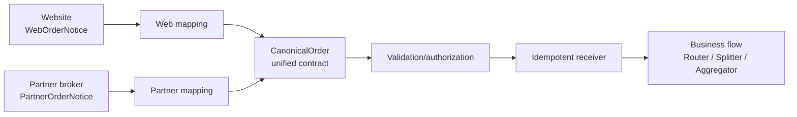
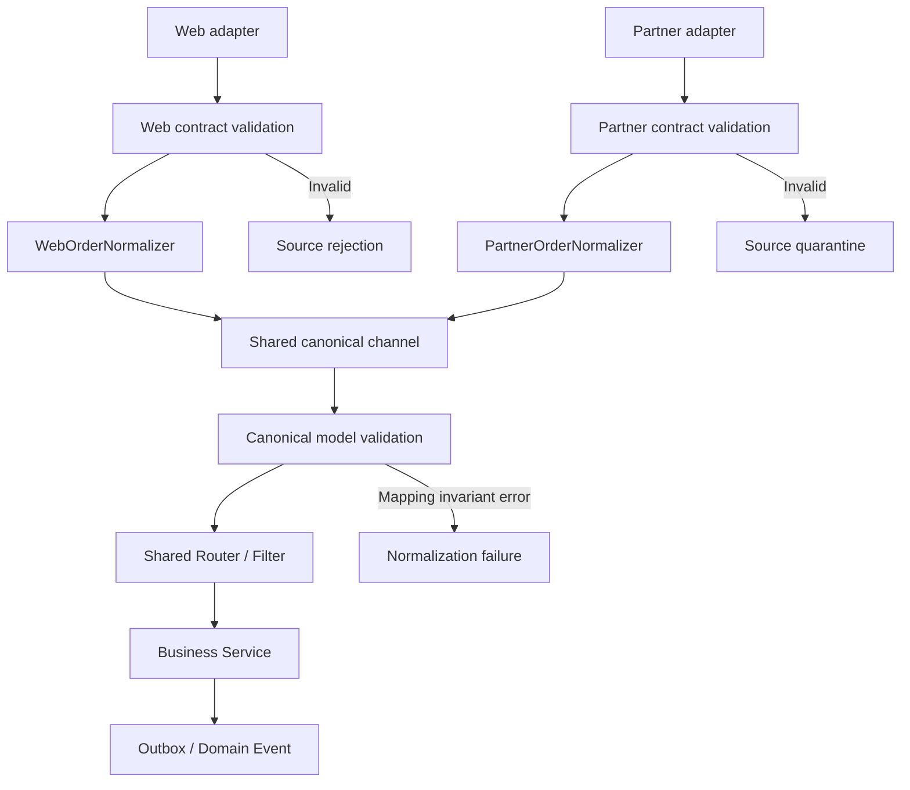
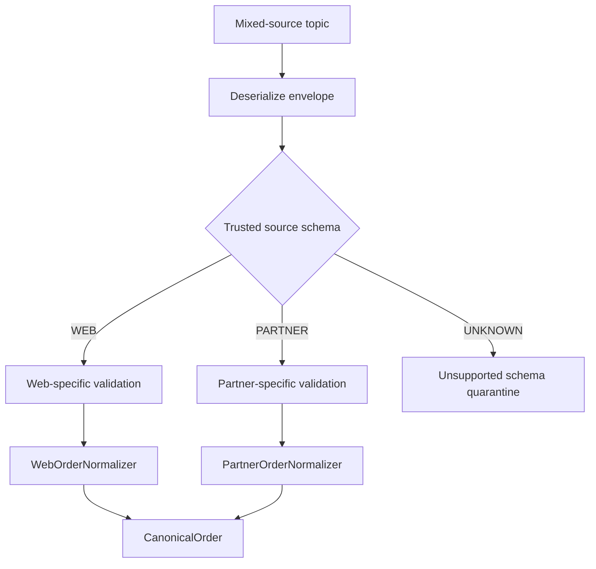
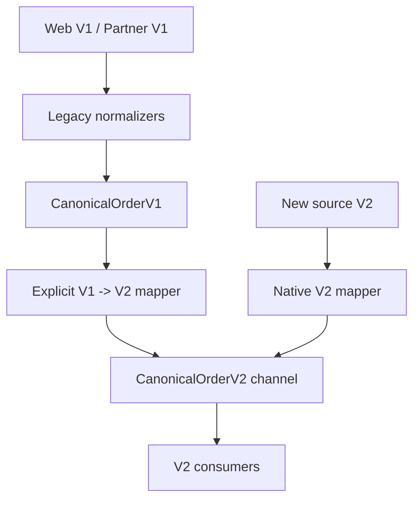

# Placing the Canonical Model in an Integration Flow

## 1. The Problem: Multiple Input Formats, One Common Processing Flow

A system receives orders from an **internal website** and a **partner via broker**. Both sources describe the same business event—a customer ordering products with quantities and unit prices—yet use different field names, timestamp formats, product codes, and data types:

`WebOrderNotice` payload from the website:

```json
{
  "tenantId": "tenant-a",
  "eventId": "web-event-105",
  "orderId": "WEB-105",
  "createdAt": "2026-11-21T04:00:00Z",
  "lines": [
    {"sku": "SKU-A", "quantity": 2, "unitPriceVnd": 25000}
  ]
}
```

`PartnerOrderNotice` payload from the partner:

```json
{
  "partnerAccount": "merchant-7",
  "eventRef": "partner-event-77",
  "purchaseRef": "PO-77",
  "occurredAtIso": "2026-11-21T11:00:00+07:00",
  "details": [
    {"productCode": "PART-A7", "units": "2", "priceVndMinor": "25000"}
  ]
}
```

If every Service Activator, Router, Aggregator, and consumer must understand both schemas, the number of branches grows with every source. Every partner change forces business logic to know about transport formats. Conversely, if both sources are normalized into **a canonical model** ahead of the shared processing flow, downstream works exclusively against a single internal contract.

**Normalizer** is the Enterprise Integration Pattern (EIP) that takes multiple message formats representing equivalent data and converts them into one unified form for downstream processing. Typically a Normalizer combines a **Message Router** to select the source/message type with **Message Transformers** per format. The **Canonical Data Model** is the target contract produced by the Normalizer.

In the **Normalizer** chapter of the **SPRING_INTEGRATION_PATTERN** module, learners implement Enterprise Integration Patterns with Spring Integration to build loosely coupled, extensible message flows—combining Router, Filter, Transformer, Splitter, Aggregator, Gateway, retry, error channel, and correlation, while testing and monitoring processing branches.



**Core question of this lesson:** **Where** in the integration flow should the canonical model sit so sources stay isolated while shared business logic remains independent of per-source DTOs?

## 2. Distinguishing Normalizer, Transformer, Adapter, and Canonical Model

These concepts are related, not synonymous:

| Concept | Responsibility | Example |
| --- | --- | --- |
| **Inbound adapter** | Receives messages from HTTP, broker, file, or database and converts to Spring `Message` | Receives partner JSON from a message broker |
| **Message Converter** | Deserializes bytes into a source Java type | JSON into `PartnerOrderNotice` |
| **Transformer** | Converts one payload type into another | `PartnerOrderNotice → CanonicalOrder` |
| **Normalizer** | Brings **multiple sources/formats** into the same shape | Web + Partner → `CanonicalOrder` |
| **Canonical Data Model** | Defines the shared internal language of a boundary | `tenantId`, `sourceOrderId`, `occurredAt`, `lines` |
| **Validator** | Checks whether an object meets the contract | Required SKU, positive quantity |
| **Content-Based Router** | Chooses a channel from message data | Valid results to processing; errors to quarantine |
| **Business Enricher** | Adds information absent from the payload | Looks up approved selling price from catalog |
| **Idempotent Receiver** | Avoids executing side effects twice for one logical event | Avoids deducting inventory twice on broker redelivery |

**One Transformer is not automatically a Normalizer.** In the Normalizer pattern, *multiple source transformations* converge on a single canonical contract. Nor is a Normalizer an Aggregator: it does not combine multiple messages into one summary merely because multiple sources flow into the same channel.

### 2.1. Anti-Corruption Layer at the Boundary

The Normalizer acts as an **anti-corruption layer**: isolating external systems' language and formats so details like `purchaseRef` or `priceVndMinor` do not leak into every business service.

Instead of shared code like:

```java
// ANTI-PATTERN: business service directly knows every source format.
void process(Object input) {
    if (input instanceof WebOrderNotice web) {
        // web-specific rules
    } else if (input instanceof PartnerOrderNotice partner) {
        // partner-specific rules
    }
    // Adding a new source forces changes to this service.
}
```

We aim for:

```java
interface CanonicalOrderService {
    void process(CanonicalOrder order);
}
```

The intake layer handles conversion; the business service knows only `CanonicalOrder`.

### 2.2. Do Not Create an “Enterprise-Wide Canonical Model” Too Early

A canonical model is valuable within **a bounded context or a clearly scoped integration boundary**. You do not need to force every service in the system onto one giant schema packed with optional fields and unrelated business types.

A good canonical model is:
- General enough for **the sources and workflows that truly share it**.
- Explicit in semantics for monetary units, timezones, identity, and status.
- Governed by contract/versioning and evolution policies.
- Free of quirky field names from any single partner.
- Not turned into a database/JPA entity merely for reuse convenience.

## 3. Where Should the Canonical Model Sit in the Flow?

Typical placement:

```text
External Source
  -> Inbound Adapter / Deserialize
  -> Source-Specific Structural Validation
  -> Source-Specific Normalizer / Mapping
  -> Canonical Validation & Provenance Check
  -> Shared Canonical Channel
  -> Business Router / Filter / Enricher
  -> Idempotent Receiver / Side Effects
  -> Downstream Event / Gateway Reply
```

The Normalizer sits **after identifying the source format and before shared business steps**. The goal is to minimize how many places need to know input formats.



**Depending on the workflow**, normalization may precede canonical validation if the input structure is parseable. Yet a guard is always required before risky field access or source operations. Never let a mis-deserialized message become a “valid” canonical object just by filling in default values.

### 3.1. Two Valid Wiring Approaches

**Approach A — One dedicated channel per source:**

```text
orders.web.in      -> WebOrderNormalizer      ┐
                                            ├-> orders.canonical
orders.partner.in  -> PartnerOrderNormalizer ┘
```

Suitable when source adapters already know the message type. Each channel has clear ownership and validation without requiring a Router to guess payload types.

**Approach B — One polymorphic input:**

```text
orders.raw
  -> Router by trusted source/type
       -> orders.web.normalize
       -> orders.partner.normalize
  -> orders.canonical
```

Suitable when one adapter receives multiple event types, provided type selection uses **trusted schema/type metadata**, never an arbitrary caller header used to cast payloads unsafely.

This lesson prefers **Approach A** to keep the Java DSL simple and type-safe. A Router can be added when sources arrive over a single inbound topic.

### 3.2. Consequences of Misplacing the Normalizer

| Normalizer Placement | Consequence |
| --- | --- |
| Too late, after multiple business handlers | Every handler must understand source-specific DTOs |
| Too early, before knowing schema/version | Unclear which data types to map |
| After a Filter coupled to source-specific fields | Filter remains tied to external formats |
| Before source authentication while trusting tenant headers | Risk of cross-tenant spoofing |
| After DB writes or event emission | Inconsistent data may already have caused side effects |
| Duplicated inside each consumer | Repeated mapping logic, hard to synchronize versions |

Placing normalization cleanly ensures the shared model appears **once**, at the ingress boundary of that scope.

## 4. Designing the Canonical Contract: Semantics Matter More Than Field Names

We select a small internal contract specifically for **new order** messages:

```text
CanonicalOrder
  tenantId           : String
  source             : WEB | PARTNER
  sourceOrderId      : String
  sourceEventId      : String
  occurredAt         : Instant (UTC instant)
  lines              : List<CanonicalLine>
  totalVnd           : long (whole VND units)
  
CanonicalLine
  sku                : String (internal SKU code)
  quantity           : int (>0)
  unitPriceVnd       : long (>=0)
  lineTotalVnd()     : quantity * unitPriceVnd
```

Design rationale:

- `tenantId` scopes the customer and **must be verified against authenticated identity**.
- `source` is a source enum; never blindly trust a client-supplied String label.
- `sourceOrderId` and `sourceEventId` preserve original identity **within the source's namespace**; do not pretend sources generate globally unique IDs.
- `occurredAt` is an `Instant` representing **an unambiguous point in time**, not a timezone-less local string.
- `sku` is a mapped internal code; not every vendor alias is valid.
- `totalVnd` is computed from lines in the canonical model; do not blindly trust an unverified declared total.
- `long` is used here only because the example prices in whole VND. For multi-currency systems, use `Money(currency, minorUnits)` with explicit precision/conversion rules; never mix USD and VND.

### 4.1. Immutable Canonical Model in Java

```java
import java.time.Instant;
import java.util.List;
import java.util.Objects;

enum OrderSource {
    WEB, PARTNER
}

record CanonicalLine(
        String sku,
        int quantity,
        long unitPriceVnd) {

    CanonicalLine {
        if (sku == null || !sku.matches("[A-Z0-9-]{1,32}")
                || quantity <= 0 || unitPriceVnd < 0) {
            throw new IllegalArgumentException(
                    "INVALID_CANONICAL_LINE");
        }
    }

    long lineTotalVnd() {
        return Math.multiplyExact(
                (long) quantity, unitPriceVnd);
    }
}

record CanonicalOrder(
        String tenantId,
        OrderSource source,
        String sourceOrderId,
        String sourceEventId,
        Instant occurredAt,
        List<CanonicalLine> lines,
        long totalVnd) {

    CanonicalOrder {
        if (tenantId == null || tenantId.isBlank()
                || source == null
                || sourceOrderId == null || sourceOrderId.isBlank()
                || sourceEventId == null || sourceEventId.isBlank()
                || occurredAt == null
                || lines == null || lines.isEmpty()) {
            throw new IllegalArgumentException(
                    "INVALID_CANONICAL_ORDER");
        }

        lines = List.copyOf(lines);

        long expected = 0L;
        for (CanonicalLine line : lines) {
            expected = Math.addExact(
                    expected, line.lineTotalVnd());
        }
        if (totalVnd != expected) {
            throw new IllegalArgumentException(
                    "CANONICAL_TOTAL_MISMATCH");
        }
    }

    static CanonicalOrder create(
            String tenantId,
            OrderSource source,
            String sourceOrderId,
            String sourceEventId,
            Instant occurredAt,
            List<CanonicalLine> lines) {

        Objects.requireNonNull(lines, "lines");
        long sum = 0L;
        for (CanonicalLine line : lines) {
            sum = Math.addExact(sum, line.lineTotalVnd());
        }

        return new CanonicalOrder(
                tenantId, source, sourceOrderId,
                sourceEventId, occurredAt, lines, sum);
    }
}
```

**Notable details:**

1. `List.copyOf` creates a snapshot collection; because line records hold only `String` and immutable primitives, downstream cannot mutate the list.
2. Any caller invoking the constructor directly with a mismatched `totalVnd` is rejected. Mappers typically call the `create` factory to recompute totals.
3. `Math.multiplyExact` and `Math.addExact` detect overflow, preventing silent wrap-around to negative totals.
4. Positive quantity and non-negative unit price are enforced directly on the canonical line.
5. `sourceEventId` is the business identity for idempotency coordination, not `MessageHeaders.ID`.
6. `occurredAt` uses `Instant`; formatters and timezones live only at input/output boundaries.

### 4.2. Canonical Model Is Not a Database Object

Do not add JPA annotations or make `CanonicalOrder` a mutable entity just for convenient persistence. A canonical message is a **transport contract between integration components**, whereas domain aggregates/entities have their own lifecycles and invariants. A business service can convert `CanonicalOrder` into a command/domain object after checking domain rules.

### 4.3. Canonical Event Identity Contract

An example idempotency key:

```text
(consumerName, tenantId, source, sourceEventId)

("stock-reservation", "tenant-a", WEB, "web-event-105")
("stock-reservation", "tenant-a", PARTNER, "partner-event-77")
```

Do not use `sourceOrderId` alone if one order can emit multiple logical events (created, revised, cancelled). Do not use `sourceEventId` alone if sources have overlapping ID spaces. Retries of the same event must keep these identity fields stable.

## 5. Two Source Models: Describing Boundary Data Only

### 5.1. Website Schema

```java
import java.time.Instant;
import java.util.List;

record WebOrderLine(
        String sku,
        int quantity,
        long unitPriceVnd) {}

record WebOrderNotice(
        String tenantId,
        String eventId,
        String orderId,
        Instant createdAt,
        List<WebOrderLine> lines) {}
```

The website schema is close to canonical yet still distinct: it has `orderId`/`eventId` fields and lacks the provenance enum or computed internal total.

### 5.2. Partner Schema

```java
import java.util.List;

record PartnerOrderLine(
        String productCode,
        String units,
        String priceVndMinor) {}

record PartnerOrderNotice(
        String partnerAccount,
        String eventRef,
        String purchaseRef,
        String occurredAtIso,
        List<PartnerOrderLine> details) {}
```

In this source:
- `units` and `priceVndMinor` are **strings**, requiring strict parsing rules.
- `productCode` is partner-specific and must be mapped to a canonical SKU.
- `occurredAtIso` is an offset timestamp string.
- `partnerAccount` must be checked against the **partner account authenticated at ingress**, never treated as self-proving tenant authorization.
- Price is explicitly defined as **whole VND units**, not decimal USD or an unspecified currency.

Neither source class should leak past `orders.canonical`. When adding a third partner, create a dedicated mapper for that partner's schema rather than editing every consumer's business service.

## 6. Normalization Error Boundary: Parse Failure Is Not Infrastructure Failure

A normalizer can encounter errors such as:
- Missing order ID, empty lines, negative quantity.
- String `units="two"` instead of an integer.
- ISO timestamp missing timezone or unparseable.
- Vendor product code without a mapping.
- Unreachable catalog/tenant directory due to timeout.

Separate two groups:

| Group | Example | Policy |
| --- | --- | --- |
| **Contract/data error** | Missing ID, invalid quantity, malformed time | Terminal reject/quarantine; do not retry the same payload endlessly |
| **Undeclared mapping** | Vendor SKU absent from mapping table | Quarantine or wait for intentional mapping update |
| **Infrastructure/transient** | Directory/DB timeout | Bounded retry with backoff |
| **Authorization** | Partner A sends Partner B's account | Deny, security audit; never “fix” the tenant |
| **Internal bug** | Unexpected `NullPointerException` in mapper | Alert application error; do not disguise as invalid input |
| **Overflow** | Monetary value exceeds `long` range | Reject or change numeric model per contract |

An exception carrying a **stable error code** lets downstream classify failures without parsing raw-payload error strings.

```java
final class NormalizationFailure
        extends IllegalArgumentException {

    private final String reasonCode;

    NormalizationFailure(String reasonCode) {
        super(reasonCode);
        this.reasonCode = reasonCode;
    }

    String reasonCode() {
        return reasonCode;
    }
}
```

Never place raw orders, PII, access tokens, or sensitive identifiers inside exception messages or metric labels. When data repair is needed, store the original in an access-controlled quarantine store and link it via tracking ID instead of broadcasting the body inside errors.

## 7. WebOrderNormalizer: Even Near-Canonical Sources Need Validation

A website source mapper should:
1. Verify the source payload is non-null and required fields are present.
2. Iterate through lines, constructing immutable canonical lines.
3. Not trust a caller-provided total blindly; let the canonical factory compute it.
4. Preserve provenance and business IDs.
5. Let authorization verify `tenantId` against the authenticated sender.

```java
import java.util.ArrayList;
import org.springframework.stereotype.Component;

@Component
final class WebOrderNormalizer {

    CanonicalOrder normalize(WebOrderNotice input) {
        if (input == null
                || input.tenantId() == null
                || input.eventId() == null
                || input.orderId() == null
                || input.createdAt() == null
                || input.lines() == null
                || input.lines().isEmpty()) {
            throw new NormalizationFailure(
                    "WEB_REQUIRED_FIELD_MISSING");
        }

        var normalizedLines =
                new ArrayList<CanonicalLine>();

        for (WebOrderLine line : input.lines()) {
            if (line == null) {
                throw new NormalizationFailure(
                        "WEB_NULL_LINE");
            }
            try {
                normalizedLines.add(new CanonicalLine(
                        line.sku(),
                        line.quantity(),
                        line.unitPriceVnd()));
            } catch (IllegalArgumentException ex) {
                throw new NormalizationFailure(
                        "WEB_LINE_INVALID");
            }
        }

        try {
            return CanonicalOrder.create(
                    input.tenantId(),
                    OrderSource.WEB,
                    input.orderId(),
                    input.eventId(),
                    input.createdAt(),
                    normalizedLines);
        } catch (IllegalArgumentException ex) {
            throw new NormalizationFailure(
                    "WEB_ORDER_INVALID");
        }
    }
}
```

The example intentionally maps data errors to reason codes without logging bad SKUs or prices. Overflow `ArithmeticException`s should not be swallowed as null errors; in production you can map them to a dedicated `AMOUNT_OUT_OF_RANGE` reason code or use a larger numeric type if business rules require it.

**Security boundary:** The website adapter must bind the authenticated tenant to `input.tenantId()`. A non-empty String does not mean the caller is authorized to submit orders for that tenant. Authorization must run before any business side effect—either before or after normalization depending on where the verified principal lives.

## 8. PartnerOrderNormalizer: Mappings Must Be Explicit and Contracted

For partners, two lookups belong behind **abstractions**, rather than mixing lookup logic into domain services:

```java
interface PartnerTenantDirectory {
    String requireTenantId(String partnerAccount);
}

interface PartnerSkuDirectory {
    String requireCanonicalSku(
            String partnerAccount, String partnerSku);
}
```

Assume the integration adapter already authenticated partner identity (certificate, broker principal, signed message, etc.) and accepts `partnerAccount` only when **matching the verified identity**. Both interfaces look up registered mappings rather than treating caller-supplied codes as permissions. If a directory relies on network calls, distinguish timeout errors from undefined product codes.

### 8.1. Strictly Converting Units, Prices, and Timestamps

```java
import java.time.Instant;
import java.time.format.DateTimeParseException;
import java.util.ArrayList;
import java.util.Objects;
import org.springframework.stereotype.Component;

@Component
final class PartnerOrderNormalizer {

    private final PartnerTenantDirectory tenants;
    private final PartnerSkuDirectory skus;

    PartnerOrderNormalizer(
            PartnerTenantDirectory tenants,
            PartnerSkuDirectory skus) {
        this.tenants = Objects.requireNonNull(tenants);
        this.skus = Objects.requireNonNull(skus);
    }

    CanonicalOrder normalize(PartnerOrderNotice input) {
        if (input == null
                || isBlank(input.partnerAccount())
                || isBlank(input.eventRef())
                || isBlank(input.purchaseRef())
                || isBlank(input.occurredAtIso())
                || input.details() == null
                || input.details().isEmpty()) {
            throw new NormalizationFailure(
                    "PARTNER_REQUIRED_FIELD_MISSING");
        }

        String tenantId =
                tenants.requireTenantId(input.partnerAccount());

        Instant occurredAt;
        try {
            occurredAt = Instant.parse(input.occurredAtIso());
        } catch (DateTimeParseException ex) {
            throw new NormalizationFailure(
                    "PARTNER_TIME_INVALID");
        }

        var lines = new ArrayList<CanonicalLine>();
        for (PartnerOrderLine raw : input.details()) {
            if (raw == null
                    || isBlank(raw.productCode())
                    || isBlank(raw.units())
                    || isBlank(raw.priceVndMinor())) {
                throw new NormalizationFailure(
                        "PARTNER_LINE_MISSING_FIELD");
            }

            int quantity = parseQuantity(raw.units());
            long price = parsePrice(raw.priceVndMinor());

            // Partners use their own codes; do not just UPPERCASE
            // or replace delimiters and assume an internal SKU.
            String sku = skus.requireCanonicalSku(
                    input.partnerAccount(), raw.productCode());

            try {
                lines.add(new CanonicalLine(
                        sku, quantity, price));
            } catch (IllegalArgumentException ex) {
                throw new NormalizationFailure(
                        "PARTNER_LINE_INVALID");
            }
        }

        try {
            return CanonicalOrder.create(
                    tenantId,
                    OrderSource.PARTNER,
                    input.purchaseRef(),
                    input.eventRef(),
                    occurredAt,
                    lines);
        } catch (IllegalArgumentException ex) {
            throw new NormalizationFailure(
                    "PARTNER_ORDER_INVALID");
        }
    }

    private static int parseQuantity(String raw) {
        try {
            int value = Integer.parseInt(raw);
            if (value <= 0) {
                throw new NumberFormatException();
            }
            return value;
        } catch (NumberFormatException ex) {
            throw new NormalizationFailure(
                    "PARTNER_QUANTITY_INVALID");
        }
    }

    private static long parsePrice(String raw) {
        try {
            long value = Long.parseLong(raw);
            if (value < 0) {
                throw new NumberFormatException();
            }
            return value;
        } catch (NumberFormatException ex) {
            throw new NormalizationFailure(
                    "PARTNER_PRICE_INVALID");
        }
    }

    private static boolean isBlank(String value) {
        return value == null || value.isBlank();
    }
}
```

The code uses `Instant.parse` so only timestamps carrying full instant/offset semantics supported by the parser are accepted. If a partner sends `"2026-11-21 11:00"` without a timezone, **never assume UTC or Vietnam time**: require an explicit contract or a separate adapter version configured with the source timezone.

`Integer.parseInt` and `Long.parseLong` require integer decimal digits; inputs like `"2.0"` or `"25,000"` are rejected under this contract. If a supplier officially specifies another separator or decimal format, add an approved versioned source parser rather than guessing from the host locale.

### 8.2. Directory Lookups Can Fail for Two Reasons

- **Unknown mapping:** partner SKU is not registered → stop or quarantine; never fall back to using the vendor code as an internal SKU.
- **Directory unavailable:** DB/network unreachable → infrastructure error, retry with backoff if policy permits.

Both interfaces serve as **contracts**; the example code intentionally avoids catching every `RuntimeException` from them so transient errors are not silently misclassified as invalid input. If directories expose typed errors, an error classifier at the inbound adapter can route each category to the proper retry or quarantine path.

### 8.3. Never Convert Currencies Implicitly

`priceVndMinor` on the source adapter illustrates whole VND units per known contract. If a third source sends USD in cents, **never** multiply or divide arbitrarily to turn it into VND. Currency conversion requires an exchange rate, effective timestamp, rounding policy, rate source, and version. A multi-currency canonical contract can use `Money(currency, amountMinorUnits)`, while this lesson's contract explicitly accepts only VND.

## 9. Spring Integration Java DSL: Two Sources Converging on One Canonical Channel

We connect both normalizers into one integration flow. Each inbound channel receives its deserialized source type, yet downstream consumes only `CanonicalOrder`:

```java
import org.springframework.context.annotation.Bean;
import org.springframework.context.annotation.Configuration;
import org.springframework.integration.channel.DirectChannel;
import org.springframework.integration.config.EnableIntegration;
import org.springframework.integration.dsl.IntegrationFlow;
import org.springframework.messaging.MessageChannel;

@Configuration
@EnableIntegration
class CanonicalOrderFlowConfiguration {

    @Bean("orders.web.in")
    MessageChannel webOrders() {
        return new DirectChannel();
    }

    @Bean("orders.partner.in")
    MessageChannel partnerOrders() {
        return new DirectChannel();
    }

    @Bean("orders.canonical")
    MessageChannel canonicalOrders() {
        return new DirectChannel();
    }

    @Bean
    IntegrationFlow normalizeWebOrders(
            WebOrderNormalizer normalizer) {
        return IntegrationFlow.from("orders.web.in")
                .transform(WebOrderNotice.class,
                        normalizer::normalize)
                .channel("orders.canonical")
                .get();
    }

    @Bean
    IntegrationFlow normalizePartnerOrders(
            PartnerOrderNormalizer normalizer) {
        return IntegrationFlow.from("orders.partner.in")
                .transform(PartnerOrderNotice.class,
                        normalizer::normalize)
                .channel("orders.canonical")
                .get();
    }

    @Bean
    IntegrationFlow processCanonicalOrders(
            CanonicalOrderService service) {
        return IntegrationFlow.from("orders.canonical")
                .handle(CanonicalOrder.class, (order, headers) -> {
                    service.process(order);
                    return null; // One-way handler.
                })
                .get();
    }
}
```

`CanonicalOrderService` is the interface from section 2, whose application implementation supplies authorization, business validation, transactions, and idempotency. The `.transform(Class<T>, transformer)` API belongs to Java DSL; verify against your project's actual dependency versions during technical QA/compilation.

**Processing flow:**

1. The website adapter sends `WebOrderNotice` to `orders.web.in` after source authentication and parsing.
2. `normalizeWebOrders` produces the canonical payload.
3. The partner adapter sends `PartnerOrderNotice` to `orders.partner.in`, running its own lookup/mapping.
4. Both branches emit `CanonicalOrder` onto `orders.canonical`.
5. The common handler knows nothing about partner field names like `purchaseRef`, `productCode`, or string quantities.

**Illustrative scope:** The channels are synchronous in-JVM `DirectChannel`s. There are no broker adapters, transactional outboxes, Gateway replies, or retry policies in this snippet. Real deployments integrate those components as needed.

### 9.1. What If Inputs Share One Topic?

When one broker topic mixes multiple event types, add a Router keyed on **trusted type/schema/provenance**:



Never cast to `PartnerOrderNotice` merely because a caller set `source=PARTNER`. The adapter must verify the schema before creating typed payloads. Because the example uses two separate input channels, no extra Router is needed to distinguish message types.

### 9.2. Keep the Normalizer Independent of DSL Wiring

If all parsing, lookup, validation, and mapping live inside one long DSL lambda:
- Edge cases become hard to unit test;
- Reuse is hard when replacing HTTP with a broker;
- A partner change can break the shared flow;
- Exceptions get caught carelessly, losing causes/reason codes;
- It becomes hard to guarantee the normalizer has no business side effects.

A standalone mapper like `PartnerOrderNormalizer` can be unit-tested with fake directories. The DSL describes only how **endpoints are wired**.

### 9.3. Where Does Validation Belong?

Usually **two levels of validation** are needed:

1. **Source-specific validation:** schema, required fields, data types, authentication, source version.
2. **Canonical validation:** shared invariants of `CanonicalOrder`, money, tenant, identity, line totals, and semantic contract.

Compact constructors in this lesson guard core invariants, yet do not replace Bean Validation, authorization, or business rules (e.g., checking catalog prices). In particular, summing `totalVnd` from producer-supplied unit prices **does not prove those unit prices are approved**.

## 10. Controlled Error Branching

A normalizer that cannot map data must report why clearly. On `DirectChannel`, `NormalizationFailure` can propagate back to the sender. In broker listeners, pollers, or executors, exceptions and ACK/NACK/DLQ depend on adapter/error-handling configuration.

| Outcome | Example | Handling Direction |
| --- | --- | --- |
| **NORMALIZED** | Valid schema, mapped to `CanonicalOrder` | Forward into shared flow |
| **REJECTED_INPUT** | Unparseable quantity text | Rejection/quarantine; no infinite retry |
| **UNKNOWN_MAPPING** | Undeclared vendor SKU | Fix mapping or quarantine with replay |
| **TRANSIENT_FAILURE** | Directory DB timeout | Bounded retry/backoff |
| **UNAUTHORIZED** | Partner spoofs another account/tenant | Security audit and reject |
| **UNSUPPORTED_VERSION** | Source schema outside contract | Quarantine or migration |
| **PROGRAMMING_BUG** | Unexpected code exception | Alert/error channel; never disguise as bad data |

### 10.1. Typed Normalization Outcome

One option is turning invalid data into a result message **without raw payload**:

```java
sealed interface NormalizationOutcome
        permits NormalizedOrder, RejectedSourceOrder {}

record NormalizedOrder(CanonicalOrder order)
        implements NormalizationOutcome {}

record RejectedSourceOrder(
        String trackingId,
        String reasonCode)
        implements NormalizationOutcome {}
```

Adapter boundary example:

```java
NormalizationOutcome normalizeSafely(
        WebOrderNotice input,
        String trustedTrackingId,
        WebOrderNormalizer mapper) {

    try {
        return new NormalizedOrder(mapper.normalize(input));
    } catch (NormalizationFailure invalidInput) {
        return new RejectedSourceOrder(
                trustedTrackingId, invalidInput.reasonCode());
    }
}
```

**Catch only `NormalizationFailure` for invalid data.** Exceptions such as `DataAccessException`, network timeouts, or programming bugs must not be turned into permanent rejections and ACKed away.

### 10.2. Routing the Two Outcomes

```text
normalization.outcomes
  -> Router by outcome type
      -> NormalizedOrder
           -> unwrap CanonicalOrder
           -> orders.canonical
      -> RejectedSourceOrder
           -> orders.quarantine / source reply
```

The accepted path must **unwrap** the wrapper so business flows actually receive `CanonicalOrder`; do not pass `NormalizedOrder` directly to handlers expecting `CanonicalOrder`. The rejected path must persist or reply with an error per contract. If a Gateway is waiting, never silently Filter out the message and let the caller time out.

### 10.3. When a Filter Sits Between Splitter and Aggregator

If a batch has 5 items and 2 malformed items are dropped, a downstream Aggregator waiting for `sequenceSize=5` can stall. Two options:
- Emit **both accepted and rejected outcomes** keyed by `sourceIndex` so the coordinator knows all 5 were processed.
- Or use a trusted completion marker or expected accepted count instead of the initial raw count.

The Normalizer does not manage correlation/release directly, yet normalization failures must be accounted for in the overall flow policy.

## 11. Canonical Payload and Header Propagation

In Spring Integration, `Message<T>` consists of payload and headers. The Normalizer converts the payload to `CanonicalOrder`, yet the framework may carry many inbound headers across the Transformer.

```text
Web message
  payload = WebOrderNotice(...)
  headers = eventId, contentType, source, replyChannel, traceId...

After normalization
  payload = CanonicalOrder(...)
  headers = ? (depends on endpoint, adapter, and mapping policy)
```

**A canonical payload does not mean canonical headers.** If an incoming header `eventId` differs from `sourceEventId` in the canonical payload, an Idempotent Receiver might read the wrong business key. Choose an explicit source of truth.

| Header | Recommended Policy |
| --- | --- |
| `trustedTenantId` | Verify against payload and security principal |
| `eventId` | Derive/verify against `sourceEventId` |
| `sourceSystem` | Derive from `OrderSource` enum |
| `schemaVersion` | Keep the successfully parsed version |
| `traceId` | Handle via tracing policy/library |
| `CORRELATION_ID` | Keep only if group semantics remain valid |
| `SEQUENCE_NUMBER/SIZE` | Never forge or alter arbitrarily |
| `replyChannel` | Keep per Gateway request–reply contract |
| `errorChannel` | Configured explicitly for error orchestration |
| Raw tokens / credentials | Never forward downstream unnecessarily |

**Anti-pattern:** calling `copyHeaders(input.getHeaders())` on every third-party message, leaking transport-specific objects, sensitive data, or stale sequence metadata downstream.

Across brokers/HTTP, use a **header allowlist** or an explicit header mapper, then test the actual endpoint output. For Gateway replies, preserve the reply path; never delete `replyChannel` inside the same JVM when the framework relies on it.

### 11.1. Business-Scoped Idempotency Key

```java
record CanonicalEventKey(
        String consumerName,
        String tenantId,
        OrderSource source,
        String sourceEventId) {}

CanonicalEventKey keyFor(
        String consumerName, CanonicalOrder order) {
    return new CanonicalEventKey(
            consumerName,
            order.tenantId(),
            order.source(),
            order.sourceEventId());
}
```

One source can emit two distinct events for the same `sourceOrderId`. Therefore, never deduplicate solely by order ID. If an `eventId` arrives again with a different payload, that is an **idempotency key conflict**, not a valid duplicate. In the database, use composite columns or versioned canonical encoding rather than unescaped string concatenation.

## 12. Money, Time, SKUs, and Default Values

### 12.1. Money Must Have Explicit Units

`totalVnd` in the example uses **whole VND units**; `long` fits only within a bounded range. If another source sends USD cents or decimals, never multiply/divide arbitrarily to turn it into VND. Conversion requires an exchange rate source, effective timestamp, rounding rule, and version.

```java
// Alternative model when multi-currency support is needed.
record Money(String currency, long minorUnits) {}

record PricedCanonicalLine(
        String sku,
        int quantity,
        Money unitPrice) {}
```

If using this model, validate currencies per contract and never add `Money` values of different currencies. Also never trust client-supplied prices merely because they are numerically valid: final selling prices must be verified against a trusted catalog/quote by the business service.

### 12.2. Two Timestamps Can Represent the Same Instant

```text
Web:     2026-11-21T04:00:00Z
Partner: 2026-11-21T11:00:00+07:00
Canonical occurredAt:
         2026-11-21T04:00:00Z
```

The same instant can be written with different offsets. If a partner sends `"2026-11-21 11:00"` without a timezone, never fill it in with the running server's default timezone. Require an offset or a versioned timezone contract, checking DST edge cases for regions with daylight saving time.

### 12.3. SKU Mappings Need Provenance/Versioning

Today partner code `PART-A7` maps to `SKU-A`; next month the catalog mapping changes due to a product merge. If the same event is replayed against the new mapping table, the canonical payload may differ from before.

Consider:
- Recording the source mapping version/revision used.
- Snapshotting the canonical result when exact audit/replay is required.
- Distinguishing replay of an old event from a new event revision.
- Never letting a “latest” lookup silently alter past committed decisions without migration.

### 12.4. Null Does Not Always Have a Default

Dangerous silent auto-fixes:
- `quantity=null → 1` when the source never specified it;
- `unitPrice=null → 0` making order total 0;
- `tenantId=null → defaultTenant` causing cross-tenant leaks;
- `occurredAt=null → Instant.now()` giving replays brand-new timestamps;
- `unknownSku → rawPartnerCode` letting external aliases enter business logic.

Apply defaults only when **defined in a versioned contract**, and test deterministic outputs. When required data is missing, return a reason code and quarantine.

## 13. Managing Canonical Schemas and Source Versions

A canonical model reduces coupling to sources yet can become a new coupling point if every change forces updates on all consumers.

| Change | Scope That Should Be Impacted |
| --- | --- |
| Adding a third source with the same order meaning | New source mapper + tests |
| Partner renames a field in API v2 | Partner v2 DTO/parser/mapper |
| Adding a genuinely useful optional canonical field | Consumer contract tests |
| Changing total from VND to USD or cents | **Breaking semantic change** |
| Changing `sourceEventId` identity rules | Breaks idempotency/correlation |
| Adding promotional pricing logic | Business policy; do not cram into parser |
| Changing partner SKU mappings | Mapping version/replay policy |

### 13.1. Avoid a “God Canonical DTO”

```text
CanonicalOrder:
  webOrderId?
  partnerPurchaseRef?
  legacyOrderRowId?
  platformAOnlyTax?
  platformBOnlyCampaign?
  ... 80 optional fields
```

If downstream still writes `if (order.source()==PARTNER)` to read source-only fields that should have been normalized, the model is not reducing coupling. Audit-only fields belong in a source envelope or separate store; events with different meanings belong in separate canonical types or bounded contexts.

### 13.2. Upgrading from V1 to V2



You can deploy dual-read, track V1/V2 ratios, migrate consumers incrementally, and retire V1 once support ends. Never change the semantic meaning of a field in an older version without bumping versions, or historical replays will misbehave silently.

### 13.3. A Schema Registry Does Not Guarantee Semantics

JSON Schema, Avro, or Protobuf validate shape and compatibility, yet schemas alone do not prove:
- Monetary amounts have the right currency/precision;
- The tenant belongs to the producer;
- Partner SKUs map to valid products;
- Event IDs stay stable across retries;
- Timezone or business policy versions are accurate.

Write **semantic-level contract tests**, not just schema validation.

## 14. Unit Testing Both Normalizers Independently

Mappers must be testable **without booting a Spring context**. Unit tests should prove:
- Two sources describing the same order yield **the same canonical business data**.
- Provenance and source IDs remain distinct.
- Invalid data produces specific reason codes.
- Timestamps normalize to the same instant.
- Partner SKUs go through mapping lookups rather than using raw aliases.
- Canonical records are unaffected by mutating source lists.
- Overflows never yield wrong totals.

### 14.1. JUnit 5: Same Content, Different Source Formats

```java
import java.time.Instant;
import java.util.List;
import org.junit.jupiter.api.Test;

import static org.junit.jupiter.api.Assertions.*;

class CanonicalOrderNormalizerTest {

    private final WebOrderNormalizer web =
            new WebOrderNormalizer();

    private final PartnerTenantDirectory tenants = account -> {
        if ("merchant-7".equals(account)) {
            return "tenant-a";
        }
        throw new NormalizationFailure(
                "UNKNOWN_PARTNER_ACCOUNT");
    };

    private final PartnerSkuDirectory skus =
            (account, partnerSku) -> {
                if ("merchant-7".equals(account)
                        && "PART-A7".equals(partnerSku)) {
                    return "SKU-A";
                }
                throw new NormalizationFailure(
                        "UNKNOWN_PARTNER_SKU");
            };

    private final PartnerOrderNormalizer partner =
            new PartnerOrderNormalizer(tenants, skus);

    @Test
    void sameBusinessContentHasSameCanonicalShape() {
        var fromWeb = web.normalize(new WebOrderNotice(
                "tenant-a", "web-event-105", "WEB-105",
                Instant.parse("2026-11-21T04:00:00Z"),
                List.of(new WebOrderLine(
                        "SKU-A", 2, 25_000L))));

        var fromPartner = partner.normalize(
                new PartnerOrderNotice(
                        "merchant-7", "partner-event-77", "PO-77",
                        "2026-11-21T11:00:00+07:00",
                        List.of(new PartnerOrderLine(
                                "PART-A7", "2", "25000"))));

        assertEquals(OrderSource.WEB, fromWeb.source());
        assertEquals(OrderSource.PARTNER, fromPartner.source());

        assertEquals("tenant-a", fromWeb.tenantId());
        assertEquals("tenant-a", fromPartner.tenantId());
        assertEquals(50_000L, fromWeb.totalVnd());
        assertEquals(50_000L, fromPartner.totalVnd());
        assertEquals(fromWeb.lines(), fromPartner.lines());
        assertEquals(fromWeb.occurredAt(),
                fromPartner.occurredAt());

        // Do not erase provenance from each source.
        assertEquals("WEB-105", fromWeb.sourceOrderId());
        assertEquals("PO-77", fromPartner.sourceOrderId());
        assertEquals("web-event-105", fromWeb.sourceEventId());
        assertEquals("partner-event-77",
                fromPartner.sourceEventId());
    }

    @Test
    void partnerQuantityMustBePositiveInteger() {
        var input = new PartnerOrderNotice(
                "merchant-7", "partner-event-77", "PO-77",
                "2026-11-21T11:00:00+07:00",
                List.of(new PartnerOrderLine(
                        "PART-A7", "2.5", "25000")));

        var error = assertThrows(NormalizationFailure.class,
                () -> partner.normalize(input));

        assertEquals("PARTNER_QUANTITY_INVALID",
                error.reasonCode());
    }

    @Test
    void unknownPartnerSkuIsNotSilentlyAccepted() {
        var input = new PartnerOrderNotice(
                "merchant-7", "partner-event-78", "PO-78",
                "2026-11-21T11:00:00+07:00",
                List.of(new PartnerOrderLine(
                        "UNMAPPED", "2", "25000")));

        var error = assertThrows(NormalizationFailure.class,
                () -> partner.normalize(input));

        assertEquals("UNKNOWN_PARTNER_SKU",
                error.reasonCode());
    }

    @Test
    void missingTimezoneDoesNotUseServerDefault() {
        var input = new PartnerOrderNotice(
                "merchant-7", "partner-event-79", "PO-79",
                "2026-11-21 11:00:00",
                List.of(new PartnerOrderLine(
                        "PART-A7", "2", "25000")));

        var error = assertThrows(NormalizationFailure.class,
                () -> partner.normalize(input));

        assertEquals("PARTNER_TIME_INVALID",
                error.reasonCode());
    }
}
```

**Two canonical payloads need not be wholly `equals`**: they preserve distinct `source`, `sourceOrderId`, and `sourceEventId`, which are meaningful provenance. What tests verify as equivalent are **shape, types, canonical lines, units, and instants**. Never collapse two logical events from different sources into one identity just because items and totals match.

### 14.2. Testing Collection Immutability

```java
import java.time.Instant;
import java.util.ArrayList;
import java.util.List;
import org.junit.jupiter.api.Test;
import static org.junit.jupiter.api.Assertions.*;

class CanonicalOrderImmutabilityTest {
    @Test
    void inputListMutationDoesNotChangeCanonicalOrder() {
        var mutable = new ArrayList<CanonicalLine>();
        mutable.add(new CanonicalLine("SKU-A", 2, 25_000L));

        var order = CanonicalOrder.create(
                "tenant-a", OrderSource.WEB,
                "WEB-105", "web-event-105",
                Instant.parse("2026-11-21T04:00:00Z"),
                mutable);

        mutable.clear(); // After creating the object.

        assertEquals(1, order.lines().size());
        assertEquals(50_000L, order.totalVnd());
        assertThrows(UnsupportedOperationException.class,
                () -> order.lines().add(
                        new CanonicalLine("SKU-B", 1, 10_000L)));
    }

    @Test
    void rejectsOverflowRatherThanWrappingLong() {
        var huge = new CanonicalLine(
                "SKU-A", 2, Long.MAX_VALUE);

        assertThrows(ArithmeticException.class,
                () -> huge.lineTotalVnd());
    }
}
```

For payloads holding `byte[]` or mutable nested objects, `List.copyOf` alone does not protect **inner elements**: use defensive copies or immutable subtypes. The records here hold only `String`, enums, `Instant`, primitives, and immutable records, keeping immutability straightforward.

### 14.3. Edge-Case Test Matrix

| Source Input | Expected Result |
| --- | --- |
| Web `lines=null` | `WEB_REQUIRED_FIELD_MISSING` |
| Web `lines=[]` | No canonical order created |
| Web empty SKU | `WEB_LINE_INVALID` |
| Web negative quantity | `WEB_LINE_INVALID` |
| Partner `units="two"` | `PARTNER_QUANTITY_INVALID` |
| Partner `units="2.5"` | `PARTNER_QUANTITY_INVALID` |
| Partner `priceVndMinor="-10"` | `PARTNER_PRICE_INVALID` |
| Partner timestamp missing offset | `PARTNER_TIME_INVALID` |
| Unmapped partner SKU | Never pass raw alias as canonical SKU |
| Directory timeout | Infrastructure error; never disguise as malformed |
| Total overflow | Never emit wrong total |
| Partner changes mapping revision | Test replay/version behavior |
| Same event ID, different payload | Idempotency conflict at receiver |
| Source list mutated after normalization | Canonical order unchanged |

## 15. Integration Test: Two Input Channels, One Common Consumer

Unit tests only prove mappers return the right objects. You need **real wiring tests** to prove both sources enter the same `orders.canonical` channel and the same business handler.

To make the example complete, register the configuration with both normalizers and fake directory beans. We use Mockito to observe a single consumer without hitting a real DB.

### 15.1. Spring Test Configuring Dependencies

```java
import java.time.Instant;
import java.util.List;
import org.junit.jupiter.api.AfterEach;
import org.junit.jupiter.api.Test;
import org.mockito.ArgumentCaptor;
import org.springframework.beans.factory.annotation.Autowired;
import org.springframework.beans.factory.annotation.Qualifier;
import org.springframework.context.annotation.Bean;
import org.springframework.context.annotation.Configuration;
import org.springframework.messaging.MessageChannel;
import org.springframework.messaging.support.MessageBuilder;
import org.springframework.test.context.junit.jupiter.SpringJUnitConfig;

import static org.junit.jupiter.api.Assertions.*;
import static org.mockito.Mockito.*;

@SpringJUnitConfig(classes = {
        CanonicalOrderFlowConfiguration.class,
        WebOrderNormalizer.class,
        PartnerOrderNormalizer.class,
        CanonicalOrderFlowIT.Dependencies.class
})
class CanonicalOrderFlowIT {

    @Autowired
    @Qualifier("orders.web.in")
    MessageChannel webInput;

    @Autowired
    @Qualifier("orders.partner.in")
    MessageChannel partnerInput;

    @Autowired
    CanonicalOrderService service;

    @AfterEach
    void clearMocks() {
        reset(service);
    }

    @Test
    void bothSourcesReachOneCanonicalConsumer() {
        var web = new WebOrderNotice(
                "tenant-a", "web-event-105", "WEB-105",
                Instant.parse("2026-11-21T04:00:00Z"),
                List.of(new WebOrderLine(
                        "SKU-A", 2, 25_000L)));

        var partner = new PartnerOrderNotice(
                "merchant-7", "partner-event-77", "PO-77",
                "2026-11-21T11:00:00+07:00",
                List.of(new PartnerOrderLine(
                        "PART-A7", "2", "25000")));

        assertTrue(webInput.send(
                MessageBuilder.withPayload(web).build()));
        assertTrue(partnerInput.send(
                MessageBuilder.withPayload(partner).build()));

        var captor =
                ArgumentCaptor.forClass(CanonicalOrder.class);
        verify(service, times(2)).process(captor.capture());

        List<CanonicalOrder> received =
                captor.getAllValues();
        assertEquals(2, received.size());
        assertEquals(OrderSource.WEB,
                received.get(0).source());
        assertEquals(OrderSource.PARTNER,
                received.get(1).source());
        assertEquals(50_000L,
                received.get(0).totalVnd());
        assertEquals(50_000L,
                received.get(1).totalVnd());
    }

    @Test
    void invalidPartnerInputNeverCallsBusinessService() {
        var bad = new PartnerOrderNotice(
                "merchant-7", "partner-event-78", "PO-78",
                "2026-11-21T11:00:00+07:00",
                List.of(new PartnerOrderLine(
                        "PART-A7", "invalid", "25000")));

        // Error may be wrapped by Spring Messaging in
        // MessageHandlingException / MessageTransformationException.
        assertThrows(Exception.class, () ->
                partnerInput.send(
                        MessageBuilder.withPayload(bad).build()));

        verifyNoInteractions(service);
    }

    @Configuration
    static class Dependencies {
        @Bean
        PartnerTenantDirectory tenantDirectory() {
            return account -> {
                if ("merchant-7".equals(account)) {
                    return "tenant-a";
                }
                throw new NormalizationFailure(
                        "UNKNOWN_PARTNER_ACCOUNT");
            };
        }

        @Bean
        PartnerSkuDirectory skuDirectory() {
            return (account, rawSku) -> {
                if ("merchant-7".equals(account)
                        && "PART-A7".equals(rawSku)) {
                    return "SKU-A";
                }
                throw new NormalizationFailure(
                        "UNKNOWN_PARTNER_SKU");
            };
        }

        @Bean
        CanonicalOrderService canonicalOrderService() {
            return mock(CanonicalOrderService.class);
        }
    }
}
```

Because `DirectChannel` runs synchronously and the test creates no executors, Mockito assertions can run right after `send()`. When switching to Kafka/RabbitMQ, `ExecutorChannel`, or pollers, tests must wait using latches or Awaitility with bounded timeouts—never unconditional `Thread.sleep`.

**Implementation note:** If the Spring context already component-scans `@Component` normalizers, do not register the same class twice via two mechanisms. The test above uses explicit class registration. Match JUnit 5, Spring Test, Mockito, and Spring Integration dependencies to your project version. These code blocks are test-writing guides and **have not been built/run in this step**.

### 15.2. Protecting the Canonical Channel from Wrong Payload Types

In a system with multiple publishers, never treat a channel name as a strict type-safety barrier: `MessageChannel.send(Message<?>)` remains a generic API. Ensure:
- Only authorized publishers can send to `orders.canonical`.
- Type validation runs at the shared endpoint when needed.
- No untrusted inbound adapter can bypass the normalizer.
- A test verifies raw `PartnerOrderNotice` cannot reach business handlers as a canonical order.
- On shared brokers, schema registry/content-type/type headers are validated before deserializing into canonical types.

A practical approach is keeping the internal canonical channel separate from public topics so only normalized producers can publish to it.

## 16. Retry, Correlation, Idempotency, and Downstream Side Effects

The Normalizer should be **nearly a deterministic transformation**: identical source event and mapping version produce the same canonical object. It should never:
- Deduct inventory;
- Record invoices;
- Send emails;
- Generate a fresh `sourceEventId` on every delivery;
- Substitute `Instant.now()` for the source timestamp;
- Insert business records into the DB before returning the payload.

### 16.1. Flow When a Broker Redelivers from One Source

```text
Broker receives WebOrderNotice(eventId=web-event-105)
  -> WebOrderNormalizer -> CanonicalOrder(sourceEventId=web-event-105)
  -> Idempotent Receiver -> commit business state
  -> ACK lost

Broker redelivers same source event
  -> WebOrderNormalizer -> same canonical identity
  -> Idempotent Receiver -> stored outcome / no second side effect
  -> ACK
```

If the normalizer generates a new UUID on each attempt, the Idempotent Receiver treats every delivery as a brand-new event. Therefore **provenance and business event IDs must remain stable**; `MessageHeaders.ID` is insufficient for replays.

### 16.2. Mapping Lookups in the Normalizer and Determinism

Looking up `PartnerSkuDirectory` can depend on external state. If directory data changes between two attempts of the same event, canonical outputs can diverge. Options:

- Attach `mappingVersion` to source/canonical metadata and query by version.
- Persist the normalized snapshot after the first run before side effects and reuse it on redeliveries.
- Version events explicitly when business mappings change.
- Separate transient errors (directory down) from intentional mapping updates.

Never use an unversioned cache assuming it reflects identical semantics across every instance; stale caches can cause two workers to normalize differently.

### 16.3. Interaction with Router/Filter

Once messages are `CanonicalOrder`, a Router can write:

```java
// Illustrates a business predicate on the canonical model.
boolean isLargeOrder(CanonicalOrder order) {
    return order.totalVnd() >= 1_000_000L;
}
```

The Router needs no knowledge of string prices, timezone offsets, or vendor codes. Yet `totalVnd` sums source-provided unit prices; the business service must still verify authoritative pricing before credit/charge decisions.

If a Filter drops a canonical item inside a Splitter/Aggregator flow, design a completion/rejection outcome rather than deleting the message and leaving the downstream group waiting forever.

### 16.4. Interaction with Gateway and Replies

When a synchronous Gateway sends `WebOrderNotice` and awaits a result, provide a contracted reply path for **both normalization success and failure**. Section 9's configuration is **one-way**; applying it verbatim behind a Gateway would time out callers on errors. You can return a `NormalizationRejectedReply` with a reason code or throw a typed exception mapped by the Gateway/error handler.

Never copy `replyChannel` from a single Splitter child or use source headers for global response routing.

### 16.5. Transactions and External Effects

Do not hold open a long DB transaction while parsing payloads or waiting on remote lookups unnecessarily. Normalization and read-only mapping lookups should run before the business handler's short transaction. For effects that might repeat after broker redelivery, use an **Inbox/idempotency key** and, when emitting downstream events, a **transactional outbox** within the same database transaction where feasible.

The Normalizer governs **input format and semantics only**; it does not provide exactly-once execution on its own.

## 17. Observing and Operating the Normalizer

### 17.1. Metrics to Track

| Suggested Metric | Meaning |
| --- | --- |
| `normalizer.input.received` | Messages by source/schema version |
| `normalizer.output.created` | Valid canonical messages created |
| `normalizer.duration` | P50/P95/P99 normalization latency |
| `normalizer.invalid.input` | Structural/parsing errors |
| `normalizer.unknown.sku` | Unmapped source aliases |
| `normalizer.directory.failure` | Lookup infrastructure timeouts |
| `normalizer.tenant.mismatch` | Source and authenticated tenant mismatch |
| `normalizer.unsupported.version` | Unsupported schema version |
| `normalizer.amount.overflow` | Price/quantity numeric overflow |
| `normalizer.quarantine.backlog` | Items awaiting repair and replay |
| `normalizer.canonical.validation.failure` | Output invariant violations |
| `normalizer.mapping.version.skew` | Instances running mismatched mapping versions |

These metric names are **application instrumentation suggestions**, not automatically generated in full by Spring Integration.

### 17.2. Logs Must Not Contain Sensitive Raw Payloads

Log:
- Trusted tracking ID, source system, schema version.
- `sourceEventId`/tenant per security policy, never as high-cardinality metric labels.
- Stable reason code, latency, mapping version.
- Trace/correlation IDs where appropriate.
- Line count / message size (without dumping every line).
- Outcome: NORMALIZED / REJECTED / RETRY.

Do not log:
- Full order payloads.
- Tokens, personal data, credentials.
- Unsanitized raw header maps.
- Arbitrary customer-supplied text in exception messages.
- Fields containing personal or financial details outside purpose.

### 17.3. Common Symptoms

| Symptom | Likely Cause | Investigation Path |
| --- | --- | --- |
| Unknown SKUs spike after deploy | New alias or changed mapping | Catalog/mapper version |
| Same event normalizes differently across two nodes | Cache/directory version skew | Mapping snapshots, cache invalidation |
| Quarantine rises with number-parse errors | Partner changed units format | Source schema negotiation |
| Wrong processing timestamps | Missing timezone/offset or server default | Source timestamp contract |
| Business handlers inspect source-specific DTOs | Normalizer placed too late | Move shared flow onto `CanonicalOrder` |
| Gateway times out on invalid data | Error silently dropped by Filter | Rejection reply path |
| Same event executes side effect twice | Missing Inbox/idempotency or unstable key | `sourceEventId` and transaction boundaries |
| Canonical payload carries forged tenant | Missing trusted identity check | Ingress auth + tenant mapping |
| High CPU/memory before normalization | Oversized payload/deep parsing | Ingress limits, batching/streaming |

### 17.4. Contract Health Checks

When a source upgrades its API version, run a canary with **synthetic data** to verify:
1. Source schema deserialization;
2. Source-specific validation;
3. Normalization;
4. Canonical invariants;
5. Expected business fields;
6. Dry-run pass into consumers with no side effects;
7. Error handling, tracing, and mapping version.

A spike in errors after a deploy usually signals a source contract change—never fix it by disabling validation across the board.

## 18. Common Anti-Patterns

1. **Passing partner DTOs straight into business services**, exposing external formats to every consumer.
2. **Placing the Normalizer too late**, after Router/Filter/Service Activator already depend on source fields.
3. **Building a canonical DTO with dozens of source-specific optional fields**, failing to normalize in reality.
4. **Using `Object` or `Map<String,Object>` in shared flows** and casting everywhere with conditionals.
5. **Guessing timezone from the host's default** when a source provides only local timestamps.
6. **Treating USD cents and whole VND as interchangeable `long`s**.
7. **Auto-uppercasing/replacing characters in vendor product codes** without verifying internal SKUs.
8. **Assigning `tenantId=default` when missing**, creating cross-tenant exposure.
9. **Generating a new event ID on every retry**, defeating the Idempotent Receiver.
10. **Dropping source provenance/version**, making replays unexplainable.
11. **Copying all source headers onto canonical messages**, including raw credentials, `replyChannel`, or stale sequence metadata.
12. **Turning every exception into invalid input**, swallowing DB/network timeouts.
13. **Letting a Filter silently drop malformed items**, stalling Gateways or Aggregators.
14. **Having the Normalizer execute business DB updates**, violating separation of concerns.
15. **Leaving canonical payloads mutable** and sharing the same `List`/byte array across fan-outs.
16. **Ignoring overflow**, producing wrong or negative totals.
17. **Mapping an unknown alias to `SKU=UNKNOWN` and continuing**, corrupting business data.
18. **Changing a canonical field's semantic meaning without bumping version**, breaking older consumers.
19. **Testing only the mapper** without verifying routing/headers on the output channel.
20. **Testing only end-to-end happy paths**, skipping mapping misses, tenant mismatches, bad times, and replays.
21. **Assuming the Normalizer provides idempotency/authorization automatically** when it only translates formats.
22. **Relying on a schema registry while skipping semantic validation**, leaving prices/identities wrong.

## 19. Hands-On Exercise and Self-Assessment

**Exercise:** A payment system receives transactions from three sources: Web, POS, and partners via webhooks. Each source uses different amount/timezone/customer identifier formats, while downstream expects a clear `CanonicalPaymentRequested`.

1. Build a mapping table from all three source DTOs to one canonical contract with tenant, source, eventId, occurredAt, amount, currency, and reference.
2. Decide whether canonical amount uses minor units or `BigDecimal`, documenting precision and currency semantics.
3. Create immutable typed Java records with defensive copies for any collections/binaries.
4. Place the Normalizer **after source authentication/deserialization** and before shared routing/business services.
5. Write three separate mappers so shared services never reference source-specific classes.
6. Handle offset timestamps cleanly; reject or apply a timezone contract when offsets are missing.
7. Map customer/merchant aliases from a versioned directory; never use raw IDs as canonical IDs unverified.
8. Separate malformed input, unknown mappings, unauthorized tenants, and infrastructure timeouts.
9. Use typed accepted/rejected outcomes with a Router rather than silently dropping messages when a Gateway waits.
10. Define a header allowlist, correlation policy, and event identity across brokers.
11. Build `CanonicalEventKey(consumer, tenant, source, eventId)` for the Idempotent Receiver.
12. Write unit tests proving identical business facts across sources produce matching canonical semantics with distinct provenance.
13. Test nulls, quantity/amount overflow, wrong currencies, unknown aliases, and invalid timezones.
14. Write an integration test proving all three input channels converge on **one canonical handler**.
15. Attach source schema version and normalization rule version so replays remain explainable.
16. Design an upgrade from Canonical V1 to V2 without silently shifting field meanings.
17. Simulate broker redelivery after a business DB commit; verify no repeated side effects.
18. Track accepted/rejected rates, mapping errors, latency, and schema version skew.
19. Propose an access-controlled/retention-governed quarantine for raw malformed payloads.
20. Explain why a Normalizer should not call a bank or send emails itself.

**Self-check questions:** Why should the canonical model sit before shared Routers/consumers? Is a single Transformer enough to form a Normalizer? Should two source events with the same total share the same `sourceEventId`? Why is `Instant.parse` better than defaulting to local time? If a partner SKU mapping changes between replays, what can change? Can `MessageHeaders.ID` substitute for business `eventId`? If a child is dropped by a normalizer while an Aggregator still waits for `sequenceSize`, what happens to the system?

**Placing the canonical model in an integration flow** is the architectural choice that brings multiple source formats into a unified internal business contract. In Spring Integration, source-specific transformers/normalizers belong at the verified ingress boundary, ahead of shared Router, Filter, Splitter, Aggregator, and consumer steps. The canonical model must carry clear identity, money, time, provenance, and version semantics—paired with validation, error routing, idempotency, contract tests, and observability so field mapping never becomes a silent source of business bugs.
