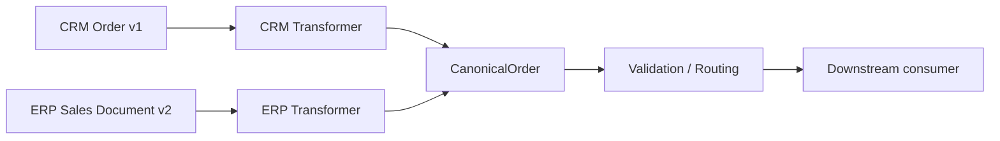
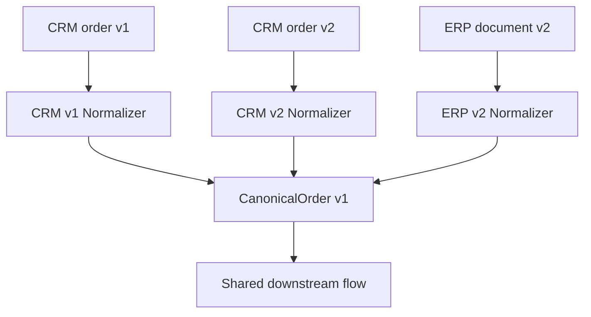
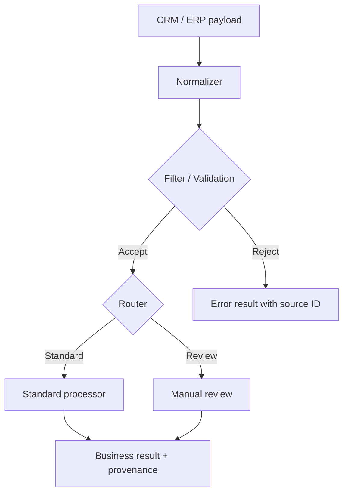

# Preserving Source Information After Normalization

When an integration application receives orders from two systems, CRM and ERP, input data typically differs: CRM sends `externalOrderId`, monetary amounts as decimal strings, and timestamps in ISO 8601; ERP sends `documentNumber`, amounts in minor units, and timestamps as epoch milliseconds. **Normalizer** converts these different representations into a shared model such as `CanonicalOrder`, so downstream components do not need custom logic per source system.

However, if after normalization all that remains is `CanonicalOrder(orderId, amount, currency)` with **no record of where the order came from**, the system struggles to answer critical questions: which ERP record caused a failure, which source schema version needs fixing, whether a Message is a redelivery or a new event, which rules transformed the data, and where to retrieve the original when a replay is required.

Therefore, a reliable Normalizer must **standardize business data while preserving sufficient provenance** for traceability, testing, deduplication, and incident response. That does not mean keeping every raw source field or copying all technical headers; source metadata must be selected under an explicit, bounded contract that respects security boundaries.

The lesson **Preserving Source Information After Normalization** belongs to the **Normalizer** chapter of the `SPRING_INTEGRATION_PATTERN` module. The module focuses on implementing Enterprise Integration Patterns with Spring Integration to build loosely coupled, extensible Message flows—practicing Router, Filter, Transformer, Splitter, Aggregator, Gateway, retry, error channel, and correlation, while testing and monitoring branches. This lesson focuses on **provenance modeling, canonical payload/envelope design, multi-source Java Transformers, preserving provenance across transports, idempotency, replay, error handling, and observability**.

## 1. What Problem Does Normalizer Solve?

Normalizer is an Enterprise Integration Pattern that **transforms Messages of different formats into one canonical format** before they enter common steps. A typical implementation includes:

1. Distinguishing the source or Message type.
2. Selecting the appropriate Transformer for each source.
3. Producing a unified **canonical data model**.
4. Letting downstream Router, Filter, Aggregator, and consumers process against the canonical contract.



Spring Integration does not require a single endpoint literally named `Normalizer`. You can build a Normalizer using a **Router + corresponding Message Transformers**, or multiple inbound channels/adapters emitting canonical Messages onto a shared channel.

### 1.1. Normalizing Field Names Alone Is Not Enough

Consider two sources:

| Meaning | CRM | ERP | Canonical |
| --- | --- | --- | --- |
| Order ID | `externalOrderId` | `documentNumber` | `orderId` |
| Customer ID | `crmCustomerRef` | `accountCode` | `customerRef` |
| Amount | `"49.95"` | `4995` cents | `BigDecimal("49.95")` |
| Currency | `"USD"` | `"USD"` | `currency="USD"` |
| Timestamp | ISO string | epoch milliseconds | `Instant` |
| Delivery ID | `sourceEventId` | `deliveryId` | `sourceMessageId` in provenance |

`sourceMessageId` is not a business field replacing `orderId`. It is an ID for **source lookup, deduplication, and auditing**. One order can have multiple valid update events or be observed by multiple source systems.

## 2. Which Source Information Should Be Preserved After Normalization?

A practical metadata set usually contains:

| Provenance Field | Meaning | Example |
| --- | --- | --- |
| `sourceSystem` | Emitting system or authenticated owning system | `CRM` |
| `sourceMessageId` | Stable ID of the logical event/delivery at the source | `crm-event-91` |
| `sourceSchemaVersion` | Decoded input format version | `crm-order-v1` |
| `sourceOccurredAt` | Event timestamp reported by the source | `2026-11-20T10:00:00Z` |
| `normalizedAt` | Timestamp when the Normalizer completed mapping | `2026-11-21T02:15:00Z` |
| `normalizationRuleVersion` | Version of the mapping rules applied | `order-normalizer-v1` |
| `tenantId` | Verified tenant scope | `tenant-7` |
| `sourceRecordId` (if applicable) | Key to look up the original record | `ERP-DOC-124` |
| `rawPayloadRef` (optional) | Reference to retained raw data per policy | `archive/ref/...` |

**This is an application-designed provenance contract**, not a default Spring Integration header list.

### 2.1. Keep Enough, Not Everything

A source payload may include email addresses, phone numbers, street addresses, account numbers, and tokens that normalized consumers do not need. Do not copy all of them into metadata or logs just “to look them up later”.

Prefer:

- Stable source IDs for traceability.
- Schema/rule versions to explain how mappings ran.
- Source time vs. processing time with distinct semantics.
- Minimal correlation/business keys needed by the workflow.
- References to independently managed raw payloads, **only if** business or investigative needs require them.

When storing raw events, enforce access control, encryption, retention, and separate lifecycles. **Preserving provenance does not mean storing raw payloads forever.**

## 3. Four Distinct Identifiers Never to Conflate

| Identifier | Question It Answers | Can It Change Between Two Messages? |
| --- | --- | --- |
| `sourceMessageId` | Which logical event/delivery from the source? | Yes, across different source events |
| `orderId` | Which business order? | No, when updating the same order |
| `correlationId` / `batchAttemptId` | Which Messages belong to the same run/group? | Yes, across workflow attempts |
| `MessageHeaders.ID` | Which specific Spring Messaging object is this? | Can change when rebuilding Messages |

Example:

```text
orderId          = ORD-1001
sourceSystem     = CRM
sourceMessageId  = crm-event-91
batchAttemptId   = validation-run-01

orderId          = ORD-1001
sourceSystem     = CRM
sourceMessageId  = crm-event-92
batchAttemptId   = validation-run-02
```

Two update events for the same order may **both be valid and require processing**. Deduplicating solely by `orderId` wrongly drops the second event. Grouping an Aggregator solely by `sourceMessageId` can wrongly split child Messages from the same batch. Each EIP must key on its proper **scope**.

### 3.1. Source IDs Must Stay Stable Across Redeliveries

If CRM lacks a stable event ID, calling `UUID.randomUUID()` every time the adapter receives the payload creates a **new `sourceMessageId`**, preventing deduplication from recognizing the same event. When a source lacks an ID, obtain a producer contract or derive a deterministic identity from business key + version/offset proven stable across the transport.

Never promise idempotency merely by adding a `sourceMessageId` field if its stability is not guaranteed.

## 4. Source Provenance vs. Processing History

As a Message traverses multiple Transformers, two layers of information exist:

```text
Origin:
  sourceSystem=ERP
  sourceMessageId=erp-change-71
  sourceSchemaVersion=erp-order-v2

Processing history:
  decoded by erp-adapter-v3
  normalized by order-normalizer-v1
  validated by order-validator-v2
  enriched by customer-enricher-v5
```

**Origin** answers “where did the data come from?”. **Processing history** answers “which steps processed the data?”. In an Enricher/Transformer chain, never replace `sourceSystem=ERP` with `sourceSystem=Normalizer`, because the Normalizer is a processing step, **not the original business source**.

### 4.1. Should Every Message Carry Its Entire History?

Not necessarily. A `processing.history` header growing across hundreds of hops bloats Messages, hits transport limits, and leaks internal topology. Detailed audit events belong in tracing/audit stores; the canonical payload only needs the **applied normalization version** and required trace/correlation IDs.

### 4.2. Data Already Transformed by Another Normalizer

If service B receives a `CanonicalOrder` already produced by service A, service B should not overwrite original provenance with `B`; it can append its own processing record or advance `canonicalSchemaVersion`/`normalizationRuleVersion` per contract. Distinguish **original origin** from **current-hop source system**.

## 5. Headers, Payload, or Envelope: Where to Store Provenance?

Three common choices:

| Location | Advantages | Limitations |
| --- | --- | --- |
| **Message headers** | Convenient for Router, Filter, tracing, and correlation | Header mappers/adapters can alter or drop them; spoofing and leakage risks |
| **Canonical payload** | Follows business schema, serializes cleanly over brokers/HTTP | Consumers see provenance fields; schema changes require versioning |
| **Shared envelope** | Separates `data` from `meta`, reusable across event types | More DTOs and requires agreement across all producers/consumers |

An envelope example:

```json
{
  "schemaVersion": 1,
  "data": {
    "orderId": "ORD-1001",
    "amount": "49.95",
    "currency": "USD"
  },
  "provenance": {
    "sourceSystem": "CRM",
    "sourceMessageId": "crm-event-91",
    "sourceSchemaVersion": "crm-order-v1",
    "normalizationRuleVersion": "order-normalizer-v1"
  }
}
```

When provenance matters for auditing or replay across brokers and restarts, placing minimal provenance **inside an explicitly schema-defined envelope/payload** is usually more durable than relying solely on in-JVM headers.

### 5.1. Can Both Payload and Headers Carry It?

Yes. For instance, the payload holds durable `provenance.sourceSystem`, while header `normalized.sourceSystem` lets a Router select branches quickly. Still, establish the **source of truth**:

- Provenance in the payload is constructed by the trusted Normalizer.
- The header is a **regenerable technical copy**, not something arbitrary upstream callers may edit.
- If the two values disagree, never silently pick one of uncertain authority; reject and investigate.

## 6. Trust Boundary: Who Is Allowed to Claim Where a Message Came From?

An external producer could send:

```text
sourceSystem = "TRUSTED_ERP"
sourceMessageId = "already-approved"
```

If the Normalizer trusts client-supplied headers blindly, an unauthorized caller can **spoof a source** to enter privileged Router branches or corrupt audits.

To assign `sourceSystem` trustworthily:

1. Authenticate inbound adapters (credentials, mTLS, topic ACLs, or equivalent).
2. Assign source identity from the **configured/authenticated entry point**, not arbitrary payload headers.
3. Validate `sourceMessageId`, tenant, and schema version against the source's contract.
4. Strip or overwrite provenance headers that clients are forbidden to declare.
5. Restrict mutating `sourceSystem`/`sourceMessageId` in downstream steps.
6. Test deliberately sending a forged header to verify canonical provenance cannot be spoofed.

In the example below, Messages entering `crmOrdersInput` are always assigned `sourceSystem="CRM"` by the CRM normalizer, regardless of any `sourceSystem` header attached to the input. **The precondition** is that only the authenticated CRM adapter is permitted to send to that channel.

## 7. Designing Canonical Model and Provenance in Java 17+

The example uses records for immutable DTOs. `SourceProvenance` travels inside `CanonicalOrder`, so once serialized under the schema, source metadata does not depend solely on Spring Integration headers.

```java
package example.integration;

import java.math.BigDecimal;
import java.time.Instant;

public final class NormalizerModel {

    private NormalizerModel() {
    }

    // CRM v1 contract: decimal string amount, ISO timestamp.
    public record CrmOrder(
            String tenantId,
            String externalOrderId,
            String crmCustomerRef,
            String amountText,
            String currency,
            String sourceEventId,
            String occurredAtIso) {
    }

    // ERP v2 contract: amount in cents, epoch milliseconds.
    public record ErpOrder(
            String tenantCode,
            String documentNumber,
            String accountCode,
            long amountCents,
            String currency,
            String deliveryId,
            long occurredAtEpochMillis) {
    }

    public record SourceProvenance(
            String sourceSystem,
            String sourceMessageId,
            String sourceSchemaVersion,
            Instant sourceOccurredAt,
            Instant normalizedAt,
            String normalizationRuleVersion) {
    }

    public record CanonicalOrder(
            String tenantId,
            String orderId,
            String customerRef,
            BigDecimal amount,
            String currency,
            String canonicalSchemaVersion,
            SourceProvenance provenance) {
    }
}
```

In production, add constructor validation, Jackson/Avro/Protobuf DTO mapping, and a schema registry. Those choices depend on your transport ecosystem; here the focus is **provenance semantics**.

### 7.1. Why Track Multiple Schema Versions?

- `sourceSchemaVersion="crm-order-v1"` answers **which input contract was decoded**.
- `canonicalSchemaVersion="canonical-order-v1"` answers **which shape the output has**.
- `normalizationRuleVersion="order-normalizer-v1"` answers **which transformation rules were applied**.

All three versions can evolve independently. For example, CRM may move from v1 to v2 without changing the canonical schema; the CRM v2 normalizer deploys while canonical consumers stay untouched.

### 7.2. Distinguish Origin Time from Processing Time

`sourceOccurredAt` comes from the source and may be skewed by clock drift or bad input; `normalizedAt` is when the service ran the mapping. If you need the **exact ingress timestamp**, stamp `receivedAt` at the trusted inbound adapter separately. Do not call `normalizedAt` `receivedAt`, since a Message may sit in a queue before reaching the Normalizer.

## 8. Spring Integration: Two Sources, One Canonical Output

Java DSL/channel example combined with `@Transformer`:

```text
crmOrdersInput ── CRM Transformer ─┐
                                  ├─ canonicalOrdersOutput
erpOrdersInput ── ERP Transformer ─┘
```

Each source uses a dedicated ingress channel. This serves the role of **selecting the Transformer** for that data format, analogous to a Router branching by Message type/source. Downstream consumers read only `CanonicalOrder`.

### 8.1. Java Configuration

```java
package example.integration;

import java.math.BigDecimal;
import java.time.Instant;
import java.time.format.DateTimeParseException;

import org.springframework.context.annotation.Bean;
import org.springframework.context.annotation.Configuration;
import org.springframework.integration.annotation.Transformer;
import org.springframework.integration.channel.DirectChannel;
import org.springframework.integration.channel.QueueChannel;
import org.springframework.integration.config.EnableIntegration;
import org.springframework.messaging.Message;
import org.springframework.messaging.MessageChannel;
import org.springframework.messaging.PollableChannel;
import org.springframework.messaging.support.MessageBuilder;

import example.integration.NormalizerModel.*;

@Configuration
@EnableIntegration
public class SourceAwareNormalizerConfiguration {

    private static final String RULE_VERSION = "order-normalizer-v1";
    private static final String CANONICAL_SCHEMA = "canonical-order-v1";

    @Bean
    public MessageChannel crmOrdersInput() {
        return new DirectChannel();
    }

    @Bean
    public MessageChannel erpOrdersInput() {
        return new DirectChannel();
    }

    @Bean
    public PollableChannel canonicalOrdersOutput() {
        return new QueueChannel(20);
    }

    @Transformer(
            inputChannel = "crmOrdersInput",
            outputChannel = "canonicalOrdersOutput")
    public Message<CanonicalOrder> fromCrm(Message<CrmOrder> input) {
        CrmOrder source = input.getPayload();

        String tenantId = requiredId(source.tenantId(), "tenantId");
        String orderId = requiredId(
                source.externalOrderId(), "externalOrderId");
        String customer = requiredId(
                source.crmCustomerRef(), "crmCustomerRef");
        String eventId = requiredId(
                source.sourceEventId(), "sourceEventId");

        BigDecimal amount = parseCrmAmount(source.amountText());
        String currency = requireUsd(source.currency());
        Instant occurredAt = parseIsoTime(source.occurredAtIso());

        SourceProvenance provenance = new SourceProvenance(
                "CRM",
                eventId,
                "crm-order-v1",
                occurredAt,
                Instant.now(),
                RULE_VERSION);

        CanonicalOrder normalized = new CanonicalOrder(
                tenantId, orderId, customer, amount, currency,
                CANONICAL_SCHEMA, provenance);
        return outboundMessage(normalized);
    }

    @Transformer(
            inputChannel = "erpOrdersInput",
            outputChannel = "canonicalOrdersOutput")
    public Message<CanonicalOrder> fromErp(Message<ErpOrder> input) {
        ErpOrder source = input.getPayload();

        String tenantId = requiredId(
                source.tenantCode(), "tenantCode");
        String orderId = requiredId(
                source.documentNumber(), "documentNumber");
        String customer = requiredId(
                source.accountCode(), "accountCode");
        String eventId = requiredId(
                source.deliveryId(), "deliveryId");

        if (source.amountCents() < 0) {
            throw new IllegalArgumentException("ERP_AMOUNT_INVALID");
        }
        BigDecimal amount = BigDecimal.valueOf(source.amountCents(), 2);
        String currency = requireUsd(source.currency());
        Instant occurredAt = Instant.ofEpochMilli(
                source.occurredAtEpochMillis());

        SourceProvenance provenance = new SourceProvenance(
                "ERP",
                eventId,
                "erp-order-v2",
                occurredAt,
                Instant.now(),
                RULE_VERSION);

        CanonicalOrder normalized = new CanonicalOrder(
                tenantId, orderId, customer, amount, currency,
                CANONICAL_SCHEMA, provenance);
        return outboundMessage(normalized);
    }

    private static Message<CanonicalOrder> outboundMessage(
            CanonicalOrder normalized) {
        // Set only headers derived from normalized provenance.
        // Payload also carries provenance to avoid header-mapper coupling.
        return MessageBuilder.withPayload(normalized)
                .setHeader("normalized.sourceSystem",
                        normalized.provenance().sourceSystem())
                .setHeader("normalized.sourceMessageId",
                        normalized.provenance().sourceMessageId())
                .setHeader("normalized.schemaVersion",
                        normalized.canonicalSchemaVersion())
                .build();
    }

    private static String requiredId(String value, String field) {
        if (value == null
                || !value.matches("[A-Za-z0-9_-]{1,80}")) {
            throw new IllegalArgumentException(
                    "INVALID_ID_" + field);
        }
        return value;
    }

    private static String requireUsd(String value) {
        // Demo accepts only USD, where 1 dollar = 100 cents.
        if (!"USD".equals(value)) {
            throw new IllegalArgumentException(
                    "UNSUPPORTED_CURRENCY");
        }
        return value;
    }

    private static BigDecimal parseCrmAmount(String raw) {
        // Disallow negatives, exponents, or more than 2 decimal places.
        if (raw == null || !raw.matches(
                "[0-9]+(\\.[0-9]{1,2})?")) {
            throw new IllegalArgumentException(
                    "CRM_AMOUNT_INVALID");
        }
        return new BigDecimal(raw).setScale(2);
    }

    private static Instant parseIsoTime(String value) {
        try {
            return Instant.parse(value);
        } catch (DateTimeParseException | NullPointerException ex) {
            // Do not interpolate raw values into exceptions,
            // preventing input data from leaking into public logs.
            throw new IllegalArgumentException(
                    "CRM_TIMESTAMP_INVALID", ex);
        }
    }
}
```

**Example scope:** the Transformers illustrate provenance semantics and canonical formatting. `DirectChannel` runs synchronously; `QueueChannel(20)` holds outputs in RAM without durability. Java/Spring Integration methods should be tested against your project's actual dependencies during QA/build; no build was executed here.

### 8.2. Why Is `sourceSystem` Hard-Bound to the Endpoint?

`fromCrm(...)` sets `CRM` and `fromErp(...)` sets `ERP`. That value comes from the **expected-authenticated ingress channel** rather than a client-submitted `sourceSystem` header.

However, forged data **allowed onto the CRM channel by mistake** will still be tagged `CRM`. Thus, inbound adapter/channel authorization and producer authentication are **prerequisites**; `@Transformer` alone does not provide authentication.

### 8.3. Why Not Use `MessageBuilder.fromMessage(input)`?

`fromMessage(input)` is handy for preserving existing headers, yet it can also copy **unwanted headers**, including private data, forged headers, or internal JVM objects.

The example uses `MessageBuilder.withPayload(normalized)` to demonstrate a policy of **building a fresh Message with intentionally chosen headers**. Even so, final header propagation/merging depends on endpoints and adapters; security at external boundaries still requires **allowlists/header mappers and real serialization tests**, not just a builder call.

### 8.4. Why Does the Demo Accept Only USD?

Because ERP supplies `amountCents`, we pick a currency with **two decimal places** to illustrate exact conversion:

```text
CRM amountText = "49.95"  -> 49.95 USD
ERP amountCents = 4995   -> 49.95 USD
```

Never apply `movePointLeft(2)` by default to all currencies. Under ISO 4217 some currencies have 0 or 3 decimal places; in production, determine currency and minor units from **each source's contract**, checking range, rounding, and precision before normalization.

## 9. Running Demo: Same Canonical Data, Different Provenance

This snippet uses the configuration from section 8 and sends two Messages from CRM and ERP:

```java
package example.integration;

import java.time.Instant;

import org.springframework.context.annotation.AnnotationConfigApplicationContext;
import org.springframework.messaging.Message;
import org.springframework.messaging.MessageChannel;
import org.springframework.messaging.PollableChannel;
import org.springframework.messaging.support.MessageBuilder;

import example.integration.NormalizerModel.*;

public class SourceAwareNormalizerDemo {

    public static void main(String[] args) {
        try (var context = new AnnotationConfigApplicationContext(
                SourceAwareNormalizerConfiguration.class)) {

            MessageChannel crm = context.getBean(
                    "crmOrdersInput", MessageChannel.class);
            MessageChannel erp = context.getBean(
                    "erpOrdersInput", MessageChannel.class);
            PollableChannel output = context.getBean(
                    "canonicalOrdersOutput", PollableChannel.class);

            Instant eventTime =
                    Instant.parse("2026-11-20T10:00:00Z");

            crm.send(MessageBuilder.withPayload(new CrmOrder(
                    "tenant-7", "ORD-1001", "CUS-9",
                    "49.95", "USD",
                    "crm-event-91", eventTime.toString()))
                    .build());

            erp.send(MessageBuilder.withPayload(new ErpOrder(
                    "tenant-7", "ORD-1001", "CUS-9",
                    4995L, "USD",
                    "erp-change-71", eventTime.toEpochMilli()))
                    .build());

            Message<?> crmMessage = output.receive(0);
            Message<?> erpMessage = output.receive(0);
            if (crmMessage == null || erpMessage == null) {
                throw new IllegalStateException(
                        "Expected two canonical messages");
            }

            CanonicalOrder a =
                    (CanonicalOrder) crmMessage.getPayload();
            CanonicalOrder b =
                    (CanonicalOrder) erpMessage.getPayload();

            System.out.println(a.amount()); // 49.95
            System.out.println(b.amount()); // 49.95
            System.out.println(a.provenance().sourceSystem()); // CRM
            System.out.println(b.provenance().sourceSystem()); // ERP
        }
    }
}
```

Two Messages can have **identical canonical data** for order, customer, and amount yet **different provenance**:

```text
Canonical A:
  orderId = ORD-1001
  amount = 49.95
  sourceSystem = CRM
  sourceMessageId = crm-event-91

Canonical B:
  orderId = ORD-1001
  amount = 49.95
  sourceSystem = ERP
  sourceMessageId = erp-change-71
```

That **does not automatically prove** they are the same business event. An order might have been synced to ERP, or two independent sources observed it; determining their relationship requires explicit business rules and event identity.

## 10. JUnit 5: Two Schemas Enter the Same Format Without Losing Provenance

A test must verify **both canonical data and provenance**. If it only checks `amount == 49.95`, a Transformer could accidentally strip all source metadata and the test would still PASS.

```java
package example.integration;

import static org.junit.jupiter.api.Assertions.*;

import java.math.BigDecimal;
import java.time.Instant;

import org.junit.jupiter.api.Test;
import org.springframework.context.annotation.AnnotationConfigApplicationContext;
import org.springframework.messaging.Message;
import org.springframework.messaging.MessageChannel;
import org.springframework.messaging.PollableChannel;
import org.springframework.messaging.support.MessageBuilder;

import example.integration.NormalizerModel.*;

class SourceAwareNormalizerIntegrationTest {

    @Test
    void twoDifferentSourceSchemasKeepDistinctProvenance() {
        try (var context = new AnnotationConfigApplicationContext(
                SourceAwareNormalizerConfiguration.class)) {

            MessageChannel crm = context.getBean(
                    "crmOrdersInput", MessageChannel.class);
            MessageChannel erp = context.getBean(
                    "erpOrdersInput", MessageChannel.class);
            PollableChannel output = context.getBean(
                    "canonicalOrdersOutput", PollableChannel.class);

            Instant occurred =
                    Instant.parse("2026-11-20T10:00:00Z");

            assertTrue(crm.send(MessageBuilder.withPayload(
                    new CrmOrder(
                            "tenant-7", "ORD-1001", "CUS-9",
                            "49.95", "USD", "crm-event-91",
                            occurred.toString()))
                    .build()));

            assertTrue(erp.send(MessageBuilder.withPayload(
                    new ErpOrder(
                            "tenant-7", "ORD-1001", "CUS-9",
                            4995L, "USD", "erp-change-71",
                            occurred.toEpochMilli()))
                    .build()));

            Message<?> first = output.receive(0);
            Message<?> second = output.receive(0);
            assertNotNull(first);
            assertNotNull(second);

            CanonicalOrder crmOrder =
                    (CanonicalOrder) first.getPayload();
            CanonicalOrder erpOrder =
                    (CanonicalOrder) second.getPayload();

            assertEquals("ORD-1001", crmOrder.orderId());
            assertEquals(crmOrder.orderId(), erpOrder.orderId());
            assertEquals(new BigDecimal("49.95"), crmOrder.amount());
            assertEquals(crmOrder.amount(), erpOrder.amount());
            assertEquals("USD", erpOrder.currency());

            assertEquals("CRM",
                    crmOrder.provenance().sourceSystem());
            assertEquals("ERP",
                    erpOrder.provenance().sourceSystem());
            assertEquals("crm-event-91",
                    crmOrder.provenance().sourceMessageId());
            assertEquals("erp-change-71",
                    erpOrder.provenance().sourceMessageId());
            assertEquals("crm-order-v1",
                    crmOrder.provenance().sourceSchemaVersion());
            assertEquals("erp-order-v2",
                    erpOrder.provenance().sourceSchemaVersion());
            assertEquals(occurred,
                    crmOrder.provenance().sourceOccurredAt());
            assertEquals(occurred,
                    erpOrder.provenance().sourceOccurredAt());
            assertEquals("order-normalizer-v1",
                    crmOrder.provenance().normalizationRuleVersion());
            assertEquals("canonical-order-v1",
                    erpOrder.canonicalSchemaVersion());
            assertNotNull(crmOrder.provenance().normalizedAt());
            assertNotNull(erpOrder.provenance().normalizedAt());
            assertNull(output.receive(0));
        }
    }
}
```

This test proves that within **one Spring application context**, two source Transformers produce the right canonical DTO while retaining distinct provenance.

Because the inputs use synchronous `DirectChannel`s, the output queue can be read immediately with `receive(0)` after both `send()` calls. With executors, pollers, or brokers, tests must wait with bounded timeouts and proper grouping/correlation. This test does not yet prove persistence across restarts, external adapter header mapping, or concurrent deduplication.

## 11. JUnit: Do Not Trust Client-Supplied Source Headers

Suppose a client sends a CRM payload while declaring `sourceSystem=ERP`. The test must prove **the source inside the canonical payload cannot be spoofed**:

```java
// Place method inside SourceAwareNormalizerIntegrationTest.
@Test
void forgedSourceHeaderDoesNotOverrideVerifiedSourceInPayload() {
    try (var context = new AnnotationConfigApplicationContext(
            SourceAwareNormalizerConfiguration.class)) {

        MessageChannel crm = context.getBean(
                "crmOrdersInput", MessageChannel.class);
        PollableChannel output = context.getBean(
                "canonicalOrdersOutput", PollableChannel.class);

        var input = new CrmOrder(
                "tenant-7", "ORD-1001", "CUS-9",
                "49.95", "USD", "crm-event-91",
                "2026-11-20T10:00:00Z");

        assertTrue(crm.send(MessageBuilder.withPayload(input)
                .setHeader("sourceSystem", "ERP")
                .setHeader("normalized.sourceSystem", "ERP")
                .build()));

        Message<?> message = output.receive(0);
        assertNotNull(message);
        CanonicalOrder normalized =
                (CanonicalOrder) message.getPayload();

        assertEquals("CRM",
                normalized.provenance().sourceSystem());
        assertEquals("crm-event-91",
                normalized.provenance().sourceMessageId());
        assertEquals("CRM", message.getHeaders()
                .get("normalized.sourceSystem"));
        assertNull(output.receive(0));
    }
}
```

**Test limitation:** it verifies provenance mapping and the `normalized.sourceSystem` header at the output of the illustrative flow. It does not prove every arbitrary header is stripped across every framework/adapter. At **outbound boundaries**, configure allowlists and test that no forged `sourceSystem`, secrets, or internal headers leak externally.

## 12. JUnit: Invalid Source Data Must Be Caught, Not Given Fake Provenance

If CRM sends `"amountText": "abc"`, the Normalizer must not default `amount=0` and emit a seemingly valid `CanonicalOrder`.

```java
// Place method inside SourceAwareNormalizerIntegrationTest.
@Test
void invalidSourceAmountDoesNotProduceCanonicalOrder() {
    try (var context = new AnnotationConfigApplicationContext(
            SourceAwareNormalizerConfiguration.class)) {

        MessageChannel crm = context.getBean(
                "crmOrdersInput", MessageChannel.class);
        PollableChannel output = context.getBean(
                "canonicalOrdersOutput", PollableChannel.class);

        CrmOrder invalid = new CrmOrder(
                "tenant-7", "ORD-1001", "CUS-9",
                "not-a-number", "USD", "crm-event-91",
                "2026-11-20T10:00:00Z");

        assertThrows(RuntimeException.class, () ->
                crm.send(MessageBuilder.withPayload(invalid).build()));
        assertNull(output.receive(0));
    }
}
```

On synchronous `DirectChannel` paths, transformer exceptions normally propagate back to the caller (possibly wrapped in a Spring Messaging exception). Therefore the test does not pin a rigid exception class name. In asynchronous flows, `send()` may succeed before the mapper fails; observe `errorChannel`/retry/DLQ at the appropriate layer.

### 12.1. Never Put Raw Input in Public Exceptions

Errors should carry `errorCode="CRM_AMOUNT_INVALID"` or `SOURCE_TIMESTAMP_INVALID`, not:

```text
Could not parse amount "customer private data ..." from raw payload ...
```

When logging, include controlled source IDs and error codes; raw details belong only in access-controlled diagnostic storage if truly needed.

## 13. Source Schema Versions and Canonical Schema Versions Evolve Independently

An application may receive CRM v1, CRM v2, and ERP v2 simultaneously:



If CRM v2 switches from `amountText` to `amountMinorUnits`, the CRM v2 normalizer must **interpret the new unit properly**, rather than reusing the v1 parser and hoping it works. Meanwhile, canonical schema v1 can stay unchanged.

### 13.1. Why Store the Rule Version?

Suppose an older CRM record normalized with `order-normalizer-v1` had a rounding bug. After fixing it in v2, you need to know:

- Which rule generated the old output?
- Will replaying the raw event produce a different value?
- Which events need backfilling?
- How should v1 and v2 outputs be compared?

`normalizationRuleVersion` **links outputs to the mapping logic** applied, though it does not replace git revisions, release metadata, or audit pipelines when reproducing exact historical conditions.

### 13.2. Versions Should Be Stable Across Builds and Deploys

Do not set rule version to a per-Message timestamp; that creates infinite values for the same rule set. Use a meaningful version/release ID so Messages governed by the same rule set can be grouped.

## 14. Event Time, Ingest Time, and Normalization Time

In an integration pipeline, there are usually at least three timestamps:

```text
sourceOccurredAt = event happened in CRM at 09:00
receivedAt       = adapter received it at 09:01
normalizedAt     = transformer ran at 09:05
```

They are not equivalent:

| Timestamp | Used For | Risk If Misused |
| --- | --- | --- |
| `sourceOccurredAt` | Ordering events per source, historical analytics | Source clock skew, unclear timezone/format |
| `receivedAt` | Latency from source to ingress | Unavailable if adapter does not stamp it |
| `normalizedAt` | Normalization processing latency | Does not reflect when the event occurred |

A Message may be replayed hours later. On replay, `normalizedAt` changes while `sourceOccurredAt` for the **same event** must stay stable per data contract.

### 14.1. Time Zones Must Be Explicit, Never Guessed

For example, source time `"2026-11-20 10:00:00"` without zone or offset cannot be converted reliably to `Instant`. Use a published source contract such as `Asia/Ho_Chi_Minh`, or reject timestamps lacking timezone information. Never fall back silently to the JVM host's timezone.

### 14.2. Source Timestamps Are Not Infallible Proof

Check ranges and clock skew per SLA. However, if a pipeline supports backfills, do not reject all historical events merely because `sourceOccurredAt` is far in the past. Distinguish real-time and backfill policies.

## 15. Preserving Provenance Across Splitter and Aggregator

A canonical order can be split into child Messages:

```text
CanonicalOrder:
  provenance.sourceSystem = CRM
  provenance.sourceMessageId = crm-event-91
  orderId = ORD-1001
  lines = [L1, L2, L3]

Splitter:
  LineTask L1 + origin CRM/crm-event-91
  LineTask L2 + origin CRM/crm-event-91
  LineTask L3 + origin CRM/crm-event-91
```

If child Messages lose provenance and cross another broker, when the Aggregator collects results it will not know which source originated the batch.

### 15.1. Parent-Level and Child-Level Provenance

- Parent `sourceMessageId`: the batch's input event ID.
- `childId`: ID of an individual item/subtask, e.g., `(parentEventId, lineNumber)`.
- `batchAttemptId`: ID of the split/processing run.
- `correlationId`: group key so the Aggregator gathers children of the same batch.

**Do not automatically use `sourceMessageId` as the correlation key.** One source event may spawn multiple distinct processing groups; distinguish each batch attempt clearly.

### 15.2. Aggregator Receiving from Multiple Sources

If an Aggregator combines results from `INVENTORY`, `PRICING`, and `SHIPPING`, each result's provenance **may differ**. The output should:

1. Preserve the **origin of the primary request** when that matches business semantics.
2. Or maintain a **bounded contributor provenance set** when the aggregate needs multi-source lineage.
3. Never arbitrarily treat the first-arriving Message's `sourceSystem` as the sole origin of the whole group.

Example:

```json
{
  "batchAttemptId": "attempt-01",
  "approved": true,
  "contributors": [
    {"sourceSystem": "INVENTORY", "sourceMessageId": "inv-31"},
    {"sourceSystem": "PRICING", "sourceMessageId": "pr-18"},
    {"sourceSystem": "SHIPPING", "sourceMessageId": "ship-77"}
  ]
}
```

Bound the contributor list size. For millions of items, store detailed lineage externally and carry a controlled `lineageRef` rather than stuffing everything into the Message.

## 16. Router, Filter, Content Enricher, and Claim Check

Provenance helps across many EIPs:



### 16.1. Filter

When a Filter rejects data, include at least `sourceSystem`, `sourceMessageId`, and a **safe `errorCode`** for investigation. Do not drop a Message and log only `"invalid input"`, which makes finding the source event nearly impossible.

However, if the cause involves customer data, use a **catalog error code** rather than copying raw exceptions or raw payloads into headers.

### 16.2. Router

A Router can route by `CanonicalOrder.currency`, `tenantId`, or `provenance.sourceSystem`. When routing on `sourceSystem`, ensure provenance was authenticated so callers cannot spoof source labels to bypass checks.

### 16.3. Content Enricher

An Enricher may append data from a third system. Distinguish **the order's origin** from **the source of the enriched data**; for example:

```text
order origin: CRM
customer rating: CUSTOMER_PROFILE_SERVICE
```

Do not overwrite origin CRM with `CUSTOMER_PROFILE_SERVICE` just because enrichment ran last.

### 16.4. Claim Check

If a Message travels over a hop unsuitable for large payloads, Claim Check stores the original in a `MessageStore` and passes a claim ID. Provenance can hold a **reference to the original**, provided the link survives checkout, lookup permissions are enforced, and cleanup is coordinated. Claim ID does not replace `sourceMessageId`.

## 17. Idempotency: Provenance Is an Input, Not the Whole Solution

A broker can redeliver the same event:

```text
E = CRM / crm-event-91
Attempt 1: Normalize -> CanonicalOrder -> Business update -> COMMIT
Attempt 2: Re-normalize E due to lost ACK
```

A candidate idempotency key:

```text
tenantId + ":" + sourceSystem + ":" + sourceMessageId
    + ":" + operationType
```

Conditions:

- `sourceMessageId` stays stable across redeliveries.
- IDs are namespaced by tenant and source.
- `operationType` separates distinct handlers consuming the same event.
- Conflicting payloads under the same key must be detected, not silently ignored.
- Idempotency markers and business side effects need an aligned transaction/consistency policy.

### 17.1. Why Isn't `orderId` a Universal Deduplication Key?

The same `ORD-1001` can have a creation event, a modification event, and a cancellation event. Blocking everything by `orderId` drops valid updates.

### 17.2. Why Distinguish the Two Sources?

CRM may have `sourceMessageId="91"` and ERP may also have `"91"`. Deduplicating by `"91"` alone causes independent events to collide.

### 17.3. Same Business Event Emitted by Two Sources?

Events from CRM and ERP describing the same order **are not automatically duplicates**. Cross-source deduplication requires explicit business reconciliation/ownership rules (e.g., which source is authoritative, which revision is newer), rather than inferring equivalence merely because two canonical payloads match.

## 18. Retry, Replay, and Origin Records

Provenance supports replay by answering:

```text
Locate source event:
  sourceSystem = CRM
  sourceMessageId = crm-event-91

Identify mapping used:
  sourceSchemaVersion = crm-order-v1
  normalizationRuleVersion = order-normalizer-v1

Re-run:
  read raw or retrieve authorized source event
  select appropriate mapping version
  emit new canonical output
```

However, keeping IDs **does not guarantee the raw event still exists**. Replay requires producer/broker retention or an accessible raw archive. If the source deleted the record and no archive exists, `sourceMessageId` alone cannot reconstruct the raw payload.

### 18.1. Determinism During Replay

If normalization depends on:

- Current exchange rates.
- `Instant.now()` for business values.
- Mutable lookup/enrichment data.
- Automatically picking a newer rule version than before.

then replay can yield different results even from identical raw payloads. Decide whether replay aims to **reproduce the exact historical output** or **recompute with new rules**, and record that choice. A different `normalizedAt` on replay is valid; clock-dependent business fields must be governed separately.

### 18.2. Replay Must Not Break Idempotency

If replay only recovers lost output after a business commit, never trigger side effects a second time. Combine an idempotent receiver, outbox, and completion tracking keyed by logical event/operation.

## 19. Transaction Boundaries and Failure Windows Between Normalizer and Downstream

A Normalizer usually holds no state of its own, yet sits inside a path involving transactions and broker ACKs.

```text
Inbound broker -> Normalizer -> Business DB -> Outbound broker
```

Several failure windows:

| Failure Point | Likelihood / Effect | What to Do? |
| --- | --- | --- |
| Normalizer fails before emitting Message | Input may be redelivered | Retry or quarantine by error type |
| Canonical Message only in RAM queue when crash occurs | Canonical Message may be lost | Durable transport or replay from input |
| DB commit succeeds, input ACK not sent | Input may be redelivered | Deduplicate by provenance + operation |
| Outbound broker received, DB not committed | Output may disagree with persisted state | Transactional outbox / consistency policy |
| Outbox published, relay failed to mark done | Output may publish twice | Idempotent downstream consumer |

Storing full provenance **does not guarantee exactly-once processing**. It provides the identifiers needed to build idempotency and traceability, while atomicity depends on transaction boundaries, durable sources, and redelivery handling.

### 19.1. Headers and Transactions Are Two Separate Problems

A Message with an accurate `sourceMessageId` can still be processed twice if the deduplication marker sits outside the DB transaction. Conversely, a sound DB transaction is not enough if a producer mints a new `sourceMessageId` on retries.

## 20. Header Mapping Across HTTP, Kafka, and AMQP

Within a single JVM in Spring Integration, some headers ride along through Transformers and Routers. Across HTTP, Kafka, AMQP, or storage, **adapters and header mappers decide names, types, and which headers cross**.

Example outbound policy:

```text
Allowed:
  normalized.sourceSystem
  normalized.sourceMessageId
  normalized.schemaVersion
  traceId / correlationId (when verified and needed)

Not allowed by default:
  rawPayload
  authentication token
  internal replyChannel/errorChannel object
  full exception/stackTrace
  arbitrary client headers
```

This is a **recommended policy**, not a universal built-in mapper for all adapters. For external-JVM consumers, prefer serializing `CanonicalOrder` with provenance inside the published schema; kept headers serve as technical optimizations or routing metadata.

### 20.1. Message Headers Are Not an Infinite Data Store

Brokers cap header sizes. Never place raw source JSON, binary files, exceptions, or thousand-step history lists in headers. If raw data is needed, store it in a properly governed store and pass a **controlled lookup reference**.

### 20.2. Test Real Header Mapping

An integration test using a real adapter should send:

- `normalized.sourceSystem=CRM` from the server side.
- A spoofed client header `sourceSystem=ERP`.
- A simulated sensitive header.

After serialization, verify the **spoofed header is absent**, allowlisted headers remain intact, and the canonical payload retains provenance. Never infer transport behavior solely from `MessageBuilder` unit tests.

## 21. Error Handling: What If Provenance Is Missing?

When a source omits `sourceEventId` or sends a bad timestamp:

```json
{
  "externalOrderId": "ORD-1001",
  "sourceEventId": "",
  "occurredAtIso": "not-a-date"
}
```

The Normalizer must not fabricate:

```text
sourceMessageId = UNKNOWN
sourceOccurredAt = Instant.now()
```

and treat it as a valid canonical event. Unrelated failed Messages would collide under `"UNKNOWN"`, and fabricated timestamps corrupt audits and ordering.

### 21.1. Error-Handling Branches

| Situation | Classification | Handling Path |
| --- | --- | --- |
| Missing required event ID | Source contract error | Reject/quarantine; notify producer |
| Unparseable timestamp | Source data error | Reject with safe error code |
| Unsupported schema version | Schema incompatibility | DLQ/quarantine and upgrade mapper |
| DB enrichment timeout | Potentially transient technical error | Bounded retry and error channel |
| Consumer failure post-normalization | Downstream error | Deduplicate/retry at its own boundary |
| Producer spoofs source | Security error | Deny before normalization |

An `ErrorMessage` carrying an exception on `errorChannel` **is not equivalent** to a valid `CanonicalOrder` with provenance. When returning an error to a caller, build a DTO containing `errorCode`, verified source ID (if available), request ID, and safe text.

### 21.2. Do Not Lose Source Context on Early Rejections

When a payload cannot even be parsed, there may be no `sourceMessageId` in the body. The ingress adapter can still record the verified **transport offset, partition, delivery tag, or requestId** for investigation. Those are transport metadata—never record them mistakenly as the business event ID.

## 22. Logging, Tracing, and Metrics with Provenance

Suggested structured log:

```json
{
  "stage": "order-normalization",
  "sourceSystem": "ERP",
  "sourceMessageId": "erp-change-71",
  "sourceSchemaVersion": "erp-order-v2",
  "canonicalSchemaVersion": "canonical-order-v1",
  "normalizationRuleVersion": "order-normalizer-v1",
  "result": "SUCCESS",
  "durationMs": 11
}
```

This is an **application-defined log schema**, not default Spring Integration fields. Apply access and retention policies to IDs and business data; keep raw payloads and sensitive details out of general logs.

### 22.1. Suggested Metrics

| Metric | Meaning |
| --- | --- |
| `normalization.events.received` | Messages entering the Normalizer |
| `normalization.events.success` | Messages converted successfully |
| `normalization.events.rejected` | Invalid source data |
| `normalization.events.technical_failure` | Dependency/infrastructure failures |
| `normalization.latency` | Mapping duration |
| `normalization.source_schema.unsupported` | Events from unsupported schemas |
| `normalization.provenance.missing` | Missing source ID or required fields |
| `normalization.replay.count` | Replayed Messages |
| `normalization.duplicates.detected` | Duplicate events by logical key |
| `normalization.output.delivery_failure` | Failures delivering canonical Messages downstream |

Metric names are **instrumentation suggestions**, not guaranteed built-ins from Spring Integration/Micrometer. Low-cardinality tags include `sourceSystem`, `sourceSchemaVersion`, `result`, and `ruleVersion`; never use `sourceMessageId`, `orderId`, or `customerRef` as metric tags.

### 22.2. Distinguishing Traceability from Privacy

A provenance ID can link indirectly to a customer. Even without an email address, it may still require access restrictions. Use **tokenization or hashed lookup keys** for broad observability, keeping detailed links to source records inside protected audit systems.

## 23. When Raw Payloads Are Large or Sensitive

Keeping raw copies helps verify mappings, at a cost:

```text
S3/object storage, database, or controlled repository
    raw event (encrypted, TTL, ACL)
       |
       +--- rawPayloadRef (access-controlled reference ID)
                |
           CanonicalOrder provenance
```

If replay is needed, retain:

- Verified source IDs and versions.
- Durable raw reference with contractual TTL/retention.
- Checksum or fingerprint if integrity checks are needed.
- Auditable access controls.
- Deletion and backup policies per data compliance rules.

**Never store long-lived pre-signed URLs, tokens, or credentials inside provenance.** Passing `rawPayloadRef` requires consumers to authenticate separately to dereference it; knowing the ID must not automatically grant access to every raw payload.

Some systems do not retain raw events; they rely on source IDs/versions to re-query the source system or broker retention, provided that recovery model is validated.

## 24. Testing Multi-Hop Flows and Edge Cases

JUnit tests in sections 10–12 cover only the first layer. A thorough test suite adds:

| Scenario | What to Verify |
| --- | --- |
| Valid CRM v1 input | Canonical fields accurate, `sourceSystem=CRM` |
| Valid ERP v2 input | Canonical fields accurate, `sourceSystem=ERP` |
| Two sources with the same `orderId` | Distinct source IDs preserved |
| Spoofed `sourceSystem` header | Trusted provenance never overwritten |
| Malformed CRM amount | No fake valid canonical output emitted |
| Negative ERP cents | Rejected with stable error code |
| Non-USD currency in demo | Rejected rather than blindly dividing by 100 |
| Timestamp missing zone | Never guesses timezone |
| Missing source event ID | Never substitutes `UNKNOWN` |
| Unsupported source schema v3 | Routed to quarantine/error flow |
| Downstream Transformer alters payload | Provenance preserved or mapped into new envelope |
| Splitter creates multiple children | Each child carries parent origin and child identity |
| Aggregator combines contributors | Per-source provenance not replaced by first Message's source |
| Broker header mapping | Only allowlisted fields exported |
| Retry with same event ID | Idempotency scoped by source + tenant + operation |
| Replay across v1/v2 mappings | Rule version and replay intent explicit |
| Restart and outbox | Committed data survives; outputs not lost outside policy |
| Source spoofing at ingress | Messages cannot forge source identity |
| Logs and tracing | No raw payloads, tokens, or customer PII leaked |

### 24.1. Separate Pure Tests from Integration Tests

**Unit tests** invoke DTO parse/normalize logic directly when mappers are pure classes. **Integration tests** verify `@Transformer` wiring, channels, output Messages, and header propagation. **Adapter tests** validate real serialization and allowlists; **failure-injection tests** verify broker ACKs, DB transactions, and replays.

A passing mapper unit test does not prove metadata survives all middleware.

## 25. Common Design Mistakes

| Symptom | Cause | Fix |
| --- | --- | --- |
| Cannot tell whether event came from CRM or ERP | Kept only canonical business fields | Add verified provenance |
| Replay fails to reproduce old result | Schema/rule version not recorded | Record and govern mapping versions |
| Deduplication blocks events from another source | Keyed only on `sourceMessageId` | Namespace by tenant/source/operation |
| Deduplication blocks all updates to an order | Keyed only on `orderId` | Key on logical event ID/version |
| CRM Message tagged as ERP | Trusted client-supplied header | Authenticate ingress; server assigns source |
| Aggregator merges two runs wrongly | Used source ID instead of `batchAttemptId` or over-broad key | Key correlation by workflow |
| Source ID lost across Kafka | Relied on unmapped headers | Provenance in payload/envelope + mapper |
| Timestamps scrambled | Used normalize time as event time | Keep timestamps with distinct semantics |
| ERP money off by 100x | Forgot cents/USD scale | Map per unit and currency contract |
| Downstream logs filled with PII | Copied raw payload into provenance | Data minimization, separate raw archive |
| Parser error leaks raw input | Embedded exception text in response | Safe error-code catalog |
| Headers grow unboundedly | Appended full processing history | External tracing/audit store |
| New rule changes historical values | Unversioned replay | Define replay-as-was vs. reprocess-as-new |
| Outbox emits duplicates | Relay redelivery | Idempotent consumer keyed by event ID |
| Normalizer becomes a bottleneck | All sources tangled in one handler | Separate Transformers per source/schema |
| Two tenants' orders collide | Key missing tenant | Namespace and enforce tenant authorization |

## 26. Checklist for Preserving Source Information

- **Define canonical model:** downstream fields, types, and units.
- **Define provenance:** `sourceSystem`, `sourceMessageId`, schema version, source time, normalization version.
- **Separate IDs:** source event, order, workflow attempt, message ID.
- **Authenticate sources at ingress:** never trust client-supplied source headers.
- **Never replace origin with intermediate service names:** normalization belongs to processing history.
- **Choose where provenance lives:** payload/envelope for durable contracts, controlled headers for routing/tracing.
- **Define source of truth when both payload and headers carry provenance.**
- **Minimize data:** never copy raw payloads, tokens, exceptions, or unnecessary PII.
- **Pin schema/rule versions:** support replay, migration, and mapping debugging.
- **Normalize types accurately:** amounts, currencies, timezones, IDs.
- **Keep timestamps semantically distinct:** event, received, and normalized.
- **Preserve provenance across Splitter/Transformer/Aggregator** when workflows need lineage.
- **Deduplicate by logical event and operation**, never order ID alone.
- **Define error/quarantine policies:** never fabricate canonical events from bad input.
- **Configure outbound header allowlists** and test real serialization.
- **Define raw data retention if replay is needed:** reference IDs alone cannot reconstruct raw bytes.
- **Test multi-source flows and header spoofing** through Spring Integration channels.
- **Monitor by source/schema/rule:** low-cardinality metrics, secure logs.

## 27. Hands-On Exercise: Source Lost After a Transformer Step

A system receives two events:

```json
{
  "sourceSystem": "CRM",
  "sourceMessageId": "crm-601",
  "externalOrderId": "ORD-9001",
  "amountText": "120.00",
  "currency": "USD"
}
```

```json
{
  "sourceSystem": "ERP",
  "sourceMessageId": "erp-742",
  "documentNumber": "ORD-9001",
  "amountCents": 12000,
  "currency": "USD"
}
```

After transformation, a Transformer returns only:

```json
{
  "orderId": "ORD-9001",
  "amount": "120.00",
  "currency": "USD"
}
```

Explain:

1. Why is the canonical result insufficient for deduplication and auditing?
2. Which minimal provenance fields should be stored?
3. If both CRM and ERP have `sourceMessageId="601"`, what must the idempotency key include?
4. Why cannot `normalizedAt` replace `sourceOccurredAt`?
5. If a client sends `sourceSystem="ERP"` on the CRM channel, which value should be trusted?
6. When an Aggregator combines three branches from three subsystems, how do you avoid attributing the whole group to the first Message's source?

A sound answer: **place provenance inside the payload/envelope**, carrying verified source system, source message ID, schema/rule versions, and semantically clear timestamps. Deduplication needs namespacing by tenant + source + logical event/operation; inbound headers cannot assign origin; Aggregators preserve contributor lineage when required by business rules. Producing a unified canonical shape **must never come at the cost of losing source traceability**.

---

**Normalizer makes heterogeneous data uniform; provenance keeps that uniform data explainable, auditable, and recoverable.** When sources are authenticated, IDs/schemas/timestamps/rule versions are recorded under control, and Transformers preserve lineage across each EIP, a Spring Integration system can process a shared canonical format without losing critical knowledge of where each Message originated and how it was transformed.
