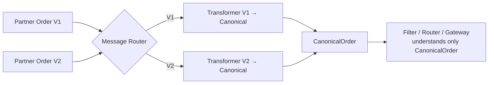
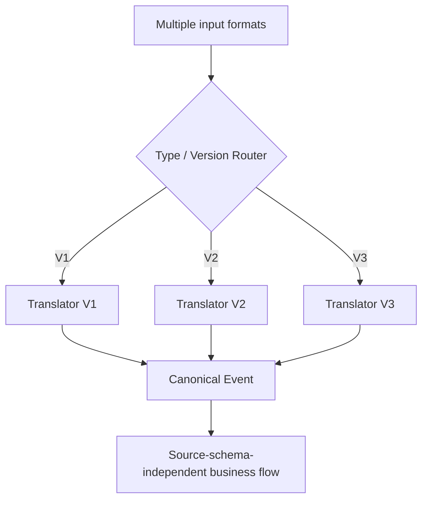
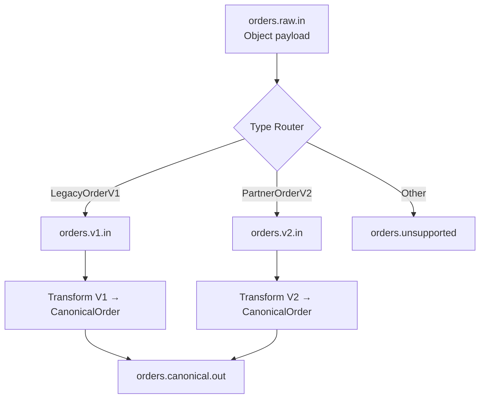
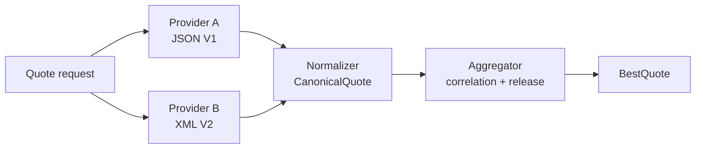

# Comparing Normalizer with Transformer

## 1. One Order, Two Input Formats

A sales application receives messages from the same partner while that partner is migrating APIs:

**V1 format** uses integer cents:

```json
{
  "orderId": "O-204",
  "buyerRef": "C-09",
  "totalCents": 1995,
  "currencyCode": "USD"
}
```

**V2 format** uses a decimal money string:

```json
{
  "externalOrderCode": "O-204",
  "customerReference": "C-09",
  "amountDecimal": "19.95",
  "isoCurrency": "USD"
}
```

Both represent **the same business data**: order `O-204` for customer `C-09` worth 19.95 USD. However, field names, data types, and monetary representation differ.

If you send both payloads directly into Router, Filter, Aggregator, and Gateway, every endpoint must understand both V1 and V2:

```text
Order V1 ─┐
          ├─► Router knowing V1/V2
Order V2 ─┘    └─► Filter knowing V1/V2
                    └─► Business handler knowing V1/V2
                            └─► Audit knowing V1/V2
```

A better approach places a **Normalizer** at the integration boundary:



**Transformer** is the operation of **converting one representation**. **Normalizer** is the **design pattern for bringing multiple different representations into one canonical representation**, typically using a Router and multiple Transformers.

That is the central distinction of **“Comparing Normalizer with Transformer”**, part of the **Normalizer** chapter in the **SPRING_INTEGRATION_PATTERN** module. The module focuses on practicing Enterprise Integration Patterns with Spring Integration to build loosely coupled, extensible message flows—combining Router, Filter, Transformer, Splitter, Aggregator, Gateway, retry, error channel, correlation, plus testing and monitoring processing branches.

After this lesson, you will be able to:

1. State accurately the roles of Normalizer and Transformer in Enterprise Integration Patterns.
2. Choose among a single Transformer, a multi-branch Transformer, or a Normalizer composed of a Router and specialized Transformers.
3. Design a **canonical message contract** that preserves business meaning rather than merely renaming fields.
4. Write Spring Integration Java DSL to route V1/V2 payloads, transform each separately, and unify outputs.
5. Test two equivalent sources, unsupported versions, invalid data, headers/correlation, and processing order.
6. Understand risks when normalizing money, units of measure, time, IDs, schema versions, and tenants.
7. Separate Normalizer from validation, idempotency, Aggregator, Content Enricher, and authorization.
8. Plan operations, observability, migrations, and controlled deprecation of old formats.

## 2. What Is a Transformer?

**Message Transformer** is an Enterprise Integration Pattern that changes the **representation of a message** so the receiver can consume the data.

In Spring Integration, it is typically implemented via a Transformer endpoint or `.transform(...)` operator in Java DSL.

Simple example:

```java
record LegacyPrice(long cents) {}
record CanonicalPrice(java.math.BigDecimal dollars) {}

CanonicalPrice convert(LegacyPrice input) {
    return new CanonicalPrice(
        java.math.BigDecimal.valueOf(input.cents(), 2));
}
```

Given `LegacyPrice(1995)`, the Transformer returns `CanonicalPrice(19.95)`.

A Transformer can:

- Change payload type: `String → OrderDto`.
- Change schema: `LegacyOrder → CanonicalOrder`.
- Change units: `cents → BigDecimal dollars`.
- Change fields/nesting: `buyer.ref → customerId`.
- Convert data into JSON, XML, Avro, or typed objects.
- Translate system A's specific model into system B's specific model.

**A Transformer does not require multiple input formats.** When there is only one source message type and one target, a single Transformer may suffice.

### Does a Transformer Create a New Message?

A transformer in Spring Integration typically processes a `Message<?>` and creates a new output payload or `Message<?>`, depending on API and implementation. The framework supports header propagation/copying in many cases, yet **which headers are kept, overwritten, or dropped depends on how the transform is written and subsequent components**. When business logic depends on `correlationId`, `requestId`, or provenance, test propagation rather than assuming every header survives intact.

## 3. What Is a Normalizer?

In Enterprise Integration Patterns, **Normalizer** answers the question:

> How do you process messages with similar meaning but different structures without forcing every consumer to understand every structure?

Classic structure:

1. **Message Router** identifies the input format/type.
2. Specialized **Message Translators/Transformers** convert each type into a **common format**.
3. Transformed messages enter **one logical output channel**.
4. Downstream consumers rely on a single unified contract.



Normalizer is a **composed pattern**, not necessarily a single Spring Integration class named `Normalizer`. In Java DSL, we commonly wire `route(...)` and `transform(...)`; you can also have separate ingress channels per format, each with its own Transformer converging on a canonical channel.

### Why Does a Normalizer Have Multiple Transformers Inside?

Because each format is usually interpreted differently:

- V1: `totalCents=1995` must be scaled by 100.
- V2: `amountDecimal="19.95"` must be parsed as an exact decimal.
- V3: may carry `gross, discount, tax`; you must define the semantics of “total” before mapping.

One giant Transformer packed with `if/else` blocks can still emit canonical output, yet as versions grow, it becomes harder to own, test, and retire per branch than a clearly structured Normalizer.

## 4. Quick Comparison

| Criterion | Transformer | Normalizer |
| --- | --- | --- |
| **Nature** | Pattern converting a message's representation | Pattern coordinating routing and conversion |
| **Input** | Usually one source contract per transformer | Multiple differing contracts/versions/partners |
| **Output** | One target format per use case | **One common/canonical contract** |
| **Core components** | Transformation function/endpoint | Router plus Translators/Transformers |
| **Variant selection** | May not be needed | Must pick the right converter per source |
| **Adding a new source** | Add/edit transform logic | Add matching route and transformer |
| **Consumers** | Often a specific consumer | Multiple consumers sharing the canonical type |
| **Typical placement** | Anywhere a flow needs format conversion | Ingress / integration boundary / anti-corruption layer |
| **Primary failure** | Wrong mapping/schema/units | Wrong mapping plus wrong route, version mix-up, lost semantics |
| **Solves idempotency?** | No | No |
| **Combines multiple messages into one?** | Not by default | No; that is normally an Aggregator |
| **Authenticates source/tenant itself?** | No | No; needs a separate trust boundary |

**Do not treat them as mutually exclusive techniques.** Normalizer **uses Transformers**; a single Transformer can also act as normalization if a system currently has only one source variant.

## 5. When Is a Single Transformer Enough?

A single Transformer usually suffices when:

- There is only **one authoritative source schema**.
- Multiple versions are not active simultaneously.
- Conversion rules are small, stable, and easy to test.
- Consumers just need a type/unit/format conversion.
- No routing by message kind is needed.
- Changes do not ripple across many consumers.

Example:

```java
@Bean
IntegrationFlow legacyOnly() {
    return IntegrationFlow.from("legacy.orders.in")
        .transform(LegacyOrderV1.class,
            OrderNormalizationRules::fromV1)
        .channel("orders.canonical")
        .get();
}
```

This is still a Transformer producing **canonical output**. Without V2, adding a Router just to invoke the same function lengthens the flow without adding value.

### Do Not Over-Pattern

A system receiving exactly one `OrderCreatedV1` type and mapping it to `CanonicalOrder` does not need three channels, two Routers, and a complex layered diagram. Use the **smallest structure that makes the contract clear**.

The deciding factor is not whether a class is named `Normalizer` or `Transformer`, but **whether you have multiple input representations to unify**.

## 6. When Should You Use a Normalizer?

Normalizer is especially valuable when:

- A partner runs V1 and V2 in parallel during a migration.
- The system consolidates JSON webhooks from multiple providers.
- The same event arrives via REST, CSV import, and broker.
- Legacy data spans multiple historical schemas.
- One downstream business service has multiple upstream producer teams.
- Consumers should never contain `if (sourceVersion == ...)`.
- You want separate mapping ownership and independent contract tests per source.
- You need to track which versions are still active before deprecating them.

Example:

```text
External feed A ─► Transformer A ─┐
                                   │
External feed B ─► Transformer B ──┼─► CanonicalOrder ─► Business flow
                                   │
CSV batch       ─► Transformer CSV ┘
```

Connectors themselves may identify the variant and send to separate channels. In that setup **the Router may live outside the code-expressed Normalizer flow**, yet the pattern's role remains: **accurately classify the variant + convert every variant to one contract**.

## 7. Canonical Models Must Preserve Meaning, Not Just Rename Fields

Changing:

```text
buyerRef → customerId
totalCents → totalAmount
```

is simple mechanical mapping. A proper Normalizer must also answer:

1. Do V1 `buyerRef` and V2 `customerReference` share the **same customer ID scope**?
2. Is `totalCents` **USD cents** or minor units of whichever currency is on the message?
3. Is `amountDecimal` **before or after tax/discounts**?
4. Is there an `orderRevision`/`eventId` to distinguish retries from updates?
5. Do currency codes and timezones follow the same standard?
6. Must source provenance be preserved for audits?
7. Do dropped fields affect downstream business decisions?
8. Do both schemas share the same semantics when a field is missing or null?

If V1 records **gross price** while V2 records **net price**, mapping both into the same `CanonicalOrder.total` corrupts semantics. You then need a richer canonical model or enrichment with enough data to compute the same monetary definition.

### Canonicalization Does Not Mean Erasing Every Difference

A canonical model needs enough data for consumers, not **every field that ever appeared** across all schemas. You can separate:

- **Core domain payload**: fields consumers genuinely use.
- **Provenance metadata**: source system, schema version, input record ID.
- **Audit reference**: pointer to retained raw payload when reconciliation is needed.
- **Processing headers**: verified request/correlation/trace/tenant context.

Never drop fields needed for compliance, reconciliation, or idempotency just because they are absent from an illustrative DTO.

## 8. Canonical Schema and Published Assumptions

The running example uses a **simulated partner** named `PARTNER_ALPHA` with two input schemas agreed to share the same meaning:

- `orderId` and `externalOrderCode` are the same partner order ID.
- `buyerRef` and `customerReference` are the same customer ID within the partner namespace.
- `totalCents` represents **USD cents**.
- `amountDecimal` is a USD string with exact two decimal places.
- Total is the **payable total** after applicable pricing rules.
- V1 and V2 may coexist during migration.
- Each input message represents **one logical order event**; the Normalizer does not deduplicate on its own.
- In production, tenant/source identity must come from **verified ingress**, not only partner JSON.

Canonical payload:

```java
import java.math.BigDecimal;

record CanonicalOrder(
    String sourceSystem,
    String orderId,
    String customerId,
    BigDecimal total,
    String currencyCode) {}
```

Two inputs for **the same order and identical business data** must produce equal `CanonicalOrder` values. Schema/version differences can live in **trusted headers/provenance** without altering the business payload.

Do not treat this `CanonicalOrder` as universal across every domain: orders with multiple line items, taxes, promotions, addresses, and statuses need a fuller model. The goal here is comparing patterns, not modeling an entire commerce domain.

## 9. Source DTOs and Their Differences

```java
// Legacy schema: amount in integer cents.
record LegacyOrderV1(
    String orderId,
    String buyerRef,
    long totalCents,
    String currencyCode) {}

// Newer schema: amount as decimal String.
record PartnerOrderV2(
    String externalOrderCode,
    String customerReference,
    String amountDecimal,
    String isoCurrency) {}
```

Neither type should enter business handlers. They exist solely at the integration boundary to reflect partner contracts.

### An Intentional Mapping Table

| Canonical | V1 | V2 | Rule |
| --- | --- | --- | --- |
| `sourceSystem` | Trusted partner ingress | Trusted partner ingress | Assigned `PARTNER_ALPHA` in demo |
| `orderId` | `orderId` | `externalOrderCode` | Never auto-trim/lowercase |
| `customerId` | `buyerRef` | `customerReference` | Same partner namespace |
| `total` | `totalCents` | `amountDecimal` | USD cents → dollars or decimal parse |
| `currencyCode` | `currencyCode` | `isoCurrency` | Demo accepts only USD |

**Caution:** for currencies without two decimal places (e.g., JPY) or with three (e.g., KWD), you cannot assume every “minor unit” divides by 100. When expanding currencies, define scales per each source's contract rather than sharing `BigDecimal.valueOf(cents, 2)` across all currencies.

## 10. Conversion Code: Each Format Gets Its Own Transformer

The class below has three responsibilities: detecting the variant, converting V1, and converting V2. Conversion rules are **pure functions**: no network calls, no mutable shared state, and no dependency on wall-clock time.

```java
import java.math.BigDecimal;
import java.math.RoundingMode;

final class OrderNormalizationRules {

    private static final String SOURCE = "PARTNER_ALPHA";

    private OrderNormalizationRules() {}

    static String detectVersion(Object payload) {
        if (payload instanceof LegacyOrderV1) {
            return "V1";
        }
        if (payload instanceof PartnerOrderV2) {
            return "V2";
        }
        return "UNSUPPORTED";
    }

    static CanonicalOrder fromV1(LegacyOrderV1 order) {
        if (order == null) {
            throw new IllegalArgumentException(
                "V1 order must not be null");
        }

        requireIdentifier(order.orderId(), "orderId");
        requireIdentifier(order.buyerRef(), "buyerRef");
        requireUsd(order.currencyCode());

        if (order.totalCents() <= 0) {
            throw new IllegalArgumentException(
                "totalCents must be positive");
        }

        BigDecimal amount =
            BigDecimal.valueOf(order.totalCents(), 2);

        return new CanonicalOrder(
            SOURCE,
            order.orderId(),
            order.buyerRef(),
            amount,
            "USD");
    }

    static CanonicalOrder fromV2(PartnerOrderV2 order) {
        if (order == null) {
            throw new IllegalArgumentException(
                "V2 order must not be null");
        }

        requireIdentifier(
            order.externalOrderCode(), "externalOrderCode");
        requireIdentifier(
            order.customerReference(), "customerReference");
        requireUsd(order.isoCurrency());

        // Demo contract: positive decimal, exact two decimal places,
        // at most 9 digits before the decimal point, no exponent.
        String text = order.amountDecimal();
        if (text == null
                || !text.matches("[0-9]{1,9}\\.[0-9]{2}")) {
            throw new IllegalArgumentException(
                "Invalid decimal amount");
        }

        BigDecimal amount = new BigDecimal(text)
            .setScale(2, RoundingMode.UNNECESSARY);

        if (amount.signum() <= 0) {
            throw new IllegalArgumentException(
                "Amount must be positive");
        }

        return new CanonicalOrder(
            SOURCE,
            order.externalOrderCode(),
            order.customerReference(),
            amount,
            "USD");
    }

    private static void requireIdentifier(
            String value,
            String name) {
        if (value == null
                || !value.matches("[A-Z0-9-]{1,40}")) {
            throw new IllegalArgumentException(
                "Invalid " + name);
        }
    }

    private static void requireUsd(String currencyCode) {
        if (!"USD".equals(currencyCode)) {
            throw new IllegalArgumentException(
                "Only USD is supported by this demo");
        }
    }
}
```

### Why Use BigDecimal?

Money should not be computed with `double` because binary floating point cannot represent decimal fractions exactly. `BigDecimal.valueOf(1995, 2)` creates 19.95 at scale 2. `new BigDecimal("19.95")` also constructs an exact decimal value.

The two branches do not share one parse routine because **their source formats differ**. That is a solid reason to keep two separate Transformers.

### Why Not Silently Round?

If a source sends `"19.955"` while the contract demands two decimal places, default rounding can create a financially wrong transaction. The example validates format before constructing values. In production, specify rounding per operation type and never pick an unapproved rule on your own.

### What This Code Does Not Yet Address

- Partner authentication, tenant authorization, and source provenance.
- Payload size limits and JSON adapter schema versioning.
- Currencies other than USD.
- Tax, discounts, refunds, status, or multiple order lines.
- Deduplication when V1 and V2 both emit the same logical event.
- External service lookups to resolve customer references.
- Error responses or dead-letter retention.
- Downstream transactions and side effects.

Those belong in separate layers; never cram everything into one conversion just because a class is named `Normalizer`.

## 11. Spring Integration Java DSL: Router + Two Transformers

In this example, one `orders.raw.in` channel receives two payload types. A Router picks the right branch; both branches transform into `CanonicalOrder` and send to a shared output channel.



Sample configuration using Spring Integration Java DSL:

```java
import org.springframework.context.annotation.Bean;
import org.springframework.context.annotation.Configuration;
import org.springframework.integration.channel.DirectChannel;
import org.springframework.integration.channel.QueueChannel;
import org.springframework.integration.config.EnableIntegration;
import org.springframework.integration.dsl.IntegrationFlow;

@Configuration
@EnableIntegration
public class OrderNormalizerConfig {

    @Bean("orders.raw.in")
    DirectChannel rawOrders() {
        return new DirectChannel();
    }

    @Bean("orders.v1.in")
    DirectChannel v1Orders() {
        return new DirectChannel();
    }

    @Bean("orders.v2.in")
    DirectChannel v2Orders() {
        return new DirectChannel();
    }

    @Bean("orders.unsupported")
    QueueChannel unsupportedOrders() {
        return new QueueChannel();
    }

    @Bean("orders.canonical.out")
    QueueChannel canonicalOrders() {
        return new QueueChannel();
    }

    @Bean
    IntegrationFlow detectOrderVersion() {
        return IntegrationFlow.from("orders.raw.in")
            .route(
                Object.class,
                OrderNormalizationRules::detectVersion,
                spec -> spec
                    .channelMapping("V1", "orders.v1.in")
                    .channelMapping("V2", "orders.v2.in")
                    .defaultOutputChannel(
                        "orders.unsupported"))
            .get();
    }

    @Bean
    IntegrationFlow normalizeOrderV1() {
        return IntegrationFlow.from("orders.v1.in")
            .transform(
                LegacyOrderV1.class,
                OrderNormalizationRules::fromV1)
            .channel("orders.canonical.out")
            .get();
    }

    @Bean
    IntegrationFlow normalizeOrderV2() {
        return IntegrationFlow.from("orders.v2.in")
            .transform(
                PartnerOrderV2.class,
                OrderNormalizationRules::fromV2)
            .channel("orders.canonical.out")
            .get();
    }
}
```

### Important Details About the Configuration

- `route(...)` **selects the translator**; it does not transform data itself.
- Each `transform(...)` **handles only one source schema**.
- Both branches converge on the same `CanonicalOrder` contract.
- `orders.unsupported` receives **messages whose payload type is unrecognized**; it is not a catch-all for exceptions.
- `orders.canonical.out` is a `QueueChannel` for testing; in production it would feed validation/domain services rather than necessarily being an in-memory queue.
- `DirectChannel`s make the example synchronous; transform errors propagate back to the sender rather than entering `orders.unsupported` automatically.
- Do not subscribe two service activators to one `DirectChannel` expecting both to receive every message; `DirectChannel` dispatches point-to-point. The Router here dispatches explicitly to the right branch.
- DSL overloads and endpoint specs must be verified against your actual Spring Integration dependency version when building; STEP 4 did not run compilation.

### Why Isn't the Shared Output Channel an Aggregator?

Each V1 or V2 input turns into **one individual output**. The shared channel is simply a convergence point (*fan-in*) for normalized messages—it **does not wait for a group of N messages** and produces no multi-message summary.

This is a **Normalizing Message Flow**, not Aggregation. If the business wants to combine 10 order lines into one order total, add Splitter/Aggregator and dedicated correlation/release policies.

## 12. The Router Need Not Always Be Written Inside the Same Flow

Another topology uses two independent adapters/ingresses:

```text
HTTP /legacy/order → LegacyOrderV1 → Transformer V1 ─┐
                                                      ├→ CanonicalOrder
Kafka topic order-v2 → PartnerOrderV2 → Transformer V2 ┘
```

Each transport already knows the variant by endpoint, topic, or schema ID. Then no in-app `instanceof` Router is needed. **Pattern-wise, the system still performs normalization**, because multiple source representations are translated into one shared contract.

You can write:

```java
@Bean
IntegrationFlow legacyIngress() {
    return IntegrationFlow.from("partner.legacy.in")
        .transform(LegacyOrderV1.class,
            OrderNormalizationRules::fromV1)
        .channel("orders.canonical.out")
        .get();
}

@Bean
IntegrationFlow modernIngress() {
    return IntegrationFlow.from("partner.modern.in")
        .transform(PartnerOrderV2.class,
            OrderNormalizationRules::fromV2)
        .channel("orders.canonical.out")
        .get();
}
```

Do not register **both** this alternative configuration and section 11's configuration with the same channel/bean names in one context without redesigning the topology. This is an **architectural alternative for comparison**, not a mandatory block to append to the sample config.

## 13. Can a Multi-Branch Transformer Replace a Normalizer?

You could write one Transformer accepting `Object`:

```java
CanonicalOrder convert(Object payload) {
    if (payload instanceof LegacyOrderV1 v1) {
        return OrderNormalizationRules.fromV1(v1);
    }
    if (payload instanceof PartnerOrderV2 v2) {
        return OrderNormalizationRules.fromV2(v2);
    }
    throw new IllegalArgumentException(
        "Unsupported order payload");
}
```

and use one `.transform(Object.class, this::convert)` endpoint.

**Functionally**, this still normalizes variants into a canonical model. **Structurally as a pattern**:

- Branching rules are embedded inside one Transformer.
- At 10–20 versions, the class balloons.
- Routing unsupported variants to a dedicated rejection channel becomes awkward.
- Validation, routing, mapping, and retry easily get tangled together.
- Teams owning individual partners/versions struggle to modify independently.

**It is not always wrong.** With just two simple variants, a multi-branch Transformer can stay readable and easy to test. Choose Router + translators when **diversity, ownership boundaries, and extensibility** make branch separation worthwhile.

### Selection Rules

| Need | Suggested Choice |
| --- | --- |
| One source schema → one target schema | One Transformer |
| Two small, rarely changing variants | Multi-branch Transformer or Router + Transformers |
| Many versions/partners with distinct policies | Normalizer with Router and dedicated mappings |
| Inputs already split by topic/endpoint | Multiple ingresses + Transformers sharing one output |
| Separate provenance/error flows per variant | Normalizer with explicit branches |
| Combining multiple messages | Aggregator, not Normalizer |
| Enriching from external data | Content Enricher + validation, not mere renaming |
| Filtering invalid messages | Validation/Filter; do not call every Filter a Normalizer |

## 14. Integration Test: V1 and V2 Both Produce CanonicalOrder

Use JUnit 5, Spring Test, and AssertJ. The test sends both versions representing the same meaning through the Router and reads from the shared output.

```java
import static org.assertj.core.api.Assertions.assertThat;

import org.junit.jupiter.api.Test;
import org.springframework.beans.factory.annotation.Autowired;
import org.springframework.beans.factory.annotation.Qualifier;
import org.springframework.integration.channel.QueueChannel;
import org.springframework.messaging.Message;
import org.springframework.messaging.MessageChannel;
import org.springframework.messaging.support.MessageBuilder;
import org.springframework.test.context.junit.jupiter.SpringJUnitConfig;

@SpringJUnitConfig(OrderNormalizerConfig.class)
class OrderNormalizerFlowTest {

    @Autowired
    @Qualifier("orders.raw.in")
    MessageChannel input;

    @Autowired
    @Qualifier("orders.canonical.out")
    QueueChannel normalized;

    @Autowired
    @Qualifier("orders.unsupported")
    QueueChannel unsupported;

    private LegacyOrderV1 legacy(String orderId) {
        return new LegacyOrderV1(
            orderId, "C-09", 1995, "USD");
    }

    private PartnerOrderV2 modern(String orderId) {
        return new PartnerOrderV2(
            orderId, "C-09", "19.95", "USD");
    }

    private void send(Object payload, String traceId) {
        assertThat(input.send(
            MessageBuilder.withPayload(payload)
                .setHeader("requestId", traceId)
                .build())).isTrue();
    }

    @Test
    void equivalentV1AndV2BecomeSameCanonicalOrder() {
        send(legacy("O-204"), "request-v1");
        send(modern("O-204"), "request-v2");

        Message<?> first = normalized.receive(1_000);
        Message<?> second = normalized.receive(1_000);

        assertThat(first).isNotNull();
        assertThat(second).isNotNull();
        assertThat(first.getPayload())
            .isInstanceOf(CanonicalOrder.class);
        assertThat(second.getPayload())
            .isInstanceOf(CanonicalOrder.class);

        CanonicalOrder canonicalV1 =
            (CanonicalOrder) first.getPayload();
        CanonicalOrder canonicalV2 =
            (CanonicalOrder) second.getPayload();

        assertThat(canonicalV1)
            .isEqualTo(canonicalV2);

        assertThat(canonicalV1.orderId()).isEqualTo("O-204");
        assertThat(canonicalV1.customerId()).isEqualTo("C-09");
        assertThat(canonicalV1.currencyCode()).isEqualTo("USD");
        assertThat(canonicalV1.total())
            .isEqualByComparingTo(
                new java.math.BigDecimal("19.95"));

        assertThat(first.getHeaders().get("requestId"))
            .isEqualTo("request-v1");
        assertThat(second.getHeaders().get("requestId"))
            .isEqualTo("request-v2");

        assertThat(normalized.receive(0)).isNull();
    }

    @Test
    void unsupportedVersionIsSeparatedFromCanonicalOutput() {
        record OrderV3(String eventId) {}

        send(new OrderV3("evt-3"), "request-unsupported");

        Message<?> rejected = unsupported.receive(1_000);
        assertThat(rejected).isNotNull();
        assertThat(rejected.getPayload())
            .isInstanceOf(OrderV3.class);

        assertThat(normalized.receive(0)).isNull();
    }

    @Test
    void eachValidInputCreatesOneOutputMessage() {
        send(legacy("O-205"), "req-205");
        send(modern("O-206"), "req-206");

        CanonicalOrder a = (CanonicalOrder)
            normalized.receive(1_000).getPayload();
        CanonicalOrder b = (CanonicalOrder)
            normalized.receive(1_000).getPayload();

        assertThat(a.orderId()).isEqualTo("O-205");
        assertThat(b.orderId()).isEqualTo("O-206");
        assertThat(normalized.receive(0)).isNull();
    }
}
```

### What Does This Test Prove?

- The Router picks the right Transformer for both payload types.
- Both Transformers produce the same **canonical contract**.
- Monetary amounts convert accurately from cents and decimals.
- Messages of unsupported variants **never enter the canonical channel**.
- In the synchronous demo flow, the `requestId` header propagates across transformation for observation.
- Each valid input produces one output; **no grouping/aggregation happens**.

### What This Test Does NOT Prove

- Real JSON adapters bind V1/V2 schemas accurately.
- Partner identity/tenant is authenticated.
- Durable storage/brokers, ordering, or multi-instance retries work.
- Idempotency when V1 and V2 both send **the same logical event**.
- Header mapping across Kafka/AMQP/HTTP.
- Schema evolution/rolling deploys outside the simulated test.
- Downstream side effects commit exactly once.

Add integration tests against real adapters, brokers, and storage when required by your system.

### Keeping Tests Isolated

`QueueChannel`s can be shared when Spring Test caches contexts; tests must drain their own messages, use distinct IDs, or isolate fixtures. When running tests in parallel, use separate contexts/channels so two tests do not read each other's outputs. Never depend on JUnit execution order.

## 15. Unit Testing Each Transformer Individually

In practice, Normalizers benefit greatly from **per-variant contract tests**.

```java
import static org.assertj.core.api.Assertions.assertThat;
import static org.assertj.core.api.Assertions.assertThatThrownBy;

import java.math.BigDecimal;

import org.junit.jupiter.api.Test;

class OrderNormalizationRulesTest {

    @Test
    void v1CentsAndV2DecimalHaveEquivalentMeaning() {
        CanonicalOrder v1 = OrderNormalizationRules.fromV1(
            new LegacyOrderV1("O-204", "C-09", 1995, "USD"));

        CanonicalOrder v2 = OrderNormalizationRules.fromV2(
            new PartnerOrderV2(
                "O-204", "C-09", "19.95", "USD"));

        assertThat(v1).isEqualTo(v2);
        assertThat(v1.total())
            .isEqualByComparingTo(new BigDecimal("19.95"));
    }

    @Test
    void rejectsZeroOrNegativeAmounts() {
        assertThatThrownBy(() ->
            OrderNormalizationRules.fromV1(
                new LegacyOrderV1(
                    "O-204", "C-09", 0, "USD")))
            .isInstanceOf(IllegalArgumentException.class);

        assertThatThrownBy(() ->
            OrderNormalizationRules.fromV2(
                new PartnerOrderV2(
                    "O-204", "C-09", "-19.95", "USD")))
            .isInstanceOf(IllegalArgumentException.class);
    }

    @Test
    void rejectsUnexpectedCurrency() {
        assertThatThrownBy(() ->
            OrderNormalizationRules.fromV1(
                new LegacyOrderV1(
                    "O-204", "C-09", 1995, "JPY")))
            .isInstanceOf(IllegalArgumentException.class);
    }

    @Test
    void rejectsV2AmountWithExtraFractionalDigit() {
        assertThatThrownBy(() ->
            OrderNormalizationRules.fromV2(
                new PartnerOrderV2(
                    "O-204", "C-09", "19.955", "USD")))
            .isInstanceOf(IllegalArgumentException.class);
    }

    @Test
    void detectsKnownTypesOnly() {
        assertThat(OrderNormalizationRules.detectVersion(
            new LegacyOrderV1(
                "O-204", "C-09", 1995, "USD")))
            .isEqualTo("V1");

        assertThat(OrderNormalizationRules.detectVersion(
            new PartnerOrderV2(
                "O-204", "C-09", "19.95", "USD")))
            .isEqualTo("V2");

        assertThat(OrderNormalizationRules.detectVersion(
            "unknown payload"))
            .isEqualTo("UNSUPPORTED");
    }
}
```

**You do not need to boot a full Spring context to test every field mapping.** Pure Java unit tests cover boundary values, nulls, type mismatches, and scales much faster. Spring integration tests focus on **routing, channel wiring, error paths, and header propagation**.

## 16. Testing That Invalid V2 Does Not Become an Unsupported Variant

An essential distinction:

- **Unsupported variant:** payload belongs to a type/schema for which the app **has no converter**.
- **Invalid content:** payload has a known type (V2) yet its data **is invalid**.

Example:

```text
PartnerOrderV2(amountDecimal="ABC")
  → Router picks V2 accurately.
  → V2 Transformer fails to parse.
  → Validation/transform exception.
  ≠ Unsupported schema.
```

If all errors dump into the same `orders.unsupported` channel, operators may wrongly assume an adapter is missing when the partner actually sent malformed content.

For the synchronous flow, an integration test:

```java
@Test
void invalidKnownVariantFailsBeforeCanonicalOutput() {
    PartnerOrderV2 invalid = new PartnerOrderV2(
        "O-207", "C-09", "19.955", "USD");

    assertThatThrownBy(() -> input.send(
        MessageBuilder.withPayload(invalid).build()))
        .isInstanceOf(RuntimeException.class);

    assertThat(normalized.receive(0)).isNull();
}
```

Place this test **inside** `OrderNormalizerFlowTest` and add the static import:

```java
import static org.assertj.core.api.Assertions.assertThatThrownBy;
```

In Spring Integration, exceptions may be wrapped in `MessageTransformationException`, `MessageHandlingException`, or another wrapper depending on endpoint/adapter. Tests verify **failure behavior and absence of canonical output**, without coupling tightly to wrapper message text.

## 17. Error Handling for Multi-Variant Normalizers

A Normalizer introduces an additional failure point beyond a single Transformer: **input classification**.

| Scenario | Where Detected | Suggested Response |
| --- | --- | --- |
| Unknown schema/version | Router | Unsupported input channel, quarantine, version metric |
| Known schema with invalid fields | Transformer/validation | Reject with field code and schema version |
| Spoofed schema version | Trusted ingress/router | Deny/audit; never guess from content |
| Amount cannot convert accurately | Transformer | Reject; never silently round |
| Unclear mapping semantics | Contract/test/review | Block new version release or escalate review |
| Dependency lookup unavailable | Enricher/adapter | Bounded retry/backoff within deadline |
| External consumer unavailable | Downstream Gateway | Retry output with idempotency key |
| Correlation lost after transform | Integration test/header mapping | Fix mapping/provenance; never mint random IDs |
| Duplicate event from V1 and V2 | Idempotent Receiver/downstream | Use stable event/business identity |
| Cross-tenant message | Authentication/authorization boundary | Security reject; never normalize across tenants |
| Oversized input/schema bomb | Adapter/ingress limit | Reject before expensive parsing |
| Canonical model violates business rules | Domain validation | Fail or quarantine; never invent fake defaults |

**Never assume every exception automatically flows to the global `errorChannel`.** On synchronous `DirectChannel`s, exceptions propagate to the sender; on pollers, executors, and broker listeners, errors follow endpoint error/recovery configuration. Test real error paths and verify ACK/retry/DLQ behavior.

### Never Build a Fake `CanonicalOrder` Just to Keep the Flow Alive

An anti-pattern:

```java
try {
    return fromV2(order);
} catch (Exception ex) {
    return new CanonicalOrder(
        "PARTNER_ALPHA", "UNKNOWN",
        "UNKNOWN", BigDecimal.ZERO, "USD");
}
```

Downstream consumers might treat it as a valid zero-dollar order and trigger wrong side effects. When core data is missing, **rejecting/quarantining with a reason** is far safer than fabricating a default payload.

## 18. Does Normalizer Replace Validation?

**No.** Normalizer focuses on **unifying representation**. Validation protects the **data contract** and may sit before, inside, or after transformation depending on conditions.

Suggested boundaries:

```text
External payload
    │
    ├─ Trusted ingress: authenticate source, check payload size/version
    ▼
Version/Type Router
    │
    ├─ V1 Transformer: parse + check V1 invariants
    └─ V2 Transformer: parse + check V2 invariants
    ▼
CanonicalOrder (typed, immutable)
    │
    ├─ Domain validation: new business invariants
    ▼
Business flow / side effect
```

You do not need to re-run **the exact same `orderId` regex** after every Transformer, Router, and Gateway once verified within a trusted, immutable scope. However, when messages **cross from another source**, **mutate**, or **drive consequential decisions**, validation is warranted.

### Canonical Invariants

Ensure the canonical DTO always enforces:

- Non-empty, properly namespaced `orderId`/`customerId`.
- Positive `total` with currency-matching scale/precision.
- Supported `currencyCode`.
- Ingress-verified `sourceSystem`.
- No required fields filled with `"UNKNOWN"` to mask errors.

Enforce invariants inside validated factories or value objects rather than duplicating Filters on every channel.

## 19. Normalizer Is Not a Content Enricher

A Transformer normally maps fields **already present**. Sometimes, though, inputs lack data needed to build the canonical model:

```text
V1:
  customerRef = 81

Canonical:
  customerId = "C-009"
```

If mapping `81 → C-009` requires querying a directory API, normalization must coordinate with a **Content Enricher** or a contracted lookup service.

Account for:

- Tenant/source namespacing on the lookup key.
- 404s, stale entries, timeouts, or updated mapping revisions.
- Whether replaying the same logical event a day later yields a **different canonical value**.
- Snapshots/versioning to guarantee reproducibility.
- Batching/caching lookups to avoid N+1 calls.
- Retrying when the directory is unavailable instead of substituting `customerId="UNKNOWN"`.

A **Normalizer** may **include an enrichment step** when necessary, yet Normalizer does not turn every data enrichment into pure format conversion. Whenever external lookups are used, explicitly document state, dependencies, retries, and failure handling.

## 20. Normalizer Is Not an Aggregator or Resequencer

| Pattern | Problem Solved | Example |
| --- | --- | --- |
| Transformer | Changes one message's representation | `totalCents → BigDecimal` |
| Normalizer | Brings multiple equivalent formats to one contract | V1/V2/CSV → `CanonicalOrder` |
| Aggregator | **Multiple messages** into **one result** | 3 line events → `OrderSummary` |
| Resequencer | Replays parts of a sequence in order | 3,1,2 → 1,2,3 |
| Router | Selects a message's path | `schemaVersion=2` → V2 converter |
| Filter | Accepts or rejects | Drops ineligible orders |
| Claim Check | Replaces large payload with claim reference | Stores 12 MB, passes token |
| Idempotent Receiver | Prevents applying the same logical operation twice | Redelivered event causes no duplicate side effect |

A Normalizer can sit **ahead of an Aggregator** so replies from diverse providers share one schema before grouping. Even then, the Aggregator still needs correlation, expected parts, and a release strategy.

### Coordination Example in Scatter–Gather



If you only normalize payloads and configure the Aggregator to release on `group.size()==2`, two duplicate replies from Provider A could satisfy the count as if from two providers. Normalizer **does not replace** responder identity, deduplication, correlation, or group lifecycle.

## 21. Idempotency: Two Identical Canonical Messages Are Not Always Duplicates

During migration, a partner might emit **the same order event** over both V1 and V2:

```text
V1 eventId=evt-77 → CanonicalOrder(O-204, 19.95 USD)
V2 eventId=evt-77 → CanonicalOrder(O-204, 19.95 USD)
```

The Normalizer converts both into canonical messages with identical payloads. **That is correct for representation.** Yet if downstream creates two payment charges from them, that is an **idempotency bug**.

An idempotency key must identify the **logical event/operation**, e.g.:

```text
(tenantId, sourceSystem, logicalEventId, handlerOperation)
```

Do not rely on:

- Fresh `MessageHeaders.ID` after a Transformer.
- Delivery attempt headers or timestamps.
- Hashing the whole canonical payload when two valid orders can share the same amount and fields.
- Bare `orderId` when one order undergoes multiple updates, revisions, or actions.

If V1 and V2 lack a stable `eventId`, the Normalizer cannot reliably infer duplicates from matching content alone. Establish a producer contract or an authoritative operation ledger.

### Mapping Must Not Accidentally Alter Idempotency Semantics

V2 might add `eventRevision` or `operationId`. Dropping them in the mapper prevents downstream from telling apart:

- Redelivery of the same update.
- A new update on the same order.
- An intentional reprocessing run.

Keep idempotency identity in headers or a well-defined canonical envelope, verifying header mapping across adapters and trust boundaries.

## 22. Headers, Correlation, and Provenance Across Conversion

A business message has at least two layers:

```text
Message:
  payload: PartnerOrderV2(...)
  headers:
    requestId
    correlationId
    sourceSystem
    sourceSchemaVersion
    tenantId (trusted)
    eventId
    traceId
```

After normalization, you usually want:

```text
Message:
  payload: CanonicalOrder(...)
  headers:
    requestId, correlationId, sourceSystem,
    sourceSchemaVersion, tenantId, eventId, traceId
```

**Not every header is preserved automatically.** A Transformer returning a payload is wrapped into a message per endpoint semantics; a Transformer returning a full `Message<?>` controls headers explicitly. Network adapters may apply their own header mappers.

Points to test:

| Metadata | Purpose | Risk |
| --- | --- | --- |
| `requestId` | Request tracing | Lost after manual message building |
| `correlationId` | Grouping replies/parts | Aggregator creates wrong groups |
| `sequenceNumber/sequenceSize` | Splitter/Resequencer | Fails to release or scrambles order |
| `eventId` | Idempotency | Consumer mints new ID and reprocesses |
| `sourceSchemaVersion` | Audit/migration | Unknown which mapping ran |
| `sourceSystem` | Provenance/tenant authorization | Client spoofs source |
| `tenantId` | Data partitioning | Untrusted header causes tenant mixing |
| `replyChannel/errorChannel` | Request–reply/error routing | Channel objects unserializable over transports |

**Rule:** business identity and trusted context require clear ownership and propagation contracts; never assume natural field mapping preserves all headers.

## 23. Do Not Determine Version by Guessing Missing Fields

An anti-pattern:

```java
String detect(Map<String, Object> map) {
    return map.containsKey("buyerRef") ? "V1" : "V2";
}
```

Problems:

- An invalid V1 missing `buyerRef` is misclassified as V2.
- A V3 schema with new fields is also misclassified as V2.
- A valid payload could contain both old and new fields.
- Producers can add unknown fields on their own.
- When version selects monetary mapping, guessing wrongly produces wrong amounts.

**Prefer** determining the variant from an authoritative source:

1. Endpoint, route, topic, or partner account.
2. Verified `Content-Type` or schema registry ID.
3. Validated, authorized envelope `schemaVersion`.
4. Payload type already deserialized by the **matching adapter**.

The Type Router in the example runs after payloads are constructed as `LegacyOrderV1` or `PartnerOrderV2`. It does **not** classify an unknown-version raw JSON string. Raw JSON must be parsed/routed by ingress contract before becoming a typed payload.

### If Sniffing Legacy Data Is Unavoidable

Sometimes a legacy source truly omits versions. In that case:

- Define a detector with explicit ambiguity handling.
- Route ambiguous inputs to reject/quarantine rather than defaulting to a newer type.
- Maintain contract tests against historical payloads.
- Track detector confidence and ambiguous-payload metrics.
- Prioritize protocol upgrades so producers emit explicit schema/version metadata.
- Never allow callers to self-declare a variant to bypass stricter validation branches.

## 24. Unifying Outputs and Ownership

Two ways to organize output channels:

**One canonical channel:** all branches send `CanonicalOrder` to `orders.canonical.out`. Downstream consumers subscribe or poll here. Simple when the shared contract is stable.

**Multiple canonical domain streams:** if partners emit events with different meanings (`OrderCreated`, `OrderCancelled`, `RefundRequested`), do not force all of them into `CanonicalOrder` just because “order” is in the name. Normalize per **event type**:

```text
LegacyOrderCreated  ─┐
ModernOrderCreated  ─┼─► CanonicalOrderCreated
CSVOrderCreated     ─┘

LegacyOrderCancelled ─┐
ModernOrderCancelled ─┼─► CanonicalOrderCancelled
```

This follows the principle of designing canonical models by **semantics**, not the convenience of one nullable catch-all table.

### Avoid a “God Canonical DTO”

A shared schema with 100 fields where 80 are optional leads to:

- Consumers unsure which fields are trustworthy per variant.
- Silent null mappings causing business bugs.
- Bloating the shared DTO with every new schema.
- Semantically different versions forced into one model.
- Changes for one partner impacting every consumer.

Instead, split **canonical event types** by domain and use versioned contracts with compatibility policies.

## 25. Schema Evolution: Adding V3 Properly

Suppose the partner announces V3:

```json
{
  "order": "O-204",
  "buyer": {"ref": "C-09"},
  "subTotal": "18.00",
  "tax": "1.95",
  "total": "19.95",
  "currency": "USD"
}
```

If `total` shares the exact meaning of canonical `total`, add:

1. Exact `PartnerOrderV3` DTO matching the schema.
2. V3 → `CanonicalOrder` Transformer, verifying `subTotal + tax == total` if required by business contract.
3. V3 Router mapping.
4. V3 test vectors and equivalence tests against V1/V2 for identical business facts.
5. Tests for invalid/missing fields and header propagation.
6. Feature flags/canaries and adoption metrics.
7. V1/V2 retention and rollback compatibility.

**Do not tack an `else` merging V3 into V2 just because field names look similar.** Each version needs its own translator or versioned, tested adapter.

### When V3 Cannot Convert Without Losing Meaning

Suppose V3 introduces discount rules so `total` is no longer equivalent to V1. Three options:

- **Extend the canonical contract** compatibly to express the new semantics.
- **Create a new canonical event type** and route downstream appropriately.
- **Reject / mark unsupported** until business design is ready.

Never silently drop critical fields and claim “the Normalizer now supports V3”.

## 26. Changing the Canonical Model and Rolling Deployments

When the canonical schema changes, impact can reach every consumer—for example, adding `taxInclusive` and changing the meaning of `total`.

Version along two separate axes:

| Axis | Example | Rule |
| --- | --- | --- |
| **Source schema** | V1, V2, V3 | Each translator knows its exact source contract |
| **Canonical schema** | `canonical-v1`, `canonical-v2` | Consumers manage compatibility/migration independently |

A partner upgrading V2 → V3 **does not force** the canonical contract to change if existing semantics remain sufficient. Yet changing canonical `total`'s meaning is a shared domain change, not a local mapping refactor.

### Rolling Deployment Scenario

```text
Instance A: supports input V1/V2 → canonical-v1
Instance B: supports input V1/V2/V3 → canonical-v1

Later:
Instance C: supports V2/V3 → canonical-v2
```

If a caller sends V3 through a load balancer to A, A must **reject/quarantine safely**, never guess V2. If consumers cannot yet read `canonical-v2`, use version negotiation or a compatibility plan.

Ensure:

- Golden fixtures for every source schema.
- Contract tests for every canonical event type.
- Monitoring actual version shares before removing the V1 branch.
- Tracking DLQ/replay queues for remaining V1 messages.
- A plan to replay historical events through older converters.
- Preventing version routing from changing the semantics of the same logical event across instances.

## 27. Performance: Where Is Normalization Most Cost-Effective?

A Normalizer can reduce downstream complexity:

Without normalization:

```text
3 source formats × 5 consumers ≈ 15 places understanding/mapping variants.
```

With a Normalizer:

```text
3 source mappers + 5 canonical consumers ≈ 8 contract boundaries.
```

That is a **mental model of dependency points**, not a performance benchmark or linear code-size law. Normalization adds routing and translation overhead, yet typically cuts duplicated logic and schema bugs.

### Avoid Unnecessary Overhead

- Converting JSON → String → Map → JSON → DTO repeatedly.
- Calling remote APIs inside every Transformer when batched/cached enrichment works.
- Serializing and re-deserializing the same object just to switch classes.
- Copying large payloads repeatedly when streaming or Claim Check fits.
- Funneling all traffic through one centralized bottleneck service when pure mappings can scale by partition.
- Bloating canonical objects with fields irrelevant to the event type.
- Logging sensitive raw payloads for every source just to debug conversions.
- Re-validating unchanged invariants after every endpoint.

Still, **never sacrifice business correctness** for raw throughput. With money, timezones, or addresses, verifying precision outweighs a few microseconds.

## 28. Metrics and Observability

A Normalizer is healthy only when versions, branches, failures, and canonical outputs are visible.

Suggested structured log:

```text
event=normalization_completed
sourceSystem=PARTNER_ALPHA
sourceSchemaVersion=V2
canonicalSchemaVersion=canonical-v1
requestRef=req-204
result=SUCCESS
converter=OrderV2Translator
durationMs=3
```

On failure:

```text
event=normalization_rejected
sourceSystem=PARTNER_ALPHA
sourceSchemaVersion=V2
errorCode=AMOUNT_FORMAT_INVALID
retryable=false
```

These are **application-suggested log/metric schemas**, not auto-emitted by the framework. Avoid logging full payloads containing PII, tokens, or sensitive financial data.

| Metric | Question |
| --- | --- |
| `normalizer.input.total{source,version}` | Input share by version |
| `normalizer.output.total{canonicalType}` | How many canonical events were emitted? |
| `normalizer.unsupported.total{source}` | Are unsupported variants arriving? |
| `normalizer.invalid.total{version,reason}` | Which fields fail most often? |
| `normalizer.duration{version}` | Which mapper is slow? |
| `normalizer.mapping.conflict.total` | Are semantic mismatches or version conflicts occurring? |
| `normalizer.schema.version.usage` | How is the V1/V2/V3 migration progressing? |
| `normalizer.downstream.error.total` | What errors do canonical consumers hit? |
| `normalizer.duplicate.event.total` | Are logical events emitted across multiple variants? |
| `normalizer.header.missing.total{header}` | Are provenance or correlation headers disappearing? |

Metric names are illustrative only. Never use `orderId`, `customerId`, `eventId`, or trace IDs as high-cardinality metric labels.

### Tracing

Useful span and tags:

```text
span: order.normalize
tags:
  source.system=PARTNER_ALPHA
  source.schema=V2
  canonical.schema=canonical-v1
  route=orders.v2.in
  outcome=SUCCESS
```

Tracing V1 vs. V2 paths distinguishes **routing** bugs from **conversion** bugs, preventing wasted fixes on Transformers when the schema detector is at fault.

## 29. Common Mistakes

| Symptom | Possible Cause | Where to Check |
| --- | --- | --- |
| V1 amounts 100x larger than V2 | Forgot to divide cents by 100 | Minor-unit contract, `BigDecimal` scale |
| JPY treated like USD cents | Hard-coded scale 2 for all currencies | Per-currency/per-source minor-unit semantics |
| Valid JSON misrouted as V2 | Guessed version from missing fields | Trusted schema discriminator |
| Invalid V2 reported as unsupported | Validation exceptions routed to unsupported | Separate unknown type from invalid content |
| V3 converter drops tax/discounts | Canonical model lacks expressiveness | Semantic mapping review |
| Message loses `correlationId` after transform | Header not mapped/copied | Header propagation integration test |
| Same order processed twice | Partner sent V1 and V2 for one event | Idempotent Receiver / operation ID |
| Two distinct orders treated as duplicates | Payload hash used as key | Stable business identity |
| Outputs pile up in queue | Missing consumer/poller or capacity issue | Check channel topology |
| Two branches both receive one input unexpectedly | Wrong PublishSubscribe/Router topology | Check channel semantics and subscriptions |
| Consumers fail to read `canonical-v2` | Schema deployment skew | Compatibility / rolling migration |
| Cannot replay V1 DLQ | Old converter deleted too early | Retention / version support |
| Consumers inspect V1/V2 themselves | Normalizer placed at wrong boundary | Move canonicalization ahead of business flow |
| Source spoofs tenant | Trusted incoming JSON/headers | Trusted ingress / authentication |
| Tests pass, broker prod fails | Header mapping/serialization differs | Test real transport and error handlers |
| Latency climbs rapidly | N+1 enrichment or repeated parsing | Measure converter latency/dependency calls |

## 30. Pre-Production Design Checklist

- [ ] Every input schema/version has a documented contract and authenticated source.
- [ ] Clear justification exists for why variants share **the same business meaning**.
- [ ] Canonical event types have explicit semantics, field ownership, and versioning.
- [ ] No God DTO bloated with dozens of nullable fields.
- [ ] Router selects variants by trusted metadata/type, never guessing from missing fields.
- [ ] Unsupported types and invalid content take separate error paths.
- [ ] Every Transformer has unit tests and edge-case fixtures.
- [ ] V1/V2 equivalence tests cover representative datasets.
- [ ] Currencies, minor units, rounding, timezones, and units are handled accurately.
- [ ] Business- or compliance-critical fields are never dropped silently.
- [ ] Header/provenance propagation contracts hold across conversions and adapters.
- [ ] Tenant/source identity is verified at ingress, never trusted from self-reported fields.
- [ ] Normalizer is not confused with Aggregator, Content Enricher, or Idempotent Receiver.
- [ ] Stable event/operation IDs exist when multiple versions can emit one logical event.
- [ ] Compatibility and migration plans exist for both source and canonical schemas.
- [ ] Canary/rollback plans exist when adding V3 or retiring V1.
- [ ] DLQ/historical replays remain possible with compatible converters.
- [ ] Retries/error flows handle transient dependencies without infinitely retrying invalid data.
- [ ] Metrics cover routing, mapping, invalid inputs, unsupported types, latency, and duplicates.
- [ ] Integration tests cover real channel/transport topologies when SLAs require them.
- [ ] No unnecessary Router is added when one Transformer cleanly solves the problem.

## 31. Hands-On Exercises

### Exercise 1 — Distinguish Patterns

Given three scenarios:

1. Convert `"19.95"` into `BigDecimal`.
2. Accept CSV, XML, and JSON to produce one `CanonicalOrder`.
3. Receive three `OrderLine` events and combine them into `OrderSummary`.

Identify the matching pattern: Transformer, Normalizer, or Aggregator. Explain why “all three produce a new output” does not make them the same pattern.

### Exercise 2 — Implement a Single Transformer

Use `OrderNormalizationRules.fromV1()` in a flow receiving only `LegacyOrderV1`. Verify `totalCents=1995` becomes `BigDecimal("19.95")` with currency USD and IDs preserved.

### Exercise 3 — Evolve from Transformer to Normalizer

Add `PartnerOrderV2` and a Router to the flow. Test that both V1 and V2 yield the same `CanonicalOrder` while downstream remains unaware of source versions.

### Exercise 4 — Unknown Type vs. Invalid Data

Send an unsupported `OrderV3`, then send V2 with `amountDecimal="ABC"`. Require the first to reach the unsupported channel and the second to raise a validation/transform error. Never return a default `CanonicalOrder` or swallow exceptions.

### Exercise 5 — Monetary Semantic Equivalence

Write tests:

- V1 cents `1995` ↔ V2 decimal `"19.95"`.
- V1 cents `1` ↔ V2 decimal `"0.01"`.
- V2 `"19.955"` rejected.
- Non-USD currency rejected in the demo.
- V1 and V2 with different `customerReference` → canonical outputs are unequal.

Then extend support to a currency with a different minor-unit scale and specify the exact input contract before modifying mappers.

### Exercise 6 — V3 with Tax

Define `PartnerOrderV3` with `subtotal, tax, total`. Write the translator and tests ensuring totals match. If `total` is net instead of gross, adjust the canonical schema accordingly rather than discarding meaning to pass equality tests.

### Exercise 7 — Headers and Correlation

Send `requestId`, `correlationId`, and `eventId` through both branches. Assert which headers survive transformation. Simulate an adapter that strips custom headers and configure the needed header mapper or canonical envelope.

### Exercise 8 — Idempotency Across Migration

A logical event `evt-77` arrives in both V1 and V2. The Normalizer emits two identical canonical messages. Add an Idempotent Receiver keyed on `(tenant, source, eventId, operation)`, proving side effects run once while two new valid orders with the same amount are not blocked wrongly.

### Exercise 9 — Splitter/Aggregator Downstream of Normalizer

Different variants describe `OrderLine` results. Normalize each part into `CanonicalLine`, then have an Aggregator group by trusted `orderId + revision` and release based on unique line IDs. Test that duplicate parts do not trigger premature release.

### Exercise 10 — Retiring V1

Plan V1 deprecation using real metrics. Check broker retention, DLQ replays, historical events, canaries, and rollbacks. Never delete the translator before confirming no valid V1 messages remain to process.

### Exercise 11 — Multiple Sources/Tenants

Partner A and Partner B both use `orderId=O-204`. Design provenance and canonical identity so the two orders never merge mistakenly. Explain why source/tenant must be verified before normalization.

### Exercise 12 — Observability and Runbook

Build a dashboard for route counts by version, invalid rejections, unsupported variants, converter latency, missing headers, and canonical outputs. When V1 amounts appear 100x too high, diagnose the bug in minor-unit mapping rather than blaming Router or Aggregator.

**Completion criteria:** learners can explain **Transformer converts one form into another** and **Normalizer unifies multiple forms into one contract**, demonstrate **semantic preservation**, write equivalence tests, and distinguish routing, transformation, and domain errors.

## 32. Quick Review Questions

**1. Is Normalizer a required built-in class in Spring Integration?**

No. In EIP it is a composed pattern. It can be built from Router + Transformers or multiple input adapters/transformer flows converging on one canonical channel. Specific APIs vary by framework version.

**2. Can a single Transformer producing `CanonicalOrder` be called normalizing?**

You can say it *normalizes one input*, yet with a single format, Transformer is the simpler description. When a system has multiple equivalent formats, Normalizer captures the architectural intent better.

**3. Does a Normalizer remove duplicates automatically?**

No. Two source messages with the same meaning still yield two canonical messages. Idempotency needs event/operation identity and dedicated state/recovery.

**4. Is every Router + Transformer automatically a Normalizer?**

Not necessarily. If a Router branches by business rules and the branches produce outputs with **different meanings** that never converge on a shared contract, that is general routing/transformation, not necessarily the Normalizer pattern.

**5. Does a Normalizer lose source data?**

A canonical model need not carry every source field. However, it must never silently drop **critical semantics**, provenance, or identities needed by downstream, audits, or compliance.

**6. Why separate source schema version from canonical schema version?**

Because producers can change formats while business contracts stay unchanged; conversely, the canonical domain model can evolve independently of any single partner. Separating both axes simplifies migrations and compatibility.

**7. When should you reject instead of trying to normalize?**

When a variant is unsupported, data violates the contract, currency/timezone/units are ambiguous, the source is untrusted, or mapping risks altering business meaning.

## 33. Summary

A **Transformer** changes one message's representation. A **Normalizer** classifies **multiple equivalent input formats** and applies matching Transformers to produce **one consistent canonical model**.

In Spring Integration, the structure commonly looks like:

```text
Heterogeneous inputs
      ↓
Router by trusted type/schema
      ├── Transformer V1 ─┐
      ├── Transformer V2 ─┼──► Canonical message ─► Business flow
      └── Transformer V3 ─┘
```

The architectural value of Normalizer lies in **decoupling business flows from individual producer schemas**, not in adding extra endpoints. For production correctness, ensure:

- A canonical contract that **preserves business semantics**.
- Dedicated converters and tests for every significant schema.
- Trustworthy variant and source identification.
- Policies for errors, provenance, headers/correlation, idempotency, and migrations.
- Validation for semantic mismatches, not just field renaming.

**Use a Transformer when one conversion suffices; use a Normalizer when multiple data languages must speak one business language.**

## References

- [Enterprise Integration Patterns — Normalizer](https://www.enterpriseintegrationpatterns.com/patterns/messaging/Normalizer.html)
- [Enterprise Integration Patterns — Message Translator](https://www.enterpriseintegrationpatterns.com/patterns/messaging/MessageTranslator.html)
- [Enterprise Integration Patterns — Content-Based Router](https://www.enterpriseintegrationpatterns.com/patterns/messaging/ContentBasedRouter.html)
- [Spring Integration Reference — Message Transformation](https://docs.spring.io/spring-integration/reference/transformer.html)
- [Spring Integration Reference — Message Routing](https://docs.spring.io/spring-integration/reference/router.html)
- [Spring Integration Reference — Java DSL](https://docs.spring.io/spring-integration/reference/dsl.html)
- [Spring Integration Reference — Message Channels](https://docs.spring.io/spring-integration/reference/channel.html)
- [Spring Integration Reference — Error Handling](https://docs.spring.io/spring-integration/reference/error-handling.html)
- [Spring Integration Reference — Idempotent Receiver](https://docs.spring.io/spring-integration/reference/handler-advice/idempotent-receiver.html)
- [Spring Integration Reference — Aggregator](https://docs.spring.io/spring-integration/reference/aggregator.html)

Examples use Java 17+ (`record`, pattern matching for `instanceof`), Spring Integration Java DSL, and JUnit 5/AssertJ for illustration; V1/V2 monetary values are **assumed semantically equivalent** and restricted to USD per the lesson contract. In real deployments, verify Spring Integration APIs/overloads against project dependencies, partner schemas, authentication/tenants, header mapping, error handling, transactions/transports, and real-adapter tests. Within STEP 4 NEW scope, compilation, infrastructure test runs, and specialist Content QA occur in a separate phase.
