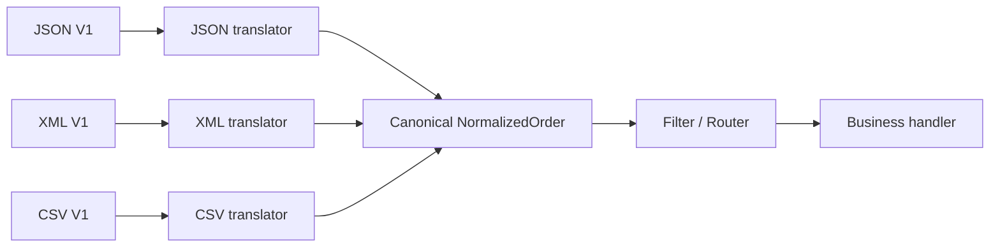
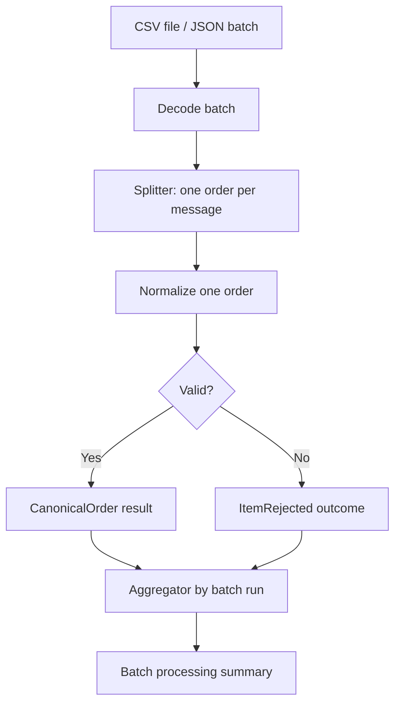
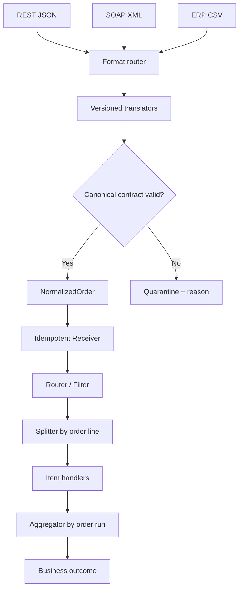

# Testing Multiple Input Formats

An integration system rarely has the authority to force every partner to use the same format. Partner A sends **JSON**, a legacy system sends **XML**, and another supplier exports **CSV**; sometimes a partner also changes schema versions when not all consumers can deploy simultaneously. If every business branch understands each source's format directly, Router, Filter, Aggregator, and handlers quickly become tightly coupled to external structures.

**Normalizer** is an Enterprise Integration Pattern (EIP) that solves this: **routing different input representations to appropriate converters and bringing all of them to one canonical message model**. However, merely writing three parsers does not prove the system works properly. You must test that **three representations of the same event yield the same business meaning**, that bad data is rejected with clear reasons, and that differences in encoding, schema version, record order, or retries do not corrupt results.

The lesson **“Testing Multiple Input Formats”** belongs to the **Normalizer** chapter of the `SPRING_INTEGRATION_PATTERN` module. Its scope covers implementing Enterprise Integration Patterns with Spring Integration to build loosely coupled, extensible message flows—coordinating Router, Filter, Transformer, Splitter, Aggregator, Gateway, retry, error channel, correlation, plus testing and observing processing branches.

**Learning Objectives**

- Distinguish **normalization** from parsing, schema validation, a single Transformer, Splitter, and Aggregator.
- Define a **canonical contract** with invariants so you know when JSON/XML/CSV are business-equivalent.
- Design **golden fixtures** and test each adapter independently before testing the Spring Integration flow.
- Write a Java 17+ example normalizing JSON/XML/CSV into `NormalizedOrder`, with validation, size limits, and error classification.
- Test malformed formats, wrong versions, missing fields, duplicate headers, out-of-range numbers, multi-order CSV data, and unsafe XML.
- Test routing/channels, headers, correlation, idempotency, retries, concurrency, performance, and schema evolution.
- Recognize the demo's limitations and select appropriate integration/end-to-end tests for production.

## 1. The Problem: One Business Domain, Three Data Representations

Suppose a system imports orders from three sources:

```text
Partner A -> JSON order event
Partner B -> XML order document
Legacy ERP -> CSV export
```

The Normalizer's desired output is **a single representation**:

```text
NormalizedOrder(
  eventId=E-100,
  tenantId=T-1,
  orderId=O-100,
  currency=VND,
  lines=[
    {sku=A, quantity=2, unitPriceMinor=12500},
    {sku=B, quantity=1, unitPriceMinor=5000}
  ],
  totalMinor=30000
)
```

From here on, downstream steps handle only `NormalizedOrder`:



The three raw messages can differ in field names, tags, CSV headers, and line ordering. Yet if they represent **the same order with the same meaning**, the normalized result must satisfy the exact same contract.

**The primary test target is not the serialized JSON/XML/CSV string**, but the **meaning of the canonical DTO after conversion**, plus required metadata preserved alongside it.

## 2. What Normalizer Does Not Solve on Its Own

| Component | Primary Responsibility | Relationship to Normalizer |
| --- | --- | --- |
| Parser/Deserializer | Reads JSON/XML/CSV into structured data. | One step inside each branch. |
| Schema Validator | Checks structure, types, version, and bounds. | Must run before or inside the corresponding translator. |
| Transformer | Converts one representation into another. | Each branch of a Normalizer is typically a Transformer. |
| Router | Selects a branch by verified format/source. | Routes data to the right translator. |
| **Normalizer** | Converges multiple formats onto **one canonical contract**. | Pattern coordinating routing + translation. |
| Filter | Decides whether a message proceeds. | Runs after trusted canonical fields exist, or before intake for boundary checks. |
| Splitter | Splits one file/batch into multiple messages. | Multi-order CSVs may need splitting before or after normalization. |
| Aggregator | Combines messages belonging to one group. | Does not replace normalization. |
| Content Enricher | Fills missing data from another source. | Should not mask raw data violating the contract. |
| Idempotent Receiver | Prevents reprocessing one business event. | Relies on stable, verified IDs. |

**A message parsing cleanly does not mean it normalized accurately.** For instance, `amount=125.00` could be dong, cents, or an internal unit. If a translator guesses the wrong unit, data is type-valid yet business-wrong.

## 3. Define the Canonical Contract and Equivalence First

Before writing JUnit tests, define **what counts as two equivalent results**.

In this lesson, the canonical contract:

- `eventId` identifies the producer-emitted event, used to link retries/replays.
- `tenantId` scopes business identity; taking it from a payload alone does not prove authorization.
- `orderId` identifies the order.
- `currency` supports only `"VND"` in this example to avoid mixing units.
- `lines` is a list of items with `sku`, `quantity > 0`, `unitPriceMinor >= 0`.
- `totalMinor` **is recomputed** from quantity and unit price, never copied from an arbitrary raw total field.
- Line ordering **carries no business meaning in the example contract**: canonical results sort by `sku`.
- An order has no duplicate `sku` in the example. If business rules allow multiple lines with the same SKU under different promotions, change the contract and tests.
- One payload represents **one order**; multi-order files require dedicated batch/split designs.

Total invariant:

\[
\text{totalMinor}=\sum_{i=1}^{n}
\text{quantity}_i\times \text{unitPriceMinor}_i
\]

Because monetary math uses integer minor units per contract, tests must verify **overflow** instead of allowing silent `long` wraparound.

### Semantic Equivalence, Not Necessarily Byte-for-Byte

Two JSON payloads with different field orders can be equivalent. A CSV with reversed row order can still be equivalent when line order is irrelevant. XML with different whitespace/indentation can carry identical data.

However, the following differences **must never be treated as equivalent**:

- `currency=VND` vs. `USD` even with the same numeric amount.
- Quantity `2` vs. `200`.
- Price in **minor units** vs. major units without an explicit conversion rule.
- Distinct `eventId`s when they represent **two valid independent events**.
- A missing or duplicated line.
- `tenantId` belonging to another owner.

**Tests must express business choices explicitly**, avoiding `toString()` or byte equality to judge correctness.

## 4. Three Golden Fixtures for the Same Order

### 4.1. JSON V1

```json
{
  "schemaVersion": 1,
  "eventId": "E-100",
  "tenantId": "T-1",
  "orderId": "O-100",
  "currency": "VND",
  "lines": [
    {"sku": "A", "quantity": 2, "unitMinor": 12500},
    {"sku": "B", "quantity": 1, "unitMinor": 5000}
  ]
}
```

### 4.2. XML V1

```xml
<order version="1"
       eventId="E-100"
       tenantId="T-1"
       orderId="O-100"
       currency="VND">
  <item sku="A" quantity="2" unitMinor="12500"/>
  <item sku="B" quantity="1" unitMinor="5000"/>
</order>
```

### 4.3. CSV V1

```csv
event_id,tenant_id,order_id,currency,sku,quantity,unit_minor
E-100,T-1,O-100,VND,A,2,12500
E-100,T-1,O-100,VND,B,1,5000
```

In this CSV contract, **each row is one item of the same order**. All rows must share the same `event_id`, `tenant_id`, `order_id`, and `currency`. If a file contains two different orders, the Normalizer **must never merge** them mistakenly into one `NormalizedOrder`.

**Golden fixtures** should be stored as reviewable test data with clear expected outputs. In this lesson they are embedded directly in Java tests for illustration; in larger projects, use versioned test resources.

## 5. Mandatory Test Matrix for the Three Formats

| Aspect | JSON | XML | CSV |
| --- | --- | --- | --- |
| Valid message | Matching schema version/fields. | Matching elements/attributes. | Valid header and single order. |
| Missing field | Missing `eventId`, `lines`. | Missing `orderId`, `item`. | Missing column or value. |
| Wrong type | `"quantity":"2"` instead of integer. | `quantity` attribute unparseable as number. | Non-numeric `quantity` cell. |
| Version | `schemaVersion=9`. | `version="9"`. | Unsupported CSV format label/version. |
| Multiple records | Array `lines`. | Multiple `<item>` elements. | Multiple rows for one order; multi-order files rejected. |
| Special characters | JSON escaping. | Safe XML entities/encoding. | Commas and quotes inside fields. |
| Security | Deeply nested/oversized JSON. | XXE/DOCTYPE/entity expansion. | Formula injection on spreadsheet export; excessive rows. |
| Duplicates | Duplicate JSON keys/lines. | Duplicate items/attributes per parser. | Duplicate headers/rows/items. |
| Numeric limits | Huge integers. | Numbers exceeding `long`/`int`. | Out-of-range numbers, invalid notation. |
| Metadata | `eventId` in payload. | `eventId` in attribute. | `event_id` on every row. |

You do not need three completely separate business test suites once **shared invariant tests** exist on the canonical model. Still, each format's parser needs thorough **format-specific tests** because each fails differently.

## 6. Identify the Source Format Before Parsing

Typically the adapter wraps input in an envelope:

```text
RawOrder {
  format = JSON_V1 | XML_V1 | CSV_V1
  body = bytes
  auditId = ingress identifier
}
```

`format` must come from a **transport contract or verified metadata**, not merely guessing whether a string starts with `{` or `<`. Even if a client supplies `Content-Type`, verify it **against the bytes** and authorization policies.

A `.csv` containing JSON or an HTTP request declaring `application/xml` with a JSON body must be handled as an explicit **format mismatch**, never by trying parsers one after another until one “succeeds”.

### When Is Content Sniffing Acceptable?

For legacy file drops lacking metadata, a format-detection layer may be necessary. Tests must then cover **ambiguous inputs, BOMs, whitespace, wrong content types, and malicious inputs**. Sniffing only selects the parser branch; **it never replaces schema or semantic validation**.

Once format/version is determined, keep `sourceFormat`/`schemaVersion` in observability metadata rather than altering the semantic identity of `NormalizedOrder`.

## 7. Java 17: Raw and Canonical Models

The example below selects three formats and one unified contract. The code uses Java 17 records and defensive copies to prevent callers from mutating byte arrays after sending.

```java
import java.util.List;
import java.util.Objects;

enum IncomingFormat {
    JSON_V1,
    XML_V1,
    CSV_V1
}

record RawOrder(
        IncomingFormat format,
        byte[] bytes,
        String auditId
) {
    RawOrder {
        Objects.requireNonNull(format, "format");
        Objects.requireNonNull(bytes, "bytes");
        bytes = bytes.clone();
    }

    @Override
    public byte[] bytes() {
        return bytes.clone();
    }
}

record NormalizedLine(
        String sku,
        int quantity,
        long unitPriceMinor
) {}

record NormalizedOrder(
        String eventId,
        String tenantId,
        String orderId,
        String currency,
        List<NormalizedLine> lines,
        long totalMinor
) {
    NormalizedOrder {
        lines = List.copyOf(lines);
    }
}

final class NormalizationFailure extends RuntimeException {
    private final String reasonCode;

    NormalizationFailure(String reasonCode) {
        super(reasonCode);
        this.reasonCode = reasonCode;
    }

    String reasonCode() {
        return reasonCode;
    }
}
```

**Note:** `RawOrder` is only a flow wrapper. A real system must authenticate `tenantId`, enforce size limits at the adapter **before loading an entire file into RAM**, and avoid logging raw payloads. Reference-level record immutability does not make **nested objects** immutable automatically; `List.copyOf` and `bytes.clone()` mitigate two common bugs in the example.

## 8. Building `OrderNormalizer`: Selecting the Right Translator

A service can expose an entry point like:

```java
final class OrderNormalizer {
    private static final int MAX_BYTES = 64 * 1024;

    NormalizedOrder normalize(RawOrder input) {
        if (input.bytes().length == 0
                || input.bytes().length > MAX_BYTES) {
            throw new NormalizationFailure("BODY_SIZE_INVALID");
        }

        return switch (input.format()) {
            case JSON_V1 -> fromJson(input.bytes());
            case XML_V1  -> fromXml(input.bytes());
            case CSV_V1  -> fromCsv(input.bytes());
        };
    }

    // fromJson, fromXml, fromCsv, and shared validation
    // are presented in the following sections.
}
```

The snippet above is the **class skeleton** situating the methods in subsequent sections; it will not compile standalone until those methods are included. In practice, you can use `FormatRouter → JsonTranslator/XmlTranslator/CsvTranslator → canonicalChannel` instead of a switch inside one class.

**Test goal:** regardless of topology, `normalize(RawOrder)` must produce **the exact same `NormalizedOrder`** for all three equivalent fixtures and **the exact same normalized error code** for each class of violation.

### Arrival-Order Independence

When three sources arrive via Kafka, AMQP, or executors, processing order can vary. The Normalizer should be a **pure business function**, never relying on mutable state tracking “current format” or “previous event” to parse the next message.

## 9. JSON Adapter: Strict Types Before Mapping DTOs

With JSON, a common trap is Jackson or another mapping library **coercing** strings to numbers. If the contract says `quantity` is a JSON integer, `"2"` must not be accepted as `2` merely because a mapper coerced it.

Below are the methods for `OrderNormalizer` from section 8, using `JsonNode` to check shape before building canonical lines:

```java
// Additional imports for OrderNormalizer:
import com.fasterxml.jackson.databind.JsonNode;
import com.fasterxml.jackson.databind.ObjectMapper;
import java.io.IOException;
import java.util.ArrayList;
import java.util.List;

private final ObjectMapper jsonMapper = new ObjectMapper();

private NormalizedOrder fromJson(byte[] bytes) {
    try {
        JsonNode root = jsonMapper.readTree(bytes);

        if (root == null || !root.isObject()) {
            throw new NormalizationFailure("JSON_ROOT_INVALID");
        }

        JsonNode version = root.path("schemaVersion");
        if (!version.isIntegralNumber()
                || version.intValue() != 1) {
            throw new NormalizationFailure("UNSUPPORTED_VERSION");
        }

        String eventId = requiredText(root, "eventId");
        String tenantId = requiredText(root, "tenantId");
        String orderId = requiredText(root, "orderId");
        String currency = requiredText(root, "currency");

        JsonNode lines = root.path("lines");
        if (!lines.isArray()
                || lines.isEmpty()
                || lines.size() > 100) {
            throw new NormalizationFailure("LINES_INVALID");
        }

        List<NormalizedLine> canonicalLines = new ArrayList<>();
        for (JsonNode line : lines) {
            if (!line.isObject()) {
                throw new NormalizationFailure("LINE_NOT_OBJECT");
            }

            JsonNode qty = line.path("quantity");
            JsonNode unit = line.path("unitMinor");
            if (!qty.isIntegralNumber()
                    || !qty.canConvertToInt()
                    || !unit.isIntegralNumber()
                    || !unit.canConvertToLong()) {
                throw new NormalizationFailure("NUMERIC_TYPE_INVALID");
            }

            canonicalLines.add(new NormalizedLine(
                    requiredText(line, "sku"),
                    qty.intValue(),
                    unit.longValue()));
        }

        return assemble(eventId, tenantId, orderId,
                currency, canonicalLines);

    } catch (IOException ex) {
        throw new NormalizationFailure("JSON_PARSE_FAILED");
    }
}

private static String requiredText(
        JsonNode root, String field) {
    JsonNode value = root.path(field);
    if (!value.isTextual()
            || value.textValue().isBlank()
            || value.textValue().length() > 128) {
        throw new NormalizationFailure(
                "REQUIRED_TEXT_INVALID");
    }
    return value.textValue();
}
```

`requiredText`, `assemble`, and `NormalizationFailure` are helpers/types in the example. This is a **parser illustrating essential fields**, not a full JSON Schema Draft 2020-12 implementation: it does not yet handle all unknown fields, duplicate JSON keys, trailing tokens, or nesting limits.

### JSON-Specific Tests

- `quantity` is integer `2` → accepted.
- `quantity` is string `"2"` → rejected with `NUMERIC_TYPE_INVALID`.
- `quantity=2.0` → rejected when contract requires a JSON integer.
- `unitMinor` out of `long` range → rejected, never truncated.
- Missing `eventId` → rejected, never minting a new ID for the producer.
- Root `[]` or `null` → rejected.
- Critical duplicate keys → parser configured strictly or explicit policy.
- JSON with trailing tokens → never silently accept only the first document unless policy allows.
- Deeply nested/oversized JSON → blocked by parser/ingress limits.

**In production**, configure Jackson `StreamReadConstraints`, duplicate-key detection, and appropriate coercion/unknown-field policies. Tests must cover byte encodings rather than only pre-built `JsonNode` instances.

## 10. XML Adapter: Preserving Meaning While Blocking XXE

XML carries attributes, elements, namespaces, entities, and whitespace. If an XML parser is configured unsafely, partner data can include DTDs/external entities causing **XXE/SSRF/file disclosure or entity expansion**.

An internal adapter following section 4's contract reads attributes of `<order>` and `<item>`:

```java
// Additional imports:
import java.io.ByteArrayInputStream;
import javax.xml.XMLConstants;
import javax.xml.parsers.DocumentBuilderFactory;
import org.w3c.dom.Document;
import org.w3c.dom.Element;
import org.w3c.dom.Node;
import org.w3c.dom.NodeList;

private NormalizedOrder fromXml(byte[] bytes) {
    try {
        DocumentBuilderFactory factory =
                DocumentBuilderFactory.newInstance();

        factory.setFeature(
                XMLConstants.FEATURE_SECURE_PROCESSING, true);
        factory.setFeature(
                "http://apache.org/xml/features/disallow-doctype-decl",
                true);
        factory.setFeature(
                "http://xml.org/sax/features/external-general-entities",
                false);
        factory.setFeature(
                "http://xml.org/sax/features/external-parameter-entities",
                false);
        factory.setFeature(
                "http://apache.org/xml/features/nonvalidating/load-external-dtd",
                false);

        factory.setXIncludeAware(false);
        factory.setExpandEntityReferences(false);
        factory.setAttribute(
                XMLConstants.ACCESS_EXTERNAL_DTD, "");
        factory.setAttribute(
                XMLConstants.ACCESS_EXTERNAL_SCHEMA, "");

        Document document = factory.newDocumentBuilder()
                .parse(new ByteArrayInputStream(bytes));
        Element root = document.getDocumentElement();

        if (!"order".equals(root.getTagName())) {
            throw new NormalizationFailure(
                    "XML_ROOT_INVALID");
        }
        if (!"1".equals(root.getAttribute("version"))) {
            throw new NormalizationFailure(
                    "UNSUPPORTED_VERSION");
        }

        List<NormalizedLine> lines = new java.util.ArrayList<>();
        NodeList children = root.getChildNodes();
        for (int i = 0; i < children.getLength(); i++) {
            Node child = children.item(i);
            if (child instanceof Element item) {
                if (!"item".equals(item.getTagName())) {
                    throw new NormalizationFailure(
                            "UNKNOWN_XML_ELEMENT");
                }
                lines.add(new NormalizedLine(
                        item.getAttribute("sku"),
                        parseInt(item.getAttribute("quantity")),
                        parseLong(item.getAttribute("unitMinor"))));
            }
        }

        return assemble(
                root.getAttribute("eventId"),
                root.getAttribute("tenantId"),
                root.getAttribute("orderId"),
                root.getAttribute("currency"),
                lines);

    } catch (NormalizationFailure ex) {
        throw ex;
    } catch (Exception ex) {
        // Includes parser configuration/parse failures;
        // fail closed if secure XML settings are unsupported.
        throw new NormalizationFailure("XML_PARSE_FAILED");
    }
}
```

**Scope:** the example uses `DocumentBuilderFactory` and **namespace-less** XML per section 4's contract. If a partner uses namespaces, XSD, mixed content, or specific encodings, add matching parsers/validators and tests. XML that merely “looks right” by tags/attributes may still violate XSD.

### Mandatory Security Test

```xml
<!DOCTYPE order [
  <!ENTITY secret SYSTEM "file:///etc/passwd">
]>
<order version="1" eventId="E-X"
       tenantId="T-1" orderId="O-X" currency="VND">
  <item sku="&secret;" quantity="1" unitMinor="1"/>
</order>
```

Input containing the DOCTYPE above **must be rejected** by parser configuration. Never depend on whether the target file exists on the test host, never log entity contents, and never allow XML parsers arbitrary filesystem or network access.

Additional tests needed:

- Missing `orderId` or `version`.
- Malformed XML.
- XML with namespaces unsupported by the contract.
- `<item>` nested in the wrong element.
- XML with BOM/different encodings; accept or reject per contract.
- `quantity` attribute exceeding range.
- Item count exceeding limits.
- Blocked DTD/entity expansion.
- Whitespace between elements never changes canonical order.

## 11. CSV Adapter: Multiple Lines in One File, Still One Order

CSV is especially hazardous when parsed with:

```java
String[] fields = line.split(",");
```

This code **breaks** when an SKU contains a comma or valid quotes, such as `"SKU,A"`. Use a parser supporting RFC 4180 quoting/escaping or your exact CSV dialect.

Example with **Apache Commons CSV**, inside the same `OrderNormalizer` class:

```java
// Additional imports:
import java.io.InputStreamReader;
import java.nio.charset.StandardCharsets;
import org.apache.commons.csv.CSVFormat;
import org.apache.commons.csv.CSVParser;
import org.apache.commons.csv.CSVRecord;

private NormalizedOrder fromCsv(byte[] bytes) {
    try (var reader = new InputStreamReader(
            new ByteArrayInputStream(bytes),
            StandardCharsets.UTF_8);
         CSVParser parser = CSVFormat.RFC4180.builder()
                 .setHeader()
                 .setSkipHeaderRecord(true)
                 .build()
                 .parse(reader)) {

        List<String> expectedHeaders = List.of(
                "event_id", "tenant_id", "order_id",
                "currency", "sku", "quantity", "unit_minor");

        if (!parser.getHeaderNames().equals(expectedHeaders)) {
            throw new NormalizationFailure(
                    "CSV_HEADER_INVALID");
        }

        String eventId = null;
        String tenantId = null;
        String orderId = null;
        String currency = null;
        List<NormalizedLine> lines = new java.util.ArrayList<>();

        for (CSVRecord row : parser) {
            if (!row.isConsistent() || lines.size() >= 100) {
                throw new NormalizationFailure(
                        "CSV_ROW_INVALID");
            }

            String currentEvent = row.get("event_id");
            String currentTenant = row.get("tenant_id");
            String currentOrder = row.get("order_id");
            String currentCurrency = row.get("currency");

            if (eventId == null) {
                eventId = currentEvent;
                tenantId = currentTenant;
                orderId = currentOrder;
                currency = currentCurrency;
            } else if (!eventId.equals(currentEvent)
                    || !tenantId.equals(currentTenant)
                    || !orderId.equals(currentOrder)
                    || !currency.equals(currentCurrency)) {
                throw new NormalizationFailure(
                        "CSV_MIXED_ORDERS");
            }

            lines.add(new NormalizedLine(
                    row.get("sku"),
                    parseInt(row.get("quantity")),
                    parseLong(row.get("unit_minor"))));
        }

        return assemble(eventId, tenantId, orderId,
                currency, lines);

    } catch (NormalizationFailure ex) {
        throw ex;
    } catch (Exception ex) {
        throw new NormalizationFailure("CSV_PARSE_FAILED");
    }
}
```

`CSVFormat.RFC4180` is a **syntax choice**; many legacy systems use `;` delimiters, BOMs, other encodings, trailing blank lines, or localized headers. Never swap rules silently across partners. In real code, match builders/APIs to your project's Apache Commons CSV version.

### What Must Be Agreed Upon for CSV

- Is there exactly one header row, and what are the exact column names/order?
- Are UTF-8 BOMs or other encodings allowed?
- How do empty values differ from missing columns?
- Is `""` quote escaping supported?
- Can one file hold multiple distinct orders?
- Are duplicate SKUs allowed in the same order?
- Are blank lines skipped or treated as violations?
- Are row counts and byte sizes capped?

**The example intentionally rejects multi-order CSVs**, because the method returns **one** `NormalizedOrder`. If the system needs multiple orders per file, change the contract to `List<NormalizedOrder>` or split batches with a Splitter while managing correlation/sequence and partial errors. Never let `fromCsv` silently read the first order and drop the rest.

## 12. Shared Validation: Catching Semantic Errors Right After Parsing

All three parsers call `assemble(...)` to enforce identical invariants:

```java
// Additional methods inside OrderNormalizer:

private static int parseInt(String value) {
    try {
        return Integer.parseInt(value);
    } catch (NumberFormatException ex) {
        throw new NormalizationFailure(
                "NUMERIC_VALUE_INVALID");
    }
}

private static long parseLong(String value) {
    try {
        return Long.parseLong(value);
    } catch (NumberFormatException ex) {
        throw new NormalizationFailure(
                "NUMERIC_VALUE_INVALID");
    }
}

private static NormalizedOrder assemble(
        String eventId,
        String tenantId,
        String orderId,
        String currency,
        List<NormalizedLine> lines) {

    requireIdentifier(eventId);
    requireIdentifier(tenantId);
    requireIdentifier(orderId);

    if (!"VND".equals(currency)) {
        throw new NormalizationFailure(
                "UNSUPPORTED_CURRENCY");
    }
    if (lines == null || lines.isEmpty()
            || lines.size() > 100) {
        throw new NormalizationFailure("LINES_INVALID");
    }

    long total = 0;
    java.util.Set<String> seenSku =
            new java.util.HashSet<>();

    try {
        for (NormalizedLine line : lines) {
            requireIdentifier(line.sku());

            if (!seenSku.add(line.sku())) {
                throw new NormalizationFailure(
                        "DUPLICATE_SKU");
            }
            if (line.quantity() <= 0
                    || line.unitPriceMinor() < 0) {
                throw new NormalizationFailure(
                        "INVALID_LINE_VALUES");
            }

            long lineTotal = Math.multiplyExact(
                    line.quantity(), line.unitPriceMinor());
            total = Math.addExact(total, lineTotal);
        }
    } catch (ArithmeticException ex) {
        throw new NormalizationFailure("MONEY_OVERFLOW");
    }

    List<NormalizedLine> sorted =
            new java.util.ArrayList<>(lines);
    sorted.sort(java.util.Comparator.comparing(
            NormalizedLine::sku));

    return new NormalizedOrder(
            eventId, tenantId, orderId,
            currency, sorted, total);
}

private static void requireIdentifier(String value) {
    if (value == null || value.isBlank()
            || value.length() > 128) {
        throw new NormalizationFailure(
                "IDENTIFIER_INVALID");
    }
}
```

**Why is testing shared validation crucial?** If the JSON branch blocks `quantity=0` while the CSV branch allows it, canonical output is no longer truly canonical. A shared assembler enforces identical invariants regardless of source format.

### What the Example Does Not Handle Automatically

- Does not authorize `tenantId`. At ingress, tenants must be verified against a **trusted authentication context**.
- Does not support multiple currencies or exchange-rate conversions. Money is **`long` minor units under the example contract**, never floating point.
- Does not define Unicode normalization, case-folding, trimming, or SKU aliasing; apply business policies before doing so.
- Does not validate full JSON/XML/CSV schemas; the demo validates key fields.
- Performs no business lookups such as “does this SKU exist in the catalog?”.
- Performs no dedup/retry/side-effect storage; those belong in downstream flow steps.

## 13. The Most Important Unit Test Suite: Same Meaning, Same Canonical Model

If you pick **one test demonstrating the essence of Normalizer**, it is this: three different sources representing one order must produce **equal `NormalizedOrder`s**.

```java
import static org.junit.jupiter.api.Assertions.assertEquals;

import java.nio.charset.StandardCharsets;
import org.junit.jupiter.api.Test;

class OrderNormalizerEquivalenceTest {

    private final OrderNormalizer normalizer =
            new OrderNormalizer();

    private RawOrder raw(IncomingFormat format, String body) {
        return new RawOrder(
                format,
                body.getBytes(StandardCharsets.UTF_8),
                "audit-test");
    }

    @Test
    void jsonXmlAndCsvProduceTheSameCanonicalOrder() {
        NormalizedOrder fromJson = normalizer.normalize(
                raw(IncomingFormat.JSON_V1, """
                  {
                    "schemaVersion": 1,
                    "eventId": "E-100",
                    "tenantId": "T-1",
                    "orderId": "O-100",
                    "currency": "VND",
                    "lines": [
                      {"sku": "B", "quantity": 1, "unitMinor": 5000},
                      {"sku": "A", "quantity": 2, "unitMinor": 12500}
                    ]
                  }
                  """));

        NormalizedOrder fromXml = normalizer.normalize(
                raw(IncomingFormat.XML_V1, """
                  <order version="1" eventId="E-100"
                         tenantId="T-1" orderId="O-100"
                         currency="VND">
                    <item sku="A" quantity="2" unitMinor="12500"/>
                    <item sku="B" quantity="1" unitMinor="5000"/>
                  </order>
                  """));

        NormalizedOrder fromCsv = normalizer.normalize(
                raw(IncomingFormat.CSV_V1, """
                  event_id,tenant_id,order_id,currency,sku,quantity,unit_minor
                  E-100,T-1,O-100,VND,A,2,12500
                  E-100,T-1,O-100,VND,B,1,5000
                  """));

        assertEquals(fromJson, fromXml);
        assertEquals(fromJson, fromCsv);
        assertEquals(30_000L, fromJson.totalMinor());
        assertEquals("A", fromJson.lines().get(0).sku());
        assertEquals("B", fromJson.lines().get(1).sku());
    }
}
```

**Note:** `NormalizedOrder` is a Java record containing `List<NormalizedLine>`, so `assertEquals` compares field values via `equals`, not object references. The test **reverses line order in JSON** to prove the example contract does not depend on arrival or row order.

### Do Not Compare via Serialized Output

If tests compare JSON serialized from DTOs, field ordering and mapper settings can fail tests even when business data matches. For Normalizer, assert **semantic fields and invariants**. Test serialized outputs in a **separate** outbound boundary contract test.

## 14. Testing Each Format and Error Code Individually

A real Normalizer needs stable error reporting. A test calling only `assertThrows(Exception.class)` does not verify that the branch rejected for the right reason.

```java
import static org.junit.jupiter.api.Assertions.*;

import org.junit.jupiter.api.Test;

class OrderNormalizerInvalidTest {

    private final OrderNormalizer normalizer =
            new OrderNormalizer();

    private static RawOrder raw(
            IncomingFormat format, String body) {
        return new RawOrder(format,
                body.getBytes(java.nio.charset.StandardCharsets.UTF_8),
                "audit-invalid");
    }

    private void rejects(
            IncomingFormat format, String body,
            String expectedReason) {

        NormalizationFailure failure = assertThrows(
                NormalizationFailure.class,
                () -> normalizer.normalize(raw(format, body)));

        assertEquals(expectedReason, failure.reasonCode());
    }

    @Test
    void jsonStringQuantityIsNotAnInteger() {
        rejects(IncomingFormat.JSON_V1, """
          {
            "schemaVersion": 1, "eventId": "E-200",
            "tenantId": "T-1", "orderId": "O-200",
            "currency": "VND",
            "lines": [
              {"sku": "A", "quantity": "2", "unitMinor": 12500}
            ]
          }
          """, "NUMERIC_TYPE_INVALID");
    }

    @Test
    void unsupportedXmlVersionIsRejected() {
        rejects(IncomingFormat.XML_V1, """
          <order version="9" eventId="E-200"
                 tenantId="T-1" orderId="O-200"
                 currency="VND">
            <item sku="A" quantity="2" unitMinor="12500"/>
          </order>
          """, "UNSUPPORTED_VERSION");
    }

    @Test
    void csvMustContainOnlyOneOrder() {
        rejects(IncomingFormat.CSV_V1, """
          event_id,tenant_id,order_id,currency,sku,quantity,unit_minor
          E-200,T-1,O-200,VND,A,2,12500
          E-201,T-1,O-201,VND,B,1,5000
          """, "CSV_MIXED_ORDERS");
    }

    @Test
    void malformedJsonIsRejected() {
        rejects(IncomingFormat.JSON_V1,
                "{\"schemaVersion\":1,",
                "JSON_PARSE_FAILED");
    }
}
```

### Same Underlying Cause May Yield Different Parser-Layer Codes

For example, JSON `"quantity":"2"` yields `NUMERIC_TYPE_INVALID`, while XML `quantity="two"` yields `NUMERIC_VALUE_INVALID`. Depending on design, the boundary can map both to a business-level `INVALID_QUANTITY` while keeping the **parser reason** as secondary operational metadata.

**Key takeaway:** intentionally standardize the error contract rather than leaking raw exception/library strings into public APIs.

## 15. Testing CSV Quoting, Special Characters, and Multi-Record Files

RFC 4180 CSV permits commas inside quoted fields:

```csv
event_id,tenant_id,order_id,currency,sku,quantity,unit_minor
E-300,T-1,O-300,VND,"SKU,A",2,1000
```

Using `.split(",")` miscounts columns on the row above.

Tests should verify:

```java
@Test
void csvQuotedCommaDoesNotSplitSkuIntoColumns() {
    NormalizedOrder result = normalizer.normalize(
            raw(IncomingFormat.CSV_V1, """
              event_id,tenant_id,order_id,currency,sku,quantity,unit_minor
              E-300,T-1,O-300,VND,"SKU,A",2,1000
              """));

    assertEquals("SKU,A", result.lines().get(0).sku());
    assertEquals(2_000L, result.totalMinor());
}
```

In this test snippet, `raw(...)` is the helper from section 13's test class; in a real test file, place this test inside a class defining that helper.

Additional cases:

| CSV Data | What to Assert |
| --- | --- |
| SKU field with comma | Parser keeps it as one field instead of splitting. |
| SKU with escaped quotes `""` | Unescaped accurately. |
| CRLF instead of LF | Works per selected CSV dialect. |
| Duplicate `sku` header | Rejected or handled explicitly per contract; never picks arbitrarily. |
| Row missing a column | Reject `CSV_ROW_INVALID`. |
| Trailing blank line | Accepted or rejected per published CSV dialect. |
| Missing header | Reject `CSV_HEADER_INVALID`. |
| 101 items when limit is 100 | Rejected before unbounded accumulation. |
| Two event IDs in one file | Reject `CSV_MIXED_ORDERS` or route via designed batch/Splitter. |
| UTF-8 BOM | Explicit policy; test real raw bytes. |
| Price exceeding `long` | Reject `NUMERIC_VALUE_INVALID`. |
| Field starting with `=`, `+`, `-`, `@` on spreadsheet export | Mitigate **formula injection** at export; never execute or strip characters from canonical identity. |

**Formula injection** is primarily a risk when applications **export data to spreadsheets** or UIs that evaluate leading symbols as formulas. An inbound CSV parser does not execute formulas itself, yet outbound exporters must escape/quote appropriately for the target environment.

## 16. Testing Safe, Schema-Valid XML

An XML Normalizer test must **never touch the filesystem or network** even when malicious payloads contain external entities. Verify that DOCTYPE inputs are rejected:

```java
@Test
void xmlDoctypeCannotExpandExternalEntity() {
    String xml = """
      <!DOCTYPE order [
        <!ENTITY unsafe SYSTEM "file:///etc/passwd">
      ]>
      <order version="1" eventId="E-X"
             tenantId="T-1" orderId="O-X" currency="VND">
        <item sku="&unsafe;" quantity="1" unitMinor="100"/>
      </order>
      """;

    NormalizationFailure failure = assertThrows(
            NormalizationFailure.class,
            () -> normalizer.normalize(
                    raw(IncomingFormat.XML_V1, xml)));

    assertEquals("XML_PARSE_FAILED", failure.reasonCode());
}
```

Beyond XXE tests, verify **namespace contracts**, wrong root tags, unexpected nested elements, empty attributes, item count caps, and integer overflow.

**Important distinction:** XML elements/attributes may be tightly specified by an XSD schema. A DOM parser calling `getAttribute("eventId")` **does not validate XSD automatically**. When production requires XSD, select a proper validator, lock down external schema resolution, and test against the exact XSD version.

### Be Careful with Encodings

XML can declare encoding in its prolog, whereas CSV/JSON files follow their own contracts. If supporting Windows-1258, UTF-16, or BOMs, test **real byte sequences**, not only Java `String`s. With `InputStreamReader(... UTF_8)` in the CSV example, malformed bytes may be replaced depending on decoder defaults; production should use `CodingErrorAction.REPORT` when strict UTF-8 is required.

## 17. Shared Invariant Tests: Canonical Output Must Always Hold

Do not test only that output is non-null. `NormalizedOrder` must obey invariants:

| Invariant | Assertion |
| --- | --- |
| Non-blank IDs | `eventId`, `tenantId`, `orderId` are valid. |
| Contracted currency | Only `VND` in the demo. |
| Non-empty lines | `1 <= lines.size() <= 100`. |
| Valid quantities | Every line has `quantity > 0`. |
| Valid unit prices | `unitPriceMinor >= 0`. |
| No duplicate SKUs | Each SKU appears at most once per example contract. |
| Deterministic order | Lines sorted by SKU. |
| Accurate total | `sum(quantity * unitPriceMinor)` without overflow. |
| Source format stays out of business identity | Semantic DTO never changes merely due to JSON/XML/CSV. |

You can extract a test helper:

```java
static void assertCanonicalInvariants(
        NormalizedOrder order) {

    assertNotNull(order);
    assertFalse(order.eventId().isBlank());
    assertFalse(order.orderId().isBlank());
    assertFalse(order.tenantId().isBlank());
    assertEquals("VND", order.currency());
    assertFalse(order.lines().isEmpty());

    long recomputed = 0;
    String previousSku = null;

    for (NormalizedLine line : order.lines()) {
        assertTrue(line.quantity() > 0);
        assertTrue(line.unitPriceMinor() >= 0);

        if (previousSku != null) {
            assertTrue(previousSku.compareTo(line.sku()) < 0);
        }
        previousSku = line.sku();

        recomputed = Math.addExact(recomputed,
                Math.multiplyExact(line.quantity(),
                        line.unitPriceMinor()));
    }
    assertEquals(recomputed, order.totalMinor());
}
```

`previousSku.compareTo(...) < 0` holds only because the example **forbids duplicate SKUs and sorts by SKU**. If business rules depend on original line order for promotions or invoice numbering, change the invariant/test and do not sort automatically.

## 18. Spring Integration Wiring: One Entry Point, One Output Type

In production you can use a `Router` sending JSON/XML/CSV messages to dedicated `Transformer`s. To keep this lesson focused on **testing multiple formats**, we start with a Spring Integration flow accepting `RawOrder`, invoking `OrderNormalizer`, and emitting **a single canonical type**.

```java
import org.springframework.context.annotation.Bean;
import org.springframework.context.annotation.Configuration;
import org.springframework.integration.channel.DirectChannel;
import org.springframework.integration.channel.QueueChannel;
import org.springframework.integration.config.EnableIntegration;
import org.springframework.integration.dsl.IntegrationFlow;

@Configuration
@EnableIntegration
class NormalizerFlowConfig {

    @Bean
    OrderNormalizer orderNormalizer() {
        return new OrderNormalizer();
    }

    @Bean
    DirectChannel rawOrders() {
        return new DirectChannel();
    }

    @Bean
    QueueChannel canonicalOrders() {
        return new QueueChannel();
    }

    @Bean
    IntegrationFlow normalizeOrders(OrderNormalizer normalizer) {
        return IntegrationFlow.from("rawOrders")
                .handle(RawOrder.class,
                        (payload, headers) ->
                                normalizer.normalize(payload))
                .channel("canonicalOrders")
                .get();
    }
}
```

This configuration intentionally uses synchronous `DirectChannel` for simple testing and `QueueChannel` to inspect outputs. **The default `QueueChannel` in this example is not a durable broker**, and returning `NormalizedOrder` from `.handle(...)` does not write to a business DB.

### Splitting Router + Transformers as Formats Grow

Another topology:

```text
rawOrders
  |
  +-- format=JSON_V1 --> jsonInput --> JsonTranslator --+
  +-- format=XML_V1  --> xmlInput  --> XmlTranslator  ---+--> canonicalOrders
  +-- format=CSV_V1  --> csvInput  --> CsvTranslator  --+
```

Branches can use:

```java
// Java DSL sketch; do not register alongside section 18's flow
// on the same rawOrders without replacing the topology:
// .route(RawOrder.class, r -> r.format().name(),
//        m -> m.channelMapping("JSON_V1", "jsonInput")
//              .channelMapping("XML_V1", "xmlInput")
//              .channelMapping("CSV_V1", "csvInput"))
```

The Router needs a **fallback/rejection** path for unsupported formats; if upstream adds `AVRO_V2`, it must never route wrongly into the JSON branch. Tests must verify that one message visits **exactly one matching translator** without duplicating outputs.

**The Normalizer EIP is an orchestration structure**, not required to be implemented by a single class named `Normalizer`. What matters is the canonical contract and the ability to swap input adapters without changing business handlers.

## 19. Integration Test: Three Entry Paths Emit the Same Canonical Type

We test the Spring Integration endpoint itself rather than calling Java methods directly.

```java
import static org.junit.jupiter.api.Assertions.*;

import java.nio.charset.StandardCharsets;
import org.junit.jupiter.api.Test;
import org.springframework.beans.factory.annotation.Autowired;
import org.springframework.beans.factory.annotation.Qualifier;
import org.springframework.integration.channel.QueueChannel;
import org.springframework.messaging.Message;
import org.springframework.messaging.MessageChannel;
import org.springframework.messaging.support.MessageBuilder;
import org.springframework.test.annotation.DirtiesContext;
import org.springframework.test.context.junit.jupiter.SpringJUnitConfig;

@SpringJUnitConfig(NormalizerFlowConfig.class)
@DirtiesContext(classMode = DirtiesContext.ClassMode.AFTER_EACH_TEST_METHOD)
class NormalizerFlowTest {

    @Autowired @Qualifier("rawOrders")
    MessageChannel input;

    @Autowired @Qualifier("canonicalOrders")
    QueueChannel output;

    private NormalizedOrder sendAndReceive(
            IncomingFormat format, String content) {

        RawOrder raw = new RawOrder(
                format,
                content.getBytes(StandardCharsets.UTF_8),
                "audit-integration");

        assertTrue(input.send(
                MessageBuilder.withPayload(raw).build()));

        Message<?> reply = output.receive(1_000);
        assertNotNull(reply);
        assertTrue(reply.getPayload() instanceof NormalizedOrder);

        return (NormalizedOrder) reply.getPayload();
    }

    @Test
    void eachFormatReachesCanonicalChannel() {
        NormalizedOrder json = sendAndReceive(
                IncomingFormat.JSON_V1, """
                  {"schemaVersion":1,"eventId":"E-101",
                   "tenantId":"T-1","orderId":"O-101",
                   "currency":"VND","lines":[
                     {"sku":"A","quantity":2,"unitMinor":12500}]}
                  """);

        NormalizedOrder xml = sendAndReceive(
                IncomingFormat.XML_V1, """
                  <order version="1" eventId="E-101"
                         tenantId="T-1" orderId="O-101"
                         currency="VND">
                    <item sku="A" quantity="2" unitMinor="12500"/>
                  </order>
                  """);

        NormalizedOrder csv = sendAndReceive(
                IncomingFormat.CSV_V1, """
                  event_id,tenant_id,order_id,currency,sku,quantity,unit_minor
                  E-101,T-1,O-101,VND,A,2,12500
                  """);

        assertEquals(json, xml);
        assertEquals(json, csv);
        assertEquals(25_000L, json.totalMinor());
        assertNull(output.receive(0));
    }
}
```

`@DirtiesContext` isolates queues/contexts across tests. When flows use `ExecutorChannel`, brokers, or pollers, use bounded waits and never assume outputs appear immediately after `send`.

**Distinguish two scenarios:** the test sends three different-format inputs **with the same `eventId`** to check semantic equivalence. In production, if three messages with the same `eventId` actually arrive, an Idempotent Receiver may need to treat them as **duplicate deliveries** and avoid executing business side effects three times.

## 20. Testing Failure Paths of an IntegrationFlow

In a synchronous flow using `DirectChannel`, `NormalizationFailure` thrown inside `.handle(...)` may be wrapped in `MessageHandlingException` or propagate per endpoint configuration. In tests, **never assume the caller receives the exact unwrapped exception class** when the framework adds wrappers.

A test should verify:

1. `rawOrders` receives an invalid message.
2. No invalid `NormalizedOrder` enters `canonicalOrders`.
3. The exception/error classifies into a **stable error code**, e.g., `CSV_MIXED_ORDERS`.
4. Errors/rejections are observed on the error channel, HTTP error mapper, or quarantine handler per topology.
5. Zero business side effects occur when normalization fails.

### An Option to Avoid Losing Data on Invalid Input

Instead of letting every error take a generic exception path, the service can return:

```java
sealed interface NormalizeOutcome
        permits NormalizeAccepted, NormalizeRejected {}

record NormalizeAccepted(
        NormalizedOrder order) implements NormalizeOutcome {}

record NormalizeRejected(
        String auditId,
        String format,
        String reasonCode) implements NormalizeOutcome {}
```

The downstream flow uses a Router:

```text
RawOrder -> normalize
             |
             +-- NormalizeAccepted -> canonical business flow
             |
             +-- NormalizeRejected -> quarantine/audit/error reply
```

This is a **design pattern**, not fully implemented in section 18's configuration. If adopted, test that every rejection lands in **durable quarantine** when required by contract, rather than sitting in an in-memory queue.

### Never Retry Invalid Data Infinitely

`CSV_MIXED_ORDERS`, `UNSUPPORTED_VERSION`, and `JSON_PARSE_FAILED` are permanent contract errors in most cases; redelivering identical bytes will not fix them. Conversely, `SCHEMA_REGISTRY_UNAVAILABLE` or object-store timeouts are transient. Distinguish them to prevent poison-message retry loops.

## 21. Preserving Headers, Correlation, and Source Identity

After normalization, business handlers need the canonical payload, yet certain orchestration metadata remains critical:

| Metadata | Purpose | How to Test |
| --- | --- | --- |
| `auditId` / `ingressAuditId` | Investigate source and raw errors. | Output or rejection carries matching reference. |
| `eventId` | Business event identity for deduplication. | Never varies across JSON/XML/CSV. |
| `tenantId` | Business scope. | Verified against authenticated principal before trusting. |
| `traceId` | Cross-branch tracing. | Propagated across chosen adapters/executors. |
| `correlationId` | Groups Splitter/Aggregator/Scatter–Gather. | Preserved or mapped intentionally per contract. |
| `sequenceNumber` / `sequenceSize` | Position and size within group. | Never used as source format/version. |
| `replyChannel` | Gateway request–reply return path. | Replies reach the right caller; never serialize channel objects across brokers. |
| `sourceFormat` | Observes parser branch. | Bounded values; never alters business identity. |

**Preserving does not mean copying all headers.** External headers may be untrusted or carry secrets. Across brokers or separate JVMs, `replyChannel` may no longer be a valid reference. Use transport-appropriate header mappers/envelopes instead of blindly serializing entire Spring messages.

### Testing Post-Normalization Idempotency

If JSON, XML, and CSV genuinely represent **the same business event**, `eventId` must remain intact so downstream deduplicates by `(consumer, eventId)`. If three independent partners reuse the same ID string for unrelated events, include a **source/tenant namespace** per contract. Spring `MessageHeaders.id` can change after transformation or replay and **must never serve as the sole durable business event ID**.

## 22. Normalizer with Splitter/Aggregator: Batch Semantics Must Be Explicit

A CSV file may contain 10,000 rows spanning multiple orders; an XML document may hold multiple `<order>` elements; likewise for a JSON array. If the Normalizer returns **one** `NormalizedOrder`, never silently take only the first item or merge distinct orders.

Three common contracts:

1. **One input message → one canonical order.** Reject multi-order files, as in this lesson's example.
2. **One input message → `List<NormalizedOrder>`.** A Transformer returning a collection **does not automatically** emit multiple Spring messages; add a Splitter if downstream needs per-order messages.
3. **One input batch → multiple canonical messages.** A Splitter separates each record/order, then each part is normalized/validated; an Aggregator gathers batch outcomes if needed.



**Note:** if an invalid item is dropped by a Filter while an Aggregator waits for `sequenceSize=N`, the group can hang. Use **failure-as-result**, partial release, or whole-batch rejection before splitting; tests must verify the chosen policy.

Never use a per-file/per-record `claimId` or `sourceFormat` as a shared correlation key when a batch holds multiple orders. `correlationId` must identify the batch/run accurately per design.

## 23. Money, Numeric Coercion, and Overflow

This is a critical failure category when Normalizer bridges formats:

| Input | Potential Bug |
| --- | --- |
| JSON number `12500.5` | Silently rounded to `12500` despite minor-unit integer contract. |
| XML attribute `"12,500"` | Parsed under another locale as `12.5` or `12500`. |
| CSV `"00125"` | If an ID, leading zeros lost when parsed as a number. |
| CSV `"1e3"` | Scientific notation parsed when unsupported by contract. |
| `quantity * price` exceeds `long` | Wrong positive/negative total from overflow. |
| `USD` vs. `VND` | Different currency units with identical raw numeric values. |
| Negative price or zero quantity | Parses numerically yet violates semantics. |

In this lesson, money uses **`long` minor units per dedicated contract** supporting only VND; `Math.multiplyExact`/`addExact` prevent overflow. Multi-currency systems may need `Money(currency, amountMinor)` or `BigDecimal` with explicit precision and rounding policies.

### Overflow Test

```java
@Test
void multiplicationOverflowMustNotProduceWrongTotal() {
    String json = """
      {
        "schemaVersion": 1,
        "eventId": "E-OVERFLOW",
        "tenantId": "T-1",
        "orderId": "O-OVERFLOW",
        "currency": "VND",
        "lines": [
          {
            "sku": "A",
            "quantity": 10000,
            "unitMinor": 9223372036854775807
          }
        ]
      }
      """;

    NormalizationFailure ex = assertThrows(
            NormalizationFailure.class,
            () -> normalizer.normalize(
                    raw(IncomingFormat.JSON_V1, json)));

    assertEquals("MONEY_OVERFLOW", ex.reasonCode());
}
```

`normalizer` and `raw(...)` here are the test class fixtures/helpers. With `unitMinor=Long.MAX_VALUE` and `quantity=10000`, `Math.multiplyExact` throws `ArithmeticException`, mapped to `MONEY_OVERFLOW`.

## 24. Schema Evolution: Testing Old and New Producers Running Together

A Normalizer often supports **multiple input versions simultaneously**, while exposing **one canonical output version** downstream.

```text
JSON_V1 ----+
JSON_V2 ----+
XML_V1 -----+--> CanonicalOrder V3
CSV_V1 -----+
CSV_V2 -----+
```

For example, V2 might change:

```text
JSON V1: unitMinor
JSON V2: unit_price_minor
```

If both fields carry identical meaning, the V2 translator maps cleanly without touching V1. If V2 changes from minor units to decimal major currency units, that is a **semantic** change requiring dedicated conversion and rounding tests.

### Compatibility Matrix

| Producer / Format | Supported? | Expected Behavior |
| --- | --- | --- |
| `JSON_V1` | Yes | Maps accurately to canonical, no false warnings. |
| `JSON_V2` | Yes after rollout | Maps accurately via V2 mapping. |
| `XML_V1` | Yes | Maps accurately to canonical. |
| `XML_V0` | No | Reject/quarantine `UNSUPPORTED_VERSION` or dedicated legacy adapter. |
| `CSV_V1` | Yes | Exact header, single order/file. |
| `CSV_V2` | Yes if upgraded | New header handled by versioned translator. |
| Unknown format | No | Explicit reject; never route to a “close” adapter. |

**Never silently mutate schema V1** to “also accept V2” without testing backward/forward compatibility. With Kafka retention or DLQs, V1 data can replay **after V2 is deployed**, so the older decoder may still need to remain active.

### Consumer-Driven Contract Tests

Beyond Normalizer unit tests, share or publish **contract fixtures** with producers: valid/invalid samples per format/version, golden outputs, unknown-field rules, and version migrations. These catch renamed fields or changed separators before production breaks.

## 25. Metamorphic and Property-Based Testing

Golden fixtures verify known cases yet miss combinations. For Normalizers, **metamorphic tests** check input changes that **must not alter semantic output**.

Examples:

- Reorder JSON properties → canonical unchanged.
- Change XML indentation/whitespace → canonical unchanged.
- Reorder CSV rows **within the same order** when order doesn't matter → canonical unchanged.
- Quote a CSV SKU containing a comma → `sku` stays intact.
- Reorder JSON/XML items → canonical list still sorted by SKU per contract.
- Rename a required field wrongly → must reject.
- Increase quantity from `2` to `3` → total increases by **exactly 1 × unitMinor**, no longer equal.
- Change `eventId` → canonical event ID must change, never cached wrongly.
- Duplicate a SKU → reject per example contract.

### Property-Based Invariants

With libraries like jqwik or QuickTheories, generate valid `NormalizedOrder`s, encode them into each format, normalize back, and compare:

```text
for each generated canonical order:
  json = encodeJson(order)
  xml  = encodeXml(order)
  csv  = encodeCsv(order)

  assert normalize(json) == order
  assert normalize(xml)  == order
  assert normalize(csv)  == order
```

**Note:** round-trip tests are not always possible when legacy sources **cannot represent every canonical field** or normalization drops non-essential details. Then generate **only orders in the overlapping domain** and assert the defined semantic equivalence.

Property tests must preserve failing seeds for reproduction rather than discarding random fuzz failures.

## 26. Fuzzing and Resource-Limit Testing

The Normalizer is a multi-source input boundary; invalid payloads can deliberately crash parsers or exhaust resources.

Useful fuzz inputs:

- JSON nested thousands of levels deep, duplicate keys, huge numbers, invalid Unicode strings.
- XML DTD/ENTITY, huge node counts, unexpected namespaces, massive text nodes.
- CSV with millions of lines, duplicate headers, inconsistent column counts, unclosed quotes, oversized files.
- Invalid UTF-8 byte sequences, malformed BOMs, or truncated multi-byte characters.
- Compressed payloads with extreme expansion ratios.
- Metadata claiming `format=JSON_V1` when bytes are XML/CSV.
- Overly long IDs/SKUs or control characters.

### Where Should Controls Live?

**It is not enough** to allocate `new byte[200_000_000]`, call the Normalizer, and assert rejection. By then the test already allocated 200 MiB of RAM. Real systems enforce body/file/broker size limits and backpressure **before loading full bytes into memory**.

Parsers should also cap nesting, attributes, and number lengths where supported. For XML, disable DTDs, external entities, and external schema resolution. For CSV, bound row counts and cell sizes while streaming.

**Measure latency and memory near valid upper limits**, not only on tiny inputs. A functionally correct Normalizer with O(n²) behavior on large item lists can still stall consumers.

## 27. Concurrent Requests, Thread Safety, and State Isolation

A sound Normalizer holds no mutable per-request state. In the example, `OrderNormalizer` uses `ObjectMapper` for reading only, which can be shared **once fully configured and never mutated at runtime**; XML/CSV parsers are instantiated per invocation.

Never do this:

```java
// Avoid: this field is shared across requests.
private String currentEventId;

NormalizedOrder normalize(RawOrder input) {
    currentEventId = parseEventId(input);
    // Another thread can overwrite it before assemble.
    ...
}
```

### Interleaving Tests

Run hundreds of concurrent requests mixing:

- Distinct `eventId`s.
- Interleaved JSON/XML/CSV formats.
- Distinct tenant/order IDs.
- Invalid payloads mixed among valid ones.

Assert outputs retain exact identities without mixing items or totals from other requests. With `ExecutorChannel`, tests must not assume arrival order; match by `eventId` or correlation key.

**Never share one `QueueChannel` fixture across tests** without resetting it; leftover messages can break subsequent tests. Use `@DirtiesContext`, per-test namespaces, or controlled queue/store resets.

## 28. Retries, Duplicates, and Post-Normalization Idempotency

The same event can arrive multiple times—for instance, a producer resends JSON or a raw CSV replays after a lost broker ACK. Each Normalizer invocation creates a **new DTO** carrying the **same business `eventId`**.

```text
raw JSON event E-100 -> normalized E-100 -> business handler
raw JSON event E-100 (redelivery) -> normalized E-100
```

The Normalizer **is not an Idempotent Receiver itself**. To avoid executing side effects twice, downstream needs a durable receipt/idempotency key such as `(consumerName, tenantId, eventId)` or `(businessOperation, commandId)` per contract.

### Deduplicate Before or After Normalization?

| Placement | Benefit | Risk |
| --- | --- | --- |
| Before normalization by broker record ID | Avoids re-parsing exact redelivered records when identity is trustworthy. | Two different records for the same business event can slip through. |
| After normalization by validated event ID | Uniform semantics/identity across JSON/XML/CSV. | Must parse/validate first before dedup; malicious inputs still burn CPU. |
| Both layers | Cuts poison retry load + guards business side effects. | Must distinguish transport receipts from business receipts. |

Never use Spring's `MessageHeaders.id` as the sole durable business key. For schema-invalid inputs lacking an `eventId`, use a separate quarantine audit ID rather than inventing an event ID and processing it as a valid business event.

### How Should ACKs Behave When Normalization Fails?

A parse/schema error is usually a **permanent data error** if bytes do not change: route to durable rejection/quarantine per contract instead of infinite retries. Transient store or schema-registry failures can retry with backoff. ACK/offset-commit behavior depends on Kafka/AMQP adapter settings and transaction/recovery policies—**never assume exceptions go straight to a DLQ automatically**.

## 29. Observability: Separating Errors by Format

When the JSON parser succeeds 99.9% of the time while the CSV parser drops to 60%, you must see **which format is drifting** or which producer changed headers.

| Illustrative Metric | Purpose |
| --- | --- |
| `normalizer_received_total{format}` | Raw messages per format. |
| `normalizer_success_total{format}` | Valid canonical messages emitted. |
| `normalizer_rejected_total{format,reason}` | Rejections by bounded reason code. |
| `normalizer_duration_seconds{format}` | Parse + map + validate latency. |
| `normalizer_payload_bytes{format}` | Raw payload size distribution. |
| `normalizer_schema_version_total{source,version}` | Which versions are active. |
| `normalizer_unknown_format_total` | Unconfigured formats. |
| `normalizer_invalid_encoding_total{format}` | Bad bytes/encoding. |
| `normalizer_oversized_input_total{format}` | Payloads rejected for exceeding quota. |
| `normalizer_duplicate_event_total` | Business duplicates post-normalization. |
| `normalizer_quarantine_write_total{outcome}` | Durable quarantine write successes/failures. |

Metric names are **application instrumentation suggestions**, not exact metrics emitted automatically by Spring Integration. Keep labels bounded: `format`, `reason`, `sourceType`, `version`. **Never put `eventId`, raw order IDs, unverified tenants, SKUs, or payload text in metric labels** due to high cardinality and data leakage.

Sample log:

```text
auditId=ingress-a1
source=legacy-erp
format=CSV_V1
stage=NORMALIZE
outcome=REJECTED
reason=CSV_MIXED_ORDERS
traceId=trace-101
```

For unparseable payloads, `eventId` may not be verified yet. Log the ingress `auditId` and keep raw payloads (if needed for investigation) in an **access-controlled, retention-governed quarantine store**, never dumping customer-data files into logs.

## 30. Pre-Production Test Matrix

| Test ID | Data / Scenario | Expected Outcome |
| --- | --- | --- |
| EQ-01 | JSON/XML/CSV representing the same order. | Identical canonical DTO and total. |
| EQ-02 | Reversed item order. | Canonical lines stay deterministic per contract. |
| JSON-01 | Valid JSON V1 schema. | Pass. |
| JSON-02 | `quantity` as string. | Reject with type error. |
| JSON-03 | `null` or array root. | Reject. |
| JSON-04 | Duplicate keys / trailing tokens. | Follows strict parser policy; no ambiguous acceptance. |
| XML-01 | XML V1 with varying whitespace/indentation. | Pass and match canonical output. |
| XML-02 | DOCTYPE / external entity. | Reject without reading files or network. |
| XML-03 | Wrong root/attribute/version. | Reject with exact reason. |
| XML-04 | Unsupported namespace/encoding. | Reject or handle via dedicated contract adapter. |
| CSV-01 | CSV V1 with two rows for one order. | One canonical order with two lines. |
| CSV-02 | SKU containing comma/quotes. | Parser reads field accurately. |
| CSV-03 | Missing/extra/duplicate header. | Reject or versioned mapping per policy. |
| CSV-04 | Row with wrong column count. | Reject; no silent truncation. |
| CSV-05 | Two orders in one file. | Reject `CSV_MIXED_ORDERS` or split per new contract. |
| CSV-06 | BOM / CRLF / blank lines. | Behaves per published dialect. |
| NUM-01 | Negative price or `quantity=0`. | Reject. |
| NUM-02 | Number exceeding `int`/`long` range. | Reject. |
| NUM-03 | Total overflow. | Reject `MONEY_OVERFLOW`. |
| SECURITY-01 | Spoofed raw tenant. | No privilege escalation; checked against principal. |
| SECURITY-02 | XML XXE / deeply nested payload. | Blocked by parser/limits. |
| VERSION-01 | Unsupported schema. | Reject/quarantine with reason. |
| VERSION-02 | `JSON_V1` and `JSON_V2` coexisting. | Both map cleanly to canonical contract. |
| FLOW-01 | Spring Integration receives three formats. | Each input yields one canonical output. |
| FLOW-02 | Invalid input in flow. | No canonical output; follows rejection/error policy. |
| CORR-01 | Trace/correlation across Transformer. | Required headers preserved/mapped accurately. |
| BATCH-01 | Invalid item inside batch. | Failure-as-result, partial, or batch reject per policy. |
| IDEMP-01 | Same event ID replayed. | No duplicate business side effects. |
| CONC-01 | Concurrent mixed formats/requests. | No state mixing across requests. |
| PERF-01 | Payload near size limit. | Bounded latency and memory. |
| RECOVERY-01 | Quarantine store failure. | No data-losing ACK when durability is required. |

**Do not declare production readiness just because `NormalizerFlowTest` passes.** Verify real adapters and brokers, serializers/versions, security boundaries, persistent quarantine/idempotency stores, and transaction choices.

## 31. Hands-On Scenario: Converging Order Data from Three Partners

**Context:** A company receives `OrderCreated` from a JSON REST API, a SOAP/XML adapter, and an ERP CSV file import. Some orders have many items; CSV sources can submit thousands of rows. After normalization, the system routes by status, uses a Splitter to dispatch items, and an Aggregator to collect results. Brokers may redeliver, and two tenants may share the same `orderId`.



### Hands-On Tasks

1. **Canonical contract:** define IDs, tenant, currency, line identity, total, item ordering, and schema version. Can the same `orderId` appear under two tenants?
2. **Format mapping:** build the JSON/XML/CSV field → canonical field table; specify monetary units and conversions if any.
3. **Fixtures:** create at least three golden inputs representing the same event with the same expected canonical output.
4. **Schema/versioning:** prepare `JSON_V1`/`V2`, `XML_V1`, and `CSV_V1` with a trusted version detector; what error route handles unknown formats?
5. **Security:** reject XML DTDs/entities, oversized bodies, and invalid UTF-8; authenticate tenants at ingress.
6. **CSV batch:** decide whether multi-order files reject or split. If splitting, how are `batchId`/sequence preserved?
7. **Shared validation:** `quantity > 0`, valid currency, total overflow; all branches share identical rules.
8. **Idempotency:** an order resent from JSON or broker must not execute twice, yet two tenants sharing an order ID stay independent.
9. **Error policy:** permanent parse/schema failures go to quarantine; transient storage errors use bounded retries; Gateways return specific error replies.
10. **Splitter/Aggregator:** one invalid item must not hang the batch forever; define failure-as-result or partial/release policies.
11. **Tests:** JUnit semantic equivalence, strict parser checks, CSV quoting, XXE, duplicate IDs, concurrency, and random/metamorphic tests.
12. **Performance:** measure throughput/latency near payload limits and bound large CSV parser memory.
13. **Observability:** dashboard success/rejection by format/version/source, quarantine backlog age, and redelivery counts.
14. **Rollout:** support V1/V2 concurrently; test consumers before producers upgrade and keep a rollback plan.

### Self-Assessment Questions

**Question 1:** If JSON and XML both parse cleanly and share `orderId=O-100`, can we conclude they are equivalent? **No.** Verify tenant, event, currency, lines, unit prices, and required invariants.

**Question 2:** For a multi-record CSV, will a Transformer returning `List<NormalizedOrder>` emit multiple Spring messages automatically? **Do not assume so.** Use a Splitter to produce one message per item or order.

**Question 3:** Can `MessageHeaders.id` serve as the sole business key to block redeliveries after the Normalizer? **No.** Message IDs can change when rebuilding messages or replaying; use a durable business ID.

**Question 4:** If an XML with a DOCTYPE parses without crashing, should the message be accepted? **No.** For untrusted inputs, disable DTDs/external entities and test for XXE.

**Question 5:** JSON has `"quantity":"2"`, which a mapper coerces to integer 2; does it satisfy a JSON Schema requiring an integer? **No.** Type coercion hides contract violations; enforce strict schema validation before mapping or equivalent strict configuration.

**Question 6:** If a Filter drops an item before an Aggregator, will the group still finish automatically? **No.** Implement failure-as-result, release/timeout policies, or whole-batch rejection.

**Question 7:** Can a CSV with two different `orderId`s silently grab the first `orderId` and merge all lines? **No.** That mixes distinct business orders; reject or design batch splitting.

**Question 8:** Is `assertEquals(jsonResult, xmlResult)` enough for all Normalizer testing? **Not yet.** You must still test parser security, versioning, errors, headers, flow wiring, retries, concurrency, and performance.

## 32. Pre-Deployment Review Checklist

- [ ] Canonical model/version and semantic equivalence are clearly defined.
- [ ] Every format/version has its own translator and reviewed mapping contract.
- [ ] Format selection uses verified metadata, never ambiguous routing.
- [ ] Golden fixtures exist for JSON/XML/CSV alongside expected canonical outputs.
- [ ] Tests cover missing/mistyped fields, bad versions, invalid quantities/prices, and overflow.
- [ ] CSV parser supports quoting, header validation, row limits, and mixed-order policy.
- [ ] XML parser blocks DOCTYPE/XXE, external entity/schema resolution, and oversized inputs.
- [ ] JSON parser enforces strict types, duplicate keys, trailing tokens, and nesting policies.
- [ ] Ingress enforces size/encoding quotas before large payloads allocate into RAM.
- [ ] Shared validator enforces identical invariants across every branch.
- [ ] Client-supplied `tenantId` is never treated as authorization; independent auth enforces it.
- [ ] Spring Integration flow emits exactly one canonical output per single-order input.
- [ ] Invalid messages follow structured error/quarantine paths—never silently dropped or infinitely retried.
- [ ] Correlation/reply/trace headers propagate or reconstruct per transport contract.
- [ ] Batch Splitter/Aggregator define explicit result/error release policies.
- [ ] Idempotent Receiver prevents duplicate business events post-normalization.
- [ ] Property/metamorphic, concurrency, load, and recovery tests are in place.
- [ ] V1/V2 schema evolution includes compatibility, rollout, and rollback plans.
- [ ] Metrics track format/source/version/reason with bounded labels and no data leakage.
- [ ] Content QA, compilation, and integration tests with real dependencies run in a dedicated verification step.

## Summary

- **Normalizer** uses format-specific translators to turn heterogeneous JSON/XML/CSV messages into **one canonical contract**; it is more than data parsing and does not replace Schema Validators, Splitters, Aggregators, or Idempotent Receivers.
- **The core test** checks **semantic equivalence**: the same order across three representations must share tenant/order/event identity, currency, items, quantities, prices, and total; format differences must never alter business outcomes.
- Write **format-specific tests** for strict JSON types/versions, XML XXE/DTD blocking, and CSV headers/quoting/mixed orders, plus **shared invariant tests** so no single branch diverges.
- **Multi-order files** must never collapse silently into one `NormalizedOrder`. Choose explicitly among one-message-one-order, list + Splitter, or batch flows with correlation/release policies.
- Test Spring Integration **wiring and channel outputs** alongside unit tests; invalid messages must follow error/quarantine policies without causing bad downstream side effects or infinite retry loops.
- In distributed systems, verify **headers/correlation, idempotency, schema evolution, concurrency, persistence, and resource limits**; a passing happy-path test alone never proves the whole integration is reliable.
