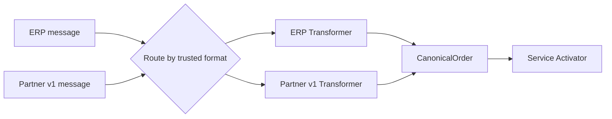
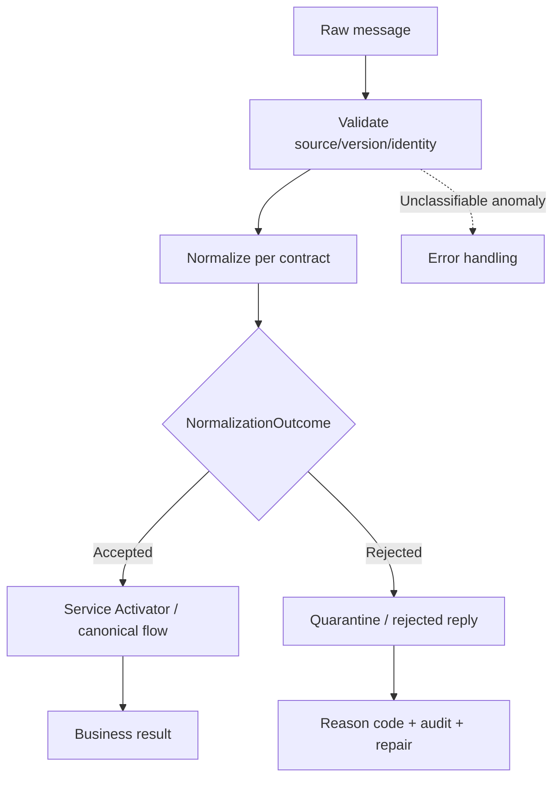
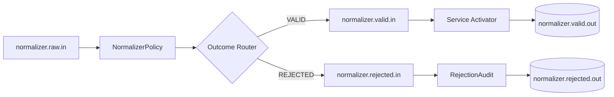
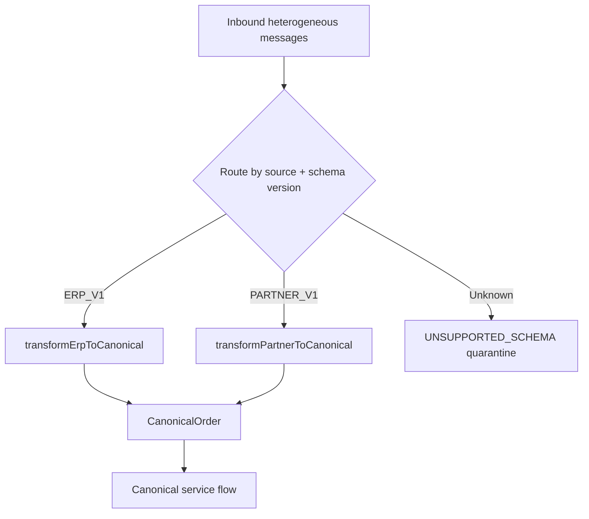
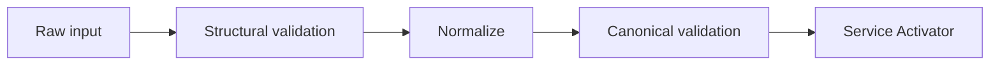
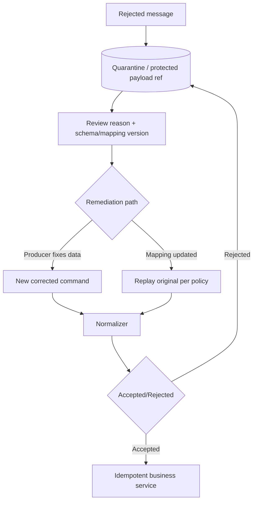

# Routing Unnormalizable Messages in Spring Integration

## Lesson Objectives

A platform receives orders from an ERP system and a trading partner. ERP formats amounts like `"125000.50"`, while Partner v1 uses decimal commas like `"125000,50"`. Once inside the system, data must map into one `CanonicalOrder` structure so the Service Activator processes against a single unified contract.

However, some messages **cannot be normalized safely**: missing order ID, unknown currency, unsupported source, ambiguous monetary formatting, unknown schema version, or malformed content. Guessing and continuing on such messages risks producing **orders with wrong amounts or wrong tenants**.

This lesson focuses on a key design decision: **explicitly routing unnormalizable messages to a rejection/quarantine flow**, while cleanly converted messages reach the Service Activator. Never use arbitrary defaults to turn bad data into “valid” data, and never lump unprocessable data errors together with transient DB/network outages.

This lesson belongs to the **Normalizer** chapter of the **SPRING_INTEGRATION_PATTERN** module, part of the Enterprise Integration Patterns track with Spring Integration: Router, Filter, Transformer, Splitter, Aggregator, Gateway, retry, error channel, correlation, plus multi-branch testing and monitoring. The goal is building loosely coupled, extensible message flows that preserve rejection reasons and investigability.

After this lesson, you will be able to:

1. Explain **Normalizer = selecting the right mapping + standardizing into a shared model** and why an unnormalizable path is mandatory.
2. Distinguish expected **business rejections** from **technical exceptions** and **security violations**.
3. Use an explicit result type (`Accepted`/`Rejected`) and `.route(...)` on the outcome instead of swallowing exceptions or silently dropping messages.
4. Write Java DSL with `valid`/`rejected` branches and test that **invalid messages never invoke the Service Activator**.
5. Design error codes, traceability context, quarantine/DLQs, classified retries, and repair/replay workflows.
6. Protect correlation IDs, tenant identity, sensitive data, and idempotency when replaying messages.
7. Understand how Filter, Gateway, Splitter/Aggregator, and async adapters interact with the rejected flow.

---

## 1. What Is a Normalizer?

In Enterprise Integration Patterns, **Normalizer** typically uses a **Router** to pick the right conversion and one or more **Transformers** to convert diverse formats into a **canonical message format**.



The receiver does not need to know how two sources differ on decimal dots vs. commas, field names, or schemas. The Service Activator receives a clearly defined DTO:

```text
CanonicalOrder(
    tenantId,
    sourceSystem,
    externalOrderId,
    amount: BigDecimal,
    currency: "VND" | "USD"
)
```

**Core point:** Normalizer does not mean “produce an output at all costs”. A message can be normalized only when a **defined mapping** exists and the data is trustworthy enough to convert **without inventing information**.

### Sample Inputs

| Source | Raw Data | Result |
| --- | --- | --- |
| ERP | `amountText="125000.50"`, `currency=USD` | Normalizable |
| Partner v1 | `amountText="125000,50"`, `currency=usd` | Normalizable if contract permits lowercase |
| ERP | `amountText="1,250.50"` | **No**; thousands separators unsupported |
| Partner v1 | `amountText="1.250,50"` | **No**; no mapping for this format |
| Other source | `sourceSystem="UNKNOWN"` | **No**; no approved mapping |
| ERP | `currency="XYZ"` | **No**; unsupported currency code |
| ERP | `externalOrderId=""` | **No**; missing business identity |
| ERP | `amountText="-10"` | **No** under the lesson's intake contract |

A comma in a payload can be a decimal separator or a thousands separator depending on locale. Without a contract, **never guess the sender's intent**.

## 2. Why Do We Need an “Unnormalizable” Branch?

A happy-path-only design typically suffers one of three failures:

1. **Bad data gets turned into defaults:** unknown currency becomes VND; unparseable amount becomes 0.
2. **Messages vanish:** a Filter returns false and drops silently; the producer never learns what to fix.
3. **Data errors enter general retries:** a malformed payload gets consumed and NACKed endlessly, creating a poison-message loop.

An explicit handling flow:



Here **Rejected** is a **valid business outcome of the normalization step**, not a signal that “business processing succeeded”. It can be used to halt early, return an error response, or route the message for data repair.

### Distinguish “Unnormalizable” from “Unauthorized”

A message that matches a schema and converts cleanly **does not prove the sender is authorized to place an order**. Authentication and authorization must run at trust boundaries and services. Conversely, a message rejected for bad format **must not** be logged as `NETWORK_TIMEOUT` or leak a Java stack trace to clients.

## 3. Classify Failures Before Routing

| Scenario | Category | Example | Appropriate Action |
| --- | --- | --- | --- |
| Missing required field | Permanent input rejection | Missing `externalOrderId` | Rejected + field error |
| Unrecognized source/schema | Mapping unavailable | `partnerVersion=99` | Rejected/quarantine to update contract |
| Value violates contract | Semantic rejection | `currency=XYZ`, `amount <= 0` | Rejected + `reasonCode` |
| Unclear interpretation | Ambiguous input | `"1,000"` without locale | Rejected; never guess |
| Unauthorized | Security denial | Spoofed tenant | Deny/audit; never reach Service Activator |
| Mapping store unreachable | Transient infrastructure | Registry unresponsive | Error flow / bounded retry |
| Normalizer code bug | Unexpected failure | `NullPointerException` from defect | Error channel, alert; never blame input |
| DB fails writing canonical order | Downstream failure | Deadlock/timeout | Retry at Service Activator with idempotency |
| Duplicate valid command | Idempotency policy | Redelivery of same order command | Replay stored result or handle via ledger |

**Never catch every `Exception` and return `Rejected("INVALID_FORMAT")`.** Doing so masks code bugs and infrastructure outages, misdirecting retries and alerts.

### Permanent Does Not Mean Unfixable Forever

A malformed payload will not heal itself under **unchanged** retries. Yet an operator can repair it, or the system can deploy a new parser/mapping. Therefore the rejected branch still needs metadata for **controlled repair/replay**.

## 4. Explicit Result Contract

When expected data errors can be modeled explicitly, have the normalizer return one of two outcomes:

```java
sealed interface NormalizationOutcome
    permits Accepted, Rejected { }

record Accepted(CanonicalOrder order)
    implements NormalizationOutcome { }

record Rejected(
    String sourceSystem,
    String tenantId,
    String externalOrderId,
    String reasonCode
) implements NormalizationOutcome { }
```

This is a **data-modeling template**; the runnable code below declares these types as nested types inside the configuration class.

### Why Use Outcomes Instead of Just `null`?

- `Accepted` guarantees a valid canonical DTO.
- `Rejected` preserves an auditable/testable **reason code**.
- `null` cannot distinguish missing payloads, missing mappings, or code bugs.
- Data errors no longer require exceptions for every control-flow branch.
- Java 17 `sealed interface` restricts the cases the router must handle.

`Rejected` in the example keeps only **minimal metadata**. Never dump sensitive raw payloads into every rejection event or log. If the original is needed for repair, store it in a separately protected quarantine/claim-check store.

### Error Codes Must Be Stable

| Code | Meaning |
| --- | --- |
| `SOURCE_REQUIRED` | Source/contract type missing |
| `SOURCE_UNSUPPORTED` | No mapping exists for source |
| `TENANT_INVALID` | Tenant field violates contract; **not a substitute for AuthZ** |
| `ORDER_ID_REQUIRED` | Missing order ID |
| `ORDER_ID_INVALID` | Order ID violates format |
| `AMOUNT_REQUIRED` | Missing amount |
| `AMOUNT_TOO_LONG` | Amount exceeds input length limit |
| `AMOUNT_FORMAT_INVALID` | Does not match source numeric syntax |
| `AMOUNT_NOT_POSITIVE` | Value ≤ 0 |
| `AMOUNT_EXCEEDS_LIMIT` | Exceeds demo limit |
| `CURRENCY_UNSUPPORTED` | Currency lacks supported mapping |
| `AMOUNT_SCALE_INVALID` | Fractional digits exceed currency scale |

Avoid embedding raw user-supplied values inside error messages. Return `field`, `reasonCode`, and a safe `correlationId` so callers can contact support.

## 5. Define the Canonical Contract First

Decisions to settle upfront:

- Which currencies are supported?
- Is `amount` whole units, decimal, or minor units?
- Are thousands separators allowed?
- Are negative numbers allowed for refunds?
- What is the monetary precision?
- Are trimming, uppercasing, or decimal-separator conversions permitted?
- Is the source schema explicitly versioned?
- Which fields are required to establish business identity?

In this example:

- Accepted sources are `ERP` or `PARTNER_V1`.
- ERP uses a decimal dot, e.g., `125000.50`.
- PARTNER_V1 uses a decimal comma, e.g., `125000,50`.
- Thousands separators, scientific notation, and ambiguous values are rejected.
- Supported currencies are `VND`/`USD`; lowercase codes are accepted and uppercasing is an approved normalization.
- VND must be exact to whole dong; USD allows at most two **significant** decimal places.
- Amounts must be positive and not exceed 1,000,000,000,000 currency units.
- IDs permit only alphanumeric characters, underscores, and hyphens per the sample contract.

**These are practice-exercise policies**, not universal rules for all monetary systems or partners.

### Normalization vs. “Fixing Bad Data”

```text
"usd"     -> "USD"       // approved mapping
"125,50"  -> "125.50"    // only for PARTNER_V1
"XYZ"     -> "VND"      // WRONG: guessing currency
"1,250"   -> "1250"     // WRONG without knowing separator
""        -> "UNKNOWN"  // WRONG: fabricating order ID
```

A heuristic format detector can assist humans with repair suggestions, yet **must never silently turn guesses into live transactions**.

## 6. Java DSL Demo: Normalize Then Route to Two Branches

### Example Architecture



Classes/beans:

- `RawOrder` is the shared ingress envelope holding source and raw fields. Real source adapters convert JSON/XML/CSV into this envelope.
- `NormalizerPolicy.normalize` returns `Accepted(CanonicalOrder)` or `Rejected(reasonCode)`.
- `IntegrationFlow.normalizeAndRoute` picks the channel from the outcome.
- `AcceptedFlow` invokes the service only after obtaining `CanonicalOrder`.
- `RejectedFlow` records the rejection and forwards to an observable output; **never calls the business service**.
- The final `QueueChannel`s are test sinks only, **not a durable quarantine system**.

### Complete Configuration (Java 17+, Spring Integration 6.x/7.x)

```java
import java.math.BigDecimal;
import java.math.RoundingMode;
import java.util.Locale;
import java.util.Set;
import java.util.concurrent.atomic.AtomicInteger;
import java.util.regex.Pattern;

import org.springframework.context.annotation.Bean;
import org.springframework.context.annotation.Configuration;
import org.springframework.integration.channel.DirectChannel;
import org.springframework.integration.channel.QueueChannel;
import org.springframework.integration.config.EnableIntegration;
import org.springframework.integration.dsl.IntegrationFlow;
import org.springframework.messaging.MessageChannel;
import org.springframework.messaging.PollableChannel;

@Configuration
@EnableIntegration
public class NormalizerRoutingConfig {

    public record RawOrder(
        String sourceSystem,
        String tenantId,
        String externalOrderId,
        String amountText,
        String currencyText
    ) {}

    public record CanonicalOrder(
        String sourceSystem,
        String tenantId,
        String externalOrderId,
        BigDecimal amount,
        String currency
    ) {}

    public sealed interface Outcome permits Accepted, Rejected {}

    public record Accepted(CanonicalOrder order)
            implements Outcome {}

    public record Rejected(
        String sourceSystem,
        String tenantId,
        String externalOrderId,
        String reasonCode
    ) implements Outcome {}

    public static final class NormalizerPolicy {
        private static final Pattern SAFE_ID =
            Pattern.compile("[A-Za-z0-9_-]{1,80}");

        private static final Pattern ERP_MONEY =
            Pattern.compile("[0-9]+(\\.[0-9]+)?");

        private static final Pattern PARTNER_MONEY =
            Pattern.compile("[0-9]+(,[0-9]+)?");

        private static final BigDecimal MAX_AMOUNT =
            new BigDecimal("1000000000000");

        private static boolean validId(String value) {
            return value != null
                && SAFE_ID.matcher(value).matches();
        }

        private static Rejected reject(RawOrder raw, String code) {
            return new Rejected(
                raw == null ? null : raw.sourceSystem(),
                raw == null ? null : raw.tenantId(),
                raw == null ? null : raw.externalOrderId(),
                code);
        }

        public Outcome normalize(RawOrder raw) {
            if (raw == null) {
                return reject(null, "INPUT_REQUIRED");
            }
            if (raw.sourceSystem() == null ||
                    raw.sourceSystem().isBlank()) {
                return reject(raw, "SOURCE_REQUIRED");
            }

            String source = raw.sourceSystem().trim();
            if (!Set.of("ERP", "PARTNER_V1").contains(source)) {
                return reject(raw, "SOURCE_UNSUPPORTED");
            }

            if (!validId(raw.tenantId())) {
                return reject(raw, "TENANT_INVALID");
            }

            if (raw.externalOrderId() == null
                    || raw.externalOrderId().isBlank()) {
                return reject(raw, "ORDER_ID_REQUIRED");
            }
            if (!validId(raw.externalOrderId())) {
                return reject(raw, "ORDER_ID_INVALID");
            }

            if (raw.currencyText() == null) {
                return reject(raw, "CURRENCY_UNSUPPORTED");
            }
            String currency = raw.currencyText()
                .trim().toUpperCase(Locale.ROOT);

            if (!Set.of("VND", "USD").contains(currency)) {
                return reject(raw, "CURRENCY_UNSUPPORTED");
            }

            if (raw.amountText() == null
                    || raw.amountText().isBlank()) {
                return reject(raw, "AMOUNT_REQUIRED");
            }

            String amountText = raw.amountText().trim();
            if (amountText.length() > 32) {
                return reject(raw, "AMOUNT_TOO_LONG");
            }

            boolean formatMatches = "ERP".equals(source)
                ? ERP_MONEY.matcher(amountText).matches()
                : PARTNER_MONEY.matcher(amountText).matches();

            if (!formatMatches) {
                return reject(raw, "AMOUNT_FORMAT_INVALID");
            }

            String decimalDot = "ERP".equals(source)
                ? amountText : amountText.replace(',', '.');

            // Regex already validated digits and one decimal mark,
            // yet still catch NumberFormatException to fail safely.
            BigDecimal parsed;
            try {
                parsed = new BigDecimal(decimalDot);
            } catch (NumberFormatException ex) {
                return reject(raw, "AMOUNT_FORMAT_INVALID");
            }

            if (parsed.signum() <= 0) {
                return reject(raw, "AMOUNT_NOT_POSITIVE");
            }
            if (parsed.compareTo(MAX_AMOUNT) > 0) {
                return reject(raw, "AMOUNT_EXCEEDS_LIMIT");
            }

            int scale = "VND".equals(currency) ? 0 : 2;
            BigDecimal canonical;
            try {
                // No silent rounding: only trim trailing zero fraction digits.
                canonical = parsed.setScale(
                    scale, RoundingMode.UNNECESSARY);
            } catch (ArithmeticException ex) {
                return reject(raw, "AMOUNT_SCALE_INVALID");
            }

            return new Accepted(new CanonicalOrder(
                source,
                raw.tenantId(),
                raw.externalOrderId(),
                canonical,
                currency));
        }
    }

    public static final class OrderService {
        private final AtomicInteger calls = new AtomicInteger();

        public CanonicalOrder process(CanonicalOrder order) {
            calls.incrementAndGet();

            // Demo does not write DB or call real providers.
            return order;
        }

        public int invocations() {
            return calls.get();
        }
    }

    public static final class RejectionAudit {
        private final AtomicInteger calls = new AtomicInteger();

        public Rejected record(Rejected rejection) {
            calls.incrementAndGet();

            // Demo: does not persist payload; production needs durable
            // audit/quarantine, authorization, and explicit retry/ack.
            return rejection;
        }

        public int invocations() {
            return calls.get();
        }
    }

    static String destination(Outcome outcome) {
        if (outcome instanceof Accepted) {
            return "VALID";
        }
        if (outcome instanceof Rejected) {
            return "REJECTED";
        }
        throw new IllegalArgumentException("UNKNOWN_OUTCOME_TYPE");
    }

    @Bean
    NormalizerPolicy normalizerPolicy() {
        return new NormalizerPolicy();
    }

    @Bean
    OrderService orderService() {
        return new OrderService();
    }

    @Bean
    RejectionAudit rejectionAudit() {
        return new RejectionAudit();
    }

    @Bean("normalizer.raw.in")
    MessageChannel rawInput() {
        return new DirectChannel();
    }

    @Bean("normalizer.valid.in")
    MessageChannel validInput() {
        return new DirectChannel();
    }

    @Bean("normalizer.rejected.in")
    MessageChannel rejectedInput() {
        return new DirectChannel();
    }

    @Bean("normalizer.valid.out")
    PollableChannel validOutput() {
        return new QueueChannel();
    }

    @Bean("normalizer.rejected.out")
    PollableChannel rejectedOutput() {
        return new QueueChannel();
    }

    @Bean
    IntegrationFlow normalizeAndRoute(NormalizerPolicy policy) {
        return IntegrationFlow.from("normalizer.raw.in")
            .transform(RawOrder.class, policy::normalize)
            .route(
                Outcome.class,
                NormalizerRoutingConfig::destination,
                mapping -> mapping
                    .channelMapping(
                        "VALID", "normalizer.valid.in")
                    .channelMapping(
                        "REJECTED", "normalizer.rejected.in"))
            .get();
    }

    @Bean
    IntegrationFlow acceptedFlow(OrderService service) {
        return IntegrationFlow.from("normalizer.valid.in")
            .handle(Accepted.class, (accepted, headers) ->
                service.process(accepted.order()))
            .channel("normalizer.valid.out")
            .get();
    }

    @Bean
    IntegrationFlow rejectedFlow(RejectionAudit audit) {
        return IntegrationFlow.from("normalizer.rejected.in")
            .handle(Rejected.class, (rejected, headers) ->
                audit.record(rejected))
            .channel("normalizer.rejected.out")
            .get();
    }
}
```

### Why Separate the Two Branches into Two IntegrationFlows?

With `DirectChannel`, one subscriber receives messages from the selected route. `acceptedFlow` expects payload type `Accepted`, whereas `rejectedFlow` expects `Rejected`. Explicit separation means:

- The Service Activator never repeats `if (payload.invalid())`.
- Rejected messages cannot reach `OrderService.process` accidentally.
- Each branch has its own tests, metrics, and retention.
- Switching to Kafka/AMQP/DB quarantine only changes the rejected branch's adapter/flow.
- Policy has already validated a canonical DTO before it reaches the service.

**One input here enters one router**, rather than two handlers subscribing directly to `normalizer.raw.in` and hoping each filters for its own type.

### What Happens to Headers?

`.transform(...)` returns an `Outcome` payload, and Spring Integration constructs the next message per endpoint header propagation rules. Within a single-process example, supported headers like `traceId` and `correlationId` can carry through. Still:

- Never treat raw `headers['tenantId']` as proof the sender belongs to that tenant.
- Never unconditionally copy `replyChannel`, `errorChannel`, or tokens across broker/HTTP boundaries.
- Across separate processes, test header mappers and DTO contracts at every boundary.
- The rejected branch needs appropriate `sourceId`, `requestId`, and `correlationId`, without forwarding raw sensitive payloads just for debugging.

### Why Does the Demo Intentionally Not Retry?

An `AMOUNT_FORMAT_INVALID` message will **never become valid** when redelivered with the exact same payload and mapping. The exercise uses an explicit outcome to mark it as **data needing repair or a missing mapping**, not a network blip. Infrastructure failures belong in dedicated error handling.

## 7. JUnit Integration Test: Invalid Input Never Touches Service Activator

We must verify **not only that routing picks the right channel**, but also **zero side effects** in the business handler.

### JUnit 5 + AssertJ

```java
import static org.assertj.core.api.Assertions.assertThat;

import java.math.BigDecimal;

import org.junit.jupiter.api.Test;
import org.springframework.beans.factory.annotation.Autowired;
import org.springframework.beans.factory.annotation.Qualifier;
import org.springframework.messaging.Message;
import org.springframework.messaging.MessageChannel;
import org.springframework.messaging.PollableChannel;
import org.springframework.messaging.support.MessageBuilder;
import org.springframework.test.annotation.DirtiesContext;
import org.springframework.test.context.junit.jupiter.SpringJUnitConfig;

@SpringJUnitConfig(NormalizerRoutingConfig.class)
@DirtiesContext(
    classMode = DirtiesContext.ClassMode.AFTER_EACH_TEST_METHOD)
class NormalizerRoutingFlowTest {

    @Autowired
    @Qualifier("normalizer.raw.in")
    MessageChannel input;

    @Autowired
    @Qualifier("normalizer.valid.out")
    PollableChannel accepted;

    @Autowired
    @Qualifier("normalizer.rejected.out")
    PollableChannel rejected;

    @Autowired
    NormalizerRoutingConfig.OrderService service;

    @Autowired
    NormalizerRoutingConfig.RejectionAudit audit;

    private void send(
        String source,
        String orderId,
        String amount,
        String currency
    ) {
        var raw = new NormalizerRoutingConfig.RawOrder(
            source, "tenant-a", orderId, amount, currency);

        assertThat(input.send(
            MessageBuilder.withPayload(raw)
                .setHeader("traceId", "trace-42")
                .setHeader("correlationId", "WORKFLOW-42")
                .build()
        )).isTrue();
    }

    @Test
    void erpAmountReachesBusinessService() {
        send("ERP", "ORD-101", "125000.50", "USD");

        Message<?> result = accepted.receive(2_000);
        assertThat(result).isNotNull();

        var canonical = (NormalizerRoutingConfig.CanonicalOrder)
            result.getPayload();

        assertThat(canonical.amount())
            .isEqualByComparingTo(new BigDecimal("125000.50"));
        assertThat(canonical.currency()).isEqualTo("USD");
        assertThat(canonical.externalOrderId())
            .isEqualTo("ORD-101");
        assertThat(service.invocations()).isEqualTo(1);
        assertThat(audit.invocations()).isZero();
        assertThat(rejected.receive(0)).isNull();
        assertThat(accepted.receive(0)).isNull();

        assertThat(result.getHeaders().get("correlationId"))
            .isEqualTo("WORKFLOW-42");
    }

    @Test
    void partnerDecimalCommaIsNormalized() {
        send("PARTNER_V1", "ORD-102", "49,90", "usd");

        Message<?> result = accepted.receive(2_000);
        assertThat(result).isNotNull();

        var canonical = (NormalizerRoutingConfig.CanonicalOrder)
            result.getPayload();

        assertThat(canonical.amount())
            .isEqualByComparingTo(new BigDecimal("49.90"));
        assertThat(canonical.currency()).isEqualTo("USD");
        assertThat(service.invocations()).isEqualTo(1);
        assertThat(rejected.receive(0)).isNull();
    }

    private NormalizerRoutingConfig.Rejected rejectedResult() {
        Message<?> result = rejected.receive(2_000);
        assertThat(result).isNotNull();
        assertThat(result.getPayload())
            .isInstanceOf(NormalizerRoutingConfig.Rejected.class);
        return (NormalizerRoutingConfig.Rejected)
            result.getPayload();
    }

    @Test
    void unknownSourceIsRoutedToRejectedFlow() {
        send("UNREGISTERED", "ORD-201", "100", "USD");

        assertThat(rejectedResult().reasonCode())
            .isEqualTo("SOURCE_UNSUPPORTED");
        assertThat(service.invocations()).isZero();
        assertThat(audit.invocations()).isEqualTo(1);
        assertThat(accepted.receive(0)).isNull();
    }

    @Test
    void ambiguousNumberNeverCallsBusinessService() {
        send("ERP", "ORD-202", "1,250.00", "USD");

        assertThat(rejectedResult().reasonCode())
            .isEqualTo("AMOUNT_FORMAT_INVALID");
        assertThat(service.invocations()).isZero();
        assertThat(audit.invocations()).isEqualTo(1);
        assertThat(accepted.receive(0)).isNull();
    }

    @Test
    void unknownCurrencyIsNotSilentlyReplaced() {
        send("ERP", "ORD-203", "1000", "XYZ");

        assertThat(rejectedResult().reasonCode())
            .isEqualTo("CURRENCY_UNSUPPORTED");
        assertThat(service.invocations()).isZero();
        assertThat(audit.invocations()).isEqualTo(1);
        assertThat(accepted.receive(0)).isNull();
    }

    @Test
    void unsupportedPrecisionIsRejectedWithoutRounding() {
        send("PARTNER_V1", "ORD-204", "12,345", "USD");

        assertThat(rejectedResult().reasonCode())
            .isEqualTo("AMOUNT_SCALE_INVALID");
        assertThat(service.invocations()).isZero();
        assertThat(accepted.receive(0)).isNull();
    }
}
```

The test suite uses `@DirtiesContext(AFTER_EACH_TEST_METHOD)` so counters and `QueueChannel` contents do not leak across tests. `DirectChannel` keeps calls synchronous here. With async flows or brokers, use event-driven assertions and appropriate timeouts.

**What this proves:** valid data normalizes to `CanonicalOrder`; unnormalizable data enters the rejected branch with a reason; `OrderService` **is never called** for rejected messages.

**What this does NOT prove:** DB commits, retries across restarts, exactly-once effects, quarantine durability, cross-broker tracing, or multi-tenant security policies. Those require dedicated integration/fault tests.

## 8. Fast Unit Tests for the Normalizer

Mapping logic should be **pure functions**, needing no Spring startup to test individual inputs.

```java
import static org.assertj.core.api.Assertions.assertThat;

import java.math.BigDecimal;

import org.junit.jupiter.api.Test;

class NormalizerPolicyTest {

    private final NormalizerRoutingConfig.NormalizerPolicy policy =
        new NormalizerRoutingConfig.NormalizerPolicy();

    private NormalizerRoutingConfig.RawOrder raw(
        String source, String amount, String currency
    ) {
        return new NormalizerRoutingConfig.RawOrder(
            source, "tenant-a", "ORD-U",
            amount, currency);
    }

    @Test
    void acceptedResultUsesCanonicalDecimalScale() {
        var result = policy.normalize(
            raw("ERP", "12.5", "USD"));

        assertThat(result)
            .isInstanceOf(NormalizerRoutingConfig.Accepted.class);
        var accepted = (NormalizerRoutingConfig.Accepted) result;

        assertThat(accepted.order().amount())
            .isEqualTo(new BigDecimal("12.50"));
    }

    @Test
    void vndAllowsTrailingZerosButNotFractionalValue() {
        var good = policy.normalize(
            raw("ERP", "120.00", "VND"));
        var bad = policy.normalize(
            raw("ERP", "120.50", "VND"));

        assertThat(good)
            .isInstanceOf(NormalizerRoutingConfig.Accepted.class);
        assertThat(bad)
            .isInstanceOf(NormalizerRoutingConfig.Rejected.class);
        assertThat(
            ((NormalizerRoutingConfig.Rejected) bad).reasonCode()
        ).isEqualTo("AMOUNT_SCALE_INVALID");
    }

    @Test
    void invalidIdCannotSneakIntoCanonicalOrder() {
        var invalid = new NormalizerRoutingConfig.RawOrder(
            "ERP", "tenant-a", "ORD|OTHER",
            "50.00", "USD");

        assertThat(policy.normalize(invalid))
            .isInstanceOf(NormalizerRoutingConfig.Rejected.class);
    }

    @Test
    void unsupportedSourceNeverFallsBackToErp() {
        var result = policy.normalize(
            raw("PARTNER_V99", "50,00", "USD"));

        assertThat(result)
            .isInstanceOf(NormalizerRoutingConfig.Rejected.class);
        assertThat(
            ((NormalizerRoutingConfig.Rejected) result).reasonCode()
        ).isEqualTo("SOURCE_UNSUPPORTED");
    }
}
```

### Decision-Table Tests

Beyond the sample tests, add parameterized tests for:

| Source | Amount | Currency | Expected |
| --- | --- | --- | --- |
| ERP | `"1500.20"` | USD | Accepted 1500.20 |
| PARTNER_V1 | `"1500,20"` | USD | Accepted 1500.20 |
| ERP | `"1500,20"` | USD | Rejected FORMAT |
| PARTNER_V1 | `"1500.20"` | USD | Rejected FORMAT |
| ERP | `"1000.00"` | VND | Accepted 1000 |
| ERP | `"1000.01"` | VND | Rejected SCALE |
| ERP | `"0"` | VND | Rejected NON_POSITIVE |
| ERP | `"-10"` | VND | Rejected FORMAT under this parser |
| ERP | `"1e3"` | VND | Rejected FORMAT |
| ERP | `"9999999999999"` | VND | Rejected EXCEEDS_LIMIT |
| UNKNOWN | `"10"` | USD | Rejected SOURCE |

For `"-10"`, the current example returns `AMOUNT_FORMAT_INVALID` because the regex allows only positive digits, rather than `AMOUNT_NOT_POSITIVE`. Error-code precedence is a **contract rule** that must be tested consistently.

## 9. Alternative: Routing by Source Ahead of Transformers

When each source has its own payload/schema:

```text
Message<ErpOrderV1>
Message<PartnerOrderV1>
Message<LegacyCsvRecord>
```

You can route **by trusted type/schema** first and then transform:



**This is the Router + multiple Transformers Normalizer layout**. Section 6's Java DSL packages both conversions inside `NormalizerPolicy` behind a common envelope to keep the exercise concise and easy to test; semantically it still selects mappings per source and standardizes outputs.

### Routers Need an Explicit Default Output

With a `HeaderValueRouter` or source-based Router:

- Map `ERP_V1` to the ERP normalization flow.
- Map `PARTNER_V1` to the Partner normalization flow.
- Provide an explicit **unknown-source** branch so messages never disappear due to missing channel mappings.
- For untrusted inputs, never let an arbitrary `sourceType` header select high-privilege endpoints.

A key rule: **unmapped paths must never enter the Service Activator with a “close enough” type**.

### Should a Filter Drop Unsupported Sources?

A `MessageFilter` works when the policy is “only care about supported sources, intentionally ignore all others”. However, for **commands expecting replies** or batches needing reconciliation, silent Filter drops lose work or cause Gateway timeouts. Routing to a rejected flow with an **error code and terminal status** is usually better.

## 10. When to Throw an Exception Instead of Returning Rejected?

Not every situation should be modeled as an outcome value.

### Return `Rejected` When

- Source/schema is unsupported under the contract.
- Input fields are missing or malformed.
- Monetary currency/amount cannot convert unambiguously.
- A clearly defined static rule is violated.
- Producers need actionable feedback or originals retained for repair.

### Throw an Exception or Use Error Channels When

- Metadata stores or schema registries fail to respond.
- Infrastructure serialization errors occur that the app expects to retry.
- Unexpected programming bugs occur.
- Downstream DB/HTTP connections fail.
- Authorization/security violations require separate handling without leaking details.

A Java Transformer throwing an exception on a `DirectChannel` propagates back to the caller; in poller, executor, or broker topologies, it can route to an error flow per adapter/configuration. **Never assume every exception automatically becomes an `ErrorMessage` on one global `errorChannel`.**

### Avoid Catch-All Blocks

```java
// ANTI-PATTERN: hides both infrastructure failures and bugs.
try {
    return normalizeWithExternalMapping(raw);
} catch (Exception ex) {
    return new Rejected(
        raw.sourceSystem(), raw.tenantId(),
        raw.externalOrderId(), "BAD_INPUT");
}
```

If an external mapping service suffers an outage, labeling it `BAD_INPUT` is wrong; operators might discard the message instead of retrying once the mapping service recovers.

### Error Classification

```text
Permanent mapping/input issue:
  -> Rejected outcome / quarantine / repair

Transient infrastructure issue:
  -> exception + bounded retry + backoff

Programming defect / unexpected:
  -> error channel / alert / investigation

Unauthorized access:
  -> deny + security audit, do not reveal sensitive details
```

A real application can also throw a typed `NormalizationRejectedException` if it wants framework error flows to drive the rejected path. Just stay consistent: **expected outcomes** and **unexpected exceptions** should never be muddled together.

## 11. Differences Among Rejected Channel, Discard Channel, Error Channel, and DLQ

| Concept | Nature | When Used |
| --- | --- | --- |
| **Rejected branch** | Application flow handling `Rejected` with `reasonCode` | Input/mapping cannot normalize |
| `discardChannel` | Messages dropped by Filter/Idempotent Receiver per policy | Intentionally discarding from an endpoint |
| `errorChannel` | Destination for `ErrorMessage` per endpoint/adapter config | Exceptions during processing |
| **DLQ** | Broker-side store for unprocessable messages | Exhausted redeliveries or intentional rejection |
| **Quarantine store** | Dedicated store holding payloads/metadata for repair/replay | Messages needing repair or new schema mapping |
| **Business rejection reply** | Response to Gateway/API callers | Invalid requests needing explicit feedback |

Do not treat those five concepts as interchangeable channels. An in-memory `QueueChannel` in the example **does not provide durability, TTLs, backpressure, or access control**.

### Designing Quarantine with Enough Context and Minimal Sensitivity

An illustrative record:

```json
{
  "rejectionId": "REJ-42",
  "sourceSystem": "PARTNER_V1",
  "requestId": "REQ-42",
  "reasonCode": "AMOUNT_FORMAT_INVALID",
  "schemaVersion": "1",
  "mappingVersion": "v3",
  "receivedAt": "2026-11-21T10:00:00Z",
  "rawPayloadRef": "protected-store-reference"
}
```

This is an **application-designed format**, not an automatic Spring Integration DTO. `rawPayloadRef` should be an access-controlled reference, never raw sensitive data dumped in logs.

### When Must Originals Be Retained?

- When partners can fix and resend—or repair workflows fix them.
- When a new mapping version is about to deploy.
- When investigating a data dispute.
- When required for auditing/compliance.

Still enforce TTL/retention, encryption, RBAC, and deletion policies. **Never retain all invalid payloads forever**, which creates an uncontrolled sensitive-data hoard.

## 12. Gateway and Replies for Unnormalizable Messages

If the flow is invoked through a Messaging Gateway:

```text
Caller -> Gateway -> Normalizer
                       |
                       +-- Accepted -> Service -> Success reply
                       |
                       +-- Rejected -> Rejection result / mapped error
```

The flow can return one of two types:

- `OrderAccepted` with canonical order ID/status.
- `NormalizationRejected` with `reasonCode` and appropriate error field list.

If rejected messages only go into a queue with **no reply**, synchronous Gateways wait until timeout. The demo's `QueueChannel` is a test sink, not a complete request–reply API solution.

### Two Common Contracts

**A. Rejection as a normal reply**

```java
sealed interface OrderIntakeResult
    permits OrderAccepted, OrderRejected { }
```

A Gateway endpoint returns `OrderIntakeResult`. Callers distinguish accepted vs. rejected and display the reason without using exceptions for every invalid input.

**B. Rejection as a mapped exception**

A `NormalizationRejectedException` maps to HTTP 4xx or adapter-contracted errors. Infrastructure outages still map to 5xx/retries.

Which to pick depends on protocol and caller. **Never assume HTTP statuses arise automatically just by calling `.route(...)` or constructing a `Rejected` record.**

### When Two Branches Both Try to Reply

If misconfigured routing causes both accepted and rejected paths to reply for one request, callers receive nondeterministic or late responses. Use an **exclusive** router per outcome and test that exactly one terminal branch completes.

## 13. Filter Does Not Replace Normalizer

A Filter decides which messages stay. It does not handle:

- Selecting source/version mappings.
- Parsing, validating, and standardizing currencies/amounts.
- Returning reason codes when mapping fails.
- Storing original payloads/metadata for repair.
- Separating permanent errors from transient infrastructure outages.

A simple flow:

```java
.filter(RawOrder.class, raw ->
    Set.of("ERP", "PARTNER_V1")
        .contains(raw.sourceSystem()))
```

If a Filter drops `SOURCE_UNSUPPORTED`, producers never learn whether to switch sources or update mappings. When fire-and-forget traffic intentionally ignores out-of-scope events, that may be desired. Yet for side-effecting commands, **preserving rejection evidence** usually matters more than dropping messages.

### If You Still Use a Filter

Configure `discardChannel` or `throwExceptionOnRejection` with an explicit rejected flow. Never enable retries on deterministic rejections.

## 14. Validation Before and After Normalization

There are two layers of validation:



- **Structural validation:** source fields present, version, lengths, source-specific syntax.
- **Canonical validation:** shared DTO has no invalid nulls, exact money precision, verified tenant identity, input invariants met.
- **Business validation at service/DB:** order state, stock, and credit limits still hold at commit time.

A message can be syntactically valid ERP input yet violate the canonical contract after conversion. Never treat “the parser didn't throw” as sufficient to call the Service Activator.

### Bean Validation on Canonical DTOs

You can use `jakarta.validation.Validator` to check DTOs after normalization. For instance:

```java
public record CanonicalOrderValidated(
    @jakarta.validation.constraints.NotBlank String orderId,
    @jakarta.validation.constraints.NotNull
    @jakarta.validation.constraints.Positive
    java.math.BigDecimal amount
) {}
```

Annotations only declare constraints. You must **actually invoke `validator.validate(...)`** or configure Method Validation and test at the endpoint; annotating a record alone does not prove the flow validates automatically.

### “Unnormalizable” Is Not “Out of Stock”

A valid canonical order that hits an out-of-stock item is not a mapping failure. That is a business outcome from the Service Activator / Inventory service. Labeling “out of stock” as `AMOUNT_FORMAT_INVALID` corrupts metrics, error handling, and team ownership.

## 15. Correlation and Header Propagation Between Both Branches

A message may carry:

```text
correlationId = shop-a|ORD-42|run-1
traceId       = trace-xyz
sourceId      = partner-ingress
requestId     = REQ-42
schemaVersion = 1
```

These headers help:

- Locate the original message after normalization or rejection.
- Link rejected outcomes back to producers.
- Track mapping versions and processing times.
- Track retries and infrastructure errors.
- Tie branches together when the message is part of a Scatter–Gather.

| Header | Role | Do Not Confuse With |
| --- | --- | --- |
| `correlationId` | Groups related messages | Does not grant access permissions |
| `traceId` | Tracks spans/latency | Does not replace business identity |
| `requestId` | Caller request contract | Not necessarily an idempotency key |
| `schemaVersion` | Selects matching mapping | Never infer from filename |
| `sourceId` | Verified technical source | Not synonymous with principal |
| `idempotencyKey` | Guards one side effect | Never mint from random message IDs |

When emitting `Rejected`, keeping the **correlation key** helps operators diagnose causes without reading raw payloads. If input is too corrupted to derive business correlation, use the verified ingress request ID, broker offset, or trusted transport metadata.

### Never Trust Source/Tenant in Payloads as Credentials

`sourceSystem="ERP"` in the demo's `RawOrder` only **selects the mapping**. In production, the true source must be authenticated via adapter, client credentials, or controlled channels. Any client sending `"ERP"` is not proof they are ERP.

Similarly, `tenantId` must match the authenticated principal/service identity. Passing normalization **never authorizes** access to another tenant's data.

## 16. Retries and Poison-Message Loops

Suppose an invalid amount arrives:

```text
T0 PARTNER_V1 amountText="1.250,50"
T1 Normalizer -> Rejected(AMOUNT_FORMAT_INVALID)
T2 Broker redelivers same payload after NACK
T3 Normalizer -> Rejected(AMOUNT_FORMAT_INVALID)
T4 Repeats forever...
```

With unchanged mappings, automatic retries only burn CPU and flood DLQs.

### Retry Classification

| Category | Retry? | Reason |
| --- | --- | --- |
| Unsupported source/schema | Usually do not retry immediately | Needs contract/mapping update |
| Missing/invalid field | Never retry identical payload endlessly | Needs data repair |
| Ambiguous number/currency | Never guess | Needs human/producer confirmation |
| Registry/config service timeout | Bounded retry | Transient outage |
| DB/network outage post-normalize | Retry at appropriate service | Canonical data remains valid |
| Code bug causing NPE | Alert/fix bug; replay after deploy | Hot retries do not help |
| Security denial | Never retry as infra outage | Requires valid auth/permissions |

### ACK/NACK Belongs to Adapters, Not Arbitrary Router Choices

Sending `Rejected` onto a rejected channel **does not guarantee durable persistence**. For broker consumers, define when the original message is ACKed:

- After the rejected event/quarantine record persists successfully.
- Or after returning a terminal reply with proper audit evidence.
- Or under an explicit at-most-once policy accepting loss risk.

ACKing before quarantine persistence succeeds risks **losing messages**. NACKing after persistence succeeds causes redeliveries to create **duplicate rejection records** without idempotency.

## 17. Repairing and Replaying a Rejected Message

An operations-friendly workflow:



### Recommended Workflow

1. Identify `rejectionId`, `sourceId`, `requestId`, and business identity.
2. Inspect rejection reason, schema/mapping version, and receipt time.
3. Determine whether this requires **payload repair** or a **mapping update**.
4. Enforce operator authorization and replay attempt limits.
5. Keep idempotency keys stable for the **same logical command**; if a correction is a new command, bump generation/version per contract.
6. Attach `replayAttempt` and audit old vs. new status.
7. Never invoke the Service Activator before data passes normalization and canonical validation.
8. Notify the producer/caller of the outcome if the earlier request was rejected.

**Never blindly replay all historical messages just because a new mapping deployed.** Newer schemas can alter meanings for older messages; pin versions and test to avoid corrupting history.

### How Much Raw Payload to Retain

A protected Claim Check-style reference reduces passing sensitive payloads through handlers, yet a ticket **is not authorization itself**. Callers reading the raw store must be authenticated/authorized, with TTLs and audit trails.

## 18. Idempotency in Both Accepted and Rejected Flows

There are two kinds of duplicates:

1. **Input redelivery:** broker redelivers the same raw message.
2. **Post-repair replay:** a rejection re-enters the flow after mapping changes.

In the accepted flow, prevent duplicate side effects: identical `tenant + operation + commandId` commits per contract. In the rejected flow, also avoid creating thousands of duplicate quarantine rows on redeliveries.

### Suggested Keys

```text
Business command key:
  tenantId + "|" + sourceSystem + "|" + externalOrderId + "|" + generation

Rejection key:
  rawEventId + "|" + mappingVersion + "|" + reasonCode
```

These keys are **suggestions**; if an `externalOrderId` can be reused for a new command, add an appropriate transaction/attempt ID. Never use `MessageHeaders.ID` as an idempotency key across redeliveries when producers can assign new IDs.

### Lost ACK Scenario

```text
T1 Accepted flow commits to DB.
T2 Response/ACK is lost.
T3 Broker redelivers raw order.
T4 Normalizes to identical CanonicalOrder.
T5 Service must return committed outcome without creating a second order.
```

A deterministic normalizer **does not make the Service Activator idempotent on its own**. Protect DB writes with unique constraints/transactions/outboxes; protect external APIs with provider idempotency keys and reconciliation.

## 19. Splitter/Aggregator: Invalid Parts Can Stall Groups Forever

A three-record batch:

```text
Splitter creates seqSize=3
  Part #1 -> normalizes successfully
  Part #2 -> Rejected
  Part #3 -> normalizes successfully
```

If the downstream Aggregator receives only accepted parts, it sees **2/3** and may wait forever.

### Option A — Terminal Outcome for Every Part

```text
Part #1 -> PartOutcome(SUCCEEDED)
Part #2 -> PartOutcome(REJECTED, reasonCode)
Part #3 -> PartOutcome(SUCCEEDED)

Aggregator -> BatchSummary(
  processed=2, rejected=1, total=3)
```

Here each part emits a terminal result keeping `correlationId`, `sequenceNumber`, and matching metadata. The Aggregator collects all parts and returns a summary to the caller.

### Option B — Filter Before Splitting

If policy allows dropping records before determining batch size, split only records that already passed normalization/validation. Then `sequenceSize` reflects only parts actually dispatched.

### Option C — Custom Release / Timeout

If part counts vary and summaries accept partials, configure a `ReleaseStrategy` over terminal part sets or explicit deadlines. Never arbitrarily mutate `sequenceSize` on already-emitted messages.

### Scatter–Gather

A supplier whose reply fails normalization **is not** a supplier that never replied. Return `SupplierOutcome(REJECTED)` to the gatherer when contracts expect one terminal outcome per supplier; rank only valid canonical offers. Simply dropping bad replies makes the gatherer wait until timeout even though the supplier responded.

## 20. Router and Transformer: Clarify Error Boundaries

In a larger topology:

```text
Inbound Adapter
    -> Validate envelope/source identity
    -> Normalizer (route + transform)
    -> Accepted/Rejected router
    -> Service Activator or Quarantine Handler
```

One source may have multiple versions:

```text
ERP_V1 -> ErpV1Transformer
ERP_V2 -> ErpV2Transformer
PARTNER_V1 -> PartnerV1Transformer
UNKNOWN -> UnsupportedSchema Rejected
```

When adding a new version, do not replace an old parser with one “universal” parser without regression tests. Track mapping versions in traces/audits; very old data may need approved migration/replays.

### Never Use a Dangerous Default Route

A hazardous bug:

```text
Unknown source -> default route = ERP
```

If an unknown payload happens to parse, the system may record a transaction under the wrong schema. Default branches should emit `SOURCE_UNSUPPORTED`, never “try the closest parser” ahead of side effects.

### A Router Can Drop Messages

If a Router finds no matching channel and configuration permits ignoring unroutable messages, messages can vanish or throw depending on settings. Define the fallback branch **explicitly** and test unknown mappings. In the demo, `destination(...)` always returns `VALID` or `REJECTED`, and both map to channels.

## 21. Security: Quarantine and Logging Can Leak Data

Unnormalizable messages may contain PII, addresses, account numbers, or unvalidated payloads. Treat them as **untrusted and potentially sensitive**.

Do not:

- Log raw payloads when parsing fails.
- Expose rejected channels to unrestricted dashboards.
- Return full stack traces or parser exceptions to clients.
- Use client-supplied `sourceSystem` to select higher-privilege handlers.
- Buffer bad messages indefinitely inside an in-memory `QueueChannel`.
- Forward internal `replyChannel`/`errorChannel` objects over brokers.
- Treat a claim-ticket UUID as proof the holder is authorized to read it.

Do:

1. Authenticate principals/tenants at ingress.
2. Use server-configured schema/source allowlists.
3. Cap payload size, field length, and nesting depth.
4. Alert on sudden rejection spikes without exposing raw inputs.
5. Encrypt and enforce access controls on quarantine stores and backups.
6. Redact sensitive info in logs, error messages, traces, and metrics.
7. Restrict replays to authorized, audited APIs/UIs.
8. Rate-limit unsupported messages to mitigate DoS risks.

## 22. Observing Successes, Failures, and Replays

An illustrative metric set:

| Suggested Metric | Meaning |
| --- | --- |
| `normalizer_received_total{source}` | Inputs by trusted source |
| `normalizer_accepted_total{source}` | Inputs normalized cleanly |
| `normalizer_rejected_total{reason}` | Inputs rejected by reason code |
| `normalizer_unknown_source_total` | Messages lacking mappings |
| `normalizer_duration_seconds{source}` | Normalization latency |
| `normalizer_service_invoked_total` | Canonical messages reaching handlers |
| `normalizer_quarantine_written_total` | Rejections persisted durably |
| `normalizer_quarantine_failed_total` | Failures persisting rejections |
| `normalizer_replay_total{outcome}` | Successful/failed replays |
| `normalizer_mapping_version_total{version}` | Active policy/mapping versions |
| `normalizer_transport_failure_total` | Adapter/broker errors distinct from bad input |
| `normalizer_duplicate_command_total` | Duplicate replay/redelivery commands |

These are **application-definable metrics**, not guaranteed defaults emitted verbatim by Spring Integration. Combine Micrometer/Observation, structured logging, and business auditing.

### Safe Structured Logs

```text
traceId=trace-42 requestId=REQ-42 source=PARTNER_V1
event=normalization_rejected reason=AMOUNT_FORMAT_INVALID
mappingVersion=v3 rawPayloadRef=<redacted>

traceId=trace-43 requestId=REQ-43 source=ERP
event=normalization_accepted currency=USD mappingVersion=v3
canonicalOrderRef=<redacted>

traceId=trace-44 requestId=REQ-42
event=normalization_replayed attempt=2 outcome=ACCEPTED
```

Never put raw `orderId`, `requestId`, or `correlationId` into high-cardinality metric tags. Keep specific IDs in access-controlled logs/audits.

### Key Diagnostic Indicators

- Accepted/rejected ratio by source and schema version.
- Top reason codes.
- Quarantine writer failures isolated from input rejections.
- Pending repair count and quarantine backlog age.
- Replay counts after deploying a new mapping.
- Service errors **after** successful normalization.
- Inputs unclassifiable due to missing source identity.
- End-to-end latency from receipt → normalization → business commit.

## 23. Troubleshooting Matrix

| Symptom | Possible Cause | Fix |
| --- | --- | --- |
| Bad messages still reach Service Activator | Missing routing gate, bad default route | Separate Accepted/Rejected before handler |
| No rejection record on bad input | Filter silently drops or throws unmapped | Explicit rejected outcome / quarantine |
| Normalizer retries malformed amount forever | Permanent error classified as transient | Stop hot retries; repair per contract |
| ERP format processed as Partner | Untrusted source mapping / version mix-up | Validate source/version at ingress |
| Unknown currency defaults to VND | Unsafe fallback value | Reject `CURRENCY_UNSUPPORTED` |
| USD loses cents | Parsed/rounded via `double` | `BigDecimal` + no-rounding scale policy |
| Many rejections for one message | Broker redelivery + un-deduped quarantine | Rejection idempotency key + ACK boundary |
| Gateway times out on invalid input | Rejected flow never replies | Typed rejection reply or error mapping |
| Batch Aggregator misses sequence count | Rejected part dropped with no terminal outcome | Emit `PartOutcome(REJECTED)` |
| Cannot trace rejected input | Missing `requestId`/raw payload ref | Protected quarantine + trace/audit |
| Registry error reported as malformed | Catch-all `Exception` | Separate infra errors from input errors |
| Replay creates two orders | Service lacks idempotency | Unique business key + transaction/outbox |
| Tenant B message handled as Tenant A | Trusted self-reported tenant header/body | AuthN/AuthZ at ingress + service |
| Quarantine exposes sensitive data publicly | Missing RBAC/encryption/redaction | RBAC, retention, encryption |
| Rejection rate spikes after deploy | Wrong mapping version or producer schema change | Version pinning + contract regression tests |
| Rejected queue fills up | Missing consumer/backpressure/retention | Durable store/consumer and capacity policy |
| Correlation lost over broker | Broken header mapper/serialization | Boundary contract tests and trusted metadata |

## 24. Hands-On Exercises

### Exercise 1 — Two-Outcome Path

Create `NormalizerRoutingConfig`. Send a valid ERP order and confirm `normalizer.valid.out` receives `CanonicalOrder`, the rejected queue is empty, and the Service Activator runs once.

### Exercise 2 — Unsupported Source

Send source `UNKNOWN`. Verify `SOURCE_UNSUPPORTED`, `RejectionAudit` is invoked, and Service Activator invocation count stays 0.

### Exercise 3 — Never Guess Amounts

Send ERP `"1,250.00"` and PARTNER_V1 `"1.250,00"`. Ensure both reach the rejected flow with `AMOUNT_FORMAT_INVALID` instead of stripping separators.

### Exercise 4 — Currency and Precision

Test `VND=120.00`, `VND=120.50`, `USD=12.345`, and `USD=12.30`. Verify no out-of-contract rounding occurs.

### Exercise 5 — Rejected Result with Field Code

Extend `Rejected` with `fieldName` and `schemaVersion`. Establish error precedence so multi-error inputs fail deterministically.

### Exercise 6 — Separate Router + Per-Source Transformers

Build separate `ERP_V1` and `PARTNER_V1` flows plus a fallback flow. Compare against the policy-based normalizer in the demo; verify identical inputs yield identical canonical DTOs.

### Exercise 7 — Gateway

Place a Gateway ahead of `normalizeAndRoute`. Send invalid input and verify callers receive `OrderRejected` or a mapped error **without timing out**.

### Exercise 8 — Error Channel

Make a normalizer dependency throw a timeout exception. Verify it classifies as transient and enters retry/error flows rather than `AMOUNT_FORMAT_INVALID`.

### Exercise 9 — Real Quarantine

Replace the rejected `QueueChannel` with a handler persisting to a DB/broker keyed by `rejectionId`. Simulate a write failure before ACK and verify redelivery does not lose the rejection.

### Exercise 10 — Repair/Replay

Save a `SOURCE_UNSUPPORTED` payload, add the new mapping version per requirements, replay under authorized controls, and verify auditing of old/new mappings plus idempotency of the accepted flow.

### Exercise 11 — Splitter/Aggregator

In a three-part batch with one rejected part, design `PartOutcome(REJECTED)` preserving correlation/sequence so the Aggregator builds a complete `BatchSummary`.

### Exercise 12 — Multi-Tenant

Have caller `tenant-b` send a payload claiming `tenantId=tenant-a`. Verify the ingress security gate denies it; passing normalizer tenant syntax **does not grant authorization**.

### Exercise 13 — Duplicates/Retries

Resend the same raw message after the business order committed. Verify the Service Activator uses an idempotency key/ledger to avoid committing twice. Test rejection redeliveries too.

### Exercise 14 — Observability

Build dashboards by source, `reasonCode`, `mappingVersion`, and replay outcome. Alert when rejection rates cross thresholds without putting raw payloads or high-cardinality IDs in metrics.

## 25. Production Readiness Checklist

1. **Which inputs are normalizable vs. rejected?** Is the business contract explicit?
2. Are **missing mappings**, **bad fields**, **ambiguous data**, **security denials**, and **transient exceptions** separated?
3. Do source and schema versions come from trusted boundaries rather than client headers alone?
4. Do structural validation before mapping and canonical validation after mapping both run?
5. Is there an **explicit Rejected branch** with `reasonCode` instead of silent drops?
6. Does the Router use safe fallback/unknown-source mappings instead of defaulting to ERP?
7. Do both accepted and rejected paths have proper consumers, deadlines, and backpressure/retention?
8. Do rejected messages preserve correlation, `schemaVersion`, `mappingVersion`, and `requestId` for investigation?
9. Is there an integration test proving **Service Activator never runs** on rejections?
10. Are `BigDecimal`, currency, locale, and scale handled without guessing or unapproved rounding?
11. Behind a Gateway, does the rejected path return replies/mapped errors so callers never time out?
12. With brokers, do ACK/NACK wait for successful rejection persistence?
13. Are permanent errors kept out of endless retries, while transient errors use backoff and alerts?
14. Does quarantine enforce encryption, RBAC, payload references, TTLs, and auditing?
15. Do replays enforce authorization, mapping versions, and business idempotency keys?
16. Does every step preserve correlation/tracing while keeping sensitive raw data private?
17. With Splitter/Aggregator, do rejected parts emit terminal outcomes so groups never hang?
18. Does the service use transactions/unique constraints to stop redeliveries from repeating side effects?
19. Are accepted/rejected counts, reasons, mapping versions, quarantine backlogs, and replays monitored?
20. Do regression tests run whenever adding sources/schemas/mappings and for ambiguous data?

### Takeaways

**Normalizer** standardizes multiple input formats into one canonical model, typically via **Router + Transformer**. Yet a reliable integration system **never tries to normalize every payload**: unsupported sources, missing fields, ambiguous amounts, or unknown currencies must **route to a rejected/quarantine branch with explicit reason codes**, rather than applying dangerous defaults or letting messages vanish.

In Spring Integration, a Transformer can return `Accepted(CanonicalOrder)` or `Rejected(reasonCode)`, followed by `.route(...)` sending both outcomes to separate flows. When rejected, **the Service Activator is never invoked**. Repairable/replayable data errors differ from retryable infrastructure failures; the rejected branch also needs auditing, retention, security, and idempotency.

Correctness does not stop at “the message reached the right channel”: uphold the **canonical contract**, reply cleanly to Gateways, emit terminal outcomes for batch parts, block duplicate side effects, and keep every unnormalizable case traceable.

### References

- [Enterprise Integration Patterns — Normalizer](https://www.enterpriseintegrationpatterns.com/patterns/messaging/Normalizer.html)
- [Spring Integration Reference — Router](https://docs.spring.io/spring-integration/reference/router.html)
- [Spring Integration Reference — Transformer](https://docs.spring.io/spring-integration/reference/transformer.html)
- [Spring Integration Reference — Message Filter](https://docs.spring.io/spring-integration/reference/filter.html)
- [Spring Integration Reference — Error Handling](https://docs.spring.io/spring-integration/reference/error-handling.html)
- [Spring Integration Reference — Service Activator](https://docs.spring.io/spring-integration/reference/service-activator.html)
- [Spring Integration Reference — Java DSL](https://docs.spring.io/spring-integration/reference/dsl.html)
- [Spring Integration Reference — Aggregator](https://docs.spring.io/spring-integration/reference/aggregator.html)
