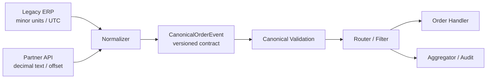
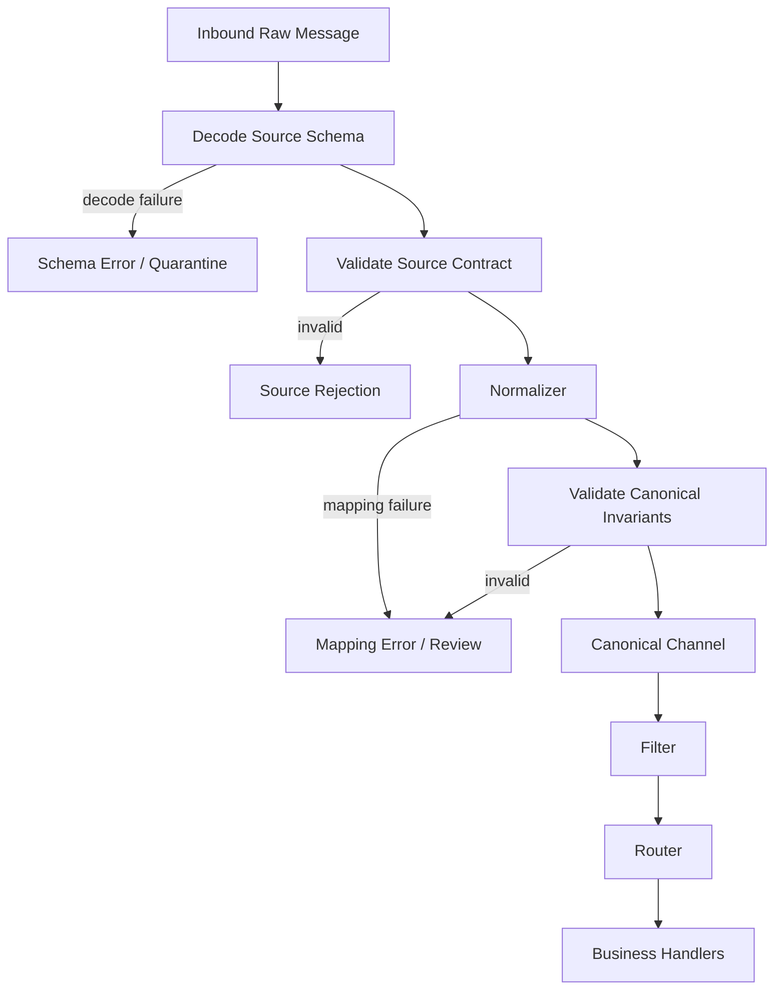
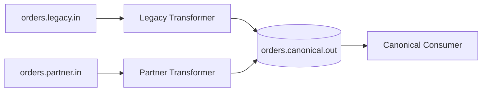
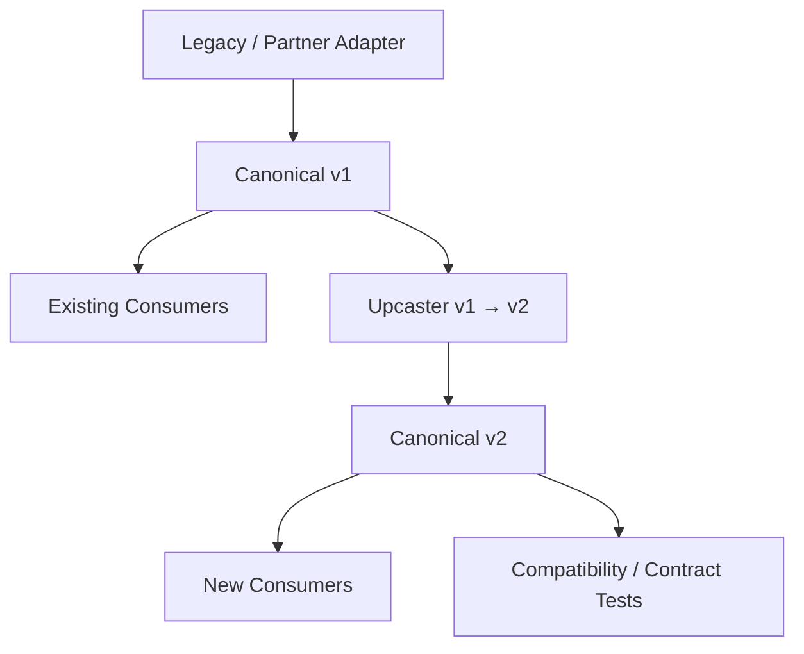
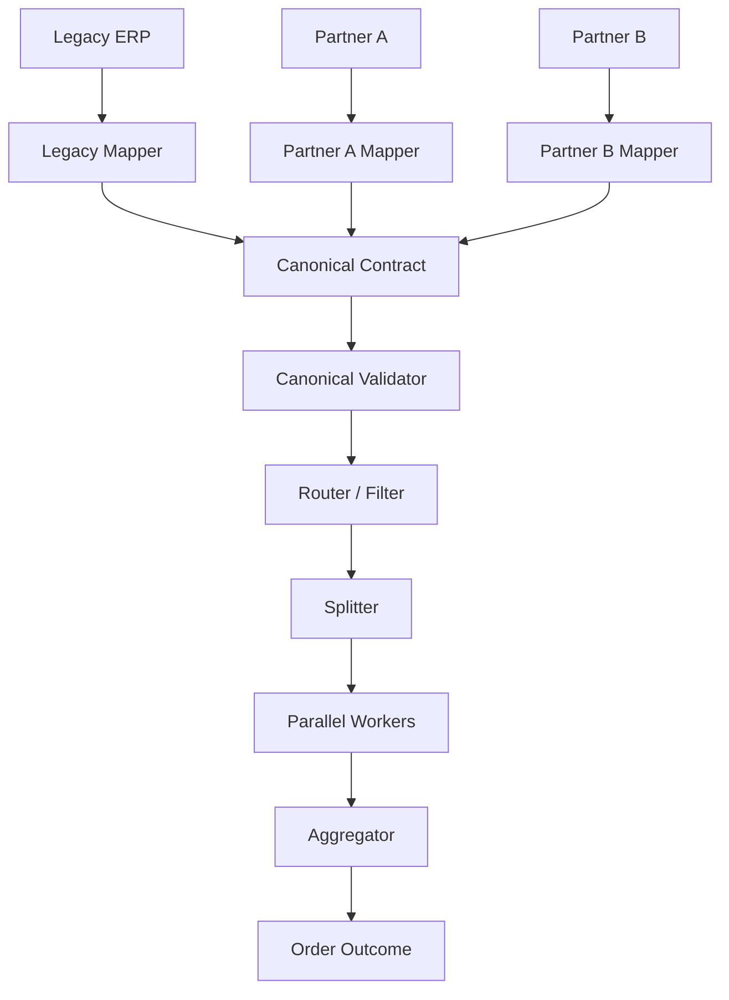

# Ensuring a Stable Canonical Model

**Normalizer** is an Enterprise Integration Pattern (EIP) that brings different message formats into **a single common model (canonical model)** that downstream processing steps can interpret consistently. Instead of forcing every Router, Filter, Aggregator, or business service to understand dozens of formats from legacy systems, partners, and new APIs, we place translation logic at the integration boundary.

However, defining a shared Java record is not enough. If `amount=100` means **100 USD** today yet is interpreted as **100 cents** tomorrow, or if `eventTime` is sometimes UTC and sometimes local time, the model—despite keeping identical field names—is **semantically unstable**. The system will suffer subtle bugs: miscalculated money, miscorrelated messages, duplicate executions, out-of-order events, or skewed reports after an adapter upgrade.

The lesson **“Ensuring a Stable Canonical Model”** belongs to the **Normalizer** chapter in the **SPRING_INTEGRATION_PATTERN** module. The module teaches implementing Enterprise Integration Patterns with Spring Integration to build loosely coupled, extensible message flows—practicing Router, Filter, Transformer, Splitter, Aggregator, Gateway, retry, error channel, and correlation, while testing processing branches.

**Lesson objectives:** design a canonical contract that stays durable over time; define invariants for IDs, currencies, timestamps, enums, and provenance; write adapters normalizing multi-source data using Java and Spring Integration DSL; handle invalid inputs without fabricating canonical payloads; and test determinism, backward compatibility, replays, and cross-version conversions.

## 1. What Problem Does Normalizer Solve?

Suppose an ordering system receives from two sources:

- **Legacy ERP** sends orders as `LegacyOrderEvent` with total amount in minor units, UTC timestamps, and order code `orderNo`.
- **Partner API** sends `PartnerOrderEvent` with total amount as decimal text, offset timestamps, and order code `externalOrderRef`.

Both systems express the same business concept without sharing a schema.



Without a Normalizer, every downstream consumer ends up containing logic like `if (source == "ERP") ... else ...`. When a third partner joins, every one of those places must change.

With a Normalizer, each source is responsible for **translating into the canonical contract**, while downstream understands only one unified model.

Even so, a Normalizer **is not an arbitrary data patcher**. It must never silently “guess” currencies, generate a new `orderId` when an ID is missing, or swap source timestamps for `Instant.now()` just so output always appears populated.

## 2. What Does a Stable Canonical Model Mean?

A canonical model is considered stable when consumers can rely on **the exact same meaning for every field and invariant**, even as adapters upgrade or new sources are onboarded.

Four layers of stability must be distinguished:

| Layer | Example | Requirement |
| --- | --- | --- |
| **Structural** | Field `orderId` is always a string; `totalMinor` is always an integer | Schema/types do not change unexpectedly |
| **Semantic** | `totalMinor` is always expressed in minor units of `currency` | Meaning never shifts silently |
| **Identity** | `tenantId + sourceSystem + eventId` identifies the same source event | Retries/replays never alter identity |
| **Lifecycle/evolution** | V1 consumers can still read v1-contract data when v2 releases | Versioning, migration, and compatibility follow explicit rules |

**Stability does not mean “the model can never change”.** It means changes are governed by contracts, versions, migrations, and tests so consumers never have to guess payload meaning.

Example of semantic drift:

```text
Old mapping:
  totalMinor = 2599
  currency = USD
  meaning = 25.99 USD

Accidentally changed mapping:
  totalMinor = 2599
  currency = USD
  meaning = 2599 USD

JSON shape is unchanged; business meaning is broken.
```

**Schema validation covers only part of the contract.** It can verify `totalMinor` is a positive integer, yet cannot tell on its own whether an adapter multiplied or divided by the wrong factor.

## 3. Where Normalizer Sits in Spring Integration Architecture

A maintainable architecture clearly separates:

1. **Inbound adapter/decoder:** reads HTTP, Kafka, JMS, or files and checks physical framing/format.
2. **Source-specific validation:** verifies source schema, data types, and preconditions.
3. **Normalizer/Transformer:** translates source concepts into canonical fields with unified meaning.
4. **Canonical validation:** enforces output invariants rather than assuming mappers are always bug-free.
5. **Business flow:** Router, Filter, Splitter, Aggregator, Gateway, and handlers understand only the canonical model.
6. **Output adapter:** when needed, translates the canonical model into a target system's format.



In Spring Integration, Normalizer can be implemented with **Transformer endpoints** or separate per-source flows feeding a canonical channel. Normalizer is an **architectural responsibility**; never assume a single built-in component automatically understands every business schema.

### How Normalizer Differs from Router and Aggregator

- **Router** selects the processing branch/destination; it is not where all semantic translation rules live.
- **Transformer** is the mechanism changing a payload/message; a Normalizer can compose multiple Transformers targeting one canonical contract.
- **Aggregator** gathers related messages and decides when to release; it does not fix schema errors by merging arbitrarily.
- **Resequencer** restores message ordering; it does not unify IDs or currencies on its own.
- **Gateway** provides a request–reply contract; it does not guarantee payloads crossing it are already normalized.

Using each pattern for its proper responsibility lets you fix mapping in one place without dragging similar logic through downstream consumers.

## 4. Establishing Ownership of the Canonical Contract

If every team interprets the shared model on its own, “canonical” is only a name. Someone must own:

- **Names and meanings** of every field.
- **Units of measurement:** money, weight, time.
- **Invariants:** requiredness, optionality, ranges, uniqueness.
- **Identity and idempotency rules.**
- **Schema versions** and compatible changes.
- **Enum and unknown-value policies.**
- **Sensitive data** and trust boundaries.
- **Contract fixtures** that source adapters must pass.

A clear contract answers:

> If two adapters receive two different representations of the same business event, which canonical fields must match? Which fields remain intentionally distinct, such as `originSystem` or `sourceEventId`?

Depending on the business domain, two sources may reflect **two distinct events** rather than the same event; never force them to share one idempotency key merely because `orderId` matches.

## 5. Designing a Canonical Model with Explicit Invariants

We define a canonical order event with the following fields:

| Field | Type | Canonical Convention | Invariant |
| --- | --- | --- | --- |
| `schemaVersion` | `int` | Payload contract version | Always defined, e.g., `1` |
| `tenantId` | `String` | Verified tenant identity | Non-empty, tenant-isolated |
| `orderId` | `String` | Accurately mapped source order code | Non-empty, never derived from timestamp |
| `sourceEventId` | `String` | Stable source-side event ID | Unchanged across retries of the same event |
| `occurredAt` | `Instant` | Absolute UTC timestamp | Never replaced with receipt time |
| `currency` | ISO code | Verified currency | Never inferred from server locale |
| `totalMinor` | `long` | Count of currency **minor units** | Positive, no overflow |
| `originSystem` | `String`/enum | Controlled provenance | Originating from trusted adapter |

`schemaVersion=1` means the record complies with **canonical contract v1**, not “source A is using mapping version 1”.

### Illustrative Canonical JSON

```json
{
  "schemaVersion": 1,
  "tenantId": "tenant-a",
  "orderId": "ORD-7",
  "sourceEventId": "evt-99",
  "occurredAt": "2026-11-21T02:05:00Z",
  "currency": "USD",
  "totalMinor": 159900,
  "originSystem": "LEGACY_ERP"
}
```

Here `159900` means **1,599.00 USD**, because USD has two decimal places in this example. For VND, the same number `159900` represents **159,900 VND** using zero decimal places.

**Never interpret `totalMinor` without knowing `currency`.** When a system handles non-ISO assets or special currencies, define separate unit and precision tables rather than applying USD/VND rules arbitrarily.

## 6. What Should NOT Enter the Core Canonical Model

The more source-specific details you cram into the canonical model, the harder it becomes to keep stable:

- Source-specific field names like `erpOrderNr` or `partnerDocId` once a shared identity exists.
- Unbounded `rawPayload`; carries PII and locks consumers to source formats.
- Java `MessageChannel`, `replyChannel`, or adapter-specific implementation objects.
- Dozens of `partnerXFlag` fields with no shared business meaning.
- Transient values like `workerThreadId` or `receivedAtLocal` defaulted as business timestamps.
- Internal headers that do not survive brokers yet consumers depend on.
- An `isValid` flag detached from versioned rules and unverified after mapping.

If raw inputs must be saved for auditing, use **Claim Check or a source archive** with dedicated permissions and retention. The canonical model carries only **a valid reference or minimal metadata** per contract.

This does not mean dropping all provenance. Keep `originSystem`, `sourceEventId`, or `mappingRevision` in **envelope/audit metadata** sufficient for investigation without polluting the business model.

## 7. Example: Two Sources with Different Representations

**Legacy source:**

```json
{
  "tenantId": "tenant-a",
  "orderNo": "ORD-7",
  "eventRef": "evt-99",
  "createdAtUtc": "2026-11-21T02:05:00Z",
  "currencyCode": "USD",
  "totalMinor": 159900
}
```

**Partner source:**

```json
{
  "partnerTenant": "tenant-a",
  "externalOrderRef": "ORD-7",
  "eventRef": "partner-event-88",
  "occurredAtWithOffset": "2026-11-21T09:05:00+07:00",
  "isoCurrency": "usd",
  "amountDecimal": "1599.00"
}
```

Both messages represent the same timestamp and total after normalization. However, **`eventRef` and `originSystem` differ** because two separate sources emitted the events; if they truly represent one business event, rely on a **trusted identity mapping** rather than guessing from matching totals and order IDs.

Mapping table:

| Canonical | Legacy Source | Partner Source |
| --- | --- | --- |
| `tenantId` | `tenantId`, verified against trusted source | `partnerTenant`, mapped via partner authorization |
| `orderId` | `orderNo` | `externalOrderRef` |
| `sourceEventId` | `eventRef` | `eventRef` |
| `occurredAt` | Parse UTC `Instant` | Parse offset, then convert to `Instant` |
| `currency` | Uppercase ISO per contract | Uppercased per partner-approved contract |
| `totalMinor` | Already minor units | Decimal string → exact minor units |
| `originSystem` | `LEGACY_ERP` | `PARTNER_API` |

**Map only after authenticating the source.** A caller-declared tenant string must never grant tenant access automatically.

## 8. Currencies: Do Not Just Rename Fields

Turning `amountDecimal` into `totalMinor` by copying the raw number directly can cause severe financial errors.

| Source | Raw Value | Currency | Canonical Minor Units |
| --- | --- | --- | ---: |
| Legacy | `159900` minor | USD | 159900 |
| Partner | `"1599.00"` major | USD | 159900 |
| Partner | `"159900"` major | VND | 159900 |
| Partner | `"1.599"` major | USD | **Invalid** when exact cents required |
| Partner | `"1.5"` major | VND | **Invalid** under example convention |
| Partner | `"-10.00"` | USD | **Invalid** for positive purchase orders |

### Currency Principles

- Use `BigDecimal` when parsing decimal text—never `double` multiplied by 100.
- Determine fraction digits from the right **currency policy**; never hardcode 2 for all currencies.
- Never silently round numbers with invalid precision when the contract demands exact amounts.
- Check for overflow before converting to `long`.
- Disallow negative amounts for positive-order event types; refunds belong in **a different model/event type**, not jammed into meaningless negative values.
- If currency is null or unsupported, **reject** rather than defaulting to server locale currency.
- If a source sends minor units without specifying currency in metadata, you cannot know which scale applies.

Under strict contracts, `"1599.000"` USD may pass because there is no non-zero sub-cent fraction, whereas `"1599.001"` must reject if rounding is disallowed. That is a **policy rule** to test explicitly rather than leaving to accidental conversions.

## 9. Time: Normalize to an Instant Without Changing Event Meaning

`2026-11-21T02:05:00Z` and `2026-11-21T09:05:00+07:00` express **the exact same absolute instant**. The canonical model uses `Instant` to avoid timezone confusion.

```text
Legacy UTC:
  2026-11-21T02:05:00Z

Partner offset:
  2026-11-21T09:05:00+07:00

Canonical Instant:
  2026-11-21T02:05:00Z
```

Do not use `LocalDateTime` without timezone/offset when a source sends only `"09:05"`: a local time can be ambiguous on DST transitions. Never guess timezone from the container host.

Distinguish:

- `occurredAt`: when the event occurred according to a trusted source.
- `receivedAt`: when the adapter received it.
- `processedAt`: when the Normalizer/handler processed it.
- `committedAt`: when side effects committed.

These timestamps **are not interchangeable**. If a source omits `occurredAt` and downstream requires the business timestamp, the safe choice is usually **reject/hold** or an **explicitly versioned fallback policy**, never sneaking in `Instant.now()` which makes replays return different outputs.

## 10. Identifiers: Normalize Without Losing Identity

Some “normalizations” cause damage:

```text
"ORD-007" -> "ORD-7"         // may lose identity
"Tenant-A" -> "tenant-a"     // may merge two distinct tenants
"00123" -> "123"             // may collide customer codes
"À" -> "A"                   // may alter proper names
"ref A " -> "ref A"          // valid only if source contract permits trimming
```

Never assume transformations like lowercasing, trimming, Unicode normalization, and stripping leading zeros are harmless for **every business key**.

Design guidelines:

1. Document per source which fields allow trimming or case-folding.
2. Derive tenant identity from **authenticated source mappings**, not body strings alone.
3. If upstream has multiple ID systems, maintain a domain-managed **ID mapping table**.
4. Mint new identifiers only when the contract genuinely defines a new entity/event.
5. Never generate a fresh random ID on each retry of the same event.
6. Never hash the full payload as a business event ID, since timestamps or auxiliary fields may change.

If an order ID fails the canonical contract, report **invalid identity**; never rewrite it just to look “valid” while pointing to a different order.

## 11. Java Models for Both Sources and Canonical

In this example, each adapter receives a deserialized, typed DTO:

```java
import java.time.Instant;

record LegacyOrderEvent(
    String tenantId,
    String orderNo,
    String eventRef,
    String createdAtUtc,
    String currencyCode,
    long totalMinor
) {}

record PartnerOrderEvent(
    String partnerTenant,
    String externalOrderRef,
    String eventRef,
    String occurredAtWithOffset,
    String isoCurrency,
    String amountDecimal
) {}

record CanonicalOrderEvent(
    int schemaVersion,
    String tenantId,
    String orderId,
    String sourceEventId,
    Instant occurredAt,
    String currency,
    long totalMinor,
    String originSystem
) {}
```

`CanonicalOrderEvent` is the **version 1** canonical DTO. When mapper revision metadata is needed without changing payload semantics, keep `mappingRevision` in envelope/audit metadata or an explicitly governed contract field rather than coupling consumers to mapper class names.

**Do not assume Java records enforce all invariants automatically.** Mappers and canonical validators must verify fields; records can still be instantiated with `orderId=""` unless validated.

### Mapping Error Type Without Raw Data

```java
final class CanonicalMappingException extends RuntimeException {
    private final String field;
    private final String reasonCode;

    CanonicalMappingException(String field, String reasonCode) {
        super("Canonical mapping failed: " + field
              + "/" + reasonCode);
        this.field = field;
        this.reasonCode = reasonCode;
    }

    String field() {
        return field;
    }

    String reasonCode() {
        return reasonCode;
    }
}
```

The error message includes only **field name + reason code**, never raw values or payloads that might hold PII. For unclassifiable failures, use a separate infrastructure error path; never turn a `NullPointerException` bug into an invalid-input error.

## 12. Java Normalizer: Both Sources Emitting CanonicalOrderEvent

The mapper below:

- Validates IDs per the example format (alphanumeric/`_`/`-`, max 64 characters).
- Never alters casing or strips leading zeros on IDs.
- Parses timestamps into `Instant`.
- Enforces the `USD`/`VND` currency allowlist and corresponding precision.
- Validates positive amounts and exact conversions.
- Sets `schemaVersion=1` and fixed source provenance.
- **Never generates IDs or timestamps from wall-clock execution time**, so replaying identical inputs yields identical outputs.

```java
import java.math.BigDecimal;
import java.time.Instant;
import java.time.OffsetDateTime;
import java.time.format.DateTimeParseException;
import java.util.Currency;
import java.util.Locale;
import java.util.Set;
import java.util.regex.Pattern;

final class CanonicalOrderNormalizer {
    private static final int SCHEMA_VERSION = 1;
    private static final Pattern ID =
        Pattern.compile("[A-Za-z0-9_-]{1,64}");
    private static final Set<String> CURRENCIES =
        Set.of("USD", "VND");

    CanonicalOrderEvent fromLegacy(LegacyOrderEvent source) {
        if (source == null) {
            throw new CanonicalMappingException(
                "payload", "REQUIRED");
        }

        String tenant = id(source.tenantId(), "tenantId");
        String order = id(source.orderNo(), "orderNo");
        String event = id(source.eventRef(), "eventRef");
        String currency = currency(
            source.currencyCode(), false);

        long totalMinor = positive(
            source.totalMinor(), "totalMinor");

        return new CanonicalOrderEvent(
            SCHEMA_VERSION, tenant, order, event,
            parseInstant(source.createdAtUtc(), "createdAtUtc"),
            currency, totalMinor, "LEGACY_ERP"
        );
    }

    CanonicalOrderEvent fromPartner(PartnerOrderEvent source) {
        if (source == null) {
            throw new CanonicalMappingException(
                "payload", "REQUIRED");
        }

        // This example assumes the partner contract ALLOWS
        // lowercase currency codes. Do not apply implicitly to all fields.
        String currency = currency(
            source.isoCurrency(), true);

        return new CanonicalOrderEvent(
            SCHEMA_VERSION,
            id(source.partnerTenant(), "partnerTenant"),
            id(source.externalOrderRef(), "externalOrderRef"),
            id(source.eventRef(), "eventRef"),
            parseOffsetTime(
                source.occurredAtWithOffset(),
                "occurredAtWithOffset"),
            currency,
            decimalToMinor(
                source.amountDecimal(), currency),
            "PARTNER_API"
        );
    }

    private static String id(String raw, String field) {
        if (raw == null || !ID.matcher(raw).matches()) {
            throw new CanonicalMappingException(
                field, "INVALID_ID");
        }
        return raw;
    }

    private static String currency(
            String raw, boolean normalizePartnerCase) {
        if (raw == null) {
            throw new CanonicalMappingException(
                "currency", "REQUIRED");
        }

        String result = normalizePartnerCase
            ? raw.toUpperCase(Locale.ROOT)
            : raw;

        if (!CURRENCIES.contains(result)) {
            throw new CanonicalMappingException(
                "currency", "UNSUPPORTED_CURRENCY");
        }
        return result;
    }

    private static long positive(long amount, String field) {
        if (amount <= 0) {
            throw new CanonicalMappingException(
                field, "MUST_BE_POSITIVE");
        }
        return amount;
    }

    private static long decimalToMinor(
            String decimalText, String currency) {
        if (decimalText == null || decimalText.isBlank()) {
            throw new CanonicalMappingException(
                "amountDecimal", "REQUIRED");
        }

        try {
            // USD = 2, VND = 0 per the ISO currency policy
            // used in this example.
            int fractionDigits = Currency
                .getInstance(currency)
                .getDefaultFractionDigits();

            BigDecimal minorUnits =
                new BigDecimal(decimalText)
                    .movePointRight(fractionDigits);

            return positive(
                minorUnits.longValueExact(), "amountDecimal");
        } catch (NumberFormatException | ArithmeticException ex) {
            throw new CanonicalMappingException(
                "amountDecimal", "NOT_EXACT_MINOR_UNITS");
        }
    }

    private static Instant parseInstant(
            String raw, String field) {
        try {
            return Instant.parse(raw);
        } catch (DateTimeParseException | NullPointerException ex) {
            throw new CanonicalMappingException(
                field, "INVALID_TIMESTAMP");
        }
    }

    private static Instant parseOffsetTime(
            String raw, String field) {
        try {
            return OffsetDateTime.parse(raw).toInstant();
        } catch (DateTimeParseException | NullPointerException ex) {
            throw new CanonicalMappingException(
                field, "INVALID_TIMESTAMP");
        }
    }
}
```

### Limitations of the Sample Code

- `Currency.getDefaultFractionDigits()` is an ISO currency policy, **not representative of every asset or partner**. Systems with cash rounding, settlement precisions, or crypto assets need dedicated contracts.
- `Currency.getInstance(...)` here runs only on allowlisted `USD`/`VND`. Production must check unsupported codes and unusual default fraction digits.
- ID formatting is intentionally restricted for illustration. Never use this regex to “fix” real customer IDs when business permits spaces, Unicode, or other formats.
- `partnerTenant` **is valid only after authenticating/authorizing** the producer; the mapper does not verify sources itself.
- Source schemas omit line items, tax, discounts, and versioned references; adding them requires defining **complete semantics** instead of guessing.
- Exceptions are standardized for invalid fields, yet infrastructure failures and bugs must never be swallowed or classified as invalid input.
- Code must be built and tested against actual JDK, Spring Integration, and dependency versions in subsequent QA.

## 13. Validating Canonical Invariants After the Mapper

Never assume that because each mapper is written in Java its output is always valid. An independent **canonical validator** guards the shared convergence point.

```java
import java.util.Set;

final class CanonicalOrderValidator {
    private static final Set<String> CURRENCIES =
        Set.of("USD", "VND");

    void validate(CanonicalOrderEvent event) {
        if (event == null) {
            throw new CanonicalMappingException(
                "canonical", "REQUIRED");
        }
        if (event.schemaVersion() != 1) {
            throw new CanonicalMappingException(
                "schemaVersion", "UNSUPPORTED_VERSION");
        }
        if (event.tenantId() == null
                || event.tenantId().isBlank()
                || event.orderId() == null
                || event.orderId().isBlank()
                || event.sourceEventId() == null
                || event.sourceEventId().isBlank()) {
            throw new CanonicalMappingException(
                "identity", "REQUIRED");
        }
        if (event.occurredAt() == null) {
            throw new CanonicalMappingException(
                "occurredAt", "REQUIRED");
        }
        if (event.currency() == null
                || !CURRENCIES.contains(event.currency())
                || event.totalMinor() <= 0) {
            throw new CanonicalMappingException(
                "money", "INVALID_VALUE");
        }
        if (event.originSystem() == null
                || !Set.of("LEGACY_ERP", "PARTNER_API")
                .contains(event.originSystem())) {
            throw new CanonicalMappingException(
                "originSystem", "INVALID_PROVENANCE");
        }
    }
}
```

When the contract requires strict ID formatting, the validator must check that format too, not only non-blankness. When the canonical model adds a new invariant, version it accordingly; otherwise older consumers may emit v1 payloads valid under the old contract yet rejected by the new validator.

### “Invalid” and “Insufficient Data” Are Not the Same

If a source omits currency, never invent canonical `currency="USD"` unless backed by an **authoritative source and explicit policy**. If an FX rate API is unavailable, that is **mapping enrichment unavailable**, not `UNSUPPORTED_CURRENCY`.

Three possible outcomes:

| Outcome | Example | Handling |
| --- | --- | --- |
| `NORMALIZED` | All invariants satisfied | Emit canonical event |
| `REJECTED` | Bad ID, inexact amount, timestamp missing offset | Typed rejection/quarantine |
| `UNAVAILABLE` | Tenant mapping store or reference service failed | Bounded retry/backoff/hold |

Never emit a “temporarily valid” record to business handlers intending to fix it after side effects have occurred.

## 14. Determinism: Same Input Must Produce Same Output

An essential property of a Normalizer is **deterministic mapping**:

\[
normalize(x, v) = normalize(x, v)
\]

for the same source data `x` and mapping rule `v`, assuming no unmanaged changes in reference data.

Non-deterministic anti-pattern:

```java
// Do not do this to fill missing source fields:
String eventId = java.util.UUID.randomUUID().toString();
Instant occurredAt = Instant.now();
```

On retries of the same event, the mapper generates different IDs and timestamps; downstream may treat it as a brand-new event. That breaks idempotency, correlation, and regression tests.

A deterministic mapper should:

- Take source data and an explicit mapping policy version.
- Never call random clocks or mint UUIDs while normalizing **the same source event**.
- For time-varying reference data, record versions/snapshots and read values valid for the event's time.
- Never rely on `HashMap` iteration order when element ordering is part of the canonical contract.
- Never rely on JVM default locale or timezone.
- Never use binary floating point to “approximate” exact monetary amounts.

Still, **determinism alone does not guarantee mapping correctness**: a function that always scales money wrong by 100x is also deterministic. Add golden tests and semantic invariant checks.

## 15. Stable Identity, Retries, and Event Replay

A canonical event may contain:

```text
tenantId       = tenant-a
originSystem   = PARTNER_API
sourceEventId  = partner-event-88
orderId        = ORD-7
```

Suggested consumer idempotency key:

```text
(tenantId, originSystem, sourceEventId, consumerScope)
```

If a partner redelivers **the same event**, this tuple remains unchanged. Yet if the same order updates a second time, it must carry a **new event ID/version**, rather than being blocked mistakenly as a duplicate just because `orderId` is the same.

If two independent sources emit **the same business effect**, relying on two source event IDs can run the effect twice. Use **domain uniqueness / a business operation key** or a trusted source-equivalence mapping. Never infer equivalence solely from `orderId + amount`, because two valid transactions can share the same value.

### Never Use Framework Message IDs as Business Keys

Spring Messages carry `MessageHeaders.ID`, yet Transformers and adapters can create new messages. It is never proof that two messages represent the same business event. Preserve `sourceEventId` separately and map across transports via an explicit schema.

## 16. Spring Integration Java DSL: Two Sources into One Canonical Channel

A straightforward approach builds two flows, each using a **source-specific transformer**, both forwarding results to the same channel.



Java DSL example:

```java
import org.springframework.context.annotation.Bean;
import org.springframework.context.annotation.Configuration;
import org.springframework.integration.channel.DirectChannel;
import org.springframework.integration.channel.QueueChannel;
import org.springframework.integration.config.EnableIntegration;
import org.springframework.integration.dsl.IntegrationFlow;
import org.springframework.messaging.MessageChannel;
import org.springframework.messaging.PollableChannel;

@Configuration
@EnableIntegration
class CanonicalNormalizerFlows {

    @Bean("orders.legacy.in")
    MessageChannel legacyOrdersInput() {
        return new DirectChannel();
    }

    @Bean("orders.partner.in")
    MessageChannel partnerOrdersInput() {
        return new DirectChannel();
    }

    @Bean("orders.canonical.out")
    PollableChannel canonicalOrdersOutput() {
        // In-memory queue for observing outputs during learning/testing.
        return new QueueChannel();
    }

    @Bean
    CanonicalOrderNormalizer canonicalOrderNormalizer() {
        return new CanonicalOrderNormalizer();
    }

    @Bean
    IntegrationFlow normalizeLegacyOrder(
            CanonicalOrderNormalizer normalizer) {
        return IntegrationFlow.from("orders.legacy.in")
            .transform(LegacyOrderEvent.class,
                normalizer::fromLegacy)
            .channel("orders.canonical.out")
            .get();
    }

    @Bean
    IntegrationFlow normalizePartnerOrder(
            CanonicalOrderNormalizer normalizer) {
        return IntegrationFlow.from("orders.partner.in")
            .transform(PartnerOrderEvent.class,
                normalizer::fromPartner)
            .channel("orders.canonical.out")
            .get();
    }
}
```

**Conditions for this example:**

1. Input channels must receive properly typed DTOs from decoders/trusted ingress only.
2. Both Transformers emit **the same `CanonicalOrderEvent` type** and v1 contract.
3. `orders.canonical.out` is a simple `QueueChannel` for tests; it is **not durable** and gives no consumer ordering or transaction guarantees.
4. `CanonicalOrderValidator` must be wired at the shared convergence point in production or run immediately after each transformation; this minimal snippet only illustrates routing two sources to one channel.
5. Verify `transform(Class, ...)` DSL overloads against your exact Spring Integration version.
6. To ingest raw Kafka/HTTP payloads, place decoders/adapters **ahead of** the source channels.
7. Never let clients dictate `replyChannel`, `errorChannel`, or channel names via untrusted headers.

### Do Not Create One “Generic Catch-All” That Hides Source Failures

You could write one flow taking `Object`, checking `instanceof`, and dispatching. As sources multiply, that turns into one monolithic transformer coupled to every DTO. Two dedicated flows keep per-source authorization, validation, and monitoring clear.

When a Router dispatches multiple formats, each branch should still own its source adapter; canonical output **must not depend on input type** beyond declared provenance.

## 17. Checking and Blocking Invalid Canonical Outputs

If `CanonicalOrderValidator` is wired as a **one-way handler**, it can accidentally terminate the flow. Ensure the endpoint validates **and forwards the payload**.

A simple flow option uses a pass-through Filter:

```java
@Bean
IntegrationFlow canonicalValidationFlow(
        CanonicalOrderValidator validator) {
    return IntegrationFlow.from("orders.canonical.check")
        .filter(CanonicalOrderEvent.class, event -> {
            validator.validate(event);
            return true;
        })
        .channel("orders.canonical.accepted")
        .get();
}
```

This is an **illustrative alternative snippet** requiring channels `orders.canonical.check` and `orders.canonical.accepted`; do not attach it to section 16's flow without wiring channels and consumers. In production, use a **shared canonical validation subflow** fed by both transformers, forwarding to the business channel.

**Never use `.handle(event -> { validate(event); })` expecting messages to keep flowing**, because a one-way Service Activator with no return value ends the flow.

### Canonical Filter Does Not Handle All Validation Failures Automatically

When `validator.validate` throws an exception:

- On synchronous `DirectChannel`s, the exception propagates back to the sender.
- In async executors, pollers, or adapters, error handlers may publish Spring `ErrorMessage`s to an error channel depending on configuration.
- A Filter returning `false` may discard without creating an `ErrorMessage`.
- Deterministic mapping errors usually need typed rejections with field/reason codes; unavailable dependencies need separate retry/recovery.

Use proper output contracts rather than letting consumers mistake a mapping exception for “no order” and retry blindly.

## 18. Headers and Payload: What Is Canonical?

In Spring Integration, a message carries a payload and headers. A canonical payload does not mean every original header is also canonicalized or permitted downstream.

| Header/Metadata | Recommended Action |
| --- | --- |
| `sourceEventId` | Keep stable inside payload or versioned envelope |
| `businessGroupKey` | Derive from verified identity; verify against canonical payload |
| `correlationId` | Preserve while within the same batch/workflow scope |
| `sequenceNumber`/`sequenceSize` | Preserve while referencing the same sequence elements |
| `replyChannel`/`errorChannel` | Never copy client-supplied values across trust boundaries |
| `tenantId` from raw client | Never trust; verify against producer principal |
| `contentType` | Update if payload converted from raw JSON to object/another format |
| `traceId` | Use for observability, never as business identity |

A Transformer may preserve some headers depending on the Spring Integration endpoint and return type. When constructing `Message<?>` manually, test actual propagation/merging instead of assuming everything is kept or cleared.

### Canonical Payload and Transport Envelope

When publishing over Kafka/JMS/HTTP:

- Canonical payloads need a versioned schema/wire format.
- Header mappers may be unable to propagate internal Java objects.
- Correlation and idempotency metadata should have an explicit deserialization format.
- Never attach source A's raw headers onto a normalized event arbitrarily and cause consumer B to misinterpret them.
- If a field is required by downstream consumers across a broker, consider placing it in a **versioned envelope** rather than an ambiguous header.

**Canonical stability** includes proving output semantics **after serialization/deserialization**, not just comparing two Java records in the same JVM.

## 19. Unit Testing Two-Source Mapping and Simultaneous Instants

With JUnit 5:

```java
import static org.junit.jupiter.api.Assertions.*;
import java.time.Instant;
import org.junit.jupiter.api.Test;

class CanonicalOrderNormalizerTest {

    private final CanonicalOrderNormalizer normalizer =
        new CanonicalOrderNormalizer();

    @Test
    void mapsLegacyMinorUnitsWithoutChangingAmount() {
        var legacy = new LegacyOrderEvent(
            "tenant-a", "ORD-7", "evt-99",
            "2026-11-21T02:05:00Z", "USD", 159_900L);

        CanonicalOrderEvent result =
            normalizer.fromLegacy(legacy);

        assertEquals(1, result.schemaVersion());
        assertEquals("tenant-a", result.tenantId());
        assertEquals("ORD-7", result.orderId());
        assertEquals("evt-99", result.sourceEventId());
        assertEquals("USD", result.currency());
        assertEquals(159_900L, result.totalMinor());
        assertEquals(
            Instant.parse("2026-11-21T02:05:00Z"),
            result.occurredAt());
        assertEquals("LEGACY_ERP", result.originSystem());
    }

    @Test
    void mapsPartnerDecimalAndOffsetIntoCanonical() {
        var partner = new PartnerOrderEvent(
            "tenant-a", "ORD-7", "partner-event-88",
            "2026-11-21T09:05:00+07:00",
            "usd", "1599.00");

        CanonicalOrderEvent result =
            normalizer.fromPartner(partner);

        assertEquals("USD", result.currency());
        assertEquals(159_900L, result.totalMinor());
        assertEquals(
            Instant.parse("2026-11-21T02:05:00Z"),
            result.occurredAt());
        assertEquals("PARTNER_API", result.originSystem());
    }

    @Test
    void sameSourceEventProducesSameCanonicalOutput() {
        var input = new LegacyOrderEvent(
            "tenant-a", "ORD-7", "evt-99",
            "2026-11-21T02:05:00Z", "USD", 159_900L);

        assertEquals(
            normalizer.fromLegacy(input),
            normalizer.fromLegacy(input));
    }
}
```

Both sources share **identical `totalMinor` and `occurredAt`** in this example, yet you **should not assert the entire records are equal** because `sourceEventId` and `originSystem` intentionally differ.

Determinism is verified against **the same source input and the same mapping version**. When a source attaches additional metadata, the contract must specify which fields are allowed to differ.

## 20. Negative Tests: Wrong Money, Missing Time, Invalid IDs

Key negative tests:

```java
import static org.junit.jupiter.api.Assertions.*;
import org.junit.jupiter.api.Test;

class CanonicalOrderNormalizerNegativeTest {
    private final CanonicalOrderNormalizer normalizer =
        new CanonicalOrderNormalizer();

    private PartnerOrderEvent partner(String amount) {
        return new PartnerOrderEvent(
            "tenant-a", "ORD-7", "p-event-1",
            "2026-11-21T09:05:00+07:00", "USD", amount);
    }

    @Test
    void rejectsFractionOfCentInsteadOfRoundingSilently() {
        var error = assertThrows(
            CanonicalMappingException.class,
            () -> normalizer.fromPartner(partner("1.999")));

        assertEquals("NOT_EXACT_MINOR_UNITS",
            error.reasonCode());
    }

    @Test
    void rejectsNegativeAmount() {
        var error = assertThrows(
            CanonicalMappingException.class,
            () -> normalizer.fromPartner(partner("-5.00")));

        assertEquals("MUST_BE_POSITIVE",
            error.reasonCode());
    }

    @Test
    void rejectsMissingTimestamp() {
        var invalid = new LegacyOrderEvent(
            "tenant-a", "ORD-7", "evt-1",
            null, "USD", 1L);

        assertEquals("INVALID_TIMESTAMP",
            assertThrows(CanonicalMappingException.class,
                () -> normalizer.fromLegacy(invalid))
                .reasonCode());
    }

    @Test
    void rejectsUntrustedIdentityFormat() {
        var invalid = new LegacyOrderEvent(
            "tenant|other", "ORD-7", "evt-1",
            "2026-11-21T02:05:00Z", "USD", 1L);

        assertEquals("INVALID_ID",
            assertThrows(CanonicalMappingException.class,
                () -> normalizer.fromLegacy(invalid))
                .reasonCode());
    }
}
```

**The tests above verify formatting**, not authentication/authorization. An input `tenant-a` matching the regex could still belong to a tenant the caller is unauthorized to access.

### Edge Cases to Add

| Case | Expectation |
| --- | --- |
| `"1.00"` USD | `100` minor units |
| `"1.001"` USD | Reject fraction-of-cent |
| `"1.000"` USD | Policy may allow exact 100 minor |
| `"100"` VND | `100` minor units |
| `"1.5"` VND | Reject fractional VND in this example |
| Number beyond `long` bounds | Reject overflow |
| `"NaN"` or `"Infinity"` | Reject format |
| `null`/unsupported currency | Reject, never guess |
| `+07:00` offset | Parse to exact UTC instant |
| Timestamp without offset | Reject or follow dedicated source policy |
| ID `ORD-007` | Preserve leading zeros |
| ID with disallowed delimiters | Reject, never auto-“fix” |
| Identical event replay | Deterministic canonical output |
| Mapper revision changes | Caught by golden tests and migration policy |

Never use `double`/`float` to test exact monetary values; those types can introduce precision errors before reaching the mapper.

## 21. Parameterized Tests for Money and Currency

```java
import static org.junit.jupiter.api.Assertions.*;
import org.junit.jupiter.params.ParameterizedTest;
import org.junit.jupiter.params.provider.CsvSource;

class CanonicalMoneyParameterizedTest {
    private final CanonicalOrderNormalizer normalizer =
        new CanonicalOrderNormalizer();

    @ParameterizedTest
    @CsvSource({
        "USD, 1.00, 100",
        "USD, 1599.00, 159900",
        "USD, 0.01, 1",
        "VND, 100, 100",
        "VND, 159900, 159900"
    })
    void convertsSupportedCurrenciesExactly(
            String currency, String amount, long expectedMinor) {
        var input = new PartnerOrderEvent(
            "tenant-a", "ORD-7", "evt-1",
            "2026-11-21T09:05:00+07:00",
            currency, amount);

        assertEquals(expectedMinor,
            normalizer.fromPartner(input).totalMinor());
    }

    @ParameterizedTest
    @CsvSource({
        "USD, 1.001",
        "USD, -1.00",
        "USD, 0",
        "VND, 1.5",
        "USD, 9223372036854775808.00"
    })
    void rejectsInvalidOrUnrepresentableAmounts(
            String currency, String amount) {
        var input = new PartnerOrderEvent(
            "tenant-a", "ORD-7", "evt-2",
            "2026-11-21T09:05:00+07:00",
            currency, amount);

        assertThrows(CanonicalMappingException.class,
            () -> normalizer.fromPartner(input));
    }
}
```

Test cases must reflect **this lesson's currency policy**, rather than assuming one pricing policy across every country/partner. Some businesses use fractional minor units, such as metering or freight billing; in those cases use a different model instead of forcing `long totalMinor` everywhere.

## 22. Integration Testing Two Flows Emitting One Canonical Type

Spring Integration tests should prove **two real input channels** produce `CanonicalOrderEvent` instances and converge on the output channel.

```java
import static org.junit.jupiter.api.Assertions.*;
import org.junit.jupiter.api.Test;
import org.springframework.beans.factory.annotation.Autowired;
import org.springframework.beans.factory.annotation.Qualifier;
import org.springframework.messaging.Message;
import org.springframework.messaging.MessageChannel;
import org.springframework.messaging.PollableChannel;
import org.springframework.messaging.support.MessageBuilder;
import org.springframework.test.context.junit.jupiter.SpringJUnitConfig;

@SpringJUnitConfig(CanonicalNormalizerFlows.class)
class CanonicalFlowIntegrationTest {

    @Autowired
    @Qualifier("orders.legacy.in")
    MessageChannel legacyInput;

    @Autowired
    @Qualifier("orders.partner.in")
    MessageChannel partnerInput;

    @Autowired
    @Qualifier("orders.canonical.out")
    PollableChannel canonicalOutput;

    @Test
    void bothSourcesEmitVersionedCanonicalOrderEvents() {
        legacyInput.send(MessageBuilder.withPayload(
            new LegacyOrderEvent(
                "tenant-a", "ORD-7", "evt-99",
                "2026-11-21T02:05:00Z", "USD", 159_900L))
            .build());

        partnerInput.send(MessageBuilder.withPayload(
            new PartnerOrderEvent(
                "tenant-a", "ORD-7", "partner-event-88",
                "2026-11-21T09:05:00+07:00",
                "USD", "1599.00"))
            .build());

        Message<?> first = canonicalOutput.receive(1_000);
        Message<?> second = canonicalOutput.receive(1_000);

        assertNotNull(first);
        assertNotNull(second);

        assertInstanceOf(
            CanonicalOrderEvent.class, first.getPayload());
        assertInstanceOf(
            CanonicalOrderEvent.class, second.getPayload());

        CanonicalOrderEvent fromLegacy =
            (CanonicalOrderEvent) first.getPayload();
        CanonicalOrderEvent fromPartner =
            (CanonicalOrderEvent) second.getPayload();

        assertEquals(1, fromLegacy.schemaVersion());
        assertEquals(1, fromPartner.schemaVersion());
        assertEquals(fromLegacy.totalMinor(),
            fromPartner.totalMinor());
        assertEquals(fromLegacy.occurredAt(),
            fromPartner.occurredAt());
        assertNull(canonicalOutput.receive(50));
    }
}
```

**Test limitations:** these example channels use `DirectChannel` and `QueueChannel`; the test does not prove durability, transport serialization, or ordering guarantees when swapping channels for executors or brokers.

When running parallel tests sharing an `ApplicationContext` and output queue, **isolate fixtures or filter by ID** so tests never consume each other's messages. For async mappers, use a latch/await with a deadline rather than assuming output arrives immediately.

## 23. Contract Tests and Golden Fixtures

A stable canonical contract needs testing not only against one point-in-time mapper, but also against **immutable datasets across deployments**.

Example golden fixture:

```json
{
  "caseId": "partner-usd-offset-001",
  "source": {
    "partnerTenant": "tenant-a",
    "externalOrderRef": "ORD-7",
    "eventRef": "partner-event-88",
    "occurredAtWithOffset": "2026-11-21T09:05:00+07:00",
    "isoCurrency": "usd",
    "amountDecimal": "1599.00"
  },
  "expectedCanonical": {
    "schemaVersion": 1,
    "tenantId": "tenant-a",
    "orderId": "ORD-7",
    "sourceEventId": "partner-event-88",
    "occurredAt": "2026-11-21T02:05:00Z",
    "currency": "USD",
    "totalMinor": 159900,
    "originSystem": "PARTNER_API"
  }
}
```

If a refactor changes `totalMinor` in this fixture from `159900` to `1599`, the test must FAIL immediately. Never update a golden fixture simply because the current implementation's output changed; verify **whether the contract or the mapper is wrong**.

A fixture suite should cover:

- Every valid source format.
- Major currencies, timezones, and enums.
- Boundary values and mandatory error cases.
- Leading zeros and identity scopes.
- Historical data still eligible for replay.
- Optional fields and missing-field behavior.
- Older schema versions still under support.
- Approved mapping revision changes.

**Golden tests protect specific semantics**, while property tests protect general invariants (such as positivity, deterministic output, and tenant isolation).

## 24. Property-Based Tests for Invariants

Beyond concrete examples, you can generate inputs across the valid domain and verify:

1. `normalizer.fromLegacy(input).totalMinor() == input.totalMinor()` when legacy adheres to the currency/contract.
2. `normalizer.fromPartner(input).currency()` belongs to the allowlist.
3. `normalizer.fromPartner(input).occurredAt()` equals the instant of the offset timestamp.
4. Given identical inputs, the mapper returns `equals` results across repeated runs.
5. No accepted input produces a canonical event with `totalMinor <= 0`.
6. Tenant and source event IDs never mutate outside the contract.
7. Missing/malformed inputs are always rejected with error codes and never produce canonical records.
8. Amounts overflowing `long` bounds never wrap or silently round.
9. Reordering JSON fields never changes post-deserialization event semantics.
10. Replaying under the same mapping revision never invents a new business key.

Property testing frameworks like jqwik/QuickTheories can help, though they are **not required** for STEP 4. What matters is specifying invariants clearly enough to enforce in any appropriate test framework.

### Example Invariant Expressed as a Formula

For the partner source, USD currency, and a valid decimal value `a`:

\[
minor(a, USD) = 100a
\]

provided the conversion is **exact and yields an integer**. You must not accept arbitrary `a` and round it. For VND under this example policy:

\[
minor(a, VND) = a
\]

provided the result is a positive integer. If ISO or settlement policies change, the formulas and tests must be versioned/re-evaluated accordingly.

## 25. Schema Evolution: Stability Does Not Mean Frozen Forever

Over time, downstream consumers may need `salesChannel`, `taxAmountMinor`, or `orderCategory`. Even small field additions can break older consumers if left undesigned.

| Change | Potentially Compatible? | What to Check |
| --- | --- | --- |
| Add **optional** field with clear default | Often yes | Do older consumers tolerate unknown fields? |
| Add new required field | Risk of breaking | Where do older producers obtain the value? |
| Change `totalMinor` from minor to major | **Breaking semantic** | Must use a separate contract/version |
| Rename `orderId` to `id` | Potentially breaking | Serializers/deserializers, event consumers |
| Change `Instant` to local date text | Breaking semantic | Offsets/timezones, replay |
| Add enum value | Potentially breaking | Consumer switches / unknown handling |
| Change ID case-folding | Potentially breaking identity | Collisions and idempotency |
| Remove field still used downstream | Breaking | Migration / dual-read |
| Change optional null to empty string | Potentially breaking | Null semantics and business rules |
| Change default currency | Dangerous | Never guess missing data |

Do not increment versions only on structural edits; **changing the meaning of an identically named field must also be treated as a breaking change**.

### Canonical Version Differs from Source Version

Example:

```text
Source Legacy schema v4
    -> Adapter mapping revision 12
    -> CanonicalOrderEvent v1

Source Partner schema v2
    -> Adapter mapping revision 7
    -> CanonicalOrderEvent v1
```

Both adapters can upgrade independently while still emitting canonical v1. If the canonical contract requires a breaking change, introduce v2 or an explicit migration path.

Do not confuse:

- **Source schema version:** format of the sending system.
- **Mapping revision:** version of the translation logic.
- **Canonical schema version:** the system's shared contract.
- **Business event version:** state-change generation/event version.
- **Trace/span ID:** for observability only.

## 26. Strategies for Migrating Canonical v1 to v2

Three common approaches:

1. **Expand/contract:** add optional fields first, adapt consumers, then make them required once all sources supply them.
2. **Controlled dual-publish:** publish canonical v1 and v2 to distinct channels/schema subjects; downstream selects by version.
3. **Upcaster/compatibility transformer:** read legacy v1 and upgrade to v2 using **provable rules**, especially during historical replay.



Not all v1 records can be validly upcast. If v2 requires a field that **never existed historically** and cannot be reliably inferred, an upcaster must never fabricate values.

### Rolling Deployment Considerations

Some instances emit v1 while others emit v2. Sharing a channel/topic without versioned schemas exposes consumers to unpredictable mixed traffic.

Specify clearly:

- Versioning in payload/envelope or schema registry.
- Which versions consumers accept.
- When v1 emission can retire.
- Whether idempotency and correlation keys differ between v1 and v2.
- How to replay historical events without triggering duplicate side effects.
- Rollback plan if v2 mapping contains bugs.

**When a mapping fix corrects past monetary errors**, reconcile business outcomes as well rather than running replay and hoping everything fixes itself.

## 27. Source-Specific Mapping Rules and Reference Data

Many adapters rely on lookup tables:

```text
partnerTenant X -> internalTenant A
legacyStatus "C" -> canonicalStatus CONFIRMED
partnerCurrencyCode "US$" -> USD
externalWarehouseCode -> internal warehouse ID
```

These mappings evolve. Looking up an unversioned table at runtime means replaying the same historical event six months later could resolve to a different tenant/warehouse.

Safer practices:

- Persist the **mappingRevision/referenceVersion** used for critical events/outcomes.
- During audit replays, restore mappings effective at the relevant timestamp.
- Separate valid **entity/owner changes** from **mapping bug fixes**.
- If the mapping table is unavailable, fail with `NORMALIZATION_UNAVAILABLE` or hold; never fall back to a “default tenant”.
- Cache reference data with TTL/versioning and enforce freshness when business demands it.
- Define clear collision rules for one-to-one, many-to-one, and alias mappings.
- Maintain regression tests for codes retired from alias tables.

**Determinism must account for reference data versions** whenever mapping results depend on them.

## 28. Error Handling: Never Let Fake Canonical Data Pass

When a mapper encounters bad input, options include:

- **Source rejection:** source violates contract; emit a typed outcome such as `CanonicalMappingRejected` with field/reason codes.
- **Quarantine:** store failed messages with access control for source correction or reconciliation.
- **Temporary dependency failure:** bounded retries, backoff, and an appropriate error channel.
- **Unknown outcome:** if side effects occurred elsewhere, reconcile before replaying.
- **Unsupported schema version:** reject or route to the matching adapter rather than parsing with an unverified “similar” version.

Example typed rejection:

```json
{
  "source": "PARTNER_API",
  "sourceEventId": "partner-event-88",
  "errorCode": "CANONICAL_MAPPING_REJECTED",
  "field": "amountDecimal",
  "reasonCode": "NOT_EXACT_MINOR_UNITS",
  "mappingRevision": "partner-map-7",
  "retryable": false
}
```

This is a **proposed application schema**, not a default Spring Integration Transformer output. Never emit stack traces or sensitive raw payloads.

### ErrorMessage Does Not Appear Automatically in Every Case

- When a Transformer throws inside a `DirectChannel`, the exception usually propagates to the caller of `send(...)`.
- In async executors/pollers/adapters, an error handler may publish an `ErrorMessage` wrapping the `Throwable` to the configured error channel.
- A global `errorChannel` does not catch every synchronous exception automatically.
- A typed `CanonicalMappingRejected` does not turn into a Spring `ErrorMessage` on its own; the application must route it to the appropriate destination.

In tests, assert **the exact error-handling path** rather than checking only exception message text.

## 29. Normalizer and Multi-Tenant Security

A Normalizer is not an authorization service. Suppose a partner sends:

```json
{
  "partnerTenant": "tenant-victim",
  "externalOrderRef": "ORD-7",
  "eventRef": "forged-event",
  "occurredAtWithOffset": "2026-11-21T09:05:00+07:00",
  "isoCurrency": "USD",
  "amountDecimal": "1599.00"
}
```

Every field may be **properly typed and regex-valid**, yet the caller has no authority to emit order events for `tenant-victim`.

Verify that:

1. The producer/service authenticated via trusted credentials.
2. Which tenants the partner account is authorized to act upon.
3. The source tenant code maps to proven ownership.
4. Order IDs belong within that tenant/partner's scope.
5. Event IDs are not reused for spoofing or unauthorized replays.
6. These checks enforce **before any side effects** and, when required, before the Normalizer.
7. Untrusted `replyChannel`/`errorChannel`/routing headers from clients are never copied internally.

A clean canonical model shrinks data surface area, yet **never makes untrusted data trustworthy on its own**. Simply copying `tenantId` into a shared payload can trick downstream into **misinterpreting unverified identity as trusted**. Mark provenance/trust boundaries and test negative cases explicitly.

## 30. Correlation, Splitter, Aggregator, and Resequencer

A stable canonical model empowers other EIPs:

### With Router and Filter

Routers can branch on `currency` or `originSystem` because field semantics are fixed. Filters can evaluate `totalMinor > 0` without caring whether sources sent major or minor units.

**Never use currency to determine tenant authorization**: those are two unrelated attributes.

### With Splitter

When a canonical event holds line items and a Splitter produces N parts, each part needs accurate batch **correlation/sequence metadata**. Once multi-source inputs share a normalized schema, Splitter applies one common contract.

If a Normalizer alters the item list by dropping an “invalid” item silently, `sequenceSize` and manifests break. Enforce validation/rejection/manifest policies before or inside splitting.

### With Aggregator

Aggregators need a stable group identity key such as `(tenantId, batchId, generationId)`. If one adapter lowercases `tenantId` while another preserves case, groups split or collide.

When a GroupStore holds both canonical v1 and v2 events, correlation/release strategies must understand versions rather than assuming identical keys imply identical schemas.

### With Resequencer

Resequencers use sequence metadata to restore message order. Normalizers must never invent `sequenceNumber` from arrival time or worker completion order. If a source lacks sequencing, establish an explicit sequence contract instead of fabricating sequence numbers and claiming business ordering is restored.

### With Gateway / Error Channel

A Gateway may await a canonical reply. When normalization fails, return a typed error/reply per the API contract so Gateway timeouts are not mistaken for “order does not exist”. Error channels handle exceptions published according to the execution context, rather than replacing business rejection outcomes.

## 31. Observability to Catch Semantic Drift

Many canonical bugs pass compilation and JSON schema validation. Monitor mapping quality continuously.

Suggested metrics:

```text
normalization_events_total{source="legacy",outcome="success"}
normalization_events_total{source="partner",outcome="rejected"}
normalization_events_total{source="partner",outcome="unavailable"}
normalization_errors_total{reason="NOT_EXACT_MINOR_UNITS"}
normalization_errors_total{reason="INVALID_TIMESTAMP"}
normalization_duration_seconds{source="partner"}
canonical_schema_version_total{version="1"}
canonical_currency_total{currency="USD"}
canonical_mapping_revision_total{revision="partner-map-7"}
```

These are **application-instrumentable metric names**, not built-in Spring Integration metrics. Never place `orderId`, `tenantId`, `eventId`, or raw payloads in metric labels due to high cardinality and data-exposure risks.

Controlled audit log:

```json
{
  "event": "canonical_normalization_completed",
  "source": "PARTNER_API",
  "sourceEventId": "partner-event-88",
  "mappingRevision": "partner-map-7",
  "canonicalSchemaVersion": 1,
  "currency": "USD",
  "outcome": "SUCCESS"
}
```

Useful alerts:

- Sudden spikes in `NOT_EXACT_MINOR_UNITS`.
- Frequent timestamps without offsets from a new source.
- Source adapters emitting currencies outside the allowlist.
- Increasing canonical rejection rates after mapping revision deployments.
- Different canonical payloads emitted on replay for the same `sourceEventId`.
- Rising group timeouts after ID normalization updates.
- Domain unique constraints catching duplicates after mapping revision changes.
- Downstream monetary totals diverging from source reconciliation records.

**Never treat a success-count metric as proof of correct business values**; perform semantic reconciliation via sampling and domain data checks.

## 32. Test Matrix Protecting Canonical Stability

| ID | Scenario | Expectation |
| --- | --- | --- |
| C01 | Legacy USD minor amount | Preserves `totalMinor` |
| C02 | Partner USD decimal | Exact conversion to minor units |
| C03 | Partner VND with no decimals | Converts via 0-digit policy |
| C04 | Partner USD fraction-of-cent | Reject, never round |
| C05 | Negative or zero amount | Reject per event contract |
| C06 | Overflow beyond `long` | Reject, never wrap |
| C07 | Unsupported currency | Reject, never default |
| C08 | UTC and offset same instant | Equal `occurredAt` |
| C09 | Timestamp missing offset | Reject / follow versioned policy |
| C10 | Replay with identical input | Deterministic canonical equality |
| C11 | ID with leading zeros | Preserves source identity |
| C12 | Malformed ID | Reject, never synthesize identity |
| C13 | Two tenants with same orderId | Never mix ownership/correlation |
| C14 | Client spoofing tenant | Ingress authorization rejection |
| C15 | Missing eventRef | Reject, never mint new UUID |
| C16 | Legacy and Partner to shared channel | Common `CanonicalOrderEvent` v1 |
| C17 | Wrong payload type on source channel | Contract error / type guard |
| C18 | Missing/invalid schema version | Reject or route to right mapper |
| C19 | Headers dropped across broker | Mapper/serialization contract test |
| C20 | Mapping revision changes | Golden fixtures catch drift |
| C21 | V1 event replayed in V2 runtime | Tested upcaster/compatibility |
| C22 | Reference data unavailable | `UNAVAILABLE`, never fake canonical |
| C23 | Duplicate event retry | Stable business ID/idempotency |
| C24 | Splitter with rejected item | Manifest/sequence remain consistent |
| C25 | Aggregator after canonical upgrade | Never mix different versions/scopes |
| C26 | Error flow containing PII | Never log raw failed payloads |
| C27 | One source overloaded | Valid backpressure/quotas |
| C28 | Consumer deserializes canonical JSON | Same meaning after wire roundtrip |
| C29 | Unknown enum value | Never silently map to wrong value |
| C30 | Same amount, distinct events | Never mistakenly deduplicate |
| C31 | Mixed rolling v1/v2 deployment | Tested compatibility/rollout |
| C32 | Downstream commit failure post-normalize | Contract-compliant idempotency/recovery |

Not everything belongs in one test class. Organize into **unit mapping**, **property/golden**, **Spring Integration flow**, **transport contract**, **security/correlation**, and **replay/migration tests**.

## 33. Common Mistakes

**“Same JSON schema means canonical stability.”** False if units, timezones, identity, or enum semantics shift.

**“Every source must copy fields verbatim.”** False; translation follows a contract. Nor should you arbitrarily “fix” IDs.

**“Convert money with `double` and round.”** Risks precision loss and unapproved semantics.

**“Local time without timezone can convert to `Instant`.”** Lacks information unless the source contract fixes a verified timezone.

**“Generate a UUID when `eventId` is missing.”** Turns retries of the same event into distinct events, breaking idempotency.

**“Tenant in payload is trustworthy if regex matches.”** Format validation is not authorization.

**“If schema v1 stays unchanged, the mapper can change freely.”** Semantic changes can still break consumers without renaming fields.

**“Adding optional fields is always safe.”** Strict deserializers, signed payloads, or legacy mappers may reject them.

**“Returning the right Java record type passes.”** You still have canonical invariants, header mapping, and downstream business constraints.

**“Filtering out one item doesn't affect Aggregator.”** It can leave groups missing sequences/replies until timeout.

**“`MessageHeaders.ID` alone prevents duplicates.”** Framework IDs are not stable business event identities across transports.

**“With `errorChannel`, every exception becomes an `ErrorMessage`.”** Synchronous paths can propagate to callers; async handlers depend on configuration.

**“Replaying after a mapping fix always fixes historical data.”** Can cause duplicate side effects or rewrite history without versioning/reconciliation.

**“Use a default fallback currency to reduce rejections.”** Produces mispriced orders unnoticed by users.

**“Golden fixtures only need recent source samples.”** Historical data still gets replayed; fixtures must cover all supported legacy schemas.

## 34. Exercise: Normalizing Orders Across ERP and Partners

An e-commerce platform integrates three sources:

- Legacy ERP sends amounts in minor units with UTC timestamps.
- Partner A sends decimal amounts, offset timestamps, and lowercase currency codes.
- Partner B sends amounts under a custom convention and timestamps without offsets, accompanied by a verified `sourceTimezone`.

Downstream from Normalizer: Router by currency, Filter by amount, Splitter over line items, Aggregator combining inventory outcomes, and Gateway returning status.



**Design requirements:**

1. Define `totalMinor` semantics for USD, VND, and a third-party currency.
2. If Partner B truly omits timezone, may you default to the server timezone?
3. Why should `orderId="00123"` not automatically normalize to `"123"`?
4. When a source omits event IDs, may you mint a new ID? If so, how do you establish **stable identity** using trusted sources or a durably persisted issuance step?
5. When two sources emit the same business event, should deduplication happen per source event or domain operation?
6. Distinguish source schema version, mapping revision, and canonical schema version.
7. When a mapping revision alters decimal parsing, which test detects monetary drift?
8. Write a test proving UTC and offset timestamps for the same instant yield equal `occurredAt`.
9. Write a test verifying `1.001` USD is rejected rather than rounded.
10. Choose a strategy when Partner B sends an unmapped enum value.
11. At which boundary do you reconcile `tenantId` in the payload with the authenticated principal?
12. If canonical v2 adds a required field absent in v1 events, how should an upcaster behave?
13. If an item is rejected by Filter after Splitter, will Aggregator miss a reply?
14. When mapping fails inside a DirectChannel, how should Gateway/API return the error?
15. If raw input carries tokens/PII, how do you protect error logs and quarantine storage?
16. During historical replay, how do you identify which mapper revision originally ran?
17. In a rolling v1/v2 deployment, which metadata lets clients/downstream choose the right schema?
18. Define the minimum test matrix required to approve rolling out a new mapper.

**Completion criteria:** a canonical contract with accurate units/time/identity, deterministic mappers, source-specific validation, an independent canonical validator, migration/version policies, semantic and transport tests, and protections for idempotency, tenancy, and recovery.

## 35. Checklist for Implementing a Stable Canonical Model

- [ ] Canonical fields have clear **meanings**, types, units, and valid ranges.
- [ ] An explicit owner and version policy govern the contract.
- [ ] Every source has a verified mapping into the shared contract.
- [ ] Source schema versions and canonical schema versions are never conflated.
- [ ] Mapping revisions are observable/persisted when needed for replay.
- [ ] Currency/amounts use exact decimal conversion with no silent rounding.
- [ ] Minor-unit rules follow an explicit currency policy.
- [ ] Timestamps carry trusted offsets/timezones before converting to `Instant`.
- [ ] `occurredAt` is distinct from `receivedAt`/`processedAt` and never fabricated.
- [ ] IDs retain leading zeros, casing, and Unicode outside explicit contract rules.
- [ ] Tenant and producer provenance undergo authentication/authorization.
- [ ] Event IDs/idempotency keys remain stable across retries and replays.
- [ ] `MessageHeaders.ID` and trace IDs are never treated as business identity.
- [ ] Normalizer rejects missing/unverifiable inputs instead of fabricating defaults.
- [ ] Mapping is deterministic for identical sources and policy versions.
- [ ] An independent canonical validator enforces post-mapping invariants.
- [ ] Rejections/errors and dependency unavailability are clearly distinguished.
- [ ] Correlation and sequence headers are preserved within appropriate scopes.
- [ ] Cross-broker messages preserve schema versions and explicit header/metadata mappings.
- [ ] Serializer/deserializer roundtrip tests are in place.
- [ ] Unit tests cover every source and every critical field.
- [ ] Parameterized tests cover money, time, and ID boundaries.
- [ ] Golden fixtures and regression tests cover historical events.
- [ ] Compatibility, v1–v2 rollout, and upcaster tests exist.
- [ ] Integration tests prove multiple sources emit the same canonical type.
- [ ] Duplicate, multi-tenant, and Splitter/Aggregator cases are tested.
- [ ] Metrics track schema versions, mapping failures, and semantic drift.
- [ ] Raw PII and secrets are excluded from error messages, metrics, and traces.
- [ ] Java DSL and dependencies are verified against actual project versions before publishing.

## Key Takeaways

**Ensuring a stable canonical model** goes far beyond mapping multiple JSON payloads into one Java class. It requires upholding **one consistent semantic contract** for downstream consumers: money represented in exact units, time expressed as true instants, identities preserved without silent mutation, correlation/idempotency kept intact, and invalid inputs never patched quietly into wrong events.

In Spring Integration, implement **Normalizer via dedicated Transformers/source adapters** feeding one canonical channel, re-validate invariants downstream, guard tenancy and provenance boundaries, and classify failures explicitly. As contracts evolve, govern source schemas, mapping revisions, canonical versions, golden fixtures, and migration policies rather than letting field meanings drift silently.

A well-built Normalizer simplifies downstream flows **without trading away correctness**: identical inputs and rules yield identical results, diverse sources share consistent interpretation, and breaking changes get caught by tests before corrupting business state.
