# Envelope Wrapper Adds Metadata Around the Payload in Spring Integration

> **Chapter:** Envelope wrapper  
> **Lesson:** Envelope Wrapper Adds Metadata Around the Payload  
> **Module:** `SPRING_INTEGRATION_PATTERN` — learn to implement Enterprise Integration Patterns with Spring Integration to build loosely coupled and extensible message flows. This lesson connects Router, Filter, Transformer, Splitter, Aggregator, Gateway, retry, error channel, correlation, and branch-by-branch testing.  
> **Scope:** Java 17+, Spring Messaging, Spring Integration Java DSL, and essential contracts when transferring data between services.

## 1. The Problem: Business Payloads Need Context

An e-commerce system emits an **order created** event. The business payload can be very concise:

```json
{
  "orderId": "ORD-1042",
  "tenantId": "shop-01",
  "eventId": "EV-1042",
  "totalMinorUnits": 125000,
  "currency": "VND",
  "occurredAt": "2026-11-21T08:30:00Z"
}
```

At the order-writing service, this information may suffice. However, as the message passes through other steps, new questions arise:

- Which system did the message come from?
- Which schema version is this?
- Which tenant does the message belong to, and how was that tenant authenticated?
- Which key should be used to trace the entire workflow?
- Is this event the result of another event?
- Can the consumer distinguish a retry from a new event?
- When an error occurs, how do we look up the original payload version and its path?

If each team adds `traceId`, `sourceSystem`, `schemaVersion`, and `correlationId` directly into the `OrderPlaced` record in their own way, the domain model may gradually accumulate transport metadata. If metadata is placed only in internal headers of a single JVM, it may not survive transmission over Kafka, HTTP, or another JSON format.

**Envelope Wrapper** solves most of this problem by **wrapping the payload inside an object/envelope that contains metadata fields** while still keeping the business payload as an independent unit.

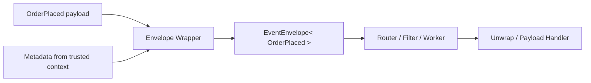

### Desired Outcome

Instead of sending only the payload:

```json
{
  "orderId": "ORD-1042",
  "totalMinorUnits": 125000,
  "currency": "VND"
}
```

we send a structured **message envelope**:

```json
{
  "metadata": {
    "messageType": "order.placed",
    "schemaVersion": 1,
    "eventId": "EV-1042",
    "tenantId": "shop-01",
    "sourceSystem": "WEB_CHECKOUT",
    "businessCorrelationId": "order:ORD-1042",
    "causationId": null,
    "occurredAt": "2026-11-21T08:30:00Z",
    "envelopedAt": "2026-11-21T08:30:01Z"
  },
  "payload": {
    "orderId": "ORD-1042",
    "tenantId": "shop-01",
    "eventId": "EV-1042",
    "totalMinorUnits": 125000,
    "currency": "VND",
    "occurredAt": "2026-11-21T08:30:00Z"
  }
}
```

In this example, `metadata` helps middleware observe, select routes, check versions, and manage the event lifecycle; `payload` still describes the order business data. Duplicated fields such as `eventId` and `tenantId` may need to be cross-checked to detect inconsistent data — you should not assume the two copies match by default.

### Learning Objectives

After this lesson, you can:

1. Explain what **Envelope Wrapper** is and what problem it solves.
2. Distinguish an envelope in a **serialized payload** from a Spring `Message<?>` with `MessageHeaders`.
3. Design immutable `EventEnvelope<T>` and `EnvelopeMetadata`.
4. Attach tenant, event ID, source, schema version, correlation/causation, and timestamp information from a trusted source.
5. Implement wrap/unwrap using a Spring Integration Transformer/Java DSL.
6. Test round-trip preservation of payload, metadata, and business correlation.
7. Design header mapping when traversing HTTP/Kafka/AMQP.
8. Identify the differences between tracing, correlation, idempotency, and routing.
9. Handle schema evolution, invalid metadata, duplicates, retries, error channels, and authorization.
10. Integrate with Splitter, Aggregator, Gateway, Filter, Router, and Content Enricher.
11. Determine when an **envelope is not needed** to avoid over-engineering.

## 2. What Is Envelope Wrapper in EIP?

**Envelope Wrapper** is a pattern that **wraps the data to be sent in a layer containing additional fields**. The outer layer can hold routing information, version, security-related context, address, processing metadata, or tracing information that the business payload handler does not necessarily need to know.

```text
+----------------------------------------------------+
| EventEnvelope                                      |
| +------------------------------------------------+ |
| | Metadata                                       | |
| | - messageType                                  | |
| | - schemaVersion                                | |
| | - sourceSystem                                 | |
| | - businessCorrelationId                        | |
| | - eventId / causationId                        | |
| | - occurredAt / envelopedAt                     | |
| +------------------------------------------------+ |
| +------------------------------------------------+ |
| | Payload                                        | |
| | OrderPlaced(orderId, amount, currency, ...)    | |
| +------------------------------------------------+ |
+----------------------------------------------------+
```

An envelope is useful when:

- Multiple event types need the same set of metadata.
- Consumers want to route or track events without depending on the specific schema of each payload.
- The payload must traverse a broker or a language/framework boundary.
- Version, provenance, and logical identity must be explicitly recorded for replay.
- Business data needs to be separated from operational integration information.

### The Pattern Does Not Necessarily Have a Class Named `EnvelopeWrapper`

In Spring Integration, Envelope Wrapper is typically implemented using a **Transformer** or a component that converts a message into an envelope DTO. You should not assume a standalone Java DSL operator named `.envelopeWrapper()` exists.

An implementation can look like:

```text
Message<OrderPlaced>
    -> Transformer.wrap(...)
    -> Message<EventEnvelope<OrderPlaced>>
    -> outbound adapter
```

The important point is the **envelope-style contract**, not a specific class or framework API name.

## 3. How Does Envelope Wrapper Differ from Spring Message Headers?

This is the most important distinction in Spring Integration.

### 3.1. Spring Message Already Has Payload and Headers

```java
org.springframework.messaging.Message<T>
    getPayload()
    getHeaders()
```

An internal message can be:

```text
Message<OrderPlaced>
  payload = OrderPlaced(...)
  headers:
    id = 29c4...
    timestamp = ...
    businessCorrelationId = order:ORD-1042
    replyChannel = ...
```

Headers assist Spring Integration with routing, correlation, reply/error handling, and propagation within a message pipeline. However, **not all headers are serialized into the JSON body by default** or remain meaningful across multiple platforms.

### 3.2. Envelope Wrapper Is Part of the Data Contract

```text
Message<EventEnvelope<OrderPlaced>>
  payload:
    metadata: ...
    payload: OrderPlaced(...)
  headers:
    id: ...
    timestamp: ...
    replyChannel: ...
```

When the outbound adapter serializes the envelope payload, fields in `metadata` can be included in JSON/Avro/Protobuf according to a shared schema, even when the consumer does not use Spring.

### 3.3. Comparison

| Criterion | Spring `MessageHeaders` | Envelope in serialized payload |
| --- | --- | --- |
| Location | Header map of Spring Message | Field inside DTO/body |
| Natural scope | Spring Messaging/integration runtime | Cross-service data contract |
| Easy to use with internal Router/Filter | Yes | Yes, though nested fields must be accessed |
| Traverses HTTP/Kafka | Depends on header mapping and adapter | Travels in body if serializer supports it |
| Can contain `replyChannel` object | Yes, inside the JVM | Should not contain it |
| Versioning | Governed by protocol/header policy | Usually explicit in the envelope schema |
| Security | Requires verifying headers from the source | Also requires verifying metadata from the source |
| Schema registry | Transport-dependent | Can use the envelope payload schema |
| Binary attachment | Not by default | Requires encoding/reference design |
| Ownership | Framework and application | Application/protocol |

**There is no rule that both are always required.** In a simple internal pipeline, `MessageHeaders` may suffice. When multiple services/languages exchange events, a versioned envelope is usually easier to manage.

### 3.4. A Header Name Matching a Metadata Field Does Not Mean the Same Source of Truth

If a message has both:

```text
Spring header:       correlationId = internal-group-17
Envelope metadata:   businessCorrelationId = order:ORD-1042
```

that can be **correct**: the `correlationId` header serves an Aggregator, while the `businessCorrelationId` metadata serves business tracing.

Do not automatically equate two IDs just because both contain the word “correlation”.

## 4. How Does Envelope Wrapper Differ from Header Enricher?

**Header Enricher** adds or modifies Spring Message headers, usually without changing the payload.

**Envelope Wrapper** creates a new payload containing **both the metadata and the original payload**.

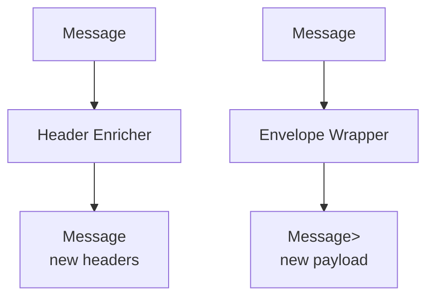

| Aspect | Header Enricher | Envelope Wrapper |
| --- | --- | --- |
| Runtime payload | Usually unchanged | Changes to a DTO/envelope containing the original payload |
| Metadata | In MessageHeaders | In the serialized structure |
| Non-Spring consumers | Requires header mapping | Reads metadata from the body |
| Impact on handlers | Usually little payload type change | Consumer must understand the envelope or unwrap it |
| Suitable use case | Correlation/tracing within internal flows | Exchange contracts between services |
| Risk | Headers lost when adapter mapping is incomplete | Larger payload, more complex schema |

An architecture can use both: Header Enricher produces trusted `verifiedTenantId`/`traceMarker` inside the JVM; Envelope Wrapper turns publishable metadata into portable fields before publishing.

## 5. How Does Envelope Wrapper Differ from Normalizer and Content Enricher?

All three patterns can produce a new message, but they serve different purposes.

| Pattern | Primary effect | Example |
| --- | --- | --- |
| **Envelope Wrapper** | Wraps payload in a metadata layer | `OrderPlaced` → `EventEnvelope<OrderPlaced>` |
| **Normalizer** | Converts multiple source formats into a canonical payload | `PartnerOrderV2` → `CanonicalOrder` |
| **Content Enricher** | Adds missing business data | `OrderPlaced` + `CustomerTier` |
| **Transformer** | Mechanism for transforming a message/payload | Java class performing one of the steps above |
| **Claim Check** | Stores payload and sends a ticket instead of a large payload | `LargeDocument` → `ClaimTicket` |
| **Filter** | Decides whether a message continues through the flow | Invalid event → discard/error |
| **Router** | Selects a channel/endpoint | `messageType` → specialized consumer |

Example of a full pipeline:


You are not required to use every pattern. Only add a step when it solves a concrete requirement. If a normalizer already produces sufficient metadata in a canonical event contract structured as an envelope, another wrapper may only add unnecessary nesting.

## 6. Which Metadata Should and Should Not Be Placed in the Envelope?

Fields should be classified by **semantics and trust level**, not just by name.

| Metadata | Purpose | Recommended source of truth |
| --- | --- | --- |
| `messageType` | Distinguish event/command type | Producer adapter contract |
| `schemaVersion` | Deserialize/migrate with the right schema | Producer registry/protocol |
| `eventId` | Logical event identity | Verified source or producer service |
| `tenantId` | Tenant namespace/isolation | Authenticated principal and mapping |
| `sourceSystem` | Provenance | Trusted ingress configuration |
| `businessCorrelationId` | Workflow tracing | Coordinator or domain ID |
| `causationId` | Event/request that caused the new event | Trusted parent event |
| `occurredAt` | Time when the business event occurred | Domain source |
| `envelopedAt` | Time when wrapping occurred | Wrapper service clock |
| `traceparent` | Distributed tracing | Tracing system with validation/sanitization |
| `idempotencyKey` | Prevent duplicate side effects | Stable identity per operation |
| `contentType` | Select parser/serializer | Protocol/schema |
| `partitionKey` | Ordered routing by key | Routing/partitioning policy |

Do not arbitrarily copy into the envelope:

- Internal Spring `replyChannel`/`errorChannel` objects.
- Passwords, private tokens, signed URLs, or the full Authorization header.
- Raw security context or overly sensitive claims.
- All user HTTP headers without an allowlist.
- Stack traces, access credentials, secret keys.
- Debug payloads or entire request headers just for “easy tracing”.
- A `now()` timestamp as an idempotency key or logical event ID.
- Session-scoped objects that lose meaning after a consumer restarts.

**An envelope is part of the trust boundary.** Its fields do not automatically become authenticated proof merely because they are called `metadata`.

## 7. Domain Payload and Metadata Have Different Responsibilities

Payload:

```java
public record OrderPlaced(
    String tenantId,
    String orderId,
    String eventId,
    long totalMinorUnits,
    String currency,
    java.time.Instant occurredAt
) {}
```

represents the **business event**. It can be used in a domain handler even without knowing about HTTP, Kafka, or tracing.

Metadata:

```java
public record EnvelopeMetadata(
    String messageType,
    int schemaVersion,
    String eventId,
    String tenantId,
    String sourceSystem,
    String businessCorrelationId,
    String causationId,
    java.time.Instant occurredAt,
    java.time.Instant envelopedAt
) {}
```

represents the **transport/observability/event-management contract**. This article deliberately places `eventId`, `tenantId`, and `occurredAt` in both payload and metadata to illustrate the requirement for **consistency cross-checking**.

### Why Might Metadata Duplicate Some Payload Fields?

- A Router wants to read the event type without understanding each specific domain payload.
- A gateway/consumer wants to verify the tenant before parsing a large body.
- A registry wants to route based on schema version.
- A logger wants to log correlation IDs without logging PII inside the payload.
- The event ID in metadata helps consumers deduplicate even when the payload schema changes.

However, every duplicated field must follow a rule: **outer metadata is derived from a trusted payload/identity and verified upon unwrap**. If they differ, it is a contract violation or a sign of tampering; do not arbitrarily pick one side.

## 8. Choosing an Immutable Envelope Structure

Java 17 records fit this example well because they are reference-immutable and provide `equals/hashCode` over their components.

```java
package example.integration;

import java.util.Objects;

public record EventEnvelope<T>(
    EnvelopeMetadata metadata,
    T payload
) {
    public EventEnvelope {
        Objects.requireNonNull(metadata, "metadata");
        Objects.requireNonNull(payload, "payload");
    }
}
```

Declaration example:

```java
EventEnvelope<OrderPlaced> envelope =
    new EventEnvelope<>(metadata, orderPlaced);
```

Generic `T` allows the same metadata schema to wrap many business event types:

```text
EventEnvelope<OrderPlaced>
EventEnvelope<OrderCancelled>
EventEnvelope<InvoiceIssued>
EventEnvelope<ShipmentDispatched>
```

### Generics Alone Are Not a Cross-Service Schema

When serializing to JSON, Java generic types at runtime are subject to type erasure. If a consumer does not know the payload type, it cannot safely infer the class/JSON schema just by looking at an object `T`.

You need a contract such as:

```json
{
  "metadata": {
    "messageType": "order.placed",
    "schemaVersion": 1
  },
  "payload": {
    "orderId": "ORD-1042"
  }
}
```

The deserializer uses an **allowlist** mapping `messageType + schemaVersion` to a supported schema/DTO, without letting external input dictate arbitrary class names.

## 9. Metadata Does Not Mean an Arbitrary Mutable Map

An overly loose design:

```java
record Envelope(
    java.util.Map<String, Object> metadata,
    Object payload
) {}
```

may work for a prototype, but in production it leads to errors:

- Field names differ across producers.
- Types are `String` in one place and `Long` in another.
- `schemaVersion` is missing or unversioned.
- Consumers need unsafe casts.
- Metadata can be mutated after creation if the map is mutable.
- No validation for required fields.
- Unclear which fields are sensitive or allowed to be public.

Use a typed record for **core metadata**, and if extension fields are needed, assign a namespace, define the serializer, and enforce an allowlist.

### Naming Conventions

An easily testable contract can use:

```text
metadata.messageType
metadata.schemaVersion
metadata.eventId
metadata.tenantId
metadata.sourceSystem
metadata.businessCorrelationId
metadata.causationId
metadata.occurredAt
metadata.envelopedAt
payload
```

Use a single convention across HTTP, Kafka, JSON events, and logs. Avoid having each service choose `trace_id`, `traceId`, or `TraceID` without a mapping.

## 10. Version and Message Type Contract

`messageType` answers: **what kind of event is this**.  
`schemaVersion` answers: **which contract should be used to read the payload/envelope**.

```text
messageType = order.placed
schemaVersion = 1

messageType = order.cancelled
schemaVersion = 1

messageType = order.placed
schemaVersion = 2
```

A consumer might support versions 1 and 2 for `order.placed` but only version 1 for `order.cancelled`.

### Do Not Confuse Versions

| Version | Purpose |
| --- | --- |
| Envelope schema version | Structure of metadata and wrapper |
| Payload schema version | Structure of the business event body |
| Source schema version | Input format before the Normalizer |
| API/protocol version | Endpoint/transport rules |
| Application release version | Deployed version of the service |

Simple examples use a single `schemaVersion` to reduce complexity. When the envelope and payload evolve independently, you may need separate `envelopeSchemaVersion` and `payloadSchemaVersion`, or a schema registry ID identifying the entire event schema.

### How Should Unknown `messageType` Be Handled?

```text
metadata.messageType = "java.lang.Runtime"
metadata.schemaVersion = 999
```

Do not use `Class.forName(messageType)` to deserialize or invoke handlers based on external input. Use a registry/allowlist of permitted event types and return `UNSUPPORTED_EVENT_TYPE` or `UNSUPPORTED_SCHEMA_VERSION` when there is no match.

## 11. Envelope Wrapper Does Not Guarantee Metadata Trustworthiness by Itself

Suppose a client sends:

```json
{
  "metadata": {
    "tenantId": "shop-admin",
    "sourceSystem": "TRUSTED_PARTNER"
  },
  "payload": {
    "tenantId": "shop-01",
    "orderId": "ORD-1042"
  }
}
```

If the consumer trusts `metadata.tenantId` alone for authorization, an attacker can spoof the tenant. You must authenticate the principal/credential/service identity at ingress and cross-check it against metadata/payload.

**A safer workflow:**

1. Authenticate the message source using HTTP/broker/service identity mechanisms.
2. Determine the permitted tenant and allowed source types.
3. Parse the envelope against a schema allowlist.
4. Validate metadata structure, version, and required fields.
5. Compare metadata tenant against the authenticated tenant.
6. Compare payload identity with metadata when corresponding fields exist.
7. Only forward to business Router/Filter/Handler once valid.

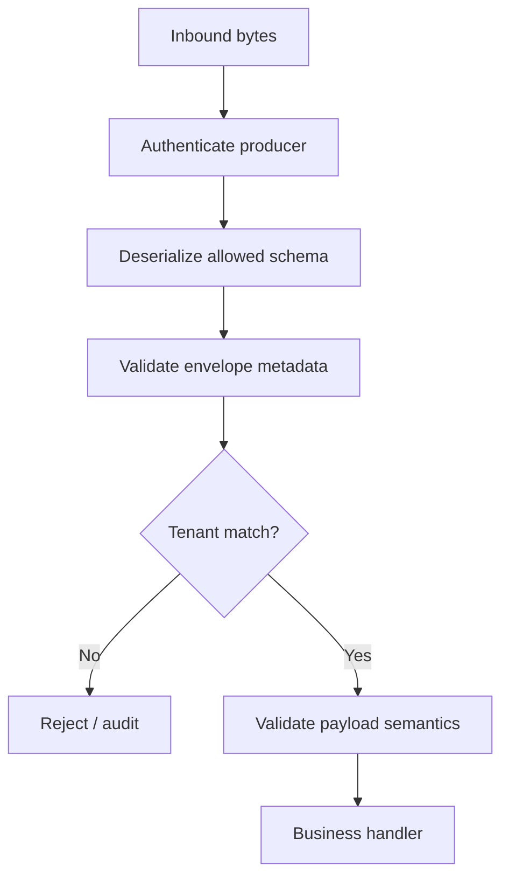

Signing the payload/envelope can help verify integrity and origin when crossing untrusted boundaries, but requires designing key management, replay protection, canonical serialization, and defining **which fields are signed**. Simply adding a `signature` field does not make a message automatically secure.

## 12. Java 17: Completing Immutable Records and Validation

To build an extensible example, create three Java files in an example package.

### 12.1. `OrderPlaced.java`

```java
package example.integration;

import java.time.Instant;

public record OrderPlaced(
    String tenantId,
    String orderId,
    String eventId,
    long totalMinorUnits,
    String currency,
    Instant occurredAt
) {
    public OrderPlaced {
        if (tenantId == null || tenantId.isBlank()
                || orderId == null || orderId.isBlank()
                || eventId == null || eventId.isBlank()
                || currency == null || currency.isBlank()
                || occurredAt == null) {
            throw new IllegalArgumentException(
                "OrderPlaced is missing required fields");
        }

        if (totalMinorUnits < 0) {
            throw new IllegalArgumentException(
                "Total must not be negative");
        }
    }
}
```

Checking `totalMinorUnits` and required fields in the record does not replace all business validation. An order may still need currency, items, maximum amount, payment status, or idempotency checks under separate policies.

### 12.2. `EnvelopeMetadata.java`

```java
package example.integration;

import java.time.Instant;

public record EnvelopeMetadata(
    String messageType,
    int schemaVersion,
    String eventId,
    String tenantId,
    String sourceSystem,
    String businessCorrelationId,
    String causationId,
    Instant occurredAt,
    Instant envelopedAt
) {
    public EnvelopeMetadata {
        if (messageType == null || messageType.isBlank()
                || schemaVersion <= 0
                || eventId == null || eventId.isBlank()
                || tenantId == null || tenantId.isBlank()
                || sourceSystem == null || sourceSystem.isBlank()
                || businessCorrelationId == null
                || businessCorrelationId.isBlank()
                || occurredAt == null
                || envelopedAt == null) {
            throw new IllegalArgumentException(
                "Invalid EnvelopeMetadata");
        }

        // causationId can be null when this is a root event.
    }
}
```

### 12.3. `EventEnvelope.java`

```java
package example.integration;

import java.util.Objects;

public record EventEnvelope<T>(
    EnvelopeMetadata metadata,
    T payload
) {
    public EventEnvelope {
        Objects.requireNonNull(metadata, "metadata");
        Objects.requireNonNull(payload, "payload");
    }
}
```

### Why Use Records?

- The constructor enforces that required fields are present.
- Named getters like `metadata.eventId()` are easy to read.
- No setters exist for downstream code to accidentally alter event identity.
- `equals/hashCode` makes comparing payloads/envelopes in unit tests easier.
- Generic payloads can still retain exact Java types inside the application.

### Note on Deep Immutability

Records protect **field references**, not automatically making a mutable `byte[]` or `List` immutable. If a payload contains a collection or blob:

```java
public record DocumentPayload(
    String documentId,
    byte[] content
) {
    public DocumentPayload {
        content = content.clone();
    }

    @Override
    public byte[] content() {
        return content.clone();
    }
}
```

For large data, instead of repeatedly copying `byte[]`, you can reference object storage or use Claim Check under an appropriate contract. An envelope only adds metadata; **it does not reduce payload size**.

## 13. Writing `OrderEnvelopeTransformer`: Wrapping from a Trusted Source

We build a Transformer that accepts `Message<OrderPlaced>`, requires ingress to have attached a **`verifiedTenantId`** header produced by an authenticated component, and returns `Message<EventEnvelope<OrderPlaced>>`.

This is a **convention of the demo application**, not a header that Spring Integration authenticates on its own.

```java
package example.integration;

import java.time.Clock;
import java.util.Objects;

import org.springframework.messaging.Message;
import org.springframework.messaging.support.MessageBuilder;

public final class OrderEnvelopeTransformer {

    private final Clock clock;
    private final String sourceSystem;

    public OrderEnvelopeTransformer(
            Clock clock,
            String sourceSystem) {
        this.clock = Objects.requireNonNull(clock);
        this.sourceSystem = require(sourceSystem, "sourceSystem");
    }

    public Message<EventEnvelope<OrderPlaced>> wrap(
            Message<OrderPlaced> input) {

        OrderPlaced order = input.getPayload();

        String verifiedTenant =
            requiredHeader(input, "verifiedTenantId");

        if (!verifiedTenant.equals(order.tenantId())) {
            throw new SecurityException(
                "Payload tenant differs from authenticated tenant");
        }

        String correlation = "order:"
            + verifiedTenant + ":" + order.orderId();

        EnvelopeMetadata metadata = new EnvelopeMetadata(
            "order.placed",
            1,
            order.eventId(),
            verifiedTenant,
            sourceSystem,
            correlation,
            null, // Root event has no causationId.
            order.occurredAt(),
            clock.instant());

        EventEnvelope<OrderPlaced> wrapped =
            new EventEnvelope<>(metadata, order);

        // Only place fields needed inside the JVM into headers.
        // Do not blindly copy replyChannel/errorChannel from the source.
        return MessageBuilder.withPayload(wrapped)
            .setHeader(
                "businessCorrelationId",
                metadata.businessCorrelationId())
            .setHeader("envelopeEventId", metadata.eventId())
            .setHeader("envelopeSchemaVersion",
                metadata.schemaVersion())
            .build();
    }

    private static String requiredHeader(
            Message<?> message, String headerName) {

        Object value = message.getHeaders().get(headerName);

        if (!(value instanceof String text)
                || text.isBlank()) {
            throw new SecurityException(
                "Missing trusted header: " + headerName);
        }

        return text;
    }

    private static String require(
            String value, String field) {

        if (value == null || value.isBlank()) {
            throw new IllegalArgumentException(
                "Missing " + field);
        }

        return value;
    }
}
```

### Analysis

**1. `sourceSystem` is attached via bean configuration.** `sourceSystem="WEB_CHECKOUT"` is configured by the service that knows the ingest source, not self-declared by the client.

**2. Verified tenant comes from ingress.** The demo uses `verifiedTenantId` in a header. In production, the inbound adapter/security filter must **strip any self-declared headers with the same name** and set it from the authenticated context.

**3. Payload content is unchanged.** The wrapper creates `EventEnvelope<>(metadata, order)`, preserving `OrderPlaced`.

**4. Business correlation is tenant-scoped.** `order:shop-01:ORD-1042` distinguishes the same order ID in a different tenant.

**5. Enveloped timestamp differs from event timestamp.** `occurredAt` records when the event occurred; `envelopedAt` records when the wrapper was created. Retries may produce a new `envelopedAt` if re-wrapped; do not use it as a logical event ID.

**6. Do not copy all headers.** Internal reply/error channels must not be placed into the serialized envelope; any headers that must traverse an adapter need to be allowlisted and mapped into the appropriate protocol.

### Should `traceId` Be Included in the Envelope?

Yes, if it is part of your organization's tracing contract, provided it uses a standard format and defines the trust boundary. For example, a producer can use the W3C `traceparent` header, validated/sanitized by the adapter and propagated through the broker. Do not generate a “business trace ID” by blindly copying every client-sent header and treating it as an authenticated identity.

### Where Can Causation ID Come From?

When `OrderPlaced` is the result of a previous command/event:

```text
CheckoutConfirmed eventId=EV-900
    |
    v
OrderPlaced eventId=EV-1042
  causationId=EV-900
```

Causation ID links the direct cause between messages; business correlation ID links the entire workflow. They can differ and should not be set equal by default.

## 14. Safe Unwrap: Cross-Checking Metadata, Payload, and Tenant

Unwrap should not simply extract `envelope.payload()` while ignoring metadata. When an event arrives from the network, check:

- Does `messageType` match what the consumer expects?
- Is `schemaVersion` supported?
- Does `tenantId` match the authenticated tenant?
- Does the payload have valid types and required fields?
- Are `eventId`, `tenantId`, and `occurredAt` consistent between metadata and payload?
- Does the business correlation ID conform to the grouping contract if the consumer relies on it?
- Should events that are too old or in the future be accepted? If so, under what policy?

Add the following method to `OrderEnvelopeTransformer` from Section 13:

```java
public Message<OrderPlaced> unwrap(
        Message<EventEnvelope<OrderPlaced>> input) {

    EventEnvelope<OrderPlaced> envelope =
        input.getPayload();

    EnvelopeMetadata metadata = envelope.metadata();
    OrderPlaced order = envelope.payload();

    String authenticatedTenant =
        requiredHeader(input, "verifiedTenantId");

    if (!"order.placed".equals(metadata.messageType())
            || metadata.schemaVersion() != 1) {
        throw new IllegalArgumentException(
            "Unsupported envelope type or version");
    }

    if (!authenticatedTenant.equals(metadata.tenantId())
            || !authenticatedTenant.equals(order.tenantId())) {
        throw new SecurityException(
            "Cross-tenant envelope rejected");
    }

    if (!metadata.eventId().equals(order.eventId())
            || !metadata.occurredAt().equals(order.occurredAt())) {
        throw new IllegalArgumentException(
            "Envelope payload/metadata mismatch");
    }

    String expectedCorrelation = "order:"
        + authenticatedTenant + ":" + order.orderId();

    if (!expectedCorrelation.equals(
            metadata.businessCorrelationId())) {
        throw new IllegalArgumentException(
            "Unexpected business correlation identity");
    }

    return MessageBuilder.withPayload(order)
        .setHeader(
            "businessCorrelationId",
            metadata.businessCorrelationId())
        .setHeader("sourceEventId", metadata.eventId())
        .setHeader("sourceSystem", metadata.sourceSystem())
        .build();
}
```

**Note:** this is a specific contract for the `order.placed` event with correlation formatted as `order:<tenant>:<orderId>`. In other workflows, the correlation ID may be generated by a coordinator and is not necessarily the order ID; validate against the actual contract rather than hardcoding the same formula for every event.

### Unwrap Restores the Payload, Not the Entire Old Spring Message

The method above creates a new `Message<OrderPlaced>` and adds only the required business headers. It does not restore:

- The original Spring `MessageHeaders.id`.
- The original `replyChannel`/`errorChannel`.
- All transport-specific headers.
- The `correlationId` header of another Splitter/Aggregator.
- The caller's previous security context.

This information may **no longer be valid** after a network hop or restart. If the current workflow needs reply/group headers, they must be transmitted and mapped according to the current protocol in a controlled way.

### Note on Type Erasure and Deserialization

In a JSON adapter, `EventEnvelope<OrderPlaced>` is not created safely just because Java has generics. Before calling `unwrap`, the adapter must deserialize using an allowed schema/type and verify `messageType/schemaVersion`. Do not cast a payload from `Map<String,Object>` to `OrderPlaced` without going through a concrete converter/schema validation step.

## 15. Spring Integration Java DSL: Two Flows for Wrap and Unwrap

We create two separate flows so both outbound and inbound can be tested without a real broker:

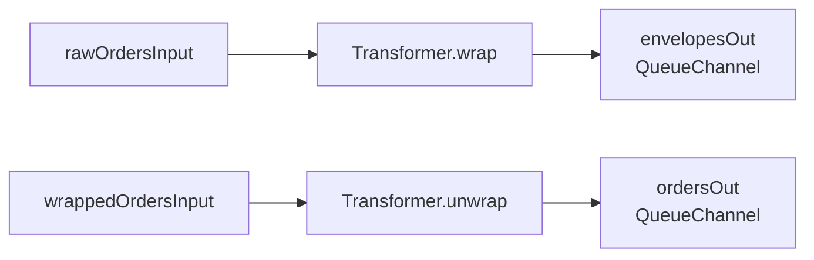

### Configuration Example

```java
package example.integration;

import java.time.Clock;

import org.springframework.context.annotation.Bean;
import org.springframework.context.annotation.Configuration;
import org.springframework.integration.channel.DirectChannel;
import org.springframework.integration.channel.QueueChannel;
import org.springframework.integration.config.EnableIntegration;
import org.springframework.integration.dsl.IntegrationFlow;
import org.springframework.messaging.MessageChannel;

@Configuration
@EnableIntegration
public class EnvelopeWrapperConfiguration {

    @Bean
    public MessageChannel rawOrdersInput() {
        return new DirectChannel();
    }

    @Bean
    public QueueChannel envelopesOut() {
        return new QueueChannel();
    }

    @Bean
    public MessageChannel wrappedOrdersInput() {
        return new DirectChannel();
    }

    @Bean
    public QueueChannel ordersOut() {
        return new QueueChannel();
    }

    @Bean
    public OrderEnvelopeTransformer orderEnvelopeTransformer() {
        return new OrderEnvelopeTransformer(
            Clock.systemUTC(), "WEB_CHECKOUT");
    }

    @Bean
    public IntegrationFlow envelopeOutbound(
            OrderEnvelopeTransformer transformer) {

        return IntegrationFlow.from("rawOrdersInput")
            .transform(transformer, "wrap")
            .channel("envelopesOut")
            .get();
    }

    @Bean
    public IntegrationFlow envelopeInbound(
            OrderEnvelopeTransformer transformer) {

        return IntegrationFlow.from("wrappedOrdersInput")
            .transform(transformer, "unwrap")
            .channel("ordersOut")
            .get();
    }
}
```

### Why Use `.transform(transformer, "wrap")`?

A Spring Integration Transformer endpoint can invoke a method on a bean to transform a message. Here the bean exposes a method taking `Message<OrderPlaced>` and returning `Message<EventEnvelope<OrderPlaced>>`. The inbound endpoint invokes the `unwrap` method for the reverse direction.

The method name is merely an implementation detail; **Envelope Wrapper is the pattern**, not a requirement for every flow to have a DSL operator named `.envelopeWrapper()`.

### Note on Library Versions

Java DSL API overloads and method resolution behavior should be verified with a build/tests against real dependencies. This lesson presents the contract and Java 17 examples; compile/integration testing in a real project belongs to specialized QA verification after content creation.

### Why Use `QueueChannel` for Output?

`QueueChannel` is convenient for writing tests that inspect `receive(timeout)`. It does not become a persistent broker, does not share state across multiple pods by default, and does not provide exactly-once guarantees.

### Ingress Authentication Is Outside the DSL Example

The snippet intentionally omits a fake authentication service. The `verifiedTenantId` values in tests are **assumed fixtures attached by a trusted component**. In production:

```text
HTTP/Kafka/AMQP inbound adapter
  -> authenticate producer
  -> set verifiedTenantId from authenticated context
  -> parse allowed DTO/schema
  -> wrap/unwrap transformer
```

If users can send a `verifiedTenantId` header themselves and you trust it, the “tenant match” test provides no security value.

## 16. Unit Test: Wrap Produces Correct Metadata Without Altering the Payload

Write a test for the transformer class without needing a Spring context. Use `Clock.fixed` to verify `envelopedAt` deterministically.

```java
package example.integration;

import static org.junit.jupiter.api.Assertions.*;

import java.time.Clock;
import java.time.Instant;
import java.time.ZoneOffset;

import org.junit.jupiter.api.Test;
import org.springframework.messaging.Message;
import org.springframework.messaging.support.MessageBuilder;

class OrderEnvelopeTransformerTest {

    private final Instant occurred =
        Instant.parse("2026-11-21T08:30:00Z");

    private final Instant wrappedAt =
        Instant.parse("2026-11-21T08:30:01Z");

    private final OrderEnvelopeTransformer transformer =
        new OrderEnvelopeTransformer(
            Clock.fixed(wrappedAt, ZoneOffset.UTC),
            "WEB_CHECKOUT");

    private OrderPlaced order() {
        return new OrderPlaced(
            "shop-01", "ORD-1042", "EV-1042",
            125_000L, "VND", occurred);
    }

    private Message<OrderPlaced> input() {
        return MessageBuilder.withPayload(order())
            .setHeader("verifiedTenantId", "shop-01")
            .build();
    }

    @Test
    void wrapsPayloadAndAddsStableMetadataFields() {
        Message<OrderPlaced> source = input();

        Message<EventEnvelope<OrderPlaced>> output =
            transformer.wrap(source);

        EventEnvelope<OrderPlaced> envelope =
            output.getPayload();

        // Do not alter business values.
        assertEquals(source.getPayload(), envelope.payload());

        EnvelopeMetadata meta = envelope.metadata();

        assertEquals("order.placed", meta.messageType());
        assertEquals(1, meta.schemaVersion());
        assertEquals("EV-1042", meta.eventId());
        assertEquals("shop-01", meta.tenantId());
        assertEquals("WEB_CHECKOUT", meta.sourceSystem());
        assertEquals(
            "order:shop-01:ORD-1042",
            meta.businessCorrelationId());
        assertNull(meta.causationId());
        assertEquals(occurred, meta.occurredAt());
        assertEquals(wrappedAt, meta.envelopedAt());

        assertEquals(
            "order:shop-01:ORD-1042",
            output.getHeaders()
                .get("businessCorrelationId"));
    }
}
```

### What the Test Proves

- `OrderPlaced` is preserved intact.
- Metadata has the correct type/version/source/tenant/event ID.
- `occurredAt` differs from `envelopedAt` meaningfully.
- Business correlation ID is computed consistently by tenant/order.
- The Java Message can still carry business headers if internal flows need them.

### What the Test Does Not Prove

- Cross-platform JSON serialization.
- Signed envelopes or real authentication.
- Header mapping over Kafka/HTTP.
- Idempotent processing after retries.
- Database side effects.
- Correctness across multiple message types/schema versions.

Those areas require the additional tests below.

## 17. Unit Test: Unwrap Restores the Domain Payload

Add a test to `OrderEnvelopeTransformerTest`:

```java
@Test
void roundTripRestoresTheOriginalDomainPayload() {
    Message<OrderPlaced> original = input();

    Message<EventEnvelope<OrderPlaced>> wrapped =
        transformer.wrap(original);

    // Simulate inbound adapter having authenticated the caller and attached
    // the trusted tenant header in the current context.
    Message<EventEnvelope<OrderPlaced>> inbound =
        MessageBuilder.withPayload(wrapped.getPayload())
            .setHeader("verifiedTenantId", "shop-01")
            .build();

    Message<OrderPlaced> restored =
        transformer.unwrap(inbound);

    assertEquals(
        original.getPayload(),
        restored.getPayload());

    assertEquals(
        "order:shop-01:ORD-1042",
        restored.getHeaders()
            .get("businessCorrelationId"));

    assertEquals(
        "EV-1042",
        restored.getHeaders().get("sourceEventId"));

    assertEquals(
        "WEB_CHECKOUT",
        restored.getHeaders().get("sourceSystem"));
}
```

**Important:** this test proves restoration of **the domain payload and intentional business headers**. It does not claim that `MessageHeaders.id` or `replyChannel` of the original message is preserved. In many systems, recreating messages with a new runtime ID across boundaries is completely normal.

## 18. Test: Mismatched Tenant Metadata Must Be Rejected

An incoming external envelope may claim a different tenant than the authenticated tenant.

```java
@Test
void unwrapRejectsCrossTenantEnvelope() {
    Message<EventEnvelope<OrderPlaced>> wrapped =
        transformer.wrap(input());

    Message<EventEnvelope<OrderPlaced>> inbound =
        MessageBuilder.withPayload(wrapped.getPayload())
            .setHeader("verifiedTenantId", "shop-99")
            .build();

    assertThrows(SecurityException.class, () ->
        transformer.unwrap(inbound));
}
```

### Do Not Trust a Header Just Because It Is Named “verified”

A header's name does not make it trustworthy. The test simulates an inbound adapter/security layer performing authentication properly. Production must prove:

- Clients cannot set an accepted `verifiedTenantId` themselves.
- Broker topic/producer identity is controlled.
- Service accounts are only authorized to emit messages within their permitted scope.
- Metadata/payload tenant is verified against the authenticated identity.
- Consumers do not leak other tenants' details in exceptions/logs.

### Multi-Tenant Context

`orderId=ORD-1042` can appear in both `shop-01` and `shop-99`. Correlation should be tenant-scoped when business keys are not globally unique. Tenant scoping is also needed in idempotency keys and DB unique constraints if required by the domain.

## 19. Test: Inconsistent Metadata and Payload

A wrapper must not turn conflicting fields into “two different truths” for two consumers.

```java
@Test
void unwrapRejectsMismatchedEventId() {
    Message<EventEnvelope<OrderPlaced>> wrapped =
        transformer.wrap(input());

    EventEnvelope<OrderPlaced> original =
        wrapped.getPayload();

    EnvelopeMetadata old = original.metadata();

    EnvelopeMetadata altered = new EnvelopeMetadata(
        old.messageType(),
        old.schemaVersion(),
        "EV-FORGED",
        old.tenantId(),
        old.sourceSystem(),
        old.businessCorrelationId(),
        old.causationId(),
        old.occurredAt(),
        old.envelopedAt());

    EventEnvelope<OrderPlaced> corrupted =
        new EventEnvelope<>(
            altered, original.payload());

    Message<EventEnvelope<OrderPlaced>> inbound =
        MessageBuilder.withPayload(corrupted)
            .setHeader("verifiedTenantId", "shop-01")
            .build();

    assertThrows(IllegalArgumentException.class, () ->
        transformer.unwrap(inbound));
}
```

### Other Mismatches to Test

| Metadata or payload | Violation | Expectation |
| --- | --- | --- |
| `metadata.tenantId` | Differs from authenticated tenant | Security rejection |
| `payload.tenantId` | Differs from metadata tenant | Security rejection |
| `metadata.eventId` | Differs from payload eventId | Contract violation |
| `metadata.occurredAt` | Differs from payload occurredAt | Contract violation |
| `metadata.messageType` | Not `order.placed` | Unsupported event type |
| `metadata.schemaVersion` | Unsupported version | Schema error |
| `businessCorrelationId` | Violates contract | Reject/map per policy |
| `metadata.sourceSystem` | Unauthorized spoofed value | Provenance/authz error at ingress |
| `payload.currency` | Invalid format | Domain validation error |
| Reused `eventId` with different payload | Business identity conflict | Idempotency conflict / quarantine |

In systems accepting multiple versions, the validator can select the right schema mapper instead of rejecting every version other than 1. However, it must not parse an unknown version by guessing field names.

## 20. Unit Test: Missing Verified Tenant Header

A producer without a trust context might try to send a payload with a valid tenant but **without verified authorization**.

```java
@Test
void wrapRejectsMissingTrustedTenant() {
    Message<OrderPlaced> unverified =
        MessageBuilder.withPayload(order()).build();

    assertThrows(SecurityException.class, () ->
        transformer.wrap(unverified));
}
```

An input containing `tenantId=shop-01` in the payload does not replace authentication. This test ensures the code does not fall back to dangerous patterns like:

```java
// Do not do this at the trust boundary:
String tenant = headerTrustedTenant != null
    ? headerTrustedTenant
    : payload.tenantId();
```

If the trust context is missing, fail fast and record an appropriate reason code.

## 21. Integration Test: Real Java DSL Wrap Flows

Unit tests calling the Transformer directly do not prove that Spring Integration endpoints are wired properly. Create a context test with `EnvelopeWrapperConfiguration`:

```java
package example.integration;

import static org.junit.jupiter.api.Assertions.*;

import java.time.Instant;

import org.junit.jupiter.api.Test;
import org.springframework.beans.factory.annotation.Autowired;
import org.springframework.beans.factory.annotation.Qualifier;
import org.springframework.integration.channel.QueueChannel;
import org.springframework.messaging.Message;
import org.springframework.messaging.MessageChannel;
import org.springframework.messaging.support.MessageBuilder;
import org.springframework.test.annotation.DirtiesContext;
import org.springframework.test.context.junit.jupiter.SpringJUnitConfig;

@SpringJUnitConfig(EnvelopeWrapperConfiguration.class)
@DirtiesContext(
    classMode = DirtiesContext.ClassMode.AFTER_EACH_TEST_METHOD)
class EnvelopeWrapperFlowTest {

    @Autowired
    @Qualifier("rawOrdersInput")
    private MessageChannel rawInput;

    @Autowired
    @Qualifier("envelopesOut")
    private QueueChannel envelopesOut;

    @Autowired
    @Qualifier("wrappedOrdersInput")
    private MessageChannel wrappedInput;

    @Autowired
    @Qualifier("ordersOut")
    private QueueChannel ordersOut;

    private OrderPlaced event() {
        return new OrderPlaced(
            "shop-01", "ORD-1042", "EV-1042",
            125_000L, "VND",
            Instant.parse("2026-11-21T08:30:00Z"));
    }

    @Test
    void outboundFlowWrapsAndInboundFlowUnwraps() {
        Message<OrderPlaced> source = MessageBuilder
            .withPayload(event())
            .setHeader("verifiedTenantId", "shop-01")
            .build();

        assertTrue(rawInput.send(source));

        Message<?> out = envelopesOut.receive(1_000);
        assertNotNull(out);
        assertInstanceOf(
            EventEnvelope.class, out.getPayload());

        @SuppressWarnings("unchecked")
        EventEnvelope<OrderPlaced> envelope =
            (EventEnvelope<OrderPlaced>) out.getPayload();

        assertEquals("order.placed",
            envelope.metadata().messageType());

        Message<EventEnvelope<OrderPlaced>> inbound =
            MessageBuilder.withPayload(envelope)
                .setHeader("verifiedTenantId", "shop-01")
                .build();

        assertTrue(wrappedInput.send(inbound));

        Message<?> restored = ordersOut.receive(1_000);
        assertNotNull(restored);
        assertEquals(event(), restored.getPayload());

        assertNull(envelopesOut.receive(0));
        assertNull(ordersOut.receive(0));
    }
}
```

### What Does This Test Prove?

- Spring Integration input → Transformer → output channel works as expected.
- The wrapper actually becomes the payload of the Spring Message.
- Unwrap produces `OrderPlaced` for downstream handlers.
- The `verifiedTenantId` header is provided at each flow's ingress boundary.
- One valid message produces one output per flow in the synchronous demo setup.

### What Must Not Be Inferred

- Two `QueueChannel` instances are not Kafka/AMQP.
- There is no real JSON serialization in this test.
- It does not guarantee at-most-once delivery.
- It does not prove the security header was attached by real authentication.
- There is no database commit, retry, or callback.
- This is not a production latency/throughput test.

## 22. Test: Interleaved Envelopes Without Mixing Metadata

When two tenants emit events simultaneously, the wrapper must not store a variable like `currentTenant` to share across messages.

```text
Input arrival:
  shop-01 / EV-A
  shop-02 / EV-B
  shop-01 / EV-C

Expected:
  Envelope A: tenant=shop-01, eventId=EV-A
  Envelope B: tenant=shop-02, eventId=EV-B
  Envelope C: tenant=shop-01, eventId=EV-C
```

Do not implement:

```java
// Anti-pattern: shared mutable context.
static String currentTenant;
```

Instead, `wrap` computes metadata from **the input message and that input's own trusted context**.

### Illustrative Test

```java
@Test
void differentTenantsKeepTheirOwnMetadata() {
    var events = java.util.List.of(
        new OrderPlaced("shop-01", "O-A", "EV-A",
            100L, "VND",
            Instant.parse("2026-11-21T00:00:00Z")),
        new OrderPlaced("shop-02", "O-B", "EV-B",
            200L, "VND",
            Instant.parse("2026-11-21T00:00:01Z")),
        new OrderPlaced("shop-01", "O-C", "EV-C",
            300L, "VND",
            Instant.parse("2026-11-21T00:00:02Z"))
    );

    for (OrderPlaced order : events) {
        Message<OrderPlaced> input = MessageBuilder
            .withPayload(order)
            .setHeader("verifiedTenantId", order.tenantId())
            .build();

        assertTrue(rawInput.send(input));
    }

    var byEventId = new java.util.HashMap<
        String, EnvelopeMetadata>();

    for (int i = 0; i < events.size(); i++) {
        Message<?> message = envelopesOut.receive(1_000);
        assertNotNull(message);

        @SuppressWarnings("unchecked")
        EventEnvelope<OrderPlaced> envelope =
            (EventEnvelope<OrderPlaced>) message.getPayload();

        byEventId.put(
            envelope.metadata().eventId(),
            envelope.metadata());
    }

    assertEquals("shop-01",
        byEventId.get("EV-A").tenantId());
    assertEquals("shop-02",
        byEventId.get("EV-B").tenantId());
    assertEquals("shop-01",
        byEventId.get("EV-C").tenantId());

    assertEquals(3, byEventId.size());
}
```

This method is added to `EnvelopeWrapperFlowTest` from Section 21. The test sends sequentially into a `DirectChannel`, while still verifying **no metadata mixing** when events interleave across tenants. With an `ExecutorChannel`/broker, do not assert global output order; index outputs by event ID and verify correlation per item.

## 23. Envelope Over JSON: Serialization Is a Separate Contract

An `EventEnvelope<OrderPlaced>` inside the JVM is still just a Java object. To exchange it over HTTP, Kafka, or AMQP, a unified serializer/deserializer is required.

### Example Published JSON Body

```json
{
  "metadata": {
    "messageType": "order.placed",
    "schemaVersion": 1,
    "eventId": "EV-1042",
    "tenantId": "shop-01",
    "sourceSystem": "WEB_CHECKOUT",
    "businessCorrelationId": "order:shop-01:ORD-1042",
    "causationId": null,
    "occurredAt": "2026-11-21T08:30:00Z",
    "envelopedAt": "2026-11-21T08:30:01Z"
  },
  "payload": {
    "tenantId": "shop-01",
    "orderId": "ORD-1042",
    "eventId": "EV-1042",
    "totalMinorUnits": 125000,
    "currency": "VND",
    "occurredAt": "2026-11-21T08:30:00Z"
  }
}
```

When deserializing, the consumer needs `metadata.messageType` and `schemaVersion` before mapping the payload to `OrderPlaced`. Do not call `Class.forName` on a producer-supplied string.

### Illustrative Serialization Test with Jackson

If the project uses Jackson Databind and the Java Time module, you can test JSON round-trip in an integration test:

```java
import static org.junit.jupiter.api.Assertions.*;

import com.fasterxml.jackson.databind.JavaType;
import com.fasterxml.jackson.databind.ObjectMapper;
import com.fasterxml.jackson.databind.json.JsonMapper;
import com.fasterxml.jackson.datatype.jsr310.JavaTimeModule;
import org.junit.jupiter.api.Test;

// Test fragment: requires Jackson + JavaTimeModule dependencies.
@Test
void jsonRoundTripKeepsEnvelopeMetadataAndOrder() throws Exception {
    ObjectMapper mapper = JsonMapper.builder()
        .addModule(new JavaTimeModule())
        .build();

    EventEnvelope<OrderPlaced> original =
        transformer.wrap(input()).getPayload();

    String serialized = mapper.writeValueAsString(original);

    JavaType type = mapper.getTypeFactory()
        .constructParametricType(
            EventEnvelope.class, OrderPlaced.class);

    EventEnvelope<OrderPlaced> decoded =
        mapper.readValue(serialized, type);

    assertEquals(original, decoded);
}
```

This fragment belongs in `OrderEnvelopeTransformerTest` from Section 16 or a similar test class. It assumes `transformer` and `input()` are already-defined fixtures; it is not a standalone file you can copy and run directly.

### What to Verify Beyond JSON Round-Trip

- Is `Instant` serialized as ISO 8601 or epoch? Is it consistent across Java, Node, and Go?
- Can the integer `totalMinorUnits` exceed the safe range of JavaScript `Number`?
- How are unknown/optional fields handled under your compatibility policy?
- Must null `causationId` be present, or can it be omitted?
- Is it compatible when a producer adds `metadata.attributes`?
- Are field names and casing stable according to the schema registry?
- Does the consumer verify `messageType/schemaVersion` before binding types?

**A JSON round-trip in a single JVM does not prove cross-language compatibility.** For multi-platform systems, maintain contract tests and schemas verified between producers and consumers.

## 24. Over Kafka, AMQP, or HTTP: Where Does Metadata Live?

Envelope Wrapper can be serialized into the body, while the transport/broker still has its own attributes:

```text
Kafka record
  key: shop-01:ORD-1042
  headers: content-type, trace context (per policy)
  value: JSON EventEnvelope<OrderPlaced>

HTTP request
  headers: Authorization, Content-Type, traceparent
  body: JSON EventEnvelope<OrderPlaced>

Spring Message<EventEnvelope<OrderPlaced>>
  headers: internal runtime metadata
  payload: EventEnvelope<OrderPlaced>
```

### Do Not Duplicate Everything in Two Places

If `businessCorrelationId` exists in both the body and a transport header, you must decide:

1. Which one is authoritative?
2. Which one is checked on disagreement?
3. When forwarding through another service, who is allowed to update it?
4. Do both need to be signed or integrity-protected?
5. On mismatch, should the consumer reject or reconcile?

Without a policy, two consumers might trust two different values and process the same event under two different groups.

### Header Mappers Can Drop Metadata

An adapter only forwards allowlisted headers. Therefore, if a workflow requires `schemaVersion` and `eventId` across a broker, putting them in the envelope schema is a portable option. However, that **does not replace** mapping content type, partitioning key, tracing headers, or authenticated producer identity.

### Transport Key and Business Correlation

A Kafka record key is often used for partitioning; it can be `tenantId:orderId` so events for one order land on the same partition. This is a **routing/ordering decision**, and does not guarantee the message body has not been tampered with. Similarly, `businessCorrelationId` for tracing does not create global ordering across multiple partitions.

### Do Not Serialize Spring `replyChannel`

An in-JVM `replyChannel` object is not a safe JSON field. If you need request-reply over a broker, use a protocol correlation ID, an allowlisted reply destination, and an appropriate timeout.

## 25. Envelope Wrapper and Content-Based Router

A Router can choose a branch based on `messageType` without needing to deserialize every business payload type.

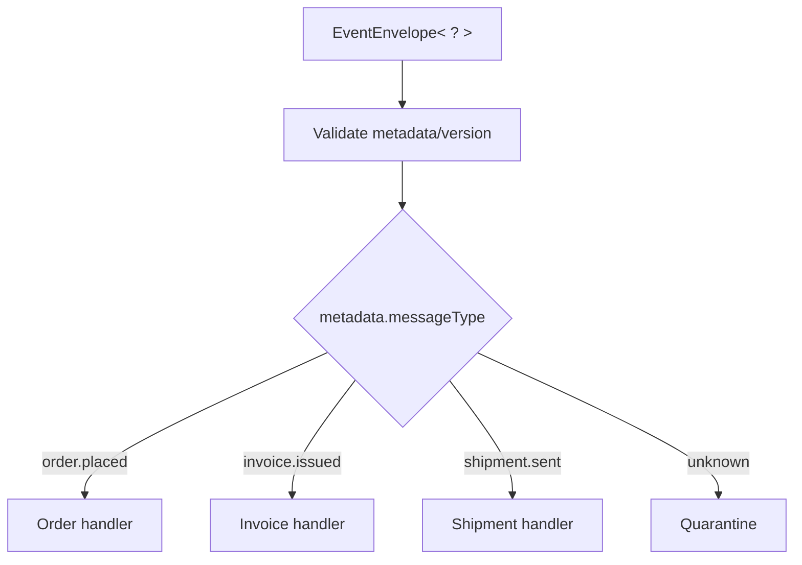

### Router Reading Metadata from the Payload

Illustrative Java DSL example:

```java
// Fragment: assumes input payload is a validated EventEnvelope<?>.
// Order, invoice, and shipment output channels must be configured separately.

IntegrationFlow routeByEnvelopeType() {
    return IntegrationFlow.from("validatedEnvelopes")
        .route(EventEnvelope.class,
            envelope -> envelope.metadata().messageType(),
            spec -> spec
                .channelMapping("order.placed", "ordersChannel")
                .channelMapping("invoice.issued", "invoicesChannel")
                .channelMapping("shipment.sent", "shipmentsChannel"))
        .get();
}
```

This is an example of routing by type, not a full producer-consumer configuration. In production, handle unknown mappings, versioning, and a structured DLQ.

### Do Not Select a Handler Using an Input-Provided Class Name

Anti-pattern:

```java
// Do not do this with external data.
String javaClassName = envelope.metadata().messageType();
Class<?> type = Class.forName(javaClassName);
```

Use a fixed allowlist mapping `messageType` to permitted schemas/handlers. This avoids unsafe deserialization and keeps the event contract explicit.

### Router and Authorization

A producer only authorized to emit `order.placed` must not be allowed to change metadata to `admin.action` to reach a privileged handler. Metadata-based routing is only safe when producer identity and permitted message types have been verified.

## 26. Envelope Wrapper and Filter: Rejecting Invalid Data Before Business Side Effects

A Filter can use metadata to drop unsuitable or expired events according to policy.

```text
Envelope
  -> Validate schema/tenant
  -> Filter eventType == order.placed
  -> Unwrap
  -> Business Handler
```

However, separate these concerns:

- **Security validation:** wrong tenant, invalid signature → reject + audit, do not just quietly discard.
- **Schema validation:** unsupported version → structured error/quarantine.
- **Business Filter:** order below a threshold, unsuitable status → domain condition.
- **Duplicate Filter:** already processed event → idempotency decision.

Do not lump these reasons into a single `filteredOut` outcome with no recovery contract.

### Check Metadata Without Reading the Full Payload?

In a JSON body, metadata often appears before the payload in sample structures, but **JSON object field order provides no streaming/security guarantee**. To truly inspect metadata before parsing a large payload, you need a streaming-capable parser/envelope protocol or verified metadata in transport/record headers. Do not promise that “putting metadata first in JSON always avoids deserializing the body”.

### Filter Failures Before an Aggregator

If a Splitter emits three children and a Filter drops one due to bad metadata, the downstream Aggregator may wait indefinitely. Emit a failure outcome with proper sequence/group metadata, fail the entire workflow, or apply an explicit partial/expiry policy.

## 27. Correlation ID, Causation ID, Event ID, and Trace ID: Four Different Questions

An Envelope Wrapper often contains multiple IDs, and each ID answers a different question.

| ID | Question | Example |
| --- | --- | --- |
| `eventId` | Which logical event is this? | `EV-1042` |
| `businessCorrelationId` | Which events belong to the same workflow? | `order:shop-01:ORD-1042` |
| `causationId` | Which event directly led to this event? | `EV-1039` |
| `traceId`/`traceparent` | Which spans belong to the same distributed trace? | Trace context generated by the tracing system |
| `MessageHeaders.id` | Which Spring message instance is this? | Internal UUID |
| Splitter `correlationId` | Which children belong to the same message group? | `split-group-77` |
| `idempotencyKey` | Which operation must not execute twice? | `shop-01:CAP-9:ledger` |

### Workflow Example

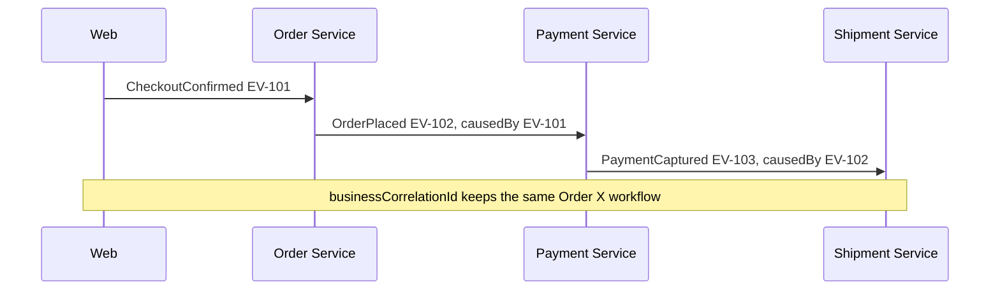

`eventId` differs for every event. `businessCorrelationId` can stay the same. `causationId` indicates the direct parent relationship, not a list of all ancestor events.

### Do Not Use Correlation ID as the Key for Every Child

In a `Splitter -> Aggregator`, children share the same `correlationId` but have different `sequenceNumber` values. If you use only `correlationId` for an idempotent receiver, the second child will be treated as a duplicate of the first.

An idempotency key must include the logical child ID or operation identity per contract.

## 28. Envelope Wrapper and Idempotent Receiver

A broker may redeliver the same event twice:

```text
Delivery #1:
  metadata.eventId=EV-1042
  metadata.envelopedAt=08:30:01Z
  payload.orderId=ORD-1042

Delivery #2:
  metadata.eventId=EV-1042
  metadata.envelopedAt=08:31:30Z
  payload.orderId=ORD-1042
```

If an event is re-wrapped during a retry, `envelopedAt` may change. **Do not use `envelopedAt` or a full-envelope JSON hash as a logical deduplication key**.

A suitable idempotency key could be:

```text
(tenantId, sourceSystem, eventId, operationType)
```

In another workflow needing protection per business action:

```text
(tenantId, orderId, ledgerEntryType)
```

Choose a key that matches the side effect being protected.

### Duplicate With Different Metadata and Conflicts

The same `eventId` with a different payload/amount may indicate a producer bug, data corruption, or replay of an altered event. Do not ignore it silently without auditing; you can store a canonical fingerprint of **meaningful business fields**:

```text
First event:
  key=K
  payloadFingerprint=HASH(canonical business fields)
  state=COMPLETED

Second event:
  key=K
  payloadFingerprint=same
  -> duplicate, no second effect

Second event:
  key=K
  payloadFingerprint=different
  -> conflict/quarantine
```

Do not compute the fingerprint from `envelopedAt`, transient trace context, or transport headers that change on every delivery.

### Do Not Confuse With Exactly-Once Effect

An idempotent receiver might detect a duplicate at input yet crash after recording the key before committing the business effect, or after committing the effect before sending an ack. You need transactions, unique constraints/outbox, or downstream idempotency by design. Envelope metadata provides identity; **it does not guarantee transactional correctness on its own**.

## 29. Retry and Error Channel: Keeping the Envelope for Error Investigation

A flow can fail at many points:

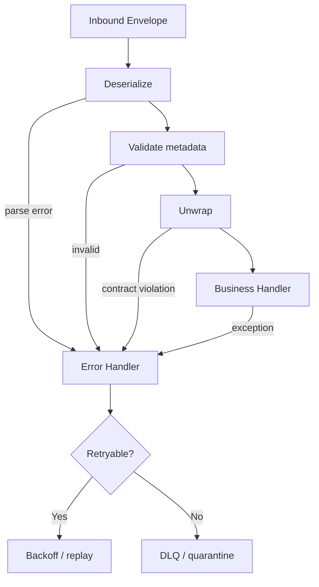

### Error Classification

| Error | Example | Recommended handling |
| --- | --- | --- |
| `INVALID_JSON` | Body cannot be parsed | Quarantine, avoid blind retries |
| `UNSUPPORTED_EVENT_TYPE` | Unregistered `messageType` | Quarantine/notify schema owner |
| `UNSUPPORTED_SCHEMA_VERSION` | V3 not yet supported | Keep raw reference for replay after upgrade |
| `TENANT_MISMATCH` | Payload/metadata/auth identity mismatch | Security rejection + audit |
| `METADATA_PAYLOAD_CONFLICT` | Different `eventId` | Reject, reconcile with source |
| `SIGNATURE_INVALID` | Invalid envelope signature | Reject, security alert |
| `TRANSIENT_STORE_FAILURE` | DB/temporary connection loss | Bounded retries |
| `DOWNSTREAM_TIMEOUT` | Handler API call unresponsive | Retry/reconcile with idempotency |
| `DUPLICATE_COMPLETED` | Event already committed | Return cached result/ignore per contract |
| `UNKNOWN_OUTCOME` | External effect may have executed | Reconciliation, no blind retries |

### Error Channel May Not Be Used in Synchronous Flows

In a synchronous `DirectChannel`, an exception from a Transformer can propagate back to the sending thread; with listeners or an `ExecutorChannel`, an error adapter or `errorChannel` may participate depending on configuration. Do not assume every exception automatically lands on a global error channel.

### Does a Failure Envelope Need the Full Payload?

Not necessarily. An error record can retain:

```java
public record EnvelopeFailure(
    String eventId,
    String sourceSystem,
    String messageType,
    int schemaVersion,
    String businessCorrelationId,
    String reasonCode,
    String rawMessageReference
) {}
```

If the payload contains payment details or PII, retain a **rawMessageReference** pointing to restricted-access storage instead of logging the entire body. Replay requires clear provenance, checksums, retention, and access controls.

## 30. Outbox: Creating the Envelope Before Publishing Messages

A common problem:

```text
DB: CREATE Order
Broker: PUBLISH OrderPlaced envelope
```

If the DB commit succeeds but publishing fails, other consumers never receive the event. Envelope wrapper **does not solve atomicity** between the DB and the broker.

### Transactional Outbox

A possible design:

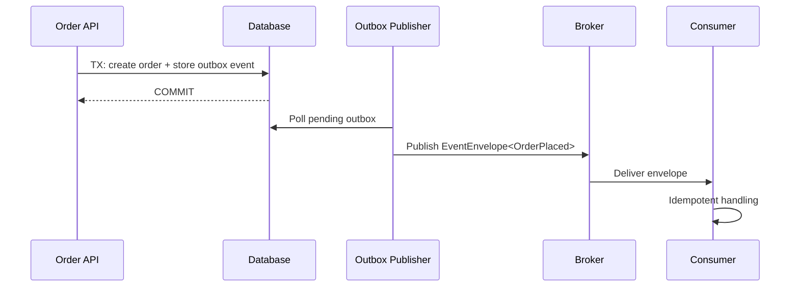

### Principles

1. Generate a stable domain event ID before writing to the outbox.
2. Store the event/envelope or enough data to reconstruct the **same logical event** inside the outbox transaction.
3. The publisher may retry without generating a new event ID on each attempt.
4. `envelopedAt` needs clear semantics: when the record was created or when the publish attempt occurred. If it changes on retry, do not use it as a dedup identity.
5. Consumers implement idempotency keys and conflict handling.
6. Outbox events are marked published via retry/ack mechanisms, without assuming the broker delivers exactly once.

A JSON envelope makes messages easier to interpret, but side effects are only safe with an appropriate **business transaction and recovery protocol**.

## 31. Splitter and Aggregator: Outer Metadata and Inner Group Headers

An order has three lines:

```text
OrderPlaced envelope (businessCorrelationId=order:shop-01:ORD-1042)
  |
  v
Splitter
  -> Line 1 (correlationId=split-G, sequenceNumber=1/3)
  -> Line 2 (correlationId=split-G, sequenceNumber=2/3)
  -> Line 3 (correlationId=split-G, sequenceNumber=3/3)
  |
  v
Aggregator
  -> OrderLineSummary
```

Children share the same **business correlation**, yet also have a **technical group correlation** created by the Splitter.

### Why Not Overwrite Technical Correlation?

If wrap/unwrap creates a new Spring Message setting only `businessCorrelationId`, it can strip the `correlationId`, `sequenceNumber`, and `sequenceSize` headers needed by the Aggregator.

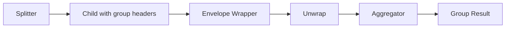

This requires careful design whenever an envelope sits **between a Splitter and an Aggregator**.

### Safe Options

- **Wrap before the Splitter:** children created by the Splitter carry group headers for the current flow.
- **Wrap after the Aggregator:** keep grouping internal and only envelope the final business result.
- **Use the envelope as child payload:** while preserving group headers in the Spring Message when not crossing a network.
- **Across a broker:** encode group ID and sequence index/size as versioned protocol fields, then rebuild validated headers in the inbound adapter.
- **Content-based correlation:** if the group key exists in the validated payload/envelope, the Aggregator can use a custom `CorrelationStrategy` instead of the Splitter's headers.

**Do not blindly copy all `MessageHeaders` over the network** just to keep `correlationId`, as this may carry reply/error channel objects or sensitive metadata. Define a dedicated allowlist for the required grouping fields.

### Filter Between Splitter and Aggregator

If a Filter drops a child without emitting a failure outcome, the Aggregator may never receive all N items. Envelope Wrapper cannot fix this loss. You need a completion/skip marker, a partial release policy, or structured failure of the entire group.

## 32. Gateway Request-Reply and Reply Routing

A `@MessagingGateway` can invoke a flow and wait for a result. When attaching Envelope Wrapper, you must decide how an outbound request envelope differs from an inbound reply envelope.

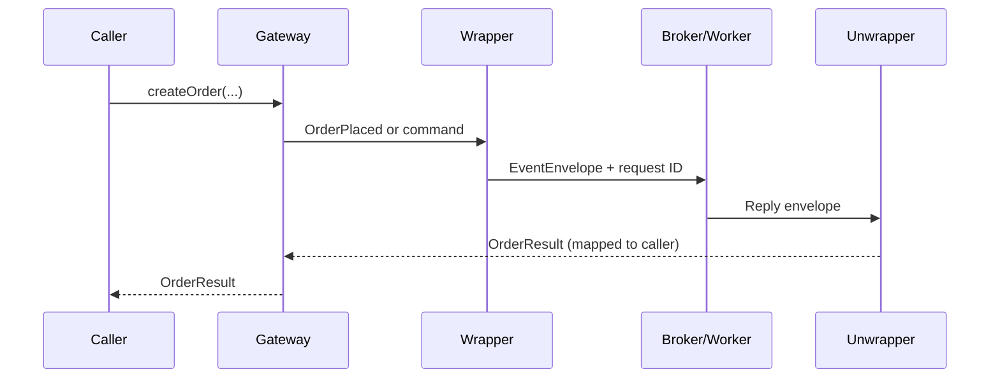

### Two Correlations That Must Not Be Confused

- **BusinessCorrelationId:** e.g. `order:shop-01:ORD-1042`, linking events about an order.
- **Request correlation:** a key mapping a reply to the exact waiting Gateway call, which can be a dedicated request ID.

If two clients both request a lookup for order `ORD-1042`, they may have **two different request IDs** while sharing the same business correlation ID. Do not use the business ID to distinguish individual pending requests.

### `ReplyChannel` Is Not a Portable Object

Inside a JVM, a Gateway can attach `replyChannel` to a Spring Message. Across a broker or a restart, a Java channel object cannot be transmitted to another service and keep its meaning.

For async request-reply:

1. Use protocol-level request/reply IDs and reply destinations.
2. Map the response to a live caller or a persistent request context.
3. Configure a reply timeout and handle late responses.
4. Do not confuse receiving a child message with the final reply.
5. Do not restore a stale `replyChannel` from an envelope or persisted original message.

For long-running workflows, returning an `ACCEPTED/PENDING` status and letting the caller query the result later may make more sense than holding a synchronous Gateway open.

## 33. Schema Evolution: Adding Metadata Without Breaking Old Consumers

Envelope Wrapper is a shared contract; changing it can impact many consumers.

### Common Changes

| Change | Risk | Approach |
| --- | --- | --- |
| Add optional `causationId` | Strict consumers reject unknown fields | Compatibility tests, schema policy |
| Change `schemaVersion` from int to string | Deserialization fails | Explicit versioning/migration |
| Rename `businessCorrelationId` | Tracing and grouping break | Time-bounded alias/migration |
| Change meaning of `occurredAt` | Wrong ordering/SLA | Change contract/version, do not change silently |
| Add `traceparent` | May contain untrusted baggage | Sanitize and limit size |
| Remove `eventId` | Dedup/replay loses stable ID | Change schema or reject |
| Add payload field | Old consumers may not recognize it | Backward compatibility rules |
| Change money from minor units to decimal | Business calculations break | New event schema version, explicit mapping |
| Change tenant namespace | Cross-tenant collision | Migration + ownership validation |

### Two Version Types May Need Independence

```text
envelopeSchemaVersion = 2
payloadSchemaVersion = 1
```

If envelope metadata is standardized across many event types, changes to the envelope schema and changes to `OrderPlaced` may happen independently. Having a single `schemaVersion` is fine if the contract treats envelope + payload as one versioned unit; just stay consistent.

### A Safe Migration Plan

1. Deploy consumers capable of reading both old and new schemas.
2. Roll out the new producer to a small percentage of traffic.
3. Monitor rejections/errors by `messageType/schemaVersion`.
4. Ensure DLQ/replay can still read older versions.
5. Only retire old versions after retention/replay windows expire or a migration strategy is in place.
6. Do not break event ID/correlation stability when changing serializers.

## 34. Multi-Source and Content-Based Correlation

When multiple sources emit order events, an envelope can standardize shared metadata:

```text
WEB_CHECKOUT
  payload=WebOrderV1
  -> Normalizer -> OrderPlaced
  -> Envelope(sourceSystem=WEB_CHECKOUT)

PARTNER_B2B
  payload=PartnerOrderV2
  -> Normalizer -> OrderPlaced
  -> Envelope(sourceSystem=PARTNER_B2B)
```

Two envelopes can share the same `orderId` while having different `sourceEventId/eventId` values. Having the same order ID **does not prove they are the same logical event**.

### Content-Based `CorrelationStrategy`

An Aggregator can group events by:

```text
GroupKey(tenantId, orderId, workflowRunId)
```

However, the demo envelope has no `workflowRunId`; if the application processes the same order multiple times, add that field or a verified coordinator ID.

### Do Not Use a Global Mutable “currentEnvelope”

When two sources emit interleaved events:

```text
A: order:shop-01:O-1
B: order:shop-02:O-2
A: order:shop-01:O-1
```

The Transformer must compute metadata **per message**, never storing the “current” source/tenant in a shared variable. The `OrderEnvelopeTransformer` class in the example uses an immutable bean-configured `sourceSystem` field and takes the tenant from the authenticated input, so it never updates a mutable `currentTenant` per request.

With multiple sources, each source can have a transformer instance configured with its own `sourceSystem`, or a factory can pick the source from a trusted context; never let the producer self-declare its source for privilege.

## 35. Concurrent Wrapping Test: Preserving Metadata per Message

A concurrency test should use multiple threads emitting events with different tenants/event IDs simultaneously, then check the **set of outputs** without forcing a global order.

### JUnit 5 Example

Add this method to `EnvelopeWrapperFlowTest` from Section 21:

```java
@Test
void concurrentWrapDoesNotMixTenantOrEventIdentity()
        throws Exception {

    var cases = java.util.List.of(
        new OrderPlaced("shop-01", "O-1", "EV-1",
            10L, "VND",
            Instant.parse("2026-11-21T00:00:00Z")),
        new OrderPlaced("shop-02", "O-2", "EV-2",
            20L, "VND",
            Instant.parse("2026-11-21T00:00:01Z")),
        new OrderPlaced("shop-03", "O-3", "EV-3",
            30L, "VND",
            Instant.parse("2026-11-21T00:00:02Z"))
    );

    var pool = java.util.concurrent.Executors
        .newFixedThreadPool(3);

    var ready = new java.util.concurrent.CountDownLatch(3);
    var start = new java.util.concurrent.CountDownLatch(1);

    var futures = new java.util.ArrayList<
        java.util.concurrent.Future<?>>();

    try {
        for (OrderPlaced order : cases) {
            futures.add(pool.submit(() -> {
                ready.countDown();

                if (!start.await(5,
                        java.util.concurrent.TimeUnit.SECONDS)) {
                    throw new IllegalStateException(
                        "Concurrent start timeout");
                }

                Message<OrderPlaced> input =
                    MessageBuilder.withPayload(order)
                        .setHeader(
                            "verifiedTenantId",
                            order.tenantId())
                        .build();

                assertTrue(rawInput.send(input));
                return null;
            }));
        }

        assertTrue(ready.await(
            5, java.util.concurrent.TimeUnit.SECONDS));

        start.countDown();

        for (var future : futures) {
            future.get(5, java.util.concurrent.TimeUnit.SECONDS);
        }

        var envelopesByEvent = new java.util.HashMap<
            String, EventEnvelope<OrderPlaced>>();

        for (int i = 0; i < cases.size(); i++) {
            Message<?> message = envelopesOut.receive(2_000);
            assertNotNull(message);

            @SuppressWarnings("unchecked")
            EventEnvelope<OrderPlaced> envelope =
                (EventEnvelope<OrderPlaced>) message.getPayload();

            assertNull(envelopesByEvent.put(
                envelope.metadata().eventId(), envelope));
        }

        for (OrderPlaced order : cases) {
            EventEnvelope<OrderPlaced> actual =
                envelopesByEvent.get(order.eventId());

            assertNotNull(actual);
            assertEquals(order, actual.payload());
            assertEquals(
                order.tenantId(),
                actual.metadata().tenantId());
        }

        assertEquals(cases.size(), envelopesByEvent.size());
    } finally {
        start.countDown();
        pool.shutdownNow();
    }
}
```

### What Does This Test Prove?

- Three threads can invoke the flow concurrently within one JVM.
- Event IDs and tenants are not mixed up.
- Retrieval of results does not rely on arrival order.
- The wrapper does not use a global mutable context for tenant/event.

**Does not prove:** that headers were attached by real authentication, broker round-trip, durability, multi-pod exactly-once, or fault tolerance. Those require appropriate test environments and adapters.

## 36. Observability: Envelopes Help Log Inspection Without Opening the Payload

When messages carry clear metadata, middleware can log useful fields:

```text
stage=ENVELOPE_CREATED
messageType=order.placed
schemaVersion=1
eventId=EV-1042
tenant=shop-01
sourceSystem=WEB_CHECKOUT
businessCorrelationId=order:shop-01:ORD-1042

stage=ENVELOPE_VALIDATED
eventId=EV-1042
schemaVersion=1
result=PASS

stage=BUSINESS_COMPLETED
eventId=EV-1042
operation=CREATE_ORDER
result=SUCCESS
```

These are illustrative application logs. Do not assume Spring Integration automatically emits this exact format.

### Recommended Metrics

| Metric | Question |
| --- | --- |
| `envelope.created` | How many events were wrapped? |
| `envelope.validated` | How many envelopes passed validation? |
| `envelope.rejected` | Are metadata/schema/tenant errors rising? |
| `envelope.unknown_type` | Is there a new unsupported `messageType`? |
| `envelope.unsupported_version` | Are producer/consumer versions out of sync? |
| `envelope.serialization_failed` | Are there codec/format failures? |
| `envelope.unwrap_failed` | Are there contract failures on unwrap? |
| `envelope.processing_latency` | How long from wrap/receive to processing? |
| `envelope.payload_size` | How much size does the wrapper add? |
| `envelope.duplicate_event` | How many logical events were redelivered? |
| `envelope.replay_attempts` | How many replay/recovery attempts occurred? |
| `envelope.error_backlog` | How many failed messages remain unhandled? |

Labels should be low-cardinality such as `messageType`, `schemaVersion`, `sourceSystem`, and `reasonCode`. Do not use `eventId`/`orderId`/`businessCorrelationId` as metric labels by default; they have high cardinality. Use structured logs and protected tracing to look up specific events.

### Do Not Confuse Envelope Creation with Committed Business Effects

```text
ENVELOPE_CREATED
   != BROKER_PUBLISHED
   != CONSUMER_RECEIVED
   != BUSINESS_COMMITTED
```

A wrapper only constructs data. Publishing, acknowledgement, and commit milestones must be tracked separately, especially when using retries and transactional outbox.

## 37. Performance: Envelopes Do Not Make Payloads Lighter

Suppose a JSON payload is 2 KB and metadata is 300 bytes. The envelope increases the message by about 300 bytes plus serialization overhead. For small events, this cost is acceptable in exchange for a unified contract.

However, for a 30 MB document:

```text
Before:
  payload = PDF bytes 30 MB

After Envelope Wrapper:
  metadata ~ hundreds of bytes
  payload  = PDF bytes 30 MB
```

Envelope Wrapper **does not remove large bytes** from a message. If the goal is to reduce file transfer size, consider **Claim Check** or an object storage reference:

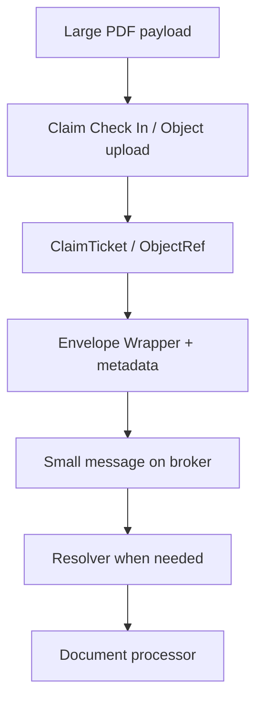

### Other Performance Impacts

- Serialization/deserialization adds CPU overhead.
- Envelopes increase bytes sent over the network/broker.
- Validating metadata/tenant/schema adds latency, which is a necessary cost for correctness/security.
- Generic JSON envelopes may require consumers to perform schema resolution.
- Too many nested wrappers increase payload overhead and complexity.
- At high throughput, enforce max message size, queue depth, and backpressure limits.

A performance test should measure:

1. Byte size before and after.
2. Serialization CPU and allocations.
3. P50/P95/P99 latency.
4. Validation/rejection rate.
5. Consumer lag when a new schema rolls out.
6. Impact of retries/redelivery and DLQ.
7. Amount of unnecessary data logged.

Do not optimize by removing validation or copying all metadata into unprotected headers.

## 38. When Is Envelope Wrapper Not Needed?

Not every system needs an explicit wrapper layer.

**It may be unnecessary** when:

- Messages stay within a single JVM where Spring `MessageHeaders` is enough.
- The payload is processed immediately by a single service.
- An existing schema already includes the needed metadata, so a new wrapper only duplicates fields.
- The team lacks versioning/trust/retention policies to govern the envelope.
- There is only one simple event type with no cross-service compatibility requirements.

**Consider using it** when:

- Multiple event types share the need for provenance, identity, and versioning.
- Multiple consumers use different languages/frameworks.
- Messages cross multiple broker/HTTP hops where header mapping is inconsistent.
- Contract tests and a schema registry are needed.
- Tracing/correlation/causation is needed across services.
- You want to separate business payloads from transport/operational metadata.

### Avoid Unnecessary Multi-Layer Wrapping

```text
Message<Envelope<Envelope<Envelope<OrderPlaced>>>>
```

If every downstream service adds a new wrapper, code becomes hard to read and it becomes unclear which envelope is authoritative. Usually you should **keep one canonical envelope**, emit new events at service boundaries with explicit causation/correlation, or record processing metadata in tracing/operational stores rather than nesting wrappers indefinitely.

## 39. Common Anti-Patterns

### 39.1. Treating Spring Message Headers and Envelope Body as the Same Thing

They have different lifecycles. Header mapping across a broker does not automatically match the JSON payload. Define which metadata is portable.

### 39.2. Using All HTTP Headers as Envelope Metadata

This can leak Authorization tokens, cookies, PII, and signed URLs, and creates coupling with clients. Only use an allowlist.

### 39.3. Treating `metadata.tenantId` as Proof of Access

External metadata can be spoofed. Always verify authenticated identity before processing.

### 39.4. Generating a New `eventId` on Every Retry

Idempotent Receiver cannot recognize the same logical event, potentially causing duplicate side effects. Event IDs must remain stable per contract.

### 39.5. Using `envelopedAt` as an Idempotency Key

Timestamps can differ on replay and therefore do not identify a logical event.

### 39.6. Overwriting Group `correlationId` with `businessCorrelationId`

Splitter/Aggregator can lose group identity and sequence contracts. Keep the two meanings separate.

### 39.7. Not Checking Duplicated Metadata/Payload Fields

One consumer reads tenant/eventId from the envelope while another reads from the payload, leading to divergent behavior. Validate consistency or remove duplicate fields if the contract permits.

### 39.8. Deserializing by Class Name from `messageType`

External data could choose unauthorized classes. Use a controlled schema/type registry allowlist.

### 39.9. Keeping Stale `replyChannel` Across a Broker

The Gateway may time out or replies may target an old context. Use a request/reply protocol with explicit correlation IDs and destinations.

### 39.10. Ignoring Schema Evolution

Abruptly adding a required metadata field can break older consumers. Run version/compatibility tests before deploying.

### 39.11. Using Envelope Wrapper to “Shrink File Sizes”

A wrapper does not offload the payload anywhere. Claim Check/ObjectRef is what offloads large data.

### 39.12. Having No Negative Tests

Testing only happy-path wrap/unwrap misses cross-tenant attempts, unsupported versions, mismatches, and invalid payloads.

### 39.13. Equating `eventId` with Order ID

A single order can have many events, corrections, and workflow runs. Keep logical event IDs separate from business entity IDs.

### 39.14. Failing to Distinguish Causation from Correlation

Causation points directly to the parent event, whereas correlation links an entire workflow; blindly setting them equal destroys flow traceability.

### 39.15. Stripping the Envelope Without Retaining Provenance on Unwrap

Downstream services lose `sourceSystem/eventId/version` and cannot retry or reconcile properly. Only discard fields that are no longer needed.

### 39.16. Storing Mutable Objects in the Envelope

A `List` or `byte[]` can be mutated after publishing without an immutability/deep-copy policy. Event contracts should be logically immutable.

## 40. Practice Exercise: Unifying an Envelope Across Multiple Event Types

**Context:** the `SPRING_INTEGRATION_PATTERN` module handles three events: `OrderPlaced`, `PaymentCaptured`, and `ShipmentDispatched`. Each has its own payload, yet must be traced, routed, and replayed using shared metadata.

### Part A — Contract Design

1. Define `EnvelopeMetadata` with `messageType`, `schemaVersion`, `eventId`, tenant, source, correlation, causation, and `occurredAt`/`envelopedAt`.
2. Define an immutable `EventEnvelope<T>`.
3. Define a domain payload such as `OrderPlaced`.
4. Decide which fields belong in the business payload and which belong in metadata.
5. Specify which source/tenant identity is verified at ingress.
6. Define the schema registry/allowlist for message types.
7. Specify required fields, optional fields, versioning, and failure codes.
8. Choose an event ID that remains stable across redeliveries.

### Part B — Spring Integration

9. Create `OrderEnvelopeTransformer.wrap`.
10. Create `OrderEnvelopeTransformer.unwrap`.
11. Configure Java DSL with `rawOrdersInput` and `envelopesOut`.
12. Configure the inbound unwrap flow with `wrappedOrdersInput` and `ordersOut`.
13. Ensure the wrapper does not copy stale reply/error channels.
14. Add a Router based on `metadata.messageType`.
15. Add Filter/validation to reject invalid schemas/tenants.
16. Integrate Idempotent Receiver using a stable event/business operation key.
17. If using Splitter/Aggregator, preserve the group ID and sequence.
18. Extend to other event types without permitting arbitrary class deserialization.

### Part C — Testing

19. Unit test that `wrap` leaves the domain payload unchanged.
20. Test `envelopedAt` using `Clock.fixed`.
21. Test `wrap -> unwrap` round-trip restoring the payload and appropriate business headers.
22. Test missing verified tenant header.
23. Test metadata tenant differing from authenticated tenant.
24. Test `metadata.eventId` differing from `payload.eventId`.
25. Test unsupported `messageType`/`schemaVersion`.
26. Test JSON serialization/deserialization with a typed schema.
27. Test interleaved multiple tenants/events without mixing.
28. Test concurrency without asserting global output order.
29. Test duplicates/replay without generating a new event ID per delivery.
30. Test header mappers across real Kafka/AMQP/HTTP adapters.

### Part D — Operations

31. Test broker redelivery after DB commit and before ACK.
32. Use an outbox when publishing events tied to DB transactions.
33. Separate Gateway reply ID from business correlation ID.
34. Design error channels/DLQs by reason code.
35. Limit max message size, attributes, and tracing baggage.
36. Measure serializer latency and wrapper size.
37. Test V1→V2 schema migration while older consumers are still running.
38. Store controlled raw message references for replay/quarantine.
39. Ensure tokens/PII are not logged in metadata.
40. Document a production checklist and ownership of the envelope schema.

### Expected Results Table

| Scenario | Expected outcome |
| --- | --- |
| Valid `OrderPlaced` | `EventEnvelope<OrderPlaced>` with accurate metadata |
| Wrap → unwrap | Business payload matches the original |
| Source tenant matches payload | Processing permitted |
| Source tenant differs from metadata/payload | Security rejection |
| Metadata `eventId` differs from payload | Contract error |
| Unsupported type/version | Quarantine/unsupported schema |
| `sourceSystem` from trusted configuration | Reliable provenance |
| Same event retried | Logical `eventId` unchanged |
| Different `envelopedAt` when re-wrapped | Not treated as a new event based on timestamp |
| Two concurrent tenants | Metadata not mixed |
| Broker header mapper drops headers | Envelope body preserves defined portable metadata |
| Splitter group 1..N | Group/sequence metadata stays compliant with contract |
| Gateway two callers on same order | Replies route by request ID, not solely order ID |
| 30 MB payload | Wrapper does not offload bytes; consider Claim Check |
| New JSON schema | Compatibility/version handling tested |

## 41. Self-Assessment Questions

**Q1.** How does Envelope Wrapper differ from Header Enricher?

*Header Enricher primarily adds metadata to Spring `MessageHeaders`; Envelope Wrapper creates a structured payload containing both metadata and the original payload, which can be serialized into a cross-service contract.*

**Q2.** Why can we not simply take `replyChannel` from a Spring Message and put it into a JSON envelope?

*Because `replyChannel` can be an internal JVM object/context with no portable meaning across a broker, restart, or another language.*

**Q3.** Can `metadata.tenantId` sent by a client be trusted?

*No. The tenant must be determined from an authenticated context and cross-checked against metadata/payload.*

**Q4.** Why is `eventId` different from `businessCorrelationId`?

*`eventId` identifies a single logical event; `businessCorrelationId` links events belonging to a workflow or business entity.*

**Q5.** When a retry creates a new envelope with a different `envelopedAt`, is it a new event?

*No, as long as the logical `eventId` and business meaning remain the same event; the wrapping timestamp is not the event's identity.*

**Q6.** Should `metadata.messageType` be used as a Java class name to deserialize via reflection?

*No. Use a controlled allowlist/schema registry mapping.*

**Q7.** Why can unwrapping after a Splitter cause an Aggregator to wait forever?

*If unwrapping creates a new Message that drops group/sequence headers, the Aggregator cannot recognize all children of the group. Grouping fields must be preserved or reconstructed per contract.*

**Q8.** Does Envelope Wrapper reduce the size of a large PDF document?

*No. It adds metadata around the payload. To offload large payloads, use Claim Check or an object storage reference.*

**Q9.** Is an event having the same `causationId` and `businessCorrelationId` always wrong?

*Not always wrong as data, but they have two distinct meanings; each should be computed according to actual causal relationships and workflow scope rather than defaulted to the same value.*

**Q10.** Does an envelope guarantee exactly-once processing by itself?

*No. It provides identity/provenance, while transactions, outbox, idempotency, acknowledgements, and recovery determine whether side effects are duplicated or lost.*

## 42. Production Readiness Checklist

- **Domain separation:** metadata does not turn business payloads into transport-specific DTOs.
- **Typed envelope:** `EventEnvelope<T>` has required fields and validation.
- **Schema:** explicit message type/version, schema registry/allowlist.
- **Trust boundary:** tenant/source derived from trusted identity.
- **Consistency:** metadata and payload match on event/tenant/timestamp per policy.
- **Correlation:** business correlation is separate from technical group correlation and request IDs.
- **Causation:** store parent event ID when a true causal relationship exists.
- **Event ID:** stable across retries; do not arbitrarily use `MessageHeaders.id`.
- **Time:** distinguish `occurredAt`, `envelopedAt`, and processing/commit time.
- **Transport:** JSON/Avro/Protobuf schemas and header mappings are tested.
- **Security:** never serialize credentials, signed URLs, unnecessary PII, or reply channels.
- **Serialization:** cross-language round-trip, `Instant`, large integers, and null handling.
- **Router:** route only on permitted message types.
- **Filter:** validation errors separated from business-rule filtering.
- **Normalizer:** source-specific payloads converted to canonical models before wrapping when appropriate.
- **Content Enricher:** enrich domain fields at the right boundary without fabricating metadata.
- **Idempotency:** keyed per logical operation, with duplicate/conflict handling.
- **Splitter/Aggregator:** preserve group/sequence fields across wrappers/brokers.
- **Gateway:** separate request/reply IDs; never retain stale `replyChannel`.
- **Retry:** distinguish transient errors from invalid schema/tenant errors.
- **Error handling:** DLQ reason codes, raw message references, and replay policy.
- **Outbox:** emit events safely when tied to DB business transactions.
- **Schema evolution:** V1/V2 compatibility and retention/replay tests.
- **Concurrency:** stateless wrapper, no mutable shared `currentTenant`/`currentEvent`.
- **Performance:** byte overhead, serializer CPU, bounded queues, and backpressure.
- **Observability:** useful metadata without putting high-cardinality IDs into metric labels.
- **Tests:** wrap/unwrap, tenant mismatch, schema errors, serialization, interleaving, retry, and commit.
- **Ownership:** a designated team owns the envelope contract, security, and migrations.

## 43. Conclusion

**Envelope Wrapper adds metadata around a payload** so a message carries the information integration needs — event type, schema version, source, tenant, event ID, business correlation, causation, and timestamps — without forcing every domain payload to manage these operational concerns itself.

In Spring Integration, Envelope Wrapper is typically implemented with a **Transformer** producing `Message<EventEnvelope<T>>`; when the business payload is needed, a validated **unwrap** step converts it back to `Message<T>`. Do not confuse a portable envelope in the serialized body with internal `MessageHeaders`, and do not blindly copy headers like `replyChannel` or `errorChannel` across system boundaries.

A good wrapper does more than “add a few JSON fields”: it establishes a **contract, source of truth, authentication, versioning, consistency checks, correlation/idempotency semantics, error/retry policies, and tests**. Once these are clearly defined, Router, Filter, Transformer, Splitter, Aggregator, and Gateway flows can exchange events across multiple sources and services consistently, observably, and extensibly.
