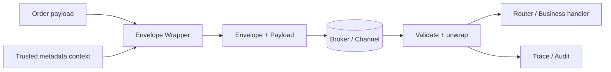
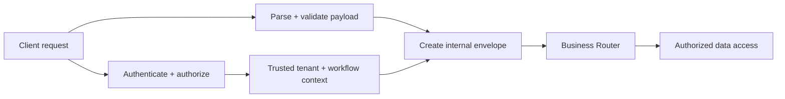
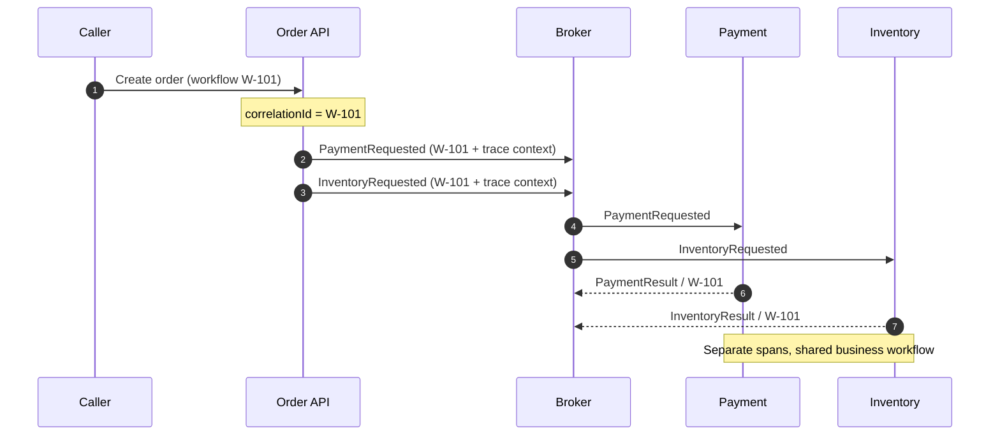
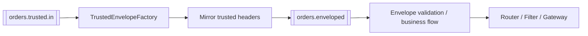
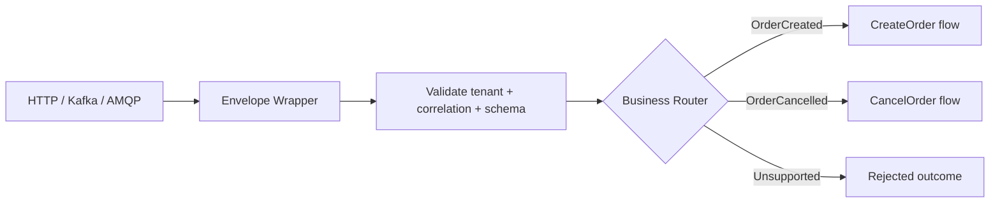
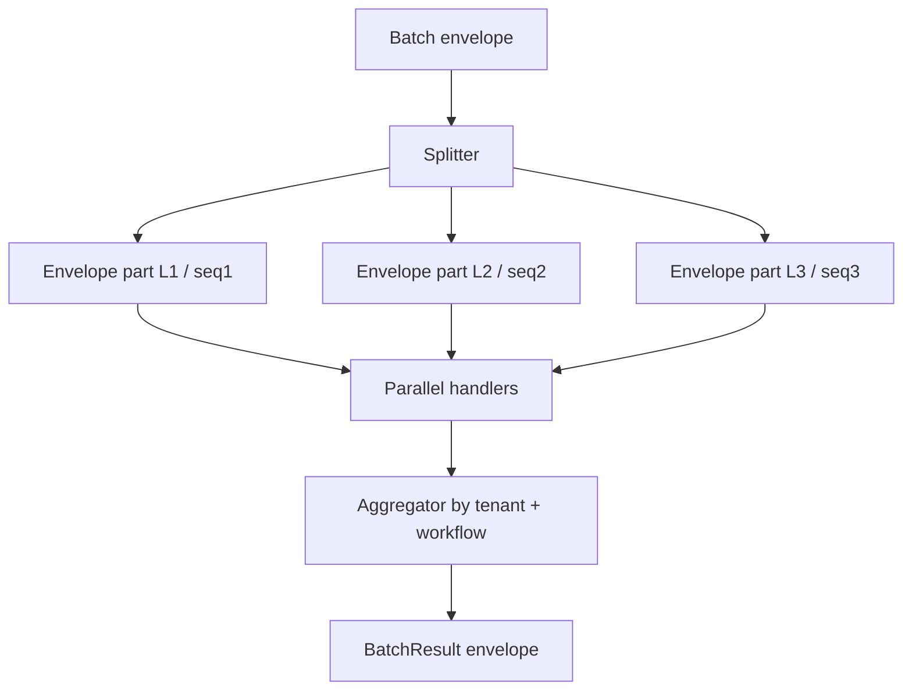
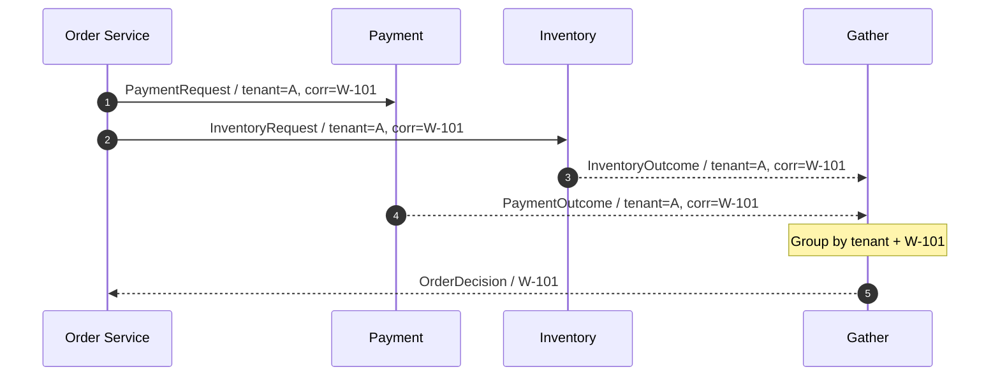
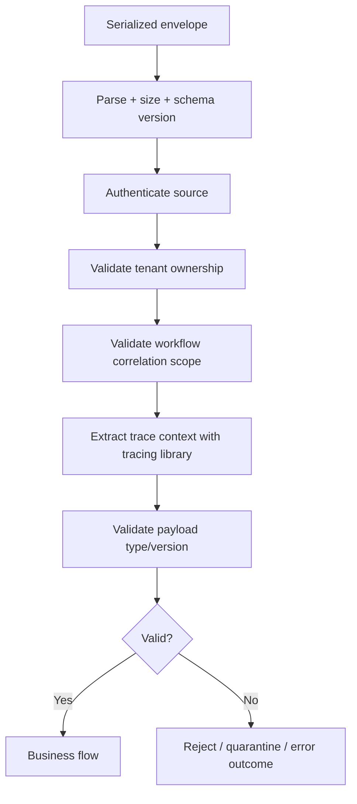
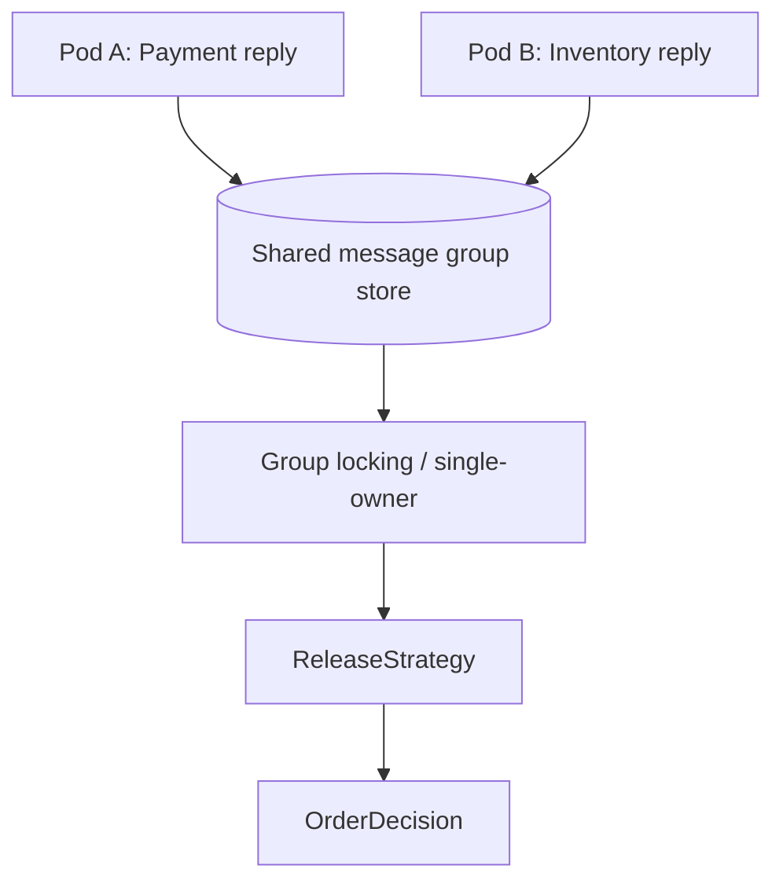

# Envelope Containing Correlation, Tenant, and Trace Information

An e-commerce system receives an order-creation request over HTTP, sends an inventory-check command over Kafka, receives the result from Inventory, and then aggregates it with the Payment result using Spring Integration. Each service may generate its own `Message<?>`, message ID, and trace/span. Yet all steps still belong to the **same business workflow**, a single **tenant**, and a processing chain that must be observed. If that information only sits scattered in transport-specific headers, it can be lost or misinterpreted after a Router, Transformer, broker adapter, or retry.

**Envelope Wrapper** in **Enterprise Integration Patterns (EIP)** packages the **business payload** alongside a **metadata layer with an explicit contract**. An envelope can carry a **correlation identifier**, **tenant identifier**, **trace context**, version, source, and permitted control fields so the receiver knows which flow the message belongs to, under what scope it is authorized to execute, and how to link the trace to preceding steps. Upon receipt, the receiver validates the envelope and maps the payload into an appropriate internal model.

The lesson **“Envelope Containing Correlation, Tenant, and Trace Information”** belongs to the **Envelope wrapper** chapter of module `SPRING_INTEGRATION_PATTERN`. Its goal is to teach implementing Enterprise Integration Patterns with Spring Integration to build loosely coupled, extensible message flows; practicing Router, Filter, Transformer, Splitter, Aggregator, Gateway, retry, error channel, and correlation, while knowing how to test and observe each processing branch.

> **Core Principle:** **An envelope carries metadata, but does not prove the metadata is trustworthy by itself.** A self-declared `tenantId` from a client does not replace authorization; `correlationId` is not automatically an idempotency key; `traceparent` is not automatically a group identity; and a message with valid JSON envelope syntax does not mean business processing has completed. The system must specify **who issues, who may modify, how to validate, and how to propagate** each field.

## 1. What Problem Does Envelope Wrapper Solve?

Suppose a Producer sends a command:

```json
{
  "orderId": "ORD-101",
  "quantity": 2
}
```

In a simple system, this payload is enough to call a service. In a multi-service flow, however, the receiver also needs:

- **Correlation:** which workflow/request/batch does this command belong to?
- **Tenant:** under which tenant authorization and data partition is the command processed?
- **Trace:** which span/trace is this operation associated with across multiple services?
- **Schema version:** does the payload follow contract v1 or v2?
- **Source:** which system created or forwarded the message, and has it been authenticated?
- **Message/event identity:** is this a new logical event or a replayed copy?

An envelope can look like:

```json
{
  "envelopeVersion": 1,
  "metadata": {
    "correlationId": "flow-51edc234",
    "tenantId": "TENANT-A",
    "source": "order-api",
    "eventId": "evt-8ef2c",
    "traceparent": "00-4bf92f3577b34da6a3ce929d0e0e473-00f067aa0ba902b7-01"
  },
  "payload": {
    "orderId": "ORD-101",
    "quantity": 2
  }
}
```

This is an **illustrative application-defined schema**, not a default JSON format mandated by Spring Integration or W3C. The `eventId` and `traceparent` fields are included to distinguish **message identity** and **trace context** from **business correlation**.



### 1.1. Envelope and Payload Have Different Roles

| Component | Example data | Used for |
| --- | --- | --- |
| **Envelope** | `correlationId`, `tenantId`, `traceparent`, `envelopeVersion` | Group identity, security context, trace propagation, protocol contract. |
| **Payload** | `orderId`, `quantity`, `sku` | Business logic of the command or event. |
| **Transport headers** | HTTP `Content-Type`, Kafka headers, AMQP properties | Adapter/serializer and routing at the transport boundary. |
| **Spring MessageHeaders** | `id`, `timestamp`, `contentType`, `replyChannel`, `errorChannel`, `correlationId` | Message metadata in the Spring Messaging runtime. |
| **Business state** | Has the order already been paid/shipped? | Authoritative business source in DB/service, not wholly contained in the envelope. |

**The goal is to reduce transport coupling.** Once HTTP, Kafka, and AMQP are normalized into an internal envelope, business handlers do not need to parse HTTP's `X-Correlation-ID` or Kafka's byte-array headers themselves.

### 1.2. What Does Envelope Wrapper Not Do by Itself?

It does **not** automatically:

- Authenticate the sender's identity and authorize per tenant.
- Guarantee that the same `correlationId` belongs to the same legitimate workflow.
- Make a workflow run synchronously or sequentially.
- Deduplicate, ensure exactly-once delivery, or commit transactions.
- Produce valid traces/spans if tracing instrumentation is absent.
- Ensure schema compatibility or confidentiality simply by “wrapping” the payload.
- Make the broker, database, and external API commit atomically together.

An envelope is a **contract for representing and carrying metadata**. Those guarantees come from security boundaries, state stores, transactions, retry policies, tracing frameworks, and business logic.

## 2. Model of a Minimal Envelope

Two groups of data should be separated: **metadata with shared rules** and **domain-specific payload**.

```text
Envelope
├── envelopeVersion
├── metadata
│   ├── correlationId
│   ├── tenantId
│   ├── source
│   ├── eventId
│   └── traceparent (optional)
└── payload
    ├── orderId
    └── quantity
```

### 2.1. Which Fields Should Be Required?

| Field | Required in example | Source of authority |
| --- | --- | --- |
| `envelopeVersion` | Yes | Producer/adapter protocol/schema contract. |
| `correlationId` | Yes | Issued by workflow/ingress or restored from a trusted record. |
| `tenantId` | Yes | Authenticated principal/tenant mapping, never blindly taken from client. |
| `source` | Yes | Authenticated producer/adapter identity. |
| `eventId` | Yes | Issued once per logical event by event producer or workflow. |
| `traceparent` | No | Tracing instrumentation/context propagation. |
| `payload` | Yes | Command/event after schema validation. |

Not every system needs `eventId`; some use `operationId`, `messageType`, or `generation`. The table above reflects **this exercise's design choices**, not a mandatory EIP list.

### 2.2. Is Using One Identity for Everything Dangerous?

If `correlationId=ORD-101` is used for everything:

```text
Tenant A, order ORD-101, verification generation 1
Tenant B, order ORD-101, verification generation 1
Tenant A, order ORD-101, verification generation 2
```

there is a risk of mixing messages between **two tenants** or **two processing runs**. When scopes must be separated, the internal correlation key can be:

```text
(tenantId, orderId, workflowGeneration)
```

or a server-issued unique `workflowId` with a **durable mapping to tenant and business operation**. Do not rely solely on a correlation string “looking random” to skip ownership checks.

## 3. `correlationId`: Messages in the Same Conversation

**Correlation Identifier** answers:

> Which **workflow/group/request** does this message belong to?

Example of an order verification run:

```text
OrderVerification workflow W-101
  ├── PaymentRequested    correlationId=W-101
  ├── InventoryRequested  correlationId=W-101
  ├── PaymentResult       correlationId=W-101
  └── InventoryResult     correlationId=W-101
```

Two different replies can have different `eventId` values yet share the **same correlation ID**. An Aggregator can use the correlation ID to group the results accurately.

### 3.1. Distinguishing Identifier Types

| Identifier | Question | Can it replace `correlationId`? |
| --- | --- | --- |
| **Spring `MessageHeaders.ID`** | Which message instance is this? | Not by default; new messages usually get new IDs. |
| **`eventId`** | Which logical event is this? | Not by default; one workflow has many events. |
| **`operationId`** | Which side-effecting operation is this? | Not by default; one workflow has many operations. |
| **`correlationId`** | Which messages belong to the same workflow/group? | This is the core of correlation. |
| **`causationId`** | Which message/event directly caused this event? | Different; causal links can span multiple groups. |
| **`traceId`** | Which spans are linked in a distributed trace? | Different; can change on retry/sampling. |
| **`spanId`** | Which specific execution step within a trace? | No; typically changes at every step. |
| **`tenantId`** | Which security boundary/customer does the data belong to? | No; each tenant has many workflows. |
| **Idempotency key** | Has this same side effect already been performed? | No; must be bound to operation/consumer. |
| **Routing key** | Which channel/partition should the message go to? | No; the same group can traverse multiple branches. |

### 3.2. Correlation Remains Stable Across Retries, Which Does Not Mean Trace Is Immutable

```text
W-101:
  Payment attempt 1 timeout
  Payment attempt 2 succeeds
  Inventory attempt 1 succeeds
```

All attempts still belong to the **same workflow W-101**. If a network attempt is retried, **`correlationId` usually stays the same** so results are grouped properly; however, the trace/span may acquire new spans, or even a new trace during a later batch replay. **Do not generate a new `workflowId` on every technical retry**, unless the business genuinely starts a new workflow.

### 3.3. When Does a Business Group Need a Generation?

If a customer edits an order and requests re-verification, an old reply may arrive after a new reply:

```text
order ORD-101, generation 1: Payment APPROVED (late)
order ORD-101, generation 2: Inventory AVAILABLE
```

Do not put both replies into the same Aggregator group merely because `orderId` matches. Add `workflowGeneration` or issue a unique `workflowId` per business cycle, and keep that identity across retries of that specific cycle.

## 4. `tenantId`: A Data Isolation Boundary, Not a Self-Sufficient Claim

An envelope contains:

```json
{
  "metadata": {
    "tenantId": "TENANT-A",
    "correlationId": "W-101"
  }
}
```

but JSON can be arbitrarily modified by a client. Therefore, **`tenantId` inside the envelope is not by itself proof of permission to read/write that tenant's data**.

### 4.1. Trusted Ingress Establishes Tenant Context

A request:

```text
HTTP client
  → TLS / authentication
  → authenticated identity + tenant membership
  → request body validation
  → server-created TrustedTenantContext
  → Envelope Wrapper
  → internal message/broker
```

If the body includes `tenantId`, the system can cross-check it against the authenticated tenant, **never using the body as the sole source of authority**.



### 4.2. Separating Protection Layers

| Layer | Responsibility |
| --- | --- |
| **Inbound authentication** | Identify the sender, user/service identity. |
| **Tenant authorization** | Verify the caller is permitted to act on the tenant. |
| **Envelope validation** | Non-empty tenant, valid format/version, belongs to the same trusted workflow. |
| **Business access** | Data access always enforces tenant isolation, not relying solely on headers. |
| **Group/MessageStore** | Correlation groups, claims, and idempotency keys scoped by tenant/generation when needed. |
| **Observability** | Mask/hide sensitive IDs, limit cardinality. |

A message with a valid envelope **can still be rejected** because the user/service lacks permission; a valid trace **does not replace auth**.

### 4.3. How Dangerous Is Cross-Tenant Mixing?

If the Aggregator group key is only `correlationId=W-101`, two tenants might accidentally or maliciously send the same ID:

```text
TENANT-A / W-101 / Payment APPROVED
TENANT-B / W-101 / Inventory AVAILABLE
→ Must not be combined into A's result!
```

Choose a scoped correlation key, such as `(tenantId, workflowId)`, and validate that the reply source belongs to the corresponding tenant/workflow. Do not rely on `traceId` to distinguish tenants.

## 5. Trace Information: `traceparent`, `tracestate`, and `baggage`

In distributed tracing, a request traversing multiple services consists of **spans**. Systems typically propagate trace context via standard headers, including **W3C Trace Context**:

```text
traceparent:
  00-4bf92f3577b34da6a3ce929d0e0e473-00f067aa0ba902b7-01
```

Conceptually, its parts are:

- `00`: version of the `traceparent` format.
- `4bf9...e473`: trace ID (32 hex characters).
- `00f0...2b7`: parent span ID (16 hex characters).
- `01`: trace flags.

This example is an **illustrative trace context**, not a secret token or a business correlation key.

### 5.1. Trace ID Differs from Correlation ID



A trace can span many spans, yet an entire workflow does not necessarily have a **single trace** if a task lasts several hours, is rescheduled, or is replayed. Meanwhile, a correlation ID can be **durably persisted with the workflow** for business purposes.

### 5.2. Should `traceparent` Be Embedded in the Envelope Body?

There are two approaches:

1. **Wire/protocol headers:** HTTP headers, Kafka/AMQP carriers; tracing instrumentation extracts/injects context. This is usually the natural integration with Micrometer Tracing/OpenTelemetry.
2. **Envelope metadata in the body:** useful if a transport/format lacks reliable headers, or when context must be recorded at a boundary. However, it must be **synchronized with the tracing context managed by instrumentation**, avoiding manually assigning arbitrary trace/span values to the current thread.

If both are used, define **one authoritative source and a mismatch policy**; never let a spoofed body `traceparent` override the trusted tracing infrastructure's context without validation.

### 5.3. Do Not Manually Generate a `traceId` on Every Message Handoff

Code that generates a UUID inside every Transformer:

```java
String traceId = java.util.UUID.randomUUID().toString();
```

is not proper distributed tracing. It breaks span linkage and fails to handle parent-child context. Let **Micrometer Tracing/OpenTelemetry instrumentation** manage span context and inject/extract via properly versioned and configured carriers/headers; the envelope can hold a **controlled representation** if the application needs it.

### 5.4. `tracestate` and `baggage` Need a Privacy Policy

`tracestate` can carry vendor-specific trace metadata; `baggage` propagates key/value pairs with the context and can travel across many services. Do not put secrets, access tokens, emails, customer data, or tenant PII into baggage without an explicit policy. **Baggage is not a security context**; a baggage value like `tenantId=ADMIN` grants no privileges.

### 5.5. Is External Network Trace Context Trustworthy?

An HTTP caller can send a self-crafted `traceparent`. Tracing libraries may accept a remote parent after parsing, depending on policy. However:

- The value may be malformed and must be validated.
- Callers can partially influence observable trace context/correlation.
- Guard against log injection and limit data in `tracestate`/`baggage`.
- Never use a trace ID to look up a tenant record while skipping authorization.
- Never treat `sampled=1` as a mandate to log all sensitive payloads.

When trace context is missing or invalid, the system can **start a new root trace** according to tracing policy; the business message can still be valid if tracing is optional in the contract.

## 6. Body Envelope Differs from Spring Integration `MessageHeaders`

Spring Messaging represents a message with **payload and headers**:

```text
Message<T>
  ├── payload: T
  └── headers: MessageHeaders
```

Envelope Wrapper can be realized in two ways:

| Approach | Example | When to use |
| --- | --- | --- |
| **Body envelope** | `Message<IntegrationEnvelope<OrderCommand>>` or JSON with `metadata` + `payload`. | Cross-service protocols, storage/replay, multi-language consumers. |
| **Header-only wrapper** | `Message<OrderCommand>` with `correlationId`, `trustedTenantId`, and trace context in headers. | Internal Spring Integration flows, unified adapter/header mapping. |
| **Controlled hybrid** | Body envelope + selected mirrored Spring headers. | When some EIPs/adapters read headers while the wire contract requires a body envelope. |

**No single choice fits every system.** What matters is **a single source of authority** for each metadata item and a policy when the two representations disagree.

### 6.1. Key Spring Messaging Headers to Know

```java
import org.springframework.integration.IntegrationMessageHeaderAccessor;
import org.springframework.messaging.MessageHeaders;

// Standard header names in Spring Messaging:
String contentType = MessageHeaders.CONTENT_TYPE;
String reply = MessageHeaders.REPLY_CHANNEL;
String error = MessageHeaders.ERROR_CHANNEL;

// Headers for correlation/sequence in Spring Integration:
String correlation =
    IntegrationMessageHeaderAccessor.CORRELATION_ID;
String sequenceNumber =
    IntegrationMessageHeaderAccessor.SEQUENCE_NUMBER;
String sequenceSize =
    IntegrationMessageHeaderAccessor.SEQUENCE_SIZE;
```

`MessageHeaders.ID` identifies a **technical message**, and should not replace a durable `workflowId`. `replyChannel`/`errorChannel` belong to **runtime routing**; never accept arbitrary channel names from external JSON over the network.

### 6.2. Mirroring to Headers Must Be Consistent

If the envelope payload has `correlationId=W-101` while the Spring header has `correlationId=W-999`, an Aggregator may group by the header differently from what auditing reads in the body.

An invariant should be defined:

```text
If trusted correlation exists in body and header:
    header.correlationId == envelope.metadata.correlationId
Else:
    reject mismatch / derive both from one trusted value
```

When tenant exists in both body and header, run **tenant mismatch validation** and use the trusted context. Do not let one layer arbitrarily “prefer the header” while another layer “prefers the body”.

### 6.3. Avoid Dropping Headers When a Transformer Builds a New Message

In an internal flow, a Transformer may create a new `Message<?>`. Which headers are preserved depends on message creation, endpoints, and adapters. Test propagation for:

- Correlation/sequence from Splitter/Aggregator.
- Trusted tenant context.
- Stable event/operation identity.
- Reply/error channels created by Gateway/runtime.
- Trace propagation managed by tracing instrumentation.

**Blindly copying all headers is not recommended.** At external ingress, use an **allowlist**; in internal flows, preserve required trusted headers under an explicit contract.

## 7. Designing Envelope Versions and Payload Schemas

A wire envelope has two levels of versioning:

```json
{
  "envelopeVersion": 1,
  "metadata": {
    "correlationId": "W-101",
    "tenantId": "TENANT-A",
    "source": "order-api",
    "eventId": "EVT-101",
    "traceparent": null
  },
  "payloadType": "OrderCreated",
  "payloadSchemaVersion": 2,
  "payload": {
    "orderId": "ORD-101",
    "lines": [
      {"sku": "PEN-01", "quantity": 2}
    ]
  }
}
```

This example adds `payloadType` and `payloadSchemaVersion` to illustrate schema evolution:

- **Envelope version** changes when the metadata/wrapper structure changes.
- **Payload schema version** changes when the event/command structure changes.
- **Payload type** lets the receiver select the right parser/DTO branch.
- **Trace context** is optional; do not mark a business message invalid simply because tracing was not sampled or is absent.

Do not treat `application/json` as proof that all payloads share the same schema: JSON is only a **format**.

### 7.1. Version-Aware Receiver

```text
Raw message
  → Validate envelopeVersion
  → Validate and authenticate metadata
  → Select payloadType + payloadSchemaVersion
  → Deserialize/transform to canonical DTO
  → Validate business command
  → IntegrationFlow
```

If the version is unsupported, produce a **terminal rejected outcome/quarantine** or perform migration rather than forcing deserialization into another DTO and hoping it succeeds.

### 7.2. Do Not Deserialize Arbitrary Classes from `payloadType`

`payloadType` comes from input and can be tampered with:

```json
{"payloadType":"java.lang.Runtime","payload":{ }}
```

Do not pass that string class name to `Class.forName(...)` to deserialize arbitrarily. Map an **allowlisted enum/type ID → fixed parser/DTO**. In Java/Jackson, avoid enabling broad polymorphic deserialization on untrusted data.

### 7.3. When Changing Schemas, Correlation Must Remain Stable

During a rolling deployment, producer v1 uses `workflowId`, while producer v2 renames it to `correlationId`. If the receiver lacks migration mapping/version-aware parsing, the same workflow can be split into two groups. Standardize a **canonical correlation identity** and test data from both versions during the compatibility window.

## 8. Java Example: Envelope Wrapper with Trusted Context

The following example models **a trusted ingress that has authenticated the sender**. In the lab, the adapter/controller builds `TrustedIngressContext` from the principal and workflow service before calling `EnvelopeFactory`. Never let a client send arbitrary JSON to deserialize directly into `TrustedIngressContext` and treat it as trusted.

We define:

- `ExternalOrderRequest`: client-submitted data, which may claim an invalid tenant.
- `TrustedIngressContext`: tenant, workflow, and event identity **issued or verified by the system**.
- `OrderCommand`: validated internal DTO.
- `EnvelopeMetadata`: correlation, tenant, source, event, and optional `traceparent`.
- `IntegrationEnvelope<T>`: wrapper containing metadata and payload.
- `TrustedInboundOrder`: technical input fed into Spring Integration by a **trusted adapter**.

### 8.1. DTOs and Basic Invariants

```java
// ExternalOrderRequest.java
public record ExternalOrderRequest(
    String claimedTenantId,
    String orderId,
    int quantity
) {}
```

```java
// OrderCommand.java
public record OrderCommand(String orderId, int quantity) {
    public OrderCommand {
        if (orderId == null || orderId.isBlank()
                || quantity < 1 || quantity > 100) {
            throw new IllegalArgumentException(
                "Invalid order command");
        }
    }
}
```

```java
// TrustedIngressContext.java
public record TrustedIngressContext(
    String tenantId,
    String correlationId,
    String eventId,
    String source,
    String traceparent
) {
    public TrustedIngressContext {
        if (tenantId == null || tenantId.isBlank()
                || correlationId == null || correlationId.isBlank()
                || eventId == null || eventId.isBlank()
                || source == null || source.isBlank()) {
            throw new IllegalArgumentException(
                "Trusted context is incomplete");
        }
        // traceparent may be null; trace extraction/validation
        // belongs to instrumentation/trusted adapter.
    }
}
```

```java
// EnvelopeMetadata.java
public record EnvelopeMetadata(
    String correlationId,
    String tenantId,
    String eventId,
    String source,
    String traceparent
) {
    public EnvelopeMetadata {
        if (correlationId == null || correlationId.isBlank()
                || tenantId == null || tenantId.isBlank()
                || eventId == null || eventId.isBlank()
                || source == null || source.isBlank()) {
            throw new IllegalArgumentException(
                "Invalid envelope metadata");
        }
    }
}
```

```java
// IntegrationEnvelope.java
import java.util.Objects;

public record IntegrationEnvelope<T>(
    int envelopeVersion,
    EnvelopeMetadata metadata,
    T payload
) {
    public IntegrationEnvelope {
        if (envelopeVersion != 1) {
            throw new IllegalArgumentException(
                "Unsupported envelope version");
        }
        Objects.requireNonNull(metadata, "metadata");
        Objects.requireNonNull(payload, "payload");
    }
}
```

### 8.2. Adapter Converting External Data into Authenticated Input

```java
// TrustedInboundOrder.java
public record TrustedInboundOrder(
    ExternalOrderRequest request,
    TrustedIngressContext context
) {}
```

**Invariant to uphold:** `TrustedIngressContext` must not be constructed from self-declared headers/fields **without passing authentication, tenant ownership, and workflow validation**. In this example, we construct the context directly in JUnit to illustrate the boundary; in production it must connect to Spring Security/principal or service identity.

### 8.3. Factory Building the Envelope from One Authoritative Source

```java
// TrustedEnvelopeFactory.java
import java.util.Objects;

public final class TrustedEnvelopeFactory {

    public IntegrationEnvelope<OrderCommand> wrap(
            TrustedInboundOrder input) {
        Objects.requireNonNull(input, "input");
        ExternalOrderRequest request =
            Objects.requireNonNull(input.request(), "request");
        TrustedIngressContext trusted =
            Objects.requireNonNull(input.context(), "context");

        // The client may omit tenant; if sent, it
        // must not contradict the authenticated identity.
        if (request.claimedTenantId() != null
                && !request.claimedTenantId()
                    .equals(trusted.tenantId())) {
            throw new IllegalArgumentException(
                "TENANT_MISMATCH");
        }

        OrderCommand command = new OrderCommand(
            request.orderId(), request.quantity());

        EnvelopeMetadata metadata = new EnvelopeMetadata(
            trusted.correlationId(),
            trusted.tenantId(),
            trusted.eventId(),
            trusted.source(),
            trusted.traceparent());

        return new IntegrationEnvelope<>(
            1, metadata, command);
    }
}
```

**Step by step:**

1. The factory uses **`trusted.tenantId()`**, never `request.claimedTenantId()` as the primary data source.
2. If the client claims a different tenant, the factory **fails closed** with code `TENANT_MISMATCH`.
3. `OrderCommand` enforces invariants on order ID/quantity, failing before business side effects.
4. Correlation and event ID from the context are copied **verbatim**, without generating a new UUID on every retry/deserialization.
5. `traceparent` is copied only from the **trusted tracing context normalized by the adapter**. The factory **does not parse/initialize spans itself**, nor replace Micrometer/OpenTelemetry.
6. `envelopeVersion=1` informs the receiver which envelope structure is in use.

In a real product, use **typed exceptions/error codes**, stricter handling of sensitive data, schema versions, and field limits; this example focuses on **clarifying the source of authority**, not replacing authentication/validation frameworks.

### 8.4. Why Not Derive Correlation from `MessageHeaders.ID`?

`MessageHeaders.ID` can change when a converter builds a message or a broker redelivers through a new adapter. If a workflow ID must stay stable across attempts, it should be **issued once** and persisted alongside business state/commands rather than depending on technical IDs freshly created in each JVM.

### 8.5. Can a Generation Be Added?

Yes. If the same order undergoes multiple processing cycles, envelope metadata can carry `workflowGeneration`, `workflowId`, or `operationId`. However, do not arbitrarily pile on IDs lacking semantic contracts. Define **group scope and idempotency scope** first, then finalize the schema.

## 9. Spring Integration Java DSL: Wrapping Before the Business Flow

We create a flow that receives `TrustedInboundOrder` on an internal channel protected by the adapter. The factory builds `IntegrationEnvelope<OrderCommand>`. Then **two authenticated internal headers are mirrored** for downstream Aggregators/Routers:

- Header `correlationId` matching `envelope.metadata.correlationId`.
- Header `trustedTenantId` matching `envelope.metadata.tenantId`.

Trace context remains **managed separately by tracing instrumentation**, rather than trying to force `traceparent` as the current span via header enrichment alone.

```java
// EnvelopeFlowConfiguration.java
import org.springframework.context.annotation.Bean;
import org.springframework.context.annotation.Configuration;
import org.springframework.integration.IntegrationMessageHeaderAccessor;
import org.springframework.integration.channel.QueueChannel;
import org.springframework.integration.config.EnableIntegration;
import org.springframework.integration.dsl.IntegrationFlow;

@Configuration
@EnableIntegration
public class EnvelopeFlowConfiguration {

    @Bean
    TrustedEnvelopeFactory trustedEnvelopeFactory() {
        return new TrustedEnvelopeFactory();
    }

    @Bean("orders.enveloped")
    QueueChannel envelopeOutput() {
        return new QueueChannel(32);
    }

    @Bean
    IntegrationFlow wrapOrderAtTrustedIngress(
            TrustedEnvelopeFactory factory) {
        return IntegrationFlow.from("orders.trusted.in")
            .transform(TrustedInboundOrder.class, factory::wrap)
            .enrichHeaders(headers -> headers
                .headerFunction(
                    IntegrationMessageHeaderAccessor.CORRELATION_ID,
                    message -> ((IntegrationEnvelope<?>)
                        message.getPayload())
                        .metadata().correlationId())
                .headerFunction(
                    "trustedTenantId",
                    message -> ((IntegrationEnvelope<?>)
                        message.getPayload())
                        .metadata().tenantId()))
            .channel("orders.enveloped")
            .get();
    }
}
```

### 9.1. Flow Diagram



**Reading the configuration:**

1. `orders.trusted.in` is a **trusted internal input channel**, not accepting arbitrary raw HTTP headers.
2. `.transform(...)` creates the **body envelope** from data/identity authenticated by the adapter.
3. `.enrichHeaders(...)` synchronizes the application-selected headers **from the already built envelope**.
4. `orders.enveloped` is a `QueueChannel` for tests to inspect output; it does not provide a consumer or durability on its own.
5. The subsequent business flow must **validate envelope/header invariants** and enforce the proper tenant/correlation scope during processing.

**API Caveat:** The example illustrates common `transform(Class, ...)` and `headerFunction(...)` overloads of the Spring Integration Java DSL. Verify the actual module's API/version and converters before use; STEP 4 NEW does not run Gradle or specialized Content QA.

### 9.2. Header Propagation at Boundaries Must Be Tested

Spring Integration propagates/copies certain message headers across endpoints. The code above is **not a firewall that strips raw untrusted headers across every adapter**. Trusted adapters must **sanitize/allowlist before sending to `orders.trusted.in`**, and at other boundaries you must test propagation + metadata reconciliation against your runtime version.

To strip specific headers, use a **Header Filter** or build a new message from **allowlisted metadata** with configuration preventing unapproved header propagation. Do not strip `replyChannel`/`errorChannel` created by an internal Gateway without understanding request–reply semantics.

### 9.3. How Does a Body Envelope Fit with Brokers?

When publishing to Kafka/RabbitMQ:

1. Serialize `IntegrationEnvelope<OrderCommand>` to a **wire schema** (e.g., versioned JSON).
2. Use a configured converter/serializer.
3. Set content type/schema headers matching the **actual representation**.
4. Tracing instrumentation injects propagation context into the broker carrier.
5. Ensure event ID, correlation, and tenant semantics are preserved.
6. The receiver deserializes against an **allowlisted type/version** and verifies source/tenant ownership.

Do not assume Java `record` types are automatically deserialized by services in other languages. **Wire format and in-memory object are two distinct contracts.**

## 10. JUnit 5: Tenant Is Not Overwritten, Correlation Is Preserved

### 10.1. Unit Test for the Factory

```java
// TrustedEnvelopeFactoryTest.java
import static org.junit.jupiter.api.Assertions.*;

import org.junit.jupiter.api.Test;

class TrustedEnvelopeFactoryTest {

    private final TrustedEnvelopeFactory factory =
        new TrustedEnvelopeFactory();

    private static TrustedIngressContext trustedContext() {
        return new TrustedIngressContext(
            "TENANT-A",
            "W-101",
            "EVT-101",
            "order-api",
            "00-4bf92f3577b34da6a3ce929d0e0e473-"
                + "00f067aa0ba902b7-01");
    }

    @Test
    void wrapsBusinessPayloadWithTrustedMetadata() {
        TrustedInboundOrder input = new TrustedInboundOrder(
            new ExternalOrderRequest(
                "TENANT-A", "ORD-101", 2),
            trustedContext());

        IntegrationEnvelope<OrderCommand> envelope =
            factory.wrap(input);

        assertEquals(1, envelope.envelopeVersion());
        assertEquals("TENANT-A", envelope.metadata().tenantId());
        assertEquals("W-101", envelope.metadata().correlationId());
        assertEquals("EVT-101", envelope.metadata().eventId());
        assertEquals("order-api", envelope.metadata().source());
        assertEquals("ORD-101", envelope.payload().orderId());
        assertEquals(2, envelope.payload().quantity());
        assertNotNull(envelope.metadata().traceparent());
    }

    @Test
    void neverAcceptsAnotherTenantClaim() {
        TrustedInboundOrder spoofed = new TrustedInboundOrder(
            new ExternalOrderRequest(
                "TENANT-B", "ORD-101", 2),
            trustedContext());

        IllegalArgumentException failure = assertThrows(
            IllegalArgumentException.class,
            () -> factory.wrap(spoofed));

        assertEquals("TENANT_MISMATCH",
            failure.getMessage());
    }

    @Test
    void rejectsInvalidCommandBeforeBusinessHandling() {
        TrustedInboundOrder invalid = new TrustedInboundOrder(
            new ExternalOrderRequest(
                "TENANT-A", "ORD-101", -3),
            trustedContext());

        assertThrows(IllegalArgumentException.class,
            () -> factory.wrap(invalid));
    }
}
```

The unit tests show that **tenant, correlation, event ID, and trace metadata** come from `TrustedIngressContext`; a mismatched tenant field in the request is rejected before constructing the canonical envelope.

**Limitations:** The test does not prove `TrustedIngressContext` was supplied by real Spring Security, does not prove `traceparent` was validated by a tracing provider, and does not verify broker serialization or multi-instance behavior.

### 10.2. Integration Test for Java DSL and Mirrored Headers

```java
// EnvelopeFlowTest.java
import static org.junit.jupiter.api.Assertions.*;

import org.junit.jupiter.api.Test;
import org.springframework.beans.factory.annotation.Autowired;
import org.springframework.context.ApplicationContext;
import org.springframework.integration.IntegrationMessageHeaderAccessor;
import org.springframework.integration.channel.QueueChannel;
import org.springframework.messaging.Message;
import org.springframework.messaging.MessageChannel;
import org.springframework.messaging.support.MessageBuilder;
import org.springframework.test.context.junit.jupiter.SpringJUnitConfig;

@SpringJUnitConfig(EnvelopeFlowConfiguration.class)
class EnvelopeFlowTest {

    @Autowired ApplicationContext context;

    @Test
    void keepsCorrelationAndTenantConsistent() {
        TrustedIngressContext trusted =
            new TrustedIngressContext(
                "TENANT-A", "W-202", "EVT-202",
                "order-api", null);

        TrustedInboundOrder input = new TrustedInboundOrder(
            new ExternalOrderRequest(
                "TENANT-A", "ORD-202", 3),
            trusted);

        MessageChannel channel = context.getBean(
            "orders.trusted.in", MessageChannel.class);
        assertTrue(channel.send(
            MessageBuilder.withPayload(input).build()));

        QueueChannel output = context.getBean(
            "orders.enveloped", QueueChannel.class);
        Message<?> received = output.receive(0);
        assertNotNull(received);

        assertInstanceOf(
            IntegrationEnvelope.class, received.getPayload());
        IntegrationEnvelope<?> envelope =
            (IntegrationEnvelope<?>) received.getPayload();

        assertEquals("W-202",
            envelope.metadata().correlationId());
        assertEquals("TENANT-A",
            envelope.metadata().tenantId());

        assertEquals(
            envelope.metadata().correlationId(),
            received.getHeaders().get(
                IntegrationMessageHeaderAccessor.CORRELATION_ID));
        assertEquals(
            envelope.metadata().tenantId(),
            received.getHeaders().get("trustedTenantId"));

        assertNull(envelope.metadata().traceparent());
        assertNull(output.receive(0));
    }
}
```

**What the test proves:** Input to the trusted integration channel is wrapped into an envelope and metadata **matches between the body and the two selected Spring headers**. The test does not prove raw HTTP headers will be stripped in a separate adapter; **separate transport/security adapter tests** are needed for that.

### 10.3. Test for Inconsistent Metadata Errors

A receiver may receive both a body envelope and a `correlationId` header. Add a validation step:

```java
// EnvelopeConsistencyValidator.java
import java.util.Objects;
import org.springframework.integration.IntegrationMessageHeaderAccessor;
import org.springframework.messaging.Message;

public final class EnvelopeConsistencyValidator {

    public void verify(Message<?> message) {
        if (!(message.getPayload()
                instanceof IntegrationEnvelope<?> envelope)) {
            throw new IllegalArgumentException(
                "EXPECTED_ENVELOPE");
        }
        String expected =
            envelope.metadata().correlationId();
        Object actual = message.getHeaders().get(
            IntegrationMessageHeaderAccessor.CORRELATION_ID);

        if (!Objects.equals(expected, actual)) {
            throw new IllegalArgumentException(
                "CORRELATION_MISMATCH");
        }
        Object actualTenant =
            message.getHeaders().get("trustedTenantId");
        if (!Objects.equals(
                envelope.metadata().tenantId(), actualTenant)) {
            throw new IllegalArgumentException(
                "TENANT_MISMATCH");
        }
    }
}
```

This validator is intended for **a contract requiring both body and headers to carry values**. A receiver using only the wire body might not have Spring headers after deserialization; in that case, the adapter must **re-derive them from one authoritative source** before using the validator or define a body-only mode. **Never arbitrarily “prefer whichever came first”** when two sources conflict.

### 10.4. Testing Invariants Under Retry

```text
Attempt 1:
  correlationId=W-202
  eventId=EVT-202
  traceparent=trace-A

Attempt 2: retry of the same logical event
  correlationId=W-202
  eventId=EVT-202
  traceparent=trace-B (may differ if a new trace context is started)
```

If the contract represents the same logical event, **correlation and event ID should remain stable**, even though trace context may change. Tests should not assert byte-for-byte identical envelopes when instrumentation creates a new span; assert the **business identity invariants** that must stay stable.

## 11. What Do Router, Filter, and Transformer Do with an Envelope?

A Normalizer/Envelope Wrapper is often placed **before a business Router** so every branch receives the same schema. However, not every Router needs all metadata.



### 11.1. Route by Payload Type, Not by Arbitrary Tenant

A Router can inspect `payloadType` to pick the corresponding branch, but:

- Accept only payload types on an **allowlist**.
- Do not use `metadata.source` or `tenantId` strings as arbitrary **Spring channel/bean names**.
- Distinguish **message type** from **event identity**; many events of the same type still belong to different workflows.
- Define an unmatched/default route for unsupported commands.
- Never use `traceparent` as a business routing key.

### 11.2. A Filter After an Envelope Can Drop a Group Outcome

```text
Workflow W-101 sends Payment + Inventory
  PaymentResult arrives, valid
  InventoryResult arrives, Filter drops it because status=OUT_OF_STOCK

Aggregator only receives PaymentResult
→ waits forever if release requires both roles
```

If `OUT_OF_STOCK` is a **valid business outcome**, the Filter should not drop it. Emit a **terminal outcome** `INVENTORY=OUT_OF_STOCK` carrying the same tenant/workflow correlation so the Aggregator returns `REJECTED`. A Filter should only drop messages when the business contract permits missing replies or has an expiry/partial policy.

### 11.3. Transformer Changes Payload Without Arbitrarily Changing Identity

A flow can convert:

```text
IntegrationEnvelope<OrderCreatedV1>
     → Versioned Transformer
IntegrationEnvelope<OrderCommand>
```

During the transformation, preserve **trusted `tenantId`, `correlationId`, and `eventId`** for the same logical event. If a step creates a **new event** (for instance, `OrderAccepted` emitted from `OrderCreated`), it may need a **new `eventId`**, while keeping the **original workflow's `correlationId`** and optionally adding `causationId` referencing the prior event.

**Rule:** Distinguish **transforming the same logical message** from **creating a new business event**. Do not reuse an old event ID for a brand-new event if the identity contract requires unique event IDs, and do not mint a new event ID merely because of deserialization/retry.

### 11.4. Content Enricher Must Not Overwrite Tenant from a Remote Reply

A Content Enricher calls a Customer/Inventory API. If the external service returns:

```json
{"tenantId":"TENANT-B","customerTier":"GOLD"}
```

while the original envelope has `tenantId=TENANT-A`, do not overwrite the tenant metadata automatically. Separate:

- **Trusted tenant context** of the workflow.
- **Domain tenant field** in the response, which must be cross-checked.
- **Trace context** of the remote call, which does not change business ownership.

On mismatch, the safe reaction is usually **reject/quarantine/technical investigation**, not switching the flow to another tenant.

### 11.5. Normalizer Can Precede or Follow Envelope Wrapper

Two common patterns:

**A. Normalize first, wrap second:**

```text
Raw JSON/XML/CSV
  → parse/normalize into OrderCommand
  → validate
  → Envelope Wrapper using trusted context
  → business flow
```

**B. Wrap raw payload first, normalize inside:**

```text
Raw bytes
  → envelope with media type + trusted metadata
  → Format Router/Transformer
  → validated IntegrationEnvelope<OrderCommand>
```

Both can be valid if **wire schema, content type, error handling, and header trust** are explicit. Pattern A typically gives the business flow a canonical payload immediately. Pattern B can help when ingesting multiple formats over transport, provided you never confuse a “wrapped” envelope with a “validated” one.

## 12. Splitter, Aggregator, and Resequencer: Scope of the Envelope

### 12.1. One Root Envelope, Many Parts

A batch has three lines:

```text
Envelope:
  tenantId = TENANT-A
  correlationId = BATCH-101
  payload.lines = [L1, L2, L3]

Splitter:
  Part 1: correlation=BATCH-101, seq=1/3, line=L1
  Part 2: correlation=BATCH-101, seq=2/3, line=L2
  Part 3: correlation=BATCH-101, seq=3/3, line=L3
```

Spring Integration's Splitter can populate `correlationId`/`sequenceNumber`/`sequenceSize` based on the original message and configuration. **Do not assume the Splitter-assigned group ID equals the business `correlationId` in the envelope**. If you need to aggregate by business batch across retries/replays, define an explicit correlation strategy and preserve verified metadata.



### 12.2. An Aggregator Key Is More Than a Correlation String

A group key can use a **typed key**:

```java
public record EnvelopeGroupKey(
    String tenantId,
    String correlationId
) {}
```

With a validated envelope payload, a correlation strategy can be expressed as:

```java
// Illustrative DSL snippet for Aggregator, not a complete flow.
// .aggregate(spec -> spec
//     .correlationStrategy(message -> {
//         IntegrationEnvelope<?> envelope =
//             (IntegrationEnvelope<?>) message.getPayload();
//         return new EnvelopeGroupKey(
//             envelope.metadata().tenantId(),
//             envelope.metadata().correlationId());
//     })
//     .releaseStrategy(requiredOutcomesReleaseStrategy)
//     .outputProcessor(envelopeBatchProcessor))
```

This **illustrates correlation responsibility**, not a standalone runnable bean. `requiredOutcomesReleaseStrategy` and `envelopeBatchProcessor` must be implemented by the application to check duplicates, roles, expected parts, terminal errors, timeouts, and output schemas.

When using a persistent `MessageGroupStore`, typed keys need stable serialization and equality across versions; sometimes a canonical string or durably issued UUID is preferable. A durable `MessageGroupStore` does not guarantee cross-tenant isolation if the correlation strategy is flawed.

### 12.3. An Envelope Does Not Know When All Replies Have Arrived

A group contains:

```text
PAYMENT APPROVED
PAYMENT APPROVED (duplicate)
INVENTORY has not replied yet
```

The group has two messages, yet **not both required roles**. Sharing the same `correlationId` only guarantees they are **related to the group**. The release strategy must wait for **distinct Payment + Inventory outcomes**, not just `group.size() >= 2`.

### 12.4. Resequencer Preserves Part Order, Not Order Derived from Trace

If parts arrive `2,3,1`, a Resequencer needs **sequence metadata** per group/part. `traceId` is not an order, nor is `timestamp` reliable due to clock skew and concurrency. During wrap/unwrap:

- Preserve `sequenceNumber` and `sequenceSize` issued by a trusted Splitter.
- Preserve group identity/tenant scope.
- Never assign `sequenceNumber` by **message arrival order**.
- Define policies for gaps, duplicates, and late parts.

### 12.5. Nested Splitters Need Nested Correlation Scopes

A file contains many orders, and each order has many lines:

```text
Outer group: (tenantId, fileId, fileGeneration)
Inner group: (tenantId, fileId, orderId, orderGeneration)
```

An envelope with only a flat `correlationId` **cannot express both levels by itself**. You may need `parentCorrelationId`/`causationId` or a typed context per level. Do not use the outer correlation ID as the inner Aggregator's key, or lines from all orders could get mixed together.

## 13. Scatter–Gather, Recipient List, and Publish–Subscribe

### 13.1. Recipient Replies Sharing a Workflow



An envelope lets all replies carry **consistent grouping metadata** even when Payment and Inventory have different payloads. Still, recipients can have independent schemas, retries, and timeouts. Gather must:

- Determine **required/selected recipients** based on the actual request.
- Validate `source/role` from an authenticated recipient.
- Group by **tenant + workflow**, not trace ID alone.
- Deduplicate/reconcile by `eventId` or an appropriate identity.
- Separate terminal rejections from technical failures.
- Have an expiry/late-result policy and prevent double finalization.

### 13.2. A Broadcast Event Shares Correlation but Has Different Consumer Identities

Publish–Subscribe broadcasts an event to:

```text
Audit Consumer
Search Index Consumer
Notification Consumer
```

All three may see the same `correlationId` and `eventId`, yet **each consumer has its own side effect**. Do not use a global `eventId` dedup key that marks the event “processed” as soon as Audit finishes, blocking Search and Notification.

For an Idempotent Receiver, a key can be:

```text
(consumerName, tenantId, eventId)
```

This represents the **identity of processing an event at a specific consumer**, distinct from the workflow-wide `correlationId`.

### 13.3. Recipient List Does Not Make Metadata Self-Trustworthy

If an external producer claims:

```json
{"metadata":{"source":"payment","tenantId":"TENANT-A"}}
```

that **does not prove** the message actually came from the Payment service. Broker ACLs, service identity, signatures where needed, and producer→role mappings must be verified before using `source` to release Gather.

## 14. Gateway and `replyChannel`: Two Types of Correlation

A Java Gateway can hide messaging details:

```java
import org.springframework.integration.annotation.MessagingGateway;

@MessagingGateway(defaultRequestChannel = "orders.command.in")
interface OrderGateway {
    OrderReceipt submit(OrderCommand command);
}

// OrderReceipt is application-defined;
// a real request–reply flow is needed to produce the response.
```

In Spring Integration, the **Gateway reply path** can use the internal `replyChannel` header or other reply-routing mechanisms. Meanwhile, the **business correlation ID** in the envelope can link requests, subcommands, and replies across transports. **These two mechanisms can be related, but they are not the same.**

### 14.1. A Correct Gateway Flow Needs Two Invariants

1. **Business group invariant:** Payment/Inventory replies belong to the same tenant/workflow and never mix with another order.
2. **Reply path invariant:** the final result can be returned to the exact waiting caller or recorded in a status store if the caller has timed out.

If a Normalizer/Transformer creates a new message and **loses the trusted `replyChannel`** when the Gateway expects a synchronous reply, the caller may time out even though the Aggregator produced `OrderResult`. Conversely, if it **copies `replyChannel` from untrusted external input**, it can create security/routing bugs into unauthorized channels.

### 14.2. Timeouts Are Not Equivalent

| Timeout | What happened? | What cannot be concluded |
| --- | --- | --- |
| Gateway reply timeout | The caller stopped waiting for a reply. | Whether the handler/DB rolled back or committed. |
| Broker send timeout | No send confirmation per transport contract. | Whether the broker received the message earlier. |
| Aggregator group timeout | Required outcomes did not arrive within the window. | Whether workers stopped processing. |
| HTTP/DB dependency timeout | Remote call did not finish on time at the caller. | Whether the remote side effect committed. |
| Business deadline | Workflow exceeded its allowed limit. | Whether data/claims/late replies were cleaned up. |

An operation retried after a Gateway timeout should preserve the **business correlation and idempotency identity** of the same logical request. The tracing framework can create a new span, but **never treat a new trace ID as a new business command**.

### 14.3. Replies After Timeout

```text
T0: submit workflow W-101, caller is waiting
T1: Gateway timeout
T2: Payment/Inventory arrive, Aggregator produces OrderDecision
T3: Caller resubmits the same operation
```

Do not rely solely on an old `replyChannel` that may no longer have a receiver. A durable workflow should have a **state/result store** keyed by tenant/workflow/operation, allowing callers to query status or retry and receive the accurate result without duplicating side effects.

## 15. Idempotent Receiver: Correlation Is Not Duplicate Detection

An envelope may contain all three:

```text
correlationId = W-101  # Same workflow
eventId = EVT-101      # Same logical event
operationId = PAY-101  # A specific payment side effect, if applicable
```

A workflow consists of many events with **different event IDs**. If an Idempotent Receiver uses `correlationId` as its sole key, it might process the first event and drop subsequent valid events in the same group.

### 15.1. Choosing Keys by Handler Type

| Handler | Typically suitable key |
| --- | --- |
| Search projection | `(consumerName, tenantId, eventId)` |
| Payment capture | `(tenantId, operationType, paymentOperationId)` |
| Reserve inventory line | `(tenantId, orderId, generation, lineId, operationType)` |
| Batch part handler | `(consumerName, batchId, generation, partId)` |
| Correlation group | `(tenantId, workflowId)` — **not a general idempotency key**. |

A key is only meaningful alongside the producer's identity contract and the corresponding business operation. `eventId` may need to be scoped by producer if global uniqueness is not guaranteed.

### 15.2. First-Seen Is Not Committed

Even if an event is received for the first time and a metadata store marks it “seen”, the handler may crash before the DB commits:

```text
mark SEEN
    → business handler
    → crash before commit
    → redelivery treated as duplicate
    → business effect lost
```

Within a local database transaction, **write the processed key and business state in the same transaction**, using unique constraints and joint rollback. For side effects outside the DB, provider idempotency, outbox, or reconciliation is required. Envelopes do not solve atomicity or exactly-once on their own.

### 15.3. A Retry with a New Event ID Violates the Identity Contract

If an HTTP caller resends `OrderCreated` with a new event ID on every timeout, key-only deduplication by `eventId` will miss the duplicate operation. You need a stable `operationId` issued before the first attempt, or a durable business identity/command key. Envelopes should **preserve**, not invent, new identities for the same logical operation.

## 16. Claim Check: Tokens and Envelopes Serve Two Purposes

For large payloads:

```text
Large document payload
  → Claim Check In → claim token
  → Envelope{tenant, correlation, trace, claimToken}
  → Router/Approval
  → Claim Check Out → original document
```

**Claim token** references stored data; **correlation ID** links the workflow; **tenant** scopes authorization; **trace** aids observability. They **do not replace each other**.

### 16.1. How Does an Envelope Carrying a Claim Token Help?

- Branches that do not need the blob can route using trusted metadata.
- The system can record approvals/audits without transferring the entire document.
- The check-out service knows the authenticated tenant/purpose to enforce authorization.
- Traces link check-in, approval, and check-out steps.

### 16.2. When Should a Claim Be Cleaned Up?

Do not delete it merely because the envelope passed Approval or one consumer retrieved the document. If retries or a Recipient List still need the claim, premature deletion leaves the token pointing to missing data. Establish **business completion + retention/lease/ownership policies**, and never allow a client holding a claim token to read another tenant's data.

### 16.3. Content Type of the Token Differs from the Original Payload

The envelope carries `claimToken` in a JSON/string schema; the original could be PDF/XML/zip. Do not copy `contentType=application/pdf` from the original onto the token and cause consumers to parse the token as a PDF. Upon Check Out, metadata describing the original representation must be restored or retrieved from a trusted claim record.

## 17. Transport Boundaries: Envelopes Over HTTP, Kafka, AMQP, and JMS

### 17.1. HTTP

A REST request may include:

```text
POST /orders
Authorization: Bearer ...
Content-Type: application/json
traceparent: 00-...-...-01
X-Correlation-ID: client-request-reference

Body:
  {"orderId":"ORD-101","quantity":2}
```

**Do not blindly copy `Authorization`, `X-Correlation-ID`, or all HTTP headers into the business envelope.** A safe contract:

1. The HTTP boundary enforces size limits, parses JSON, and authenticates.
2. The security layer determines the current authorized tenant.
3. The workflow service issues or restores a **trusted `correlationId`**.
4. Tracing instrumentation extracts/validates trace context from the HTTP carrier.
5. The wrapper builds metadata from these verified sources.
6. The business `IntegrationFlow` processes the canonical payload.

If `X-Correlation-ID` is a client-supplied request reference, store it **separately from the business workflow ID** after validating length/format and ownership. Never let a client pick an Aggregator group ID belonging to another tenant.

### 17.2. Kafka

A Kafka message has **value bytes** and **headers**; headers like `correlationId` or `traceparent` may be represented as `byte[]`. A wire envelope in the message value helps consumers in multiple languages share a schema, yet does not guarantee:

- That the Kafka header mapper preserves every field automatically.
- That the value deserializer knows every envelope version.
- That `eventId` is preserved by the producer across retries/re-publishes.
- That ordering across multiple partitions matches ordering within a business workflow.
- That a tenant inside the value suffices for authorization.

A design might choose:

```text
Kafka key:
  tenantId + businessPartitionKey (canonical, contains no secrets)

Kafka headers:
  tracing propagation per instrumentation
  contentType/schema metadata if required by adapter

Kafka value:
  serialized envelopeVersion + metadata + payload
```

If the partition key contains tenant/business IDs, consider metadata exposure via logs/broker ACLs. **Kafka offset is a transport position**, not event identity or correlation. On consumer redelivery, an adapter may generate a new Spring `MessageHeaders.ID`, yet must still preserve the **event/operation identity inside the envelope**.

### 17.3. RabbitMQ/AMQP

AMQP has properties like `contentType`, `contentEncoding`, and headers. After the Spring AMQP adapter/message converter, the content may be `byte[]`, String, or a DTO.

Test:

- Which headers map from AMQP to Spring Messaging?
- Which carrier extracts/injects `traceparent`/correlation?
- Does `contentType` describe the **wire envelope JSON** or the inner payload?
- When the converter fails, how does the adapter ack/nack/requeue/DLT?
- Can anyone from an external transport set an internal `replyChannel`?

**Do not confuse the AMQP correlation ID property** with the business correlation contract if producers can set it arbitrarily or if the adapter uses it for a different request–reply protocol.

### 17.4. JMS

JMS has `JMSCorrelationID`, `JMSMessageID`, and message properties. Despite similar names, their **scopes do not automatically match** `metadata.correlationId` in the envelope. If mapping is needed, define and test an explicit conversion rule:

```text
Trusted JMSCorrelationID
    → canonical business correlation?
    → only when permitted by producer contract and security policy
```

Do not deserialize arbitrary Java objects from untrusted JMS messages based solely on a class-name header. Prefer schema-based data formats and converter allowlists.

### 17.5. File/SFTP and Offline Batches

A batch file may contain many envelopes. Determine:

- Is the envelope version on **each record** or in the **file header**?
- Is correlation the **`batchId`** or each **record's `workflowId`**?
- Does tenant come from the **file source/ACL** or an inner field? What happens on conflict?
- Does `traceparent` exist? For offline data, a new trace can start when reading the file.
- When reprocessing the same file, are stable event/operation identities reused?

**Do not assign a single new trace ID and treat all records as one business group.** Batch correlation and per-order correlation can differ.

## 18. Envelope Validation and Error Classification

### 18.1. What Should a Trusted Envelope Receiving Boundary Check?



**Step order** can vary by transport: HTTP authentication usually happens before DTO parsing; on a broker, consumer identity/ACLs may be known upon receipt. The core rule is **never letting invalid/unauthorized metadata reach side effects**.

### 18.2. Error and Retryability Table

| Scenario | Classification | Recommended reaction |
| --- | --- | --- |
| Unparseable JSON envelope | Permanent input error. | Reject/400/quarantine/DLT per adapter. |
| Unsupported `envelopeVersion` | Contract error. | Quarantine/migration/upgrade; do not retry the same bytes indefinitely. |
| Missing required `correlationId` | Schema/identity error. | Reject or repair via an authoritative source; never place into a shared catch-all group. |
| `tenantId` mismatches authenticated context | Authorization/ownership violation. | Deny, audit; never leak another tenant's data. |
| Body correlation differs from trusted Spring header | Metadata conflict. | Reject/quarantine; never pick one source at random. |
| Malformed `traceparent` when trace is optional | Trace propagation error. | Can start a new trace per policy; do not automatically reject valid business requests unless required. |
| `eventId` already processed with terminal outcome | Duplicate operation. | ACK/no-op or replay stored result; do not re-run side effects. |
| Same event/operation ID with different payload | Identity conflict. | Reject/quarantine/reconcile per business contract. |
| Broker/DB unreachable | Technical transient error. | Retry/backoff/budget; do not treat the envelope as invalid. |
| Payload schema v2 arrives at consumer v1 | Version compatibility error. | Consumer migration, quarantine, or compatible reader. |
| Gateway reply timeout expires | Caller deadline. | Query status/retry with stable operation identity. |
| Aggregator missing a required reply | Incomplete workflow. | Timeout/partial/failure policy and late-result handling. |

### 18.3. Error Channel Differs from Rejected Outcome

In Spring Integration, an `ErrorMessage` is a **technical error-routing mechanism tied to topology/adapters**. In synchronous flows, exceptions may **propagate back to the sender**; with pollers/async adapters, exceptions may route to `errorChannel` if configured properly. Do not assume every envelope validation error automatically reaches a global error channel.

A rejected envelope should have a **machine-readable error code**:

```json
{
  "status": "REJECTED",
  "errorCode": "TENANT_MISMATCH",
  "requestRef": "opaque-request-101",
  "retryable": false
}
```

This is an **application-defined error schema**. Do not include raw tokens, full security headers, or payloads containing customer information. In async flows, rejected results need a **destination with a consumer, retention, and ack policy**, not just a declared channel name.

### 18.4. Poison Messages and Retry Storms

An event with `envelopeVersion=999` or an unauthorized tenant will not become valid after retries. If a Kafka/AMQP consumer keeps requeueing it, the system can hold onto a bad record forever and stall the pipeline.

You should:

- Separate **permanent invalid** from **transient unavailable**.
- Apply bounded retries/backoff/jitter for transient errors.
- Provide DLT/quarantine/repair flows for unprocessable data.
- Ack/commit offsets only after recording the outcome per transport policy.
- Preserve stable event/operation IDs during repair and replay if it is the same logical event.
- Avoid overly verbose logging on every attempt when a poison message repeats.

## 19. Security: Envelopes Are an Input Surface to Protect

### 19.1. Common Attack Scenarios or Bugs

**Tenant spoofing:**

```json
{
  "metadata": {
    "tenantId": "TENANT-ADMIN",
    "correlationId": "W-101"
  }
}
```

A client claiming a tenant does not grant permission. If the system uses this field to select a database/schema, cross-tenant access becomes possible.

**Correlation hijacking:** a producer learns or guesses another tenant's group ID and sends a spoofed `InventoryResult` to trigger a false Aggregator release. Require producer/role auth and group ownership checks.

**Trace context spoofing:** a caller sends `traceparent`/`tracestate` with odd values to mislink logs/traces or inflate sampling costs. Tracing context **is not a security principal**.

**Reserved-header injection:** an external caller sends `replyChannel`, `errorChannel`, or arbitrary route names to target internal endpoints.

**Payload type injection:** `payloadType` or schema metadata tricks the deserializer into instantiating classes outside the allowlist.

**Resource exhaustion:** oversized envelopes, excessive metadata/baggage, deeply nested payloads, unbounded group keys, or infinite retries.

### 19.2. Minimum Protections

1. **Authentication and authorization:** trusted identity at the adapter, tenant ownership at service/DB layers.
2. **Schema validation:** allowlisted envelope/payload versions/types, length/count limits.
3. **Metadata integrity:** verify source/role, tenant, and correlation against workflow records.
4. **Header allowlist:** never propagate arbitrary external headers into internal runtime.
5. **Tracing hygiene:** bound `tracestate`/`baggage`, avoid secrets and high cardinality.
6. **Transport security:** TLS/mTLS/ACLs/signing aligned with your threat model.
7. **Storage isolation:** `MessageGroupStore`, dedup stores, claim stores, and DLTs isolated by tenant.
8. **Logging policy:** print only opaque references/machine codes; never dump confidential raw envelopes.
9. **Quota/retention:** cap open groups, bytes, TTLs, retries, and throughput per source/tenant.
10. **Audit:** record denials, mismatches, and critical actions with proper access control.

### 19.3. Should Envelopes Be Signed?

In cross-service systems, digital signatures or MACs can protect **integrity/provenance** of serialized envelopes in addition to TLS/ACLs. However:

- Signatures must cover **canonical bytes/schema** with clear key management.
- Replay of a validly signed message can still happen; event identity/idempotency is still required.
- Signatures do not replace checking **tenant authorization and business state** at the receiver.
- When a Transformer alters payload/metadata, old signatures become invalid; a chain of custody or re-signing at trust boundaries is needed.

Do not add a `signature` field without canonicalization, rotation, verification, and failure policies. For many internal systems, authenticated producers/broker ACLs plus validated envelopes serve as the baseline, depending on security requirements.

### 19.4. Privacy and Trace Data

A correlation ID containing an email or account number will propagate across logs, traces, and brokers. Prefer **opaque identifiers** that do not leak PII, protecting business ID mapping tables in authorized stores. Do not attach raw `tenantId` to every metric label if cardinality is high or sensitive; use properly authorized audit/trace systems for tenant-specific analysis.

## 20. Multiple Instances, Persistence, and Rolling Deployments

### 20.1. Envelopes Help Exchange Data, Not Create Shared State

Two pods both receive replies with `correlationId=W-101`. If each pod's Aggregator uses its own **in-memory `MessageGroupStore`**, one pod may receive Payment while the other receives Inventory, and neither sees the complete group.



Envelopes **provide group identity**, while shared stores/partition ownership, locking/fencing, and idempotent finalization solve concurrency. Never assume a shared DB alone makes broker ACK, DB commit, and outbound publish atomic.

### 20.2. Correlation Keys Must Remain Stable Across Versions

If v1 uses:

```text
correlationId = orderId
```

and v2 uses:

```text
correlationId = tenantId + orderId + generation
```

then during a rolling deployment, pods may split **the same logical workflow into different groups**, or v1 may mix tenants. You need a **migration/drain strategy**:

- Standardize a versioned canonical group identity.
- Check open groups using the older schema.
- Transition identities in a controlled manner rather than “auto-fixing” individual messages independently.
- Run compatibility tests for v1/v2 producers and v1/v2 consumers.
- Preserve event/operation identity across replays.

### 20.3. Header Mapping Changes During Deployments

An adapter might change the representation of `correlationId`/`traceparent` from `String` to `byte[]`, or drop headers not on an allowlist. Thus, **a body envelope can be a more stable contract between services**, though the receiver still must **validate/convert** when mirroring metadata back into Spring headers.

Do not use `String.valueOf(byte[])` as a decoder; it does not decode UTF-8 content. Use proper charset/schema conversion and length bounds.

### 20.4. Group Persistence and Cleanup

Having `workflowId` in an envelope does not mean the workflow/group record is persisted durably. To survive restarts, ensure:

- Persistent business workflow state or a durable `MessageGroupStore`.
- Group expiry, late-reply, and tombstone policies.
- Serializable/versioned message schemas.
- Idempotent processing on replay.
- Locking or single-owner routing per key in multi-instance setups.
- Appropriate backups/retention without storing unauthorized secrets.

## 21. Observability: Correlation for Analysis, Tracing for Following Execution

A good envelope lets you answer:

- Which workflow is stuck at Payment/Inventory?
- Were any replies tagged with the wrong tenant/correlation?
- Which branches does the trace show, and where is the latency?
- Are there duplicate events or redeliveries after a Gateway timeout?
- Is there a schema mismatch across pods?

### 21.1. Suggested Metrics

| Signal | Purpose |
| --- | --- |
| `envelope_received_total` | Envelopes entering the boundary. |
| `envelope_validated_total` | Messages passing schema/trust checks. |
| `envelope_validation_failures_total` | Invalid envelopes by error code. |
| `envelope_tenant_mismatch_total` | Tenant ownership mismatches. |
| `envelope_correlation_mismatch_total` | Body/header or group ownership mismatches. |
| `envelope_unsupported_version_total` | Unsupported envelope/payload versions. |
| `envelope_missing_trace_context_total` | Messages missing optional trace info, for diagnostics. |
| `envelope_invalid_trace_context_total` | Trace contexts deemed invalid by instrumentation. |
| `workflow_groups_open` | Incomplete groups currently open. |
| `workflow_group_age_seconds` | Age of the longest-waiting group. |
| `workflow_late_replies_total` | Replies arriving after expiry/completion. |
| `idempotency_duplicate_deliveries_total` | Detected redeliveries. |
| `gateway_reply_timeouts_total` | Caller timeouts, distinct from group timeouts. |
| `envelope_deserialization_latency_seconds` | Cost of parsing wrapper/payload by version. |
| `envelope_outbound_publish_failures_total` | Failures publishing envelopes to transport. |

These are **suggested metric names**, not automatically emitted in full by Spring Integration from an `IntegrationEnvelope<T>`. Do not put individual `correlationId`, `traceId`, `eventId`, or `orderId` values in metric labels because of high cardinality and potential data leakage. Use bounded labels such as `flow=orderVerification`, `source=payment`, `error_code=TENANT_MISMATCH`.

### 21.2. Structured Logs

```text
event=envelope_received
flow=orderVerification
envelope_version=1
source=order-api
workflow_ref=opaque-wf-ref
tenant_scope=authorized
trace_ref=opaque-trace-ref
result=ACCEPTED
```

```text
event=envelope_rejected
flow=orderVerification
error_code=CORRELATION_MISMATCH
source=inventory
workflow_ref=opaque-wf-ref
result=QUARANTINED
```

These are **application-designed log templates**. Never print raw bodies, credentials, full baggage, or tokens into a centralized log lacking access control. `workflow_ref`/`trace_ref` can be opaque IDs used for lookup in protected systems.

### 21.3. Tracing Does Not Replace Business Auditing

A trace may be sampled, expire past retention, or split into multiple traces after a replay. Therefore, never rely on the tracing backend as the **sole source of truth** to determine whether a payment committed, a tenant was authorized, or a workflow completed. Those facts must live in **business state/audit records** per contract.

### 21.4. Investigating When a Reply Misses Its Group

1. Did the reply carry the right `tenantId` from a trusted source?
2. Is `correlationId` the stable workflow ID or a newly minted message ID?
3. Do body and header correlations conflict?
4. Did the producer accidentally create a **new generation** during a retry?
5. Did a Transformer/Normalizer/adapter drop headers or change types?
6. Was the reply `source/role` authenticated before Gather?
7. Is the group store shared/locked properly across pods?
8. Was a duplicate reply counted as a new required role?
9. Did the group expire/complete before the reply arrived?
10. Is missing trace only an observability gap, or was workflow identity actually lost?

Never try to fix every error by increasing group timeout: if correlation is wrong, waiting longer will not make messages join the right group.

## 22. Envelope Wrapper Test Matrix

### 22.1. Unit Tests: Metadata and Authorization

| Input/scenario | Outcome to prove |
| --- | --- |
| Trusted tenant A, body claims A | Envelope carries A, accepted. |
| Trusted tenant A, body claims B | Reject `TENANT_MISMATCH`, no business message emitted. |
| Body omits tenant, trusted context has A | If contract allows, envelope takes A from context. |
| Blank correlation ID | Reject when field is required. |
| Blank event ID | Reject per envelope contract. |
| Unauthenticated source | Do not turn raw source string into a trusted role. |
| `traceparent=null` | Still accepted if tracing is optional. |
| Malformed `traceparent` | Handled by tracing propagation policy; does not automatically invalidate business request. |
| Negative quantity | Rejected before side effects. |
| Unsupported envelope version | Rejected/quarantined with proper error code. |
| Non-allowlisted payload type | Never deserializes arbitrary classes. |
| Body/header correlation mismatch | Reject `CORRELATION_MISMATCH`. |
| Body/header tenant mismatch | Reject `TENANT_MISMATCH`. |

### 22.2. Integration Flow Tests

| Scenario | What must be proven |
| --- | --- |
| Message enters `orders.trusted.in` | Envelope is wrapped and published to `orders.enveloped`. |
| Mirrored `correlationId` | Matches the value in the envelope body. |
| Mirrored `trustedTenantId` | Matches the tenant in trusted metadata. |
| Output queue without consumer | Test reads exactly one message without assuming production processing. |
| Router by payload type | Routes to allowlisted channel, never by arbitrary source. |
| Filter drops invalid input | Produces rejected outcome/response, never silent drop. |
| Transformer changes schema | Keeps group identity and tenant; mints new event ID only for new events. |
| Splitter creates multiple parts | Correct correlation scope, sequence number/size; no batch mixing. |
| Aggregator requires Payment + Inventory | Two duplicate Payment replies do not cause premature release. |
| Resequencer receives parts 2,3,1 | Emits in sequence if group/policy permits. |
| Gateway request–reply | Reply channel/path and business correlation work together. |
| Idempotent Receiver | Redelivery of the same logical event does not repeat side effects. |
| Claim Check | Token is not confused with correlation/authorization. |

### 22.3. Transport and Fault-Injection Tests

| Boundary/fault | Verification target |
| --- | --- |
| Valid HTTP `traceparent` | Instrumentation extracts/injects context; does not replace tenant auth. |
| HTTP body self-claims another tenant | 403/reject per API contract; never enters business flow. |
| Kafka `traceparent` header as bytes | Adapter/tracing carrier decodes and propagates per configuration. |
| AMQP content type and envelope JSON | Converter reads exact format without arbitrary type deserialization. |
| JMS `JMSCorrelationID` | Mapped to business correlation only when permitted by trusted contract. |
| Payload schema v2 arrives at consumer v1 | Quarantine/compatible reader; no infinite poison retries. |
| Broker redelivery after DB commit, before ACK | Stable idempotency identity; business effect not duplicated. |
| Gateway timeout then caller retry | Stable workflow/operation identity; replays result or returns PENDING properly. |
| Pod A receives Payment, Pod B receives Inventory | Shared group state/partitioning releases accurately. |
| Rolling deploy changes envelope version | Compatibility/migration policy avoids splitting groups. |
| Kafka header stripped by mapper | Body envelope or adapter rehydrates metadata per contract. |
| Baggage contains secret | Not propagated against policy; logs do not leak secrets. |
| Message lacks trace context | Business processing still succeeds when tracing is optional. |
| Message arrives for closed correlation group | Late-result policy applied; no double finalization. |
| Group expiry when one recipient never replies | Terminal failure/partial outcome emitted; state not held forever. |

**No single test needs to cover everything.** Separate unit, Java DSL integration, transport contract, transaction/concurrency, and tracing/security tests so you know which boundary failed. This STEP 4 NEW lesson provides examples and a test plan; actual builds/tests have not been executed.

## 23. Common Mistakes

### Mistake 1 — “If the envelope has `tenantId`, the message is already authorized”

**False.** Senders can spoof the field. Authenticated context and tenant ownership checks are needed at ingress and data access.

### Mistake 2 — “`correlationId` is the same as `traceId`”

**False.** Correlation typically identifies a workflow/group; trace ID tracks spans and can change across retries, reprocessing, or retention windows.

### Mistake 3 — “`traceparent` is an authorization token”

**False.** It propagates distributed trace context and grants zero access rights to business data.

### Mistake 4 — “Same correlation means only one event”

**False.** One workflow can span dozens of events/operations. `eventId` and idempotency keys carry different semantics.

### Mistake 5 — “Using `orderId` alone as the group key is enough in multi-tenant systems”

**False.** IDs can collide across tenants or generations; use a controlled correlation scope.

### Mistake 6 — “Spring `MessageHeaders.ID` stays stable across all adapters and retries”

**Not by default.** New message objects can receive different IDs. Maintain separate business workflow/event identities.

### Mistake 7 — “Putting `traceparent` in the JSON body means tracing is working”

**False.** Instrumentation span context/propagators must actually extract/inject; a standalone body field does not link parent-child spans.

### Mistake 8 — “Having `envelopeVersion` means the payload schema doesn't need a version”

**False.** Wrapper metadata and domain payloads can evolve independently.

### Mistake 9 — “Copying every HTTP/Kafka header into Spring Message is always safe”

**False.** It can copy secrets, spoofed tenant/role headers, and reserved routing headers. Use an allowlist.

### Mistake 10 — “If body and header correlations differ, pick whichever is non-empty”

**Dangerous.** You need an authoritative source and a mismatch policy; usually reject or reconcile rather than guessing.

### Mistake 11 — “Aggregator knows enough replies arrived just because correlation matches”

**False.** You need a release strategy checking required roles/parts, duplicates, late replies, and group lifecycle.

### Mistake 12 — “Resequencer uses trace timestamps to order messages”

**False.** Business ordering requires trusted sequence/version metadata, not clocks or trace IDs.

### Mistake 13 — “Envelopes guarantee exactly-once”

**False.** Duplicates and transaction boundaries require Idempotent Receiver, unique keys, outbox, and provider-side guards.

### Mistake 14 — “Gateway timeout means the workflow was canceled”

**False.** Handlers may continue and commit. Use business state, idempotent retries, and late-result policies.

### Mistake 15 — “A claim token is a business correlation ID”

**Not by default.** A claim token points to stored data; correlation defines a group; authorization protects access.

### Mistake 16 — “Tenant ID in baggage can be used to select the database”

**Unsafe.** Baggage is propagated context, not an authenticated principal.

### Mistake 17 — “Every message in an internal flow is trustworthy end-to-end”

**Do not assume this.** Outbound/inbound adapters, plugins, remote services, and raw events can carry unverified metadata. Every trust boundary needs an explicit policy.

### Mistake 18 — “Renaming `contentType`/headers is enough to handle different payload versions”

**False.** Normalizers must parse/transform according to actual schema versions; identical envelopes can carry incompatible payloads.

### Mistake 19 — “Low trace sampling proves fewer workflows ran”

**False.** Trace sampling affects observed span counts; actual workflow counts must come from reliable business state/metrics.

### Mistake 20 — “Storing trace/correlation in every metric label makes debugging better”

**False.** Unique IDs explode cardinality, raise costs, and risk leaking data; use authorized logs/traces to drill down.

## 24. Practice Exercises

**Exercise 1 — Sketch an envelope.** Design a JSON envelope for `OrderCreated` with `correlationId`, `tenantId`, `eventId`, `traceparent`, and `envelopeVersion`. Explain the source of authority for each field.

**Exercise 2 — Compare IDs.** A workflow sends Payment and Inventory requests. Identify which fields stay the same between both messages, which must differ, and why `traceId` is not a group key.

**Exercise 3 — Tenant spoofing.** Using `TrustedEnvelopeFactoryTest`, submit a request claiming `TENANT-B` inside a `TENANT-A` context. Verify the factory rejects it and the business handler never runs.

**Exercise 4 — Java DSL.** Run `EnvelopeFlowConfiguration` and verify `orders.enveloped` contains mirrored `correlationId`/`trustedTenantId` matching the body.

**Exercise 5 — Mismatch validation.** Create an envelope with body `correlationId=W-101` but header `W-999`; run `EnvelopeConsistencyValidator` and verify `CORRELATION_MISMATCH`.

**Exercise 6 — Optional trace.** Send `traceparent=null`, verify the flow still works, then add instrumentation that creates a root trace per policy.

**Exercise 7 — W3C trace propagation.** Build two services over HTTP or a broker, instrument with Micrometer Tracing/OpenTelemetry, and verify parent-child relationships. Never generate IDs manually inside a Transformer.

**Exercise 8 — Schema evolution.** Envelope v1 has `metadata.eventId`; payload `OrderCreated` upgrades from schema 1 to 2. Design a version-aware reader and test both old and new data.

**Exercise 9 — Router.** Add a `payloadType` allowlist containing `OrderCreated` and `OrderCancelled`. Verify arbitrary raw `payloadType` values cannot select internal channels/beans.

**Exercise 10 — Splitter/Aggregator.** A batch has three lines; send part 2 twice. Use a tenant/batch group key, unique part identities, and release only when all three parts arrive.

**Exercise 11 — Scatter–Gather.** Payment returns JSON, Inventory returns XML. Normalize both into a `ProviderOutcome` envelope, correlate by tenant/workflow, and release when both roles arrive.

**Exercise 12 — Gateway timeout.** The caller times out after two seconds while Payment commits after three seconds. Design a status store and retry flow that keeps the same operation ID.

**Exercise 13 — Idempotent Receiver.** Two deliveries generate different Spring message IDs while sharing `eventId`. Place deduplication at the business effect boundary.

**Exercise 14 — Claim Check.** A large document is stored in a claim store. Wrap the token with tenant/correlation; enforce checkout authorization and retention before cleanup.

**Exercise 15 — Multi-instance.** Pod A receives Payment, Pod B receives Inventory. Compare an in-memory group store against a shared persistent group store/partition owner.

**Exercise 16 — Security.** A producer spoofs `source=payment` and another `tenantId`. Design producer authentication/role mapping and verify fake groups do not release.

**Exercise 17 — Header mapping.** Kafka `correlationId` headers arrive as bytes, HTTP as Strings. Build an adapter converter and verify the canonical envelope identity stays intact.

**Exercise 18 — Trace privacy.** Put an email into baggage, trace which downstream systems receive it, and fix the policy so secrets/PII are never propagated.

**Exercise 19 — Retry and DLQ.** An envelope with an unsupported version is redelivered repeatedly by the broker. Design permanent-error classification and quarantine without causing a retry storm.

**Exercise 20 — Observability.** Build a dashboard tracking accepted/rejected envelopes by envelope version, tenant mismatch, correlation mismatch, group age, late replies, and Gateway timeouts, without using unique IDs as labels.

## 25. Spring Integration Envelope Wrapper Implementation Checklist

| Question | What to verify |
| --- | --- |
| Why is the envelope defined? | Clear wrapper + payload contract, not ad-hoc metadata dumping. |
| Is the wrapper schema versioned? | `envelopeVersion` validated with a compatibility policy. |
| Does the payload have schema/type versioning? | Parser/DTO allowlist and migration strategy exist. |
| Is correlation scope defined? | Workflow/request/batch scoped by tenant/generation without mixing groups. |
| Who issues the correlation ID? | Trusted workflow service or verified mapping. |
| Do retries keep correlation? | Yes for the same logical workflow; new generation only for new business cycles. |
| Are event/operation identities clear? | `eventId` distinct from `operationId`/group keys where needed. |
| Is tenant ID trustworthy? | Derived from authenticated context; ownership enforced at data access. |
| Is source/role authenticated? | Never trust raw source strings before Gather/Router. |
| Is trace info standard-compliant? | Extracted/injected by tracing library, never random UUIDs as `traceId`. |
| Is tracing optional or required? | Explicitly documented; missing/invalid handled per policy. |
| Do `tracestate`/`baggage` have privacy rules? | No secrets, PII, or fake authorization in propagated context. |
| Are body envelope and Spring headers synchronized? | Single authoritative source and mismatch validator in place. |
| Are untrusted headers stripped? | Header allowlist; no arbitrary `replyChannel`/`errorChannel`. |
| Is the wire format clear? | JSON/Avro/Protobuf/schema converter contracted; never confuse DTOs with bytes. |
| Are HTTP/Kafka/AMQP/JMS adapters present? | Header mapping, serialization, content type, and ack/error policies tested. |
| Does the Router use an allowlist? | Never pick internal beans/channels from client strings. |
| Do Filters emit discard outcomes? | Avoid hanging Gateways or starving Aggregators indefinitely. |
| Do Transformers/Normalizers preserve identity? | Trusted correlation/tenant/event IDs mapped accurately. |
| Are Splitter/Aggregator used? | Group key scoped by tenant/workflow; sequence/required outcomes valid. |
| Is a Resequencer used? | Ordered by trusted sequence, never trace timestamps. |
| Are Scatter–Gather/Recipient List used? | Role validation, expected recipients, duplicate/late handling in place. |
| Does the Gateway need a reply? | Reply path preserved; timeouts separated from business completion. |
| Is Idempotent Receiver used? | Stable consumer/operation key; transactional side effects protected. |
| Is Claim Check used? | Claim token/retention/owner separated from correlation/trace. |
| Is shared state handled in multi-instance setups? | Group store/partition owner, locking, and recovery designed. |
| Are failures classified permanent vs. transient? | Schema/auth errors not retried forever; infra errors bounded. |
| Are logging and metrics controlled? | Opaque IDs, bounded labels, no confidential payload/header dumps. |
| Are negative/security/failure tests written? | Tenant spoofing, mismatch, duplicates, late arrivals, restarts, version drift, broker errors. |
| Is the tested scope well understood? | Unit, flow, transport, transaction, security, and tracing integration tests separated. |

## Conclusion

**An envelope containing correlation, tenant, and trace information** turns messages across multiple services and transports into a **clear, testable, and extensible contract**. **Correlation Identifier** identifies messages belonging to the **same workflow/group**, **tenant ID** represents the data boundary that must be authenticated and enforced, and **trace context** links execution steps for observability across services. These three metadata categories are related, yet **never interchangeable**.

In Spring Integration, Envelope Wrapper can be represented using a **body envelope**, **Spring `MessageHeaders`**, or a controlled combination of both. **Generate metadata from trusted ingress, version schemas, validate body/header consistency, and preserve proper identities across Router, Filter, Transformer, Splitter, Aggregator, Resequencer, Scatter–Gather, and Gateway**, while keeping correlation separate from idempotency and reply paths. Combining authorization, broker header mapping, retry/error channels, persistent group state, observability, and negative testing allows the system to **propagate accurate flow context without compromising multi-tenant security or business outcome correctness**.
