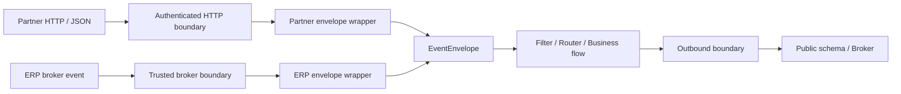
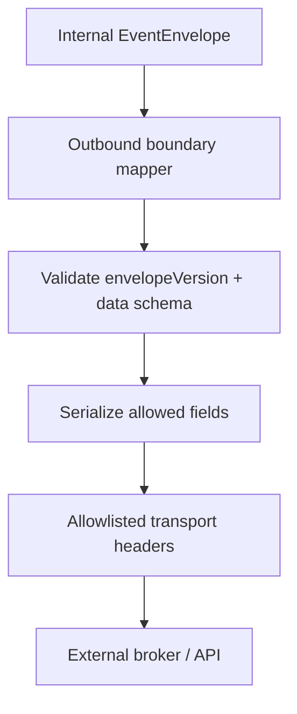
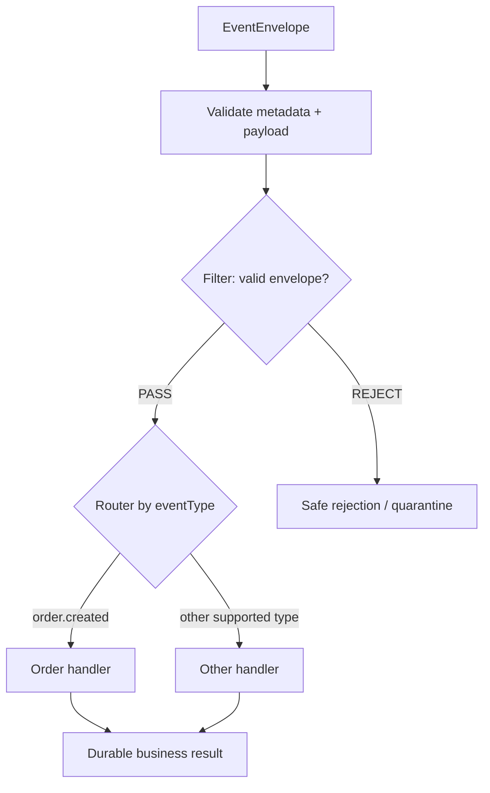
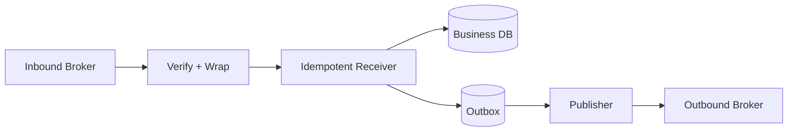

# Creating the Envelope at the Boundary

An integration application may receive orders from a partner's REST API, events from an ERP over a broker, and replayed records from an archive store. Their business data may describe **the exact same order**, yet differ in format, source identity, version, timestamp, and trust level. If you pass raw payloads straight into the internal system, downstream steps like Router, Filter, Aggregator, Gateway, or Idempotent Receiver may have to guess where a Message came from and which processing attempt it belongs to.

**Envelope Wrapper** is an Enterprise Integration Patterns (EIP) pattern that places an explicitly contracted *wrapper* around the data being transferred: inside is the **business payload**; outside is **integration metadata**, such as event type, schema version, event identifier, authenticated source, and correlation ID. Creating the envelope at the **boundary** means building this wrapper right at the boundary between an external system/protocol and the integration flow using a shared model, rather than waiting for each downstream handler to append metadata in its own ad-hoc way.

The lesson **Creating the Envelope at the Boundary** belongs to the **Envelope wrapper** chapter of module `SPRING_INTEGRATION_PATTERN`. The module aims to teach implementing Enterprise Integration Patterns with Spring Integration to build loosely coupled, extensible Message flows; practicing Router, Filter, Transformer, Splitter, Aggregator, Gateway, retry, error channel, and correlation, while testing and observing every branch. The focus of this lesson is **choosing the boundary to create the envelope, standardizing trusted metadata, preserving contracts across transports, and verifying with Java/Spring Integration**, rather than merely adding a few headers to a Message.

## 1. Where Is the Boundary and Why Create the Envelope There?

A boundary is where data **changes ownership domain or trust contract**. For example:

- An HTTP request from a partner is received by an ingress adapter into the internal system.
- An event from an ERP Kafka topic is converted into a DTO by a deserializer.
- A replay job loads records from an archive into the same processing pipeline.
- The internal system publishes an event to a public broker for partners.

At the **inbound boundary**, the adapter is responsible for authenticating the source, validating accepted formats, and stamping verified details. At the **outbound boundary**, the system selects a public envelope, serializes it per schema version, and emits only permitted metadata.



**Do not place the entire trust burden on the wrapper alone.** The wrapper builds the structure; token authentication, topic permissions, tenant, provenance, and allowed attributes must be checked **before or at the boundary**. Once verified, the wrapper turns those results into stable metadata that internal endpoints can rely on.

### 1.1. The Wrapper Is Not a Place to Patch Over All Input Errors

If the payload cannot be parsed or lacks a mandatory event ID, the wrapping step should reject it or route it to the appropriate error policy. Never substitute:

```text
eventId = UNKNOWN
sourceSystem = TRUSTED
occurredAt = now()
```

because these fake values corrupt auditing, correlation, and idempotency. `wrappedAt` can come from the system clock, yet it **never replaces** the source event's `occurredAt`.

## 2. How Does Envelope Wrapper Differ from Spring Message Headers?

In Spring Integration, a Message typically has two parts:

```text
Message<T>
  payload: T
  headers: MessageHeaders
```

Envelope Wrapper adds a contracted model onto the payload or outer serialization:

```text
Message<EventEnvelope<OrderData>>
  payload:
    metadata: EventMetadata
    data: OrderData
  headers:
    id, timestamp, replyChannel, correlationId,
    routing/tracing fields... (if present)
```

| Aspect | Spring `MessageHeaders` | Envelope payload |
| --- | --- | --- |
| Primary purpose | Orchestrating Messages inside the messaging system | Cross-boundary integration data contract |
| Data types | Can hold JVM objects, technical headers | Should be schema-defined and serializable |
| Durability across adapters | Depends on header mapper/transport | More durable when payload is serialized by schema |
| `replyChannel`/`errorChannel` | Can be internal objects/channels | Should not put internal objects in public envelopes |
| Versioning | Not automatically a public envelope schema | Should carry `envelopeVersion` and data schema version |
| Access control | Depends on the messaging system | Can be validated and enforced at the boundary |

**Envelopes do not replace Spring Integration's Message mechanisms.** `MessageHeaders.ID`, `MessageHeaders.TIMESTAMP`, `IntegrationMessageHeaderAccessor.CORRELATION_ID`, and other headers still serve their own roles. Envelopes hold **durable business-contract metadata**, while internal headers assist dispatch, replies, tracking, and flow execution.

### 2.1. Should Some Information Be Duplicated in Both Places?

Possibly. For instance, an envelope has `meta.correlationId` to travel over a broker, while a header carries `correlationId` for an in-JVM Aggregator. However, you must designate **the source of truth** and synchronization rules. When two values disagree, never pick one arbitrarily and continue.

### 2.2. Do Not Serialize All Headers into a JSON Envelope

A dangerous approach:

```java
// Anti-pattern illustration; DO NOT use as a public envelope:
Map<String, Object> everything = message.getHeaders();
```

Headers can contain unnecessary data, private information, internal bean names, or non-serializable objects. When constructing a public envelope, use an **allowlist** instead of copying `MessageHeaders` wholesale.

## 3. Three Parts of a Well-Contracted Envelope

A maintainable design consists of:

1. **Metadata:** event type, source identity, version, IDs, and timestamps.
2. **Data:** the canonical payload or event data being transferred.
3. **Schema contract:** specifies required fields, size limits, and versioning rules.

Example:

```json
{
  "envelopeVersion": 1,
  "metadata": {
    "eventType": "order.created",
    "eventId": "PARTNER_API:evt-1001",
    "tenantId": "tenant-7",
    "sourceSystem": "PARTNER_API",
    "sourceSchemaVersion": "partner-order-v1",
    "dataSchemaVersion": "canonical-order-v1",
    "correlationId": "c7b1320f-c947-4f84-8c23-507c6961c09f",
    "causationId": null,
    "occurredAt": "2026-11-20T10:00:00Z",
    "wrappedAt": "2026-11-21T02:15:00Z"
  },
  "data": {
    "orderId": "ORD-1001",
    "amount": "49.95",
    "currency": "USD"
  }
}
```

This is an **illustrative application schema**, not a default JSON structure auto-generated by Spring Integration.

### 3.1. Which Metadata Is Truly Mandatory?

| Field | What it tells you | Notes |
| --- | --- | --- |
| `envelopeVersion` | Wrapper contract | Distinguishes metadata structure changes |
| `eventType` | Event meaning | Never treat an arbitrary client string as processing authority |
| `eventId` | Logical event identifier | Must remain stable across retries/redeliveries |
| `tenantId` | Authenticated tenant scope | Never trust client-claimed tenants without verification |
| `sourceSystem` | Trusted source | Typically verified/assigned by the boundary |
| `sourceSchemaVersion` | Which schema decoded the raw input | Used for investigation and replay |
| `dataSchemaVersion` | Schema of canonical `data` | Helps consumers choose a decoder |
| `correlationId` | Links Messages within a workflow | Not identical to deduplication key |
| `causationId` | Which event/command caused this event | Can be null for root events |
| `occurredAt` | Timestamp at source | Never replace with received time |
| `wrappedAt` | Time when wrapper completed | Stamped by a trusted server |

**You do not have to copy the exact same set of metadata for every system.** Pick fields based on contract, SLA, and audit needs; then validate values, types, versions, and lengths.

## 4. When to Create the Envelope: Before or After Normalization?

There are two valid architectures:

**Option A — Wrap first, normalize second**

```text
Raw event
  -> Verify ingress
  -> Envelope<RawSourceEvent>
  -> Normalize envelope.data
  -> Envelope<CanonicalData> (preserving provenance)
```

Pros: provenance is preserved even if the downstream normalizer fails; convenient for controlled raw quarantine. Cons: `data` still carries multiple source schemas, so early consumers must understand each type.

**Option B — Normalize and wrap at the same boundary**

```text
Raw event
  -> Verify ingress
  -> Parse/validate source schema
  -> Map canonical data
  -> Envelope<CanonicalData>
  -> Shared integration flow
```

Pros: internal flows only process one canonical contract; validation is uniform. Cons: if mapping fails before creating the envelope, the error flow must retain separate **transport/source context** for tracing.

The Java examples in the following sections use **Option B**. It builds `EventEnvelope<CanonicalOrder>` at the head of the internal flow, after the boundary has distinguished the two sources.

### 4.1. Avoid Unintentional Multi-Layer Wrapping

A flow can accidentally create:

```text
Envelope<Envelope<Envelope<OrderData>>>
```

every time it crosses a gateway. That makes schemas hard to manage and mixes provenance. Without an explicit contract for nested envelopes, subsequent steps should **preserve and update metadata in a controlled manner**, instead of always wrapping another layer.

## 5. Source Identity Must Be Authenticated at Ingress

The dangerous trait of an envelope is that it looks **official**. A Message from the Internet could self-report:

```text
sourceSystem=INTERNAL_ERP
tenantId=tenant-admin
eventType=order.approved
```

If those fields are simply copied into the envelope, internal Routers could send the Message down the wrong branch or bypass validation.

A proper boundary needs:

- Authenticate clients or producers via appropriate mechanisms: mTLS, OAuth, broker ACLs, signed messages, etc.
- Derive **verified source identity** from adapter-authenticated details, never from arbitrary headers.
- Cross-check the permitted tenant against the payload tenant; do not merely check string format.
- Validate the input version and whether the producer is authorized to emit that event type.
- Bound payload size, timestamps, and required IDs.
- Record safe error codes on rejection; keep raw exceptions/credentials in restricted diagnostics.

In the demo, `partnerIngress` and `erpIngress` are **two internal channels assumed to be owned by authenticated adapters**. The wrapper hardcodes `sourceSystem` per channel. The demo **does not implement real authentication/authorization**; that responsibility must be added at the system's boundary.

## 6. Identifiers to Distinguish: Event, Correlation, Causation, and Message ID

| Identifier | Used for | Scope |
| --- | --- | --- |
| `sourceMessageId` | Event/logical delivery at source system | Source/tenant |
| `eventId` | Event ID inside the envelope | Can be namespaced by source and tenant |
| `correlationId` | Steps within the same workflow/request | Per execution flow |
| `causationId` | Event or command that created the current Message | Causal relationship |
| `orderId` | Business entity being referenced | Many events can share one order |
| Spring `MessageHeaders.ID` | A specific Message instance | Can differ every time a Message is created |

Example of one order with two events:

```text
OrderCreated:
  eventId       = PARTNER_API:evt-1001
  correlationId = workflow-A
  causationId   = null
  orderId       = ORD-1001

InventoryReserved:
  eventId       = INVENTORY:evt-8844
  correlationId = workflow-A
  causationId   = PARTNER_API:evt-1001
  orderId       = ORD-1001
```

`correlationId` should be **preserved** when emitting child events in the same workflow; `causationId` normally changes to the event/command that directly triggered the new event; the new event's `eventId` must be fresh. If a broker redelivers **the same event**, `eventId` must remain stable for deduplication.

### 6.1. Do Not Use Correlation ID as the Deduplication Key for an Entire Workflow

A workflow can emit many valid events sharing one correlation ID. Deduplicating solely by correlation ID will erroneously drop distinct events.

### 6.2. Namespaced IDs Do Not Mean Globally Unique

In the demo, `eventId = sourceSystem + ":" + sourceEventId`. If multiple tenants reuse source event IDs, include `tenantId` when constructing idempotency keys, e.g., `(tenantId, eventId, consumerOperation)`. Do not assume that ID is globally unique beyond the contract scope.

## 7. Versioning: Wrapper and Payload Can Evolve Independently

A change in metadata does not necessarily change how `data` is interpreted.

| Change | Envelope version | Data schema version |
| --- | --- | --- |
| Add optional metadata field with clear default | Can stay v1 if backward-compatible | Unchanged |
| Change `metadata` structure from object to array | Usually requires v2 | May remain unchanged |
| Change `amount` from `String` to `Money` object | May remain unchanged | Needs new version/schema |
| Upgrade source input from Partner v1 to v2 | May remain unchanged | May remain unchanged if canonical mapping stays the same |
| Rename a required field old consumers don't understand | Needs compatibility plan | Bump the affected version |

Schemas should define **types, required/optional rules, constraints, and compatibility policies**. A version number stamped into a payload is insufficient if publishers/consumers lack contract governance.

### 7.1. Old and New Envelopes Can Coexist

A system may need to read `envelopeVersion=1` and `envelopeVersion=2` during migration:

```text
Inbound decoder:
  version 1 -> decode legacy envelope -> normalized internal envelope
  version 2 -> decode current envelope -> normalized internal envelope
  unknown   -> reject/quarantine with safe reason
```

Never assume an unknown version is v1 and try to parse it; doing so can misread byte order, currency, event types, or security policies.

## 8. Java 17+: Models for the Wrapper

Example using immutable `record` types, one canonical payload type, and two source input types.

```java
package example.integration;

import java.math.BigDecimal;
import java.time.Instant;

public final class EnvelopeModel {

    private EnvelopeModel() {
    }

    // REST partner: amount as text.
    public record PartnerOrderV1(
            String tenantId,
            String orderNumber,
            String sourceEventId,
            String amountText,
            String currency,
            String occurredAtIso) {
    }

    // ERP broker: amount in minor units (cents) for USD.
    public record ErpOrderV2(
            String tenantCode,
            String documentNumber,
            String deliveryId,
            long amountCents,
            String currency,
            long occurredAtEpochMillis) {
    }

    public record CanonicalOrder(
            String orderId,
            BigDecimal amount,
            String currency) {
    }

    public record EventMetadata(
            String eventType,
            String eventId,
            String tenantId,
            String sourceSystem,
            String sourceSchemaVersion,
            String dataSchemaVersion,
            String correlationId,
            String causationId,
            Instant occurredAt,
            Instant wrappedAt) {
    }

    public record EventEnvelope<T>(
            int envelopeVersion,
            EventMetadata metadata,
            T data) {
    }
}
```

With `record` types, JSON serialization via Jackson/Avro/Protobuf must be configured for your actual stack. `Instant` requires Java Time serializer support; `BigDecimal` needs an agreed precision/scale contract between producer and consumer. Java generic `EventEnvelope<T>` **does not automatically guarantee** the receiving decoder restores the exact `T` without schema/type metadata.

### 8.1. Why Is Metadata Not a `Map<String, Object>`?

A record has explicit fields:

- Field names and types can be validated.
- The contract can be versioned.
- Avoids accidentally copying raw headers from clients.
- Helps tests verify that required elements have values.

An open map can be useful for controlled extensions, yet if every consumer adds unbounded metadata, the envelope turns into an **arbitrary data bag** with no trust boundary.

## 9. Spring Integration: Creating Envelopes with Transformers at the Ingress Boundary

Two external sources have already been parsed by adapters into their corresponding DTOs. Below focuses on **a testable wrapping step**.

```text
partnerIngress ── @Transformer wrapPartner ─┐
                                           ├─ wrappedOrders
erpIngress ───── @Transformer wrapErp ─────┘
```

### 9.1. Java Configuration

```java
package example.integration;

import java.math.BigDecimal;
import java.time.Instant;
import java.time.format.DateTimeParseException;
import java.util.UUID;

import org.springframework.context.annotation.Bean;
import org.springframework.context.annotation.Configuration;
import org.springframework.integration.annotation.Transformer;
import org.springframework.integration.channel.DirectChannel;
import org.springframework.integration.channel.QueueChannel;
import org.springframework.integration.config.EnableIntegration;
import org.springframework.messaging.Message;
import org.springframework.messaging.MessageChannel;
import org.springframework.messaging.PollableChannel;
import org.springframework.messaging.support.MessageBuilder;

import example.integration.EnvelopeModel.*;

@Configuration
@EnableIntegration
public class BoundaryEnvelopeConfiguration {

    private static final int ENVELOPE_VERSION = 1;
    private static final String EVENT_TYPE = "order.created";
    private static final String DATA_SCHEMA = "canonical-order-v1";

    @Bean
    public MessageChannel partnerIngress() {
        return new DirectChannel();
    }

    @Bean
    public MessageChannel erpIngress() {
        return new DirectChannel();
    }

    @Bean
    public PollableChannel wrappedOrders() {
        return new QueueChannel(20);
    }

    @Transformer(
            inputChannel = "partnerIngress",
            outputChannel = "wrappedOrders")
    public Message<EventEnvelope<CanonicalOrder>> wrapPartner(
            Message<PartnerOrderV1> input) {

        PartnerOrderV1 src = input.getPayload();
        String tenant = requiredId(src.tenantId(), "tenantId");
        String order = requiredId(src.orderNumber(), "orderNumber");
        String event = requiredId(src.sourceEventId(), "sourceEventId");
        BigDecimal amount = parsePartnerAmount(src.amountText());
        String currency = requireUsd(src.currency());
        Instant occurred = parseUtcInstant(src.occurredAtIso());

        return wrap(
                "PARTNER_API", "partner-order-v1",
                tenant, event, order, amount, currency, occurred);
    }

    @Transformer(
            inputChannel = "erpIngress",
            outputChannel = "wrappedOrders")
    public Message<EventEnvelope<CanonicalOrder>> wrapErp(
            Message<ErpOrderV2> input) {

        ErpOrderV2 src = input.getPayload();
        String tenant = requiredId(src.tenantCode(), "tenantCode");
        String order = requiredId(
                src.documentNumber(), "documentNumber");
        String event = requiredId(src.deliveryId(), "deliveryId");
        if (src.amountCents() < 0) {
            throw new IllegalArgumentException("ERP_AMOUNT_INVALID");
        }
        BigDecimal amount = BigDecimal.valueOf(
                src.amountCents(), 2);
        String currency = requireUsd(src.currency());
        Instant occurred = Instant.ofEpochMilli(
                src.occurredAtEpochMillis());

        return wrap(
                "ERP_BROKER", "erp-order-v2",
                tenant, event, order, amount, currency, occurred);
    }

    private static Message<EventEnvelope<CanonicalOrder>> wrap(
            String verifiedSource,
            String sourceSchema,
            String tenantId,
            String sourceEventId,
            String orderId,
            BigDecimal amount,
            String currency,
            Instant occurredAt) {

        EventMetadata metadata = new EventMetadata(
                EVENT_TYPE,
                verifiedSource + ":" + sourceEventId,
                tenantId,
                verifiedSource,
                sourceSchema,
                DATA_SCHEMA,
                UUID.randomUUID().toString(),
                null,  // Root event; no direct causing event.
                occurredAt,
                Instant.now());

        EventEnvelope<CanonicalOrder> envelope =
                new EventEnvelope<>(
                        ENVELOPE_VERSION,
                        metadata,
                        new CanonicalOrder(orderId, amount, currency));

        // Explicitly set internal headers only from the constructed metadata.
        return MessageBuilder.withPayload(envelope)
                .setHeader("envelope.eventType", metadata.eventType())
                .setHeader("envelope.eventId", metadata.eventId())
                .setHeader("envelope.sourceSystem",
                        metadata.sourceSystem())
                .build();
    }

    private static String requiredId(String value, String field) {
        if (value == null
                || !value.matches("[A-Za-z0-9_-]{1,80}")) {
            throw new IllegalArgumentException(
                    "INVALID_IDENTIFIER_" + field);
        }
        return value;
    }

    private static String requireUsd(String currency) {
        // Demo picks USD to illustrate cents -> dollars conversion.
        if (!"USD".equals(currency)) {
            throw new IllegalArgumentException(
                    "UNSUPPORTED_CURRENCY");
        }
        return currency;
    }

    private static BigDecimal parsePartnerAmount(String value) {
        if (value == null || !value.matches(
                "[0-9]+(\\.[0-9]{1,2})?")) {
            throw new IllegalArgumentException(
                    "PARTNER_AMOUNT_INVALID");
        }
        return new BigDecimal(value).setScale(2);
    }

    private static Instant parseUtcInstant(String raw) {
        try {
            return Instant.parse(raw);
        } catch (DateTimeParseException | NullPointerException ex) {
            throw new IllegalArgumentException(
                    "PARTNER_TIMESTAMP_INVALID");
        }
    }
}
```

### 9.2. Role of the Two Transformers

1. `wrapPartner(...)` handles Partner API DTOs; `wrapErp(...)` handles ERP DTOs.
2. Each transformer determines **the source by ingress channel** and its corresponding source schema, not by an external `sourceSystem` header.
3. Payload values undergo basic format validation before use.
4. Both sources are normalized into the same `CanonicalOrder` type.
5. Envelope metadata contains source, version, event ID, timestamps, and correlation.
6. `wrappedOrders` holds Messages sharing the `EventEnvelope<CanonicalOrder>` payload type.

In this example, `tenantId` is only **format-validated**; a real application must cross-check it against the authenticated and authorized tenant at the adapter. Trusting a payload-declared tenant value alone **does not provide** multi-tenant security.

### 9.3. When Must Correlation ID Be Preserved from the Source?

The example generates a new `UUID` per **root processing attempt**. Thus, a redelivered logical event may receive a **new correlation ID**; this is acceptable if correlation only tracks a single execution pass. Deduplication must use `tenantId + sourceSystem + sourceEventId + operation`, **not** the newly generated UUID.

If a workflow already carries a correlation ID from a verified upstream, the wrapper should **preserve that ID** instead of minting a new one at every hop. Policy must be defined by the request/workflow contract.

### 9.4. Warning on Header Propagation

The example builds a Message with `MessageBuilder.withPayload(...)` to illustrate **explicitly setting headers**. However, some Spring Integration endpoints copy/merge request headers into reply Messages depending on configuration. **Do not conclude that creating a new builder automatically strips all inbound headers.** To prevent header leakage at outbound boundaries, configure an actual transport header mapper/serializer allowlist and test it on that transport.

## 10. Demo: Same Business Data, Envelopes Reflecting Different Sources

```java
package example.integration;

import java.time.Instant;

import org.springframework.context.annotation.AnnotationConfigApplicationContext;
import org.springframework.messaging.Message;
import org.springframework.messaging.MessageChannel;
import org.springframework.messaging.PollableChannel;
import org.springframework.messaging.support.MessageBuilder;

import example.integration.EnvelopeModel.*;

public class BoundaryEnvelopeDemo {

    public static void main(String[] args) {
        try (var context = new AnnotationConfigApplicationContext(
                BoundaryEnvelopeConfiguration.class)) {

            MessageChannel partner = context.getBean(
                    "partnerIngress", MessageChannel.class);
            MessageChannel erp = context.getBean(
                    "erpIngress", MessageChannel.class);
            PollableChannel output = context.getBean(
                    "wrappedOrders", PollableChannel.class);

            Instant occurred = Instant.parse(
                    "2026-11-20T10:00:00Z");
            partner.send(MessageBuilder.withPayload(
                    new PartnerOrderV1(
                            "tenant-7", "ORD-1001", "evt-1001",
                            "49.95", "USD", occurred.toString()))
                    .build());
            erp.send(MessageBuilder.withPayload(
                    new ErpOrderV2(
                            "tenant-7", "ORD-1001", "erp-71",
                            4995L, "USD", occurred.toEpochMilli()))
                    .build());

            Message<?> first = output.receive(0);
            Message<?> second = output.receive(0);
            if (first == null || second == null) {
                throw new IllegalStateException(
                        "Expected two wrapped events");
            }

            @SuppressWarnings("unchecked")
            EventEnvelope<CanonicalOrder> partnerEnvelope =
                    (EventEnvelope<CanonicalOrder>) first.getPayload();
            @SuppressWarnings("unchecked")
            EventEnvelope<CanonicalOrder> erpEnvelope =
                    (EventEnvelope<CanonicalOrder>) second.getPayload();

            System.out.println(partnerEnvelope.data().amount()); // 49.95
            System.out.println(erpEnvelope.data().amount());     // 49.95
            System.out.println(
                    partnerEnvelope.metadata().sourceSystem()); // PARTNER_API
            System.out.println(
                    erpEnvelope.metadata().sourceSystem());     // ERP_BROKER
        }
    }
}
```

Both outputs carry identical business data yet have **different** `eventId`, `sourceSystem`, and `sourceSchemaVersion`. They are not automatically duplicates of the same event merely because `orderId` and `amount` match.

In the demo, `DirectChannel` runs synchronously, so after `send()` you can read the Message placed in `QueueChannel` with `receive(0)`. If switching to an executor/broker, use a finite timeout and check correlation.

## 11. JUnit 5: Verifying Data and Metadata of Both Envelopes

Tests must verify that **the wrapper builds the right envelope**, not just the normalized payload.

```java
package example.integration;

import static org.junit.jupiter.api.Assertions.*;

import java.math.BigDecimal;
import java.time.Instant;

import org.junit.jupiter.api.Test;
import org.springframework.context.annotation.AnnotationConfigApplicationContext;
import org.springframework.messaging.Message;
import org.springframework.messaging.MessageChannel;
import org.springframework.messaging.PollableChannel;
import org.springframework.messaging.support.MessageBuilder;

import example.integration.EnvelopeModel.*;

class BoundaryEnvelopeIntegrationTest {

    @Test
    void ingressBoundaryCreatesEnvelopeWithTrustedSourceAndSchema() {
        try (var context = new AnnotationConfigApplicationContext(
                BoundaryEnvelopeConfiguration.class)) {

            MessageChannel partner = context.getBean(
                    "partnerIngress", MessageChannel.class);
            MessageChannel erp = context.getBean(
                    "erpIngress", MessageChannel.class);
            PollableChannel output = context.getBean(
                    "wrappedOrders", PollableChannel.class);

            Instant occurred = Instant.parse(
                    "2026-11-20T10:00:00Z");

            assertTrue(partner.send(MessageBuilder.withPayload(
                    new PartnerOrderV1(
                            "tenant-7", "ORD-1001", "evt-1001",
                            "49.95", "USD", occurred.toString()))
                    .build()));
            assertTrue(erp.send(MessageBuilder.withPayload(
                    new ErpOrderV2(
                            "tenant-7", "ORD-1001", "erp-71",
                            4995L, "USD", occurred.toEpochMilli()))
                    .build()));

            Message<?> partnerMessage = output.receive(0);
            Message<?> erpMessage = output.receive(0);
            assertNotNull(partnerMessage);
            assertNotNull(erpMessage);

            @SuppressWarnings("unchecked")
            EventEnvelope<CanonicalOrder> a =
                    (EventEnvelope<CanonicalOrder>)
                            partnerMessage.getPayload();
            @SuppressWarnings("unchecked")
            EventEnvelope<CanonicalOrder> b =
                    (EventEnvelope<CanonicalOrder>)
                            erpMessage.getPayload();

            assertEquals(1, a.envelopeVersion());
            assertEquals(1, b.envelopeVersion());
            assertEquals("order.created", a.metadata().eventType());
            assertEquals("tenant-7", a.metadata().tenantId());
            assertEquals("PARTNER_API", a.metadata().sourceSystem());
            assertEquals("ERP_BROKER", b.metadata().sourceSystem());
            assertEquals("PARTNER_API:evt-1001",
                    a.metadata().eventId());
            assertEquals("ERP_BROKER:erp-71",
                    b.metadata().eventId());
            assertEquals("partner-order-v1",
                    a.metadata().sourceSchemaVersion());
            assertEquals("erp-order-v2",
                    b.metadata().sourceSchemaVersion());
            assertEquals("canonical-order-v1",
                    a.metadata().dataSchemaVersion());
            assertEquals(occurred, a.metadata().occurredAt());
            assertEquals(occurred, b.metadata().occurredAt());
            assertEquals(new BigDecimal("49.95"), a.data().amount());
            assertEquals(a.data().amount(), b.data().amount());
            assertFalse(a.metadata().correlationId().isBlank());
            assertNotNull(a.metadata().wrappedAt());
            assertNull(a.metadata().causationId());
            assertEquals("PARTNER_API",
                    partnerMessage.getHeaders()
                            .get("envelope.sourceSystem"));
            assertNull(output.receive(0));
        }
    }
}
```

Expected outcome: two different input schemas yield the same `CanonicalOrder` for amount/order/currency while metadata preserves **the exact source and source schema**, with envelope version 1.

In-JVM tests do not prove JSON messages on a broker are schema-compatible or header-allowlisted. Separate serialization/adapter tests are needed for real boundaries.

## 12. JUnit: Spoofed Headers Must Not Dictate Origin

Because a Message can carry headers from an external producer, verify that the wrapper **does not rely on client-declared source labels**:

```java
// Place this method inside BoundaryEnvelopeIntegrationTest.
@Test
void forgedHeadersCannotChangeSourceInCanonicalEnvelope() {
    try (var context = new AnnotationConfigApplicationContext(
            BoundaryEnvelopeConfiguration.class)) {

        MessageChannel partner = context.getBean(
                "partnerIngress", MessageChannel.class);
        PollableChannel output = context.getBean(
                "wrappedOrders", PollableChannel.class);

        var raw = new PartnerOrderV1(
                "tenant-7", "ORD-1001", "evt-1001",
                "49.95", "USD", "2026-11-20T10:00:00Z");

        assertTrue(partner.send(MessageBuilder.withPayload(raw)
                .setHeader("sourceSystem", "ERP_BROKER")
                .setHeader("envelope.sourceSystem", "ERP_BROKER")
                .setHeader("eventType", "order.approved")
                .build()));

        Message<?> result = output.receive(0);
        assertNotNull(result);
        @SuppressWarnings("unchecked")
        EventEnvelope<CanonicalOrder> envelope =
                (EventEnvelope<CanonicalOrder>) result.getPayload();

        assertEquals("PARTNER_API",
                envelope.metadata().sourceSystem());
        assertEquals("order.created",
                envelope.metadata().eventType());
        assertEquals("PARTNER_API",
                result.getHeaders().get("envelope.sourceSystem"));
        assertNull(output.receive(0));
    }
}
```

The test proves **those two critical envelope fields are constructed by the server**. It must not be interpreted as certifying that all arbitrary headers were stripped before outbound. Client-sent headers such as `sourceSystem` may still be forwarded across endpoints depending on configuration; verify header mappers at external boundaries with dedicated tests.

### 12.1. Tenant Checks Need More Than a Regex

A request with `tenantId="tenant-admin"` can **pass a regex** without the client actually being authorized to act for that tenant. HTTP/broker adapters must verify the tenant against an authenticated principal/ACL and pass the verified result via trusted context. This demo does not implement that part and makes no claim of complete tenant protection.

## 13. Invalid Input: Never Emit a Valid-Looking Envelope

Consider amount `"49,95"` or timestamp `"tomorrow"`:

```json
{
  "orderNumber": "ORD-1001",
  "amountText": "49,95",
  "occurredAtIso": "tomorrow"
}
```

If you arbitrarily substitute `amount=0` and `occurredAt=Instant.now()` while still attaching `eventType=order.created`, downstream may mistake a corrupted event for a valid request.

### 13.1. Invalid Input Test

```java
// Place this method inside BoundaryEnvelopeIntegrationTest.
@Test
void malformedAmountIsRejectedBeforeEnvelopeIsPublished() {
    try (var context = new AnnotationConfigApplicationContext(
            BoundaryEnvelopeConfiguration.class)) {

        MessageChannel partner = context.getBean(
                "partnerIngress", MessageChannel.class);
        PollableChannel output = context.getBean(
                "wrappedOrders", PollableChannel.class);

        var invalid = new PartnerOrderV1(
                "tenant-7", "ORD-1001", "evt-bad",
                "not-a-number", "USD", "2026-11-20T10:00:00Z");

        assertThrows(RuntimeException.class,
                () -> partner.send(
                        MessageBuilder.withPayload(invalid).build()));
        assertNull(output.receive(0));
    }
}
```

In a synchronous `DirectChannel` flow, Transformer errors usually propagate back to the caller, possibly wrapped in a messaging exception. Thus the test asserts `RuntimeException` at the demo boundary. With executors/pollers/brokers, `send()` may finish before the error occurs; you must test `errorChannel`, retry/ACK, and dead-letter behavior at the right points.

### 13.2. Distinguishing Contract Errors from Infrastructure Errors

| Error | Meaning | Suggested handling |
| --- | --- | --- |
| Missing `sourceEventId` | No stable event ID | Reject/quarantine, require producer fix |
| Unparseable amount | Invalid source schema or data | Reject with a safe error code |
| Unsupported input currency | Contract not yet supported | Reject or route to appropriate mapper |
| Unknown source schema version | Incompatible decoder | Quarantine and upgrade schema |
| DB/lookup service timeout | Technical error | Bounded retries, error channel |
| Outbound serialization error | Result cannot be emitted per contract | Keep durable source, error/retry per policy |

Never put raw exception messages, input JSON, or credentials into a public error envelope. When a valid event envelope cannot be built, return a **dedicated error response** containing an authenticated transport ID, error code, and server timestamp.

## 14. Outbound Boundary: Choosing Permitted Payload and Headers to Export

Creating the envelope at the inbound boundary is only the first half. When sending to an external system, an endpoint must:

1. Select the **public schema** of the event/response.
2. Map `EventEnvelope<CanonicalOrder>` to JSON/Avro/Protobuf per the published version.
3. Restrict metadata fields to the specific audience.
4. Never serialize the full Spring `MessageHeaders`.
5. Control sensitive data, Message size, and event visibility permissions.



### 14.1. A Minimal Public JSON Schema

For instance, a partner only needs:

```json
{
  "envelopeVersion": 1,
  "eventType": "order.created",
  "eventId": "PARTNER_API:evt-1001",
  "occurredAt": "2026-11-20T10:00:00Z",
  "data": {
    "orderId": "ORD-1001",
    "amount": "49.95",
    "currency": "USD"
  }
}
```

We intentionally omit `tenantId`, internal correlation, `causationId`, source schema, and `wrappedAt` if the consumer neither needs nor is authorized to see them. Exporting less data **does not lose metadata from the internal envelope**; it is a projection under the outbound contract.

### 14.2. Do Not Depend on Every Service's Default `ObjectMapper`

A serialization contract should specify:

- Field names: `eventId`, `data`, `envelopeVersion`, etc.
- Representation of `Instant`: ISO 8601 UTC or epoch, consistently.
- Representation of `BigDecimal`: decimal string or JSON number with guaranteed precision.
- Handling of `null` and optional fields.
- Size limits, nesting depth, and unknown fields.
- Schema version and how consumers select a decoder.

If using Jackson, configure Java Time, serializers, and schema tests matching your version. Never assume Java generic `EventEnvelope<T>` or `Instant` serializes/deserializes properly without required configuration.

### 14.3. Adapter Header Mapper Decides What Leaves

Example policy:

```text
Allowed outbound headers:
  content-type
  schema-version
  traceparent (if permitted)
  trusted message-key / partition-key

Not exported by default:
  replyChannel / errorChannel objects
  raw credentials / access tokens
  full stack trace or Throwable
  tenant security principal object
  arbitrary inbound headers
```

This is an **architectural policy**, not uniform configuration property names across HTTP/Kafka/AMQP adapters. Use your specific transport's header mapper/producer settings and run **adapter contract tests** verifying which fields actually cross the wire.

## 15. HTTP Requests, Broker Events, and Gateways Do Not Share the Same Contract

Envelopes should reflect **communication semantics**:

| Scenario | What to consider |
| --- | --- |
| HTTP command `POST /orders` | Request/response, status code, client idempotency key |
| Broker event `OrderCreated` | At-least-once delivery, stable event ID, consumer idempotency |
| Gateway in Spring Integration | Reply channel, timeout, request correlation |
| Scheduled replay | Original event identity, replay attempt, rule version |
| Outbound public event | Schema version and authorized audience |

An `EventEnvelope` can reuse the same metadata concept, yet **never treat commands and events as the same kind**. A command expresses intent to mutate state; an event records a fact that has occurred per contract. When mapping an HTTP request to `order.created`, make sure it is an **actually confirmed event**, not merely an uncommitted order-creation request.

### 15.1. Limitation of the `OrderCreated` Demo

To illustrate data types, the demo assigns `eventType="order.created"` as soon as the wrapper receives input. In a real system, if Partner/ERP input is only a **command requesting order creation**, change it to `order.create.requested` or `CreateOrderCommand`, and only emit `OrderCreated` **after the business transaction commits**. Event types must not turn an unprocessed request into a committed fact.

### 15.2. Do Not Put JVM `replyChannel` into Public Envelopes

Spring Integration can use an object or internal channel name in `replyChannel` to deliver Gateway results. Keep it within its proper **runtime scope**; when crossing HTTP/brokers, use a `requestId` contract and transport-managed reply destinations rather than serializing JVM channel objects into JSON.

## 16. Router, Filter, and Validator After Wrapping

Once wrapped:



A Router can inspect `metadata.eventType` or a technical header derived from metadata:

```java
// Domain/routing check usable in Router/Filter.
boolean accepted =
        envelope.envelopeVersion() == 1
        && "order.created".equals(
                envelope.metadata().eventType())
        && envelope.metadata().eventId() != null
        && envelope.data() != null;
```

The snippet above is an illustrative condition, **not a substitute for full validation** of tenant, schema, source, and processing permissions.

### 16.1. Filter Discards Can Drop Replies

If a Filter drops `EventEnvelope` without emitting an error result, a Gateway waiting for a reply can time out. When rejection is an expected outcome, build a safe response DTO carrying `requestId/eventId` within authorized scope. Unexpected runtime failures use a separate error policy.

### 16.2. Do Not Let Clients Pick Routes via `eventType` Alone

A malicious producer could set `eventType="payment.completed"` to hit a privileged branch. Route by `eventType` **only after** verifying the source is authorized to emit that event type and validating schema/version.

## 17. Splitter, Aggregator, and Envelope Lineage

If a Splitter divides an `EventEnvelope<Batch>` into child Messages, decide which metadata to retain:

```text
Parent:
  eventId       = ERP_BROKER:batch-91
  correlationId = workflow-91
  data          = Batch(lines=[L1,L2,L3])

Children:
  child-1: parentEventId=batch-91, lineNo=1
  child-2: parentEventId=batch-91, lineNo=2
  child-3: parentEventId=batch-91, lineNo=3
```

One strategy:

- Preserve `tenantId`, `sourceSystem`, and parent provenance for lineage.
- Give each child its own deterministic identifier from `(parent event, line number, operation)`.
- Children in the same workflow keep `correlationId` or an appropriate `batchAttemptId`.
- The child event's `causationId` points to the parent event.
- `sequenceNumber/sequenceSize` serve ordering/completion within the group; they are **not `eventId`**.

### 17.1. Aggregator Must Not Lose Contributing Provenance

An Aggregator combining three outcomes from Inventory, Pricing, and Risk may produce a single summary output. If it copies `sourceSystem` from the first Message only, it hides the other two contributors. When auditing is required, output should retain a **bounded set of contributor IDs** or a `lineageRef` pointing to the audit store.

### 17.2. Metadata Must Not Grow Unboundedly

Continuously copying the entire `processingHistory` and contributor list into every child causes envelope sizes to blow up on fan-out. For large batches, use access-controlled durable references and a trace ID instead of embedding full history in every Message.

## 18. Idempotency and Retry: Envelopes Help Identify, Not Automatically Deduplicate

Suppose a broker redelivers:

```text
tenantId = tenant-7
sourceSystem = ERP_BROKER
eventId = ERP_BROKER:erp-71

Delivery 1: DB COMMIT, ACK lost
Delivery 2: same eventId redelivered
```

A receiver idempotency key can be:

```text
tenantId + ":" + eventId + ":" + consumerOperation
```

If `eventId` is stable, the receiver can recognize the same logical event; however, you **still need** atomic deduplication/transactions with business state to guarantee non-duplicated side effects.

### 18.1. Why Not Use `wrappedAt` or Correlation ID for Deduplication?

- `wrappedAt` changes on every normalization/replay.
- Correlation ID may be freshly generated per processing attempt.
- `MessageHeaders.ID` can also differ whenever a new Message is created.

Those values help trace **a single processing attempt**, not replace the stable root identity of the event.

### 18.2. Same `eventId` with Different Data

Never drop the newer Message as an ordinary duplicate. Detect **key reuse conflicts** (e.g., via payload fingerprint/version) and handle them under an agreed error/reconciliation policy.

### 18.3. Envelopes Do Not Make Every Step “Exactly Once”

A local DB transaction cannot roll back an email, HTTP call, or independent broker output. If events must be emitted after a business commit, use a transactional outbox and idempotent consumers per contract. Wrappers carry the IDs to enable this, yet **do not replace** transaction/ACK design.

## 19. Transactions, Crash Windows, and Durable Output

This is a common flow:



| Failure window | What can happen | Mitigation |
| --- | --- | --- |
| Crash after wrap, before durable storage | Envelope in RAM only can be lost | Broker redelivery / durable input |
| Business commit, input not yet ACKed | Message may be redelivered | Deduplicate by `eventId + operation` |
| DB commit succeeds, broker publish fails | Business completed, output never arrived | Transactional outbox |
| Publish succeeds, relay crashes before marking sent | Event may be published twice | Idempotent target consumer |
| Event replayed with newer mapper version | Canonical data may differ | Rule/schema versioning and replay policy |

**Merely putting `eventId`, `wrappedAt`, and `correlationId` into an envelope does not ensure durability.** Persist and ACK properly according to real resources and pipeline transaction rules.

## 20. Header Mapping and Serialization Across Kafka, AMQP, and HTTP

The same `EventEnvelope<CanonicalOrder>` can traverse multiple transports:

```text
In-JVM:
  Message<EventEnvelope<CanonicalOrder>>

Kafka:
  key = tenantId/orderId (per partition policy)
  value = bytes serialized per schema
  headers = allowlist

HTTP:
  JSON body per public schema
  request headers = appropriate authentication/content-type/correlation
```

There is no guarantee that arbitrary Spring Integration `MessageHeaders` survive intact across every adapter. Each adapter has its own header mapper, serialization, and byte limits.

### 20.1. Partition Key Is Not an Idempotency Key

A Kafka key is typically chosen to keep ordering/partitioning by aggregate, e.g., `(tenantId, orderId)`. An idempotency key usually identifies a **logical operation**, e.g., `(tenantId, eventId, handler)`. Reusing one key for both without checking scope can break desired partitioning or block valid events.

### 20.2. A Good Contract Test Does a Full Bytes Round-Trip

A cross-transport test should:

1. Build an envelope from verified input.
2. Serialize according to outbound schema and header mapper.
3. Read bytes/headers in a consumer test.
4. Deserialize into the appropriate data type.
5. Assert `eventId`, `sourceSystem`, versions, timestamps, and amounts are unchanged.
6. Assert secrets, raw headers, `replyChannel`, and internal exceptions do not appear.

A `@Transformer` unit test does not replace that step.

## 21. Observability: Which Envelope, Which Source, Where Processed?

An illustrative structured log:

```json
{
  "stage": "envelope-wrapper",
  "eventType": "order.created",
  "tenantId": "tenant-7",
  "eventId": "ERP_BROKER:erp-71",
  "sourceSystem": "ERP_BROKER",
  "sourceSchemaVersion": "erp-order-v2",
  "dataSchemaVersion": "canonical-order-v1",
  "envelopeVersion": 1,
  "result": "WRAPPED"
}
```

This is an **application-designed log schema**, not default Spring Integration output. Never print full raw payloads, header dumps, or personal data into general logs.

### 21.1. Suggested Metrics

| Metric | Meaning |
| --- | --- |
| `envelope.wrap.received` | Inputs entering the boundary |
| `envelope.wrap.success` | Valid envelopes created |
| `envelope.wrap.reject` | Inputs violating the contract |
| `envelope.wrap.technical_failure` | Technical processing failures |
| `envelope.wrap.duration` | Mapping/wrapping latency |
| `envelope.schema.unsupported` | Unsupported schema versions |
| `envelope.source.unauthorized` | Unauthorized source/tenant |
| `envelope.event_id.missing` | Events missing required ID |
| `envelope.outbound.serialization_failure` | Serialization errors |
| `envelope.outbound.header_violation` | Headers blocked by policy |

These are **suggested instrumentation names**, not built-in framework metric names. Use bounded tags like `sourceSystem`, `schemaVersion`, `eventType`, and `result`; never use high-cardinality `eventId`, `orderId`, emails, or correlation IDs as metric tags.

### 21.2. Correlation for Tracing

A trace can link to `metadata.correlationId`, yet if users can supply correlation IDs themselves, validate format, length, and permissions. Never use correlation IDs as authentication or authorization evidence. When internal `traceparent` is needed, propagate via observability standards with controlled header mappers.

## 22. Security, Privacy, and Preventing Envelope Injection

Because envelopes carry critical metadata, guard against these risks:

| Threat | Example | Prevention |
| --- | --- | --- |
| **Source spoofing** | Client sets `sourceSystem=ERP` | Authenticate ingress, server assigns source |
| **Tenant spoofing** | Payload claims unauthorized tenant | Verify principal/ACL |
| **Event-type spoofing** | Client emits `payment.completed` | Allowlist types per producer |
| **Metadata injection** | Strings with newlines, oversized headers | Validate types, lengths, encodings |
| **PII leakage** | Copying raw payload into metadata | Data minimization, allowlist |
| **Secret leakage** | Serializing bearer tokens in headers | Strip credentials from envelopes/outputs |
| **Replay misuse** | Old event IDs intentionally re-sent | Idempotency, timestamp/replay policies |
| **Schema confusion** | Unknown version parsed as v1 | Explicit version dispatch |
| **Cross-tenant tracing** | Two tenants share the same ID | Namespacing + access control |

`eventId` and `correlationId` can become sensitive if they allow looking up related records. Control access, retention, and deletion for logs/audits/replays. **Never embed raw-payload access tokens or long-lived pre-signed URLs in metadata.**

### 22.1. The Boundary Does Not Automatically Add Cryptographic Signatures

To prove data was not tampered with in transit, use transport security, signatures, or appropriate integrity checks. Simply having `sourceSystem` and `envelopeVersion` fields does not authenticate the sender. Any signature mechanism must explicitly specify canonical bytes and which fields are signed; never assume every envelope is signed by default.

## 23. Common Design Mistakes

| Symptom | Cause | Fix |
| --- | --- | --- |
| Internal router must guess source schema | Not wrapped/normalized at boundary | Create canonical envelope after verified ingress |
| Wrong `sourceSystem` | Copied client-supplied header | Server assigns from authenticated adapter |
| Tenant A receives Tenant B's event | Only validated tenant string format | Authorize against principal/ACL |
| Cannot tell retries from new events | Random `eventId` minted on each receipt | Use stable logical source event ID |
| Wrapper turns request into business fact | Assigning `order.created` to uncommitted command | Separate command vs. event types |
| Consumers cannot read new envelopes | Ungoverned versions/schemas | Contract tests and migration |
| Replay produces different data | Amount/time rule changed without versioning | Store source/rule versions and replay policy |
| Broker drops correlation header | Relied solely on Spring `MessageHeaders` | Keep durable metadata in payload |
| Envelope contains `replyChannel` object | Serialized all headers | Public schema and allowlist |
| Token/PII leakage | Copied raw source/headers | Data minimization/redaction |
| Steps keep adding nested envelopes | Missing boundary contract | Preserve/update envelope within proper scope |
| Child event shares parent ID | Confused causation with event identity | Mint child event ID, `causationId=parent` |
| Aggregator loses contributor provenance | Kept metadata from first Message only | Bounded contributor lineage |
| `@Transformer` test passes, Kafka leaks headers | Tested JVM only, not mapper | Transport round-trip security test |
| Dedup blocks valid events on same order | Used `orderId` as event ID | Key `eventId` per logical event |
| Internal sync slows down suddenly | Oversized envelope / huge processing history | Bound metadata, use external references |

## 24. Checklist for Creating Envelopes at the Boundary

- **Identify true boundaries:** external ingress, broker listeners, HTTP adapters, replay, or outbound.
- **Distinguish commands from events:** never mark an uncommitted request as “occurred”.
- **Authenticate source identity:** never trust self-declared headers.
- **Authorize tenants:** check permissions, not just format.
- **Parse/validate source schema:** reject unsupported versions.
- **Create clean canonical data:** units, currency, timestamps, types, and constraints.
- **Define the envelope contract:** version, metadata, data, required/optional fields.
- **Keep `eventId` stable across redeliveries:** never randomize per retry.
- **Separate `eventId`, `correlationId`, `causationId`, order ID, and Message ID.**
- **Stamp meaningful timestamps:** `occurredAt` differs from `wrappedAt`/`receivedAt`.
- **Manage schema versions independently:** envelope version and data schema version.
- **Never copy all `MessageHeaders`:** enforce a boundary allowlist.
- **Never serialize `replyChannel`, `errorChannel`, secrets, raw exceptions, or excess payload.**
- **Preserve provenance across EIPs:** Transformer, Router, Splitter, Aggregator.
- **Design retry/idempotency:** markers/transactions/ACKs/outbox aligned with real resources.
- **Design a separate error response for unwrappable inputs.**
- **Test forged source headers and invalid inputs** in Spring Integration.
- **Test outbound serialization/header mapping on real transports.**
- **Instrument by source/version/eventType:** never tag metrics with high-cardinality IDs.
- **Define retention, security, and replay policies for stored raw data.**

## 25. Practice Exercise: Wrapping Two Inputs and Preventing Source Spoofing

An application receives two requests:

```json
{
  "channel": "partnerIngress",
  "headers": {
    "sourceSystem": "ERP_BROKER",
    "eventType": "order.approved"
  },
  "payload": {
    "tenantId": "tenant-7",
    "orderNumber": "ORD-9001",
    "sourceEventId": "evt-9001",
    "amountText": "120.00",
    "currency": "USD",
    "occurredAtIso": "2026-11-20T10:00:00Z"
  }
}
```

```json
{
  "channel": "erpIngress",
  "payload": {
    "tenantCode": "tenant-7",
    "documentNumber": "ORD-9001",
    "deliveryId": "erp-742",
    "amountCents": 12000,
    "currency": "USD",
    "occurredAtEpochMillis": 1795168800000
  }
}
```

Answer:

1. What must `sourceSystem` be in the first envelope, and why must the `ERP_BROKER` header not be trusted?
2. How should `eventId` differ between the two sources?
3. If the ERP order is reprocessed due to a lost ACK, can `wrappedAt` be used as the deduplication key?
4. If this is only an **order creation request**, should `eventType="order.created"` be used immediately?
5. If a consumer receives an unsupported `envelopeVersion=2`, what action should it take?
6. When publishing to Kafka, how do you guarantee raw client headers and internal `replyChannel` never leak to the topic?
7. Which tests prove `amount=120.00 USD` from both sources shares canonical data while provenance remains distinct?

One solution approach: the first wrapper assigns `PARTNER_API` based on verified ingress; the second assigns `ERP_BROKER`. Event IDs must be namespaced by source and tenant when deduplicating. `wrappedAt` is merely processing time and does not identify a logical event. For uncommitted commands, use a type representing a request. Unsupported schemas need rejection/quarantine with a reason code; outbound mappers must use an allowlist with bytes/header round-trip tests.

---

**Creating the envelope at the boundary establishes a trustworthy integration contract the moment a Message crosses a system boundary, not just cosmetic metadata.** A useful envelope separates business data from event identity, schema, provenance, and correlation; authenticates security-relevant attributes; controls what gets forwarded; and keeps identifiers stable for retries, replay, auditing, and idempotency. Combined with Spring Integration Transformer, Router, Filter, Gateway, and proper transaction/error handling, it lets integration flows scale while always explaining where a Message came from, which contract it follows, and how it should be processed.
