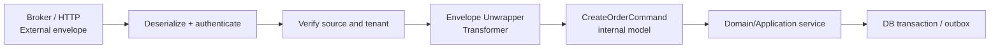
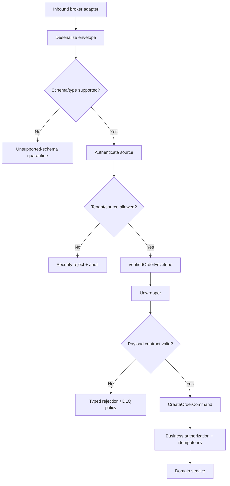
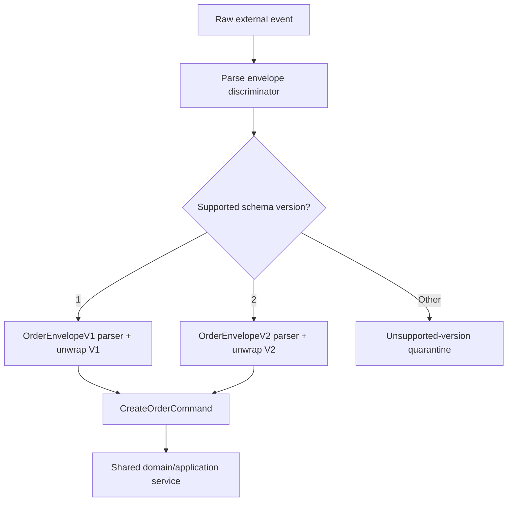
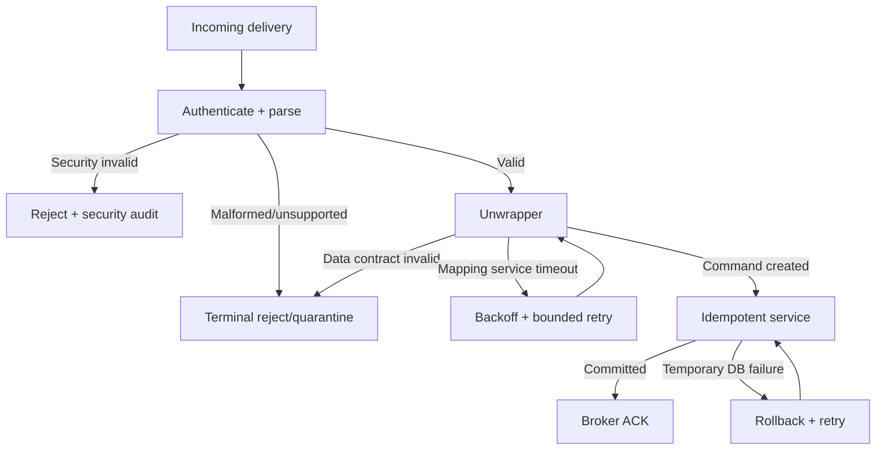

# Unwrapping Before Calling the Domain Service

## 1. Context: The Domain Service Should Not Know Transport Formats

A system receives order-creation commands from a partner over a broker. The partner does not merely send order details, but wraps them in an **envelope** containing source code, schema version, sent timestamp, event identifier, and tenant.

```json
{
  "meta": {
    "schemaVersion": 1,
    "sourceSystem": "PARTNER_A",
    "tenantId": "tenant-a",
    "eventId": "evt-order-105",
    "sentAt": "2026-11-21T11:00:00+07:00"
  },
  "payload": {
    "purchaseRef": "PO-105",
    "items": [
      {
        "productCode": "EXT-A7",
        "units": "2",
        "unitPriceMinorVnd": "25000"
      }
    ]
  }
}
```

If the domain service accepts the raw `OrderEnvelopeV1`, it is forced to know about `meta`, `sourceSystem`, `units` being a string, the partner's date-time format, and external `productCode` values. When a partner changes its schema, the business layer must change as well.

**Envelope Wrapper** is an Enterprise Integration Pattern (EIP) that wraps business data inside an outer layer holding auxiliary transport, routing, or integration information. On the receiving side, we must **unwrap** at the integration boundary and convert the payload into a stable internal command/object type before calling the domain service.

In the **Envelope wrapper** chapter of the **SPRING_INTEGRATION_PATTERN** module, learners practice implementing Enterprise Integration Patterns with Spring Integration to build loosely coupled, extensible message flows. This topic connects directly to Transformer, Router, Filter, Gateway, Splitter, Aggregator, retry, error channel, and correlation, while requiring thorough testing and observability across error branches.



**Critical boundary:** the integration layer is responsible for understanding the partner's envelope; the domain service receives a **business data type already normalized and authenticated at the appropriate layer**, never a raw transport wrapper.

## 2. What Does an Envelope Wrapper Contain?

An envelope can be split into two parts:

| Component | Example | Whose responsibility? |
| --- | --- | --- |
| **Payload** | `purchaseRef`, item list, quantities | Business content |
| **Envelope metadata** | `schemaVersion`, `sourceSystem`, `eventId`, `sentAt` | Integration protocol and tracing |
| **External transport metadata** | Broker delivery tag, partition/offset, `replyTo` | Adapter/broker |
| **Verified security context** | Principal, permitted tenant, source identity | Trust boundary |
| **Canonical command** | `CreateOrderCommand` | Application/domain layer API |

An envelope may also carry TTL, content type, checksum, message type, version, deadline, or tenant scope. However, **not every field of the wrapper is business data**.

### 2.1. Three Wrapper Layers Commonly Confused

1. **Envelope inside the payload:** JSON/XML/Avro structure defined by an external system, such as `OrderEnvelopeV1.meta` and `OrderEnvelopeV1.payload`.
2. **Spring `Message<T>`:** consists of payload and `MessageHeaders`; it is the framework's message-passing structure.
3. **Transport envelope:** metadata of HTTP, Kafka, RabbitMQ, JMS, etc., with its own naming/types and semantics.

```text
Broker Record
  transport: topic, partition, offset, delivery headers
  value: OrderEnvelopeV1
    meta: schemaVersion, sourceSystem, eventId, ...
    payload: PartnerOrderPayloadV1

Spring Integration Message<OrderEnvelopeV1>
  headers: trace, errorChannel/replyChannel, broker metadata...
  payload: OrderEnvelopeV1

After unwrap:
Spring Integration Message<CreateOrderCommand>
  headers: authorized routing / tracing metadata
  payload: CreateOrderCommand

Domain service:
  accept(CreateOrderCommand)
```

**Do not treat these three layers as one.** Removing the wrapper from the payload does not mean deleting all `MessageHeaders`, and keeping `MessageHeaders.ID` does not guarantee domain event identity remains stable across retries.

### 2.2. Envelope Wrapper vs. Normalizer, Content Enricher, and Claim Check

| Pattern | Operation | Relation to unwrapping |
| --- | --- | --- |
| **Envelope Wrapper** | Adds/removes transport wrapper around data | This lesson focuses on **removing the wrapper** |
| **Normalizer** | Converts multiple sources/formats into one canonical model | Can normalize content after unwrapping |
| **Transformer** | Converts payload A → B | Tool used to implement the unwrap step |
| **Content Enricher** | Appends missing information | Can run after unwrapping if catalog lookup is needed |
| **Claim Check** | Stores large payload and passes a token | Retrieving the body is a separate concern |
| **Filter** | Accepts/drops based on condition | Does not automatically emit a reason code when wrapper is invalid |
| **Aggregator** | Combines correlated messages | Not used simply because an envelope has many fields |
| **Gateway** | Request–reply API over messaging | Must preserve reply/error contract when unwrapping |

A Normalizer can **both** unwrap **and** map data into a canonical model. Architecturally, however, spell out the steps clearly: validate the envelope contract, separate trusted metadata, unwrap/map, and run business validation.

## 3. Where Should the Unwrapping Step Be Placed?

The recommended placement is **after the adapter has parsed and authenticated the source, and before the domain/application service receives the payload**.



### 3.1. Why Not Unwrap Too Late?

If the raw envelope goes straight to Routers/Filters/services:
- Generic handlers must access `envelope.payload.purchaseRef` instead of `command.orderId`.
- Each downstream handler parses `"2"` into a quantity itself and interprets prices in “minor units”.
- Each service decides on its own whether to trust `tenantId` inside the envelope.
- Error-prone logic is duplicated and dependencies on source schemas spread across modules.
- When `schemaVersion=2` arrives, many consumers must change simultaneously.

After unwrapping, the domain service receives only `CreateOrderCommand`, independent of external `meta/payload` structures.

### 3.2. Why Not Unwrap Before Authenticating the Source?

An untrusted sender can write `tenantId="tenant-b"` or `sourceSystem="PARTNER_A"` in JSON. If the mapper takes those values directly as trusted identity, a spoofed request could execute under the wrong tenant.

**Never take the security principal from a user-supplied field and claim it is authenticated.** The adapter must verify mTLS, broker principal, signed webhook, or an appropriate mechanism first, then match the envelope's tenant/source against the verified identity.

### 3.3. What Type Should the Domain Service Accept?

An application-layer port can look like:

```java
interface OrderApplicationService {
    void submit(CreateOrderCommand command);
}
```

`CreateOrderCommand` is an internal command with parsed numbers, timestamps, and SKU codes. The domain service does not need `Message<OrderEnvelopeV1>`, `MessageHeaders`, or Kafka/Rabbit objects. If the domain genuinely needs tenant and event ID for transaction/idempotency control, those **verified and normalized** values can live in the command or an explicit application context, without depending on the raw wrapper.

## 4. Locking Down the V1 Envelope Contract

The example uses Java 17 records to model the deserialized message. The code illustrates a **specific** contract; never guess fields if a source uses a different version.

```java
import java.util.List;

record EnvelopeMetadataV1(
        int schemaVersion,
        String sourceSystem,
        String tenantId,
        String eventId,
        String sentAt) {}

record PartnerOrderLineV1(
        String productCode,
        String units,
        String unitPriceMinorVnd) {}

record PartnerOrderPayloadV1(
        String purchaseRef,
        List<PartnerOrderLineV1> items) {}

record OrderEnvelopeV1(
        EnvelopeMetadataV1 meta,
        PartnerOrderPayloadV1 payload) {}
```

These records are **source DTOs**. Do not force them to carry all domain invariants: invalid messages still need to deserialize so they can be classified into meaningful data errors. Putting validation directly in source constructors surfaces parse/conversion failures earlier; that is a valid choice, provided exception mapping is clearly designed.

### 4.1. Role of Meta and Payload Fields

| Field | Contract | Common mistake |
| --- | --- | --- |
| `schemaVersion` | Version number supported by parser/mapper | Unknown version mistakenly mapped as V1 |
| `sourceSystem` | Partner-claimed source name, matched against trusted identity | Spoofed source |
| `tenantId` | Tenant in payload; does not prove authorization by itself | Cross-tenant injection |
| `eventId` | Logical event ID stable across delivery attempts | Retries generating new events |
| `sentAt` | Timestamp with explicit offset/timezone | Assuming local time by default |
| `purchaseRef` | Source's order reference | Confusing with event ID |
| `productCode` | Source-specific product alias | Using directly as canonical SKU |
| `units` | Quantity as decimal integer string | `"2.5"` or `"two"` |
| `unitPriceMinorVnd` | Price in whole minor VND units per contract | Confusing with USD cents |

**Time distinction:** `sentAt` is when the partner sent the envelope, not necessarily when the business order was created. If business logic requires `orderCreatedAt`, give it a separate field and semantics. This lesson maps `sentAt` to `sourceSentAt` in the command to avoid mistaking it for “payment time”.

### 4.2. Version Is Part of Semantics

If V2 changes `unitPriceMinorVnd` to `priceDecimalUsd`, **do not** reuse the V1 mapper and silently alter units. The parser/adapter must select the mapper by trusted version; unsupported versions produce an error with a dedicated reason code.

Never treat version `0` or a missing version as V1 unless the protocol explicitly defines that default. If legacy sources must be supported, build an explicit compatibility adapter and test the compatibility policy.

## 5. Immutable Domain Command with Explicit Invariants

After unwrapping, the domain service needs a clean command type with no raw transport metadata:

```java
import java.time.Instant;
import java.util.List;

enum OrderSource {
    PARTNER_A, PARTNER_B
}

record CanonicalOrderLine(
        String sku,
        int quantity,
        long unitPriceMinorVnd) {

    CanonicalOrderLine {
        if (sku == null
                || !sku.matches("[A-Z0-9-]{1,32}")
                || quantity <= 0
                || unitPriceMinorVnd < 0) {
            throw new IllegalArgumentException(
                    "INVALID_CANONICAL_ORDER_LINE");
        }
    }

    long totalMinorVnd() {
        return Math.multiplyExact(
                (long) quantity, unitPriceMinorVnd);
    }
}

record CreateOrderCommand(
        String tenantId,
        OrderSource source,
        String eventId,
        String orderId,
        Instant sourceSentAt,
        List<CanonicalOrderLine> lines,
        long totalMinorVnd) {

    CreateOrderCommand {
        if (tenantId == null || tenantId.isBlank()
                || source == null
                || eventId == null || eventId.isBlank()
                || orderId == null || orderId.isBlank()
                || sourceSentAt == null
                || lines == null || lines.isEmpty()
                || lines.size() > 1000) {
            throw new IllegalArgumentException(
                    "INVALID_CREATE_ORDER_COMMAND");
        }

        // Snapshot: do not retain a mutable List from the adapter.
        lines = List.copyOf(lines);

        long expected = 0;
        for (CanonicalOrderLine line : lines) {
            expected = Math.addExact(
                    expected, line.totalMinorVnd());
        }
        if (expected != totalMinorVnd) {
            throw new IllegalArgumentException(
                    "ORDER_TOTAL_MISMATCH");
        }
    }
}
```

Intentional design rules:

1. `sourceSentAt` uses `Instant`, representing **when the source sent it**, never substituting for `orderCreatedAt`.
2. `List.copyOf` prevents collection mutation; `CanonicalOrderLine` records are immutable too.
3. `Math.multiplyExact` and `Math.addExact` detect `long` overflow instead of silently wrapping totals.
4. `eventId` stays identical across delivery attempts of the same logical event.
5. `orderId` and `eventId` are not assumed equal: one order can have many events.
6. `tenantId` must already be verified at the security boundary, never trusted merely because it is non-blank.
7. The domain service can still validate prices against an authorized catalog; arithmetic consistency **does not** prove client-sent prices are trustworthy.

If supporting multiple currencies, do not keep a “VND” name and secretly pass USD cents. Define `Money(currency, minorUnits)` or an equivalent value object with explicit precision and conversion rules.

## 6. Separating Verified Data from the Raw Envelope

To model the trust boundary, use a dedicated `VerifiedOrderEnvelope` type. This object is created only through a step that **already holds a security identity from the transport**.

```java
record TransportIdentity(
        String authorizedTenantId,
        OrderSource authorizedSource) {}

record VerifiedOrderEnvelope(
        OrderEnvelopeV1 envelope,
        String tenantId,
        OrderSource source) {}
```

A simple verification step compares the adapter's identity against client-sent metadata:

```java
import java.util.Objects;

final class VerifiedEnvelopeFactory {

    VerifiedOrderEnvelope verify(
            OrderEnvelopeV1 raw,
            TransportIdentity identity) {

        Objects.requireNonNull(raw, "raw");
        Objects.requireNonNull(identity, "identity");

        if (identity.authorizedTenantId() == null
                || identity.authorizedTenantId().isBlank()
                || identity.authorizedSource() == null) {
            throw new SecurityException(
                    "MISSING_AUTHENTICATED_CONTEXT");
        }

        var meta = raw.meta();
        if (meta == null) {
            throw new EnvelopeContractException(
                    "ENVELOPE_META_MISSING");
        }

        if (!identity.authorizedTenantId()
                    .equals(meta.tenantId())
                || !identity.authorizedSource().name()
                    .equals(meta.sourceSystem())) {
            throw new SecurityException(
                    "ENVELOPE_IDENTITY_MISMATCH");
        }

        return new VerifiedOrderEnvelope(
                raw,
                identity.authorizedTenantId(),
                identity.authorizedSource());
    }
}
```

**Important limitation of this example:** `TransportIdentity` must **not** be built from `raw.meta()` or an arbitrary client header. It must come from the **authenticated** portion of the inbound adapter (mTLS, broker authorization, signed webhook, etc.). `VerifiedOrderEnvelope` is merely an internal typed artifact, **not cryptographic proof**: if an untrusted producer is allowed to publish directly to a channel expecting this type, callers can construct fake objects.

In real production systems, enforce internal publish permissions, avoid exposing verified-record channels publicly, and run verification at the boundary before any side effects occur.

### 6.1. Do Not Leak Secrets via Exceptions

When tenant/source mismatches occur, an error code suffices for observability; never include raw credentials, tokens, full payloads, or personal data in `SecurityException.getMessage()`. Ingress logs should capture tracking ID, source type, reason code, and tenant info **according to security policy**.

### 6.2. Verified Context Does Not Replace Business Authorization

A partner authenticated for tenant A is not automatically allowed to order every SKU or specify arbitrary prices. After unwrapping, the application service must still enforce business authorization, catalog validation, and transaction policies. Being “verified” only proves **source identity and baseline scope** under this boundary's contract.

## 7. Unwrapper: From `VerifiedOrderEnvelope` to `CreateOrderCommand`

The unwrapper should be a controlled data transformation: read verified metadata, validate the contract, parse source fields, and build an internal object. It **must not** save orders, hold transactions, send emails, or decide overall workflow success.

### 7.1. Resolving SKUs Through an Abstraction

```java
interface PartnerSkuResolver {
    String requireCanonicalSku(
            OrderSource source,
            String externalProductCode);
}
```

Do not write `externalCode.toUpperCase()` and claim it is an internal SKU. External aliases can collide in name while having different meanings. The resolver needs a governed mapping with appropriate versioning/retention for replay; unavailable errors must be distinguished from unknown mappings.

### 7.2. Contract Error Type with Stable Reason Codes

```java
final class EnvelopeContractException
        extends IllegalArgumentException {

    private final String reasonCode;

    EnvelopeContractException(String reasonCode) {
        super(reasonCode);
        this.reasonCode = reasonCode;
    }

    String reasonCode() {
        return reasonCode;
    }
}
```

Use this type only for errors attributable to input **format/contract**. A database timeout inside the resolver is an infrastructure error requiring retry/backoff, so never wrap every `RuntimeException` in `EnvelopeContractException` and ACK it as bad data.

### 7.3. Complete Unwrap Code

```java
import java.time.Instant;
import java.time.OffsetDateTime;
import java.time.format.DateTimeParseException;
import java.util.ArrayList;
import java.util.Objects;
import org.springframework.stereotype.Component;

@Component
final class OrderEnvelopeUnwrapper {

    private final PartnerSkuResolver skuResolver;

    OrderEnvelopeUnwrapper(PartnerSkuResolver skuResolver) {
        this.skuResolver = Objects.requireNonNull(skuResolver);
    }

    CreateOrderCommand unwrap(VerifiedOrderEnvelope verified) {
        if (verified == null
                || verified.envelope() == null
                || verified.tenantId() == null
                || verified.source() == null) {
            throw new EnvelopeContractException(
                    "VERIFIED_ENVELOPE_MISSING");
        }

        OrderEnvelopeV1 wrapper = verified.envelope();
        EnvelopeMetadataV1 meta = wrapper.meta();
        PartnerOrderPayloadV1 body = wrapper.payload();

        if (meta == null
                || meta.schemaVersion() != 1) {
            throw new EnvelopeContractException(
                    "UNSUPPORTED_ENVELOPE_VERSION");
        }
        if (body == null
                || isBlank(body.purchaseRef())
                || isBlank(meta.eventId())
                || isBlank(meta.sentAt())) {
            throw new EnvelopeContractException(
                    "ENVELOPE_REQUIRED_FIELD_MISSING");
        }
        if (!verified.tenantId().equals(meta.tenantId())
                || !verified.source().name()
                    .equals(meta.sourceSystem())) {
            throw new SecurityException(
                    "ENVELOPE_IDENTITY_MISMATCH");
        }

        Instant sourceSentAt = parseOffsetTime(
                meta.sentAt());

        if (body.items() == null
                || body.items().isEmpty()
                || body.items().size() > 1000) {
            throw new EnvelopeContractException(
                    "ENVELOPE_ITEM_COUNT_INVALID");
        }

        var lines = new ArrayList<CanonicalOrderLine>();
        long total = 0;

        for (PartnerOrderLineV1 line : body.items()) {
            if (line == null
                    || isBlank(line.productCode())
                    || isBlank(line.units())
                    || isBlank(line.unitPriceMinorVnd())) {
                throw new EnvelopeContractException(
                        "ENVELOPE_LINE_MISSING_FIELD");
            }

            int quantity = parseQuantity(line.units());
            long price = parseMinorVnd(line.unitPriceMinorVnd());

            // Do not treat partner code as an internal SKU.
            String sku = skuResolver.requireCanonicalSku(
                    verified.source(), line.productCode());

            try {
                var normalized = new CanonicalOrderLine(
                        sku, quantity, price);
                lines.add(normalized);
                total = Math.addExact(
                        total, normalized.totalMinorVnd());
            } catch (ArithmeticException ex) {
                throw new EnvelopeContractException(
                        "ENVELOPE_AMOUNT_OUT_OF_RANGE");
            } catch (IllegalArgumentException ex) {
                throw new EnvelopeContractException(
                        "ENVELOPE_LINE_INVALID");
            }
        }

        try {
            return new CreateOrderCommand(
                    verified.tenantId(),
                    verified.source(),
                    meta.eventId(),
                    body.purchaseRef(),
                    sourceSentAt,
                    lines,
                    total);
        } catch (IllegalArgumentException ex) {
            throw new EnvelopeContractException(
                    "ENVELOPE_COMMAND_INVALID");
        }
    }

    private static Instant parseOffsetTime(String value) {
        try {
            return OffsetDateTime.parse(value).toInstant();
        } catch (DateTimeParseException ex) {
            throw new EnvelopeContractException(
                    "ENVELOPE_TIMESTAMP_INVALID");
        }
    }

    private static int parseQuantity(String raw) {
        try {
            int quantity = Integer.parseInt(raw);
            if (quantity <= 0) {
                throw new NumberFormatException();
            }
            return quantity;
        } catch (NumberFormatException ex) {
            throw new EnvelopeContractException(
                    "ENVELOPE_QUANTITY_INVALID");
        }
    }

    private static long parseMinorVnd(String raw) {
        try {
            long value = Long.parseLong(raw);
            if (value < 0) {
                throw new NumberFormatException();
            }
            return value;
        } catch (NumberFormatException ex) {
            throw new EnvelopeContractException(
                    "ENVELOPE_PRICE_INVALID");
        }
    }

    private static boolean isBlank(String input) {
        return input == null || input.isBlank();
    }
}
```

Key points when reading this example:

- **Version gate:** Only V1 passes this mapper; V2 must have its own adapter/mapper.
- **Trust gate:** Tenant/source come from `VerifiedOrderEnvelope` and are cross-checked against the wrapper; source values are never trusted by default.
- **Strict parsing:** `"2"` is valid; `"two"`, `"2.0"`, and non-integer prices are rejected per contract.
- **Timestamps:** `OffsetDateTime.parse(...).toInstant()` honors the source-declared offset rather than the JVM's default timezone.
- **SKU:** Must resolve via mapping to internal SKU; never silently create `UNKNOWN`.
- **Pricing:** Units are explicitly named whole minor VND, never guessing USD/cents.
- **Overflow:** Detects sum overflow with `Math.addExact`/`Math.multiplyExact`.
- **Immutability:** Output holds a snapshot list, keeping no mutable references from input.
- **Exception boundary:** Only contract errors become `EnvelopeContractException`; resolver timeouts surface as infrastructure errors.

### 7.4. Why Not Simply Return `wrapper.payload()`?

```java
// Do not make the domain service depend on the raw source object:
PartnerOrderPayloadV1 unwrapBadly(OrderEnvelopeV1 wrapper) {
    return wrapper.payload();
}
```

That naive “unwrapping” only strips `meta` from the payload, yet the domain layer still has to understand `purchaseRef`, `units` as a `String`, and partner `productCode`. To isolate the domain, **map into a command/canonical model**. If the inner payload is already a canonical domain command (possible in internal applications), unwrapping is simpler, yet that must be confirmed by contract rather than assumed.

### 7.5. Never Produce Side Effects Inside a Transformer

Calling `skuResolver` is a lookup for mapping; design it to be as read-only, deterministic, and cached/versioned as possible. Never insert order rows, deduct inventory, or call payment APIs from `unwrap`. The domain service is invoked **only after** the entire wrapper passes validation and produces a command.

If the final line has a malformed price, `unwrap` must not have deducted inventory for earlier lines. Separating transformation from business side effects enforces this principle.

## 8. Spring Integration: Unwrapping Before the Service Activator

Spring Integration naturally implements unwrapping using a **Transformer endpoint**. Here, `orders.envelopes.verified` receives only adapter-authenticated objects; downstream receives `CreateOrderCommand`.

### 8.1. Java DSL with Two Clear Stages

```java
import org.springframework.context.annotation.Bean;
import org.springframework.context.annotation.Configuration;
import org.springframework.integration.channel.DirectChannel;
import org.springframework.integration.config.EnableIntegration;
import org.springframework.integration.dsl.IntegrationFlow;
import org.springframework.messaging.MessageChannel;

@Configuration
@EnableIntegration
class OrderEnvelopeIntegrationFlow {

    @Bean("orders.envelopes.verified")
    MessageChannel verifiedEnvelopes() {
        return new DirectChannel();
    }

    @Bean("orders.commands")
    MessageChannel commands() {
        return new DirectChannel();
    }

    @Bean
    IntegrationFlow unwrapVerifiedOrders(
            OrderEnvelopeUnwrapper unwrapper) {
        return IntegrationFlow.from("orders.envelopes.verified")
                .transform(VerifiedOrderEnvelope.class,
                        unwrapper::unwrap)
                .channel("orders.commands")
                .get();
    }

    @Bean
    IntegrationFlow submitCanonicalOrders(
            OrderApplicationService service) {
        return IntegrationFlow.from("orders.commands")
                .handle(CreateOrderCommand.class,
                        (command, headers) -> {
                            service.submit(command);
                            return null; // One-way handler.
                        })
                .get();
    }
}
```

**The decisive boundary lies in the handler's input type:**

```text
Source adapter:
  OrderEnvelopeV1
    -> authenticated identity check
    -> VerifiedOrderEnvelope

Integration flow:
  VerifiedOrderEnvelope
    -> Transformer / unwrap
    -> CreateOrderCommand

Domain/application port:
  submit(CreateOrderCommand)
```

If the business swaps brokers or partner envelope payloads, `OrderApplicationService` code never needs extra transport fields. A single place — the unwrapper/source adapter — manages the source schema.

### 8.2. What Protects `orders.envelopes.verified`?

In tests, you can send a `VerifiedOrderEnvelope` straight to the channel. In production, however, **that channel must be an internal boundary** wired exclusively from the verified ingress path.

Never:
- Route a public HTTP request body straight to the verified channel merely because it deserialized into the right Java record.
- Take `sourceSystem` from a raw header and fabricate `TransportIdentity`.
- Put `@Validated` on a wrapper and assume it proves partner authorization.
- Reuse the same channel for both verified and unverified payloads without separate types/contracts.

Protection can be enforced in the inbound adapter, an explicit guard endpoint before the verified channel, broker ACLs, or a restricted-publish adapter service; exact enforcement depends on deployment.

### 8.3. Why Use `DirectChannel` in the Example?

`DirectChannel` invokes the handler synchronously on the sending thread within the same context, which is convenient for demonstrations and integration tests. It is **not** a durable queue. If replaced with `ExecutorChannel` or a broker:
- Exceptions can occur on another thread/transport.
- Message ordering can change.
- Retry, ACK/NACK, deadline, and idempotency policies are required.
- The domain service still receives only the command, while delivery reliability becomes the responsibility of other layers.

### 8.4. Request–Reply Limitation

The flow above is **one-way** because the domain port returns `void` and the lambda handler returns `null`. A Messaging Gateway calling this flow and awaiting a response **will not automatically receive a success reply**. If a use case needs request–reply, define:

```java
record SubmitOrderResult(
        String tenantId,
        String eventId,
        String orderId,
        boolean accepted) {}

interface RequestReplyOrderService {
    SubmitOrderResult submit(CreateOrderCommand command);
}
```

The request–reply handler returns `SubmitOrderResult`, paired with an explicit error/timeout reply path for contract errors. Never send a rejected envelope to a terminal channel and leave the Gateway waiting forever.

## 9. Annotation-Based Variant: `@Transformer` and `@ServiceActivator`

An application can use annotations instead of the Java DSL:

```java
import org.springframework.integration.annotation.Transformer;
import org.springframework.integration.annotation.ServiceActivator;
import org.springframework.stereotype.Component;

@Component
class AnnotatedEnvelopeEndpoints {

    private final OrderEnvelopeUnwrapper unwrapper;
    private final OrderApplicationService service;

    AnnotatedEnvelopeEndpoints(
            OrderEnvelopeUnwrapper unwrapper,
            OrderApplicationService service) {
        this.unwrapper = unwrapper;
        this.service = service;
    }

    @Transformer(
            inputChannel = "orders.envelopes.verified",
            outputChannel = "orders.commands")
    public CreateOrderCommand unpack(
            VerifiedOrderEnvelope envelope) {
        return unwrapper.unwrap(envelope);
    }

    @ServiceActivator(inputChannel = "orders.commands")
    public void process(CreateOrderCommand command) {
        service.submit(command);
    }
}
```

This is an **alternative topology** to the `IntegrationFlow` beans in Section 8. Never register **both** versions simultaneously on the same `DirectChannel` expecting both to run: a `DirectChannel` normally dispatches each message to **one** subscriber under its dispatch semantics, causing unexpected behavior.

Both styles share the same goal: keep unwrapping inside the integration layer so the domain service receives only commands.

### 9.1. Do Not Place `@Transformer` on the Domain Service

If you write:

```java
// ANTI-PATTERN: the domain service must know about the wrapper.
void submit(OrderEnvelopeV1 envelope) {
    String orderId = envelope.payload().purchaseRef();
    // ... business logic ...
}
```

then unwrapping has been pushed down into the domain. That couples the domain to source schemas and forces business tests to construct unrelated wrappers/headers.

A good test for `OrderApplicationService` should only build `CreateOrderCommand` or domain objects, needing no Kafka headers or `OrderEnvelopeV1`.

## 10. Message Headers After Unwrapping

A Transformer can build a new message with payload `CreateOrderCommand` and preserve a subset of headers per Spring Integration mechanics. **Changing the payload does not automatically strip untrusted headers**, nor does wrapper metadata automatically copy to properly named headers.

```text
Incoming Spring Message:
  payload = VerifiedOrderEnvelope(
              envelope=OrderEnvelopeV1(...),
              trustedTenantId=tenant-a,
              trustedSource=PARTNER_A
            )
  headers = {
    ingressTrackingId, traceparent,
    messageId, replyChannel, errorChannel,
    broker-specific fields
  }

Outgoing Spring Message:
  payload = CreateOrderCommand(
              tenantId=tenant-a,
              eventId=evt-order-105,
              orderId=PO-105,
              ...
            )
  headers = controlled routing/tracing metadata
```

Never let a raw broker header `tenantId=tenant-b` override `CreateOrderCommand.tenantId=tenant-a`. When two layers of information conflict, validate and **reject the conflict** rather than arbitrarily picking one field.

### 10.1. Header Policy Table

| Header/metadata | What to do after unwrap? | Rationale |
| --- | --- | --- |
| `ingressTrackingId` | Propagate if issued by adapter | Auditing and error reconciliation |
| `traceparent`/trace ID | Use tracing library, protect trust boundary | Distributed observability |
| `tenantId` | Derive from verified identity or command | Prevent spoofing/cross-tenant leaks |
| `eventId` | Synchronize with stable `CreateOrderCommand.eventId` | Retry/idempotency |
| `sourceSystem` | Derive from verified `OrderSource` | Never trust raw source field |
| `schemaVersion` | Record parser version if needed for audit | Replay/migration |
| `CORRELATION_ID` | Keep if group semantics still apply | Do not mix workflows/batches |
| `SEQUENCE_NUMBER/SIZE` | Keep only when sequence semantics are preserved | Resequencer/Aggregator |
| `replyChannel` | Preserve reply path inside internal flows | Gateway request–reply |
| `errorChannel` | Maintain per error-handling policy | Exception classification |
| Broker delivery headers | Handle at adapter/ACK boundary | Keep out of domain |
| Raw authorization token | Strip where unneeded | Security |

### 10.2. Headers Are Not Proof of Authentication

Even if `MessageHeaders` are never altered at runtime, a header's initial value could have been set by a client. Therefore you need **provenance**: a header created by the ingress adapter from an authenticated principal differs from a header merely copied from a request.

A safe pattern places the verified identity in an adapter-created internal context, cross-checks wrapper fields against it, and builds the business command from that context.

### 10.3. When a Custom Transformer Returns `Message` Instead of Payload

If a Transformer manually constructs `Message<CreateOrderCommand>`, it can explicitly copy or override headers. In doing so, it must:
- Preserve required reply-routing fields;
- Strip raw credentials, PII, and JVM-only transport objects;
- Never overwrite `CORRELATION_ID` with a fresh UUID when a business group must stay intact;
- Synchronize `eventId` and tenant between payload and headers;
- Run integration tests against **actual output messages** rather than guessing framework behavior.

The unclassified `copyHeaders(input.getHeaders())` anti-pattern can drag untrusted data into downstream flows. At broker/service boundaries, enforce a **header allowlist** and contract tests.

## 11. Schema Versioning: Do Not Pretend Every Wrapper Is V1

When a partner upgrades its API, the envelope can change both structure and data semantics.

| Change | Impact | Solution |
| --- | --- | --- |
| Rename `items` to `lines` | Source DTO parsing | V2 parser/mapper |
| Change `units` from String to integer | Source contract | New version or explicit compatibility |
| Change `unitPriceMinorVnd` to USD decimal | **Breaking semantic change** | Explicit money conversion/versioning |
| Add `checksum` or `signature` | Security/transport verification | Verify before unwrapping |
| Change `eventId` semantics | Breaks idempotency/correlation | Migration and key versioning |
| Add optional tracing metadata | Not domain logic | Metadata mapping |
| Replace `sentAt` with order creation time | Business meaning changes | Update command model and tests |

### 11.1. Adapter Selects Mapper by Version



Notice the ordering: **the parser selecting schema by version** can belong to the inbound adapter; if raw bytes lack a valid discriminator, do not force-deserialize into V1 and receive bogus defaults.

If V2 changes command semantics, create `CreateOrderCommandV2` or version the canonical model rather than cramming new meanings into V1 and losing semantics. Not every source change requires modifying the domain command, yet **every breaking semantic change must be evaluated**.

### 11.2. Replaying Legacy Data Must Use Version-Matched Rules

If a V1 message sits in a DLQ for 30 days and by then the code only supports V2, replay can fail. Strategy:
1. Keep V1 parsers during the migration window;
2. Convert V1 → current canonical version via explicit rules;
3. Use appropriate source SKU mapping/versions;
4. Keep `eventId` and fingerprints stable for idempotency;
5. Audit both the source version and normalization rule version.

Never silently map `schemaVersion=1` as V2 by renaming fields in code and hoping prices, tenants, and timezones remain right.

### 11.3. Signatures and Checksums: Verification Order

If a partner signs the raw body (HMAC/digital signature), verify **over the exact bytes or canonical representation specified by the signing protocol**, before altering field order, trimming text, or mapping payloads. A valid signature proves integrity/origin under that trust material, **not** that the business data is authorized.

Never pass secret/key material into the normalizer or domain command. Verification belongs at the ingress/security boundary, with an accompanying key-rotation policy.

## 12. Unwrap Error Handling: Separating Input, Security, and Infrastructure

In practice there are at least four failure categories; never use a single `catch(Exception)` and label everything “malformed payload”.

| Category | Example | Action |
| --- | --- | --- |
| **Conversion/deserialization** | Syntax-invalid JSON, wrong content type | Block at adapter; 4xx response or DLQ policy |
| **Contract invalid** | V1 missing `eventId`, `units="two"` | Reject/quarantine with reason code |
| **Unsupported version** | `schemaVersion=9` | Quarantine; upgrade mapper or contract |
| **Security violation** | Tenant/source mismatch, bad signature | Deny and security audit |
| **Unknown mapping** | `EXT-A7` has no internal SKU yet | Quarantine/replay after mapping is added |
| **Transient infrastructure** | SKU directory timeout | Bounded retry with backoff |
| **Programming defect** | Unexpected `NullPointerException` | Alert and fail processing |
| **Business rejection** | Banned SKU, unapproved price | Domain/application decision, distinct from unwrap |

### 12.1. Do Not Use a Filter to Silently Drop Bad Wrappers

```text
Incoming Envelope
  -> filter(e -> unwrap(e) != null)
  -> domain service
```

This anti-pattern hides root causes: a Filter dropping a message causes an awaiting Gateway to time out, a batch Aggregator to miss an item, or a broker adapter to ACK wrongly. Use a **typed rejection outcome** or an exception classifier so you know why a delivery was not processed.

### 12.2. A Typed Outcome for Identifiable Errors

A variant suited for import/batch flows can return:

```java
sealed interface UnwrapOutcome
        permits UnwrappedOrder, RejectedEnvelope {}

record UnwrappedOrder(CreateOrderCommand command)
        implements UnwrapOutcome {}

record RejectedEnvelope(
        String trustedTrackingId,
        String reasonCode)
        implements UnwrapOutcome {}
```

An ingress guard can catch **specifically** `EnvelopeContractException` to return `RejectedEnvelope`, omitting raw payloads from the error object:

```java
UnwrapOutcome classify(
        VerifiedOrderEnvelope input,
        String trustedTrackingId,
        OrderEnvelopeUnwrapper unwrapper) {
    try {
        return new UnwrappedOrder(unwrapper.unwrap(input));
    } catch (EnvelopeContractException badInput) {
        return new RejectedEnvelope(
                trustedTrackingId, badInput.reasonCode());
    }
}
```

When routing the outcome, the accepted branch must **unwrap `UnwrappedOrder.command`** before sending to a channel accepting `CreateOrderCommand`. The rejected branch stores/replies per contract without swallowing lookup-source exceptions. **Never** catch `SecurityException` and return a rejection without a security audit; handle it at the security boundary.

### 12.3. Error Channel Does Not Replace a DLQ or Ledger

With synchronous `DirectChannel`, transformer errors propagate back to the sender as messaging exceptions. With executors/pollers/brokers, errors can flow to `errorChannel`/adapter-specific error handlers.

However, `errorChannel` does not automatically:
- Persist raw envelopes durably;
- Retry according to policy;
- Classify permanent vs. transient errors;
- ACK/NACK with proper broker semantics;
- Return results to an awaiting Gateway;
- Prevent duplicate processing during replay.

Those capabilities require explicit adapter settings, retry advice, quarantine storage, transactions, and Idempotent Receiver.

### 12.4. Retry the Right Error Types



Do not retry `units="two"` indefinitely: re-running the same data will not turn it into a number. Do not mark every resolver error as terminal if it was a timeout: external directories/states can recover.

## 13. Idempotency, Correlation, and Preserving Identity Across Unwrapping

A wrapper can carry different identities:

```text
sourceOrderId = PO-105      // source order
eventId       = evt-105     // logical event (stable across retries)
messageId     = framework ID of each delivery envelope
correlationId = batch/group/request correlation per flow
traceId       = distributed trace context
```

Never use `MessageHeaders.ID` or trace ID instead of `eventId`. A broker can redeliver the same event with a different envelope ID. After unwrapping, `CreateOrderCommand.eventId` must keep the stable logical identity so Idempotent Receiver detects duplicates.

### 13.1. Idempotency Keys Should Include Source and Tenant Scope

```java
record OrderEventKey(
        String consumerName,
        String tenantId,
        OrderSource source,
        String eventId) {}

OrderEventKey forCommand(
        String consumerName, CreateOrderCommand command) {
    return new OrderEventKey(
            consumerName,
            command.tenantId(),
            command.source(),
            command.eventId());
}
```

If two sources can emit the same `eventId`, `source` must be part of the key. If the same `eventId` arrives with a different payload, flag an **identity conflict** rather than silently ACKing it as a valid duplicate.

### 13.2. The Domain Service Still Needs a Transaction Boundary

The unwrapper does not prevent duplicate side effects. An at-least-once broker flow:

```text
Delivery #1:
  verify -> unwrap -> CreateOrderCommand
  idempotent receiver -> commit order + inbox
  broker ACK lost

Delivery #2:
  verify -> unwrap -> same CreateOrderCommand identity
  idempotent receiver -> duplicate, no second order
  broker ACK successful
```

When writing the order and Inbox to the same database, use a unique constraint + transaction to prevent races. If the domain service sends emails or publishes events, consider an outbox/idempotent downstream. **Never call a payment API inside `unwrap`** and claim the whole flow is idempotent.

### 13.3. Correlation Headers Should Not Vanish Arbitrarily

If the wrapper participates in a Splitter/Aggregator flow, metadata like `CORRELATION_ID`, `SEQUENCE_NUMBER`, and `SEQUENCE_SIZE` may need to survive across Transformers. Do not arbitrarily set `correlationId=eventId`:
- A batch has many `eventId`s sharing one correlation group.
- One event can have multiple replies/subtasks.
- One trace can contain multiple requests.

Define **group semantics** separately. When a Filter drops an invalid envelope, a downstream Aggregator may hang if its release strategy still expects the original item count; emit a rejected outcome/completion marker or adjust expected counts per contract.

### 13.4. Replay When Catalog Mappings Change

If `EXT-A7` maps to `SKU-A` today and `SKU-B` next month, replaying the same event can generate a different command the second time. Even with a stable event ID, idempotency checks may detect a payload conflict.

To handle this:
- Record the mapping version/snapshot used the first time;
- Or persist the canonical command/result alongside the event ID and reuse it on replay;
- Or define a new event revision when mapping changes are intentional.

Never implicitly use “latest mapping” if business rules demand deterministic replay and auditability.

## 14. Unit Test: Unwrapping Correctly and Preserving Business Semantics

To test accurately, you do not need to boot a Spring context. Construct a source envelope, pass a verified identity from a test object, use a fake SKU resolver, and verify the output is an **unwrapped** command.

### 14.1. V1 Envelope Fixtures

```java
import java.util.List;

final class EnvelopeFixtures {
    static OrderEnvelopeV1 validV1() {
        return new OrderEnvelopeV1(
                new EnvelopeMetadataV1(
                        1,
                        "PARTNER_A",
                        "tenant-a",
                        "evt-order-105",
                        "2026-11-21T11:00:00+07:00"),
                new PartnerOrderPayloadV1(
                        "PO-105",
                        List.of(new PartnerOrderLineV1(
                                "EXT-A7", "2", "25000"))));
    }

    static OrderEnvelopeV1 withUnits(String units) {
        var old = validV1();
        return new OrderEnvelopeV1(
                old.meta(),
                new PartnerOrderPayloadV1(
                        "PO-105",
                        List.of(new PartnerOrderLineV1(
                                "EXT-A7", units, "25000"))));
    }

    private EnvelopeFixtures() {}
}
```

The fixture keeps source metadata and payload separate. In version/tenant conflict tests, construct a different `EnvelopeMetadataV1` **without** altering the body so you know which rule triggered the failure.

### 14.2. Round-Trip Test of Identity and Amounts

```java
import java.time.Instant;
import org.junit.jupiter.api.BeforeEach;
import org.junit.jupiter.api.Test;
import static org.junit.jupiter.api.Assertions.*;

class OrderEnvelopeUnwrapperTest {

    private VerifiedEnvelopeFactory verifier;
    private OrderEnvelopeUnwrapper unwrapper;

    @BeforeEach
    void setup() {
        verifier = new VerifiedEnvelopeFactory();

        PartnerSkuResolver resolver = (source, externalSku) -> {
            if (source == OrderSource.PARTNER_A
                    && "EXT-A7".equals(externalSku)) {
                return "SKU-A";
            }
            throw new EnvelopeContractException(
                    "UNKNOWN_EXTERNAL_SKU");
        };
        unwrapper = new OrderEnvelopeUnwrapper(resolver);
    }

    private VerifiedOrderEnvelope trusted(
            OrderEnvelopeV1 wrapper) {
        return verifier.verify(
                wrapper,
                new TransportIdentity(
                        "tenant-a", OrderSource.PARTNER_A));
    }

    @Test
    void validEnvelopeBecomesTypedDomainCommand() {
        var command = unwrapper.unwrap(
                trusted(EnvelopeFixtures.validV1()));

        assertEquals("tenant-a", command.tenantId());
        assertEquals(OrderSource.PARTNER_A, command.source());
        assertEquals("evt-order-105", command.eventId());
        assertEquals("PO-105", command.orderId());
        assertEquals(
                Instant.parse("2026-11-21T04:00:00Z"),
                command.sourceSentAt());

        assertEquals(1, command.lines().size());
        var line = command.lines().get(0);
        assertEquals("SKU-A", line.sku());
        assertEquals(2, line.quantity());
        assertEquals(25_000L, line.unitPriceMinorVnd());
        assertEquals(50_000L, command.totalMinorVnd());
    }

    @Test
    void malformedQuantityProducesStableReasonCode() {
        var bad = EnvelopeFixtures.withUnits("two");

        var error = assertThrows(
                EnvelopeContractException.class,
                () -> unwrapper.unwrap(trusted(bad)));

        assertEquals(
                "ENVELOPE_QUANTITY_INVALID",
                error.reasonCode());
    }

    @Test
    void identityMismatchIsSecurityError() {
        var untrusted = EnvelopeFixtures.validV1();

        assertThrows(SecurityException.class,
                () -> verifier.verify(
                        untrusted,
                        new TransportIdentity(
                                "tenant-b", OrderSource.PARTNER_A)));
    }

    @Test
    void sameEventIdentitySurvivesRedelivery() {
        var first = unwrapper.unwrap(
                trusted(EnvelopeFixtures.validV1()));
        var retry = unwrapper.unwrap(
                trusted(EnvelopeFixtures.validV1()));

        assertEquals(first.eventId(), retry.eventId());
        assertEquals(first.tenantId(), retry.tenantId());
        assertEquals(first.source(), retry.source());
        assertEquals(first, retry);
    }
}
```

**Note the distinction:** The identity-mismatch test only checks that the factory rejects two differing values. It does not prove a sender was authenticated via mTLS/JWT/HMAC; security adapter integration tests must use real authentication or a test double accurately simulating trusted identity.

### 14.3. Unsupported Version Test

```java
import org.junit.jupiter.api.Test;
import static org.junit.jupiter.api.Assertions.*;

class EnvelopeVersionTest {
    @Test
    void doesNotInterpretVersionTwoAsVersionOne() {
        var old = EnvelopeFixtures.validV1();
        var oldMeta = old.meta();

        var future = new OrderEnvelopeV1(
                new EnvelopeMetadataV1(
                        2,
                        oldMeta.sourceSystem(),
                        oldMeta.tenantId(),
                        oldMeta.eventId(),
                        oldMeta.sentAt()),
                old.payload());

        var verified = new VerifiedEnvelopeFactory()
                .verify(future,
                        new TransportIdentity(
                                "tenant-a", OrderSource.PARTNER_A));

        var mapper = new OrderEnvelopeUnwrapper(
                (source, product) -> "SKU-A");

        var error = assertThrows(
                EnvelopeContractException.class,
                () -> mapper.unwrap(verified));

        assertEquals(
                "UNSUPPORTED_ENVELOPE_VERSION",
                error.reasonCode());
    }
}
```

In reality, version 2 may have a different DTO and therefore need a dedicated V2 parser. This test simply verifies **the guard prevents V2 from being mistaken for V1** if deserialized into the V1 structure in the exercise.

### 14.4. Invalid Data Test Matrix

| Scenario | Expected outcome to verify |
| --- | --- |
| `meta=null` | Cannot verify cleanly; coded error |
| `payload=null` | `ENVELOPE_REQUIRED_FIELD_MISSING` |
| `schemaVersion=2` | `UNSUPPORTED_ENVELOPE_VERSION` |
| `eventId=""` | `ENVELOPE_REQUIRED_FIELD_MISSING` |
| `sourceSystem` mismatches principal | Security rejection |
| `tenantId` mismatches principal | Security rejection |
| `sentAt` missing offset | `ENVELOPE_TIMESTAMP_INVALID` |
| `items=[]` | `ENVELOPE_ITEM_COUNT_INVALID` |
| `items` contains null | `ENVELOPE_LINE_MISSING_FIELD` |
| `units="two"` | `ENVELOPE_QUANTITY_INVALID` |
| `units="-1"` | `ENVELOPE_QUANTITY_INVALID` |
| `unitPriceMinorVnd="-100"` | `ENVELOPE_PRICE_INVALID` |
| `unitPriceMinorVnd="25.00"` | `ENVELOPE_PRICE_INVALID` |
| Unmapped `productCode` | Reason code or typed mapping error |
| Directory timeout | Infrastructure error; do not wrap as bad input |
| Total overflows `long` | `ENVELOPE_AMOUNT_OUT_OF_RANGE` |
| Same V1 delivered twice | Same command business identity |
| Same event ID, different payload | Idempotency conflict at receiver |

**An important testing detail:** `List.of(null)` throws `NullPointerException` right inside the Java fixture. To test a list containing a `null` element produced by JSON, use `Arrays.asList((PartnerOrderLineV1) null)` or a mutable list allowing `null`, then pass it through the unwrapper.

## 15. Integration Test: Domain Service Receives Only `CreateOrderCommand`

Unit tests prove the mapper, yet do not prove Spring Integration wiring calls the right endpoint. An integration test must send `VerifiedOrderEnvelope` to the channel and inspect the result with a mock domain port.

### 15.1. Spring Context for the Java DSL Example

```java
import org.junit.jupiter.api.AfterEach;
import org.junit.jupiter.api.Test;
import org.mockito.ArgumentCaptor;
import org.springframework.beans.factory.annotation.Autowired;
import org.springframework.beans.factory.annotation.Qualifier;
import org.springframework.context.annotation.Bean;
import org.springframework.context.annotation.Configuration;
import org.springframework.messaging.MessageChannel;
import org.springframework.messaging.support.MessageBuilder;
import org.springframework.test.context.junit.jupiter.SpringJUnitConfig;

import static org.junit.jupiter.api.Assertions.*;
import static org.mockito.Mockito.*;

@SpringJUnitConfig(classes = {
        OrderEnvelopeIntegrationFlow.class,
        OrderEnvelopeUnwrapper.class,
        OrderEnvelopeFlowIT.FakeDependencies.class
})
class OrderEnvelopeFlowIT {

    @Autowired
    @Qualifier("orders.envelopes.verified")
    MessageChannel input;

    @Autowired
    OrderApplicationService service;

    private final VerifiedEnvelopeFactory verifier =
            new VerifiedEnvelopeFactory();

    @AfterEach
    void resetMock() {
        reset(service);
    }

    @Test
    void unwrapsBeforeInvokingApplicationService() {
        var verified = verifier.verify(
                EnvelopeFixtures.validV1(),
                new TransportIdentity(
                        "tenant-a", OrderSource.PARTNER_A));

        assertTrue(input.send(
                MessageBuilder.withPayload(verified)
                        .setHeader("ingressTrackingId", "track-105")
                        .build()));

        var captor =
                ArgumentCaptor.forClass(CreateOrderCommand.class);
        verify(service).submit(captor.capture());

        var cmd = captor.getValue();
        assertEquals("PO-105", cmd.orderId());
        assertEquals("tenant-a", cmd.tenantId());
        assertEquals("evt-order-105", cmd.eventId());
        assertEquals(50_000L, cmd.totalMinorVnd());
        assertEquals("SKU-A", cmd.lines().get(0).sku());
    }

    @Test
    void invalidPayloadDoesNotInvokeDomainService() {
        var verified = verifier.verify(
                EnvelopeFixtures.withUnits("invalid"),
                new TransportIdentity(
                        "tenant-a", OrderSource.PARTNER_A));

        // DirectChannel may wrap the failure in a messaging exception.
        assertThrows(RuntimeException.class,
                () -> input.send(
                        MessageBuilder.withPayload(verified)
                                .build()));

        verifyNoInteractions(service);
    }

    @Configuration
    static class FakeDependencies {

        @Bean
        PartnerSkuResolver partnerSkuResolver() {
            return (source, externalSku) -> {
                if (source == OrderSource.PARTNER_A
                        && "EXT-A7".equals(externalSku)) {
                    return "SKU-A";
                }
                throw new EnvelopeContractException(
                        "UNKNOWN_EXTERNAL_SKU");
            };
        }

        @Bean
        OrderApplicationService orderApplicationService() {
            return mock(OrderApplicationService.class);
        }
    }
}
```

**Test assumptions:**
- Illustrative classes reside in an appropriate test package and are registered cleanly in the context.
- `OrderEnvelopeUnwrapper` is registered via the class list, so no extra component scan is needed in the test.
- `DirectChannel` executes synchronously; Mockito verification can run right after `send()`.
- The test sends a **fixture-created verified object**, bypassing a real auth adapter; separate integration tests are needed to prove the adapter prevents raw envelope bypass.
- Code blocks are technical documentation with **no claim of having been compiled/run**; Java DSL/dependency versions must be verified during Content QA.

### 15.2. Testing That the “Domain Knows Nothing of the Wrapper”

In a clean architecture, `OrderEnvelopeV1` should never appear in the domain service interface. An architecture test (ArchUnit or module dependency check) can enforce:

```text
domain/application module:
    may depend on CreateOrderCommand
    must not depend on OrderEnvelopeV1
    must not depend on Kafka/Rabbit/JMS/HTTP DTOs

integration adapter:
    may depend on OrderEnvelopeV1
    may depend on CreateOrderCommand
    owns the unwrap mapper
```

Verify via code review or automated dependency-graph rules. If the domain module imports `org.springframework.messaging.Message` or `OrderEnvelopeV1` just to read the tenant, revisit the **boundary**.

### 15.3. Testing Error Channels with a Real Adapter

Add scenarios where:
1. The broker delivers a malformed raw payload;
2. The JSON deserializer fails;
3. The retry classifier recognizes a terminal data error;
4. The message goes to quarantine/DLQ or returns a contract rejection;
5. The domain service is never invoked;
6. Sensitive payloads/headers never appear in logs;
7. ACK/NACK follows exact adapter semantics.

A parallel test for a transient SKU resolver outage must verify **bounded retries** and eventual recovery without creating duplicate orders. Never use a mocked `RuntimeException` to conclude that an entire broker retry policy works.

## 16. Request–Reply, Batch, and Fan-Out Scenarios

### 16.1. When a Gateway Is Waiting for a Result

A Gateway may send a raw envelope and await `SubmitOrderResult`. If the unwrapper throws `EnvelopeContractException`, the application must map it into a **structured rejection** or an exception response per contract. Never let a Filter silently drop the message and cause the Gateway to time out.

```text
Gateway call
  -> validate/verify wrapper
  -> unwrap
    -> valid: domain submit -> SubmitOrderResult
    -> invalid: RejectedOrderResult(reasonCode)
    -> store unavailable: retry/error reply
```

If results travel over an async transport, stable `eventId` and `requestId`/correlation headers must be propagated accurately; never use an ephemeral `MessageHeaders.ID` as a business request ID.

### 16.2. A Wrapper Containing a Batch

An envelope may hold an array of 100 orders instead of a single order. Two architectural options exist:

| Approach | Advantage | Things to watch |
| --- | --- | --- |
| Unwrap whole batch then Splitter | Single metadata and shared contract check | Preserve `sourceIndex`, `batchId`, `expectedCount` |
| Split wrapper into child envelopes then unwrap each item | Clean isolation of faulty items | Copy/derive verified context safely, never fake it |
| Unwrap and emit accepted/rejected outcomes per item | Controlled partial import | Aggregator must receive every outcome |
| Reject entire batch if one item fails | Clear all-or-nothing contract | No side effects before validating every item |

If a Splitter emits 100 items, 3 are malformed, and a Filter deletes them, an Aggregator waiting for `sequenceSize=100` will hang. Emit terminal statuses/rejected outcomes for every `sourceIndex` or design release strategies around `acceptedCount`/reliable completion markers.

### 16.3. When Multiple Downstream Consumers Need Metadata

Do not pass the raw envelope intact across all branches just because one consumer needs `sourceSystem`. Instead, you can:
- Include verified provenance and `eventId` in the canonical command;
- Attach approved routing/tracing headers;
- Persist the source envelope in a secure audit store and pass a reference when reconciliation is needed;
- Create a separate typed application context holding minimal metadata.

Fanning out a single mutable wrapper to multiple consumers can trigger unpredictable side effects if one branch mutates the payload. Prefer immutable commands and snapshot lists; defensively copy any `byte[]`.

## 17. Performance, Data Limits, and Observability

Unwrapping is more than calling `payload()`: it can involve JSON deserialization, schema validation, timestamp parsing, SKU lookups, and creating immutable objects. Under heavy load, those steps need clear bounds.

### 17.1. Enforce Limits Before Instantiating Objects

A sender could submit an envelope with:
- Hundreds of MB of raw JSON;
- Lists containing millions of items;
- Abnormally long timestamp strings or product codes;
- Deeply nested object levels;
- Integers causing arithmetic overflow;
- Tens of thousands of mapping lookups in a single message.

Block at **ingress**:
1. HTTP/broker payload byte limits;
2. Deserializer JSON depth and element-count limits where supported;
3. Schema/version allowlist;
4. Authentication/rate limits;
5. Quantity/price range validation;
6. Timeouts/circuit breakers on mapping services;
7. Max item counts and bounded logs/error responses.

Checking `items.size() <= 1000` inside the unwrapper **does not replace** byte/JSON-depth limits in the deserializer, because objects are already allocated before reaching the mapper.

### 17.2. Appropriate Metrics

| Suggested metric | Meaning |
| --- | --- |
| `envelope.received.total` | Deliveries by source/schema version |
| `envelope.verified.total` | Envelopes passing source/tenant checks |
| `envelope.security.rejected.total` | Identity/signature/tenant mismatches |
| `envelope.schema.unsupported.total` | Unsupported versions |
| `envelope.unwrap.success.total` | Commands built successfully |
| `envelope.unwrap.invalid.total` | Invalid input contracts |
| `envelope.unwrap.duration` | P50/P95/P99 elapsed time |
| `envelope.sku.mapping.miss.total` | Unregistered SKU aliases |
| `envelope.mapping.infrastructure.error` | Directory timeouts/outages |
| `envelope.retry.count` | Bounded retries |
| `envelope.quarantine.backlog` | Inputs needing repair or investigation |
| `order.idempotent.duplicate.total` | Duplicates caught after unwrapping |
| `order.gateway.reply.timeout.total` | Callers missing results before deadline |

These are **suggested application-level metric names**, not a default built-in list from Spring Integration. Use tags like `source`, `schemaVersion`, and `errorCategory`; **never use `eventId`, customer IDs, raw SKUs, or tokens** as high-cardinality metric labels.

### 17.3. Safe Logging and Tracing

Include:
- Trusted tracking ID, source, `schemaVersion`;
- Tenant/event ID according to permissions and data policy;
- Reason code, outcome, attempt, processing latency;
- Trace/correlation context via the tracing library;
- Payload size and item count instead of dumping data.

Exclude:
- Raw envelopes containing PII/credentials;
- JWTs, API keys, signing/HMAC secrets;
- Unfiltered transport headers;
- `ConstraintViolation.getInvalidValue()` or invalid payloads in exception messages;
- Source invoice/contract data when only a parser error is needed;
- Full Spring `Message` objects printed raw into public logs.

Error statistics grouped by reason code reveal partner schema changes without harvesting full user data.

### 17.4. Symptoms and Investigation Directions

| Symptom | Possible cause | Where to check |
| --- | --- | --- |
| Spike in `UNSUPPORTED_ENVELOPE_VERSION` | Partner deployed V2 | Schema contract and mapper rollout |
| Domain service has to parse `units` | Unwrapping placed too late | Boundary architecture |
| Same event creates multiple orders | Missing idempotency or unstable key | Business `eventId`/transactions |
| Wrong tenant on command | Trust gate bypassed | Verified identity channel |
| Prices off by 100x | Confused minor units/currency | Versioned money contract |
| Kafka headers leak secrets downstream | Uncontrolled header copying | Allowlist/redaction |
| Gateway times out on invalid payloads | Filter drops without rejection reply | Error routing |
| Frequent SKU mapping misses | Catalog/partner mapping changed | Mapping versioning |
| Replays yield different payloads | Unversioned mappers/directory | Snapshots/rule versioning |
| High CPU during deserialization | Oversized bodies / deep nesting | Byte/depth limits |

## 18. Anti-Patterns to Avoid

1. **Passing `OrderEnvelopeV1` directly into the domain service**, forcing the domain to understand partner schemas.
2. **Unwrapping via `return wrapper.payload()` alone** when the payload is still an unnormalized source DTO.
3. **Constructing `TransportIdentity` from raw `meta.tenantId`**, pretending that counts as authentication.
4. **Exposing `orders.envelopes.verified` to untrusted producers.**
5. **Treating `@NotBlank tenantId` as sufficient authorization.**
6. **Using `MessageHeaders.ID` as the business event ID** across retries/redeliveries.
7. **Using envelope send time as business order-creation time** without a contract.
8. **Using the server's timezone to parse timestamps missing offsets.**
9. **Treating USD cents as whole VND** without conversion.
10. **Treating raw external `productCode` as canonical SKU** without mapping.
11. **Skipping `schemaVersion` checks or silently falling back all versions to V1.**
12. **Copying all message headers downstream**, including credentials or stale `replyChannel`.
13. **Catching every `RuntimeException` and returning bad input**, hiding resolver timeouts and code bugs.
14. **Letting Filters silently drop invalid wrappers**, starving Gateways/Aggregators.
15. **Passing shared mutable lists or byte arrays after unwrapping**, causing unexpected payload mutations.
16. **Updating DB/deducting inventory inside a Transformer**, creating side effects before validation completes.
17. **Assigning a random `eventId` on each retry**, breaking idempotency.
18. **Replaying old events with latest unversioned SKU mappings**, producing different payloads.
19. **Omitting error replies for Gateways**, assuming one-way handlers return results.
20. **Testing only happy paths without identity mismatch, version, or error-category tests.**
21. **Failing to limit body size before deserialization**, exhausting memory before validation runs.
22. **Putting raw envelopes into metric labels**, causing cardinality explosions and data leaks.
23. **Confusing a normalized command with an authorized domain entity**, skipping business rules.
24. **Treating unwrapping as exactly-once processing**, ignoring broker ACKs, Inboxes, and outboxes.

## 19. Practice Exercises and Self-Assessment

**Exercise:** A platform processes delivery requests from three partners. Each partner sends a `DeliveryEnvelope` with `meta` (source, tenant, event ID, `sentAt`, `schemaVersion`) and `payload` (delivery reference, recipient, address, package list). The domain service expects `CreateDeliveryCommand`.

1. Build V1 wrapper DTOs independent of the domain command.
2. Create a security boundary accepting authenticated identity from the adapter and validating tenant/source in the wrapper.
3. Define an immutable `CreateDeliveryCommand` with stable event ID, source, and clear timestamp semantics.
4. Use a Spring Integration Transformer to convert verified wrappers into commands **before the Service Activator**.
5. Establish an error taxonomy for invalid schemas, missing fields, forbidden tenants, unknown mappings, and resolver timeouts.
6. Design a typed outcome/Router returning a rejection with tracking ID instead of silently dropping.
7. Preserve `MessageHeaders.REPLY_CHANNEL` in Gateway request–reply flows without confusing it with business `requestId`.
8. Write a happy-path test verifying the domain port receives only `CreateDeliveryCommand`.
9. Write a tenant/source mismatch test verifying the domain port is never invoked and a security audit is emitted.
10. Write a test ensuring unknown `schemaVersion` values do not fall back to V1.
11. Write tests for null list items, oversized lists, invalid quantities, value overflows, and timestamps missing offsets.
12. Write a test verifying source aliases map to canonical codes while raw DTOs never enter the domain.
13. Simulate broker redelivery of the same event ID with a new `MessageHeaders.ID`; domain updates must not repeat when protected by Idempotent Receiver.
14. Simulate a SKU/address mapping directory timeout; apply bounded retries and never ACK as malformed.
15. Design correlation for a 50-delivery batch; if 3 items are invalid, the Coordinator still receives all outcomes.
16. Add an adapter handling Envelope V2 with a different payload schema that still produces the same command when permitted by contract.
17. Write contract tests checking currency, timezone, and verified-identity semantics.
18. Add a header allowlist preventing tokens/PII from entering error channels or metric labels.
19. Instrument retries, rejection reasons, mapping misses, unwrap latency, and version skew.
20. Explain why the domain service does not need to know Kafka topics, HTTP headers, JSON `meta`, or `OrderEnvelopeV1`.

**Self-check:** What is the difference between an envelope inside a payload and `MessageHeaders`? Why should unwrapping happen before the domain service yet after authentication? Is extracting `payload()` enough if the payload still uses source codes? Why does a valid token or signature not automatically prove business authorization? When the same `eventId` is redelivered after commit, what prevents duplicate orders? When a Filter deletes an invalid child from a batch, what happens to the Aggregator? Does a Gateway receive a result when a domain handler returns `void`?

**Unwrapping before calling the domain service** draws a clean line between integration protocols and business logic. With Spring Integration, a Transformer/normalizer should convert a **verified external envelope** into a **typed, immutable application command** before a Service Activator or domain port executes. Preserve meaningful identities, manage header propagation, schema versions, data errors, and security; and combine retries, idempotency, transactions, and thorough testing to keep transport anomalies from turning into corrupted business side effects.
