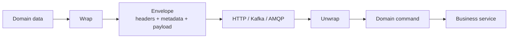
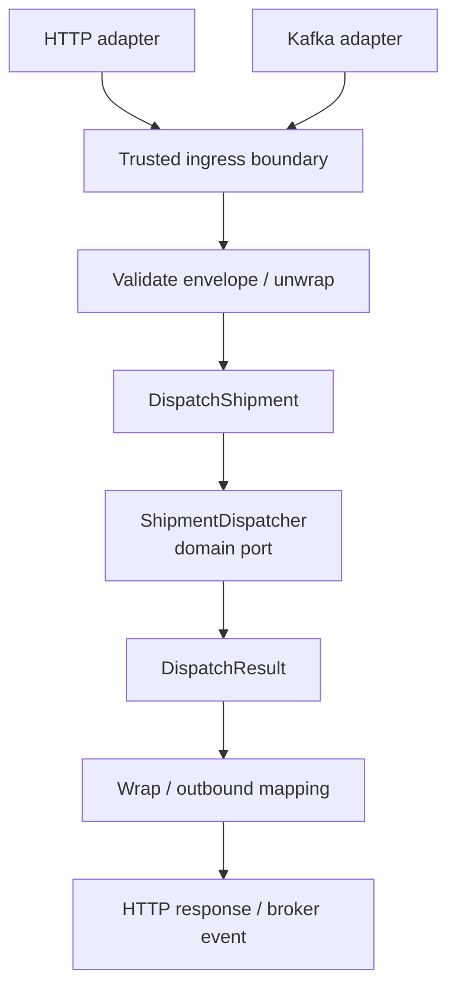
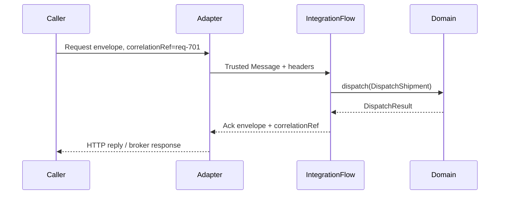
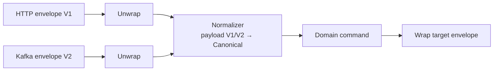
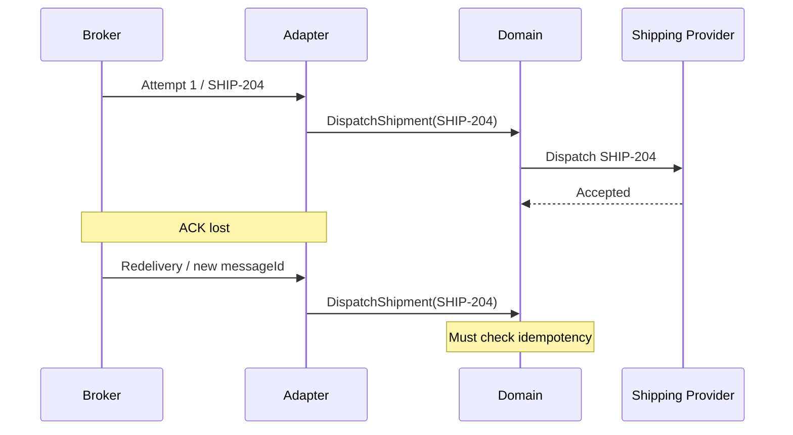

# Do Not Let Domain Logic Depend on the Transport Envelope

## 1. The Problem: Switching Kafka to HTTP Forces Domain Changes

A shipment-dispatch service receives the same kind of request from two sources:

- The sales application's HTTP API.
- The order management system's Kafka topic.

Over HTTP, the sender uses a JSON envelope:

```json
{
  "type": "SHIPMENT_REQUEST",
  "schemaVersion": "1",
  "messageId": "http-msg-101",
  "claimedTenantId": "tenant-A",
  "traceRef": "trace-701",
  "data": {
    "shipmentRequestId": "SHIP-204",
    "orderId": "ORD-204",
    "countryCode": "VN",
    "weightGrams": 1200
  }
}
```

The same request over Kafka carries additional broker metadata:

```text
topic = shipments.requested
partition = 3
offset = 9012
key = SHIP-204
headers:
  trace-id = trace-701

value:
  type = SHIPMENT_REQUEST
  schemaVersion = 1
  messageId = kafka-msg-802
  data = { shipmentRequestId: SHIP-204, ... }
```

If the domain service receives `ConsumerRecord<?,?>`, `HttpServletRequest`, or the entire message envelope and extracts offset, tenant, trace, and order itself, it becomes **coupled to the transport**. Even switching from Kafka to AMQP, SQS, or HTTP can force business code edits.

```java
// Anti-pattern: business logic knows about Kafka ConsumerRecord.
void dispatch(
        org.apache.kafka.clients.consumer.ConsumerRecord<String, String>
            record) {

    String body = record.value();
    long offset = record.offset();
    // Parse JSON, inspect broker metadata, then process order.
}
```

Consequences:

1. Every business unit test must construct headers, records, or adapter fixtures.
2. The domain imports messaging libraries that serve no business rule.
3. A new delivery ID on retry can be mistaken for a business operation ID.
4. It is easy to rely on unauthenticated headers to decide tenant authorization.
5. Changes to the envelope schema can break unrelated use cases.
6. The domain becomes hard to invoke from CLI, batch jobs, HTTP, and brokers via one shared contract.

Solution: **keep Envelope Wrapper in the integration layer**, unwrap at the inbound boundary before calling the domain, and only wrap results back into an envelope at the outbound boundary.

The lesson **“Do Not Let Domain Logic Depend on the Transport Envelope”** belongs to the **Envelope wrapper** chapter of module **SPRING_INTEGRATION_PATTERN**. The module guides implementing Enterprise Integration Patterns with Spring Integration to build loosely coupled, extensible message flows; practicing Router, Filter, Transformer, Splitter, Aggregator, Gateway, retry, error channel, and correlation, along with testing and observing processing branches.

After this lesson, you can:

- Distinguish transport metadata, integration envelopes, and domain payloads.
- Use Envelope Wrapper to send messages across infrastructure without coupling the domain to transport.
- Write a Spring Integration **validate → unwrap → domain → wrap** flow.
- Place trusted tenants, business IDs, correlation, tracing, and schema versions in the right layer.
- Test the same business command even when HTTP/Kafka envelopes carry different delivery IDs.
- Analyze retries, idempotency, outbox, error channels, schema evolution, and header propagation.
- Choose appropriately among Envelope Wrapper, Normalizer, Transformer, Content Enricher, Claim Check, and Aggregator.

## 2. Envelope Wrapper in Enterprise Integration Patterns

**Envelope Wrapper** wraps an application message inside a shell compatible with the transport or exchange protocol. On the receiving side, the wrapper is removed or converted, handing application data to the right processor.



An envelope can contain:

- `messageType` and `schemaVersion`.
- Trace, request ID, correlation, or reply-to.
- Source metadata, encoded content, and content type.
- Message ID of a single publish/delivery attempt.
- Payload and details needed by the receiver to deserialize.

**Not every envelope has all of these fields**, nor does EIP mandate a Java class literally named `EnvelopeWrapper`. An envelope may be a JSON object, CloudEvents, a protocol frame, Spring Message headers, or another wire format.

The wrapper serves **exchange**, and is not automatically part of **business semantics**.

### A Wrapper Is Not Security Proof

```text
claimedTenantId = tenant-A
traceRef = trace-701
```

Both fields above are merely sender-supplied data. If the sender is unauthenticated or able to alter headers, the domain must not trust them for authorization. The adapter must verify the source and create a **trusted application context** before calling the use case.

## 3. Three Layers Commonly Mixed Up

| Layer | Typical contents | Who owns it? | Must domain know? |
| --- | --- | --- | --- |
| **Transport mechanics** | HTTP headers/status, Kafka topic/offset, AMQP delivery tag, ACK | Adapter/broker | Usually no |
| **Integration envelope** | Type, version, trace, correlation, replyTo, contentEncoding | Messaging/integration contract | Only semantically meaningful parts mapped to typed fields |
| **Domain payload** | Shipment request, order ID, destination, weight | Domain/application | Yes, per use case |

Some details originate in headers yet carry **real business meaning**, such as an authenticated tenant, business operation ID, or stable event ID. Those can be mapped into typed commands/events. Still, the domain should not know which HTTP, Kafka, or AMQP header they came from.

### Three Different IDs

```text
Delivery message ID      = kafka-msg-802
Request/reply correlation= req-701
Business operation ID    = SHIP-204
```

Delivery ID can change on publish or broker redelivery. Correlation ID links a request–reply conversation. Operation ID identifies a **business action**. They may happen to match in a specific protocol, yet must never be equated automatically.

## 4. Spring `Message` Should Not Become a Domain Object

Spring Integration transfers data via `Message<T>`:

```text
Message<T>
  payload = T
  headers = MessageHeaders
```

This is a convenient abstraction for `IntegrationFlow`. Inside the boundary layer, handling `Message<?>`, headers, `replyChannel`, and `errorChannel` is completely normal.

Do not force **every business method** to have the signature:

```java
// Couples domain to Spring Messaging.
DispatchResult dispatch(
        org.springframework.messaging.Message<ShipmentWireBody>
            message);
```

Replace it with a plain Java port:

```java
DispatchResult dispatch(DispatchShipment command);
```

Spring `Message<?>` itself is not identical to a wire envelope. HTTP/Kafka adapters still must serialize payloads and map headers. Never assume every in-JVM header survives across the network.

**Design boundary:** `IntegrationFlow` may use the Message API; domain models and domain ports should be invocable and testable without importing transport/framework APIs.

## 5. Ports and Adapters Diagram



Responsibilities:

1. **Inbound adapter:** receives messages, authenticates producers, resolves tenant, deserializes, enforces payload size and protocol version.
2. **Boundary mapper:** validates integration envelopes and converts wire data into typed commands.
3. **Domain/application service:** enforces business rules, entity authorization, and executes the use case.
4. **Outbound adapter:** builds consumer-appropriate envelopes/schemas, selects topic/status, serializes, and publishes/replies.
5. **Infrastructure:** manages ACKs, timeouts, DLQs, transactions, message stores, retries, and observability.

You do not need five separate repositories. What matters is **dependency direction**: adapters know the domain port; the domain never needs to know Kafka or HTTP.

## 6. Plain Java Domain Commands

We implement a structured shipment dispatch request:

```java
record DispatchShipment(
        String tenantId,
        String shipmentRequestId,
        String orderId,
        String countryCode,
        int weightGrams) {}

record DispatchResult(
        String tenantId,
        String shipmentRequestId,
        String orderId,
        String status) {}
```

Field meanings:

- `tenantId` is the authenticated tenant tied to order authorization.
- `shipmentRequestId` is the stable ID of **one business command**, preserved across retries.
- `orderId` and `countryCode` are business data.
- `weightGrams` is a property of the shipment itself.
- `status` is the application outcome.

There are no Kafka topics, offsets, AMQP delivery tags, raw HTTP bodies, trace spans, or HTTP status codes.

**The domain still requires invariants and authorization.** Separating the envelope does not mean skipping data validation, tenant authorization, order state checks, or quotas.

### One Command, Multiple Deliveries

```text
HTTP attempt 1:
  messageId=http-101
  shipmentRequestId=SHIP-204

Kafka redelivery:
  messageId=kafka-205
  shipmentRequestId=SHIP-204
```

After unwrapping, the domain receives the exact same command. Ensuring it does not execute side effects twice **requires an idempotency mechanism**, not Envelope Wrapper alone.

## 7. Wrapper DTOs at the Integration Boundary

Example partner wire schema:

```java
record ShipmentWireBody(
        String shipmentRequestId,
        String orderId,
        String countryCode,
        long weightGrams) {}

record ShipmentTransportEnvelope(
        String messageType,
        String schemaVersion,
        String messageId,
        String claimedTenantId,
        String traceRef,
        ShipmentWireBody data) {}
```

Internal wrapper from an **authenticated adapter**:

```java
record AuthenticatedShipmentIngress(
        String verifiedTenantId,
        ShipmentTransportEnvelope envelope) {}
```

Notes:

- `ShipmentTransportEnvelope` is **untrusted wire data**, even after deserialization into a Java record.
- `claimedTenantId` has no authority to self-grant permissions.
- `verifiedTenantId` must come from identity/ACL/mTLS/JWT verified at the adapter.
- The domain never reads tenant from `claimedTenantId` without checking the source of truth.
- `messageId` belongs to the envelope, not the business operation ID.
- `traceRef` is for observability only, never authentication or idempotency.

If clients can submit `AuthenticatedShipmentIngress` directly to a public endpoint, having “Authenticated” in the record name provides zero security. The internal channel must be restricted to trusted adapters.

## 8. Wrapping Outbound Results

The domain returns `DispatchResult`. The outbound adapter must return a dedicated wire envelope:

```java
record ShipmentAckBody(
        String shipmentRequestId,
        String status) {}

record ShipmentAckEnvelope(
        String messageType,
        String schemaVersion,
        String messageId,
        String correlationRef,
        String traceRef,
        ShipmentAckBody data) {}
```

Illustrative JSON response:

```json
{
  "messageType": "SHIPMENT_ACK",
  "schemaVersion": "1",
  "messageId": "ack-delivery-901",
  "correlationRef": "SHIP-204",
  "traceRef": "trace-701",
  "data": {
    "shipmentRequestId": "SHIP-204",
    "status": "SIMULATED_ACCEPTED"
  }
}
```

Minting a new outbound message ID is normal. **Never push it back into the domain result** and call it a business identifier.

If callers require a request/reply correlation ID different from `shipmentRequestId`, the outbound adapter must map it from a stored trusted integration context rather than picking another ID ad hoc.

## 9. Mapper: Validate Envelope Then Unwrap

We use a mapper independent of Spring Messaging. It validates **the input contract and trusted tenant**, then maps the payload into a command.

```java
import java.util.UUID;

final class ShipmentEnvelopeMapper {

    boolean canUnwrap(AuthenticatedShipmentIngress input) {
        if (input == null
                || blank(input.verifiedTenantId())
                || input.envelope() == null) {
            return false;
        }

        ShipmentTransportEnvelope envelope = input.envelope();

        if (!"SHIPMENT_REQUEST".equals(
                envelope.messageType())
                || !"1".equals(envelope.schemaVersion())
                || blank(envelope.messageId())
                || !input.verifiedTenantId().equals(
                    envelope.claimedTenantId())
                || envelope.data() == null) {
            return false;
        }

        ShipmentWireBody body = envelope.data();

        return validId(body.shipmentRequestId())
            && validId(body.orderId())
            && ("VN".equals(body.countryCode())
                || "SG".equals(body.countryCode()))
            && body.weightGrams() > 0
            && body.weightGrams() <= 25_000L;
    }

    // Call only in the flow after canUnwrap() succeeds.
    DispatchShipment unwrap(AuthenticatedShipmentIngress input) {
        ShipmentWireBody body = input.envelope().data();

        return new DispatchShipment(
            input.verifiedTenantId(),
            body.shipmentRequestId(),
            body.orderId(),
            body.countryCode(),
            Math.toIntExact(body.weightGrams()));
    }

    ShipmentAckEnvelope wrap(
            DispatchResult result,
            Object traceValue) {

        return new ShipmentAckEnvelope(
            "SHIPMENT_ACK",
            "1",
            UUID.randomUUID().toString(),
            result.shipmentRequestId(),
            safeTraceRef(traceValue),
            new ShipmentAckBody(
                result.shipmentRequestId(),
                result.status()));
    }

    static String safeTraceRef(Object value) {
        if (value instanceof String text
                && text.matches("[A-Za-z0-9._:-]{1,64}")) {
            return text;
        }
        return "untracked";
    }

    private static boolean validId(String value) {
        return value != null
            && value.matches("[A-Z0-9-]{1,40}");
    }

    private static boolean blank(String value) {
        return value == null || value.isBlank();
    }
}
```

### Why Filter Before Mapper?

The example uses `canUnwrap()` in an ingress Filter. Once it passes, `unwrap()` does not re-run every regex. This is a synchronous pipeline over immutable input DTOs with `String/long` fields.

If `unwrap()` is a public API used independently by multiple callers, provide a `parseAndValidate()` method that returns a typed result or throws a typed exception; never force callers to remember to call `canUnwrap()` first.

### Two Types of IDs in `wrap`

- `messageId` is freshly generated for the outbound envelope/delivery.
- `correlationRef` uses `shipmentRequestId` per the **demo contract**.

If a workflow uses a request/reply correlation distinct from the business operation, retrieve it from a trusted context instead of conflating the two IDs.

### `TraceRef` Does Not Grant Authorization

`safeTraceRef()` only constrains format to mitigate log/header injection; it does not prove a trusted source issued the trace. Real adapters must follow tracing/security policies, typically W3C Trace Context or a standardized propagation mechanism.

## 10. Domain Port with Zero Spring/Kafka Imports

Interface:

```java
interface ShipmentDispatcher {
    DispatchResult dispatch(DispatchShipment command);
}
```

A demo implementation:

```java
import java.util.concurrent.atomic.AtomicInteger;

final class FakeShipmentDispatcher implements ShipmentDispatcher {

    private final AtomicInteger attempts =
        new AtomicInteger();

    @Override
    public DispatchResult dispatch(DispatchShipment command) {
        attempts.incrementAndGet();

        return new DispatchResult(
            command.tenantId(),
            command.shipmentRequestId(),
            command.orderId(),
            "SIMULATED_ACCEPTED");
    }

    int attempts() {
        return attempts.get();
    }
}
```

The domain handler accepts only a plain Java command:

```java
DispatchResult result = dispatcher.dispatch(
    new DispatchShipment(
        "tenant-A", "SHIP-204", "ORD-204", "VN", 1200));
```

Domain unit tests require no broker, servlet, Kafka `ConsumerRecord`, `MessageHeaders`, or JSON. Another use case can invoke the same port from batch/CLI without building fake envelopes.

**Note:** The fake handler only counts invocations and returns a simulated result. It has no real idempotency or side effects. Never use it to prove “exactly once”.

## 11. Spring Integration Java DSL: From Envelope to Domain

Diagram:

```text
shipping.transport.in
    ↓
Filter: validate wire envelope + trusted tenant
    ├── reject → shipping.transport.rejected
    └── pass
          ↓
Transformer: AuthenticatedShipmentIngress → DispatchShipment
          ↓
Service Activator: ShipmentDispatcher.dispatch(command)
          ↓
Outbound wrapper: DispatchResult → ShipmentAckEnvelope
          ↓
shipping.transport.ack
```

Spring Integration Java DSL configuration:

```java
import org.springframework.context.annotation.Bean;
import org.springframework.context.annotation.Configuration;
import org.springframework.integration.channel.DirectChannel;
import org.springframework.integration.channel.QueueChannel;
import org.springframework.integration.config.EnableIntegration;
import org.springframework.integration.dsl.IntegrationFlow;

@Configuration
@EnableIntegration
public class ShipmentEnvelopeFlowConfig {

    @Bean
    ShipmentEnvelopeMapper shipmentEnvelopeMapper() {
        return new ShipmentEnvelopeMapper();
    }

    @Bean
    FakeShipmentDispatcher fakeShipmentDispatcher() {
        return new FakeShipmentDispatcher();
    }

    @Bean("shipping.transport.in")
    DirectChannel transportInput() {
        return new DirectChannel();
    }

    @Bean("shipping.transport.rejected")
    QueueChannel rejectedInput() {
        return new QueueChannel();
    }

    @Bean("shipping.transport.ack")
    QueueChannel outboundAck() {
        return new QueueChannel();
    }

    @Bean
    IntegrationFlow shipmentEnvelopeFlow(
            ShipmentEnvelopeMapper mapper,
            FakeShipmentDispatcher dispatcher) {

        return IntegrationFlow.from("shipping.transport.in")
            .filter(
                AuthenticatedShipmentIngress.class,
                mapper::canUnwrap,
                spec -> spec.discardChannel(
                    "shipping.transport.rejected"))
            .transform(
                AuthenticatedShipmentIngress.class,
                mapper::unwrap)
            .handle(
                DispatchShipment.class,
                (command, headers) ->
                    dispatcher.dispatch(command))
            .handle(
                DispatchResult.class,
                (result, headers) ->
                    mapper.wrap(
                        result,
                        headers.get("trustedTraceRef")))
            .channel("shipping.transport.ack")
            .get();
    }
}
```

### Role of Each Endpoint

| Endpoint | Input | Output | Responsibility |
| --- | --- | --- | --- |
| Filter | `AuthenticatedShipmentIngress` | Accept/reject | Protect boundary |
| Transformer | `AuthenticatedShipmentIngress` | `DispatchShipment` | Remove wrapper, build domain command |
| Service Activator | `DispatchShipment` | `DispatchResult` | Call business port |
| Outbound wrapper | `DispatchResult` + trusted header | `ShipmentAckEnvelope` | Build outbound schema |
| Output channel | `ShipmentAckEnvelope` | Message awaiting consumer | Hand off to response/publisher adapter |

The two `handle(...)` calls play different roles: one calls the domain, while the other is an **outbound integration mapper** that can read headers. The domain still never sees `traceRef` or `MessageHeaders`.

### Why Not Use a Kafka Adapter in the Example?

The lesson focuses on Envelope Wrapper, so internal channels are tested with `DirectChannel` and `QueueChannel` without a broker. When adding real Kafka/HTTP, adapters take responsibility for:

- Authentication/authorization and source identity.
- Parsing/serialization and header mapping.
- Offset commits/ACKs, retries, and DLQs.
- Placing verified tenant and trusted trace context into internal messages.

The demo `QueueChannel` is not a durable queue. Never interpret a passing test as proving crash/restart durability.

### Verifying Spring Integration Versions

The code uses Java 17+ and common Java DSL overloads for `filter`, `transform`, and `handle`. When applying to a real project, verify APIs/overloads against actual dependencies. In STEP 4, builds and specialized Content QA have not been run.

## 12. Technical Headers Stay Outside the Domain

In the example, `trustedTraceRef` is a Spring header added by an authorized internal adapter:

```text
Input Message:
  payload = AuthenticatedShipmentIngress(...)
  header.trustedTraceRef = trace-http-1

After Transformer:
  payload = DispatchShipment(...)
  header.trustedTraceRef = trace-http-1

Domain:
  dispatch(DispatchShipment)
  does not read traceRef

Outbound:
  ShipmentAckEnvelope.traceRef = trace-http-1
```

Spring Integration normally forwards/copies headers when a Transformer returns a payload, yet you must **never assume all headers always survive** when:

- A Transformer manually builds a new `Message`.
- A Header Enricher overwrites them.
- A message traverses a Kafka/AMQP/HTTP mapper.
- A channel transitions from JVM objects to serialized bytes.
- A Gateway/adapter drops non-serializable headers.
- The system uses another envelope with a distinct header schema.

Tests must verify meaningful headers: correlation, event IDs, tracing, trusted tenants, reply routing, and schema provenance.

**Never serialize Spring `replyChannel` or `errorChannel` objects over the network.** Use transport-contracted reply-to destinations and correlations.

## 13. Unit Test: Two Different Envelope IDs Produce the Same Domain Command

Plain Java test:

```java
import static org.assertj.core.api.Assertions.assertThat;

import org.junit.jupiter.api.Test;

class ShipmentEnvelopeMapperTest {

    private final ShipmentEnvelopeMapper mapper =
        new ShipmentEnvelopeMapper();

    private AuthenticatedShipmentIngress inbound(
            String messageId,
            String traceRef) {

        ShipmentTransportEnvelope wire =
            new ShipmentTransportEnvelope(
                "SHIPMENT_REQUEST",
                "1",
                messageId,
                "tenant-A",
                traceRef,
                new ShipmentWireBody(
                    "SHIP-204", "ORD-204", "VN", 1200));

        return new AuthenticatedShipmentIngress(
            "tenant-A", wire);
    }

    @Test
    void differentDeliveryEnvelopesCreateSameDomainCommand() {
        AuthenticatedShipmentIngress http =
            inbound("delivery-http-1", "trace-http-1");

        AuthenticatedShipmentIngress kafka =
            inbound("delivery-kafka-2", "trace-kafka-2");

        assertThat(mapper.canUnwrap(http)).isTrue();
        assertThat(mapper.canUnwrap(kafka)).isTrue();

        DispatchShipment a = mapper.unwrap(http);
        DispatchShipment b = mapper.unwrap(kafka);

        assertThat(a).isEqualTo(b);
        assertThat(a.shipmentRequestId()).isEqualTo("SHIP-204");
        assertThat(a.tenantId()).isEqualTo("tenant-A");
    }

    @Test
    void outboundWrapperAddsTechnicalFields() {
        DispatchResult result = new DispatchResult(
            "tenant-A", "SHIP-204", "ORD-204", "OK");

        ShipmentAckEnvelope ack =
            mapper.wrap(result, "trace-701");

        assertThat(ack.messageType()).isEqualTo("SHIPMENT_ACK");
        assertThat(ack.schemaVersion()).isEqualTo("1");
        assertThat(ack.messageId()).isNotBlank();
        assertThat(ack.correlationRef()).isEqualTo("SHIP-204");
        assertThat(ack.traceRef()).isEqualTo("trace-701");
        assertThat(ack.data().shipmentRequestId())
            .isEqualTo("SHIP-204");
    }

    @Test
    void traceMetadataCannotInjectNewHeaderLines() {
        ShipmentAckEnvelope ack = mapper.wrap(
            new DispatchResult(
                "tenant-A", "SHIP-204", "ORD-204", "OK"),
            "evil\nheader-injection");

        assertThat(ack.traceRef()).isEqualTo("untracked");
    }

    @Test
    void claimedTenantAndVerifiedTenantMustMatch() {
        AuthenticatedShipmentIngress bad =
            new AuthenticatedShipmentIngress(
                "tenant-B",
                inbound("delivery-1", "trace-1")
                    .envelope());

        assertThat(mapper.canUnwrap(bad)).isFalse();
    }

    @Test
    void unsupportedVersionIsRejected() {
        ShipmentTransportEnvelope wire =
            new ShipmentTransportEnvelope(
                "SHIPMENT_REQUEST", "99", "m-99",
                "tenant-A", "trace-99",
                new ShipmentWireBody(
                    "SHIP-204", "ORD-204", "VN", 1200));

        assertThat(mapper.canUnwrap(
            new AuthenticatedShipmentIngress(
                "tenant-A", wire))).isFalse();
    }
}
```

### What Does the Test Protect?

- Changing trace/delivery ID headers does not alter the business command.
- The mapper builds the domain command only after the envelope and scope are valid.
- The domain never receives technical delivery IDs.
- The outbound wrapper can attach new schema/message IDs.
- Claimed tenant fields cannot bypass the authenticated identity.
- Unsupported schema versions are rejected instead of guessed.

**The test does not prove real authentication.** `verifiedTenantId` in fixtures is a test-supplied value, not a security subsystem. Production requires contract tests with real adapters and identity providers.

## 14. Integration Test: Filter → Domain Handler → Wrapper

Using JUnit 5, Spring Test, and AssertJ:

```java
import static org.assertj.core.api.Assertions.assertThat;

import org.junit.jupiter.api.Test;
import org.springframework.beans.factory.annotation.Autowired;
import org.springframework.beans.factory.annotation.Qualifier;
import org.springframework.integration.channel.QueueChannel;
import org.springframework.messaging.Message;
import org.springframework.messaging.MessageChannel;
import org.springframework.messaging.support.MessageBuilder;
import org.springframework.test.context.junit.jupiter.SpringJUnitConfig;

@SpringJUnitConfig(ShipmentEnvelopeFlowConfig.class)
class ShipmentEnvelopeFlowTest {

    @Autowired
    @Qualifier("shipping.transport.in")
    MessageChannel input;

    @Autowired
    @Qualifier("shipping.transport.rejected")
    QueueChannel rejected;

    @Autowired
    @Qualifier("shipping.transport.ack")
    QueueChannel ack;

    @Autowired
    FakeShipmentDispatcher dispatcher;

    private AuthenticatedShipmentIngress request(
            String claimedTenant,
            String shipmentId,
            long weight) {

        return new AuthenticatedShipmentIngress(
            "tenant-A",
            new ShipmentTransportEnvelope(
                "SHIPMENT_REQUEST", "1",
                "delivery-" + shipmentId,
                claimedTenant, "untrusted-trace",
                new ShipmentWireBody(
                    shipmentId, "ORD-204", "VN", weight)));
    }

    private void send(
            AuthenticatedShipmentIngress payload,
            String trustedTrace) {

        Message<AuthenticatedShipmentIngress> message =
            MessageBuilder.withPayload(payload)
                .setHeader("trustedTraceRef", trustedTrace)
                .build();

        assertThat(input.send(message)).isTrue();
    }

    @Test
    void validEnvelopeProducesAckWithoutExposingHeadersToDomain() {
        int before = dispatcher.attempts();

        send(request("tenant-A", "SHIP-204", 1200),
            "trace-http-204");

        Message<?> message = ack.receive(1_000);
        assertThat(message).isNotNull();
        assertThat(message.getPayload())
            .isInstanceOf(ShipmentAckEnvelope.class);

        ShipmentAckEnvelope body =
            (ShipmentAckEnvelope) message.getPayload();

        assertThat(body.messageType()).isEqualTo("SHIPMENT_ACK");
        assertThat(body.correlationRef()).isEqualTo("SHIP-204");
        assertThat(body.traceRef()).isEqualTo("trace-http-204");
        assertThat(body.data().shipmentRequestId())
            .isEqualTo("SHIP-204");

        assertThat(dispatcher.attempts() - before).isEqualTo(1);
        assertThat(rejected.receive(0)).isNull();
        assertThat(ack.receive(0)).isNull();
    }

    @Test
    void tenantMismatchIsRejectedBeforeDomainHandler() {
        int before = dispatcher.attempts();

        send(request("tenant-B", "SHIP-205", 1200),
            "trace-invalid");

        assertThat(rejected.receive(1_000)).isNotNull();
        assertThat(ack.receive(0)).isNull();
        assertThat(dispatcher.attempts() - before).isZero();
    }

    @Test
    void invalidBodyIsRejectedBeforeDomainHandler() {
        int before = dispatcher.attempts();

        send(request("tenant-A", "SHIP-206", -1),
            "trace-invalid");

        assertThat(rejected.receive(1_000)).isNotNull();
        assertThat(ack.receive(0)).isNull();
        assertThat(dispatcher.attempts() - before).isZero();
    }

    @Test
    void outboundMessageIdDoesNotReplaceBusinessId() {
        send(request("tenant-A", "SHIP-207", 400),
            "trace-207");

        ShipmentAckEnvelope body =
            (ShipmentAckEnvelope) ack.receive(1_000)
                .getPayload();

        assertThat(body.messageId()).isNotBlank();
        assertThat(body.correlationRef()).isEqualTo("SHIP-207");
        assertThat(body.messageId())
            .isNotEqualTo(body.correlationRef());
    }
}
```

**Wiring test, not a real broker test:** uses synchronous `DirectChannel` and `QueueChannel` for observation. When running tests in parallel sharing a Spring context, isolate queues/fixtures. Never infer that the demo queue survives restarts or performs broker ACKs.

### Which Tests Should Be Added?

- Real wire JSON with `data=null`, missing fields, or wrong types.
- Real HTTP authentication and Kafka producer/ACL checks.
- Header mappers across transport serialization.
- Version V2 coexisting with V1.
- Message size/timeouts, corrupted envelopes, and schema negotiation.
- Duplicate delivery after provider commit.
- Multi-instance execution, durable ledgers, ACKs, and crash recovery.
- Authorization on the actual order, not just claimed tenant checks.

## 15. One Domain Command Received Over Multiple Transports

Two ingress adapters can differ in authentication/deserialization while outputting the exact same internal object:

```text
HTTP endpoint
   → JWT/mTLS verification
   → JSON deserializer
   → AuthenticatedShipmentIngress
   ┐
   ├──► shipping.transport.in
   ┘
Kafka listener
   → trusted producer/topic/schema verification
   → record deserializer
   → AuthenticatedShipmentIngress
```

Adapter pseudocode:

```java
// These "verified" parameters must come from the security subsystem.
AuthenticatedShipmentIngress fromHttp(
        String verifiedTenant,
        ShipmentTransportEnvelope parsedBody) {

    return new AuthenticatedShipmentIngress(
        verifiedTenant, parsedBody);
}

AuthenticatedShipmentIngress fromBroker(
        String authorizedProducerTenant,
        ShipmentTransportEnvelope deserializedValue) {

    return new AuthenticatedShipmentIngress(
        authorizedProducerTenant, deserializedValue);
}
```

This is pseudocode **post-authentication**, not complete authentication logic. The domain never needs to know whether the two sources used JWT, topic ACLs, or mTLS.

When switching transports, swap **adapters and mappings**, not `ShipmentDispatcher.dispatch(DispatchShipment)`.

## 16. Domain Commands, Domain Events, and Envelopes Differ

| Concept | Example | Purpose |
| --- | --- | --- |
| Domain command | `DispatchShipment` | Request to execute an action |
| Domain event | `ShipmentDispatched` | Notification that an event occurred |
| Transport envelope | `ShipmentTransportEnvelope` | Wrapper during transmission |
| Spring Message | `Message<DispatchShipment>` | Message abstraction inside the integration flow |

A domain event carries a **logical event ID** stable across republishes. An envelope carries a **new message/delivery ID** per send. A command carries a **business operation ID** stable across client retries.

Never equate:

```text
deliveryMessageId = logicalEventId = businessOperationId
```

unless a protocol explicitly defines and tests that relationship.

### What If the Domain Needs `eventId`?

An event processor may need a logical event ID to avoid applying the same event twice. Give the event an `eventId` field as a meaningful business value object or string. Never use a Kafka offset or a freshly generated per-delivery UUID as the event ID.

## 17. Correlation and Request–Reply in the Integration Layer

A request–reply Gateway may require `correlationId`, `replyTo`, `replyTimeout`, and trace context.



If request/reply correlation truly differs from the business operation ID, store it in a **trusted messaging context** and map it back at the outbound boundary. The domain needs only business identity, not which HTTP request the caller is waiting on.

**Never send a Spring `replyChannel` object over a broker.** With Kafka/AMQP, use a reply topic/address and an appropriate correlation contract.

### Limits of Header Propagation

A Transformer returning a payload usually preserves header context in Spring Integration, yet:

- Manually building a new `Message` can drop headers.
- HTTP/Kafka/AMQP adapters each have their own header mappers.
- Not every Java header is serializable across transports.
- Client-sent headers can be spoofed.
- Fields like `traceparent` require spec-compliant validation/propagation.

Therefore, **test required headers at the boundary** rather than assuming “Spring always copies everything”.

## 18. Envelope Wrapper and Normalizer

**Envelope Wrapper** handles *the transport wrapper shell*. **Normalizer** handles *multiple payload schemas sharing the same meaning*.



A v2 schema that only adds trace metadata **does not force domain changes**; upgrading the envelope adapter may be enough.

If payload V2 changes `weightGrams` to `weightKg`, the mapper must apply the conversion contract; a Normalizer can support multiple schemas simultaneously.

| Problem | Technique |
| --- | --- |
| Wrapping/unwrapping transport shells | Envelope Wrapper |
| Converting one payload representation | Transformer |
| Mapping multiple schemas with one meaning to canonical form | Normalizer |
| Selecting an endpoint by message type | Router |
| Checking accept/reject | Filter/validation |
| Augmenting data from external APIs | Content Enricher |
| Large payload, send reference only | Claim Check |
| Combining multiple replies into a summary | Aggregator/Scatter-Gather |
| Preventing duplicate business side effects | Idempotent Receiver |

Normalizing and wrapping may both use Spring Integration Transformers, yet **they do not replace one another**.

## 19. Header Enricher vs. Envelope Wrapper

Spring Integration's Header Enricher can add/update headers on `Message<?>`:

```java
// Java DSL illustration, not a complete flow.
.enrichHeaders(spec ->
    spec.header("sourceSystem", "PARTNER_ALPHA"))
```

That operates on **metadata of an internal message**. Envelope Wrapper is broader: sometimes you must construct a **JSON frame with `messageType`, `schemaVersion`, and `data`**, or a CloudEvent with standardized packaged metadata.

A system might emit:

```text
Kafka headers:
  type = SHIPMENT_ACK
  version = 1

Kafka value:
  { "shipmentRequestId": "SHIP-204", "status": "ACCEPTED" }
```

or:

```json
{
  "type": "SHIPMENT_ACK",
  "schemaVersion": "1",
  "data": {
    "shipmentRequestId": "SHIP-204",
    "status": "ACCEPTED"
  }
}
```

Choose according to the consumer's contract, rather than letting the domain decide.

## 20. Envelope Wrapper and Claim Check

If payloads are large, store the payload and pass a claim reference:

```text
Large domain document
   ↓ Claim Check In
Store document
   ↓
Envelope(data={claimId:"CC-204"})
   ↓ broker
Claim Check Out
   ↓ Domain content
```

However, Claim Check adds requirements:

- The store must survive restarts/multi-instance setups if SLAs require it.
- TTLs must cover queue delays, retries, and DLQ replays.
- Claim tokens must be authorized per tenant/resource.
- One-time consumption needs recovery on crashes before business commit.
- Never treat an expired claim as valid default business data.

Envelope Wrapper does not guarantee the token still points to an existing payload. Appropriate **claim lifecycles, retention, and recovery** are required.

## 21. Idempotency: Envelope ID Is Not Operation ID

Suppose the same dispatch command is redelivered:

```text
Delivery 1:
  envelope.messageId = kafka-101
  data.shipmentRequestId = SHIP-204

Delivery 2:
  envelope.messageId = kafka-205
  data.shipmentRequestId = SHIP-204
```

Both unwraps produce the same command, yet if the handler directly calls the Shipping Provider twice, **two side effects** still happen.

A better key:

```text
idempotencyKey = (tenantId, DISPATCH, shipmentRequestId)
```

A production system needs:

1. Stable operation identity across retries.
2. Atomic claim/unique constraints in a shared ledger.
3. `PROCESSING`, `COMPLETED`, and `UNKNOWN` states when remote outcomes are ambiguous.
4. Sending the same key on every retry if the provider supports idempotency keys.
5. Querying status/reconciling before re-issuing when a provider response is lost.
6. Returning stored outcomes when a completed duplicate arrives.
7. Retention long enough to cover broker redeliveries and DLQ replays.

**Envelope Wrapper is not an Idempotent Receiver.** It shields the domain from delivery mechanics, yet does not prevent duplicate business operations on its own.

## 22. Crash Windows and Transactional Outbox

Example:



If the domain updates a database and needs to emit an event:

```text
Business transaction:
  update shipment state
  insert outbox row (stable eventId)

Outbox publisher:
  read row
  wrap event in target envelope
  publish to broker
  mark published
```

When outbox and domain state share one database transaction, saving state and requesting publication can be atomic. The publisher can still emit an event **multiple times** when ACKs are ambiguous; consumers need idempotency keyed by logical event ID.

Transactional outbox **does not** enroll remote HTTP providers into the database transaction. External side effects require provider idempotency, reconciliation, or compensation policies.

### Avoid Calling `KafkaTemplate` Directly from the Domain

Instead of the domain service picking topics, Kafka headers, and retries, the application/domain layer produces outcomes/domain events, and the publisher/adapter wraps them into the target transport envelope. That keeps domain ports stable when infrastructure changes.

## 23. Security: Never Trust Raw Transport Headers

A request:

```text
X-Tenant-Id: tenant-B
X-Validated: true
```

does not prove the caller has rights for tenant B, even if the headers “look official”.

A trusted boundary must:

1. Authenticate actors/services using appropriate mechanisms (JWT, mTLS, producer ACL/signature).
2. Derive tenant/scope from the verified identity.
3. Cross-check `claimedTenantId` and resource ownership.
4. Construct trusted inputs only inside authenticated adapters.
5. Prevent external clients from overriding `verifiedTenantId` or `trustedTraceRef` in internal messages.
6. Avoid leaking full envelopes/raw tokens into unprotected logs or DLQs.
7. Check payload size, nesting, and schema type/version before complex deserialization.
8. Check authorization near side effects if permissions can change over time.

**Class or header names are not security boundaries.** Real security comes from authentication, authorization, and actual ingress path controls.

## 24. Independent Envelope Version and Domain Version

Example upgrading envelope V1 → V2:

```text
V1: type, schemaVersion, messageId, data
V2: type, schemaVersion, messageId, data, contentEncoding
```

The domain command `DispatchShipment` can remain **unchanged** if the business payload retains the same meaning.

Conversely, adding `deliveryWindow` that alters business rules may require changing the domain contract even if the envelope frame stays identical.

| Change | Primary area affected |
| --- | --- |
| Change Kafka topic | Adapter/config |
| Add trace header | Envelope/header mapping |
| Change JSON nesting | Deserializer/mapper |
| Change `weightGrams` to `weightKg` | Canonical conversion, domain invariant |
| Add `deliveryWindow` | Domain/application schema |
| Change source authentication | Trust boundary |
| Change business operation ID | Domain identity + idempotency migration |
| Event type `SHIPMENT_CANCELLED` | New use case/command |

### Schema Migration and Rolling Deploys

When a producer sends envelope v2 while a consumer only knows v1, provide an explicit rejection/compatibility path instead of silently pretending v2 is v1. Before retiring v1, check:

- Are active producers still sending v1?
- How long do broker retention and DLQ replays hold v1?
- Do historical events need a v1 converter?
- Is there a canary/rollback plan?
- Are there golden contract tests per version?
- Did the body schema change **semantics**, not just shape?

A mapper that lumps all versions into “best effort” risks misconverting units or dropping critical data.

## 25. Error Handling Divided by Boundary

| Error | Detection layer | Handling direction |
| --- | --- | --- |
| Unsupported envelope version | Adapter/mapper | Typed reject, quarantine per rollout |
| Corrupted JSON / missing body | Deserializer/validation | Reject; never create fake commands |
| Tenant mismatch | Security/mapper | Deny/audit; no blind retries |
| Missing business field | Mapper/domain constructor | Permanent validation error |
| Domain rule rejects dispatch | Domain service | Business rejection with clear code |
| Provider HTTP 503 | Outbound port/adapter | Bounded retry/backoff |
| Provider timeout, unknown outcome | Recovery workflow | Reconcile; do not mint new IDs |
| Broker publish failure | Outbox/transport | Retry publish |
| Duplicate delivery | Idempotency ledger | Return stored outcome/ACK; no double effect |
| Invalid `correlationRef` | Messaging/Gateway boundary | Reject; never reply to wrong caller |
| Store unavailable | Infrastructure | Bounded retry, alert |
| Header mapping drops trace | Integration test/adapter | Fix contract and mapping |

Spring Integration does not automatically route **every exception** to the global `errorChannel`. With synchronous `DirectChannel`, exceptions can propagate to the caller; with pollers/executors/brokers, endpoints use their own recovery/error handlers.

`discardChannel(...)` does not automatically emit an HTTP response or durable DLQ entry. In a request–reply Gateway, if a Filter discards silently, the caller may time out. Provide an explicit rejection response or exception mapping per protocol.

### Domain Errors Are Not Transport Errors

The domain can return:

```java
record DispatchRejected(
        String shipmentRequestId,
        String reasonCode) {}
```

The HTTP adapter maps it to a status code and JSON response; the broker adapter maps it to an error event. The domain never needs to return `ResponseEntity<?>` or know about a `shipping.rejected` topic.

## 26. Do Not Store Raw Envelopes in Domain Entities

An anti-pattern:

```java
record ShipmentEntity(
    String shipmentRequestId,
    String orderId,
    String rawHttpBody,
    String kafkaHeadersJson,
    long brokerOffset) {}
```

Consequences:

- Domain database schemas change whenever infrastructure changes.
- Data easily captures tokens, IPs, PII, and secrets.
- Meaningless when the use case runs via batch/CLI.
- Hard to manage migrations, retention, and access controls.
- Unclear which headers are trustworthy.

When auditing is needed, store:

- Meaningful business provenance (`sourceSystem`, actor, `eventId`, policy version).
- An audit reference to a protected raw event archive.
- Minimum metadata required for reconciliation.
- Raw envelopes in an integration archive with separate retention and ACLs if required.

**This does not mean erasing provenance.** Just do not let domain entities be driven by wire schemas.

## 27. Observing the Flow Across the Wrapper

Suggested structured logs:

```text
event=envelope_received
transport=kafka
source=warehouse-service
messageType=SHIPMENT_REQUEST
schemaVersion=1
tenantScope=tenant-A
deliveryRefHash=...
operationRef=SHIP-204
```

```text
event=envelope_unwrapped
domainCommand=DispatchShipment
mapperVersion=shipment-envelope-v1
operationRef=SHIP-204
```

```text
event=envelope_wrapped
messageType=SHIPMENT_ACK
schemaVersion=1
correlationRef=SHIP-204
outcome=SIMULATED_ACCEPTED
```

These are **suggested schemas**, not logs emitted by the framework by default. Keep raw payloads, credentials, and tokens out of logs.

| Metric | Meaning |
| --- | --- |
| `envelope.received.total{transport,type,version}` | Track ingress variants |
| `envelope.rejected.total{reason}` | Validation/security errors |
| `envelope.unwrap.duration{version}` | Mapping latency |
| `envelope.wrap.duration{target}` | Outbound framing cost |
| `envelope.header.missing.total{name}` | Missing correlation/trace |
| `domain.dispatch.attempts.total` | Business handler invocations |
| `domain.dispatch.result.total{status}` | Application outcomes |
| `domain.idempotency.duplicate.total` | Redeliveries of logical operations |
| `envelope.publish.error.total{transport}` | Broker/adapter errors |
| `envelope.schema.usage{version}` | Track deprecation |
| `envelope.dlq.total{reason}` | Unprocessable messages |

Metric names are suggestions only. Never put `shipmentRequestId` or raw trace/message IDs into high-cardinality metric labels. Use protected tracing/logs to investigate individual requests.

## 28. Troubleshooting

| Symptom | Possible cause | Resolution direction |
| --- | --- | --- |
| Switching Kafka to HTTP forces business service edits | Domain accepts transport objects | Unwrap at adapter; domain takes commands |
| Domain unit tests need a broker | Domain port coupled to messaging | Use a plain Java interface |
| Domain acts on wrong tenant | Trusted `claimedTenantId` | Trusted ingress + resource authorization |
| Message redelivery repeats side effects | Used `messageId` as key | Stable operation ID + ledger |
| Trace disappears after Transformer | Unclear header mapping | Test propagation and adapter mapping |
| Reply sent to wrong request | `correlationRef` lacks contract | Separate conversation vs. business IDs |
| Schema v2 handled as v1 | Missing version check | Versioned mapper/Normalizer |
| Domain entity contains Kafka offset | Transport mechanics leaked into model | Separate audit reference |
| HTTP status decided in domain | Domain returns `ResponseEntity` | Adapter maps domain outcomes |
| Another consumer cannot read ack | Envelope hardcoded to one target | Target-specific outbound wrapper |
| Filter discard causes Gateway timeout | Missing rejection reply | Error/rejection response path |
| Outbox sends event twice | ACK/publish retry | Stable event ID, idempotent consumer |
| Fan-out blocks one recipient | Overly broad idempotency key | Namespace by recipient |
| Claim Check loses payload | Insufficient TTL/store | Durable retention/recovery |
| Fails only in multi-instance setups | Local state, no transaction | Shared state, atomic claims |
| Fails only during schema migration | V1 mapper removed too early | Historical/DLQ compatibility |
| Two transports build different domain commands | Ad-hoc per-transport mapping | Contract tests and canonical model |

## 29. Test Matrix

| Case | Expected |
| --- | --- |
| Valid V1 envelope | Unwraps cleanly to `DispatchShipment` |
| Same payload, different delivery ID | Same domain command |
| Same payload, different trace ID | Same domain command |
| Claimed tenant differs from verified tenant | Reject |
| Missing verified tenant | Reject |
| Missing body / invalid weight | Reject |
| Unsupported `schemaVersion` | Reject/quarantine |
| Wrong `messageType` | Does not enter this handler |
| HTTP/Kafka same logical command | Same operation identity |
| Outbound wrap | Valid schema, new message ID, and accurate correlation |
| Trace contains newline/invalid chars | Never copied raw into output |
| Transformer across another transport | Explicit and tested header mapping |
| Domain unit test | Needs no `MessageHeaders`/Kafka |
| Broker redelivery after business commit | Idempotency prevents double effect |
| Provider timeout after commit | Reconcile with the same operation ID |
| Two pods receive same operation | Durable atomic ledger |
| Gateway retry | Never mints a new business operation ID |
| Outbox event published twice | Consumer idempotent by logical event ID |
| Fan-out to multiple recipients | Idempotency per recipient |
| Envelope V1/V2 rolling deploy | Migration/compatibility |
| Raw envelope contains PII | Never logged publicly |
| Invalid envelope in queue | Error/reject/DLQ per protocol |
| Expired claim reference | Never fabricates fake payload |
| HTTP and broker error mapping | Same domain reason, transport-specific outputs |

## 30. Practice Exercises

### Exercise 1 — Separate Domain and Transport Parts

Given fields `topic`, `offset`, `shipmentRequestId`, `orderId`, `traceId`, `tenantId`, `replyTo`, and `weightGrams`, classify them into transport mechanics, integration context, and domain semantics. Explain why tenant and event ID can move from headers into trusted application fields.

### Exercise 2 — Refactor the Domain Port

Replace a method `dispatch(ConsumerRecord<String,String>)` with `dispatch(DispatchShipment)`. Move parsing, offsets, header mapping, and ACKs to the adapter. Write domain unit tests with zero Kafka imports.

### Exercise 3 — Unwrap Two Envelope IDs

Create two `ShipmentTransportEnvelope` instances with identical `data` but different `messageId`/`traceRef`. Assert the mapper produces equal domain commands. Add another request with a different `shipmentRequestId` despite matching order/weight; explain why it may represent a new operation.

### Exercise 4 — Spring Integration Java DSL

Run `ShipmentEnvelopeFlowConfig` with valid input. Assert the outbound ack has the right schema version, business correlation, and trace metadata, while the domain handler receives only the command.

### Exercise 5 — Tenant Spoofing

An external envelope claims `tenant-B` while trusted ingress authenticates `tenant-A`. Test that the Filter blocks it before the domain. Add a resource-ownership test in the domain/application service where the tenant matches yet the order does not belong to it.

### Exercise 6 — Version V2

Envelope V2 adds `contentEncoding` while keeping the business payload unchanged. Design a mapper supporting V1/V2 without modifying the domain. Add a test sending an unsupported version to the reject flow instead of guessing.

### Exercise 7 — Dual-Transport Egress

Use the same `DispatchResult` to build a distinct HTTP response body and Kafka event. Do not add HTTP status codes or topic names to `DispatchResult`.

### Exercise 8 — Correlation and Header Mapping

Send trusted trace, `requestRef`, `correlationRef`, and logical `eventId` through Transformer/Service Activator. Verify required headers are preserved. Simulate an adapter that maps only a subset of headers and identify which fields must live in the canonical envelope.

### Exercise 9 — Idempotency After Redelivery

The broker delivers `SHIP-204`; the Shipping Provider commits, yet the ACK is lost. The broker redelivers with a new delivery ID. Design a ledger keyed by `(tenant, DISPATCH, shipmentRequestId)` with `PROCESSING/COMPLETED/UNKNOWN` states and reconciliation.

### Exercise 10 — Domain Event / Outbox

After updating a shipment, the application creates an event with a stable `eventId` and an outbox record. The publisher wraps it in a Kafka envelope and retries after an ambiguous publish ACK. Prove downstream does not process the event twice.

### Exercise 11 — Normalizer Combined with Envelope Wrapper

Two providers send quotes in different JSON/XML schemas inside envelopes. Unwrap; Normalizer builds `CanonicalQuote`; Aggregator collects by expected responders. Prove two duplicate replies from one responder do not substitute for another responder's reply.

### Exercise 12 — CloudEvents and Contracts

Compare CloudEvents against an internal wire envelope with `id`, `type`, `source`, `time`, and `data`. Identify which IDs must stay stable across republishes, which fields belong to the domain, and which serve transport. Never assume CloudEvents provides authentication by itself.

### Exercise 13 — Typed Error Flows

Classify `INVALID_ENVELOPE`, `UNSUPPORTED_VERSION`, `ACCESS_DENIED`, `BUSINESS_REJECTED`, `STORE_UNAVAILABLE`, and `UNKNOWN_REMOTE_OUTCOME`. For HTTP and brokers, design distinct error responses/ACKs/DLQs without changing the domain contract.

### Exercise 14 — Observability / Runbook

Build a dashboard tracking envelope version ratios, rejection reasons, unwrap/wrap latency, domain attempts, and duplicate operations. Write a runbook for when duplicate dispatches spike after switching brokers: inspect operation IDs/ledgers rather than trace IDs alone.

**Completion criteria:** learners can identify **what is the transport envelope**, **what is the domain command**, **who owns unwrapping/wrapping**, **where trusted context comes from**, and **how to preserve business identity across transports, retries, and schema migrations**.

## 31. Pre-Production Checklist

- [ ] Domain models/domain ports do not import Kafka, AMQP, HTTP, or Spring Message classes for delivery mechanics.
- [ ] Inbound adapters authenticate sources and never trust `claimedTenantId`.
- [ ] Envelope type/version/content schemas are validated before building commands.
- [ ] Payload sizes and deserialization types are bounded.
- [ ] Mappers produce immutable canonical domain commands where appropriate.
- [ ] Business-meaningful operation/event IDs remain stable across retries.
- [ ] Envelope `messageId` or broker offsets are never used as idempotency keys.
- [ ] Correlation, trace, `replyTo`, and trusted identities have a header mapping contract.
- [ ] Spring `replyChannel`/`errorChannel` objects are never sent over brokers.
- [ ] Domain returns outcomes/events; outbound adapters wrap them per target protocol.
- [ ] HTTP statuses/topics/delivery ACKs stay out of domain models when purely transport details.
- [ ] Typed rejections exist for unsupported versions, invalid bodies, and access denied.
- [ ] Filter discards never stall Gateways until timeout or silently lose important messages.
- [ ] Bounded retries and reconciliation handle ambiguous remote outcomes.
- [ ] Idempotent receivers/ledgers and transactions/outboxes are used where required.
- [ ] Shared state handles horizontal scaling and restarts.
- [ ] Normalizers support multiple sources/schemas when needed without pushing variants into the domain.
- [ ] Claim Check enforces proper TTLs, authorization, persistence, and recovery when using references.
- [ ] Unit tests cover mapping, and integration tests cover channel/header propagation.
- [ ] Cross-transport contract tests cover HTTP/Kafka/AMQP per deployment.
- [ ] Migration, rollback, and DLQ replay plans exist for envelope versions.
- [ ] Logs/metrics never leak raw tokens, sensitive payloads, or PII.
- [ ] Java DSL/framework APIs are verified against actual project versions.

## 32. Summary

**Envelope Wrapper** lets messages carry a transport- and protocol-compatible shell without dragging all of those mechanics into the domain.

A maintainable flow:

```text
External transport envelope
     ↓ trusted ingress + validate + unwrap
Domain command / application event
     ↓ domain/application service
Domain result / domain event
     ↓ wrap + serialize + publish
Target transport envelope
```

- **Adapter/envelope** owns wire schemas, headers, tracing, protocols, ACKs, and retries.
- **Mapper** translates verified representations, versions, and provenance into semantic models.
- **Domain** executes business rules under a transport-independent contract.
- **Idempotency/transactions/outbox** guard against retries, redeliveries, and crashes.
- **Normalizer/Router/Transformer** coordinate when inputs vary.

The measure of success is not “zero headers ever appear inside `IntegrationFlow`”, but rather **that the domain can be invoked and tested using plain Java business data**, regardless of whether the outside world uses HTTP, Kafka, or AMQP.

**Unwrap at the right boundary, and only wrap again when communicating with another system.**

## References

- [Enterprise Integration Patterns — Envelope Wrapper](https://www.enterpriseintegrationpatterns.com/patterns/messaging/EnvelopeWrapper.html)
- [Enterprise Integration Patterns — Message Translator](https://www.enterpriseintegrationpatterns.com/patterns/messaging/MessageTranslator.html)
- [Enterprise Integration Patterns — Correlation Identifier](https://www.enterpriseintegrationpatterns.com/patterns/messaging/CorrelationIdentifier.html)
- [Enterprise Integration Patterns — Idempotent Receiver](https://www.enterpriseintegrationpatterns.com/patterns/messaging/IdempotentReceiver.html)
- [Spring Integration Reference — Message Transformation](https://docs.spring.io/spring-integration/reference/transformer.html)
- [Spring Integration Reference — Message Channels](https://docs.spring.io/spring-integration/reference/channel.html)
- [Spring Integration Reference — Java DSL](https://docs.spring.io/spring-integration/reference/dsl.html)
- [Spring Integration Reference — Content Enrichment](https://docs.spring.io/spring-integration/reference/content-enrichment.html)
- [Spring Integration Reference — Messaging Gateways](https://docs.spring.io/spring-integration/reference/gateway.html)
- [Spring Integration Reference — Error Handling](https://docs.spring.io/spring-integration/reference/error-handling.html)
- [Spring Integration Reference — Idempotent Receiver](https://docs.spring.io/spring-integration/reference/handler-advice/idempotent-receiver.html)
- [CloudEvents Specification](https://cloudevents.io/)

The illustrative examples use Java 17+, Spring Integration Java DSL, and JUnit 5/AssertJ alongside simulated shipping data and gateways. They do not implement real authentication, broker ACKs, persistent stores, or side effects. When applying to a real project, verify dependencies/APIs, adapter header mappings, schemas, transactions, retries, and live transports. This lesson belongs to STEP 4 NEW; compilation, infrastructure testing, and specialized Content QA are performed in a separate step.
