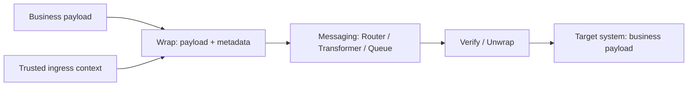
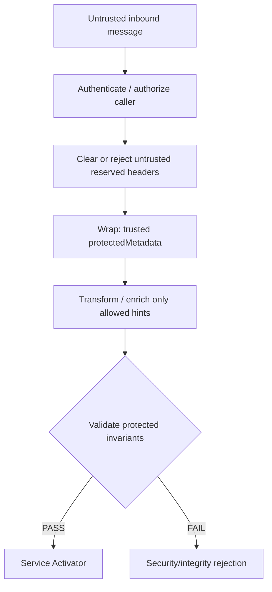
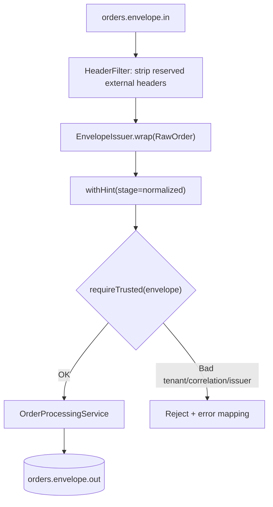
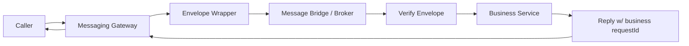
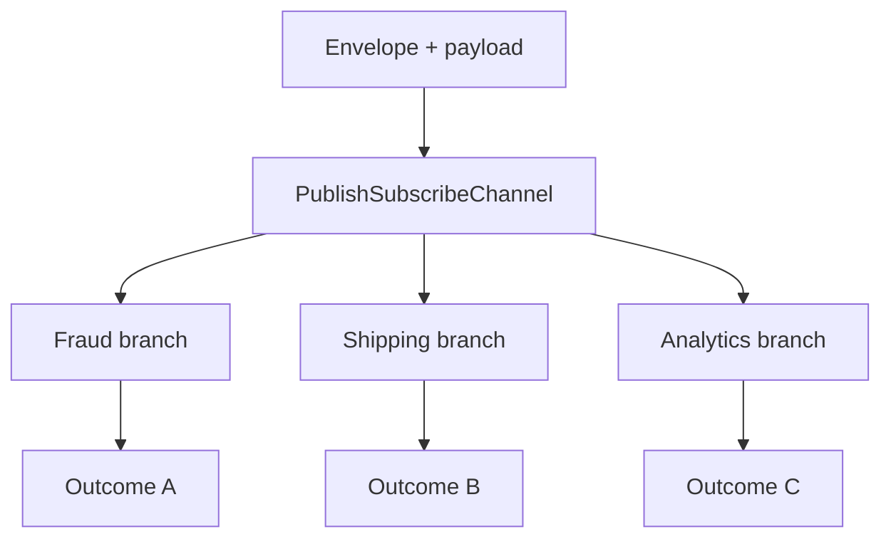
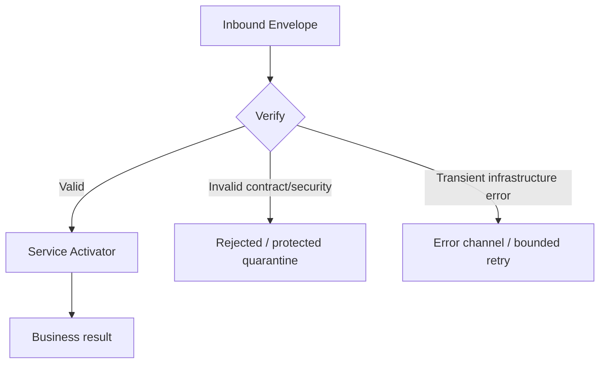

# Protecting Metadata from Overwriting with Envelope Wrapper in Spring Integration

## Lesson Objectives

A system ingests orders from multiple partners. After authenticating the incoming call, the system knows the request genuinely belongs to `tenant-a`. However, the message may carry client-set headers:

```text
headers:
  tenantId = tenant-b
  correlationId = tenant-b|ORD-42|1
  issuer = trusted-order-api
  role = ADMIN
payload:
  orderId = ORD-42
  amountMinor = 125000
  generation = 1
```

If a Router, Transformer, or Service Activator **trusts the received header** and uses it to determine the tenant, access rights, or correlation group, the system may process the wrong data or mix orders across different customers.

One solution is **Envelope Wrapper**: separating the business payload from a clearly structured metadata layer **created from a trusted context** at ingress, then protecting critical fields throughout all transformation steps. Messages can be wrapped on the receiving side and unwrapped before calling target systems that know nothing about messaging infrastructure.

**Focus of this lesson:** protecting metadata **from accidental overwriting or untrusted sources**, while recognizing the limits of those protections. Immutable Java records do not create cryptographic authentication on their own; Spring headers are not ACLs; the same metadata field may appear in the envelope, Spring Message headers, and transport headers, so you must specify **which source holds authority**.

This lesson belongs to the **Envelope wrapper** chapter of module **SPRING_INTEGRATION_PATTERN**, serving the goal of learning Enterprise Integration Patterns with Spring Integration: building loosely coupled, extensible message flows; practicing Router, Filter, Transformer, Splitter, Aggregator, Gateway, retry, error channel, and correlation; plus testing and observing branches.

After this lesson, you can:

1. Distinguish **Envelope Wrapper** from `Message<?>`/`MessageHeaders` and from **Header Enricher**.
2. Identify which metadata is **trusted/protected** versus merely **advisory** or **transport-level**.
3. Create a **typed immutable envelope** and a rule allowing only non-protected metadata additions.
4. Sanitize externally received headers; prevent `headerFunction`, `setHeader`, Transformers, or header mappers from dropping or overwriting critical metadata.
5. Build a Java DSL flow `headerFilter → wrap → safe enrich → guard → Service Activator`.
6. Write JUnit tests proving forged headers cannot alter authoritative tenant/correlation values and forged envelope metadata is caught before side effects.
7. Explain when **signatures/MACs, sender authentication, and replay checks** are required as envelopes cross untrusted boundaries.
8. Design policies for Gateway, Router, Splitter/Aggregator, brokers, error channels, retries, and auditing.

---

## 1. What Problem Does Envelope Wrapper Solve?

In Enterprise Integration Patterns, **Envelope Wrapper** packages application data inside an envelope matching messaging infrastructure requirements. That layer can carry routing, correlation, format, version, or security-control metadata that the target application system does not understand or should not receive.



Goals:

- Keep the **business payload** independent of header structures required by integration infrastructure.
- Let intermediate endpoints access metadata for correlation, routing, and observability without changing the target system's domain model.
- Establish a clear place to **issue**, **verify**, and **pass along** business- or security-relevant metadata.
- Allow swapping adapters/protocols without tying every Service Activator to HTTP/Kafka/JMS headers.
- Prevent a newly built message from accidentally changing tenant, schema version, or workflow keys.

**Limitation:** EIP Envelope Wrapper is a **message structure design pattern**, not a security suite automatically enabled by Spring Integration. Access control, signing, and key management remain the application's and infrastructure's responsibility.

### Sample Enveloped Message

```json
{
  "metadata": {
    "tenantId": "tenant-a",
    "businessCorrelationId": "tenant-a|ORD-42|1",
    "issuer": "order-ingress",
    "schemaVersion": 1,
    "issuedAt": "2026-11-21T00:00:00Z"
  },
  "body": {
    "orderId": "ORD-42",
    "amountMinor": 125000,
    "generation": 1
  },
  "hints": {
    "stage": "normalized"
  }
}
```

In this example:

- `metadata` holds **protected** fields. Only a trusted ingress component may issue initial values; downstream steps must not silently alter them.
- `body` holds the business information to process.
- `hints` holds lower-trust auxiliary fields such as stage labels for observability or secondary calculations.
- Spring `Message<?>` may still carry its own headers like `replyChannel`, `errorChannel`, and `traceId`. Never mix those operational headers with verified facts.

### Carrying Metadata in an Envelope Does Not Make Its Fields Trustworthy

If a client sends the entire JSON above itself, `metadata.issuer="order-ingress"` is **still client-declared**. Only when a trusted component creates or authenticates the envelope does that data carry trustworthy meaning within the recognized scope.

---

## 2. Three Metadata Layers Commonly Confused

A Spring Integration flow may simultaneously contain:

| Layer | Examples | Purpose |
| --- | --- | --- |
| **Protected business envelope** | Authenticated tenant, workflow generation, canonical business correlation | Business identity and cross-flow invariants |
| **Spring Message headers** | `correlationId`, `replyChannel`, `errorChannel`, `priority`, `contentType` | Messaging endpoint control |
| **Transport headers** | HTTP `X-Tenant`, Kafka record headers, JMS properties | Process/adapter communication |

These three layers can hold **identical field names with different authority**.

Example:

```text
HTTP header X-Tenant: tenant-b        // client-sent, untrusted
Spring header tenantId: tenant-b      // mapped by inbound adapter
Envelope metadata tenantId: tenant-a  // issued from verified principal
```

Safe rule: **use `tenant-a` from the authenticated identity** to decide permissions and business groups. The `tenant-b` header must be stripped, rejected, or logged as a conflict per policy; **never let it overwrite authoritative metadata**.

### Fields Typically Requiring Protection

- `tenantId`/namespace from an authenticated source.
- Verified `issuer` or service identity.
- `businessCorrelationId` or workflow/run/generation.
- `schemaVersion` and `mappingVersion` selected per contract.
- `requestId` when serving as a trusted ingress business ID.
- `classification`/`sensitivity`, e.g., restricted-access data.
- `authorizationScope` if issued by a policy engine rather than the sender.
- `issuedAt`, `expiresAt`, and `nonce` when part of a signed contract.

Not every system needs all of the fields above. **The larger the metadata, the more points require validation and synchronization.**

### Less Sensitive Metadata

Fields like `stage`, `workerDurationMs`, `debugTag`, or `retryObservation` may be appended by flows, yet still must:

- Have clear names and namespaces.
- Never collide with protected fields.
- Disallow oversized values or secrets.
- Never silently replace values already used for decisions.
- Never be treated as authentication proof merely because they sit inside the envelope.

---

## 3. Immutable `MessageHeaders` Does Not Mean Protected Business Metadata

In Spring Messaging, a standard `Message<?>` has no payload/header setters; the `MessageHeaders` map cannot be mutated in place like a `HashMap`.

However, an endpoint can build a **new message**:

```java
Message<?> next = MessageBuilder
    .fromMessage(previous)
    .setHeader("tenantId", "tenant-b")
    .build();
```

If `tenantId` is a **regular business header**, this code sets a different value on the new message. It does not mutate `previous` in place, yet downstream steps receiving `next` see altered metadata.

### Which Headers Are Actually Read-Only?

Under default Spring Integration configuration:

- `MessageHeaders.ID` and `MessageHeaders.TIMESTAMP` are two **read-only** system headers.
- Certain Header Enricher/Filter APIs disallow redefining or replacing those system names.
- Business headers like `tenantId`, `sourceSystem`, `customerTier`, or `businessCorrelationId` **are not protected like ID/timestamp by default**.
- Spring Integration lets you customize header propagation and copying at relevant points. Those settings do not constitute an authorization mechanism on their own.

**Do not confuse `MessageHeaders` being an immutable map with every value inside that map being authenticated.** Header values can also point to mutable objects or originate from untrusted sources.

### Five Different Forms of Modification

| Operation | Mutates prior message? | Risk |
| --- | --- | --- |
| `message.getHeaders().put(...)` | Invalid on default header map | Throws an exception |
| `MessageBuilder.fromMessage(message).setHeader(...)` | No; creates a new message | Can overwrite business headers in the new copy |
| Transformer returns a different `Message<?>` | No; output is a different message | Can drop or replace all protected metadata |
| Adapter builds message from broker | Creates message in another process | Can miss, mis-map, or spoof headers |
| Mutating an object inside a header | Affects referenced content | Shallow immutability does not block nested mutation |

### When a Transformer Returns Payload vs. Message

Spring Integration usually propagates inbound headers when a Transformer returns only a **payload**. If a Transformer returns a **complete message**, your code is responsible for deciding the new message's headers.

That is why metadata propagation must be tested for both Transformer styles, especially around `correlationId` and `replyChannel`.

---

## 4. Why Can a Header Enricher Cause Overwrites?

Header Enricher is handy for adding headers from payloads, configuration, or computed expressions:

```java
.enrichHeaders(spec -> spec
    .header("stage", "normalized"))
```

Now look at a configuration that permits overwriting:

```java
.enrichHeaders(spec -> spec
    .header("tenantId", "tenant-b", true))
```

For regular business headers, `true` means **allow overwriting** an existing value. If downstream handlers read `headers['tenantId']` for data access, the outcome may hit the wrong tenant.

### Things to Remember About `defaultOverwrite`

- Many methods on `HeaderEnricherSpec` default to **no overwrite** if the header already exists.
- Overwriting can be enabled per header via overloads taking a `Boolean overwrite` flag.
- `defaultOverwrite(true)` can be configured across multiple headers.
- **Disabling overwrite** is not necessarily safe either: a spoofed ingress value may have already claimed the header before a trusted component tries to add the real value.

Dangerous example:

```text
Inbound (untrusted): tenantId=tenant-b
Trusted Header Enricher (overwrite=false): tenantId=tenant-a
Result: tenantId stays tenant-b
```

Therefore, for trusted fields, do not ask only “does it overwrite?”—ask **which source supplied the current value**.

### Framework-Generated Headers vs. Application-Managed Headers

`correlationId` is also used by Aggregator/Resequencer or Splitter. Overwriting it mid-flow can break group formation even if you only meant to improve logging.

A good way to organize:

- Keep long-lived business correlation inside `protectedMetadata.businessCorrelationId`.
- Use Spring's `correlationId` for the **active processing group**, according to topology.
- Whenever placing a business key into a Spring header, **derive it from the trusted source** and be explicit about where updates are permitted.
- Never alter `replyChannel`/`errorChannel` without understanding the impact on Gateways or request–reply.

---

## 5. Metadata Protection Principles: Issue, Use, Verify

A policy can be structured in three stages:



**1. Issue:** only trusted ingress/services create `protectedMetadata` from verified identity, configuration, or server state.

**2. Use:** intermediate endpoints may read metadata; when appending auxiliary info, they never modify protected fields.

**3. Verify:** at side-effect boundaries or before crossing trust boundaries, compare metadata against authenticated sources and verify consistency between payload and correlation/generation. For data crossing untrusted systems, verify **signatures/MACs** per contract rather than just comparing values.

### Comparing Protection Mechanisms

| Mechanism | What bug/threat does it stop? | What it does not solve alone |
| --- | --- | --- |
| Java record + `Map.copyOf` | Accidental mutation of the same object | A new object can still be built with different values |
| `HeaderFilter` at ingress | Stops named client headers from entering the flow | Does not authenticate the client or payload bytes |
| Allowlist/reserved names | Prevents annotations from overwriting protected names | Does not stop components authorized to build new envelopes |
| Invariant guard before service | Catches inconsistent metadata within context | Does not prove who signed the data |
| Authentication + authorization | Establishes actor/rights at trust boundary | Does not keep body/headers immutable across brokers |
| Valid MAC/signature | Detects tampering of signed fields | Does not provide confidentiality or block replays |
| Nonce/deadline/ledger | Mitigates replaying old messages | Requires state storage and consumption policies |

**No single `immutable=true` flag replaces every row in this table.**

---

## 6. Domain Model: Envelope Holding Protected Metadata and Hints

In this exercise, we use:

```text
RawOrder
  orderId, amountMinor, generation

ProtectedMetadata
  tenantId, businessCorrelationId,
  issuer, schemaVersion, issuedAt

EnvelopedOrder
  protectedMetadata, body: RawOrder,
  hints: Map<String, String>
```

`tenantId` is not read from a client-supplied header. A trusted `VerifiedCallerContext` in the example supplies the illustrative value `tenant-a`.

We split metadata into two regions:

- **`ProtectedMetadata`:** has no methods to alter an individual field; only the trusted issuer creates it initially.
- **`hints`:** can be appended stage by stage, yet cannot use reserved names or overwrite existing keys.

```java
import java.time.Instant;
import java.util.HashMap;
import java.util.Map;
import java.util.Objects;
import java.util.Set;

public record ProtectedMetadata(
    String tenantId,
    String businessCorrelationId,
    String issuer,
    int schemaVersion,
    Instant issuedAt
) {}

public record RawOrder(
    String orderId,
    long amountMinor,
    int generation
) {}

public record EnvelopedOrder(
    ProtectedMetadata metadata,
    RawOrder body,
    Map<String, String> hints
) {
    private static final Set<String> RESERVED = Set.of(
        "tenantId", "businessCorrelationId", "issuer",
        "schemaVersion", "issuedAt", "securityRole");

    public EnvelopedOrder {
        Objects.requireNonNull(metadata, "metadata");
        Objects.requireNonNull(body, "body");
        hints = Map.copyOf(
            Objects.requireNonNull(hints, "hints"));
    }

    public EnvelopedOrder withHint(String key, String value) {
        if (key == null || key.isBlank()
                || RESERVED.contains(key)
                || value == null || value.length() > 200) {
            throw new IllegalArgumentException("INVALID_HINT");
        }
        if (hints.containsKey(key)) {
            throw new IllegalArgumentException(
                "HINT_ALREADY_DEFINED");
        }

        Map<String, String> next = new HashMap<>(hints);
        next.put(key, value);

        // Reuse the original metadata; never copy/recreate from
        // another value sourced from out-of-band headers.
        return new EnvelopedOrder(metadata, body, next);
    }
}
```

These are **illustrative learning records**; the Java DSL configuration in the next section includes self-contained versions as nested types.

### Why Not Use `Map<String,Object> metadata` for Everything?

A single map for all fields easily leads to:

```java
Map<String, Object> metadata = new HashMap<>();
metadata.put("tenantId", "tenant-a");

// Another enrichment step:
metadata.put("tenantId", "tenant-b"); // Silently overwritten.
```

A typed `ProtectedMetadata` lets IDEs, compilers, and code reviews spot critical fields; hint-adding methods have no write path into metadata.

Still, records are only **shallowly** immutable. If a record field is a mutable `List`/`Map`, defensively copy both the collection and any mutable elements as needed. In the demo, metadata uses only `String`, `int`, and `Instant` (all immutable), while `hints` uses `Map.copyOf` with `String` values.

### Why Prevent Overwriting Hints Too?

Even though `hints` is lower-trust, overwriting `stage=validated` with `stage=reviewed` without recording why can distort audits. The example makes `withHint(...)` **append-only per key**. Real systems may use timestamped event histories rather than packing every step into one map.

---

## 7. Java DSL: `HeaderFilter` → Wrap → Enrich → Guard → Service Activator

Now build a complete Spring Integration example:



Things to observe:

1. The initial payload is only `RawOrder`.
2. Specific client-controlled headers are stripped before they can affect downstream steps.
3. `EnvelopeIssuer` creates authoritative metadata from a **trusted server context**.
4. `withHint` appends stage info only.
5. `requireTrusted` verifies invariants before the Service Activator causes side effects.
6. The handler reads `envelope.metadata()`, never `headers["tenantId"]`, to select the tenant.

### Self-Contained Configuration (Java 17+, Spring Integration 6.x/7.x)

```java
import java.time.Clock;
import java.time.Instant;
import java.time.ZoneOffset;
import java.util.HashMap;
import java.util.Map;
import java.util.Objects;
import java.util.Set;
import java.util.concurrent.atomic.AtomicInteger;
import java.util.regex.Pattern;

import org.springframework.context.annotation.Bean;
import org.springframework.context.annotation.Configuration;
import org.springframework.integration.channel.DirectChannel;
import org.springframework.integration.channel.QueueChannel;
import org.springframework.integration.config.EnableIntegration;
import org.springframework.integration.dsl.IntegrationFlow;
import org.springframework.messaging.MessageChannel;
import org.springframework.messaging.PollableChannel;

@Configuration
@EnableIntegration
public class ProtectedEnvelopeConfig {

    public record RawOrder(
        String orderId, long amountMinor, int generation
    ) {}

    public record ProtectedMetadata(
        String tenantId,
        String businessCorrelationId,
        String issuer,
        int schemaVersion,
        Instant issuedAt
    ) {}

    public record EnvelopedOrder(
        ProtectedMetadata metadata,
        RawOrder body,
        Map<String, String> hints
    ) {
        private static final Set<String> RESERVED = Set.of(
            "tenantId", "businessCorrelationId",
            "issuer", "schemaVersion",
            "issuedAt", "securityRole");

        public EnvelopedOrder {
            Objects.requireNonNull(metadata, "metadata");
            Objects.requireNonNull(body, "body");
            hints = Map.copyOf(
                Objects.requireNonNull(hints, "hints"));
        }

        public EnvelopedOrder withHint(
            String key, String value
        ) {
            if (key == null || key.isBlank()
                    || RESERVED.contains(key)
                    || value == null || value.length() > 200) {
                throw new IllegalArgumentException(
                    "INVALID_HINT");
            }
            if (hints.containsKey(key)) {
                throw new IllegalArgumentException(
                    "HINT_ALREADY_DEFINED");
            }

            Map<String, String> next =
                new HashMap<>(hints);
            next.put(key, value);
            return new EnvelopedOrder(metadata, body, next);
        }
    }

    public record Receipt(
        String orderId,
        String tenantId,
        String businessCorrelationId,
        long amountMinor,
        String stage
    ) {}

    // This is only a trusted fixture for the lesson.
    // Production must derive identity from verified
    // authentication context / service principal.
    public static final class VerifiedCallerContext {

        public String tenantId() {
            return "tenant-a";
        }

        public String issuer() {
            return "order-ingress";
        }
    }

    public static final class EnvelopeIssuer {
        private static final Pattern ORDER_ID =
            Pattern.compile("[A-Za-z0-9_-]{1,80}");

        private final VerifiedCallerContext context;
        private final Clock clock;

        public EnvelopeIssuer(
            VerifiedCallerContext context,
            Clock clock
        ) {
            this.context = context;
            this.clock = clock;
        }

        public EnvelopedOrder wrap(RawOrder order) {
            if (order == null
                    || order.orderId() == null
                    || !ORDER_ID.matcher(
                        order.orderId()).matches()
                    || order.amountMinor() <= 0
                    || order.generation() < 1) {
                throw new IllegalArgumentException(
                    "INVALID_ORDER");
            }

            String tenant = context.tenantId();
            String group = tenant + "|" + order.orderId()
                + "|" + order.generation();

            var metadata = new ProtectedMetadata(
                tenant,
                group,
                context.issuer(),
                1,
                clock.instant());

            return new EnvelopedOrder(
                metadata, order, Map.of());
        }

        public void requireTrusted(EnvelopedOrder envelope) {
            if (envelope == null) {
                throw new SecurityException(
                    "INVALID_ENVELOPE_METADATA");
            }

            var metadata = envelope.metadata();
            var body = envelope.body();

            String expectedGroup =
                context.tenantId() + "|" + body.orderId()
                    + "|" + body.generation();

            boolean valid =
                context.tenantId().equals(metadata.tenantId())
                && expectedGroup.equals(
                    metadata.businessCorrelationId())
                && context.issuer().equals(metadata.issuer())
                && metadata.schemaVersion() == 1
                && metadata.issuedAt() != null
                && !metadata.issuedAt().isAfter(
                    clock.instant().plusSeconds(30));

            if (!valid) {
                throw new SecurityException(
                    "INVALID_ENVELOPE_METADATA");
            }
        }
    }

    public static final class OrderProcessingService {
        private final AtomicInteger calls =
            new AtomicInteger();

        public Receipt process(EnvelopedOrder envelope) {
            // Never read tenantId from Spring message headers.
            calls.incrementAndGet();

            return new Receipt(
                envelope.body().orderId(),
                envelope.metadata().tenantId(),
                envelope.metadata().businessCorrelationId(),
                envelope.body().amountMinor(),
                envelope.hints().get("stage"));
        }

        public int invocations() {
            return calls.get();
        }
    }

    @Bean
    Clock envelopeClock() {
        // Fixed clock makes test outputs deterministic.
        // Production usually uses Clock.systemUTC().
        return Clock.fixed(
            Instant.parse("2026-11-21T00:00:00Z"),
            ZoneOffset.UTC);
    }

    @Bean
    VerifiedCallerContext verifiedCallerContext() {
        return new VerifiedCallerContext();
    }

    @Bean
    EnvelopeIssuer envelopeIssuer(
        VerifiedCallerContext context, Clock clock
    ) {
        return new EnvelopeIssuer(context, clock);
    }

    @Bean
    OrderProcessingService orderProcessingService() {
        return new OrderProcessingService();
    }

    @Bean("orders.envelope.in")
    MessageChannel input() {
        return new DirectChannel();
    }

    @Bean("orders.envelope.out")
    PollableChannel output() {
        // Test sink with no background consumer.
        return new QueueChannel();
    }

    @Bean
    IntegrationFlow protectedEnvelopeFlow(
        EnvelopeIssuer issuer,
        OrderProcessingService service
    ) {
        return IntegrationFlow.from("orders.envelope.in")

            // Strip only untrusted external headers.
            // Do not blindly remove replyChannel/errorChannel here.
            .headerFilter(
                "tenantId",
                "businessCorrelationId",
                "issuer",
                "schemaVersion",
                "securityRole")

            // Issue trusted metadata inside the payload envelope.
            .transform(RawOrder.class, issuer::wrap)

            // Add stage label only; never alter protected metadata.
            .transform(
                EnvelopedOrder.class,
                envelope -> envelope.withHint(
                    "stage", "normalized"))

            // Guard always executes before side effects.
            .handle(
                EnvelopedOrder.class,
                (envelope, headers) -> {
                    issuer.requireTrusted(envelope);
                    return service.process(envelope);
                })

            .channel("orders.envelope.out")
            .get();
    }
}
```

### Security Model of the Demo

`VerifiedCallerContext` returns a fixed tenant **for learning/testing only**. It is not real authentication. In a multi-tenant application, replace it with a **trusted identity provider** invoked at the proper boundary; avoid a mutable singleton `currentTenant` shared across requests/threads.

Similarly, `requireTrusted` is an **invariant guard**: comparing metadata against context and body. It catches many obvious tampering or value errors, yet an actor capable of instantiating a new envelope with predictable values could bypass a string-comparing guard. **Do not use this code in place of digital signatures/HMAC or authentication when receiving data over untrusted networks.**

### Why Does `headerFilter` Come Before `wrap`?

A client can send `tenantId` or `issuer` matching field names the application uses. If left intact, a careless downstream handler might read the header instead of `envelope.metadata()`.

`headerFilter(...)` at ingress **removes explicitly named keys** from Spring Message headers. It does not remove every dangerous header in existence. For strict trust boundaries, design an **allowlist** of transport headers permitted into the flow.

### Why Not Remove `replyChannel` and `errorChannel` Here?

Because Spring Integration may use those headers to reply to a Gateway or route errors. Removing them unintentionally can stall callers until timeout or break error handling. At an outbound broker boundary, you need a different policy because in-JVM channel objects are not transport-compatible.

### Why Does the Service Activator Accept the Envelope?

It receives a validated `EnvelopedOrder` instead of relying on an open set of headers. That makes explicit **who issued the metadata**, **which fields are stable**, and **which fields are merely auxiliary for observability**.

---

## 8. JUnit Testing: Forged Headers Cannot Alter Protected Metadata

The tests use `DirectChannel` and `QueueChannel` to run synchronously in a single JVM. They prove the flow's protection logic, **not** real authentication or cross-broker signature verification.

### Integration Test: Forged Headers, Valid Requests, and Invalid Input

```java
import static org.assertj.core.api.Assertions.assertThat;
import static org.assertj.core.api.Assertions.assertThatThrownBy;

import org.junit.jupiter.api.Test;
import org.springframework.beans.factory.annotation.Autowired;
import org.springframework.beans.factory.annotation.Qualifier;
import org.springframework.messaging.Message;
import org.springframework.messaging.MessageChannel;
import org.springframework.messaging.PollableChannel;
import org.springframework.messaging.support.MessageBuilder;
import org.springframework.test.annotation.DirtiesContext;
import org.springframework.test.context.junit.jupiter.SpringJUnitConfig;

@SpringJUnitConfig(ProtectedEnvelopeConfig.class)
@DirtiesContext(
    classMode = DirtiesContext.ClassMode.AFTER_EACH_TEST_METHOD)
class ProtectedEnvelopeFlowTest {

    @Autowired
    @Qualifier("orders.envelope.in")
    MessageChannel input;

    @Autowired
    @Qualifier("orders.envelope.out")
    PollableChannel output;

    @Autowired
    ProtectedEnvelopeConfig.OrderProcessingService service;

    @Test
    void forgedBusinessHeadersCannotOverrideTrustedEnvelope() {
        var raw = new ProtectedEnvelopeConfig.RawOrder(
            "ORD-42", 125_000L, 1);

        Message<?> inbound = MessageBuilder.withPayload(raw)
            .setHeader("tenantId", "tenant-b")
            .setHeader(
                "businessCorrelationId",
                "tenant-b|ORD-42|1")
            .setHeader("issuer", "fake-issuer")
            .setHeader("schemaVersion", 999)
            .setHeader("securityRole", "ADMIN")
            .setHeader("traceId", "trace-42")
            .build();

        assertThat(input.send(inbound)).isTrue();

        Message<?> result = output.receive(2_000);
        assertThat(result).isNotNull();

        var receipt =
            (ProtectedEnvelopeConfig.Receipt)
                result.getPayload();

        assertThat(receipt.tenantId())
            .isEqualTo("tenant-a");
        assertThat(receipt.businessCorrelationId())
            .isEqualTo("tenant-a|ORD-42|1");
        assertThat(receipt.orderId()).isEqualTo("ORD-42");
        assertThat(receipt.amountMinor()).isEqualTo(125_000L);
        assertThat(receipt.stage()).isEqualTo("normalized");

        // Client-controlled headers were stripped.
        assertThat(result.getHeaders())
            .doesNotContainKeys(
                "tenantId",
                "businessCorrelationId",
                "issuer",
                "schemaVersion",
                "securityRole");

        // Observability header outside reserved list.
        assertThat(result.getHeaders().get("traceId"))
            .isEqualTo("trace-42");

        assertThat(service.invocations()).isEqualTo(1);
        assertThat(output.receive(0)).isNull();
    }

    @Test
    void twoValidOrdersKeepIndependentCorrelations() {
        sendValid("ORD-101", 1);
        sendValid("ORD-102", 2);

        var first = (ProtectedEnvelopeConfig.Receipt)
            output.receive(2_000).getPayload();

        var second = (ProtectedEnvelopeConfig.Receipt)
            output.receive(2_000).getPayload();

        assertThat(first.businessCorrelationId())
            .isEqualTo("tenant-a|ORD-101|1");
        assertThat(second.businessCorrelationId())
            .isEqualTo("tenant-a|ORD-102|2");
        assertThat(service.invocations()).isEqualTo(2);
    }

    private void sendValid(String orderId, int generation) {
        assertThat(input.send(MessageBuilder.withPayload(
            new ProtectedEnvelopeConfig.RawOrder(
                orderId, 100L, generation)).build()))
            .isTrue();
    }

    @Test
    void invalidOrderStopsBeforeServiceActivator() {
        var invalid = new ProtectedEnvelopeConfig.RawOrder(
            "ORD|INJECTED", 100L, 1);

        assertThatThrownBy(() -> input.send(
            MessageBuilder.withPayload(invalid).build()
        )).isInstanceOf(RuntimeException.class);

        assertThat(service.invocations()).isZero();
        assertThat(output.receive(0)).isNull();
    }
}
```

What the tests observe:

- An external `tenantId=tenant-b` header **does not overwrite** metadata issued by the issuer from trusted context.
- Business correlation carries full tenant/order/generation structure.
- Reserved header names are stripped from the output.
- An observability header `traceId` can traverse the flow, yet **is never treated as business identity**.
- Malformed payloads are blocked before the handler.

**Explicit limitation:** in the test, the service is invoked once because only one valid message is sent; this does not prove exactly-once processing across broker redeliveries or system crashes.

## 9. Unit Test: Envelope Invariants and Guard

The code below directly tests several cases that `HeaderFilter` alone cannot protect against.

```java
import static org.assertj.core.api.Assertions.assertThat;
import static org.assertj.core.api.Assertions.assertThatThrownBy;

import java.time.Clock;
import java.time.Instant;
import java.time.ZoneOffset;
import java.util.Map;

import org.junit.jupiter.api.Test;

class ProtectedEnvelopeUnitTest {

    private final Clock clock = Clock.fixed(
        Instant.parse("2026-11-21T00:00:00Z"),
        ZoneOffset.UTC);

    private final ProtectedEnvelopeConfig.EnvelopeIssuer issuer =
        new ProtectedEnvelopeConfig.EnvelopeIssuer(
            new ProtectedEnvelopeConfig.VerifiedCallerContext(),
            clock);

    private ProtectedEnvelopeConfig.EnvelopedOrder original() {
        return issuer.wrap(
            new ProtectedEnvelopeConfig.RawOrder(
                "ORD-77", 500L, 1));
    }

    @Test
    void addingHintDoesNotOverwriteProtectedMetadata() {
        var before = original();
        var after = before.withHint("stage", "normalized");

        assertThat(after.metadata())
            .isSameAs(before.metadata());

        assertThat(before.hints()).isEmpty();
        assertThat(after.hints())
            .containsEntry("stage", "normalized");
        assertThat(after.metadata().tenantId())
            .isEqualTo("tenant-a");

        issuer.requireTrusted(after);
    }

    @Test
    void reservedKeyCannotBeWrittenAsHint() {
        var envelope = original();

        assertThatThrownBy(
            () -> envelope.withHint("tenantId", "tenant-b"))
            .isInstanceOf(IllegalArgumentException.class)
            .hasMessage("INVALID_HINT");

        assertThatThrownBy(
            () -> envelope.withHint(
                "businessCorrelationId", "wrong"))
            .isInstanceOf(IllegalArgumentException.class);
    }

    @Test
    void existingHintCannotBeReplacedSilently() {
        var first = original().withHint("stage", "normalized");

        assertThatThrownBy(
            () -> first.withHint("stage", "overridden"))
            .isInstanceOf(IllegalArgumentException.class)
            .hasMessage("HINT_ALREADY_DEFINED");
    }

    @Test
    void hintsMapCannotBeMutatedAfterCreation() {
        var envelope = original().withHint("stage", "normalized");

        assertThatThrownBy(
            () -> envelope.hints().put("stage", "spoofed"))
            .isInstanceOf(UnsupportedOperationException.class);

        assertThat(envelope.hints())
            .containsExactlyInAnyOrderEntriesOf(
                Map.of("stage", "normalized"));
    }

    @Test
    void forgedTenantInNewEnvelopeIsDetectedByGuard() {
        var good = original();
        var originalMetadata = good.metadata();

        var forgedMetadata =
            new ProtectedEnvelopeConfig.ProtectedMetadata(
                "tenant-b",
                originalMetadata.businessCorrelationId(),
                originalMetadata.issuer(),
                originalMetadata.schemaVersion(),
                originalMetadata.issuedAt());

        var forged = new ProtectedEnvelopeConfig.EnvelopedOrder(
            forgedMetadata, good.body(), Map.of());

        assertThatThrownBy(
            () -> issuer.requireTrusted(forged))
            .isInstanceOf(SecurityException.class)
            .hasMessage("INVALID_ENVELOPE_METADATA");
    }

    @Test
    void forgedCorrelationIsDetectedByGuard() {
        var good = original();
        var metadata = good.metadata();

        var forgedMetadata =
            new ProtectedEnvelopeConfig.ProtectedMetadata(
                metadata.tenantId(),
                "tenant-a|OTHER-ORDER|1",
                metadata.issuer(),
                metadata.schemaVersion(),
                metadata.issuedAt());

        var forged = new ProtectedEnvelopeConfig.EnvelopedOrder(
            forgedMetadata, good.body(), Map.of());

        assertThatThrownBy(
            () -> issuer.requireTrusted(forged))
            .isInstanceOf(SecurityException.class);
    }
}
```

**Test takeaway:** intermediate code cannot mutate metadata of **the same object** via `withHint`; the guard catches certain invalid envelope reconstructions. However, Java still allows calling `new ProtectedMetadata(...)` with new fields: you must enforce **who is authorized to issue** and **proof of origin** at trust boundaries.

### What About Locking Down the Constructor Completely?

You can use a class with a private constructor/factory instead of a public record to restrict where objects can be constructed in code. Within a single JVM, however, code running in the same process still shares access to beans/services; constructor visibility is not equivalent to a security sandbox.

At service-to-service boundaries, rely on **sender authentication and signature/MAC verification**, not merely Java constructor encapsulation.

---

## 10. Source of Truth: Protected Envelope vs. Business Headers

Some teams want `headers['tenantId']` available in every handler for convenience. That is acceptable if **the header-creation path is controlled** and handlers never make security decisions from unverified headers.

There are three options:

### Option A — Use Only the Protected Envelope for Authoritative Data

```text
envelope.metadata.tenantId = tenant-a
Spring header tenantId     = absent
```

Pro: eliminates two identically named sources of values; forces handlers to read the verified envelope.

Con: some Routers/Aggregators that expect headers need an extra adapter step.

### Option B — Mirror Headers from the Envelope Exactly Where Needed

Illustrative **alternative DSL snippet** after the envelope has been verified:

```java
.enrichHeaders(spec -> spec
    .headerFunction(
        "businessCorrelationId",
        message -> ((ProtectedEnvelopeConfig.EnvelopedOrder)
            message.getPayload())
            .metadata().businessCorrelationId(),
        true))
```

This must run **after validating provenance/invariants**. `true` allows replacing an old business header left by untrusted ingress—yet does not make it trustworthy if the envelope itself is untrusted.

### Option C — Keep Business Identity in the Payload and Use a Correlation Strategy

For an Aggregator, instead of trusting arbitrary `headers['correlationId']`:

```java
.aggregate(spec -> spec
    .correlationStrategy(message -> {
        var envelope =
            (ProtectedEnvelopeConfig.EnvelopedOrder)
                message.getPayload();

        return envelope.metadata()
            .businessCorrelationId();
    }))
```

This is a **partial configuration**, missing release strategy and output processor. It must run only on trusted envelopes, never directly on unverified external payloads.

**Do not mix all three approaches without a precedence policy.** If the envelope says `tenant-a` while a header says `tenant-b`, the system must **reject** or **recompute headers from the trusted source**, never letting one endpoint read A while another reads B.

---

## 11. Protecting `correlationId`, `sequenceNumber`, and `sequenceSize`

Spring Integration uses several headers to manage groups and ordering:

| Header | Typical consumer | Risk if overwritten |
| --- | --- | --- |
| `correlationId` | Aggregator/Resequencer | Mixes groups or splits one group into many |
| `sequenceNumber` | Resequencer/Aggregator | Wrong order, broken release |
| `sequenceSize` | Release strategy | Hangs forever or releases incomplete groups |
| `replyChannel` | Gateway/request-reply | Replies lost or misdirected |
| `errorChannel` | Error flow | Exceptions miss their intended target |
| `priority` | `PriorityChannel` | Alters processing order |
| `contentType` | Converter/adapter | Mis-decodes payload |
| `routingSlip` | Routing Slip | Routes message to unintended endpoints |

Some framework-generated headers are valid **only within a specific processing stage**. Do not put all of them on a “never touch” list, because a Splitter or Scatter-Gather may need to mint **sequence metadata for a new level**.

### Distinguishing Business Correlation from Framework Correlation

An order has:

```text
businessCorrelationId = tenant-a|ORD-42|run-1
```

If a Splitter breaks down a record set, it generates group/sequence headers for **one split batch**. Those headers do not have to match business correlation at every level.

When using Envelope Wrapper:

- Store long-lived business IDs in protected metadata.
- Let endpoints generate sequence metadata at **the appropriate level**.
- Before Aggregator/Resequencer, explicitly define `correlationStrategy` and `releaseStrategy`.
- Never overwrite `sequenceNumber` with “retry count” or `priority`.
- For nested Splitters, understand `sequenceDetails` and preserve the right sequence level.

### When a Header Is Lost Yet the Envelope Preserves Content

Across a broker, the `correlationId` header might not be mapped; if the protected envelope is serialized in the payload, business correlation survives so the far side can **reconstruct operational metadata**—once the envelope is authenticated.

**Do not claim request–reply is preserved merely because business correlation exists.** Reply destinations, header mappings, and registries are still required per topology.

---

## 12. When Are Digital Signatures or HMACs Needed?

Within a single trusted Spring context, immutable DTOs, factories, and guards reduce programming bugs. However, when an envelope crosses:

- A broker where multiple producers can write.
- An HTTP API accepting external bodies.
- Shared filesystems/object stores.
- Multiple independently deployed services.
- Queues or connectors with differing privilege tiers.

…an attacker or compromised service can **craft a new envelope** with forged metadata. Comparing `tenantId` against another field also supplied by the attacker is pointless.

### Proposed Verifiable Envelope

```json
{
  "protectedMetadata": {
    "tenantId": "tenant-a",
    "businessCorrelationId": "tenant-a|ORD-42|1",
    "issuer": "ingress-service",
    "schemaVersion": 1,
    "issuedAt": "2026-11-21T00:00:00Z",
    "expiresAt": "2026-11-21T00:05:00Z",
    "nonce": "random-unique-id"
  },
  "body": {
    "orderId": "ORD-42",
    "amountMinor": 125000,
    "generation": 1
  },
  "signature": {
    "algorithm": "HMAC-SHA256",
    "keyId": "issuer-key-v3",
    "value": "encoded-mac-value"
  }
}
```

This is an **illustrative schema**. No real MAC value is shown; strings in the example are placeholders explaining the structure.

### Scope That Must Be Signed

A MAC or signature must cover **all fields that must not be modified**:

```text
mac = HMAC_SHA256(
  secretKeyForIssuer,
  canonicalEncode(
      protectedMetadata,
      hash(body),
      signedContextOrDestination))
```

Do not sign `tenantId` alone if an attacker could still alter amount, workflow generation, or destination. Use a stable **canonical serialization** (field ordering, encoding, Unicode, numbers, nulls) so producer and consumer sign/verify the exact same bytes.

### Verification Workflow on Receipt

1. Authenticate transport/service identity from a trusted source.
2. Verify `issuer` and `keyId` appear in the allowlist authorized for that service.
3. Look up the verification key from a **trusted key registry**, never from an arbitrary message-supplied URL.
4. Verify the MAC/signature over canonicalized bytes using constant-time comparison to avoid timing leaks.
5. Check `expiresAt`/`issuedAt` and bounded clock skew.
6. Check `nonce`/message ID against used values if replay protection is required.
7. Bind `tenantId`/scope to the authorized principal/service.
8. Only after PASS construct `VerifiedEnvelope` for business flows.

**HMAC only proves a holder of the shared secret created or endorsed the data**; it does not distinguish among actors sharing that secret. If non-repudiation or producer/consumer key separation is needed, consider asymmetric signatures under your key policy.

### MAC Does Not Encrypt Content

A signed payload remains readable by anyone with access to the message. For sensitive data, use TLS, encryption at rest, or **payload encryption** across trust boundaries. Do not confuse integrity with confidentiality.

### MAC Does Not Prevent Replay

A validly signed envelope can be re-sent verbatim. If business rules require a command to execute only once, you still need an **idempotency ledger**, appropriate nonces/expiry, and side-effect guards at commit points.

---

## 13. Versioning and Safe Metadata Upgrades

Eventually, envelope version 2 adds:

```json
{
  "schemaVersion": 2,
  "classification": "CONFIDENTIAL",
  "dataResidency": "VN"
}
```

Risks:

- Old consumers ignore `classification` and accidentally forward data to unauthorized systems.
- New producers use `correlationKey` while old consumers still read `correlationId`.
- A “copy headers if absent” Transformer preserves an older version from an external message.
- A consumer accepts version 2 yet verifies signatures only over version 1 fields.
- A new field is added outside the signed data scope.

### Upgrade Rules

1. **Envelope schema version** must be defined explicitly, independent of domain payload version if needed.
2. Unknown protected metadata may need to **fail closed**, rather than being silently ignored.
3. Each schema version specifies the signed field list and serialization format.
4. v1 → v2 mappings must preserve invariants like tenant/issuer/workflow and emit migration audits.
5. Never allow an arbitrary service to “downgrade” versions merely by stripping sensitive fields.
6. Maintain producer–consumer contract tests for every supported version.
7. Document deprecation windows and historical replay procedures.

### Fail-Closed Example

```text
Consumer supports envelope version 1.
Received version 2 with unknown metadata.
Policy: REJECT_UNSUPPORTED_VERSION.

Do NOT:
  Try reading v2 as v1 and drop every unfamiliar protected field.
```

Depending on criticality, a system may support pre-designed safe compatibility, yet you cannot blindly assume unknown fields are harmless.

---

## 14. Gateway and Messaging Bridge

A Gateway can turn a Java call into a message and await a reply. That involves two kinds of metadata:

- **Business metadata** in the envelope: tenant, request/workflow ID, source, schema version.
- **Framework reply metadata**: `replyChannel`, `errorChannel`, timeouts, and request–reply routing headers.

Never copy a raw Java `replyChannel` object across HTTP/Kafka expecting the other side to send to the same object.

### Request–Reply Path



For Gateways to reply accurately, ensure:

1. A stable request ID / business correlation ID inside the envelope.
2. An actual reply destination suited to the transport.
3. Properly configured header mappers/registries.
4. Clear timeouts and error paths.
5. Caller-supplied payload metadata can never hijack another caller's reply channel.
6. Consumers authenticate before trusting sensitive routing/destinations.

### When `HeaderChannelRegistry` Is Needed

Spring Integration provides mechanisms like `headerChannelsToString()` to convert `replyChannel`/`errorChannel` references into strings and register them when messages must be serialized. However, registries have lifecycles and scopes; they are not a way to “make public” arbitrary reply channels. Concrete designs must verify TTLs, security, and transport reply addresses.

---

## 15. Transformer and Canonical Metadata

A Transformer can convert payloads from `RawOrder` to `CanonicalOrder`:

```text
RawOrder                 CanonicalOrder
orderId, amountMinor ->   id, Money, customerInfo
```

If it builds a new envelope, protected metadata must be **carried over per policy**:

```java
public record CanonicalOrder(
    String id,
    long amountMinor
) {}

public record CanonicalEnvelope(
    ProtectedEnvelopeConfig.ProtectedMetadata metadata,
    CanonicalOrder body
) {}

CanonicalEnvelope normalize(
    ProtectedEnvelopeConfig.EnvelopedOrder original
) {
    return new CanonicalEnvelope(
        original.metadata(),
        new CanonicalOrder(
            original.body().orderId(),
            original.body().amountMinor()));
}
```

Here `CanonicalEnvelope.metadata` reuses the original metadata object. That prevents a transform step from minting a different tenant or correlation.

**However:** if the new body alters fields that were used to compute correlation, the guard must verify whether the old correlation remains valid for the new representation. Consider separating a **business identity object** from body schemas rather than deriving keys from every payload shape.

### Anti-Example

```java
CanonicalEnvelope normalizeBadly(
    ProtectedEnvelopeConfig.EnvelopedOrder original
) {
    var metadata =
        new ProtectedEnvelopeConfig.ProtectedMetadata(
            "default-tenant",
            "UNKNOWN",
            "normalizer",
            1,
            java.time.Instant.now());

    return new CanonicalEnvelope(
        metadata,
        new CanonicalOrder(
            original.body().orderId(),
            original.body().amountMinor()));
}
```

If downstream trusts the newly minted metadata, original tenant and correlation are lost. **Never re-issue authoritative metadata arbitrarily inside every Transformer.**

---

## 16. Content Enricher, Header Enricher, and Envelope Wrapper

Three related yet distinct patterns:

| Pattern | Purpose | Metadata risk |
| --- | --- | --- |
| **Envelope Wrapper** | Packages payload with infrastructure-compatible metadata and unwraps at target | New wrapper can drop or alter protected fields |
| **Header Enricher** | Adds headers for routing/tracing/control | `overwrite=true` replaces existing business headers |
| **Content Enricher** | Enriches payload from lookups/external sources | Can return untrusted enrichment data |
| **Transformer** | Transforms payload/message | Can build a new Message and drop headers |
| **Header Filter** | Strips specified headers | Can accidentally strip critical control headers |

For instance, Content Enricher fetches `customerTier` from another service. `customerTier` is **business data** that can change over time; it must not be permitted to alter the envelope's `tenantId` or `issuer`.

An explicit policy:

```text
Protected:
  tenantId, issuer, correlationKey, schemaVersion

Enrichable:
  customerTier, deliveryScore, currencyDisplay

Operational:
  traceId, attempt, processingDurationMs
```

Each group has its own semantics. If an enrichable field affects access control, decide whether it must be **promoted to verified metadata** only after a policy check step.

---

## 17. Concurrency and Publish-Subscribe: Copying Is Not Protection

When a message publishes to multiple subscribers:



If the payload or headers hold a shared mutable object, one branch can mutate it so another branch sees altered state. That can happen even though the framework's message wrapper has no setters.

### Mitigations

- Use `record`/immutable DTOs for protected metadata and payloads whenever possible.
- Defensively copy mutable `Map`/`List` values before branching.
- Never share a mutable `HashMap` of metadata across branches.
- Give each branch its own **result metadata** or defined append-only events.
- Aggregators collect branch outcomes and produce a summary; never let branches overwrite the root group's metadata.
- If a branch creates a new envelope, verify invariants upon merging.

### Branch-Specific Outcome Example

```java
public record BranchOutcome<T>(
    String businessCorrelationId,
    String branchId,
    T result
) {}
```

Two different branches can have `branchId=FRAUD` and `SHIPPING` while sharing `businessCorrelationId`. That **never means** a branch has the right to alter the root request's `tenantId`.

### Do Not Confuse Ordering with Integrity

Resequencer restores order within a group; Aggregator combines replies by correlation and release strategy. Neither verifies on its own that an envelope came from a valid service or that metadata was untampered. **Correct ordering** and **metadata integrity** are two separate requirements.

---

## 18. Untrusted Inputs: Prefer Sanitize or Reject?

Two valid policies exist depending on the trust boundary.

### Policy A — Strip and Replace

If the protocol lets callers attach arbitrary headers for observability yet **grants no permissions from headers**, you can:

```text
Input header tenantId=tenant-b
  -> HeaderFilter strip
  -> Trusted EnvelopeIssuer creates tenant-a
  -> continue
```

Pro: stops spoofed values from flowing downstream. Con: if spoofing is suspicious, stripping and continuing can hide attack signals; emit appropriate logs/audits.

### Policy B — Reject on Conflict

When the contract states clients **must not** send `tenantId` or claim a value differing from their principal:

```text
Input header tenantId=tenant-b
Authenticated tenant=tenant-a
  -> Reject + security audit
  -> never enter business flow
```

Pro: fails closed and flags misconfigured or spoofing clients. Con: can disrupt legacy clients; requires rollout/compatibility planning.

### Never Overwrite and Claim Security

Overwriting a spoofed header with a value from the same spoofed payload **does not make the data source trustworthy**. Verify identity independently first, then apply strip or reject per contract.

---

## 19. Metadata Overwritten Across Brokers or Adapters

When an outbound adapter serializes a Spring Message to Kafka/AMQP/JMS/HTTP:

- Not every Spring header is transmitted.
- Some key/value types cannot be serialized directly.
- External systems may attach headers with the same names.
- Namespacing/casing can change.
- Producers and consumers may run different schema versions.
- There is no guarantee a client-supplied header was authenticated just because the transport delivered it.

### Example Mapping Table

| In service A | Broker representation | In service B |
| --- | --- | --- |
| `ProtectedMetadata` in body envelope | JSON/Avro/Protobuf per schema | Deserialize then **verify** |
| `businessCorrelationId` copied to header | Header `x-business-correlation` | Usable for logging after cross-checking envelope |
| `traceparent`/trace headers | Transport tracing context | Used for observation; never grants permissions |
| `replyChannel` Java object | Never copy directly | Use appropriate reply destination/registry |
| `tenantId` from principal | Can live inside signed metadata | Never trust unverified broker headers |

### Safe Receiving Workflow

```text
Inbound broker message
  -> Verify producer identity/transport permissions
  -> Decode supported envelope schema
  -> Verify integrity + expiry + tenant scope
  -> Reject conflicting transport headers
  -> Rebuild safe internal Message
  -> Service processing
```

Never place authentication/verification logic **after** a Router that already picked a tenant queue or a Service Activator that already performed side effects.

### Header Mappers Can Drop Metadata

If you store business correlation only in a Spring header without mapping it over the broker, the far side receives a message lacking `correlationId`. Envelope Wrapper keeps a copy of business identity in the body when using an appropriate serializer/schema. At the same time, you must protect the body envelope against tampering.

---

## 20. Invalid Metadata: Rejected Branch, Error Channel, and Quarantine

Not every metadata mismatch should enter retries.

| Incident | Classification | Handling direction |
| --- | --- | --- |
| `tenantId` differs from authenticated principal | Security conflict | Deny + audit |
| Invalid signature/MAC | Integrity failure | Reject/quarantine, alert |
| Unknown envelope schema version | Contract mismatch | Quarantine/contract update |
| Missing required `businessCorrelationId` | Invalid envelope | Reject or resolve from trusted source |
| Expired envelope | Expiry/replay policy | Reject or handle per reissue policy |
| Header `priority` differs from body metadata | Source mismatch | Enforce precedence; never trust blindly |
| Store serializer fails after deploy | Infrastructure/schema migration | Error flow + remediation |
| DB/network outage after verify | Transient infrastructure | Bounded retry + idempotency |
| Duplicate command with valid signature | Redelivery/idempotency | Cached result/ledger; never re-execute |

### Do Not Swallow Exceptions and Fall Back to a Default Tenant

```java
// ANTI-EXAMPLE
try {
    issuer.requireTrusted(envelope);
} catch (SecurityException ex) {
    return processAsTenant("default", envelope.body());
}
```

This is fail-open. When protected metadata fails verification, **never proceed under default permissions**.

### Explicit Error Flows



With synchronous `DirectChannel`, exceptions normally propagate to the caller. With brokers/pollers/executors, error flows depend on adapter configuration. `errorChannel` is not automatically the destination for every error in every topology. Separate **permanent rejections** from **transient failures** to avoid poison-message loops.

### Quarantine Needs Protection Too

A rejected envelope can contain sensitive payloads and signatures/tokens. A quarantine store needs:

- ACLs and encryption at rest.
- Retention and capacity limits.
- Redaction in logs.
- Safe reason codes, source, `schemaVersion`, and `requestId`.
- Optionally storing an access-controlled `rawPayloadRef` rather than raw payloads in metrics/logs.
- Repair/replay workflows and approval controls.

---

## 21. Idempotency and Replay: Protected Metadata Alone Is Not Enough

Suppose an envelope is signed and verified:

```text
T1: Command ORD-42 received and Service writes DB successfully.
T2: ACK is lost.
T3: Broker redelivers the exact envelope (MAC is still valid).
T4: Service can trigger a second side effect without idempotency.
```

Protected metadata tells you **who issued it**, **which data was signed**, and **which workflow**; it does not prove the command has not already executed.

To protect side effects:

- Use a business idempotency key like `tenant + operation + commandId + generation`.
- Enforce a ledger/unique constraint where business data is written.
- Store results/terminal states to replay replies.
- When calling external systems, pass a stable provider idempotency key if supported.
- To block transport-level replays, track nonces/time windows.
- Distinguish **duplicate delivery** of an old command from a **new command** with similar payload.

### Do Not Use `MessageHeaders.ID` as the Sole Idempotency Key

Spring Message ID can change when a message is rebuilt across Transformers, adapters, or redeliveries. Business identity in the protected envelope stays more stable for the same logical command, though it must still be bound to the right run and scope.

### Signing Key Rotation

When an issuer rotates HMAC/signing keys, `keyId` must be managed by a trusted registry; the verification window for old keys must balance redelivery windows against security policy. **Never let clients pick weak algorithms or arbitrary key URLs.**

---

## 22. Error Handling, Gateways, and Processed Responses

A Gateway may await a Service Activator reply after verification. If an invalid envelope is simply routed to a rejected `QueueChannel` with no consumer or reply mapping, the caller hangs until timeout.

Two valid models:

**A. Exceptions mapped to contract errors**

```text
Gateway -> Envelope guard throws
        -> error mapper
        -> 4xx/403/422 or corresponding domain error
```

Status codes depend on nature: 403 for auth, 400/422 for schema, or 409 for conflict are only examples; adapters/controllers need real mappings.

**B. Typed rejection result**

```java
public record RejectedEnvelope(
    String requestId,
    String reasonCode
) {}
```

A flow can return a terminal `RejectedEnvelope` containing only disclosable info without leaking sensitive raw metadata. The contract must guarantee exactly one valid reply per request.

### Header Routing Differs from Business Metadata

When a Gateway selects a reply channel, it relies on framework headers and endpoint semantics. Never let `ProtectedMetadata.businessCorrelationId` serve as a reply address to unauthorized channels. Correlation is a **linking key**, not permission to send or read data.

---

## 23. Measuring Overwrite Incidents

A system counting only successful messages misses metadata overwrite attempts. Observe **issuance**, **conflicts**, and **verification outcomes**.

| Suggested metric | Meaning |
| --- | --- |
| `envelope_issued_total{issuer}` | Envelopes issued |
| `envelope_verified_total{result}` | Envelopes PASS/FAIL |
| `envelope_header_conflict_total{header}` | Inbound headers conflicting with policy |
| `envelope_reserved_hint_rejected_total` | Attempts to write reserved hints |
| `envelope_schema_unsupported_total` | Unsupported schema versions |
| `envelope_signature_invalid_total` | Failed MACs/signatures |
| `envelope_expired_total` | Expired envelopes |
| `envelope_replay_detected_total` | Replayed nonces/requests |
| `envelope_guard_failure_total{reason}` | Invariant failures before Service Activator |
| `envelope_business_invoked_total` | Business handler invocations |
| `envelope_quarantine_written_total` | Records written to quarantine |
| `envelope_quarantine_write_failed_total` | Quarantine write failures |
| `envelope_mapping_version_total{version}` | Distribution of mapping/contract versions |

These metric names **can be defined by your application**; Spring Integration does not emit these exact names automatically. Never use raw `correlationId`/`orderId`/`nonce` as high-cardinality metric tags.

### Illustrative Structured Logs

```text
traceId=trace-42 event=envelope_header_conflict
header=tenantId source=untrusted-ingress
resolution=STRIP trustedTenantRef=<redacted>

traceId=trace-43 event=envelope_verified
issuer=order-ingress schemaVersion=1
result=PASS correlationRef=<redacted>

traceId=trace-44 event=envelope_guard_rejected
reason=CORRELATION_MISMATCH
result=DENY correlationRef=<redacted>
```

Logs must never contain HMAC secrets, private keys, raw tokens, full financial payloads, or sensitive personal data. For business IDs in logs, consider surrogates/hashing and role-based access control.

### Auditing Metadata Transitions

To trace who altered a header:

1. Record message ID and correlation at ingress.
2. Record the list of filtered header **names** (without secret values).
3. Record issuer/schema/version upon envelope issuance.
4. Record verification outcomes at trust boundaries.
5. In Transformers, record stage and output schema version.
6. On rejections/late retries, record reason and policy version.
7. Include `traceId`/`spanId` to pinpoint where envelopes changed.
8. Check the business ledger to confirm whether side effects committed.

Spring Integration Message History helps trace component hops within a configuration, yet is not an independent, signed, retention-governed security audit log by default.

---

## 24. Troubleshooting Table

| Symptom | Common cause | Resolution direction |
| --- | --- | --- |
| Tenant changes after Header Enricher | `overwrite=true` on business header | Separate protected metadata; audit overwrites |
| Spoofed tenant kept despite enricher setting real value | Enricher defaults to not overwriting existing headers | Strip/reject at ingress; use trusted source |
| `MessageHeaders` blocks `put` yet downstream sees different tenant | Endpoint built a new message with `setHeader` | Compare before/after messages; do not equate immutability with AuthN |
| Correlation groups mixed | Transformer altered `correlationId` | Protect business correlation; explicit `correlationStrategy` |
| Gateway times out after header filter | Accidentally stripped `replyChannel` | Deliberately preserve/map reply metadata |
| Error flow misses exceptions | Accidentally stripped `errorChannel` or sync topology | Design error mapping; never strip blindly |
| Splitter/Aggregator never releases | Lost `sequenceNumber`/`sequenceSize` | Preserve metadata at the right level |
| Hints overwritten | Shared mutable map | `Map.copyOf` + append-only policy |
| Spoofed metadata in envelope still trusted | Missing verification/issuer check | AuthN + signature/MAC at trust boundary |
| Signature passes yet command runs twice | Replay / lost ACK | Business idempotency ledger |
| MAC fails after deploy | Canonical serialization/version drift | Versioned signing contract, byte-level tests |
| Old consumer ignores new classification | Unknown protected schema field | Fail closed / version migration |
| Broker far end loses correlation | Header mapper omitted it | Verify/rebuild from signed envelope |
| Two pods read different tenants | Trusted context uses mutable singleton tenant | Immutable per-request context, identity propagation |
| Logs leak metadata | Logged raw envelope/token | Redaction, role access, and retention |
| Rejection queue fills up | Missing consumer/backpressure | Durable quarantine and alerting |
| Read-only timestamp mistaken for expiry | `MessageHeaders.TIMESTAMP` is message creation time | Use verified expiry/business deadlines |
| Modified envelope still passes guard | Guard checks predictable values without MAC | Signatures/MACs and issuer binding over networks |

---

## 25. Practice Exercises

### Exercise 1 — Classify Metadata

Given a Spring Message with `tenantId`, `traceId`, `replyChannel`, `schemaVersion`, and `correlationId`, classify which belong in the protected business envelope, operational headers, and untrusted inputs. Explain why.

### Exercise 2 — Header Overwrite

Build two messages with `MessageBuilder.fromMessage(...)`, changing `tenantId` in the second. Prove the original message is untouched while downstream receives the altered value in the new message.

### Exercise 3 — Header Enricher Overwrite

Build a flow testing `header("tenantId", "tenant-a")` and `header("tenantId", "tenant-a", true)` when the inbound header already has `tenant-b`. Observe the difference and explain why `overwrite=false` is insufficient for security.

### Exercise 4 — Wrap with Trusted Context

Use `ProtectedEnvelopeConfig`. Send `RawOrder("ORD-42",125000,1)` with header `tenantId=tenant-b`. Assert the receipt still uses `tenant-a`, issuer-generated correlation, and stripped forged headers.

### Exercise 5 — Prevent Hint Overwrites

Call `withHint("stage","normalized")` and then `withHint("stage","overridden")`; assert an exception is thrown. Try `withHint("tenantId","tenant-b")` and confirm rejection.

### Exercise 6 — Guard Detects Tampered Metadata

Construct `new ProtectedMetadata("tenant-b", ...)` from a valid envelope. Call `issuer.requireTrusted(...)` and assert `INVALID_ENVELOPE_METADATA`. Explain why this test does not replace a MAC.

### Exercise 7 — Transformer Changes Body While Keeping Identity

Write `CanonicalEnvelope normalize(EnvelopedOrder)` keeping protected metadata and changing only the body. Verify tenant/business correlation remain unchanged after two transforms.

### Exercise 8 — Correlation with Aggregator

Keep `businessCorrelationId` in the protected envelope and configure an Aggregator with a custom `CorrelationStrategy`. Send two tenants with the same `orderId`; confirm groups do not mix.

### Exercise 9 — Nested Splitter

Split a batch into files and each file into lines. Identify which metadata is stable business-level and which is file/line-level sequence. Never overwrite another level's sequence.

### Exercise 10 — Broker Round-Trip

Serialize the envelope to JSON/Protobuf, send over a broker, decode, and verify. Test dropping `issuer`, changing `schemaVersion`, and altering correlation headers; identify when to reject, normalize, or safely rebuild.

### Exercise 11 — MAC Verification

Design canonical encoding + HMAC covering protected metadata and body hash. Try altering `tenantId`, `amountMinor`, or `issuedAt`; verification must fail. Add `keyId`/rotation and replay checks via nonce.

### Exercise 12 — Gateway

Send valid requests and invalid envelopes through a Gateway. Ensure clear responses/rejected outcomes without dropping `replyChannel` when stripping reserved headers.

### Exercise 13 — Multi-Instance Context

Replace the fixed tenant fixture with a per-request verified principal. Run two requests for different tenants concurrently. Prove no mutable singleton `currentTenant` mixes data.

### Exercise 14 — Repair and Replay

A schema v2 envelope is rejected by a v1 consumer. Upgrade the consumer and replay the old validly signed message per policy; check expiry and side-effect idempotency.

### Exercise 15 — Audit and Observability

Add metrics for header conflicts, guard rejections, invalid MACs, schema mismatches, and business invocations. Log conflicting field names without exposing raw tokens or full payloads.

---

## 26. Implementation Checklist

1. **Have you identified the authoritative source for every critical metadata field?**
2. Is protected metadata constructed from authenticated identity/service context?
3. Can an external header overwrite tenant, issuer, business correlation, or schema version?
4. Are reserved headers stripped/rejected at the right trust boundary?
5. If using Header Enricher, have `overwrite` flags and behavior with pre-existing values been checked?
6. Is everyone clear that immutable `MessageHeaders` does not equal tamper-proof business metadata?
7. Does the typed envelope defensively copy collections and nested mutable values?
8. Do all hint-enrichment steps block reserved names and accidental overwrites?
9. Do Transformers preserve protected metadata when changing payloads/schemas?
10. When building a new `Message<?>`, is full header propagation explicitly defined?
11. Are `replyChannel`/`errorChannel` altered/removed only per an explicit request–reply policy?
12. Is business correlation separated from Splitter/Aggregator framework correlation/sequences?
13. At Service Activators, do guards/verifications run **before side effects**?
14. Across untrusted brokers/services, are issuer authentication and signature/MAC verification enforced?
15. Do signatures cover all protected fields plus body/context needing protection?
16. Are versioned canonical encoding, `keyId`, key rotation, and algorithm allowlists in place?
17. Are expiry/nonce/idempotency used so valid replays cannot duplicate side effects?
18. Do consumers handle unknown protected schema versions fail-closed?
19. Is tenant/scope validated at consumers rather than trusting raw transport headers?
20. Are integrity errors separated from transient infrastructure errors with proper routing/quarantine?
21. Do Gateways return clear errors instead of timing out from lost reply metadata?
22. Do quarantines, logs, and traces enforce redaction, encryption, RBAC, and retention?
23. Do multi-instance deployments bind identity per request without mutable singletons?
24. Do tests cover forged headers, forbidden hints, forged envelopes, signature mismatches, and broker round-trips?
25. Is monitoring tracking metadata conflict/guard failure rates and supporting overwrite investigations?

### Key Takeaways

**Envelope Wrapper** lets business payloads and messaging metadata travel in one clear structure, wrapped at ingress and unwrapped at the destination. When the problem is **protecting metadata from overwriting**, separate three things: **protected business metadata**, **Spring Message headers**, and **transport headers**. A header named `tenantId` or `correlationId` never proves its value is authenticated.

In Spring Integration, `MessageHeaders` of an existing message cannot be mutated directly, yet **endpoints can create new messages, filter/enrich, and overwrite business headers**. Pick one source of authority, sanitize ingress, use typed/immutable envelopes, restrict enrichable parts, validate invariants before Service Activators, and test header-spoofing and metadata-tampering scenarios. Never turn read-only ID/timestamp headers into an argument that all headers are safe.

When crossing **untrusted boundaries**, add sender authentication, signatures/HMACs over canonicalized data, expiry/replay policies, authorization, and auditing. **Java object immutability prevents programming mistakes; integrity verification prevents tampering across system boundaries; idempotency prevents duplicate execution.** No single mechanism replaces the other two.

### References

- [Enterprise Integration Patterns — Envelope Wrapper](https://www.enterpriseintegrationpatterns.com/patterns/messaging/EnvelopeWrapper.html)
- [Spring Integration Reference — Message and MessageHeaders](https://docs.spring.io/spring-integration/reference/message.html)
- [Spring Integration Reference — Transformer and Header Filter](https://docs.spring.io/spring-integration/reference/transformer.html)
- [Spring Integration Reference — Header Enricher](https://docs.spring.io/spring-integration/reference/content-enrichment.html)
- [Spring Integration Reference — Router](https://docs.spring.io/spring-integration/reference/router.html)
- [Spring Integration Reference — Aggregator](https://docs.spring.io/spring-integration/reference/aggregator.html)
- [Spring Integration Reference — Error Handling](https://docs.spring.io/spring-integration/reference/error-handling.html)
- [Spring Integration Reference — Message History](https://docs.spring.io/spring-integration/reference/message-history.html)
- [Spring Integration API — HeaderEnricherSpec](https://docs.spring.io/spring-integration/api/org/springframework/integration/dsl/HeaderEnricherSpec.html)
- [Spring Integration API — HeaderFilterSpec](https://docs.spring.io/spring-integration/api/org/springframework/integration/dsl/HeaderFilterSpec.html)
