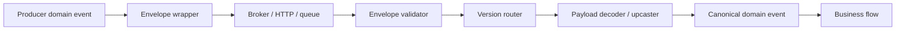
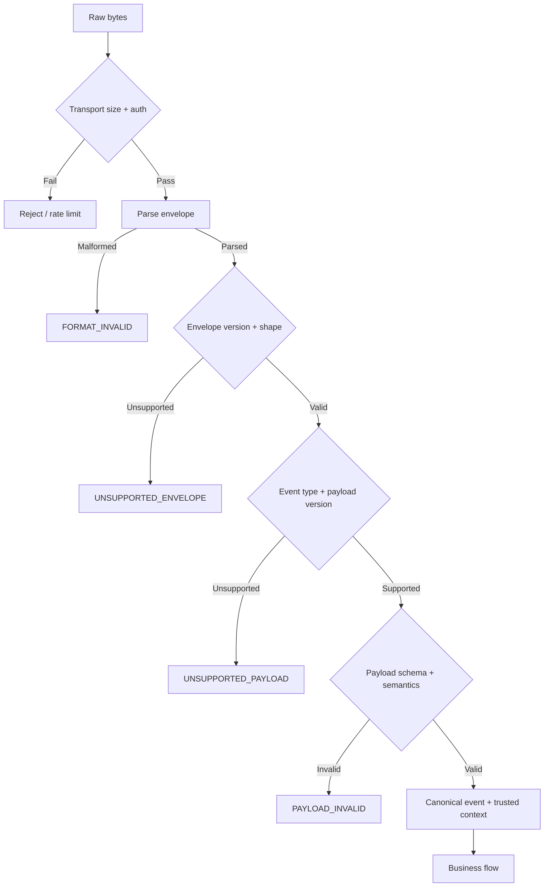
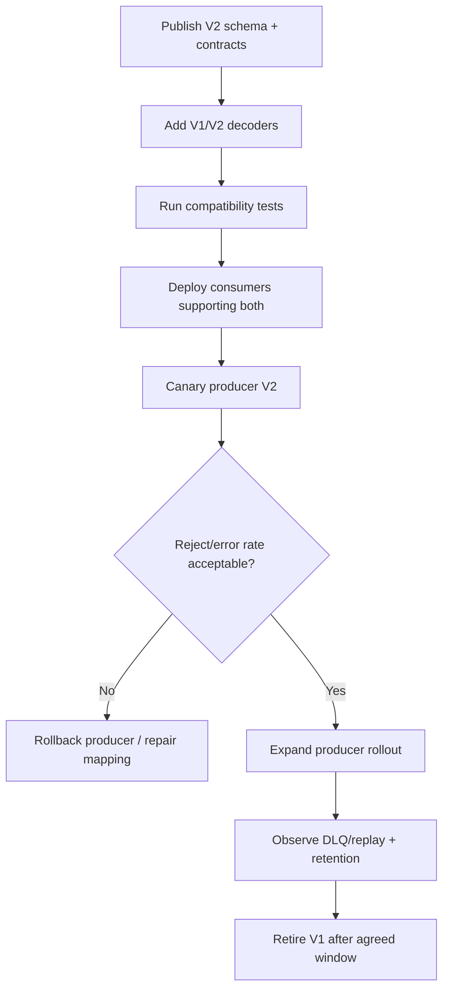
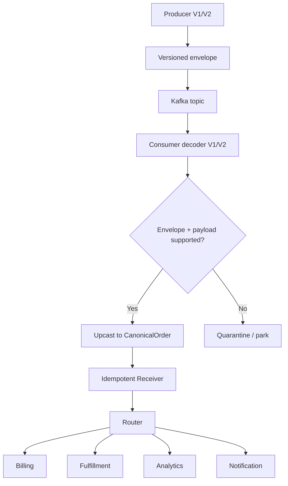

# Envelope Versioning and Compatibility

In an integration system, a message carries more than just business data. It also needs information so the consumer knows **what event this is, which contract it follows, which tenant it belongs to, which request it correlates with, and how to decode it**. As the number of producers, consumers, and brokers grows, sending raw payloads and expecting every consumer to guess the format makes upgrades difficult, complicates replay, and risks misinterpreting versions.

**Envelope Wrapper** is an Enterprise Integration Pattern (EIP) that places an outer layer (*envelope*) around business data. This wrapper carries metadata for exchange, routing, tracing, classification, and decoder selection. **Envelope versioning and compatibility** concerns designing and evolving that wrapper so services deployed at different times still communicate **under contract**, without conflating a metadata change with a payload change.

This lesson belongs to the **Envelope wrapper** chapter of module `SPRING_INTEGRATION_PATTERN`: learning to implement EIP with Spring Integration to create loosely coupled, extensible message flows; practicing Router, Filter, Transformer, Splitter, Aggregator, Gateway, retry, error channel, and correlation, while testing and observing every processing branch.

**After this lesson, you can:**

- Distinguish **envelope version**, **payload schema version**, and business-semantics version.
- Design an envelope with identity, type, schema reference, correlation, timestamps, and trusted metadata.
- Explain **backward/forward compatibility** in terms of writer–reader relationships rather than vague buzzwords.
- Choose how to handle added fields, removed fields, required fields, new enum values, and format changes.
- Use **upcasters/adapters** to normalize data from multiple versions into a single internal DTO.
- Design a Spring Integration Java DSL flow with accepted/rejected branches and stable error codes.
- Test a compatibility matrix across versions, replays, unsupported schemas, duplicates, gateway responses, and security.
- Plan a multi-service rollout strategy without assuming bumping a version number alone is enough.

## 1. What Problem Does Envelope Wrapper Solve?

Suppose a producer emits a JSON message:

```json
{
  "orderId": "ORD-100",
  "amountMinor": 30000,
  "currency": "VND"
}
```

A consumer can read the fields, yet cannot be certain: is this `OrderSubmitted` or `OrderCorrected`? Which version is it? Who sent it? Is it a redelivery of the same event or a new event? Where should replies or correlations go?

Adding an envelope:

```json
{
  "envelopeVersion": 1,
  "eventType": "OrderSubmitted",
  "payloadSchemaVersion": 2,
  "eventId": "evt-100",
  "tenantId": "TENANT-A",
  "correlationId": "flow-100",
  "occurredAt": "2026-11-21T03:00:00Z",
  "data": {
    "orderId": "ORD-100",
    "amountMinor": 30000,
    "currency": "VND"
  }
}
```

The `data` layer contains the **business content**; the outer layer contains the **application-level transport contract**. Schemas and decoders are selected by `(eventType, payloadSchemaVersion)` after verifying the envelope structure.



**Not all Spring Messaging headers should go into a JSON envelope.** The wrapper is an inter-service contract; objects like internal `replyChannel`, security contexts, or exception objects are not meaningful to transmit verbatim across every broker.

## 2. There Are at Least Three Distinct Version Axes

A common design mistake is having only one `version` field and using it simultaneously for the shape of both the envelope and the business payload.

| Axis | Definition | Example changes |
| --- | --- | --- |
| **Envelope version** | Shape and semantics of the shared metadata layer. | Adding `causationId`, changing timestamp representation, renaming `eventType`. |
| **Payload schema version** | Shape of `data` for a specific event type. | `totalMinor` → `amountMinor`, adding `sourceChannel`. |
| **Business semantics/policy version** | Business meaning or calculation algorithm. | Price changing from pre-tax to post-tax total, changing state transition rules. |

A message can be completely valid with:

```text
envelopeVersion       = 2
eventType             = OrderSubmitted
payloadSchemaVersion  = 1
businessPolicyVersion = managed separately if needed
```

There is no rule that envelope V2 must pair with payload V2. The two axes can **evolve independently**, as long as consumers declare and test the combinations they support.

### Why Not Bump the Envelope Version When Adding One Field to `data`?

If every business change forced bumping the shared wrapper version, all consumers—even those unconcerned with that event type—would have to handle a new envelope version. That creates **artificial coupling**. Conversely, changing how envelope metadata itself is encoded affects all event types and requires versioning at the envelope layer.

## 3. Minimal Envelope Contract

An envelope should be stable enough without absorbing every metadata item from every transport.

| Field | Purpose | Notes |
| --- | --- | --- |
| `envelopeVersion` | Selects wrapper contract. | Do not conflate with payload version. |
| `eventType` | Message or event type name. | Should be stable with a registry/allowlist. |
| `payloadSchemaVersion` | Selects decoder/schema for `data`. | Always evaluated together with `eventType`. |
| `eventId` | Durable business identity for the event. | Used for deduplication within proper consumer scope. |
| `tenantId` | Business ownership context. | Must be **cross-checked against authenticated principal**. |
| `correlationId` | Links messages in one flow/run. | Does not replace event ID. |
| `causationId` | Which message/command caused this event. | Can be added in a newer version. |
| `occurredAt` | Occurrence or emission time per contract. | Should be ISO-8601 with explicit timezone/UTC. |
| `data` | Business payload. | Validated against its own schema. |

You might also need `source`, `traceparent`, `contentType`, `schemaId`, `partitionKey`, `producerVersion`, or `expiresAt`. **Add them only with a clear use case** and explicit semantics. An envelope stuffed with dozens of unchecked optional fields quickly becomes a new source of coupling.

### Values Must Not Be Trusted Merely Because They Match the Type

A client can send `"tenantId":"TENANT-A"` or `"correlationId":"run-1"`. Schema validation proves they are valid strings; **it does not prove** the sender is authorized to attach them. At ingress, authenticate the source, enforce policies, and rebuild/cross-check trusted metadata.

## 4. Example of Two Envelope Versions

### Envelope V1 + `OrderSubmitted` Payload V1

```json
{
  "envelopeVersion": 1,
  "eventType": "OrderSubmitted",
  "payloadSchemaVersion": 1,
  "eventId": "evt-100",
  "tenantId": "TENANT-A",
  "correlationId": "flow-100",
  "occurredAt": "2026-11-21T03:00:00Z",
  "data": {
    "orderId": "ORD-100",
    "totalMinor": 30000,
    "currency": "VND"
  }
}
```

### Envelope V2 + `OrderSubmitted` Payload V2

```json
{
  "envelopeVersion": 2,
  "eventType": "OrderSubmitted",
  "payloadSchemaVersion": 2,
  "eventId": "evt-100",
  "tenantId": "TENANT-A",
  "correlationId": "flow-100",
  "causationId": "cmd-create-100",
  "occurredAt": "2026-11-21T03:00:00Z",
  "data": {
    "orderId": "ORD-100",
    "amountMinor": 30000,
    "currency": "VND",
    "sourceChannel": "MOBILE"
  }
}
```

In this example:

- Envelope V2 adds optional metadata `causationId`.
- Payload V2 renames `totalMinor` to `amountMinor` and adds `sourceChannel`.
- Monetary amounts in both versions mean **minor units of VND**.
- `eventId` is identical to illustrate **the same logical event represented in two schemas**, not to suggest production should emit both representations simultaneously to a non-idempotent consumer.
- `sourceChannel` does not alter the business amount; adapters can keep it in observability metadata if needed.

**Equivalence in business data** does not mean **two envelopes are identical**: metadata versions, causation, and source fields can differ by contract.

## 5. The Version Matrix Must Be Explicitly Defined

If a consumer supports envelope V1/V2 and `OrderSubmitted` payload V1/V2, it can declare:

| Envelope | Payload | Expected consumer behavior |
| --- | --- | --- |
| V1 | V1 | Accept, upcast `totalMinor`. |
| V1 | V2 | Accept **if** independent versioning of both axes is published. |
| V2 | V1 | Accept; new metadata can be optional. |
| V2 | V2 | Accept, read `amountMinor`. |
| V3 | V2 | Reject/park `UNSUPPORTED_ENVELOPE_VERSION`. |
| V2 | V9 | Reject/park `UNSUPPORTED_PAYLOAD_SCHEMA`. |
| V2 | V2 of unknown `eventType` | Reject/park `UNSUPPORTED_EVENT_TYPE`. |

Do not assume **every** combination between two version ranges is valid. The matrix above is an **illustrative contract**; if a payload V2 field is only meaningful under envelope V2, document that dependency and test the exact boundary.

### Compatibility Differs from Version Recognition

A consumer able to read `envelopeVersion: 2` does not necessarily know how to process a new field. Conversely, an old consumer may **accept an additive change** if it permits unknown fields and semantics stayed constant, yet you must not assume that under strict validation.

**Version numbers signal which contract to pick; compatibility is proven by tests.**

## 6. Backward and Forward Compatibility: Be Explicit About Reader and Writer

These two terms cause confusion unless you state who upgrades first:

- **Backward compatibility (from the new reader's perspective):** a **new** consumer/reader can read data written by an **old** producer/writer.
- **Forward compatibility (from the old reader's perspective):** an **old** consumer/reader can read data written by a **new** producer/writer.

| Writer | Reader | What to verify |
| --- | --- | --- |
| V1 | V1 | Current contract. |
| V1 | V2 | New reader still understands old format (backward). |
| V2 | V1 | Does the old reader accept new data (forward)? |
| V2 | V2 | New contract. |

Naming conventions for backward/forward can also vary by schema registry or speaker's direction. In project documentation, always write **`writer Vx → reader Vy`** alongside the term.

### Is an Additive Change Always Forward-Compatible?

Not necessarily. Suppose producer V2 adds `"causationId"` and bumps `envelopeVersion` to 2. If reader V1 requires **`envelopeVersion == 1`** or uses `additionalProperties: false`, it rejects the message. A change that looks additive at the field level is **incompatible with existing readers**.

For old readers to handle messages during a transition window, you can:

1. Keep emitting V1 until producers are cleared to switch versions.
2. Roll out compatibility support/configuration to V1 readers first.
3. Follow an envelope evolution policy for optional metadata without breaking version checks.
4. Place an upcaster/adapter at ingress to downgrade V2 to the old representation **only when no critical meaning is lost**.

## 7. Which Changes Are Typically Safe or Breaking?

| Change | Risk | Recommended policy |
| --- | --- | --- |
| Add optional metadata | Strict readers may reject it. | Verify unknown-field policy and compatibility matrix. |
| Add required metadata | Old writers cannot supply it. | Define a valid fallback or bump version. |
| Remove/rename `eventId` | Breaks idempotency and tracing. | Breaking change; explicit migration/upcaster. |
| Rename `eventType` | Routers/decoders no longer recognize event. | Controlled alias/version migration. |
| Change `occurredAt` from string to epoch number | Old readers fail type check. | Breaking change; version timestamp format. |
| Change meaning of `correlationId` | Misgroups flows despite remaining a string. | Semantic breaking change; test grouping/replies. |
| Add enum value | Old Routers may lack a route. | Intentional default/reject policy. |
| `totalMinor` → `amountMinor` | Old mappers miss the field. | New payload version + upcaster. |
| Decimal amount → integer minor units | Risk of wrong monetary scaling. | Versioned contract + conversion/rounding tests. |
| Change JSON `data` to compressed bytes | Changes decoding and security surface. | Version/encoding policy + adapter/tests. |
| Remove a rarely used field | An unexpected consumer may still depend on it. | Consumer-driven contract tests. |

**Do not infer compatibility from schema shape alone.** Some changes keep the exact same types yet completely alter meaning—for example, `status="DONE"` changing from “queued” to “processed successfully”.

## 8. Should You Version the Wrapper, Payload, or Both?

A pragmatic policy is:

1. **Envelope version** changes only when a **published change in the shared metadata contract** requires distinction.
2. **Payload schema version** changes per **event type** when `data` shape/semantics change in a way requiring a new decoder.
3. **Business policy/revision** has its own identifier when receivers must reinterpret records under a specific business rule version.
4. Define whether **adding optional fields** is allowed within the same version, and specify the unknown-field policy.
5. Keep published schemas/versions **immutable or strictly lifecycle-managed**, avoiding “V1 today differs from V1 last week”.

A versioning scheme may use incrementing integers, semantic versions, or schema IDs. No single format is universally best; what matters is a **stable convention, a registry, and compatibility tests**.

### Why Not Use `producerBuildVersion` as Payload Version?

Deployment build `2.7.14` can change daily even when the data contract has not changed. Consumers should not have to track every producer build. Separate **implementation version** (for observability) from **schema/envelope contract version** (for decoding).

## 9. Should Envelope Fields Live in Payload or Headers?

In Spring Integration, a message has `payload` and `MessageHeaders`. Brokers also have their own headers/keys/properties; HTTP requests have their own headers. You must decide where the **inter-service contract** lives.

| Approach | Advantage | Risks to control |
| --- | --- | --- |
| JSON envelope inside body | Portable across files/object stores; easy standalone replay. | Metadata duplicated with broker headers; body must be parsed before routing. |
| Metadata in broker headers | Routers/adapters can inspect early. | Not every transport preserves headers; mappings/types differ. |
| Hybrid body envelope + select headers | Leverages broker routing/tracing. | Two sources can **conflict**; requires source-of-truth rules. |
| Schema ID in broker wire format | Reduces body overhead; integrates with registries. | Replay/interop requires matching registry/decoder access. |

**Do not default to “header wins”** if external clients can set `tenantId` or `schemaId` themselves. Verify trusted transport identity and define mapping rules. If the body says `eventType=OrderSubmitted` while a broker header says `OrderCancelled`, **never silently pick whichever is convenient and trigger side effects** when the contract requires them to match.

### Which Headers Should Not Be Serialized Directly?

In-JVM `replyChannel`/`errorChannel` objects, per-instance `MessageHeaders.id`, security principals, `ThreadLocal` contexts, and exception objects are not safe default JSON contracts. Across processes/brokers, use an explicitly defined **reply address or correlation token** whenever request–reply is truly needed.

## 10. Canonical Internal Model and Upcasters

A consumer can accept multiple external versions while using **one internal type**:

```text
Envelope V1 + OrderSubmitted V1 --+
                                 |
Envelope V2 + OrderSubmitted V1 --+--> validate --> upcast --> Canonical OrderSubmitted
                                 |
Envelope V1 + OrderSubmitted V2 --+
                                 |
Envelope V2 + OrderSubmitted V2 --+
```

Canonical example:

```java
record CanonicalOrderSubmitted(
        String orderId,
        String currency,
        long amountMinor
) {}
```

Translator V1:

```text
data.totalMinor -> canonical.amountMinor
```

Translator V2:

```text
data.amountMinor -> canonical.amountMinor
```

**Upcasters must preserve meaning.** If V1 lacked `currency` while V2 requires `currency`, never default to `USD` or `VND` unless the V1 contract genuinely guaranteed that default. An **undocumented** default can misrepresent historical data during replay.

### Should All History Be Upcasted to V2 in the Database?

Depends on requirements: you can retain **immutable raw events** for audit/replay and project **canonical views** on read, or run verified migrations on durable stores. Never destroy evidence of what was actually received just because internal DTOs changed. If using Claim Check, keep stored payload metadata/schema versions synchronized with the reference.

## 11. Identity and Correlation Must Not Change Across Versions

A subtle bug occurs when version conversion drops or regenerates IDs:

```text
raw V1:
  eventId=evt-100
  correlationId=flow-100

upcaster:
  new eventId=random UUID
  correlationId=null
```

Consequences:

- **Idempotent Receiver** fails to recognize a replay of the same event.
- **Aggregator** fails to group replies into the right group.
- **Gateway** may time out due to lost correlation or reply routes.
- **Tracing** breaks.
- Two tenants risk mixing data when group keys lack scope.

Policy should be: **preserve verified business event identity**, preserve or reconstruct correlation per contract, and **never use a new message UUID as the event ID**. If changing the ID scheme is unavoidable, provide a mapping table/migration and compatibility tests.

### `eventId` Differs from `correlationId` and `causationId`

| Field | Example | Role |
| --- | --- | --- |
| `eventId` | `evt-100` | Unique event, supports per-consumer deduplication. |
| `correlationId` | `checkout-run-12` | Events/messages sharing a workflow/run. |
| `causationId` | `cmd-create-100` | Command/message that directly caused this event. |
| `traceId`/`traceparent` | Distributed trace | Observes call chains, not a business ID. |
| `MessageHeaders.id` | Spring message UUID | Message instance identity; can change on transform/replay. |

Do not collapse all messages of a workflow under one idempotency key `correlationId`; many distinct events can share one flow.

## 12. Version/Schema Registry and Decoder Selection

An application may hold many schemas:

```text
OrderSubmitted / payload V1
OrderSubmitted / payload V2
OrderCancelled / payload V1
ShipmentDispatched / payload V3

Envelope / V1
Envelope / V2
```

Selection must not use `payloadSchemaVersion=2` alone, because **each `eventType` has its own V2 schema**. An appropriate key:

```text
(envelopeVersion, eventType, payloadSchemaVersion)
```

In some architectures, a `schemaId` in the envelope/transport maps to a versioned artifact, yet consumers still must verify that the schema matches the event type and producer permissions.

### Registry-Related Errors

| State | Handling |
| --- | --- |
| Schema ID/version supported with trusted cache | Decode using the matching schema. |
| Unsupported `eventType` | Reject/park/quarantine per policy. |
| New payload version not yet supported by consumer | Do not guess with an old parser; store event for replay after upgrade if needed. |
| Registry temporarily unreachable | Retry with backoff or use immutable versioned cache. |
| Schema artifact mutated under the same ID | Contract governance failure; verify checksums/signatures. |
| Data violates known schema | Permanent error; do not retry the exact bytes forever. |

A schema registry alone does not guarantee consumers are **semantically compatible**. A schema-valid message can still carry a new enum value for which the Router has no channel yet.

## 13. Validation Needs Two Layers

An envelope should pass **two independent yet coordinated validation passes**:



- **Envelope validation:** enforces field types, versions, event ID, tenant context, correlation, timestamp format, and permitted metadata.
- **Payload validation:** enforces that `data` matches the schema of `(eventType, payloadVersion)`.
- **Business validation:** enforces current business rules after data has been decoded accurately.
- **Security validation:** verifies source/tenant, permissions, and integrity; cannot be replaced by JSON Schema.

**Enforce size limits right at ingress**, before buffering hundreds of MiB into RAM. Checking `bytes.length` inside a handler is only a secondary check and does not reclaim already allocated memory.

## 14. Java 17 Data Design for the Decoder

The following example uses **Jackson**, Java records, and a coded exception. These types are **application-defined**, not built-in Spring Integration classes.

```java
import java.time.Instant;

record EventMetadata(
        int envelopeVersion,
        String eventType,
        int payloadSchemaVersion,
        String eventId,
        String tenantId,
        String correlationId,
        String causationId,
        Instant occurredAt
) {}

record CanonicalOrderSubmitted(
        String orderId,
        String currency,
        long amountMinor
) {}

record DecodedOrderMessage(
        EventMetadata metadata,
        CanonicalOrderSubmitted order
) {}

final class EnvelopeRejected extends RuntimeException {
    private final String reasonCode;

    EnvelopeRejected(String reasonCode) {
        super(reasonCode);
        this.reasonCode = reasonCode;
    }

    String reasonCode() {
        return reasonCode;
    }
}
```

The canonical order **does not embed `envelopeVersion` as a business attribute of the order**. Versions and operational metadata stay in `EventMetadata`, allowing downstream handlers to process one order type while accurately observing schema provenance.

### When Should Metadata Be Mirrored to Spring Headers?

Within the same JVM, valid metadata can be mirrored into controlled, namespaced headers. However, if inbound clients can also send headers, **strip/re-issue trusted headers** rather than copying everything. Explicit DTO metadata is easier to test than handlers reading uncontracted string headers.

## 15. Java Decoder: Select Envelope Version, Then Payload Version

The illustrative decoder supports:

- Envelope V1: core fields.
- Envelope V2: same as V1, plus optional `causationId`.
- `OrderSubmitted` payload V1: `totalMinor`.
- `OrderSubmitted` payload V2: `amountMinor`, plus optional `sourceChannel`.
- Only `currency="VND"` and `amountMinor >= 0` in this exercise.
- Rejects unsupported `eventType`, versions, fields/types, or sizes.

This is a **simplified single-event-type decoder**, not a replacement for a full JSON Schema engine or production schema registry.

```java
import java.time.Instant;
import java.time.format.DateTimeParseException;
import java.util.Iterator;
import java.util.Set;

import java.io.IOException;
import com.fasterxml.jackson.databind.JsonNode;
import com.fasterxml.jackson.databind.ObjectMapper;

final class EnvelopeDecoder {
    private static final int MAX_BYTES = 64 * 1024;

    private final ObjectMapper mapper;

    EnvelopeDecoder(ObjectMapper mapper) {
        this.mapper = mapper;
    }

    DecodedOrderMessage decode(byte[] raw) {
        if (raw == null || raw.length == 0
                || raw.length > MAX_BYTES) {
            throw new EnvelopeRejected("BODY_SIZE_INVALID");
        }

        try {
            JsonNode root = mapper.readTree(raw);
            if (root == null || !root.isObject()) {
                throw new EnvelopeRejected("ENVELOPE_NOT_OBJECT");
            }

            int envelopeVersion =
                    requiredInt(root, "envelopeVersion");
            if (envelopeVersion != 1 && envelopeVersion != 2) {
                throw new EnvelopeRejected(
                        "UNSUPPORTED_ENVELOPE_VERSION");
            }

            Set<String> envelopeFields = Set.of(
                    "envelopeVersion", "eventType",
                    "payloadSchemaVersion", "eventId",
                    "tenantId", "correlationId",
                    "occurredAt", "data");

            if (envelopeVersion == 2) {
                envelopeFields =
                        new java.util.HashSet<>(envelopeFields);
                envelopeFields.add("causationId");
            }

            rejectUnknownFields(root, envelopeFields,
                    "UNKNOWN_ENVELOPE_FIELD");

            String eventType = requiredText(root, "eventType");
            if (!"OrderSubmitted".equals(eventType)) {
                throw new EnvelopeRejected(
                        "UNSUPPORTED_EVENT_TYPE");
            }

            int payloadVersion =
                    requiredInt(root, "payloadSchemaVersion");
            if (payloadVersion != 1 && payloadVersion != 2) {
                throw new EnvelopeRejected(
                        "UNSUPPORTED_PAYLOAD_SCHEMA");
            }

            String eventId = requiredText(root, "eventId");
            String tenantId = requiredText(root, "tenantId");
            String correlationId =
                    requiredText(root, "correlationId");
            Instant occurredAt;
            try {
                occurredAt = Instant.parse(
                        requiredText(root, "occurredAt"));
            } catch (DateTimeParseException ex) {
                throw new EnvelopeRejected(
                        "OCCURRED_AT_INVALID");
            }

            String causationId = null;
            if (root.has("causationId")) {
                causationId = requiredText(root, "causationId");
            }

            JsonNode data = root.path("data");
            if (!data.isObject()) {
                throw new EnvelopeRejected("PAYLOAD_NOT_OBJECT");
            }

            CanonicalOrderSubmitted order =
                    decodeOrder(payloadVersion, data);

            return new DecodedOrderMessage(
                    new EventMetadata(
                            envelopeVersion, eventType,
                            payloadVersion, eventId,
                            tenantId, correlationId,
                            causationId, occurredAt),
                    order);

        } catch (IOException ex) {
            // Do not leak raw JSON or parser exceptions to callers.
            throw new EnvelopeRejected("JSON_PARSE_FAILED");
        }
    }

    private static CanonicalOrderSubmitted decodeOrder(
            int version, JsonNode data) {

        if (version == 1) {
            rejectUnknownFields(
                    data, Set.of("orderId", "currency", "totalMinor"),
                    "UNKNOWN_PAYLOAD_FIELD");
        } else {
            rejectUnknownFields(
                    data, Set.of("orderId", "currency",
                            "amountMinor", "sourceChannel"),
                    "UNKNOWN_PAYLOAD_FIELD");

            if (data.has("sourceChannel")) {
                requiredText(data, "sourceChannel");
            }
        }

        String orderId = requiredText(data, "orderId");
        String currency = requiredText(data, "currency");

        if (!"VND".equals(currency)) {
            throw new EnvelopeRejected("UNSUPPORTED_CURRENCY");
        }

        String moneyField =
                version == 1 ? "totalMinor" : "amountMinor";
        long amount = requiredLong(data, moneyField);

        if (amount < 0) {
            throw new EnvelopeRejected("NEGATIVE_AMOUNT");
        }

        return new CanonicalOrderSubmitted(
                orderId, currency, amount);
    }

    private static String requiredText(
            JsonNode object, String field) {
        JsonNode value = object.path(field);

        if (!value.isTextual() || value.textValue().isBlank()
                || value.textValue().length() > 128) {
            throw new EnvelopeRejected("TEXT_FIELD_INVALID");
        }

        return value.textValue();
    }

    private static int requiredInt(
            JsonNode object, String field) {
        JsonNode value = object.path(field);

        if (!value.isIntegralNumber()
                || !value.canConvertToInt()) {
            throw new EnvelopeRejected("INTEGER_FIELD_INVALID");
        }

        return value.intValue();
    }

    private static long requiredLong(
            JsonNode object, String field) {
        JsonNode value = object.path(field);

        if (!value.isIntegralNumber()
                || !value.canConvertToLong()) {
            throw new EnvelopeRejected("AMOUNT_TYPE_INVALID");
        }

        return value.longValue();
    }

    private static void rejectUnknownFields(
            JsonNode object, Set<String> allowed, String reason) {

        Iterator<String> fields = object.fieldNames();
        while (fields.hasNext()) {
            if (!allowed.contains(fields.next())) {
                throw new EnvelopeRejected(reason);
            }
        }
    }
}
```

### Accurate Scope Interpretation

- The code illustrates a **strict allowlist** so learners see the consequences of versioning. If your policy permits optional/extension fields, design appropriate allowances and tests instead of blindly copying `rejectUnknownFields`.
- `causationId` is **optional only in envelope V2**. Envelope V1 containing that field is rejected by the allowlist.
- `sourceChannel` in payload V2 is type-validated only and must never replace authentication/source identity.
- `EventMetadata` holds event/correlation identities; **it does not authenticate the tenant on its own**.
- `Instant.parse` expects ISO-8601 timestamps in the format it accepts, matching the `Z` fixture data.
- `MAX_BYTES` is only a demo threshold; production needs limits at the HTTP/broker adapter **before buffering the entire body**.
- Do not treat the code above as a complete JSON Schema validator; production can use a schema registry and versioned compiled schemas.

## 16. Safe Jackson Configuration for Untrusted Envelopes

A default mapper may not satisfy contract requirements regarding **duplicate JSON keys**, trailing tokens, or nesting limits. Configure the mapper at startup, then reuse it as a singleton **without mutating settings across threads**.

Conceptual example:

```java
import com.fasterxml.jackson.core.JsonFactory;
import com.fasterxml.jackson.core.StreamReadFeature;
import com.fasterxml.jackson.databind.DeserializationFeature;
import com.fasterxml.jackson.databind.ObjectMapper;

ObjectMapper envelopeMapper = new ObjectMapper(
        JsonFactory.builder()
                .enable(StreamReadFeature.STRICT_DUPLICATE_DETECTION)
                .build()
);
envelopeMapper.enable(
        DeserializationFeature.FAIL_ON_TRAILING_TOKENS);
```

In a real implementation, verify against your Jackson version and test that **`readTree`/object-reader APIs actually reject trailing tokens** under your configuration. You can also add `StreamReadConstraints` to bound nesting depth, string/number length, and total token counts as supported by your version.

Never enable polymorphic default typing on untrusted data to instantiate arbitrary payload-specified classes. Envelope `eventType` is used only to **select a decoder from an allowlist**, never to load arbitrary classes.

### A Tricky Edge Case: Duplicate JSON Keys

```json
{
  "envelopeVersion": 1,
  "eventType": "OrderSubmitted",
  "eventType": "OrderCancelled"
}
```

A lenient parser might keep the first or last field depending on implementation. If `eventType` drives routing and side effects, **reject duplicate keys** instead of accepting indeterminate results.

## 17. Spring Integration: Decode and Branch Accepted vs. Rejected

We wire `EnvelopeDecoder` into an `IntegrationFlow`, then route **a typed outcome** to two channels:

```java
record EnvelopeOutcome(
        DecodedOrderMessage accepted,
        String rejectionCode
) {
    boolean valid() {
        return accepted != null;
    }

    static EnvelopeOutcome pass(DecodedOrderMessage event) {
        return new EnvelopeOutcome(event, null);
    }

    static EnvelopeOutcome reject(String reason) {
        return new EnvelopeOutcome(null, reason);
    }
}
```

Illustrative Java DSL configuration:

```java
import com.fasterxml.jackson.core.JsonFactory;
import com.fasterxml.jackson.core.StreamReadFeature;
import com.fasterxml.jackson.databind.DeserializationFeature;
import com.fasterxml.jackson.databind.ObjectMapper;

import org.springframework.context.annotation.Bean;
import org.springframework.context.annotation.Configuration;
import org.springframework.integration.channel.DirectChannel;
import org.springframework.integration.channel.QueueChannel;
import org.springframework.integration.config.EnableIntegration;
import org.springframework.integration.dsl.IntegrationFlow;

@Configuration
@EnableIntegration
class EnvelopeFlowConfig {

    @Bean
    DirectChannel rawEnvelopes() {
        return new DirectChannel();
    }

    @Bean
    QueueChannel acceptedEnvelopes() {
        return new QueueChannel();
    }

    @Bean
    QueueChannel rejectedEnvelopes() {
        return new QueueChannel();
    }

    @Bean
    ObjectMapper versionedEnvelopeMapper() {
        ObjectMapper mapper = new ObjectMapper(
                JsonFactory.builder()
                        .enable(
                                StreamReadFeature.STRICT_DUPLICATE_DETECTION)
                        .build());

        mapper.enable(
                DeserializationFeature.FAIL_ON_TRAILING_TOKENS);
        return mapper;
    }

    @Bean
    EnvelopeDecoder envelopeDecoder(
            ObjectMapper versionedEnvelopeMapper) {
        return new EnvelopeDecoder(versionedEnvelopeMapper);
    }

    @Bean
    IntegrationFlow envelopeIngress(EnvelopeDecoder decoder) {
        return IntegrationFlow.from("rawEnvelopes")
                .handle(byte[].class, (body, headers) -> {
                    try {
                        return EnvelopeOutcome.pass(decoder.decode(body));
                    } catch (EnvelopeRejected rejection) {
                        return EnvelopeOutcome.reject(
                                rejection.reasonCode());
                    }
                })
                .route(EnvelopeOutcome.class,
                        outcome -> outcome.valid()
                                ? "ACCEPTED" : "REJECTED",
                        routes -> routes
                                .channelMapping(
                                        "ACCEPTED", "acceptedEnvelopes")
                                .channelMapping(
                                        "REJECTED", "rejectedEnvelopes"))
                .get();
    }
}
```

**Important:**

- `acceptedEnvelopes` receives **`EnvelopeOutcome` holding `DecodedOrderMessage`**, not `CanonicalOrderSubmitted` directly. Downstream must transform/map to the expected type.
- `rejectedEnvelopes` receives the **rejection code**, with no durable DLQ/quarantine or HTTP response mapper yet. It is a fixture for testing routing.
- `EnvelopeRejected` represents a **contract error**. Infrastructure errors (database outages, schema registry unavailability, broker failures) need a **different** exception/retry path; never catch `Exception` and treat every error as an invalid payload.
- `QueueChannel` in the demo is an in-JVM test channel; it is **not a durable broker**.
- Do not register two competing endpoints consuming `rawEnvelopes` if each message is meant to follow one path.
- Java DSL/API overloads may differ by Spring Integration dependency version; this lesson **has not run a build/Gradle at STEP 4**.

## 18. Unit Test: V1 and V2 Yield the Same Semantic Output

This is a key test: **different versions carrying the same business data** must normalize into the same canonical record, while version metadata still reflects the source.

```java
import static org.junit.jupiter.api.Assertions.*;

import java.nio.charset.StandardCharsets;

import com.fasterxml.jackson.databind.ObjectMapper;
import org.junit.jupiter.api.Test;

class EnvelopeDecoderCompatibilityTest {

    private final EnvelopeDecoder decoder =
            new EnvelopeDecoder(new ObjectMapper());

    private static byte[] utf8(String json) {
        return json.getBytes(StandardCharsets.UTF_8);
    }

    private static final String V1 = """
        {
          "envelopeVersion": 1,
          "eventType": "OrderSubmitted",
          "payloadSchemaVersion": 1,
          "eventId": "evt-100",
          "tenantId": "TENANT-A",
          "correlationId": "flow-100",
          "occurredAt": "2026-11-21T03:00:00Z",
          "data": {
            "orderId": "ORD-100",
            "totalMinor": 30000,
            "currency": "VND"
          }
        }
        """;

    private static final String V2 = """
        {
          "envelopeVersion": 2,
          "eventType": "OrderSubmitted",
          "payloadSchemaVersion": 2,
          "eventId": "evt-100",
          "tenantId": "TENANT-A",
          "correlationId": "flow-100",
          "causationId": "cmd-create-100",
          "occurredAt": "2026-11-21T03:00:00Z",
          "data": {
            "orderId": "ORD-100",
            "amountMinor": 30000,
            "currency": "VND",
            "sourceChannel": "MOBILE"
          }
        }
        """;

    @Test
    void oldAndNewVersionsNormalizeToSameBusinessOrder() {
        DecodedOrderMessage a = decoder.decode(utf8(V1));
        DecodedOrderMessage b = decoder.decode(utf8(V2));

        assertEquals(a.order(), b.order());
        assertEquals(
                new CanonicalOrderSubmitted(
                        "ORD-100", "VND", 30_000L),
                a.order());

        assertEquals(1, a.metadata().envelopeVersion());
        assertEquals(2, b.metadata().envelopeVersion());
        assertEquals(1, a.metadata().payloadSchemaVersion());
        assertEquals(2, b.metadata().payloadSchemaVersion());

        assertEquals(
                a.metadata().eventId(), b.metadata().eventId());
        assertEquals(
                a.metadata().correlationId(),
                b.metadata().correlationId());
        assertNull(a.metadata().causationId());
        assertEquals(
                "cmd-create-100",
                b.metadata().causationId());
    }
}
```

Both fixtures intentionally share the **same event ID**. In a real system, when both representations are published to the same consumer, **Idempotent Receiver** is needed to avoid executing side effects twice.

### Remaining Independent Combinations

Because the example supports envelope V1/V2 and payload V1/V2 independently, also add tests for:

- Envelope V1 + payload V2 → accepted if it satisfies the V1 allowlist.
- Envelope V2 + payload V1 → accepted if V2 metadata does not require V2 payload.
- Envelope V1 adding `causationId` → rejected with `UNKNOWN_ENVELOPE_FIELD`.
- Envelope V2 **without** `causationId` → accepted per optional contract.

Do not assert that `envelopeVersion=2` implies payload V2: that coupling does not exist in the example contract.

## 19. Unit Test: Unsupported Versions and Invalid Fields

```java
@Test
void rejectsFutureEnvelopeVersion() {
    String unknown = V1.replace(
            "\"envelopeVersion\": 1",
            "\"envelopeVersion\": 99");

    EnvelopeRejected ex = assertThrows(
            EnvelopeRejected.class,
            () -> decoder.decode(utf8(unknown)));

    assertEquals(
            "UNSUPPORTED_ENVELOPE_VERSION",
            ex.reasonCode());
}

@Test
void rejectsUnknownPayloadSchemaVersion() {
    String unknown = V2.replace(
            "\"payloadSchemaVersion\": 2",
            "\"payloadSchemaVersion\": 99");

    EnvelopeRejected ex = assertThrows(
            EnvelopeRejected.class,
            () -> decoder.decode(utf8(unknown)));

    assertEquals(
            "UNSUPPORTED_PAYLOAD_SCHEMA",
            ex.reasonCode());
}

@Test
void v1EnvelopeCannotSilentlyAcceptV2OnlyMetadata() {
    String illegal = V1.replace(
            "\"occurredAt\":",
            "\"causationId\": \"cmd-100\", \"occurredAt\":");

    EnvelopeRejected ex = assertThrows(
            EnvelopeRejected.class,
            () -> decoder.decode(utf8(illegal)));

    assertEquals(
            "UNKNOWN_ENVELOPE_FIELD",
            ex.reasonCode());
}

@Test
void wrongAmountTypeIsNotCoerced() {
    String wrong = V2.replace(
            "\"amountMinor\": 30000",
            "\"amountMinor\": \"30000\"");

    EnvelopeRejected ex = assertThrows(
            EnvelopeRejected.class,
            () -> decoder.decode(utf8(wrong)));

    assertEquals("AMOUNT_TYPE_INVALID", ex.reasonCode());
}

@Test
void missingEventIdIsNotReplacedWithRandomId() {
    String invalid = V1.replace(
            "\"eventId\": \"evt-100\",", "");

    EnvelopeRejected ex = assertThrows(
            EnvelopeRejected.class,
            () -> decoder.decode(utf8(invalid)));

    assertEquals("TEXT_FIELD_INVALID", ex.reasonCode());
}
```

These are **additional test methods inside `EnvelopeDecoderCompatibilityTest` from Section 18**, not standalone Java files if copied block by block. When renaming fields in a real payload, test both positive and negative cases for the exact mapping, not just rejections.

### What Is the Impact of Timestamp Errors?

If `occurredAt` contains an unparseable string or lacks a timezone required by contract, reject or migrate explicitly instead of silently falling back to `Instant.now()`: replaying the same event at different times would yield different metadata, corrupting audits, ordering, and TTLs.

## 20. Integration Test: Routing Valid and Invalid Versions

A passing decoder unit test does not prove the Spring Integration flow wired the channels accurately. Test that:

1. Valid inputs enter `acceptedEnvelopes`.
2. Unsupported-version inputs enter `rejectedEnvelopes`.
3. One input produces exactly one outcome.
4. No business handler runs on rejected payloads.

```java
import static org.junit.jupiter.api.Assertions.*;

import java.nio.charset.StandardCharsets;

import org.junit.jupiter.api.Test;
import org.springframework.beans.factory.annotation.Autowired;
import org.springframework.beans.factory.annotation.Qualifier;
import org.springframework.integration.channel.QueueChannel;
import org.springframework.messaging.Message;
import org.springframework.messaging.MessageChannel;
import org.springframework.messaging.support.MessageBuilder;
import org.springframework.test.annotation.DirtiesContext;
import org.springframework.test.context.junit.jupiter.SpringJUnitConfig;

@SpringJUnitConfig(EnvelopeFlowConfig.class)
@DirtiesContext(classMode = DirtiesContext.ClassMode.AFTER_EACH_TEST_METHOD)
class EnvelopeFlowTest {

    @Autowired @Qualifier("rawEnvelopes")
    MessageChannel input;

    @Autowired @Qualifier("acceptedEnvelopes")
    QueueChannel accepted;

    @Autowired @Qualifier("rejectedEnvelopes")
    QueueChannel rejected;

    private static Message<byte[]> json(String content) {
        return MessageBuilder.withPayload(
                content.getBytes(StandardCharsets.UTF_8)).build();
    }

    @Test
    void acceptsVersionedOrderEvent() {
        assertTrue(input.send(json("""
            {
              "envelopeVersion": 2,
              "eventType": "OrderSubmitted",
              "payloadSchemaVersion": 1,
              "eventId": "evt-201",
              "tenantId": "TENANT-A",
              "correlationId": "flow-201",
              "occurredAt": "2026-11-21T03:00:00Z",
              "data": {
                "orderId": "ORD-201",
                "totalMinor": 25000,
                "currency": "VND"
              }
            }
            """)));

        Message<?> output = accepted.receive(1_000);
        assertNotNull(output);

        EnvelopeOutcome outcome =
                (EnvelopeOutcome) output.getPayload();
        assertTrue(outcome.valid());
        assertEquals(
                25_000L, outcome.accepted().order().amountMinor());

        assertEquals(
                2, outcome.accepted().metadata().envelopeVersion());
        assertEquals(
                1, outcome.accepted().metadata()
                        .payloadSchemaVersion());

        assertNull(rejected.receive(0));
    }

    @Test
    void rejectsUnsupportedEnvelopeVersion() {
        assertTrue(input.send(json("""
            {
              "envelopeVersion": 99,
              "eventType": "OrderSubmitted",
              "payloadSchemaVersion": 2,
              "eventId": "evt-202",
              "tenantId": "TENANT-A",
              "correlationId": "flow-202",
              "occurredAt": "2026-11-21T03:00:00Z",
              "data": {
                "orderId": "ORD-202",
                "amountMinor": 25000,
                "currency": "VND"
              }
            }
            """)));

        Message<?> output = rejected.receive(1_000);
        assertNotNull(output);

        EnvelopeOutcome outcome =
                (EnvelopeOutcome) output.getPayload();
        assertFalse(outcome.valid());
        assertEquals(
                "UNSUPPORTED_ENVELOPE_VERSION",
                outcome.rejectionCode());

        assertNull(accepted.receive(0));
    }
}
```

The test above uses in-JVM `DirectChannel` and `QueueChannel`. There is no broker adapter, durable DLQ, or real authorization yet. When integrating Kafka/AMQP, test **ACK/retry/DLQ** and behavior when a consumer encounters an unsupported newer version.

## 21. Header Mapping Between Spring Integration and the Envelope

When a message arrives over HTTP/Kafka/AMQP, metadata may appear in both the envelope and `MessageHeaders`.

Example:

```text
envelope:
  eventId=evt-100
  tenantId=TENANT-A
  correlationId=flow-100

Spring headers:
  id=<generated UUID>
  traceId=trace-100
  contentType=application/json
  kafka_receivedPartitionId=2   (adapter-dependent)
```

A normalizing component can emit `Message<DecodedOrderMessage>` with code-added trusted headers, while ensuring it:

- Keeps **event ID** in canonical metadata, never replacing it with `MessageHeaders.id`.
- Uses `tenantId` from a trusted principal or cross-checks the envelope against context rather than merely copying client headers.
- Checks namespace/group keys on `correlationId` so clients cannot arbitrarily group across tenants.
- Preserves trace context across adapters without using trace ID for deduplication.
- Never serializes `replyChannel` as a Java object across processes; defines a separate logical reply address/correlation protocol when replies are needed.
- Keeps `envelopeVersion` and `payloadSchemaVersion` for tracing/debugging without letting business handlers branch business logic on raw versions.

### Should Conflicting Metadata Values Reject?

If a Kafka header says `eventType=OrderCancelled` while the envelope body says `OrderSubmitted`, enforce an **explicit mismatch policy**. Some systems designate the body as authoritative; others rely on gateway-rewritten headers. What matters is **never silently picking whichever is convenient and continuing side effects**, especially for events involving money or cancellations.

## 22. Normalizer, Router, Transformer, and Filter During Version Changes

Envelope Wrapper commonly pairs with other EIPs:

```text
Inbound bytes
  -> Validate envelope
  -> Route by eventType + payloadSchemaVersion
  -> Version-specific Transformer / upcaster
  -> Canonical event
  -> Business Router / Filter
  -> Service handler
```

**Router:** selects a decoder by verified version. New event types must go to an unsupported/error branch rather than misrouting to an older handler with a similar name.

**Transformer:** upcasts legacy data into canonical DTOs. If a Transformer alters `eventId`, currency, or correlation, it breaks semantics and deduplication.

**Filter:** a message with a valid envelope that business rules do not care about can be filtered intentionally. A schema-invalid message must never be dropped silently without auditing.

**Normalizer:** converges multiple formats/versions into one semantic model. Version decoders/upcasters form part of the Normalizer, while Envelope Wrapper supplies the metadata to pick the right branch.

**Content Enricher:** if V1 payloads lack a new field, external lookups can be considered, provided the source of truth and error/fallback rules are explicit. Never fabricate sensitive values just to make V1 look valid as V2.

## 23. Splitter/Aggregator and Scatter–Gather Need Consistent Correlation

A workflow can emit multiple child messages:

```text
OrderSubmitted envelope
    |
    v
Splitter -> ItemResult #1
         -> ItemResult #2
         -> ItemResult #3
    |
    v
Aggregator by orderRunId
```

If envelope V1 used `correlationId="flow-100"` while V2 treats `correlationId` as a **single event ID**, the same workflow can fragment into separate groups or misgroup.

Tests must verify:

1. `correlationId` preserves **stable semantics** across envelope versions, or has an explicit migration.
2. Each item preserves `batchId`/`orderRunId`, `itemId`, `sequenceNumber`, and `sequenceSize` per contract.
3. Duplicate items do not trigger premature Aggregator release simply because counts match.
4. Missing/late replies follow timeout/partial/failure-as-result policies.
5. Another tenant's data can never join the same group.
6. Messages rejected for unsupported versions do not hang groups forever lacking a recovery path.

**Envelope version is not a group key.** Two events of different versions can belong to one workflow; conversely, two events of the same version can be completely independent.

## 24. Idempotent Receiver and Cross-Version Replay

The same business event may be replayed as envelope V1 or **re-encoded as V2** during migration:

```text
evt-100 / envelope V1 / payload V1
evt-100 / envelope V2 / payload V2
```

If a consumer uses `(eventId, consumerName)` as its dedup key, both representations are recognized as **one event**, which is right when they share event semantics. If it uses `(eventId, envelopeVersion)`, migration can cause the same event to be processed **twice**.

Still, there is no universal rule to always omit version from keys. When **an event ID is reused improperly** or a distinct operation is authorized under a new processing version, define dedicated business identity/operation/version contracts.

### Key Tests

- Replaying V1 then V2 of the same event: **does not trigger a second business side effect** when the contract considers them the same event.
- Same `eventId` with a different payload fingerprint: **conflict**, never silently accept the newer copy.
- Two different event types with the same `correlationId`: **not treated as duplicates**.
- Same `eventId` from two different tenants: keys must be tenant-scoped or IDs must guarantee global uniqueness and authorization.
- Consumer is already `COMPLETED` when Kafka redelivers: return cached outcome/ACK per policy.
- Receipt is still `PROCESSING`: never drop permanently; implement leases/retries/recovery.

Idempotency must be enforced at the right **business boundary**. Envelopes only carry identity; they do not prevent duplicates by themselves.

## 25. Gateway and Response Contracts When Versions Change

A request–reply Gateway typically has:

```text
Client V1 -> Gateway -> version adapter -> domain handler
                                 |
                                 v
                      Reply adapter -> Client V1
```

If a V1 request is upcasted into an internal canonical model, the response to a V1 client **must not automatically** use a V2 response schema. Provide an **outbound adapter** matching the version the caller supports.

Example:

| Caller | Request | Internal processing | Reply |
| --- | --- | --- | --- |
| Client V1 | Envelope V1 | Canonical DTO | Response V1 |
| Client V2 | Envelope V2 | Canonical DTO | Response V2 |
| Unsupported Client V3 | Envelope V3 | Business skipped | Unsupported-version response |

If a caller times out, the original `replyChannel` may no longer be usable; duplicate retries need status/cached results per idempotency contract. **Do not treat upcasting a request as proof that the caller understands a newer response.**

### When to Return 400, 409, 415, or 422?

Mappings depend on your API contract:

- Malformed JSON typically maps to `400 Bad Request`.
- Unsupported `Content-Type` maps to `415 Unsupported Media Type`.
- Unsupported envelope/payload version can return a structured error with an API-defined HTTP status.
- Same idempotency key with a different payload maps to `409 Conflict`.

Spring Integration has no automatic HTTP mapping for every `EnvelopeRejected`. Gateways/controllers must choose responses without leaking stack traces or raw payloads.

## 26. Kafka/AMQP, DLQs, and Incompatible Messages

A consumer unaware of envelope V3 should not:

- Run the V2 decoder and hope fields align closely enough.
- Silently ACK/drop a message that needs future processing.
- Requeue the same poison message infinitely, stalling a partition.
- Assign a default event type or random event ID to bypass validation.

Instead, classify:

| Error | Retry exact bytes immediately? | Reaction |
| --- | --- | --- |
| `UNSUPPORTED_ENVELOPE_VERSION` | Usually will not self-heal. | Park/quarantine + upgrade consumer/rollout. |
| `UNSUPPORTED_PAYLOAD_SCHEMA` | Usually will not self-heal. | Quarantine with schema ref; replay once decoder is deployed. |
| `JSON_PARSE_FAILED` | Permanent if bytes unchanged. | Quarantine + notify producer. |
| `SCHEMA_REGISTRY_UNAVAILABLE` | Potentially transient. | Retry/backoff or use trusted cache. |
| `BROKER_UNAVAILABLE` | Potentially transient. | Retry with idempotency/proper ACK. |
| `CLAIM_NOT_FOUND` with Claim Check | Depends on store visibility/retention. | Separate transient vs. permanent; reconcile. |
| `TENANT_FORBIDDEN` | Never retry to bypass authorization. | Fail closed, security audit. |

**A DLQ does not automatically mean business recovery.** Verify durable storage, permissions, retention, replay tooling, version compatibility, and source ACK/commit conditions. If writing to quarantine fails, have a fallback policy so valid work is never lost.

## 27. Content Type, Compression, and Schema Evolution

An envelope may evolve to add:

```json
{
  "envelopeVersion": 3,
  "contentType": "application/json",
  "contentEncoding": "gzip",
  "schemaId": "ordersubmitted-3",
  "data": "..."
}
```

This example merely illustrates **the idea of changing encoding**, not a complete V3 schema or real base64 data. When switching from a JSON object to compressed bytes/strings:

- Readers must know the **decoding order** and enforce decompressed size limits.
- Never trust `contentEncoding` from external sources without allowlisting and authorization checks.
- Never deserialize arbitrary objects based on class names inside `data`.
- Content type/encoding needs an **explicit compatibility contract**; changing it can be a breaking envelope change.
- Checksums/signatures (if used) must specify whether they sign **raw bytes, canonical bytes, or logical payload**, so both sides compute the same digest.
- Guard against compression bombs and test parser/resource limits.

An envelope helps **describe** a payload, yet does not make its contents secure or intact on its own.

## 28. Security When Supporting Multiple Versions

Older versions may lack newer checks. Accepting V1 for backward compatibility **never justifies skipping current security rules**.

Critical constraints:

1. **Authentication:** verify producer/caller before trusting tenant or source.
2. **Authorization:** a schema-valid event must never modify another tenant's resources.
3. **Signed envelopes (when needed):** specify what is signed and manage key rotation.
4. **Replay defense:** prevent duplicates/replays via event identity/receipts and appropriate time windows.
5. **Unknown-field policy:** prevent unfamiliar fields from granting privileges via mass assignment.
6. **Parser safety:** guard against duplicate JSON keys, type coercion, and oversized arrays/strings.
7. **Schema integrity:** access-controlled registries/artifacts with immutable checksums/versions.
8. **PII minimization:** never log raw `data`, secrets, or signed headers.
9. **Downgrade protection:** prevent external callers from choosing an older version to bypass critical validation.
10. **Tenant-aware correlation:** groups/replies must never merge or leak data across tenants.

### Downgrade Attacks

Suppose V2 adds a mandatory `authorisationContext` field missing in V1. If a service accepts V1 unconditionally and skips authorization checks, an attacker can claim `envelopeVersion=1` to bypass the new policy.

**Solution:** version adapters only translate **data representation**; authorization must rely on the trusted principal and current policies regardless of whether V1 payloads include the field. Retire V1 on sensitive endpoints if safety cannot be guaranteed.

## 29. Producer and Consumer Rollout Strategy

A safe change generally requires **upgrading consumers first**, then switching producers to the new format.



Concrete steps:

1. **Inventory readers/writers:** list which services emit or consume which envelope/payload types.
2. **Freeze current contracts:** lock V1 fixtures and field meanings.
3. **Publish schema V2:** document required/optional fields, semantics, and compatibility targets.
4. **Upgrade decoders/upcasters:** consumers read both V1/V2; test all envelope/payload combinations.
5. **Upgrade outbound encoders:** producers emit V2 once consumers are ready.
6. **Canary:** shift a small slice by tenant/topic/source and monitor rejections.
7. **Rollback:** preserve the ability to revert to V1 emission when business rules allow, keeping event identities intact.
8. **Replay:** confirm V1 messages sitting in brokers, DLQs, and object stores remain readable.
9. **Retirement:** remove V1 decoders only after **retention/replay windows expire and all parties agree**.
10. **Automate contract tests:** run the writer–reader matrix on every release.

Never assume all services deploy simultaneously: in practice, older instances are draining queues, partitions rebalance, deployments roll gradually, offline clients reconnect, and archived messages await replay.

## 30. Producer–Consumer Contract Testing

Beyond `EnvelopeDecoder` unit tests, maintain **producer contract tests** and **consumer-driven tests**:

| Test | Objective |
| --- | --- |
| Writer V1 → reader V1 | Protect the released baseline. |
| Writer V1 → reader V2 | New reader does not drop legacy data. |
| Writer V2 → reader V1 | Confirm whether forward compatibility genuinely holds. |
| Writer V2 → reader V2 | Validate the new contract. |
| Envelope V2 + payload V1 | Confirm independent version axes. |
| Envelope V1 + payload V2 | Permitted or rejected per policy. |
| Unsupported envelope V3 | Reject with reason; no side effects. |
| Unsupported payload V9 | Quarantine/park cleanly. |
| Same event in two encodings | Upcast to identical semantic DTO; business idempotency holds. |
| New optional field | Reader behaves strictly or tolerantly per contract. |
| Currency unit change | Catch semantic breaking changes even when types stay numeric. |
| Missing identity/correlation | Reject or recover explicitly; never mint random IDs. |
| Header/body `eventType` mismatch | Fail closed or resolve per policy. |

Tests should use reviewed **golden fixtures** rather than merely constructing DTOs and serializing them: DTO-only tests miss wire format errors, number coercion, and unknown fields.

### A Schema Version Is an Artifact That Must Be Preserved

If a contract registry permits overwriting V1, two replays of the same V1 event at different times could yield different results. Archive schema artifacts/hashes or keep registry versions immutable. When schemas are upcasted, audits should still record the raw source version.

## 31. Failure Injection for Version Errors

| Fault injection point | Expected result |
| --- | --- |
| Malformed JSON message | Reject `JSON_PARSE_FAILED`, zero side effects. |
| `envelopeVersion` is string `"2"` | Reject type; never coerce. |
| `envelopeVersion=99` | `UNSUPPORTED_ENVELOPE_VERSION`. |
| `payloadSchemaVersion=99` | `UNSUPPORTED_PAYLOAD_SCHEMA`. |
| Non-allowlisted `eventType` | Reject/park accurately. |
| Envelope V1 with V2-only field | Strict V1 rejects, or explicit tolerance if contracted. |
| Envelope V2 missing optional causation ID | Accepted. |
| V2 turns `amountMinor` into string | Reject type. |
| Negative amount or `long` overflow | Reject; never truncate. |
| Missing/blank `eventId` | Reject; never invent identity for the producer. |
| Invalid `occurredAt` format | Reject or convert under versioned policy. |
| Duplicate JSON key `eventType` | Hardened parser rejects. |
| Header/body mismatch | Reject/quarantine; never misroute. |
| Schema registry outage | Retry/backoff/cache; never label data “schema invalid”. |
| Consumer V1 receives V2 before rollout | Follows published compatibility, with rollback ready. |
| Same event replayed from V1 to V2 | No duplicate business side effects. |
| Gateway receives unsupported version | Structured reply rather than silent timeout. |
| Splitter/Aggregator missing V3 reply | Failure-as-result/expiry; group never hangs forever. |
| Quarantine store down | Error/ACK policy prevents losing events. |
| Two tenants share a correlation ID | Never mix groups or leak data. |
| 10,000 mixed-version messages | Throughput, caching, and parser limits/backpressure hold. |

**A passing JUnit test on small JSON snippets does not prove correctness when brokers redeliver, stores crash, or schema registries go offline.** Those guarantees require integration/end-to-end tests against real infrastructure.

## 32. Observability for Version Migrations

During a V2 producer canary, operators must monitor **version ratios and rejection reasons**, not just total message counts.

| Illustrative metric | Purpose |
| --- | --- |
| `envelope_received_total{version,eventType}` | Messages per envelope version. |
| `envelope_decode_success_total{version}` | Successful parses/validations. |
| `envelope_rejected_total{reason}` | Classification of schema/unsupported errors. |
| `payload_schema_received_total{eventType,version}` | Track payload rollout progress. |
| `version_upcast_total{sourceVersion}` | Legacy messages converted. |
| `schema_registry_lookup_failure_total` | Registry/caching issues. |
| `envelope_decode_duration_seconds` | Parse + upcast latency. |
| `unknown_event_type_total` | New producer types lacking consumer support. |
| `cross_version_duplicate_total` | Replays/migrations of same `eventId` across two formats. |
| `quarantine_write_total{outcome}` | Are unprocessable messages safely retained? |
| `envelope_body_size_bytes` | Payload size distribution. |

Metric names are **application instrumentation suggestions**, not names Spring Integration guarantees to emit automatically. Never put `eventId`, unverified `tenantId`, `correlationId`, tokens, or raw payloads into metric labels because of high cardinality and data leaks.

Illustrative logs:

```text
auditId=ingress-100
eventType=OrderSubmitted
envelopeVersion=2
payloadSchemaVersion=1
source=orders-topic
decision=ACCEPTED
traceId=trace-100

auditId=ingress-101
envelopeVersion=99
decision=REJECTED
reason=UNSUPPORTED_ENVELOPE_VERSION
source=orders-topic
```

Some fields of a malformed message may be **unverified**. Logs should rely on ingress-issued audit IDs and bound untrusted fields, never using payload contents as sensitive metric labels or routes.

## 33. Practice Scenario: Upgrading an Event Contract Across Multiple Services

**Context:** An e-commerce system publishes `OrderSubmitted` to Kafka. Consumers include Billing, Fulfillment, Analytics, and Notification on staggered deployment schedules. Envelope V1 contains `eventId`, `tenantId`, `correlationId`, `occurredAt`, and `data`. Envelope V2 adds `causationId`; payload V2 renames `totalMinor` to `amountMinor` and adds `sourceChannel`. Both versions may remain in the broker and replay archive for days.



### Design Requirements

1. **Two version axes:** publish envelope V1/V2 and `OrderSubmitted` payload V1/V2 independently; document permitted combinations.
2. **Schema semantics:** do `totalMinor` and `amountMinor` share the exact same unit/meaning? If not, enforce conversion.
3. **Compatibility:** test `writer V1 → reader V2` and `writer V2 → reader V1`; document outcomes for strict readers.
4. **Upcaster:** do all four valid combinations produce the same canonical order? Is version metadata preserved for tracing?
5. **Security:** is `tenantId` verified against a principal? Does V1 lacking `causationId` weaken authorization?
6. **Correlation:** do Splitter/Aggregator and Gateway preserve group/reply semantics across both envelope versions?
7. **Idempotency:** does replaying the same event ID as V1 then V2 cause two payment/fulfillment side effects?
8. **Quarantine:** how is an unsupported V3 retained and replayed once decoders are upgraded?
9. **Error taxonomy:** malformed, unsupported, registry outage, checksum mismatch, and wrong tenant must have distinct reasons.
10. **Rollout:** deploy consumers first, canary producers second; define rollback triggers.
11. **Retention:** retire V1 consumers only once no valid V1 data remains to replay.
12. **Observability:** dashboards by envelope/payload version, rejection reasons, quarantine backlog, and cross-version duplicates.
13. **Tests:** decoder unit tests, Spring Integration routing, schema contract tests, concurrency, replay, and end-to-end broker tests.

### Self-Assessment Questions

**Q1:** Does `envelopeVersion=2` require `payloadSchemaVersion=2`? **No**, unless the contract explicitly declares that coupling.

**Q2:** Producer V2 adds optional `causationId`; consumer V1 enforces `additionalProperties:false`. Will consumer V1 definitely read it? **No.** It may reject the new field or version 2.

**Q3:** Does successfully parsing JSON with a string `eventType` guarantee the event is authorized to run? **No.** You need an `eventType` allowlist, schema validation, and security context.

**Q4:** May an upcaster mint a random `eventId` for legacy messages missing an ID to satisfy a new DTO? **Not by default.** It breaks identity and idempotency; define an explicit migration policy.

**Q5:** The same event is re-encoded from V1 to V2 and replayed. Should the consumer execute the business side effect a second time? **No**, if the contract treats it as the same event; use an appropriate receipt/idempotency key.

**Q6:** Does `@Transactional` on a handler guarantee an event is never processed twice on Kafka redelivery when calling an external payment API? **No.** Downstream idempotency/reconciliation and properly placed transaction boundaries are required.

**Q7:** Should `replyChannel` inside a Spring message be serialized as an object over Kafka so a Gateway in another process can reply? **No.** Use a logical reply address/correlation protocol.

**Q8:** A new message has payload schema V9 inside a valid envelope V1. Should we try decoding it as V1 to avoid losing the event? **No.** Park/quarantine or upgrade the decoder; never guess shape or semantics.

## 34. Pre-Release Checklist for a New Version

- [ ] Separate schemas and versions exist for the envelope and each event payload.
- [ ] `eventType + payloadSchemaVersion` selects decoders from a trusted allowlist/registry.
- [ ] A writer–reader compatibility matrix and supported envelope/payload combinations are documented.
- [ ] Required/optional/unknown-field policies are written explicitly, never guessed.
- [ ] New metadata fields preserve business IDs, correlation, and reply semantics.
- [ ] Upcasters preserve semantic meaning without inventing uncontracted defaults.
- [ ] Golden V1/V2 fixtures and semantic equivalence tests exist.
- [ ] JSON parser handles duplicate keys, trailing tokens, and type coercion per policy.
- [ ] Ingress enforces size/nesting/resource limits without unbounded buffering.
- [ ] Tenant/source/authorization are verified independently of the envelope schema.
- [ ] Spring Integration flows route accepted/rejected accurately with no silent drops.
- [ ] Gateways/APIs return structured errors for unsupported versions.
- [ ] Kafka/AMQP retries, quarantine/DLQ, ACKs, and replays are defined.
- [ ] Splitter/Aggregator/Scatter–Gather enforce accurate correlation, deduplication, and timeouts.
- [ ] Idempotent Receiver handles the same event re-encoded across two versions.
- [ ] Outbound encoders emit versions consumers understand without forcing lockstep upgrades.
- [ ] Schema registry/artifacts have immutable IDs/hashes and clear publish permissions.
- [ ] Canary, rollback, deployment order, and retention/replay windows are defined.
- [ ] Dashboards track version distribution, failures, latency, and quarantine backlog.
- [ ] Content QA, build/Gradle, and real integration tests run in a dedicated technical review step.

## Summary

- **Envelope Wrapper** separates communication metadata from business payloads. Versioning the envelope lets services understand metadata structure, while **payload schema version** selects the right business data contract.
- **Envelope version and payload version can evolve independently.** Each consumer should publish its supported combination matrix rather than assuming V2 always pairs with V2.
- **Backward/forward compatibility must be stated for concrete reader–writer pairs**; even additive optional fields can break strict readers or consumers lacking support for a new version.
- **Upcasters/Normalizers** convert multi-version inputs into a single canonical DTO while preserving event identity, tenant context, correlation, and semantic meaning—never fabricating arbitrary defaults to hide missing fields.
- **Versioned validation, secure header mapping, Idempotent Receiver, and error/quarantine policies** are distinct layers of responsibility. A valid envelope alone does not prove a trusted source, replay safety, or exactly-once side effects.
- Use **Spring Integration flows and JUnit contract/integration tests** to verify version combinations, unknown fields, wrong types, accepted/rejected routing, retries, Gateway replies, and Aggregator correlation.
- During rollouts, **upgrade consumers first, canary producers second, retain old decoders for the replay window**, monitor version errors, and retire legacy support only under a verified retirement policy.
