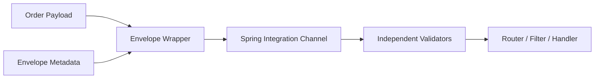
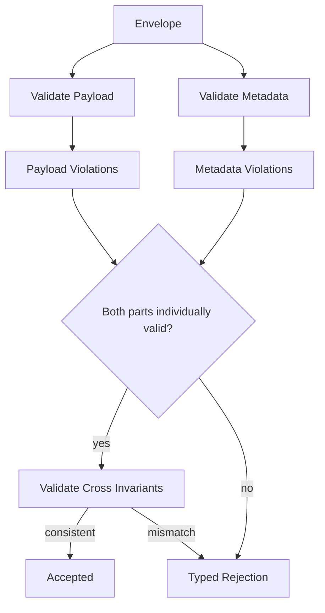
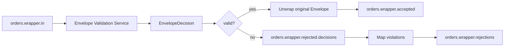
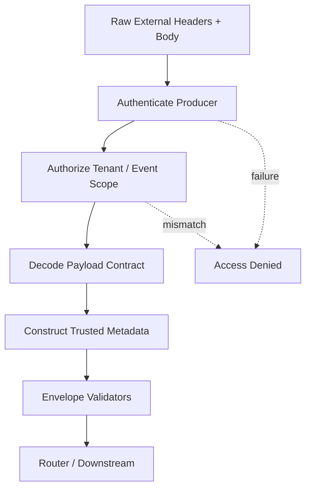
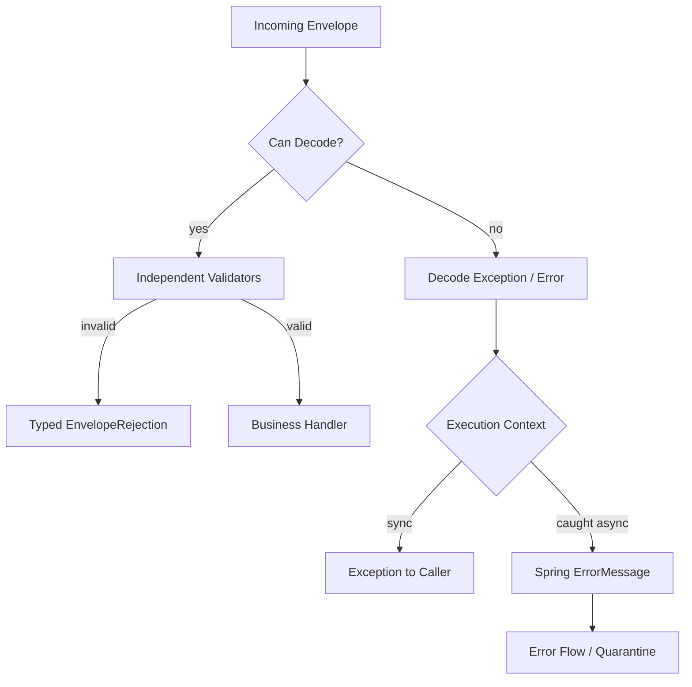
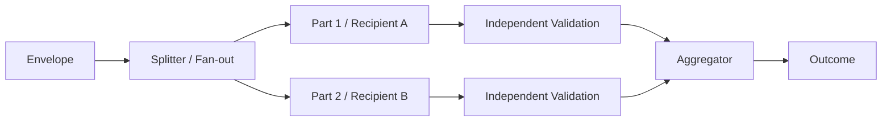
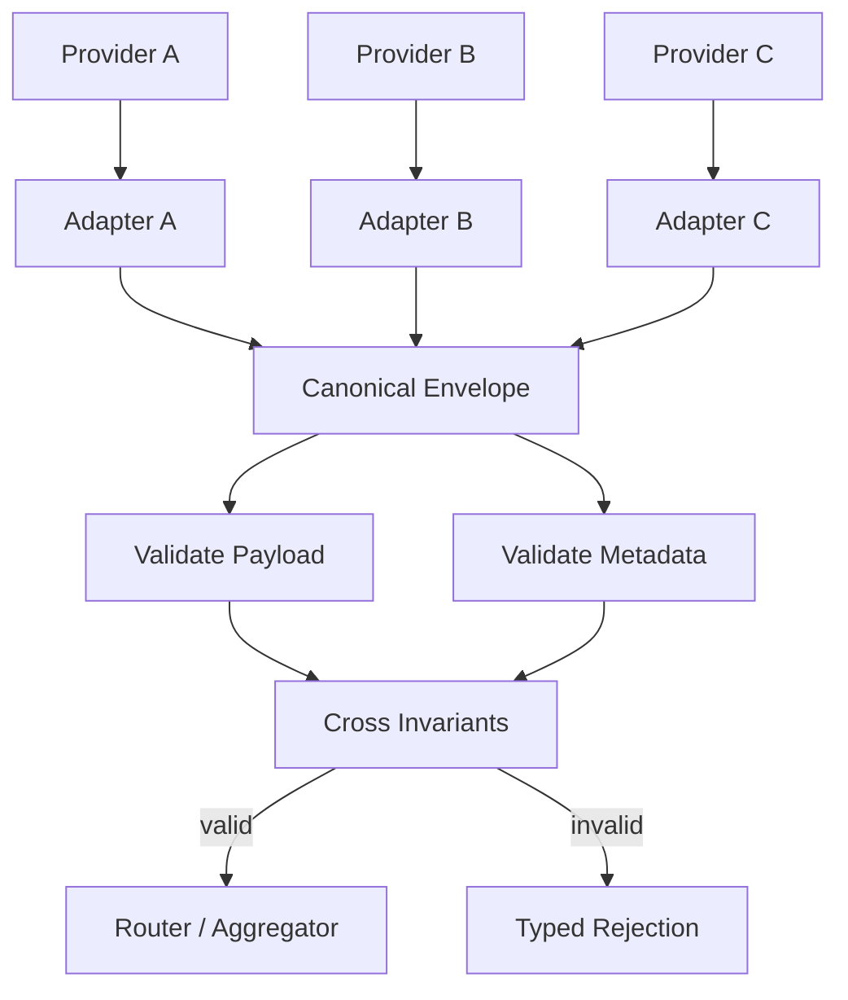

# Testing Payload and Metadata Independently

**Envelope Wrapper** is an Enterprise Integration Pattern (EIP) that packages **business data (payload)** together with **metadata required for transport, routing, correlation, and message lifecycle management**. In an integration platform, the payload may describe an order, transaction, or inspection result; metadata may contain `eventId`, `correlationId`, `tenantId`, event type, schema version, and occurrence timestamp.

A common mistake is writing one giant `validate(envelope)` function and testing it with a few “valid/invalid” cases. When a test fails, it is unclear whether **business data is wrong**, **metadata is wrong**, or **both are valid individually yet inconsistent with each other**. Worse, a consumer might ignore spoofed metadata merely because the payload is valid, or reject an otherwise valid order just because a trace header is missing.

The lesson **“Testing Payload and Metadata Independently”** belongs to the **Envelope wrapper** chapter, module **SPRING_INTEGRATION_PATTERN**. The module teaches implementing Enterprise Integration Patterns with Spring Integration to build loosely coupled, extensible message flows; practicing Router, Filter, Transformer, Splitter, Aggregator, Gateway, retry, error channel, and correlation, along with testing and observing every processing branch.

**Goal:** build separate validation contracts for payload and metadata; identify where cross-consistency tests are needed; write JUnit 5 unit/parameterized tests, Spring Integration flow tests, and transport contract tests; protect tenant/correlation/version across adapters; and handle typed rejections, exceptions, and retries properly.

**Core message:** *Independent testing* does not mean ignoring consistency. You verify each part with its own test suite **first**, then verify invariants **between** payload and metadata with a third test layer.

## 1. What Does an Envelope Wrapper Contain?

A standard envelope can be represented as:

```text
Envelope
├── payload
│   ├── orderId
│   ├── tenantId
│   ├── customerId
│   ├── currency
│   └── lines[]
└── metadata
    ├── envelopeVersion
    ├── eventId
    ├── tenantId
    ├── correlationId
    ├── payloadType
    ├── payloadSchemaVersion
    └── occurredAt
```



JSON example:

```json
{
  "payload": {
    "tenantId": "tenant-a",
    "orderId": "ORD-101",
    "customerId": "CUS-9",
    "currency": "VND",
    "lines": [
      {"sku": "SKU-1", "quantity": 2}
    ]
  },
  "metadata": {
    "envelopeVersion": 1,
    "eventId": "evt-101",
    "tenantId": "tenant-a",
    "correlationId": "corr-77",
    "payloadType": "ORDER_PLACED",
    "payloadSchemaVersion": 1,
    "occurredAt": "2026-11-21T05:00:00Z"
  }
}
```

This is an **illustrative application contract**, not a JSON envelope automatically emitted by Spring Integration with those fields. A Spring `Message<?>` also has its **own `MessageHeaders`**. Envelope metadata in the payload **does not automatically become** Spring message headers, and vice versa.

### Why Separate Payload and Metadata?

- Payload focuses on **business meaning**: which order, which products, what quantities.
- Metadata focuses on **message transport lifecycle**: which event, which correlation scope, which schema version.
- Source adapters can change transport formats without altering the business payload.
- Routers/Filters can use authenticated metadata without parsing the entire payload.
- The test suite can pinpoint whether a failure lies in the **domain contract**, the **envelope protocol**, or the **relationship between the two contracts**.

Never put passwords, secrets, access tokens, or raw control headers for `replyChannel`/`errorChannel` into metadata just because “an envelope can hold metadata”.

## 2. Three Layers of Invariants to Test

A design should answer three separate questions:

| Test layer | Question | Example |
| --- | --- | --- |
| **Payload contract** | Is the business data valid? | `quantity > 0`, `orderId` present, valid currency |
| **Metadata contract** | Is metadata complete and valid? | stable `eventId`, supported `payloadSchemaVersion`, `occurredAt` is an instant |
| **Cross-envelope contract** | Are the two parts consistent? | `payload.tenantId == metadata.tenantId`; payload type matches schema |



**Never skip cross-invariants.** A payload belonging to `tenant-a` may be valid on its own; metadata claiming `tenant-b` may also be format-valid. Yet the envelope as a whole cannot be accepted if the system requires both to refer to the same tenant.

Conversely, when testing payload alone, do not force tests to construct full `MessageHeaders`. When testing metadata alone, do not require a valid database order.

## 3. Choosing Data Boundaries to Avoid Coupling in Tests

An envelope can be implemented as a generic Java record:

```java
record EventEnvelope<T>(
    T payload,
    EnvelopeMetadata metadata
) {}
```

Payload content can vary by event type; metadata maintains a shared contract. However, `EventEnvelope<T>` **does not automatically verify** that `payload` actually matches `payloadType`.

Ways to organize tests:

1. **Payload unit tests:** construct `OrderPayload`, call `OrderPayloadValidator` directly.
2. **Metadata unit tests:** construct `EnvelopeMetadata`, call `EnvelopeMetadataValidator` directly.
3. **Envelope contract tests:** construct `EventEnvelope<OrderPayload>`, call `EnvelopeValidationService`.
4. **Spring Integration tests:** send `Message<EventEnvelope<...>>` to a channel.
5. **Wire/transport tests:** serialize/deserialize JSON/Avro/JMS/Kafka and verify identity, version, and headers.

The first test suites should run fast and deterministically without a Spring context. The later suites catch bugs that **only appear when real endpoints and adapters are wired together**.

## 4. Envelope Metadata Differs from Spring `MessageHeaders`

In Java:

```text
Spring Message
  payload = EventEnvelope<OrderPayload>
    payload = OrderPayload(...)
    metadata = EnvelopeMetadata(...)
  headers = MessageHeaders(...)
    id = generated framework message id
    timestamp = framework timestamp
    replyChannel / errorChannel / ...
```

Do not confuse:

| Value | Role | Notes |
| --- | --- | --- |
| `metadata.eventId` | Stable identity of the business event | Retries/redeliveries of the same event must keep it |
| `MessageHeaders.ID` | ID of a single Spring message | Can change across transforms/bridges |
| `metadata.correlationId` | Group/workflow identity per application contract | Not automatically Spring's `correlationId` header |
| `MessageHeaders.REPLY_CHANNEL` | Internal reply channel | Never accept arbitrary values from clients |
| `metadata.payloadSchemaVersion` | Payload structure version | Does not replace envelope version |
| `metadata.occurredAt` | Timestamp when the source event occurred | Not synonymous with `MessageHeaders.TIMESTAMP` |

**Envelope Wrapper is a data pattern**, while Spring `Message` and `MessageHeaders` are messaging mechanics. An application may map select metadata from an envelope to Spring headers for Routers/Aggregators, provided there is **explicit mapping, trust boundaries, and propagation tests**.

## 5. Sample Contract: Order and Metadata

For transparent testing, we use Java 17+:

```java
import java.time.Instant;
import java.util.List;

record OrderLine(String sku, Integer quantity) {}

record OrderPayload(
    String tenantId,
    String orderId,
    String customerId,
    String currency,
    List<OrderLine> lines
) {
    OrderPayload {
        // Allow null list so the validator can report REQUIRED.
        // If list exists, copy to avoid mutation via alias.
        if (lines != null) {
            lines = List.copyOf(lines);
        }
    }
}

record EnvelopeMetadata(
    int envelopeVersion,
    String eventId,
    String tenantId,
    String correlationId,
    String payloadType,
    int payloadSchemaVersion,
    Instant occurredAt
) {}

record EventEnvelope<T>(
    T payload,
    EnvelopeMetadata metadata
) {}

record Violation(
    String area,
    String path,
    String code
) {}
```

Meaningful fields:

- `OrderPayload.tenantId` identifies business scope from an authenticated source.
- `EnvelopeMetadata.tenantId` is transport/routing scope and must be **verified** against payload and security context.
- `eventId` is the stable event ID; never mint `UUID.randomUUID()` on every retry of the same event.
- `correlationId` links messages of the same workflow; never use it as access control.
- `payloadType="ORDER_PLACED"` and `payloadSchemaVersion=1` specify how to interpret the payload.
- `envelopeVersion=1` defines the outer wrapper format, **distinct** from payload version.
- `occurredAt` is parsed into an `Instant`, never defaulted to received time.

The constructor here intentionally **does not block all null fields** so tests can verify validator logic. In a real system, immutable factories/constructors may reject invalid data earlier; in that case, place tests at the corresponding boundary.

### A Limit of Immutability

Java `record` types do not automatically make all nested objects immutable. `List.copyOf` prevents modifying the list after construction; if elements inside are mutable objects, deeper defensive copying is required. With `OrderLine` as a record and `Integer` immutable, the example stays simple.

`List.copyOf` also **rejects null elements**; if a test must check a null line from JSON, that test may fail at the constructor itself. Test at the decoder/constructor boundary or use a factory accepting invalid states prior to validation, **without mislabeling that error as a Filter failure**.

## 6. Payload Validator Reads Business Data Only

A payload validator does not need to know `eventId`, `correlationId`, or Spring headers.

Example contract:

- `tenantId`, `orderId`, `customerId` are non-blank.
- `currency` is `VND` or `USD`.
- `lines` must have at least 1 line and no more than 100 lines.
- `sku` is non-blank.
- `quantity` is between 1 and 10,000.

```java
import java.util.ArrayList;
import java.util.List;
import java.util.Set;

final class OrderPayloadValidator {

    private static final Set<String> CURRENCIES =
        Set.of("VND", "USD");

    List<Violation> validate(Object input) {
        List<Violation> errors = new ArrayList<>();

        if (input == null) {
            errors.add(new Violation(
                "PAYLOAD", "payload", "REQUIRED"));
            return List.copyOf(errors);
        }

        if (!(input instanceof OrderPayload payload)) {
            errors.add(new Violation(
                "PAYLOAD", "payload", "WRONG_TYPE"));
            return List.copyOf(errors);
        }

        required(errors, "tenantId", payload.tenantId());
        required(errors, "orderId", payload.orderId());
        required(errors, "customerId", payload.customerId());

        if (blank(payload.currency())) {
            errors.add(new Violation(
                "PAYLOAD", "currency", "REQUIRED"));
        } else if (!CURRENCIES.contains(payload.currency())) {
            errors.add(new Violation(
                "PAYLOAD", "currency", "UNSUPPORTED_CURRENCY"));
        }

        if (payload.lines() == null) {
            errors.add(new Violation(
                "PAYLOAD", "lines", "REQUIRED"));
        } else if (payload.lines().isEmpty()) {
            errors.add(new Violation(
                "PAYLOAD", "lines", "MUST_NOT_BE_EMPTY"));
        } else {
            if (payload.lines().size() > 100) {
                errors.add(new Violation(
                    "PAYLOAD", "lines", "TOO_MANY"));
            }
            for (int i = 0; i < payload.lines().size(); i++) {
                OrderLine line = payload.lines().get(i);
                String prefix = "lines[" + i + "]";
                if (line == null) {
                    errors.add(new Violation(
                        "PAYLOAD", prefix, "REQUIRED"));
                    continue;
                }
                required(errors, prefix + ".sku", line.sku());
                if (line.quantity() == null) {
                    errors.add(new Violation(
                        "PAYLOAD", prefix + ".quantity", "REQUIRED"));
                } else if (line.quantity() < 1
                        || line.quantity() > 10_000) {
                    errors.add(new Violation(
                        "PAYLOAD", prefix + ".quantity",
                        "OUT_OF_RANGE"));
                }
            }
        }

        return List.copyOf(errors);
    }

    private static void required(
            List<Violation> errors,
            String field, String value) {
        if (blank(value)) {
            errors.add(new Violation(
                "PAYLOAD", field, "REQUIRED"));
        }
    }

    private static boolean blank(String s) {
        return s == null || s.isBlank();
    }
}
```

**Design point:** the method accepts `Object` at the boundary to distinguish `null` from the wrong Java type; once `OrderPayload` is confirmed, all remaining rules belong to the domain. The validator **never accesses metadata**, calls external services, or writes data.

Do not mistake checking non-blank `tenantId` for tenant authentication. Actors and producers must be authenticated/authorized **separately** before metadata is trusted for routing or access control.

## 7. Metadata Validator Never Reads Order Fields

The metadata validator checks only the envelope contract:

- `envelopeVersion == 1`.
- `eventId`, `tenantId`, and `correlationId` match published formats.
- `payloadType == ORDER_PLACED` in this example flow.
- `payloadSchemaVersion == 1`.
- `occurredAt` is present.
- Never use raw `MessageHeaders.ID` or framework timestamps to fill in missing fields.

```java
import java.util.ArrayList;
import java.util.List;
import java.util.regex.Pattern;

final class EnvelopeMetadataValidator {
    private static final Pattern ID =
        Pattern.compile("[A-Za-z0-9_-]{1,64}");

    List<Violation> validate(EnvelopeMetadata metadata) {
        List<Violation> errors = new ArrayList<>();

        if (metadata == null) {
            errors.add(new Violation(
                "METADATA", "metadata", "REQUIRED"));
            return List.copyOf(errors);
        }

        if (metadata.envelopeVersion() != 1) {
            errors.add(new Violation(
                "METADATA", "envelopeVersion",
                "UNSUPPORTED_ENVELOPE_VERSION"));
        }

        id(errors, "eventId", metadata.eventId());
        id(errors, "tenantId", metadata.tenantId());
        id(errors, "correlationId", metadata.correlationId());

        if (!"ORDER_PLACED".equals(metadata.payloadType())) {
            errors.add(new Violation(
                "METADATA", "payloadType",
                "UNSUPPORTED_PAYLOAD_TYPE"));
        }

        if (metadata.payloadSchemaVersion() != 1) {
            errors.add(new Violation(
                "METADATA", "payloadSchemaVersion",
                "UNSUPPORTED_PAYLOAD_VERSION"));
        }

        if (metadata.occurredAt() == null) {
            errors.add(new Violation(
                "METADATA", "occurredAt", "REQUIRED"));
        }

        return List.copyOf(errors);
    }

    private static void id(
            List<Violation> errors,
            String path, String value) {
        if (value == null || !ID.matcher(value).matches()) {
            errors.add(new Violation(
                "METADATA", path, "INVALID_ID"));
        }
    }
}
```

The example allows digits, letters, `_`, and `-` in IDs; **do not apply this illustrative regex to every system**. Real IDs can contain dots, standard UUIDs, or Unicode; what matters is publishing a policy and testing it consistently.

**Limitation:** format-valid metadata can still be **spoofed**. A client knowing another tenant's name can write it into JSON. Format validation is separate from authentication, authorization, integrity, and provenance.

## 8. Test Cross-Relationships Only After Both Parts Pass

An envelope can consist of two individually valid parts that are incompatible with each other:

```json
{
  "payload": {
    "tenantId": "tenant-a",
    "orderId": "ORD-101",
    "customerId": "CUS-9",
    "currency": "VND",
    "lines": [{"sku": "SKU-1", "quantity": 2}]
  },
  "metadata": {
    "envelopeVersion": 1,
    "eventId": "evt-101",
    "tenantId": "tenant-b",
    "correlationId": "corr-77",
    "payloadType": "ORDER_PLACED",
    "payloadSchemaVersion": 1,
    "occurredAt": "2026-11-21T05:00:00Z"
  }
}
```

Both `tenant-a` and `tenant-b` pass the regex. Yet if payload and envelope must belong to the same tenant, this is a **cross-envelope invariant** violation, not an individual format error in payload or metadata.

```java
import java.util.List;

final class CrossEnvelopeValidator {

    List<Violation> validate(EventEnvelope<?> envelope) {
        if (!(envelope.payload() instanceof OrderPayload payload)
                || envelope.metadata() == null) {
            throw new IllegalArgumentException(
                "Cross validation requires valid parts");
        }

        if (!payload.tenantId()
                .equals(envelope.metadata().tenantId())) {
            return List.of(new Violation(
                "CROSS", "tenantId", "TENANT_MISMATCH"));
        }

        return List.of();
    }
}
```

The code above is called only once **payload and metadata have passed** their separate validators. Never use it to replace tenant authorization checks. An attacker can modify **both parts** to say `tenant-b`; the comparison passes while the sender lacks authorization.

### Other Cross-Invariants

Depending on the contract:

- `payloadType` must correspond to the decoded data type.
- `payloadSchemaVersion` must correspond to the payload schema.
- `tenantId` in metadata must match payload ownership.
- `correlationId` must belong to an issued workflow/batch manifest.
- When sequences are defined, `sequenceNumber`/`sequenceSize` must match the manifest.
- `eventId` in metadata and event identity in the payload (if present) must agree.
- `causationId` (if present) must never be inferred from `MessageHeaders.ID`.
- Envelope signatures/integrity checks (if used) must cover the **exact metadata and payload** specified by contract.

Do not put all cross-invariants inside `OrderPayloadValidator`, which destroys its independence. Place them in a clear step after both parts validate.

## 9. Aggregating `ValidationDecision` Without Losing Error Details

The overall result can keep **three separate lists** for testing and observability:

```java
import java.util.ArrayList;
import java.util.List;

record EnvelopeDecision(
    EventEnvelope<?> original,
    List<Violation> payloadErrors,
    List<Violation> metadataErrors,
    List<Violation> crossErrors
) {
    EnvelopeDecision {
        payloadErrors = List.copyOf(payloadErrors);
        metadataErrors = List.copyOf(metadataErrors);
        crossErrors = List.copyOf(crossErrors);
    }

    boolean valid() {
        return payloadErrors.isEmpty()
            && metadataErrors.isEmpty()
            && crossErrors.isEmpty();
    }

    List<Violation> allViolations() {
        List<Violation> all = new ArrayList<>();
        all.addAll(payloadErrors);
        all.addAll(metadataErrors);
        all.addAll(crossErrors);
        return List.copyOf(all);
    }
}

final class EnvelopeValidationService {
    private final OrderPayloadValidator payloadValidator =
        new OrderPayloadValidator();
    private final EnvelopeMetadataValidator metadataValidator =
        new EnvelopeMetadataValidator();
    private final CrossEnvelopeValidator crossValidator =
        new CrossEnvelopeValidator();

    EnvelopeDecision evaluate(EventEnvelope<?> envelope) {
        if (envelope == null) {
            // Null cannot be passed as an ordinary Spring Message payload.
            throw new IllegalArgumentException("Missing envelope");
        }

        // Both validators run independently.
        List<Violation> payload =
            payloadValidator.validate(envelope.payload());
        List<Violation> metadata =
            metadataValidator.validate(envelope.metadata());

        List<Violation> cross =
            payload.isEmpty() && metadata.isEmpty()
                ? crossValidator.validate(envelope)
                : List.of();

        return new EnvelopeDecision(
            envelope, payload, metadata, cross);
    }
}
```

**Why run cross-validation only after the two individual checks?** If `payload=null`, comparing `payload.tenantId()` throws `NullPointerException`, masking the real `PAYLOAD_REQUIRED` error. Never rely on such an exception to guess which input part failed.

Returning three error groups also distinguishes root causes in logs and tests:

```text
payloadErrors  = [PAYLOAD.lines[0].quantity OUT_OF_RANGE]
metadataErrors = [METADATA.eventId INVALID_ID]
crossErrors    = []
```

The API/transport layer may combine violations when replying to producers while keeping `area` and `code` so consumers identify the exact error category. **Never put raw field values or secrets into `Violation`.**

## 10. Clean Test Fixtures Keep Both Parts Decoupled

A stable fixture helper prevents tests from failing simply due to copy-pasted bad metadata.

```java
import java.time.Instant;
import java.util.List;

final class EnvelopeFixtures {
    static OrderPayload validPayload() {
        return new OrderPayload(
            "tenant-a", "ORD-101", "CUS-9", "VND",
            List.of(new OrderLine("SKU-1", 2)));
    }

    static EnvelopeMetadata validMetadata() {
        return new EnvelopeMetadata(
            1, "evt-101", "tenant-a",
            "corr-77", "ORDER_PLACED", 1,
            Instant.parse("2026-11-21T05:00:00Z"));
    }

    static EventEnvelope<OrderPayload> validEnvelope() {
        return new EventEnvelope<>(
            validPayload(), validMetadata());
    }

    static EventEnvelope<OrderPayload> withPayload(
            OrderPayload replacement) {
        return new EventEnvelope<>(
            replacement, validMetadata());
    }

    static EventEnvelope<OrderPayload> withMetadata(
            EnvelopeMetadata replacement) {
        return new EventEnvelope<>(
            validPayload(), replacement);
    }

    private EnvelopeFixtures() {}
}
```

**Fixture rule:** When testing the payload, hold metadata to a constant valid fixture; when testing metadata, hold payload valid. When testing cross-invariants, ensure **both parts are individually valid** before intentionally making them inconsistent.

Avoid `Instant.now()`, fresh UUIDs, or random IDs in fixtures if they hurt reproducibility. Use fixed values for unit tests; test randomness/uniqueness only when that is the actual contract under test.

## 11. Independent Payload Unit Tests

The following tests **never construct `EnvelopeMetadata`**. They prove the domain validator operates independently of metadata and Spring.

```java
import static org.junit.jupiter.api.Assertions.*;
import java.util.List;
import org.junit.jupiter.api.Test;

class OrderPayloadValidatorTest {
    private final OrderPayloadValidator validator =
        new OrderPayloadValidator();

    @Test
    void validPayloadPassesWithoutMetadata() {
        assertTrue(validator.validate(
            EnvelopeFixtures.validPayload()).isEmpty());
    }

    @Test
    void missingOrderIdProducesPayloadViolation() {
        OrderPayload invalid = new OrderPayload(
            "tenant-a", null, "CUS-9", "VND",
            List.of(new OrderLine("SKU-1", 2)));

        assertTrue(validator.validate(invalid).contains(
            new Violation("PAYLOAD", "orderId", "REQUIRED")));
    }

    @Test
    void quantityOutsideDomainIsRejected() {
        OrderPayload invalid = new OrderPayload(
            "tenant-a", "ORD-101", "CUS-9", "VND",
            List.of(new OrderLine("SKU-1", -2)));

        assertTrue(validator.validate(invalid).contains(
            new Violation(
                "PAYLOAD", "lines[0].quantity",
                "OUT_OF_RANGE")));
    }

    @Test
    void wrongPayloadJavaTypeIsDetectedAtBoundary() {
        assertEquals(
            List.of(new Violation(
                "PAYLOAD", "payload", "WRONG_TYPE")),
            validator.validate("raw-string"));
    }

    @Test
    void missingInnerPayloadCanBeValidatedDirectly() {
        assertEquals(
            List.of(new Violation(
                "PAYLOAD", "payload", "REQUIRED")),
            validator.validate(null));
    }
}
```

The tests above **do not verify** routing or discard channels; they verify the exact scope of `OrderPayloadValidator`.

When real inputs arrive as JSON, syntax errors and pre-deserialization type errors must be tested **at the inbound decoder**, rather than feeding raw JSON into `OrderPayloadValidator` and expecting domain validation results.

## 12. Independent Metadata Unit Tests

Metadata tests do not need an `OrderPayload` either:

```java
import static org.junit.jupiter.api.Assertions.*;
import java.time.Instant;
import org.junit.jupiter.api.Test;

class EnvelopeMetadataValidatorTest {
    private final EnvelopeMetadataValidator validator =
        new EnvelopeMetadataValidator();

    @Test
    void validMetadataPassesWithoutPayload() {
        assertTrue(validator.validate(
            EnvelopeFixtures.validMetadata()).isEmpty());
    }

    @Test
    void rejectsMissingBusinessEventId() {
        var valid = EnvelopeFixtures.validMetadata();
        var invalid = new EnvelopeMetadata(
            valid.envelopeVersion(), "",
            valid.tenantId(), valid.correlationId(),
            valid.payloadType(), valid.payloadSchemaVersion(),
            valid.occurredAt());

        assertTrue(validator.validate(invalid).contains(
            new Violation(
                "METADATA", "eventId", "INVALID_ID")));
    }

    @Test
    void rejectsUnsupportedPayloadSchemaVersion() {
        var valid = EnvelopeFixtures.validMetadata();
        var invalid = new EnvelopeMetadata(
            valid.envelopeVersion(), valid.eventId(),
            valid.tenantId(), valid.correlationId(),
            valid.payloadType(), 99, valid.occurredAt());

        assertTrue(validator.validate(invalid).contains(
            new Violation(
                "METADATA", "payloadSchemaVersion",
                "UNSUPPORTED_PAYLOAD_VERSION")));
    }

    @Test
    void rejectsMissingOccurredAt() {
        var valid = EnvelopeFixtures.validMetadata();
        var invalid = new EnvelopeMetadata(
            valid.envelopeVersion(), valid.eventId(),
            valid.tenantId(), valid.correlationId(),
            valid.payloadType(),
            valid.payloadSchemaVersion(), null);

        assertTrue(validator.validate(invalid).contains(
            new Violation(
                "METADATA", "occurredAt", "REQUIRED")));
    }

    @Test
    void rejectsMissingMetadataObject() {
        assertEquals(1, validator.validate(null).size());
    }
}
```

**Do not mistake “format-valid metadata” for “trusted metadata”.** The tests above do not verify whether the producer is authorized to emit events for that tenant, nor do they check cryptographic integrity or replay authorization. Those boundaries require dedicated security/contract integration tests.

## 13. Unit Tests for Both Independent Axes and Joint Failures

A test of the full wrapper should prove: changing the payload **does not alter metadata errors**, and changing metadata **does not alter payload errors**.

```java
import static org.junit.jupiter.api.Assertions.*;
import java.util.List;
import org.junit.jupiter.api.Test;

class EnvelopeValidationIndependenceTest {
    private final EnvelopeValidationService service =
        new EnvelopeValidationService();

    private OrderPayload invalidPayload() {
        return new OrderPayload(
            "tenant-a", "ORD-101", "CUS-9", "VND",
            List.of(new OrderLine("SKU-1", -2)));
    }

    private EnvelopeMetadata invalidMetadata() {
        var valid = EnvelopeFixtures.validMetadata();
        return new EnvelopeMetadata(
            1, "", valid.tenantId(),
            valid.correlationId(), valid.payloadType(),
            1, valid.occurredAt());
    }

    @Test
    void invalidPayloadDoesNotInvalidateMetadataContract() {
        EnvelopeDecision result = service.evaluate(
            EnvelopeFixtures.withPayload(invalidPayload()));

        assertFalse(result.valid());
        assertEquals(1, result.payloadErrors().size());
        assertTrue(result.metadataErrors().isEmpty());
        assertTrue(result.crossErrors().isEmpty());
    }

    @Test
    void invalidMetadataDoesNotChangePayloadRules() {
        EnvelopeDecision result = service.evaluate(
            EnvelopeFixtures.withMetadata(invalidMetadata()));

        assertFalse(result.valid());
        assertTrue(result.payloadErrors().isEmpty());
        assertEquals(1, result.metadataErrors().size());
        assertTrue(result.crossErrors().isEmpty());
    }

    @Test
    void bothInvalidPartsReportBothSetsOfErrors() {
        EnvelopeDecision result = service.evaluate(
            new EventEnvelope<>(
                invalidPayload(), invalidMetadata()));

        assertEquals(1, result.payloadErrors().size());
        assertEquals(1, result.metadataErrors().size());
        assertTrue(result.crossErrors().isEmpty());
    }

    @Test
    void wrapperMayContainMissingInnerPayload() {
        EnvelopeDecision result = service.evaluate(
            new EventEnvelope<>(null,
                EnvelopeFixtures.validMetadata()));

        assertTrue(result.payloadErrors().contains(
            new Violation(
                "PAYLOAD", "payload", "REQUIRED")));
        assertTrue(result.metadataErrors().isEmpty());
    }
}
```

**Note on null:** `new EventEnvelope<>(null, metadata)` is a **non-null wrapper object**, even though the inner `payload` field is null. It can still be placed as the payload of an ordinary Spring `Message`. Conversely, `MessageBuilder.withPayload(null)` is normally rejected by the framework at message creation time.

That is why **“missing inner payload inside the envelope”** and **“Spring Message without a payload”** must have two separate test suites.

## 14. Cross-Invariant Tests Without Polluting the Two Individual Suites

Suppose the payload belongs to tenant A, metadata belongs to tenant B, and each part is individually valid.

```java
import static org.junit.jupiter.api.Assertions.*;
import java.time.Instant;
import org.junit.jupiter.api.Test;

class EnvelopeCrossInvariantTest {
    private final EnvelopeValidationService service =
        new EnvelopeValidationService();

    @Test
    void detectsTenantMismatchOnlyInCrossValidation() {
        EnvelopeMetadata wrongTenant = new EnvelopeMetadata(
            1, "evt-101", "tenant-b", "corr-77",
            "ORDER_PLACED", 1,
            Instant.parse("2026-11-21T05:00:00Z"));

        EnvelopeDecision result = service.evaluate(
            EnvelopeFixtures.withMetadata(wrongTenant));

        assertTrue(result.payloadErrors().isEmpty());
        assertTrue(result.metadataErrors().isEmpty());
        assertEquals(
            java.util.List.of(new Violation(
                "CROSS", "tenantId", "TENANT_MISMATCH")),
            result.crossErrors());
    }

    @Test
    void matchingValidPartsPassAllValidationLayers() {
        EnvelopeDecision result =
            service.evaluate(EnvelopeFixtures.validEnvelope());

        assertTrue(result.valid());
        assertTrue(result.allViolations().isEmpty());
    }
}
```

**Do not solve cross-tenant security merely by comparing two strings.** If an attacker controls both payload and metadata and puts `tenant-b` into both, this test will pass. Security tests must use an **authenticated principal/producer mapping**, then verify whether that tenant is permitted to emit the event.

### Matrix to Avoid Mixing Layers

| Payload | Metadata | Cross | Outcome |
| --- | --- | --- | --- |
| Valid | Valid | Match | Accept |
| Invalid | Valid | Not run | Payload rejection |
| Valid | Invalid | Not run | Metadata rejection |
| Invalid | Invalid | Not run | Both violation lists |
| Valid | Valid | Tenant mismatch | Cross rejection |
| Valid | Valid | Strings match but producer unauthorized | **Authorization rejection** at separate boundary |

## 15. Parameterized Tests for Boundary Values of Each Part

Use JUnit 5 to test value domains without duplicating test cases.

### Payload domain: quantity

```java
import static org.junit.jupiter.api.Assertions.*;
import java.util.List;
import org.junit.jupiter.params.ParameterizedTest;
import org.junit.jupiter.params.provider.CsvSource;

class PayloadBoundaryTest {
    private final OrderPayloadValidator validator =
        new OrderPayloadValidator();

    @ParameterizedTest
    @CsvSource({
        "0, false", "1, true", "2, true",
        "10000, true", "10001, false", "-1, false"
    })
    void quantityRespectsDomain(
            int quantity, boolean expectedValid) {
        OrderPayload payload = new OrderPayload(
            "tenant-a", "ORD-101", "CUS-9", "VND",
            List.of(new OrderLine("SKU-1", quantity)));

        assertEquals(expectedValid,
            validator.validate(payload).isEmpty());
    }
}
```

### Metadata versions

```java
import static org.junit.jupiter.api.Assertions.*;
import java.time.Instant;
import org.junit.jupiter.params.ParameterizedTest;
import org.junit.jupiter.params.provider.CsvSource;

class MetadataVersionBoundaryTest {
    private final EnvelopeMetadataValidator validator =
        new EnvelopeMetadataValidator();

    @ParameterizedTest
    @CsvSource({"0, false", "1, true", "2, false", "99, false"})
    void envelopeVersionPolicyIsExplicit(
            int version, boolean expectedValid) {
        EnvelopeMetadata metadata = new EnvelopeMetadata(
            version, "evt-101", "tenant-a",
            "corr-77", "ORDER_PLACED", 1,
            Instant.parse("2026-11-21T05:00:00Z"));

        assertEquals(expectedValid,
            validator.validate(metadata).isEmpty());
    }
}
```

Do not mix `quantity=-1` test cases into `MetadataVersionBoundaryTest`. **Each suite should have one primary reason to fail**. Tests combining multiple failures belong in the `EnvelopeValidationIndependenceTest` layer.

## 16. Testing Invariants When Changing Only Payload or Only Metadata

Envelopes are often transformed inside a Transformer:

- **Payload-only transform:** normalize content while preserving the identity of the same event.
- **Metadata update:** add permitted operational metadata without modifying business data.

For the same event, modifying the payload should not mint a new `eventId`; for a **new** business event derived from an old event, you must issue a new `eventId` and (if required by contract) `causationId`, rather than blindly copying the old identity.

Example helper preserving metadata when normalizing **within the same schema and same event**:

```java
final class EnvelopeOrderTransformer {

    EventEnvelope<OrderPayload> replacePayload(
            EventEnvelope<OrderPayload> original,
            OrderPayload normalized) {
        if (original == null || normalized == null) {
            throw new IllegalArgumentException(
                "Envelope and normalized payload required");
        }
        return new EventEnvelope<>(
            normalized, original.metadata());
    }
}
```

Test:

```java
import static org.junit.jupiter.api.Assertions.*;
import java.util.List;
import org.junit.jupiter.api.Test;

class EnvelopeOrderTransformerTest {

    @Test
    void sameEventPayloadTransformPreservesMetadata() {
        var original = EnvelopeFixtures.validEnvelope();
        var normalized = new OrderPayload(
            "tenant-a", "ORD-101", "CUS-9", "VND",
            List.of(new OrderLine("SKU-1", 3)));

        var result = new EnvelopeOrderTransformer()
            .replacePayload(original, normalized);

        assertSame(original.metadata(), result.metadata());
        assertEquals(normalized, result.payload());
        assertEquals(Integer.valueOf(2),
            original.payload().lines().get(0).quantity());
    }
}
```

This is a **mechanical** test verifying that the original wrapper is not mutated. It **does not prove** that changing quantity from 2 to 3 is a valid business action. If the quantity changed due to a new order-amendment command, consider creating a new event ID, appropriate schema/generation, and separate idempotency.

### When changing metadata

If only adding trace context at a gateway (without changing business identity), metadata can receive a new copy. However, you must define which fields are mutable and which fields are immutable, such as `eventId`, `tenantId`, and `payloadSchemaVersion`. **Do not expose a public `withMetadata(...)` helper that lets clients arbitrarily alter tenant and correlation**.

## 17. Spring Integration Java DSL: Validate Then Route

In Spring Integration, we can implement Envelope Wrapper as **a single payload object** holding both business payload and metadata, then use Transformer + Filter + discard flow.



Key point: **Filter receives `EnvelopeDecision`**, and does not know about the two separate validators directly. For invalid input, `discardChannel` receives a **Spring message whose payload is `EnvelopeDecision`**, not a Spring `ErrorMessage`.

### Contract for typed rejection

```java
import java.time.Instant;
import java.util.List;

record EnvelopeRejection(
    String businessEventId,
    String errorCode,
    List<Violation> violations,
    Instant rejectedAt
) {
    EnvelopeRejection {
        violations = List.copyOf(violations);
    }
}

final class EnvelopeRejectionMapper {
    private final java.time.Clock clock;

    EnvelopeRejectionMapper(java.time.Clock clock) {
        this.clock = clock;
    }

    EnvelopeRejection fromDecision(EnvelopeDecision decision) {
        if (decision.valid()) {
            throw new IllegalArgumentException(
                "Cannot reject valid envelope");
        }

        EnvelopeMetadata meta = decision.original().metadata();
        // May be null or invalid; trusted ingress audit ID
        // should be stored separately if full traceability is needed.
        String eventId = meta == null ? null : meta.eventId();

        return new EnvelopeRejection(
            eventId, "ENVELOPE_VALIDATION_FAILED",
            decision.allViolations(),
            java.time.Instant.now(clock));
    }
}
```

### Illustrative Java DSL

```java
import org.springframework.context.annotation.Bean;
import org.springframework.context.annotation.Configuration;
import org.springframework.integration.channel.DirectChannel;
import org.springframework.integration.channel.QueueChannel;
import org.springframework.integration.config.EnableIntegration;
import org.springframework.integration.dsl.IntegrationFlow;
import org.springframework.messaging.MessageChannel;
import org.springframework.messaging.PollableChannel;

@Configuration
@EnableIntegration
class EnvelopeFlowConfiguration {

    @Bean("orders.wrapper.in")
    MessageChannel input() {
        return new DirectChannel();
    }

    @Bean("orders.wrapper.accepted")
    PollableChannel accepted() {
        return new QueueChannel(); // Learning/testing; not durable.
    }

    @Bean("orders.wrapper.rejected.decisions")
    MessageChannel rejectedDecisions() {
        return new DirectChannel();
    }

    @Bean("orders.wrapper.rejections")
    PollableChannel rejectedOutcomes() {
        return new QueueChannel();
    }

    @Bean
    EnvelopeValidationService envelopeValidationService() {
        return new EnvelopeValidationService();
    }

    @Bean
    EnvelopeRejectionMapper envelopeRejectionMapper() {
        return new EnvelopeRejectionMapper(
            java.time.Clock.systemUTC());
    }

    @Bean
    IntegrationFlow validateEnvelopeFlow(
            EnvelopeValidationService validator) {
        return IntegrationFlow.from("orders.wrapper.in")
            .transform(EventEnvelope.class, validator::evaluate)
            .filter(EnvelopeDecision.class,
                EnvelopeDecision::valid,
                spec -> spec.discardChannel(
                    "orders.wrapper.rejected.decisions"))
            .transform(EnvelopeDecision.class,
                EnvelopeDecision::original)
            .channel("orders.wrapper.accepted")
            .get();
    }

    @Bean
    IntegrationFlow rejectEnvelopeFlow(
            EnvelopeRejectionMapper mapper) {
        return IntegrationFlow
            .from("orders.wrapper.rejected.decisions")
            .transform(EnvelopeDecision.class,
                mapper::fromDecision)
            .channel("orders.wrapper.rejections")
            .get();
    }
}
```

**Meaning of this topology:**

1. The input channel receives an **already-deserialized `EventEnvelope<?>`**.
2. The Transformer produces `EnvelopeDecision`, running the payload validator and metadata validator independently.
3. The Filter only reads `valid()`; validation is not executed twice.
4. The valid branch returns the **original wrapper** to keep both payload and metadata, without dropping metadata.
5. The invalid branch produces a typed `EnvelopeRejection` with violation areas `PAYLOAD`/`METADATA`/`CROSS`.
6. The `QueueChannel` beans are only used to simplify asserting outputs in a single JVM; when wiring a broker/DB, design durability, retry, and ACK properly.
7. If transform/Filter throws an exception on a `DirectChannel`, the error may propagate to the sender. It **does not automatically become an `ErrorMessage` on the global `errorChannel`**.

**Check Java DSL overloads against your project's Spring Integration version.** This snippet is a STEP 4 architectural example, not yet compiled or run through dedicated tests; the beans/services and data types from earlier sections must reside in the same package or be imported.

### A warning when using a generic wrapper

`EventEnvelope<OrderPayload>` and `EventEnvelope<OtherPayload>` both have the raw class `EventEnvelope.class` due to **type erasure**. Validators must check `payload instanceof OrderPayload` in an order-dedicated flow rather than relying on the runtime message's generic parameter to guarantee schema.

## 18. Integration Test: Separate Accepted/Rejected Channels

Using the configuration from section 17, write an integration test with a real Spring context:

```java
import static org.junit.jupiter.api.Assertions.*;
import org.junit.jupiter.api.Test;
import org.springframework.beans.factory.annotation.Autowired;
import org.springframework.beans.factory.annotation.Qualifier;
import org.springframework.messaging.Message;
import org.springframework.messaging.MessageChannel;
import org.springframework.messaging.PollableChannel;
import org.springframework.messaging.support.MessageBuilder;
import org.springframework.test.context.junit.jupiter.SpringJUnitConfig;

@SpringJUnitConfig(EnvelopeFlowConfiguration.class)
class EnvelopeFlowIntegrationTest {

    @Autowired
    @Qualifier("orders.wrapper.in")
    MessageChannel input;

    @Autowired
    @Qualifier("orders.wrapper.accepted")
    PollableChannel accepted;

    @Autowired
    @Qualifier("orders.wrapper.rejections")
    PollableChannel rejections;

    @Test
    void validEnvelopeGoesOnlyToAccepted() {
        EventEnvelope<OrderPayload> envelope =
            EnvelopeFixtures.validEnvelope();

        assertTrue(input.send(
            MessageBuilder.withPayload(envelope).build()));

        Message<?> forwarded = accepted.receive(1_000);
        assertNotNull(forwarded);
        assertEquals(envelope, forwarded.getPayload());
        assertNull(rejections.receive(50));
    }

    @Test
    void metadataInvalidEnvelopeDoesNotReachAccepted() {
        var original = EnvelopeFixtures.validMetadata();
        var badMetadata = new EnvelopeMetadata(
            1, "", original.tenantId(),
            original.correlationId(),
            original.payloadType(), 1, original.occurredAt());

        assertTrue(input.send(MessageBuilder.withPayload(
            EnvelopeFixtures.withMetadata(badMetadata)).build()));

        assertNull(accepted.receive(50));
        Message<?> rejected = rejections.receive(1_000);
        assertNotNull(rejected);

        EnvelopeRejection result =
            (EnvelopeRejection) rejected.getPayload();
        assertTrue(result.violations().contains(
            new Violation(
                "METADATA", "eventId", "INVALID_ID")));
        assertTrue(result.violations().stream()
            .noneMatch(v -> "PAYLOAD".equals(v.area())));
    }
}
```

This test proves that **a valid message payload wrapper** is accepted, whereas a metadata-invalid wrapper is emitted to the rejection channel without continuing to `accepted`.

You should also add tests for payload-invalid, both-invalid, and cross mismatch on the Spring flow. The `QueueChannel` instances in the example must be **drained clean** between tests; avoid parallel execution sharing the same context where one test consumes another test's messages. Once `accepted` is wired to a business handler, also test **that no side effects occur when rejected**, rather than relying solely on queue inspection.

## 19. Testing Missing Inner Payload Differs from a Null Spring Message

A common confusion:

```java
// This does not create a valid ordinary Spring Message:
MessageBuilder.withPayload(null).build();
```

In Spring Messaging, an ordinary `Message` has a non-null payload. However, a wrapper is a valid object even when its inner field can be null:

```java
var envelope = new EventEnvelope<OrderPayload>(
    null, EnvelopeFixtures.validMetadata());

var message = org.springframework.messaging.support.MessageBuilder
    .withPayload(envelope)
    .build();
```

Here **the Spring message payload is `EventEnvelope`, not null**. `OrderPayloadValidator` detects that `envelope.payload` is missing. If **the entire HTTP request body** is empty or JSON root is `null` before constructing the envelope, the failure happens at the decoder/inbound gateway, not at the Filter in section 17.

### Tests that must be separated

| Input | Where to test | Expected outcome |
| --- | --- | --- |
| Missing HTTP body | HTTP ingress/decoder | MISSING_BODY; no Envelope created |
| JSON root `null` | JSON decoder | ROOT_NULL; no Spring Message built |
| JSON `{"payload":null,"metadata":{...}}` | Decoder + envelope validation | PAYLOAD.REQUIRED |
| JSON `{"payload":{...},"metadata":null}` | Decoder + envelope validation | METADATA.REQUIRED |
| Payload is `String` instead of `OrderPayload` | Typed payload validator / decode boundary | PAYLOAD.WRONG_TYPE |
| Entire Spring Message payload null | Spring Message creation boundary | Ordinary message not created |
| Valid envelope with valid payload and valid meta | Spring Integration | Accepted, wrapper preserved intact |

If the JSON decoder maps `payload` to `Object` or `JsonNode` instead of `OrderPayload`, a separate decode step keyed by `payloadType + payloadSchemaVersion` is required. Raw JSON tests do not replace type-checked Java message tests.

## 20. Wire Contract: JSON and Schema Version Must Stay Consistent

When an envelope crosses HTTP, Kafka, or JMS, distinguish the **Java object contract** from the **wire format**.

A valid envelope can be serialized to JSON as in section 1, yet roundtrip tests must verify:

- `envelopeVersion` was written/read accurately.
- `payloadSchemaVersion` was not altered or dropped.
- `eventId` and `correlationId` stay intact.
- `occurredAt` preserves the exact instant with `Z`/offset.
- `tenantId` in payload and metadata does not change case.
- The list of order lines preserves content and order if order is a business invariant.
- Are unknown fields ignored or rejected per contract?
- How does an older reader version handle a newer version?

### JSON type erasure and typed decoder

A generic Java record `EventEnvelope<T>` needs **type information** during deserialization. Example with Jackson 2.x and `JavaTimeModule`:

```java
import com.fasterxml.jackson.core.type.TypeReference;
import com.fasterxml.jackson.databind.ObjectMapper;
import com.fasterxml.jackson.datatype.jsr310.JavaTimeModule;

ObjectMapper mapper = new ObjectMapper()
    .registerModule(new JavaTimeModule());

String json = /* envelope JSON from test fixture */ "...";

EventEnvelope<OrderPayload> envelope = mapper.readValue(
    json,
    new TypeReference<EventEnvelope<OrderPayload>>() {});
```

This is an **illustrative snippet meant for a test or decoder**, not a standalone runnable Java class. You need Jackson support for Java records and `JavaTimeModule` when deserializing `Instant`.

**Do not deserialize `EventEnvelope<Object>` and cast payload to `OrderPayload` unchecked**: the payload may become a `LinkedHashMap`. Use a `TypeReference`, schema registry, or an allowlisted type dispatcher to convert to the proper payload class.

### Testing schema evolution

If `payloadSchemaVersion=2` yet the decoder still uses `OrderPayload` v1, do not treat the fact that Jackson manages to parse some fields as proof that v2 is compatible. Route by version/supported schema before validating. When an upcaster from v1 to v2 is needed, test it as its own migration.

## 21. Is Metadata From Transport Headers Trustworthy?

An HTTP client can send:

```text
X-Tenant-Id: tenant-victim
X-Event-Id: evt-101
X-Correlation-Id: corr-77
```

These values are **well-formatted** yet completely fabricated by the client. If an adapter copies them into `EnvelopeMetadata` and a Router/handler treats `tenantId` as an access grant, the system becomes vulnerable to cross-tenant bugs.

You must separate:

1. **Declared values** from the body/headers.
2. **Producer identity** from verified authentication / service credentials / mTLS / JWT.
3. **Authorized tenant/workflow scope** from a trusted security context/registry.
4. **Verified metadata** allowed to travel inside the internal envelope.



**Matching `payload.tenantId` and `metadata.tenantId` is not enough**: an attacker can put the same spoofed tenant in both. You must test that an unauthorized producer for that tenant **is blocked even when both individual validators and the cross-invariant pass**.

### Essential security tests

- Client A declares `tenant-b` in both parts → authorization rejects.
- Client modifies `correlationId` to attach to an unauthorized batch → reject/quarantine.
- Consumer receives an event from a service not allowlisted for `ORDER_PLACED` → reject.
- Client-supplied `replyChannel` or `errorChannel` headers → never mapped to internal Spring `MessageChannel` beans.
- If envelope signatures are used, modifying a single byte in payload **or** metadata must fail the integrity check.

Never use regexes or valid JSON schemas as a substitute for security tests.

## 22. Mapping Metadata From Envelope to Spring Headers

Inside an internal flow, a Router/Aggregator may read metadata directly from the payload wrapper. When Spring headers are desired, **explicitly map only verified fields**.

Example:

```java
import org.springframework.messaging.Message;
import org.springframework.messaging.support.MessageBuilder;

final class TrustedEnvelopeHeaderMapper {

    Message<EventEnvelope<OrderPayload>> toMessage(
            EventEnvelope<OrderPayload> envelope) {
        if (envelope == null
                || envelope.metadata() == null) {
            throw new IllegalArgumentException(
                "Trusted envelope required");
        }

        EnvelopeMetadata meta = envelope.metadata();

        // Call only after validation and authorization.
        return MessageBuilder.withPayload(envelope)
            .setHeader("businessEventId", meta.eventId())
            .setHeader("businessCorrelationId",
                meta.correlationId())
            .setHeader("businessTenantId", meta.tenantId())
            .build();
    }
}
```

This snippet **must not be treated as a standalone security boundary**. It does not authenticate actors itself; callers must ensure the envelope has been verified before passing it to the mapper. Never copy raw source headers wholesale, especially `replyChannel`, `errorChannel`, or route/channel names.

### Test that mapping preserves identity without keeping dangerous headers

```java
import static org.junit.jupiter.api.Assertions.*;
import org.junit.jupiter.api.Test;

class TrustedEnvelopeHeaderMapperTest {

    @Test
    void mapsOnlyApprovedBusinessHeaders() {
        var source = EnvelopeFixtures.validEnvelope();

        var result = new TrustedEnvelopeHeaderMapper()
            .toMessage(source);

        assertEquals("evt-101",
            result.getHeaders().get("businessEventId"));
        assertEquals("corr-77",
            result.getHeaders().get("businessCorrelationId"));
        assertEquals("tenant-a",
            result.getHeaders().get("businessTenantId"));
        assertEquals(source, result.getPayload());

        assertFalse(result.getHeaders()
            .containsKey("replyChannel"));
        assertFalse(result.getHeaders()
            .containsKey("errorChannel"));
    }
}
```

With certain infrastructure components, system headers may be attached to the message later. The test above verifies that **the mapper itself does not copy** control headers from the source. Do not turn it into an assertion that no downstream endpoint may ever attach a legitimate `replyChannel`.

### What if metadata and headers diverge?

If a Transformer updates envelope metadata while leaving an old `businessTenantId` header intact, a Router might read the header and misroute. Establish a **source of truth** rule:

- Compute headers solely from the trusted envelope after validation.
- Or take trusted headers from ingress and assert the envelope carries identical values.
- Never allow two sources of truth to be mutated independently without an invariant test.
- At broker boundaries, mappings must match the wire contract rather than relying on implicitly serialized Java object channel headers.

## 23. Testing When a Transformer Modifies Only the Payload

A Transformer may convert `OrderPayload` into `NormalizedOrderPayload`. In that case:

- If it represents the **same business event and same payload schema semantics**, `eventId`/correlation metadata can be preserved.
- If `payloadType` or `payloadSchemaVersion` changes, metadata must be updated **intentionally**, and consumers must understand the new version.
- If the Transformer emits a **new business event**, it needs a distinct event identity/causation rather than reusing the old `eventId` arbitrarily.

Testing matrix:

| Operation | Payload | Metadata | Test |
| --- | --- | --- | --- |
| Normalize fields without changing contract | Valid content change | Keep identity/version | Output payload matches, metadata equal |
| Upcast payload v1 → v2 | Schema changes | Update `payloadSchemaVersion` | v2 decoder and cross contract pass |
| Emit child event | New payload | New event ID, linked causation | Not mistaken for redelivery |
| Add tracing context | Unchanged | Modify allowed tracing metadata only | Business identity unchanged |
| Remap tenant across adapter | Scope may change | Requires verified permission mapping | No silent cross-tenant remap |
| Broker redelivery | Unchanged | `eventId`/correlation preserved | Stable deduplication |

**Do not copy all metadata “for convenience” when the schema has changed.** `envelopeVersion` and `payloadSchemaVersion` are promises to consumers about how to interpret the data; they must accurately reflect the content.

## 24. `ErrorMessage` and Typed Rejection Are Two Different Things

When `EnvelopeValidationService.evaluate(...)` returns an invalid decision, the flow in section 17 uses **Filter discard** to route the decision into a typed rejection. It **does not automatically produce a Spring `ErrorMessage`**.

If a parser or Transform throws an exception:

- On a synchronous `DirectChannel`, the exception may propagate to the caller.
- With an `ExecutorChannel`/poller/inbound adapter configured with an error handler, the exception may be published as an `ErrorMessage` wrapping a `Throwable`.
- `failedMessage` inside `MessagingException` may contain sensitive payload and metadata.
- Error handlers must distinguish structural/data errors, authorization errors, and infrastructure failures.



A typed rejection helps producers fix bad fields; `ErrorMessage` serves Spring's exception/error delivery mechanism. **Naming a channel `errorChannel` does not automatically convert incoming objects into `ErrorMessage` instances.**

### Designing a safe rejection

`EnvelopeRejection` should include:

- `businessEventId` or a transport-generated audit ID.
- A stable `errorCode`.
- `violations[]` with `area`/`path`/`code`.
- `policyVersion` if validators evolve over time.
- `retryable` or policy-based error class.
- `rejectedAt` from the server clock if auditing is required.

Never echo entire payloads, emails, payment cards, tokens, or raw exceptions/stack traces.

## 25. Retry, Correlation, and Idempotency on Wrapper Redelivery

An event may be redelivered by a broker:

```text
First delivery:
  eventId=evt-101
  correlationId=corr-77
  messageHeaders.id=generated-1

Redelivery:
  eventId=evt-101
  correlationId=corr-77
  messageHeaders.id=generated-2
```

If downstream deduplicates by `MessageHeaders.ID`, the two deliveries may be treated as **two distinct events**. Deduplication should rely on a stable business key, typically combining:

```text
tenantId + eventType + eventId + consumerScope
```

When `payloadSchemaVersion` changes because a producer publishes a genuine correction, decide whether it is the **same event upcasted** or a **new generation**. Do not use version bumps as an arbitrary way to bypass idempotency records.

### Should invalid metadata be retried?

| Failure | Handling strategy |
| --- | --- |
| Missing or malformed `eventId` | Reject/quarantine; do not infinitely retry identical bad data |
| Unsupported `payloadSchemaVersion` | Route to the matching schema/version or quarantine |
| `correlationId` outside batch | Reject/authorization review |
| Domain-invalid payload | Reject with field error codes |
| Producer authentication failure | Access denied; do not use business retries |
| Schema registry/database unavailable | Bounded retry/hold; do not label `INVALID` |
| Downstream side effect succeeded, ACK lost | Idempotency/outcome reconciliation |
| Rejection sink failure | Outbox/retry; do not treat failure reporting as succeeded |

A message may be **valid data that cannot yet be verified** because a reference/authorization system is temporarily unavailable. That state is distinct from `INVALID`.

## 26. What Do Splitter, Aggregator, and Scatter-Gather Need From an Envelope?

### Splitter

When splitting an order into multiple lines, each part must specify:

- Which line the part payload represents.
- Whether metadata `eventId` identifies a **child event** or carries a separate `partId`.
- Which batch `correlationId` links back to.
- `sequenceNumber`/`sequenceSize` matching the contract.
- Whether tenant and source provenance are preserved.

Do not create a new envelope per part and emit the **exact same `eventId`** if downstream deduplicates by `eventId` and expects those parts to be processed independently. Keep `parentEventId`/`causationId` separately and issue stable part identities.

### Aggregator

An Aggregator needs an accurate correlation key, expected members, and release strategy. Self-declared metadata saying `sequenceSize=2` must not be trusted when an authoritative manifest specifies three items in the batch.

If a Filter drops one part because its payload is invalid, emit a **rejected part result** or enforce a fail-fast/timeout policy instead of silently leaving the Aggregator waiting forever.

### Scatter-Gather and Publish-Subscribe

Multiple branches receiving the same wrapper may have different payload access permissions. Enforce **recipient authorization**, data minimization, and metadata scoping. Do not broadcast full PII payloads merely because every subscriber needs `eventId`/`correlationId`.



**Cross-branch test:** parent event ID and correlation are never confused with individual part identities; rejected parts are never silently dropped from the outcome contract.

## 27. Testing Wire Roundtrip and Version Changes

When one service produces JSON and another consumes it, test **serialization + deserialization** of both payload and metadata.

A reasonable scenario:

1. Serialize `EventEnvelope<OrderPayload>` v1 to JSON with the production mapper.
2. Deserialize using the exact `TypeReference`.
3. Assert equality for payload business fields and metadata identity/version/timestamp.
4. Assert both validators continue to pass.
5. Change `payloadSchemaVersion` from 1 to 2 while keeping a v1-only reader, and assert a typed unsupported-version outcome.
6. Add a new field per the compatibility contract and test unknown-field policy.
7. Remove a required field and assert missing-field/metadata violations.
8. Simulate broker headers preserving only a subset; assert all required fields are already stored inside the wire envelope.

Do not assume “JSON parsed without throwing” means the models are compatible. A field might be ignored, defaulted to null, or coerced, leaving the post-roundtrip payload **semantically different**.

### A test sketch with Jackson

```java
import static org.junit.jupiter.api.Assertions.*;
import com.fasterxml.jackson.core.type.TypeReference;
import com.fasterxml.jackson.databind.ObjectMapper;
import com.fasterxml.jackson.datatype.jsr310.JavaTimeModule;
import org.junit.jupiter.api.Test;

class EnvelopeJsonRoundtripTest {

    private final ObjectMapper mapper =
        new ObjectMapper().registerModule(new JavaTimeModule());

    @Test
    void preservesBusinessAndEnvelopeMetadata()
            throws Exception {
        var original = EnvelopeFixtures.validEnvelope();

        String json = mapper.writeValueAsString(original);

        EventEnvelope<OrderPayload> restored =
            mapper.readValue(json,
                new TypeReference<EventEnvelope<OrderPayload>>() {});

        assertEquals(original.payload(), restored.payload());
        assertEquals(original.metadata(), restored.metadata());
        assertTrue(new EnvelopeValidationService()
            .evaluate(restored).valid());
    }
}
```

Jackson Java Time module and Java records support dependencies are required. With Jackson 3 or another serializer, adjust configuration to match your project version; avoid using a hand-rolled test mapper when production inbound adapters configure a different one.

### Do not serialize Spring MessageHeaders arbitrarily

`replyChannel` and `errorChannel` may hold internal `MessageChannel` objects. They are not business metadata to publish over Kafka/HTTP. Serialize only fields defined in the **wire contract**, then reconstruct internal headers on the receiving side after authentication.

## 28. Security Testing: Both Parts Can Be Tampered With Independently

An attacker can try three approaches:

1. **Modify payload**, keep metadata: inflate quantity or swap `orderId`.
2. **Modify metadata**, keep payload: change tenant, `eventId`, `correlationId`, or version.
3. **Modify both to match**: change tenant in both payload and metadata to `tenant-victim`.

If the system verifies envelope signatures/integrity, check that the signature covers the **exact required fields of both payload and metadata**. **Signing only the payload without signing tenant in metadata** leaves routing open to tampering. Never roll your own signing algorithm; use established libraries and standards aligned with key management/replay policy.

### Security test matrix

| Scenario | Expected outcome |
| --- | --- |
| Producer A sends tenant B in payload | Authorization denial |
| Producer A sends tenant B in metadata | Authorization denial |
| Producer A changes both to B | Still denied via verified identity |
| Forged metadata `eventId` | Integrity/idempotency policy not bypassed |
| `correlationId` altered to another party's batch | Unauthorized group merge prevented |
| Payload amount/quantity tampered in transit | Integrity check fails under signed transport |
| Valid signature for an already-processed event | Idempotent receiver prevents duplicate processing |
| Secret token appears inside raw error | Raw token not echoed/logged |
| Client sends `errorChannel` header | Not mapped to an internal channel |
| Two subscribers have different scopes | Full payload not broadcast beyond scope |

**A “two parts equal” check is not an authorization test.** Use an authenticated principal/producer identity to prove that even matching parts are rejected when the actor lacks permission.

## 29. Performance and Metadata Cardinality

Envelopes carry useful metadata, but should never be bloated indiscriminately with:

- Stack traces, raw request bodies, or credentials.
- Unbounded lists of headers.
- Non-serializable stateful Java objects.
- Hundreds of tracing tags copied from untrusted sources.
- Sensitive data inside Kafka/JMS keys or metric labels.

When performance testing:

- Enforce payload and metadata size limits at ingress.
- Measure latency of the two individual validators.
- Ensure validation does not redundantly deserialize the payload multiple times.
- Verify that client-supplied correlation IDs cannot grow `GroupStore` keys unboundedly.
- Apply bounded retry/backpressure when metadata registry/authorization services fail.
- For fan-out, verify whether every recipient actually needs the full payload; consider Claim Check or trimmed envelopes.

An oversized envelope stuffed with uncontrolled metadata defeats the benefits of separating payload and headers.

## 30. Observability: Report Payload, Metadata, or Cross Errors Accurately

Detailed errors should specify clear areas for investigation without **exposing sensitive data**.

Example typed rejection:

```json
{
  "businessEventId": "evt-101",
  "errorCode": "ENVELOPE_VALIDATION_FAILED",
  "violations": [
    {
      "area": "PAYLOAD",
      "path": "lines[0].quantity",
      "code": "OUT_OF_RANGE"
    },
    {
      "area": "METADATA",
      "path": "correlationId",
      "code": "INVALID_ID"
    }
  ]
}
```

This is a proposed application schema, not Spring's default `ErrorMessage`.

Suggested metrics:

```text
envelope_validation_total{flow="orders",area="payload",result="invalid"}
envelope_validation_total{flow="orders",area="metadata",result="invalid"}
envelope_validation_total{flow="orders",area="cross",result="mismatch"}
envelope_validation_total{flow="orders",area="all",result="accepted"}
envelope_version_total{flow="orders",version="1"}
payload_schema_version_total{type="ORDER_PLACED",version="1"}
envelope_rejection_publish_failure_total{flow="orders"}
envelope_decode_error_total{flow="orders"}
```

These are **application-instrumented proposed metrics**, not metrics automatically generated by Spring Integration. Never use `eventId`, `correlationId`, `orderId`, or `tenantId` as high-cardinality metric labels or expose sensitive data through them.

**Actionable signal:** a spike in payload errors after a producer change points to business/schema issues; a spike in metadata errors after an adapter change points to mapping/transport bugs; an increase in cross mismatches after changing tenant verification may indicate a boundary gap or contract drift.

## 31. Three-Layer Test Matrix

| ID | Test | Layer | Expected outcome |
| --- | --- | --- | --- |
| P01 | Completely valid payload | Payload | 0 violations |
| P02 | Null payload inside wrapper | Payload | `payload REQUIRED` |
| P03 | Java `String` payload | Payload/type | `WRONG_TYPE` |
| P04 | Null `orderId` | Payload | `orderId REQUIRED` |
| P05 | Null `lines` | Payload | `lines REQUIRED` |
| P06 | Empty `lines` | Payload | `MUST_NOT_BE_EMPTY` |
| P07 | Quantity 0 | Payload | `OUT_OF_RANGE` |
| P08 | Quantity 1 | Payload | Valid |
| P09 | Quantity 10000 | Payload | Valid |
| P10 | Quantity 10001 | Payload | `OUT_OF_RANGE` |
| P11 | Unsupported currency | Payload | `UNSUPPORTED_CURRENCY` |
| M01 | Completely valid metadata | Metadata | 0 violations |
| M02 | Null metadata | Metadata | `metadata REQUIRED` |
| M03 | Empty `eventId` | Metadata | `INVALID_ID` |
| M04 | Malformed correlation ID | Metadata | `INVALID_ID` |
| M05 | Envelope version 2 | Metadata | `UNSUPPORTED_ENVELOPE_VERSION` |
| M06 | Payload schema version 99 | Metadata | `UNSUPPORTED_PAYLOAD_VERSION` |
| M07 | Null `occurredAt` | Metadata | `REQUIRED` |
| C01 | Valid payload, valid metadata | Cross | Accept |
| C02 | Invalid payload, valid metadata | Independence | Payload violations only |
| C03 | Valid payload, invalid metadata | Independence | Metadata violations only |
| C04 | Both invalid | Independence | Both lists populated, cross not run |
| C05 | Both valid, tenant mismatch | Cross | `TENANT_MISMATCH` |
| C06 | Both declare tenant B, caller belongs to A | Authorization | Deny |
| S01 | Valid Spring wrapper message | Integration | Accepted output only |
| S02 | Invalid wrapper message | Integration | Typed rejection only |
| S03 | Null Spring Message payload | Message boundary | Ordinary message not created |
| T01 | Schema-valid JSON roundtrip | Transport | Payload + metadata equality |
| T02 | JSON missing metadata | Transport | Metadata rejection |
| T03 | JSON with wrong payload type | Decode/type | Not treated as domain-valid |
| T04 | Header mapper drops correlation | Transport | Contract test FAILS |
| T05 | Producer alters payload while keeping signed metadata | Security | Integrity validation FAILS |
| R01 | Broker redelivery with same `eventId` | Idempotency | No duplicate side effect |
| R02 | Filter drops a split part | Aggregator | Rejected result or clear policy |
| R03 | Error/rejection sink failure | Recovery | No false completion report |

The suite does not need to live in a single file. It can be split into `PayloadValidatorTest`, `MetadataValidatorTest`, `EnvelopeCrossInvariantTest`, `EnvelopeFlowIntegrationTest`, `EnvelopeJsonRoundtripTest`, and `EnvelopeAuthorizationTest`.

## 32. Common Pitfalls

**“If the payload is valid, the envelope is valid.”** False: metadata may be missing version, `eventId`, or `correlationId`.

**“If metadata is well-formatted, it can be trusted.”** False: tenant and producer identity must be authenticated.

**“Independent testing means no cross-checks are needed.”** False: individually valid parts can still mismatch.

**“Just let the payload validator read `correlationId` for convenience.”** Doing so breaks payload test independence and couples business rules to messaging.

**“If metadata is missing, just generate a random `eventId`.”** Retries of the same event will receive new identities and risk duplicate side effects.

**“Having a JSON envelope means Spring headers automatically match metadata.”** No, explicit mappers and tests are required.

**“Spring `Message` ID can replace the envelope's `eventId`.”** It provides no guarantee of stable business identity across transforms/transports.

**“A Java record is always deeply immutable.”** Records only protect top-level references; mutable collections/objects inside can still mutate.

**“Java generics guarantee the runtime payload type.”** Type erasure lets `EventEnvelope<OtherType>` slip into raw-class processors; type guards and version contracts are essential.

**“Having a `discardChannel` means you get an `ErrorMessage`.”** Filter discard does not automatically create a Spring `ErrorMessage`.

**“A validation handler with no output still forwards the message downstream.”** A one-way Service Activator can terminate the flow; use an appropriate pass-through Transformer/Filter.

**“If metadata has the same tenant as the payload, the caller is authorized.”** Both can be spoofed; check the verified producer identity.

**“Logging the full `failedMessage` on an error channel is safe for debugging.”** It risks leaking sensitive payload and metadata fields.

**“Every version bump is backward compatible.”** Schema/version migration policies and contract tests are mandatory.

**“Testing only the accepted channel is enough.”** You must also assert that invalid envelopes neither reach `accepted` nor trigger side effects.

## 33. Exercise: Envelope Wrapper for Payment Check Results

A system receives `PaymentCheckResult` from three providers. Each source has its own schema, yet all must normalize into:

- Payload containing `paymentId`, `decision`, `amountMinor`, `currency`.
- Metadata containing `eventId`, `tenantId`, `correlationId`, `payloadType`, `payloadSchemaVersion`, `occurredAt`.
- Data flows through Router, Filter, an Aggregator collecting results, and a Gateway returning the outcome.



Design tests for:

1. Dedicated payload validator: which `decision` values are valid, can amount be negative, which currencies are supported?
2. Dedicated metadata validator: version, `eventId`, `correlationId`, `occurredAt`, and producer scope.
3. Cross-invariants: tenant, payment identity, expected workflow, and source event relationships.
4. Invalid payload with valid metadata.
5. Valid payload with invalid metadata.
6. Both invalid simultaneously, asserting **both violation groups**.
7. Individually valid parts where `correlationId` does not belong to the payment group.
8. Attacker alters tenant in both parts; verified principal must reject it.
9. Null payload **inside the wrapper** vs. null `MessageBuilder` payload.
10. Raw JSON with wrong types before constructing the Java wrapper.
11. Payload normalization without changing `eventId` when it remains the same event.
12. Emitting a new business event with its own `eventId`/`causationId`.
13. JSON roundtrip preserving both payload and metadata.
14. Transport dropping headers while the wire envelope retains required identities.
15. Broker redelivery not causing the Aggregator to count the same provider twice.
16. Rejection flow never leaking raw payload/card data.
17. `ErrorMessage` emitted in an async context while Filter typed rejection remains a DTO.
18. Compatibility when adding payload schema v2 while v1 consumers still exist.

**Acceptance criteria:** Two genuinely independent validators, separate cross-invariant and authorization checks, accepted/rejected flow tests, identity/version/correlation preservation across transport, and zero side effects when either part is invalid.

## 34. Envelope Testing Implementation Checklist

- [ ] Payload and metadata have **two clearly documented independent contracts**.
- [ ] Separate validators and separate unit tests exist, without requiring objects from the other part.
- [ ] A cross-invariant layer runs **after** both parts pass.
- [ ] Violations explicitly identify `PAYLOAD`/`METADATA`/`CROSS`.
- [ ] Tests verify simultaneous failures do not drop errors from either side.
- [ ] Null inner payload is never confused with a null ordinary Spring `Message` payload.
- [ ] Wrong Java payload types are tested despite generic wrapper type erasure.
- [ ] Payload boundary checks null/empty/range/domain values.
- [ ] Metadata boundary checks `eventId`, `correlationId`, schema type/version, and timestamp.
- [ ] Metadata version and payload schema version are tested **independently**.
- [ ] `MessageHeaders.ID` is never used as business event identity.
- [ ] Metadata comes from a verified producer/trust boundary.
- [ ] Tenant tampering is tested on one side and on both sides.
- [ ] Unauthorized workflow `correlationId` values are tested.
- [ ] Accepted flow keeps the valid envelope intact without dropping metadata.
- [ ] Rejection flow emits a typed outcome, never mistaken for a Spring `ErrorMessage`.
- [ ] Parser/transport errors are tested at the exact decoder/adapter boundary.
- [ ] Filter discard and separate exception/error channels are tested.
- [ ] Spring Integration channel tests assert both accepted and rejected outputs.
- [ ] Tests verify handler side effects do not execute on invalid envelopes.
- [ ] JSON/Avro/broker roundtrip tests cover real transport serialization.
- [ ] Internal `replyChannel`/`errorChannel` are never serialized from raw client headers.
- [ ] Schema evolution/compatibility tests exist for both envelope and payload.
- [ ] Deterministic identity across retry/replay and idempotent receivers is tested.
- [ ] Fan-out/Splitter/Aggregator tests cover copied vs. newly minted metadata.
- [ ] Tests verify PII/secrets are never emitted to rejection/log/error channels.
- [ ] Metric labels have bounded cardinality and never include `eventId`/`correlationId`.
- [ ] Test suite isolates `QueueChannel`/`MessageGroupStore` across tests.
- [ ] Java DSL, JUnit, and serialization APIs are verified against project versions.

## Key Takeaways

**Testing payload and metadata independently** in Envelope Wrapper means each part has its **own contract, validator, and unit test suite**: payload is checked against business constraints; metadata against event identity, correlation, schema version, and transport contracts. Cross-invariant tests then verify that the two parts fit together—especially tenant, type/version, and workflow scope.

In Spring Integration, an envelope is commonly represented as a single payload object carrying both parts and processed via Transformer, Filter, Router, Gateway, or Aggregator. **Envelope metadata is not automatically equivalent to Spring `MessageHeaders`**, Filter discard does not automatically emit an `ErrorMessage`, and a well-formatted tenant field never replaces authorization at a trusted ingress.

A strong test suite must prove that **an invalid payload does not distort metadata validation**, **invalid metadata does not alter payload rules**, and **even individually valid parts are rejected when cross-contracts or access permissions fail**. At the same time, it preserves identity/correlation across retries, retains version info across transport, prevents invalid side effects, and avoids leaking data when reporting errors.
