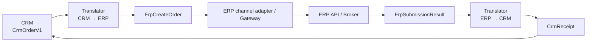
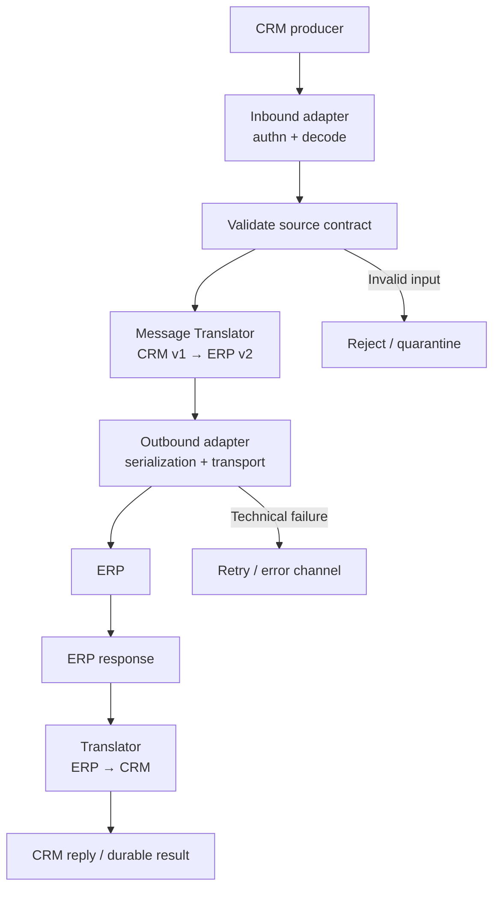
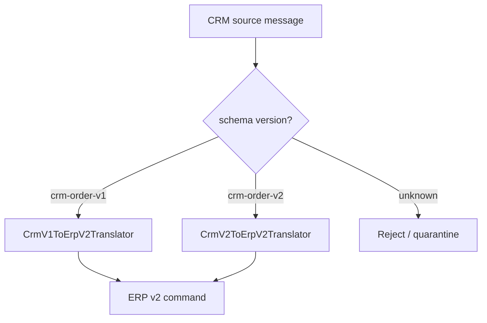
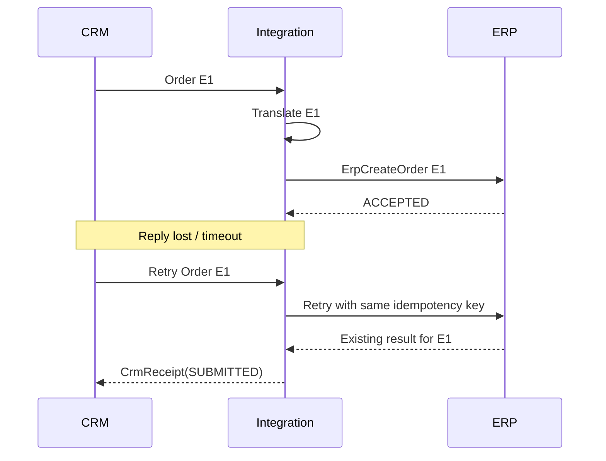
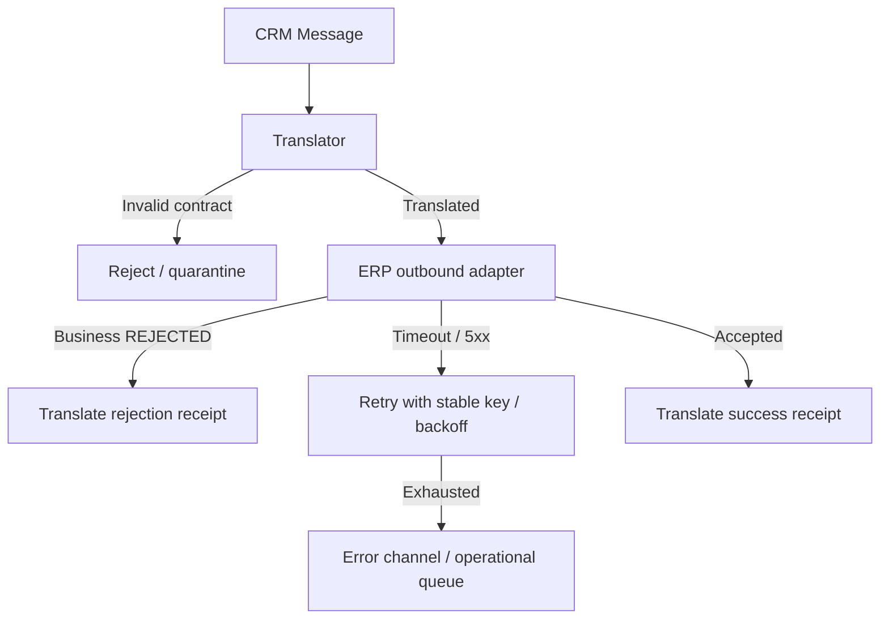
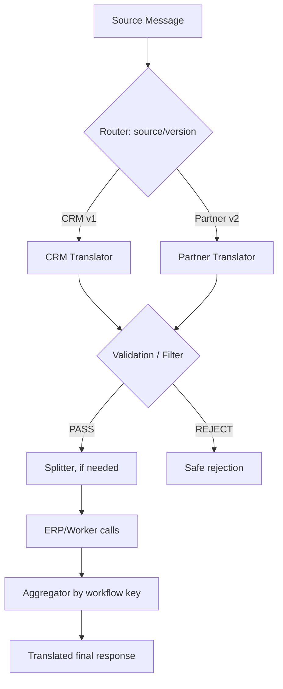

# Message Translator Converts Messages Between Two Systems

A CRM system might create an order request with an amount of `"49.95"` as a decimal string, while an ERP system only accepts an integer `4995` in cents. CRM calls the customer `customerRef`, whereas ERP uses `customerAccount`; CRM returns the status `SUBMITTED`, while ERP responds with `ACCEPTED` or `REJECTED`. If two systems exchange Messages directly without a translation layer, each side must know the data structure and specific rules of the other.

**Message Translator** is an Enterprise Integration Patterns (EIP) pattern that converts a Message from the **sending system's contract** to the **receiving system's contract**, so that two systems can interact without sharing a single payload type or a single domain model. A Translator can convert field names, data types, units of measure, lists, status codes, and part of the metadata; it must also detect differences that **cannot be safely converted** instead of guessing or losing data.

The lesson **Message Translator Converts Messages Between Two Systems** belongs to the **Message translator** chapter in the `SPRING_INTEGRATION_PATTERN` module. The module goal is to learn how to implement Enterprise Integration Patterns with Spring Integration to build loosely coupled and extensible message flows; practice Router, Filter, Transformer, Splitter, Aggregator, Gateway, retry, error channel, and correlation, while testing and monitoring processing branches. This lesson uses a CRM ↔ ERP scenario to explain **contract boundaries, implementing a translator with Spring Integration, testing bidirectional translation, and reliability requirements when two real systems communicate**.

## 1. Real-world problem: two systems, two data languages

CRM emits a request:

```json
{
  "tenantId": "tenant-7",
  "eventId": "evt-1001",
  "orderId": "ORD-1001",
  "customerRef": "CUS-9",
  "totalAmount": "49.95",
  "currency": "USD",
  "lines": [
    {"lineNo": 1, "sku": "BOOK-01", "quantity": 2},
    {"lineNo": 2, "sku": "PEN-02", "quantity": 5}
  ]
}
```

ERP requires:

```json
{
  "tenant": "tenant-7",
  "externalDocumentId": "ORD-1001",
  "sourceEventId": "evt-1001",
  "customerAccount": "ERP-CUS-9",
  "totalMinorUnits": 4995,
  "currencyCode": "USD",
  "positions": [
    {"position": 1, "materialCode": "BOOK-01", "units": 2},
    {"position": 2, "materialCode": "PEN-02", "units": 5}
  ]
}
```

If ERP returns:

```json
{
  "sourceEventId": "evt-1001",
  "externalDocumentId": "ORD-1001",
  "erpDocumentId": "ERP-DOC-777",
  "resultCode": "ACCEPTED",
  "errorCode": "NONE"
}
```

then CRM expects a response in its own language:

```json
{
  "eventId": "evt-1001",
  "orderId": "ORD-1001",
  "erpReference": "ERP-DOC-777",
  "status": "SUBMITTED",
  "reasonCode": "NONE"
}
```

Message Translator is a **contract translation boundary**, not merely renaming `totalAmount` to `totalMinorUnits`.



In this example, one CRM request leads to one ERP command and then one CRM receipt. This is a **single-branch, synchronous scenario for learning how to translate**. With an asynchronous broker or an ERP that returns results minutes later, correlation and reply handling will differ; later sections analyze these separately.

## 2. How does the Message Translator EIP differ from a Message Transformer?

Mechanically, a Message Translator is often **implemented using one or more Message Transformers**. The difference lies in **architectural intent**, not necessarily in class names:

| Pattern / Component | Main question | Example |
| --- | --- | --- |
| **Message Translator** | How do two systems with different contracts understand each other? | `CrmOrderV1 → ErpCreateOrder` |
| **Message Transformer** | How is a payload or Message transformed inside a flow? | String → DTO, currency unit conversion |
| **Normalizer** | How are multiple different source formats converted into **one common format**? | CRM/ERP/Partner → `CanonicalOrder` |
| **Envelope Wrapper** | How is stable exchange metadata attached around data? | `EventEnvelope<OrderData>` |
| **Channel Adapter** | How is an application connected to HTTP, Kafka, JMS, or files? | HTTP outbound gateway |
| **Gateway** | How is the messaging API hidden behind a request-reply call? | Java interface invoking an integration flow |
| **Router** | Which endpoint does a Message go to? | Selecting a translator by `sourceSystem` |

**A Translator is not automatically a transport adapter.** A Java function converting CRM data into ERP data does not send an HTTP request or publish to Kafka. The adapter is responsible for connectivity and serialization; the Translator is responsible for understanding the differences between the two contracts.

### 2.1. Does every Translator need a Canonical Data Model?

No. If there are only CRM and ERP, you can translate **directly** `CRM → ERP`. When connecting many sources and many targets, a canonical model can help reduce the number of mappings:

```text
Direct pairwise:
  CRM -> ERP
  CRM -> WMS
  POS -> ERP
  POS -> WMS

Canonical:
  CRM ─┐
  POS ─┴──> CanonicalOrder ──┬──> ERP
                            └──> WMS
```

However, a Canonical Model also carries governance overhead and does not automatically fit every business domain. This lesson focuses on **Translator between two systems**, while mentioning canonical mapping when scaling is needed.

## 3. Translation must preserve meaning, not just structure

A correct translation must preserve the **business invariants** agreed upon by both sides:

1. The same order retains its `orderId` and tenant per the contract.
2. Total monetary amounts remain equal after converting representation and units, without silent rounding.
3. Line count, line positions, and quantities are not altered outside published rules.
4. The source `eventId` remains stable across redelivery so the receiving side can deduplicate.
5. ERP response codes are converted using an **intentional status mapping table**.
6. Unmappable data must be **rejected or routed to an error branch**, rather than fabricating default values.

Incorrect examples:

```text
CRM totalAmount = "49.95"
ERP totalMinorUnits = 49

Wrong: taking only the integer part before the decimal point and dropping the fractional part.
```

Or:

```text
ERP resultCode = "REJECTED"
CRM status = "SUBMITTED"

Wrong: treating every HTTP 200 or every ERP reply as business success.
```

When communicating between two bounded contexts, some fields share similar names but **do not share the same semantics**. CRM's `customerRef` can only be translated to ERP's `customerAccount` if a trusted mapping rule or source exists—never assume both IDs belong to the same identity system.

## 4. The mapping table must be agreed upon before coding

| CRM v1 | ERP v2 | Translation rule |
| --- | --- | --- |
| `tenantId` | `tenant` | Preserve the authenticated value |
| `eventId` | `sourceEventId` | Keep stable across retries |
| `orderId` | `externalDocumentId` | Verify ID length and range |
| `customerRef` | `customerAccount` | Lookup/mapping per contract; demo uses a defined prefix |
| `totalAmount` | `totalMinorUnits` | USD decimal → cents, exact conversion |
| `currency` | `currencyCode` | Accept only supported currency codes |
| `lines[].lineNo` | `positions[].position` | Preserve sequence numbers |
| `lines[].sku` | `positions[].materialCode` | Demo keeps SKU; production may require product catalog mapping |
| `lines[].quantity` | `positions[].units` | Positive integer |
| CRM `eventId` + tenant | ERP idempotency key | Add a stable operation namespace |

Reverse mapping:

| ERP response | CRM receipt | Semantics |
| --- | --- | --- |
| `ACCEPTED` | `SUBMITTED` | ERP accepted the command under the demo contract |
| `REJECTED`, `OUT_OF_STOCK` | `REJECTED`, `ERP_OUT_OF_STOCK` | Business rejection; do not retry immediately with the same data |
| `REJECTED`, unknown code | `REJECTED`, `ERP_REJECTED` | Safe public code |
| Unsupported status code | Technical contract error | Do not assume success or definite rejection |

**This is an example mapping table, not the actual code table of a specific ERP.** In real integrations, use each system's versioned contract as the source of truth, clearly define acceptance levels (`received`, `validated`, `committed`), and test against the real adapter.

### 4.1. Should a common error taxonomy be used?

Separate error categories should be maintained:

```text
VALIDATION_FAILURE  -> invalid input request
TRANSLATION_FAILURE -> cannot map safely
REMOTE_REJECTION    -> ERP returned a business rejection
REMOTE_TIMEOUT      -> unknown whether ERP processed it
REMOTE_UNAVAILABLE  -> ERP system unreachable
SERIALIZATION_ERROR -> payload violates transport contract
```

Do not lump every error into `REJECTED`, because a timeout does not prove ERP has not created the order; blind retries can create duplicate orders.

## 5. Defining the CRM → Translator → ERP boundary



**Trust boundary** at the inbound adapter:

- Authenticate the sender and tenant or verify against principal/ACL.
- Decode the exact schema version.
- Validate required fields, sizes, and formats.
- Strip or overwrite internal headers self-declared by the client.
- Attach an authenticated source identity rather than trusting an arbitrary string in the payload.

**Contract translation boundary** at the Translator:

- Convert fields, types, units, and status codes.
- Preserve IDs needed for correlation/idempotency.
- Generate new values only when allowed by the contract.
- Throw an error with a safe code if conversion is impossible.

**Transport boundary** at the outbound adapter:

- Configure endpoint, authentication, and serialization.
- Forward only allowlisted headers.
- Handle timeouts, retries, response statuses, and connection errors.
- Do not leak raw exceptions, tokens, or unintended JVM headers outward.

Do not place tokens/credentials, HTTP URLs, or broker configurations inside the Translator class just to make translation "more convenient". The Translator should stay close to a pure function, easy to test without a live ERP system.

## 6. Java 17+: designing Message types for both systems

The following `record` types represent an illustrative schema. For ease of reading, they are declared inside one container class with nested types.

```java
package example.integration;

import java.util.List;

public final class TranslatorModel {

    private TranslatorModel() {
    }

    public record CrmLine(
            int lineNo, String sku, int quantity) {
    }

    public record CrmOrderV1(
            String tenantId,
            String eventId,
            String orderId,
            String customerRef,
            String totalAmount,
            String currency,
            List<CrmLine> lines) {
    }

    public record ErpLine(
            int position, String materialCode, int units) {
    }

    public record ErpCreateOrder(
            String tenant,
            String sourceEventId,
            String externalDocumentId,
            String customerAccount,
            long totalMinorUnits,
            String currencyCode,
            List<ErpLine> positions,
            String idempotencyKey) {
    }

    public record ErpSubmissionResult(
            String sourceEventId,
            String externalDocumentId,
            String erpDocumentId,
            String resultCode,
            String errorCode) {
    }

    public record CrmReceipt(
            String eventId,
            String orderId,
            String erpReference,
            String status,
            String reasonCode) {
    }
}
```

These DTOs represent only **the transmitted data**; they do not by themselves guarantee authentication, transactions, or delivery. When using real HTTP/Kafka/AMQP, you need a serialization contract (JSON/Avro/Protobuf), schema validation, and a version compatibility strategy.

### 6.1. Why keep `sourceEventId` and `externalDocumentId` in the ERP command?

ERP may issue a new `erpDocumentId`. However, when receiving a response, the Translator still needs to correlate back to CRM's `eventId` and `orderId`. These two fields distinguish the **source event ID** from the **document ID issued by ERP**.

Do not use `erpDocumentId` to replace the event ID when deduplicating inbound requests.

### 6.2. Why does `totalMinorUnits` use `long`?

This is an illustrative choice for an ERP system using minor units. There must be magnitude limits and `longValueExact()` when converting from `BigDecimal`. For systems requiring monetary amounts beyond `long` range or supporting multiple units, use a `Money` type with explicit currency, scale, and precision.

## 7. Pure Translator: validate then translate CRM to ERP

The core Translator should not call a broker, database, or external API. Mapping the customer ID with the `"ERP-"` prefix in the demo is an **agreed simulation rule**, not a safe customer lookup approach for production.

```java
package example.integration;

import java.math.BigDecimal;
import java.util.HashSet;
import java.util.List;
import java.util.Set;

import example.integration.TranslatorModel.*;

public final class CrmErpMessageTranslator {

    private static final String OPERATION = "CREATE_ERP_ORDER";

    public ErpCreateOrder toErpOrder(CrmOrderV1 input) {
        if (input == null) {
            throw new IllegalArgumentException("CRM_REQUEST_REQUIRED");
        }

        String tenant = requiredId(input.tenantId(), "TENANT");
        String event = requiredId(input.eventId(), "EVENT");
        String order = requiredId(input.orderId(), "ORDER");
        String customer = requiredId(input.customerRef(), "CUSTOMER");

        if (!"USD".equals(input.currency())) {
            throw new IllegalArgumentException("UNSUPPORTED_CURRENCY");
        }

        long cents = parseUsdCents(input.totalAmount());
        List<ErpLine> lines = translateLines(input.lines());

        // One logical CRM event + one operation -> same key on retry.
        String idempotencyKey =
                tenant + ":" + event + ":" + OPERATION;

        return new ErpCreateOrder(
                tenant,
                event,
                order,
                "ERP-" + customer, // Demo: simple contract mapping.
                cents,
                "USD",
                lines,
                idempotencyKey);
    }

    private static long parseUsdCents(String text) {
        // Plain decimal only, no exponent, non-negative;
        // limit digit count to prevent oversized input.
        if (text == null
                || !text.matches("[0-9]{1,12}(\\.[0-9]{1,2})?")) {
            throw new IllegalArgumentException("CRM_AMOUNT_INVALID");
        }
        try {
            return new BigDecimal(text)
                    .movePointRight(2)
                    .longValueExact();
        } catch (ArithmeticException ex) {
            throw new IllegalArgumentException(
                    "CRM_AMOUNT_OUT_OF_RANGE", ex);
        }
    }

    private static List<ErpLine> translateLines(
            List<CrmLine> inputLines) {
        if (inputLines == null
                || inputLines.isEmpty()
                || inputLines.size() > 100) {
            throw new IllegalArgumentException("INVALID_LINE_COUNT");
        }

        Set<Integer> seenPositions = new HashSet<>();
        return inputLines.stream().map(line -> {
            if (line == null
                    || line.lineNo() < 1
                    || line.lineNo() > inputLines.size()
                    || !seenPositions.add(line.lineNo())) {
                throw new IllegalArgumentException(
                        "INVALID_LINE_POSITION");
            }
            if (line.quantity() <= 0) {
                throw new IllegalArgumentException(
                        "INVALID_LINE_QUANTITY");
            }
            String material = requiredId(line.sku(), "MATERIAL");
            return new ErpLine(
                    line.lineNo(), material, line.quantity());
        }).toList();
    }

    private static String requiredId(String value, String field) {
        if (value == null
                || !value.matches("[A-Za-z0-9_-]{1,80}")) {
            throw new IllegalArgumentException("INVALID_" + field + "_ID");
        }
        return value;
    }

    public CrmReceipt toCrmReceipt(ErpSubmissionResult response) {
        if (response == null) {
            throw new IllegalArgumentException("ERP_RESPONSE_REQUIRED");
        }
        String event = requiredId(
                response.sourceEventId(), "EVENT");
        String order = requiredId(
                response.externalDocumentId(), "ORDER");

        return switch (response.resultCode()) {
            case "ACCEPTED" -> new CrmReceipt(
                    event, order,
                    requiredId(response.erpDocumentId(), "ERP_DOCUMENT"),
                    "SUBMITTED", "NONE");

            case "REJECTED" -> new CrmReceipt(
                    event, order, null,
                    "REJECTED", safeRejectionCode(response.errorCode()));

            default -> throw new IllegalArgumentException(
                    "UNSUPPORTED_ERP_RESULT_CODE");
        };
    }

    private static String safeRejectionCode(String rawCode) {
        // Do not reflect raw ERP error text back to CRM.
        return switch (rawCode == null ? "" : rawCode) {
            case "OUT_OF_STOCK" -> "ERP_OUT_OF_STOCK";
            case "CUSTOMER_NOT_FOUND" -> "ERP_CUSTOMER_NOT_FOUND";
            default -> "ERP_REJECTED";
        };
    }
}
```

### 7.1. Guarantees in the mapper

- `requiredId` rejects malformed IDs and enforces length limits.
- `parseUsdCents` uses `BigDecimal`, never `double`, for monetary values.
- `longValueExact()` prevents silent rounding or truncation.
- Line items must have distinct `lineNo` values within the range `1..N`.
- Material codes are assumed to share the same namespace between both systems; real systems may require a mapping table lookup.
- The idempotency key is derived from the logical event, not from `MessageHeaders.ID`.
- Response mapping uses a **bounded code table** and never exposes raw response text in the public receipt.

**Critical limitation:** this is a translator **without real ERP integration**. It does not verify whether account `ERP-CUS-9` exists, whether USD is currently accepted by ERP, or whether `REJECTED` corresponds to a retryable error. Those rules must be grounded in the ERP contract and integration tests in an appropriate environment.

### 7.2. What if customer ID mapping requires lookup data?

A CRM `customerRef` does not necessarily become an ERP account by prepending a prefix. In a real system:

1. Maintain a governed mapping source between the two customer identifiers.
2. Use a Content Enricher / dedicated service to look up by tenant/customer ID.
3. Distinguish *missing mapping* from *lookup service unavailable*.
4. Run the Translator only when sufficiently trustworthy data is available, or pass a mapping resolver via an interface.
5. Test that a customer can change mapping/version without dispatching wrong orders.

Keeping the Translator as pure as possible helps **separate conversion errors from network errors** and enables fast unit tests.

## 8. Distinguishing translation failure from remote rejection

The following two errors are **not the same**:

```text
CRM amountText="NaN"
  -> Translator cannot convert to a monetary amount
  -> Not sent to ERP.

CRM amountText="49.95"
  -> Translator sends to ERP.
  -> ERP returns REJECTED/OUT_OF_STOCK
  -> Translated into CrmReceipt(status=REJECTED).
```

The first error occurs **before transport** because the input violates the contract; the second is a **business response from ERP** after a valid request was sent.

| Condition | Create `ErpCreateOrder`? | Send to ERP? | Expected outcome |
| --- | --- | --- | --- |
| CRM amount invalid format | No | No | Validation/translation error |
| CRM missing event ID | No | No | Input contract error |
| ERP returns `ACCEPTED` | Yes | Yes | `CrmReceipt(SUBMITTED)` |
| ERP returns `REJECTED` | Yes | Yes | `CrmReceipt(REJECTED)` |
| ERP returns unknown status | Yes | Yes | Technical/protocol error |
| ERP returns no response | Yes | Possibly | Timeout/unknown outcome; check before retrying |

**Do not throw an exception for every business rejection if the system chose a receipt as the reply contract.** Conversely, do not return `"REJECTED"` for every exception, because that destroys the distinction between data errors and transport errors.

## 9. Decoupling the Message Translator from the ERP communication port

The Translator in section 7 is a DTO conversion function; the ERP invocation port can be:

```java
package example.integration;

import example.integration.TranslatorModel.*;

@FunctionalInterface
public interface ErpSubmissionPort {
    ErpSubmissionResult submit(ErpCreateOrder command);
}
```

A production application provides an implementation calling an HTTP outbound gateway, AMQP/Kafka request-reply, or an ERP SDK matching the real contract. However, to keep the example **self-contained without needing a real ERP**, we create a fake port:

```java
package example.integration;

import java.util.concurrent.atomic.AtomicReference;

import example.integration.TranslatorModel.*;

public final class RecordingErpPort implements ErpSubmissionPort {

    private final AtomicReference<ErpCreateOrder> last =
            new AtomicReference<>();

    @Override
    public ErpSubmissionResult submit(ErpCreateOrder command) {
        last.set(command);
        return new ErpSubmissionResult(
                command.sourceEventId(),
                command.externalDocumentId(),
                "ERP-DOC-" + command.externalDocumentId(),
                "ACCEPTED",
                "NONE");
    }

    public ErpCreateOrder lastCommand() {
        return last.get();
    }
}
```

The fake port is a **simulator for learning and testing**, offering no guarantees for durability, authentication, retry, or ERP transactions. Its value is that **the transport can be swapped without modifying the DTO translation function**.

### 9.1. Why not put the ERP URL inside `CrmErpMessageTranslator`?

If the mapper calls HTTP directly, testing a simple currency conversion rule would depend on network access, credentials, and ERP state. This increases coupling and makes it hard to separate mapping errors from transport errors.

Separating into:

```text
Mapper (pure conversion)
  +
ErpSubmissionPort (boundary interface)
  +
HTTP/Broker Adapter (transport implementation)
```

allows testing each layer independently and changing connectivity without altering the translator's business contract.

## 10. Spring Integration Java DSL: wiring two translators into one flow

Spring Integration can orchestrate the sequence:

```text
crmOrdersInput
    -> transform CRM request to ERP command
    -> handle sending to ERP via port
    -> transform ERP response to CRM receipt
    -> crmReceipts
```

```java
package example.integration;

import org.springframework.context.annotation.Bean;
import org.springframework.context.annotation.Configuration;
import org.springframework.integration.channel.DirectChannel;
import org.springframework.integration.channel.QueueChannel;
import org.springframework.integration.config.EnableIntegration;
import org.springframework.integration.dsl.IntegrationFlow;
import org.springframework.messaging.MessageChannel;
import org.springframework.messaging.PollableChannel;

import example.integration.TranslatorModel.*;

@Configuration
@EnableIntegration
public class TranslatorFlowConfiguration {

    @Bean
    public MessageChannel crmOrdersInput() {
        return new DirectChannel();
    }

    @Bean
    public PollableChannel crmReceipts() {
        return new QueueChannel(20);
    }

    @Bean
    public CrmErpMessageTranslator messageTranslator() {
        return new CrmErpMessageTranslator();
    }

    @Bean
    public RecordingErpPort erpSubmissionPort() {
        // Demo/test only, replace with a real adapter in production.
        return new RecordingErpPort();
    }

    @Bean
    public IntegrationFlow translateCrmOrders(
            CrmErpMessageTranslator translator,
            ErpSubmissionPort erpPort) {

        return IntegrationFlow.from("crmOrdersInput")
                .transform(
                        CrmOrderV1.class,
                        translator::toErpOrder)
                .handle(
                        ErpCreateOrder.class,
                        (command, headers) -> erpPort.submit(command))
                .transform(
                        ErpSubmissionResult.class,
                        translator::toCrmReceipt)
                .channel("crmReceipts")
                .get();
    }
}
```

### 10.1. Reading the DSL step by step

1. `IntegrationFlow.from("crmOrdersInput")` receives a `Message<CrmOrderV1>`.
2. `.transform(CrmOrderV1.class, ...)` converts the **payload** to `ErpCreateOrder`.
3. `.handle(ErpCreateOrder.class, ...)` invokes `ErpSubmissionPort` and receives the `ErpSubmissionResult` response.
4. `.transform(ErpSubmissionResult.class, ...)` converts the response back to `CrmReceipt`.
5. `.channel("crmReceipts")` delivers the receipt to the consumer/test.

In a synchronous flow, if a step throws an exception, it can propagate back to `send()` and the Message will not appear at the output. With async transport or a Gateway with a timeout, error/reply handling must be managed at the adapter and completion state level.

### 10.2. Is the API always the same across all versions?

The `.transform(Class, transformer)` and `.handle(Class, handler)` overloads are standard Java DSL idioms in modern Spring Integration versions. When integrating into a project, verify the exact dependency version and run the compiler and tests; this STEP 4 lesson **has not run build/JUnit yet**.

### 10.3. `QueueChannel(20)` is only a test buffer

It does not make the ERP call durable and does not automatically ACK an external broker. If the application crashes after ERP receives the request but before the receipt lands in `QueueChannel`, only Message/source idempotency and ERP/durable store state allow proper recovery.

## 11. Demo: send a CRM Message, receive a CRM receipt

```java
package example.integration;

import java.util.List;

import org.springframework.context.annotation.AnnotationConfigApplicationContext;
import org.springframework.messaging.Message;
import org.springframework.messaging.MessageChannel;
import org.springframework.messaging.PollableChannel;
import org.springframework.messaging.support.MessageBuilder;

import example.integration.TranslatorModel.*;

public class TranslatorDemo {

    public static void main(String[] args) {
        try (var context = new AnnotationConfigApplicationContext(
                TranslatorFlowConfiguration.class)) {

            MessageChannel input =
                    context.getBean("crmOrdersInput", MessageChannel.class);
            PollableChannel output =
                    context.getBean("crmReceipts", PollableChannel.class);
            RecordingErpPort erpPort =
                    context.getBean(RecordingErpPort.class);

            CrmOrderV1 request = new CrmOrderV1(
                    "tenant-7",
                    "evt-1001",
                    "ORD-1001",
                    "CUS-9",
                    "49.95",
                    "USD",
                    List.of(
                            new CrmLine(1, "BOOK-01", 2),
                            new CrmLine(2, "PEN-02", 5)));

            input.send(MessageBuilder.withPayload(request).build());

            Message<?> result = output.receive(0);
            if (result == null) {
                throw new IllegalStateException(
                        "Expected a translated CRM receipt");
            }

            CrmReceipt receipt = (CrmReceipt) result.getPayload();
            ErpCreateOrder erpCommand = erpPort.lastCommand();
            System.out.println(erpCommand.totalMinorUnits()); // 4995
            System.out.println(erpCommand.customerAccount());  // ERP-CUS-9
            System.out.println(receipt.status());              // SUBMITTED
            System.out.println(receipt.orderId());             // ORD-1001
        }
    }
}
```

In the demo, the fake ERP returns `ACCEPTED` synchronously. The `SUBMITTED` result **reflects only the semantics defined by this lesson**; a real ERP may distinguish accepted into queue, validated, committed, posted, and fulfilled. Do not equate `ACCEPTED` from every ERP with order completion.

## 12. JUnit 5: testing CRM → ERP translation at the mapper level

Unit tests need neither a Spring context nor a network. They specifically verify currency conversion, IDs, and line lists:

```java
package example.integration;

import static org.junit.jupiter.api.Assertions.*;

import java.util.List;

import org.junit.jupiter.api.Test;

import example.integration.TranslatorModel.*;

class CrmErpMessageTranslatorTest {

    private final CrmErpMessageTranslator translator =
            new CrmErpMessageTranslator();

    private static CrmOrderV1 validRequest() {
        return new CrmOrderV1(
                "tenant-7",
                "evt-1001",
                "ORD-1001",
                "CUS-9",
                "49.95",
                "USD",
                List.of(
                        new CrmLine(1, "BOOK-01", 2),
                        new CrmLine(2, "PEN-02", 5)));
    }

    @Test
    void crmOrderIsTranslatedToErpContractWithoutLosingMeaning() {
        ErpCreateOrder output = translator.toErpOrder(validRequest());

        assertEquals("tenant-7", output.tenant());
        assertEquals("evt-1001", output.sourceEventId());
        assertEquals("ORD-1001", output.externalDocumentId());
        assertEquals("ERP-CUS-9", output.customerAccount());
        assertEquals(4995L, output.totalMinorUnits());
        assertEquals("USD", output.currencyCode());
        assertEquals(2, output.positions().size());
        assertEquals(1, output.positions().get(0).position());
        assertEquals("BOOK-01",
                output.positions().get(0).materialCode());
        assertEquals(5, output.positions().get(1).units());
        assertEquals(
                "tenant-7:evt-1001:CREATE_ERP_ORDER",
                output.idempotencyKey());
    }

    @Test
    void sameLogicalEventGetsSameIdempotencyKeyOnRetry() {
        var first = translator.toErpOrder(validRequest());
        var retry = translator.toErpOrder(validRequest());

        assertEquals(first.idempotencyKey(), retry.idempotencyKey());
        assertEquals(first, retry);
    }

    @Test
    void erpAcceptanceAndBusinessRejectionAreTranslatedDifferently() {
        var accepted = translator.toCrmReceipt(
                new ErpSubmissionResult(
                        "evt-1001", "ORD-1001",
                        "ERP-DOC-777", "ACCEPTED", "NONE"));

        assertEquals("SUBMITTED", accepted.status());
        assertEquals("ERP-DOC-777", accepted.erpReference());
        assertEquals("NONE", accepted.reasonCode());

        var rejected = translator.toCrmReceipt(
                new ErpSubmissionResult(
                        "evt-1001", "ORD-1001",
                        null, "REJECTED", "OUT_OF_STOCK"));

        assertEquals("REJECTED", rejected.status());
        assertNull(rejected.erpReference());
        assertEquals("ERP_OUT_OF_STOCK", rejected.reasonCode());
    }
}
```

These assertions catch errors such as **wrong unit conversion**, **lost identifiers**, **scrambled line order**, or **treating rejection as accepted**.

### 12.1. Test the contract, not just object != null

A test checking only `assertNotNull(translator.toErpOrder(...))` does not prove the translator fulfills its obligations. Verify each critical invariant, especially money, tenant, IDs, status, and fields used for deduplication/correlation.

## 13. JUnit 5: invalid input must never be sent to ERP

If CRM sends `"NaN"` or `"-1.00"` for the amount, the Translator must reject it instead of generating a bad ERP command:

```java
// Methods belonging to CrmErpMessageTranslatorTest.
@Test
void invalidAmountIsRejectedBeforeAnyErpCommandIsProduced() {
    CrmOrderV1 input = new CrmOrderV1(
            "tenant-7", "evt-bad", "ORD-1001", "CUS-9",
            "NaN", "USD", List.of(new CrmLine(1, "BOOK-01", 1)));

    IllegalArgumentException ex = assertThrows(
            IllegalArgumentException.class,
            () -> translator.toErpOrder(input));

    assertEquals("CRM_AMOUNT_INVALID", ex.getMessage());
}

@Test
void duplicateLinePositionsAreRejected() {
    CrmOrderV1 input = new CrmOrderV1(
            "tenant-7", "evt-dup-line", "ORD-1001", "CUS-9",
            "49.95", "USD",
            List.of(
                    new CrmLine(1, "BOOK-01", 2),
                    new CrmLine(1, "PEN-02", 5)));

    assertThrows(
            IllegalArgumentException.class,
            () -> translator.toErpOrder(input));
}

@Test
void unsupportedErpStatusIsNotSilentlyMappedToSuccess() {
    assertThrows(IllegalArgumentException.class, () ->
            translator.toCrmReceipt(new ErpSubmissionResult(
                    "evt-1001", "ORD-1001", null,
                    "SUSPENDED_FOR_REVIEW", "NONE")));
}
```

In production, `"SUSPENDED_FOR_REVIEW"` might be a completely valid business status. When encountering a new status, **upgrade the mapping table and CRM contract version**; do not assign `ACCEPTED` or `REJECTED` when the semantics are unclear.

### 13.1. How should a missing SKU mapping be handled?

Suppose CRM sends `crmSku="CRM-BOOK-01"` while ERP only accepts `"ERP-M-100"`. Without a valid mapping table, the Translator **must not strip the prefix and guess a new code**. It can emit a `MATERIAL_MAPPING_MISSING` error or hold the work in a state requiring enrichment/reconciliation, depending on the business contract.

## 14. JUnit 5: testing across Spring Integration channels

A passing mapper unit test still does not prove that the IntegrationFlow calls the mapper and routes the result to the right channel. The following test verifies this:

```java
package example.integration;

import static org.junit.jupiter.api.Assertions.*;

import java.util.List;

import org.junit.jupiter.api.Test;
import org.springframework.context.annotation.AnnotationConfigApplicationContext;
import org.springframework.messaging.Message;
import org.springframework.messaging.MessageChannel;
import org.springframework.messaging.PollableChannel;
import org.springframework.messaging.support.MessageBuilder;

import example.integration.TranslatorModel.*;

class TranslatorFlowIntegrationTest {

    @Test
    void crmRequestCrossesTwoTranslationBoundariesAndGetsReceipt() {
        try (var context = new AnnotationConfigApplicationContext(
                TranslatorFlowConfiguration.class)) {

            MessageChannel input =
                    context.getBean("crmOrdersInput", MessageChannel.class);
            PollableChannel output =
                    context.getBean("crmReceipts", PollableChannel.class);
            RecordingErpPort port =
                    context.getBean(RecordingErpPort.class);

            var order = new CrmOrderV1(
                    "tenant-7",
                    "evt-1001",
                    "ORD-1001",
                    "CUS-9",
                    "49.95",
                    "USD",
                    List.of(
                            new CrmLine(1, "BOOK-01", 2),
                            new CrmLine(2, "PEN-02", 5)));

            assertTrue(input.send(
                    MessageBuilder.withPayload(order).build()));

            Message<?> message = output.receive(0);
            assertNotNull(message);
            assertInstanceOf(CrmReceipt.class, message.getPayload());

            CrmReceipt receipt = (CrmReceipt) message.getPayload();
            assertEquals("evt-1001", receipt.eventId());
            assertEquals("ORD-1001", receipt.orderId());
            assertEquals("SUBMITTED", receipt.status());

            ErpCreateOrder translated = port.lastCommand();
            assertNotNull(translated);
            assertEquals(4995L, translated.totalMinorUnits());
            assertEquals("ERP-CUS-9", translated.customerAccount());
            assertEquals(
                    "tenant-7:evt-1001:CREATE_ERP_ORDER",
                    translated.idempotencyKey());
            assertNull(output.receive(0));
        }
    }

    @Test
    void invalidRequestDoesNotReachErpPort() {
        try (var context = new AnnotationConfigApplicationContext(
                TranslatorFlowConfiguration.class)) {

            MessageChannel input =
                    context.getBean("crmOrdersInput", MessageChannel.class);
            PollableChannel output =
                    context.getBean("crmReceipts", PollableChannel.class);
            RecordingErpPort port =
                    context.getBean(RecordingErpPort.class);

            var invalid = new CrmOrderV1(
                    "tenant-7", "evt-invalid", "ORD-1001",
                    "CUS-9", "invalid", "USD",
                    List.of(new CrmLine(1, "BOOK-01", 1)));

            assertThrows(RuntimeException.class,
                    () -> input.send(
                            MessageBuilder.withPayload(invalid).build()));
            assertNull(port.lastCommand());
            assertNull(output.receive(0));
        }
    }
}
```

In a synchronous `DirectChannel` configuration, `send()` finishes after the translator and fake port run, so `receive(0)` is a reasonable way to observe the output. If switched to an `ExecutorChannel`, broker, or real async HTTP, the test must wait with a finite timeout, track completion, and inspect errors on the right thread/adapter.

**This is sample code to place into a project and run tests; the STEP 4 authoring step has not executed Java/JUnit.** Unit tests plus integration tests with a fake port prove the mapping and internal flow, not that the real ERP received the request.

## 15. Metadata and headers: what must the Translator preserve?

Messages between two systems often need additional fields:

| Metadata | Purpose | Where stored? |
| --- | --- | --- |
| `sourceSystem` | Authenticated trusted source | Envelope or server-assigned header |
| `sourceEventId` | Logical event from CRM | Payload/envelope, optionally mirrored in header |
| `tenantId` | Tenant scope | Payload/envelope + security context |
| `correlationId` | Links steps in a workflow | Envelope/header depending on contract |
| `causationId` | Event/command directly causing a new event | Envelope when downstream events exist |
| `schemaVersion` | Contract version of each side | Envelope/content-type/schema registry |
| `mappingVersion` | Translator logic used | Trace/audit/envelope if needed |
| `replyChannel` | Reply routing in Spring runtime | Internal technical header, do not serialize indiscriminately |

**Do not treat all `MessageHeaders` as data allowed to be sent to ERP.** If you do:

```java
// Illustration of what not to do at the outbound boundary:
Map<String, Object> all = message.getHeaders();
```

for serialization, headers such as security info, exceptions, channel objects, or debug data can be leaked or cause serialization failures.

### 15.1. Message ID and source event ID are different

`MessageHeaders.ID` is typically the identifier of a specific Spring Message instance. When the Translator creates a new Message, sends it over a broker, or retries, the framework ID can change. The `sourceEventId` defined by the source must remain **stable for the same logical event**.

### 15.2. Do not trust `sourceSystem` just because it is a header

A client could self-send:

```text
sourceSystem = TRUSTED_ERP
translation.approved = true
```

Neither the Translator nor the Router should treat these values as processing authority. The ingress adapter must authenticate the source and assign/overwrite trusted metadata. The demo's `CrmErpMessageTranslator` does not read self-declared headers; it receives the CRM DTO from an internal channel assumed to be **populated only by a trusted CRM adapter**.

### 15.3. An ID in the payload is not enough to maintain request/reply correlation across a broker

In a synchronous flow, the fake port returns `sourceEventId` and `externalDocumentId`. With request-reply over a broker, however, the ERP response may arrive on a different consumer. You need a **transport-appropriate correlation key and reply destination**, TTL, timeout, and tracking of sent request state. Simply having `eventId` in the DTO does not make a Spring Gateway route the reply to the right caller automatically.

## 16. Versioning: the Translator must know which contract it is reading

A Translator serving CRM v1 and ERP v2 must not automatically assume every payload belongs to that version.

```text
CRM v1:
  totalAmount = decimal string "49.95"

CRM v2:
  totalAmountMinor = integer 4995

ERP v2:
  totalMinorUnits = integer 4995
```

If a CRM v2 producer sends an integer while the deserializer/mapper still uses CRM v1 rules, the amount could be off by **100x**.

### 16.1. Selecting a translator by schema version



Do not use a try-catch that parses v1 and silently falls back to v2 if the two versions can share the same shape but differ in **meaning**. Prefer explicit schema versions, a registry or content-type, and compatible contracts.

### 16.2. Mapping version differs from schema version

`CRM schema v1` might remain unchanged while customer ID mapping rules change from `mapping-v1` to `mapping-v2`. An audit record may need both:

```text
sourceSchemaVersion = crm-order-v1
targetSchemaVersion = erp-order-v2
mappingVersion      = crm-erp-map-v2
```

This makes it possible to verify which logic transformed an event during replay or data remediation.

### 16.3. Upgrades must not break replay

When changing mappings, decide how old events are replayed:

- **Replay-as-was:** use the old rules to reproduce historical output.
- **Reprocess-as-new:** apply the new mapping, with clear audit trails and business update rules.

These two goals are not identical. A Translator containing only the new version's code cannot by itself reproduce historical results.

## 17. Units, currency, timezone: translating units and semantics accurately

Subtle Translation bugs are usually not syntax errors:

| Data | Source | Target | Risk |
| --- | --- | --- | --- |
| Amount | `"49.95"` USD | `4995` cents | Wrong scale or rounding |
| Quantity | `2 boxes` | `2 pieces` | Wrong unit of measure |
| Timestamp | ISO time with offset | epoch millis | Timezone and DST confusion |
| Status | `ACCEPTED` | `SUBMITTED` | Misinterpreting business completion |
| Customer ID | CRM code | ERP account | Wrong namespace |
| SKU | CRM product code | ERP material code | Mismatched product mapping |

### 17.1. `double` is unsuitable for money

Avoid:

```java
long cents = (long) (Double.parseDouble(text) * 100);
```

because floating-point cannot accurately represent many decimal values and casting to `long` can truncate fractional parts.

Prefer `BigDecimal` with validated scale/range and `longValueExact()` as in section 7.

### 17.2. Cents are not the default for every currency

The demo supports only `USD`. When handling multiple currencies, the scale depends on each system's currency/unit contract. Do not automatically multiply/divide by 100 for JPY, KWD, or arbitrary currencies without a proper conversion table.

### 17.3. Do not pick the server's timezone implicitly

A source timestamp like `"2026-11-20 10:00:00"` lacks an offset/zone. To translate it into ERP epoch millis, you must know the published timezone; never default to `ZoneId.systemDefault()` because two servers may run in different timezones.

## 18. Correlation, Idempotent Receiver, and duplicates

Two Messages might have:

```text
Message 1:
  tenantId = tenant-7
  orderId = ORD-1001
  eventId = evt-1001

Message 2:
  tenantId = tenant-7
  orderId = ORD-1001
  eventId = evt-1002
```

They share the same order but may be **two valid distinct events**, so they must not be deduplicated solely because `orderId` matches.

A key scoped by logical operation:

```text
tenantId + ":" + sourceSystem + ":" + eventId
    + ":" + consumerOperation
```

In the demo, the ERP port receives the key `tenant:event:CREATE_ERP_ORDER`; because there is exactly one CRM source on this port, the source namespace is a fixed assumption. If multiple sources share the endpoint, include the source system in the key or use a sufficiently namespaced key.

### 18.1. Same key resent with a different payload

Suppose CRM resends `evt-1001` with the total amount changed from `49.95` to `149.95`. If ERP uses the idempotency key and ignores the new Message, you need a **key reuse conflict** or versioning policy. Never assume the same event ID guarantees the payload is always identical.

### 18.2. Creating a new Message in a Translator does not prevent duplicates

`toErpOrder()` creates a new object. It writes no markers, holds no state, and executes no transactions. To ensure a command has no repeated side effects, you need:

- An ERP receiver that supports idempotency keys, or
- Durable deduplication state in the integration app with appropriate atomicity alongside the business action, or
- A workflow/outbox with completion state and clear retry rules.

### 18.3. Correlation is not idempotency

`correlationId` links request/reply steps or Messages in the same group. Multiple child results from a Splitter/Aggregator can share a correlation ID without **being duplicates**. Choose a separate deduplication key for each logical event or child operation.

## 19. Transactions and failure windows when two systems exchange data

A Translator often sits between two systems with **independent** transactions:

```text
CRM -> Broker/HTTP -> Integration Service -> ERP
```

A local `@Transactional` in the Integration Service cannot roll back an already succeeded ERP HTTP call. Failure windows:

| Incident | Possible state | Required design |
| --- | --- | --- |
| Crash before sending to ERP | ERP has not received it | Durable input and retry |
| ERP creates order but response is lost | ERP may have created it | Query status by external ID or idempotency key before resending |
| Integration returns receipt but CRM misses it | CRM may retry | Stable event ID and deduplication |
| Business DB committed, outbound not yet sent | Event/command may be lost | Transactional outbox |
| Outbox relay sends then crashes before marking sent | May publish a second time | Idempotent ERP/consumer |
| ERP rejects for business reasons | Command was processed by ERP to return rejection | Translate rejection properly; do not retry like a timeout |
| Mapper fails before transport | No ERP side effect from this request | Fix input/mapping; do not call ERP |



This is the **desired behavior if ERP supports idempotency**; the demo's fake port does not implement it. Do not infer "exactly once" merely because each Message passed through the Translator once.

### 19.1. When ERP lacks an idempotent endpoint

You may need to:

1. Send a namespaced `externalDocumentId` unique per source.
2. Query ERP by external reference before retrying after a timeout.
3. Persist request completion and the remote ERP ID in a durable database.
4. Prevent two instances from sending the same logical event concurrently.
5. Design reconciliation when ERP created the order but the acknowledgment was lost.

If ERP does not guarantee uniqueness or lookup capability, you cannot claim zero duplicate remote side effects solely from the integration app's transaction.

## 20. Retry, errorChannel, dead-letter, and timeout

A flow can encounter multiple types of errors:



A suggested policy:

- **Invalid input:** do not retry infinitely; return a code from the catalog, quarantine when needed.
- **Translator bug/schema mismatch:** technical error requiring a code fix or version update.
- **ERP business rejection:** return the business result; do not pretend it is an infrastructure failure.
- **ERP connection failure before request leaves:** safer to retry, but verify it truly was not sent.
- **ERP timeout after request may have arrived:** state is **uncertain**; retries must use idempotency/lookup.
- **Serialization failure:** log a safe code, inspect payload/schema, and do not send raw stack traces to CRM.

### 20.1. `errorChannel` is different from a rejection receipt

In Spring Integration, `errorChannel` can receive an `ErrorMessage` containing an exception at configured boundaries or asynchronous handlers. A `CrmReceipt(status="REJECTED")` is a **business result**, not automatically an `ErrorMessage`.

In a synchronous flow over `DirectChannel`, exceptions typically propagate back to the caller; do not assume every exception automatically enters `errorChannel`. Check the error handling behavior of the **actual adapter/poller/Gateway**.

### 20.2. Where should retry advice be placed?

If you retry around the entire CRM → ERP flow, each retry may re-invoke both the translator and ERP. A pure Translator is generally safe to rerun; the ERP call needs a stable key and state verification before resending. Never blindly retry a business `REJECTED` response.

### 20.3. Dead-letter paths can leak data

Raw CRM requests may contain emails, order details, and tokens. A dead-letter queue requires access control, encryption, retention, and header mapping; do not forward raw exceptions/credentials to broadly accessible locations just for debugging.

## 21. Spring Integration Gateway and real request-reply

When hiding channel details, an application can use a Messaging Gateway as an interface:

```java
package example.integration;

import org.springframework.integration.annotation.Gateway;
import org.springframework.integration.annotation.MessagingGateway;

import example.integration.TranslatorModel.*;

@MessagingGateway
public interface CrmOrderGateway {

    @Gateway(requestChannel = "crmOrdersInput")
    CrmReceipt submit(CrmOrderV1 request);
}
```

**Wiring caveat:** the flow in section 10 sends results to a `QueueChannel` named `crmReceipts` for demo/test purposes. A full request-reply Gateway needs to route responses back to the request's `replyChannel` (or configure an appropriate reply channel/poller)—never assume the Gateway will automatically receive replies just because the flow has an output queue. To use a Gateway in practice, choose **one clear reply contract**, such as:

- A direct flow ending with a reply Message returning to the Gateway on the same call stack, **without** terminating the reply in an unintended channel.
- Or the Gateway explicitly declares and configures a `replyChannel` compatible with the `PollableChannel`, timeout, and actual routing.
- If ERP responses arrive over another broker, use a durable correlation store/reply flow and an appropriate timeout policy.

The interface snippet illustrates how to define a Gateway; **do not combine it verbatim with the demo QueueChannel flow and treat it as a complete Gateway application**.

### 21.1. A Gateway timeout does not roll back ERP

A Gateway timeout after 3 seconds may only mean the **caller stopped waiting for the reply**, while ERP continues processing the request. If the caller retries, idempotency and reconciliation are required; do not treat a timeout as proof that ERP never received the order.

## 22. Splitter, Aggregator, Router, and Filter around the Translator



### 22.1. Router

A Router can select a translator by **authenticated** `sourceSystem`, event type, or schema version. Do not route client Messages solely based on a self-declared `sourceSystem` header.

### 22.2. Filter

A Filter should block invalid payloads or metadata **before calling ERP**. If a Filter discards a Message in a request-reply flow, provide a rejection path so the caller does not simply experience a timeout.

### 22.3. Splitter

If CRM sends a batch containing multiple orders, a Splitter can emit individual `CrmOrderV1` items, and the Translator converts each into `ErpCreateOrder`. Each child needs its **own stable event/operation ID**; if all share the same key, ERP's Idempotent Receiver may treat the second order as a duplicate of the first.

### 22.4. Aggregator

When combining multiple ERP replies into one batch result, use a **correlation key scoped by batchAttemptId** and an appropriate release strategy, rather than grouping solely by status code `ACCEPTED`. If a Filter drops one reply, the Aggregator may wait forever; define timeout, partial completion, and rejection policies.

### 22.5. Claim Check / Envelope Wrapper

A large payload can be claim-checked before traversing the flow; the Translator needs the original content after checking it out per policy. Envelope Wrapper preserves version, source, and correlation metadata across transport; the Translator converts **data** between contracts without losing envelope lineage/provenance.

## 23. Security and trust boundaries between CRM and ERP

A poorly implemented translator can become a conduit copying sensitive data between two systems with different privilege levels.

| Risk | Example | Mitigation |
| --- | --- | --- |
| Source spoofing | Client sends `sourceSystem=ERP` | Authenticate at ingress; server assigns identity |
| Cross-tenant mapping | Tenant A maps tenant B's customer | Tenant-aware lookup and authorization |
| Credential leakage | Copying bearer token into ERP payload | Outbound allowlist, secrets management |
| Excessive data | Sending raw CRM customer profile to ERP | Data minimization, explicit DTO |
| Error leakage | Reflecting SQL/HTTP stack traces from ERP | Map error codes from catalog |
| Payload injection | CRM sends oversized/invalid IDs | Size, charset, regex validation |
| Duplicate side effect | Retry creates two ERP orders | Stable idempotency key, reconciliation |
| Replay abuse | Attacker replays old command | Authentication, TTL/authorization, deduplication |
| Schema confusion | ERP reads v1 as v2 | Version dispatch and contract tests |

**Mapping is not authorization.** Even if `tenantId` is well-formed and `customerAccount` looks valid, the application must still verify that the CRM caller is authorized to submit commands for that tenant/customer. The demo's `"ERP-" + customerRef` rule is insufficient to protect data access rights.

### 23.1. Do not log every Message for debugging

A Spring Message can carry both sensitive payloads and headers. Avoid unchecked `logger.info("{}", message)` in production. When investigation is needed, log the event ID, source/target schema, mapping version, and error code with appropriate access controls and retention.

## 24. Observability and contract testing

An illustrative structured log:

```json
{
  "stage": "message-translator",
  "sourceSystem": "CRM",
  "targetSystem": "ERP",
  "sourceSchema": "crm-order-v1",
  "targetSchema": "erp-create-order-v2",
  "mappingVersion": "crm-erp-map-v1",
  "eventId": "evt-1001",
  "result": "TRANSLATED",
  "durationMs": 3
}
```

This is an **application-proposed schema**, not a metric/log emitted automatically by the framework. Do not log raw amounts, customer emails, bearer tokens, or full requests/responses without genuine need and proper authorization.

### 24.1. Suggested metrics

| Metric | Purpose |
| --- | --- |
| `translator.messages.received` | Messages entering the Translator |
| `translator.messages.success` | Successful translations |
| `translator.messages.rejected` | Unconvertible due to contract violations |
| `translator.messages.technical_failure` | Unexpected system/mapper failures |
| `translator.mapping.duration` | Mapping latency |
| `translator.source_schema.unsupported` | Unsupported source version |
| `translator.target_schema.unsupported` | Unsupported target version |
| `translator.mapping.missing_reference` | Missing customer/material mapping |
| `translator.erp.business_rejection` | ERP business rejections |
| `translator.erp.timeout` | ERP failed to respond within timeout |
| `translator.erp.duplicate` | ERP identified a duplicate command |
| `translator.output.serialization_error` | Outbound serialization failures |

These metric names are **instrumentation suggestions**, not guaranteed built-in Spring Integration/Micrometer names. Use bounded tags such as `sourceSystem`, `targetSystem`, `mappingVersion`, and `result`; avoid using `eventId`, `orderId`, or raw error strings as tags due to high cardinality and potential linkage to personal data.

### 24.2. Key contract tests

1. Parse source CRM JSON/Avro/Protobuf according to schema.
2. Translator builds the exact ERP DTO, amount, and line mapping.
3. Serialize ERP DTO into the **exact bytes and field names** accepted by ERP.
4. Fake/test ERP server returning `ACCEPTED`, `REJECTED`, unknown code, and timeout.
5. Translate ERP response into CRM receipt with both correct status and IDs.
6. Outbound header mapper does not emit credentials/`replyChannel`/exceptions.
7. Replaying the same event preserves the idempotency key.
8. Changing mapping/schema versions does not break backward compatibility.
9. Lost ERP response scenarios are safely reconciled.

Java mapper unit tests do not replace actual serialization and transport tests.

## 25. Pre-production checklist for a Translator

| Scenario | Expectation |
| --- | --- |
| Standard CRM order | ERP DTO has complete IDs, money, lines |
| CRM amount with 2 decimal places | Exact conversion to cents |
| CRM amount with 3 decimal places | Reject or round per published contract, never silently |
| Oversized CRM amount | No overflow |
| Unsupported currency | Do not multiply/divide by 100 implicitly |
| CRM line with duplicate position | Reject; do not create bad ERP document |
| Missing customer mapping | Do not fabricate an account |
| ERP `ACCEPTED` | CRM `SUBMITTED` per contract |
| ERP `REJECTED` | CRM rejection receipt with safe code |
| Unknown ERP result code | Clear protocol/translation error |
| ERP timeout after request | Unknown outcome; do not retry blindly |
| Duplicate with same eventId | Stable key and no repeated business side effects beyond policy |
| Same orderId but different eventId | Not blocked as duplicate |
| Spoofed tenant | Rejected at authenticated boundary |
| Source schema v2 arrives | Select matching translator version or reject |
| ERP response JSON field changes | Caught by contract test |
| Retry over broker | Correlation/idempotency preserved |
| Gateway request-reply | Explicit reply or error/timeout contract |
| Error channel / DLQ | No leaked raw PII, tokens, or exceptions |
| Observability | Exposes version/error/latency without high cardinality |

## 26. Common pitfalls when building a Message Translator

| Symptom | Root cause | Fix |
| --- | --- | --- |
| ERP total amount off by 100x | Confusing USD decimal with cents | Use `BigDecimal`, exact conversion |
| Event ID lost after creating new Message | Source identity not preserved | Copy explicitly into DTO/envelope |
| Reply reaches wrong caller | Confusing business order ID with request correlation | Transport-appropriate request/reply mapping |
| Calling ERP directly inside mapper | Coupling mapping with network | Decouple translator and adapter |
| Unit tests pass but ERP rejects JSON | Serialization/schema not tested | Add outbound contract tests |
| ERP returns `REJECTED` but CRM sees success | Mapping every HTTP 200 to success | Use a business status mapping table |
| Timeout treated as business rejection | Not distinguishing unknown state | Unknown outcome + retry/lookup |
| Customer mapped to wrong tenant | Customer mapping lacks tenant namespace | Tenant-aware resolution |
| Deduplication blocks order amendment events | Using only orderId | Key by event/operation |
| Multiple orders sent on redelivery | No idempotency at remote boundary | Stable key/reconciliation |
| Credentials leaked in headers | Serializing all MessageHeaders | Header allowlist |
| Unsupported source version parsed as v1 | No schema version governance | Version dispatch/reject |
| Batch Message missing one reply | Filter drops child, Aggregator waits forever | Rejected result/timeout policy |
| Side effect succeeded but log failed | Crash after ERP call before reply | Durable completion and reconciliation |
| Data errors confused with network errors | Catching all exceptions → `REJECTED` | Classify validation vs. transport |

## 27. Design checklist for a Message Translator between two systems

- **Lock down both contracts:** which schema/version the source emits, and which schema/version the target expects.
- **Write a semantic mapping table:** fields, types, units, statuses, cardinality, and defaults.
- **Validate data before sending:** IDs, tenant, amount, currency, lists, and constraints.
- **Never guess missing data:** unknown schemas/codes/IDs need a clear error policy.
- **Separate mapper from transport:** pure Translator and ERP port/adapter interface.
- **Preserve a stable event ID:** never generate a random ID on each retry.
- **Define correlation/reply explicitly:** especially for async brokers/Gateways.
- **Deduplicate by logical operation:** appropriate tenant/source/event/handler scope.
- **Have idempotency or reconciliation at the remote boundary:** a timeout can be an unknown outcome.
- **Keep provenance and mapping version:** supports audit and replay.
- **Separate business rejections from technical exceptions:** avoid false successes.
- **Do not use all MessageHeaders as envelope/outbound headers:** allowlist and strip untrusted values.
- **Protect tenant/customer data:** authentication, authorization, and tenant-scoped mapping.
- **Choose transaction/outbox when durable output is required:** local DB cannot roll back a remote ERP.
- **Design retry, backoff, DLQ, and retention:** prevent poison messages and retry storms.
- **Unit test:** mapping, monetary exactness, statuses, IDs.
- **Test IntegrationFlow:** channels, handlers, outputs, and errors.
- **Test adapter contracts:** request bytes, headers, responses, timeouts, and versions.
- **Ensure observability:** rate, latency, mapping errors, remote rejections, and retries without leaking PII.

## 28. Practice exercise: CRM upgrades its version while ERP remains on the old schema

CRM starts sending a new version:

```json
{
  "schemaVersion": "crm-order-v2",
  "tenantId": "tenant-7",
  "eventId": "evt-2001",
  "orderId": "ORD-2001",
  "customerRef": "CUS-20",
  "totalMinorUnits": 125075,
  "currency": "USD",
  "lines": [
    {"lineNo": 1, "sku": "BOOK-01", "quantity": 1}
  ]
}
```

ERP still expects:

```json
{
  "externalDocumentId": "ORD-2001",
  "totalMinorUnits": 125075,
  "currencyCode": "USD",
  "positions": [
    {"position": 1, "materialCode": "BOOK-01", "units": 1}
  ]
}
```

Answer the following:

1. If the old CRM v1 translator is used, how could `totalMinorUnits=125075` be misinterpreted?
2. Where should `sourceSchemaVersion`, `targetSchemaVersion`, and `mappingVersion` be tracked?
3. If ERP times out after receiving the command, should you retry immediately with a new event ID or keep the old ID?
4. If ERP responds with `REJECTED/CUSTOMER_NOT_FOUND`, what status/code should CRM receive?
5. If CRM has the same `orderId` but `eventId=evt-2002`, is it a duplicate of `evt-2001`?
6. If `sku="CRM-BOOK"` needs to be mapped to `"ERP-M-100"`, which layer is responsible for lookup and tenant verification?
7. When switching to Kafka, how do you prove that `replyChannel`, credentials, and raw exceptions are not emitted?

A sound solution direction: select `CrmV2ToErpV2Translator` based on schema version without multiplying by 100 again; preserve the versions in the contract/audit; build the idempotency key from tenant + logical event + operation and reuse it on retry; map ERP errors using a public catalog; look up customer/material IDs via a governed reference data source; and verify adapter bytes/header allowlists with integration contract tests.

---

**Message Translator enables two systems to exchange Messages without sharing all internal data types and rules, but a translation is only valuable when it preserves business meaning accurately.** A solid translation layer validates schemas, units, status codes, IDs, and metadata; remains decoupled from transport; defines clear paths for untranslatable data and error responses; and supports correlation, idempotency, retries, transactions, and observability at the real boundary. With Spring Integration, the combination of **Transformer + Channel Adapter/Gateway + error policy** brings translation into a testable and extensible flow without tightly coupling the two systems.
