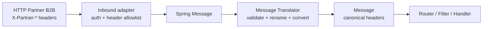
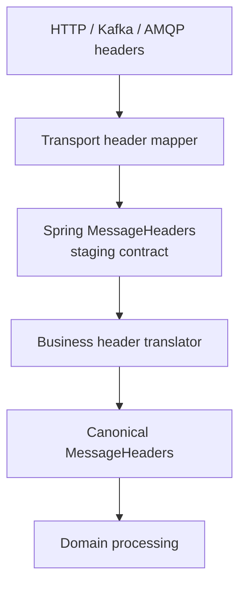
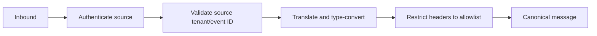
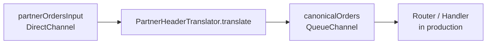
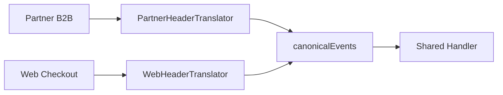
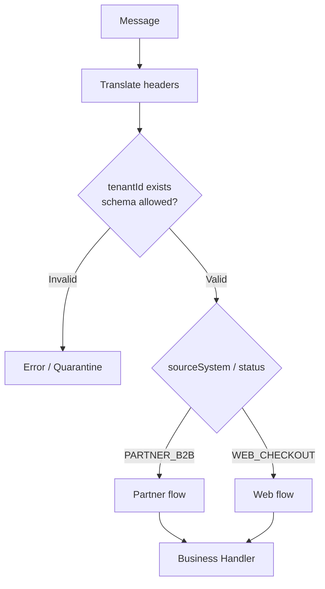
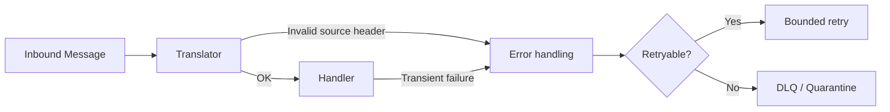
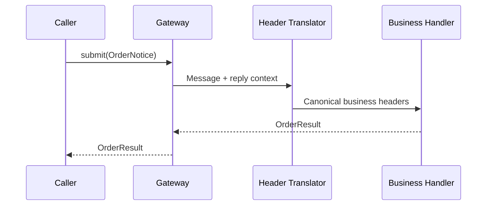
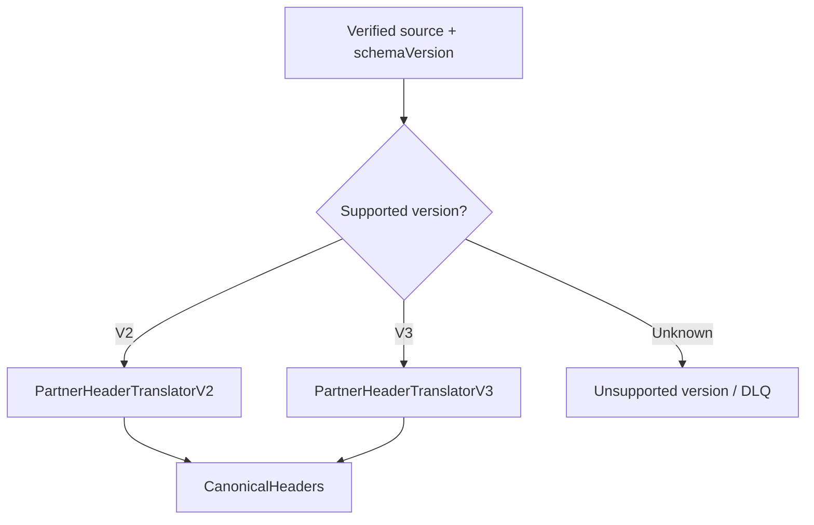

# Mapping Source System Headers to Target Headers with Message Translator in Spring Integration

> **Chapter:** Message translator  
> **Lesson:** Mapping source system headers to target headers  
> **Module:** `SPRING_INTEGRATION_PATTERN` — learn how to implement Enterprise Integration Patterns with Spring Integration, building loosely coupled and extensible message flows; practice Router, Filter, Transformer, Splitter, Aggregator, Gateway, retry, error channel, correlation, and testing processing branches.
>
> **Lesson goal:** translate the **header contract** from the source system to the internal/target contract explicitly, safely, and testably. This lesson distinguishes *message translation*, *adapter header mapping*, *header enrichment*, and *envelope serialization*.

## 1. The problem: same semantics, different header names

A service receives order update events from a partner. The partner sends HTTP headers using its own naming:

```http
POST /partner/orders HTTP/1.1
Content-Type: application/json
X-Partner-Tenant: shop-01
X-Partner-Correlation-Id: batch-2026-11-21-A
X-Partner-Event-Id: evt-901
X-Partner-Event-Time: 2026-11-21T15:30:00+07:00
X-Partner-Schema-Version: 2
X-Partner-Retry-Count: 1

{"orderId":"ORD-101","status":"PAID"}
```

Internally, Routers/Service Activators/Idempotent Receivers want a consistent set of metadata:

```text
tenantId                = shop-01
sourceSystem            = PARTNER_B2B
businessCorrelationId  = PARTNER_B2B:batch-2026-11-21-A
sourceEventId           = evt-901
sourceOccurredAt        = 2026-11-21T08:30:00Z (Instant)
sourceSchemaVersion     = 2 (integer)
sourceAttempt           = 1 (integer, audit only)
```

The business payload `OrderNotice(orderId="ORD-101", status="PAID")` does not need to change. **The main job is translating metadata semantics at the header layer**.



### Errors that appear when mapping ad hoc

- The Router looks for `tenantId` but receives `X-Partner-Tenant`, so no route matches.
- The partner's correlation ID is confused with the Aggregator's group ID.
- `"1"` is kept as a string while the handler expects an integer.
- A `+07:00` timestamp string is treated as UTC, shifting by seven hours.
- A caller spoofs `X-Partner-Tenant` to access another tenant.
- The partner's `Authorization` header or token gets copied to a downstream broker.
- Two different sources both emit `evt-901` and are wrongly deduplicated without a namespace.
- A Gateway reply channel disappears or is copied across transport where it is no longer valid.
- Duplicate deliveries are recorded as new events because `MessageHeaders.id` is used as the event ID.

**A proper header translator must convert names as well as *meaning*, types, scope, and trust.**

## 2. Learning objectives

After this lesson, you will be able to:

1. Describe the Message Translator Pattern in integration architecture.
2. Distinguish payload transformation from **header/message envelope translation**.
3. Design a source → target mapping table with data types, policies, and owners.
4. Determine which headers to preserve, rename, convert in type, drop, or regenerate.
5. Distinguish partner-declared data from information authenticated at ingress.
6. Write a Message Translator using Java 17 and `MessageBuilder`.
7. Configure a Transformer in Spring Integration Java DSL.
8. Test happy paths, missing headers, tenant mismatches, and invalid timestamps/schemas/retries.
9. Test multiple sources and multiple threads without mixing metadata.
10. Preserve correlation, causation, idempotency, and group sequence across transports.
11. Handle errors, retries, Gateway, Filter/Router, and broker header mapping in a controlled manner.
12. Design observability, schema evolution, security, and production operations.

## 3. What does a Message Translator do?

In Enterprise Integration Patterns, a **Message Translator** converts a message from the **source system's format or contract** into a **format/contract understood by the target system**.

Differences can lie in:

- Payload structure.
- Data types.
- Header names and semantics.
- Envelope metadata.
- Encoding/serialization.
- Correlation info, IDs, timestamps, or source provenance.

In this lesson's example, **the payload stays unchanged while the header contract changes**:

```text
Source:
  payload: OrderNotice
  headers:
    X-Partner-Event-Id = "evt-901"
    X-Partner-Retry-Count = "1"

Target:
  payload: OrderNotice (unchanged)
  headers:
    sourceEventId = "evt-901"
    sourceAttempt = 1
```

Not every Message Translator has to mutate the payload. Changing a message contract can involve headers alone—as long as the target sees information matching the new contract.

### How does Message Translator differ from Adapter?

- **Adapter:** connects transport to a Spring Message, e.g., HTTP request → Spring Message.
- **Adapter header mapper:** maps transport headers into/out of `MessageHeaders`, with include/exclude rules and type conversions depending on the adapter.
- **Message Translator:** converts the **semantic contract between source and target**; it can sit after an adapter to validate and normalize.
- **Header Enricher:** adds/modifies headers on a Spring Message, typically keeping the payload.
- **Transformer:** framework mechanism/endpoint performing translation or any message transformation.
- **Envelope Wrapper:** embeds metadata into a serialized payload structure, rather than relying only on Spring Message headers.

In Spring Integration, a Message Translator is commonly implemented via a `Transformer` or by combining `Header Enricher` with `Header Filter`; there is no separate Java DSL operator named `.messageTranslator()`.

## 4. Two mapping layers that must not be collapsed into one

To clarify the distinction, split the pipeline into two layers:



### Layer 1: transport → message

HTTP header names are case-insensitive at the protocol level; Kafka and Spring Message have different naming/value rules. The inbound adapter must determine:

- Which headers are allowed in.
- Which headers are blocked as sensitive.
- Whether multi-valued transport headers pick one value or reject.
- Which values can be decoded from bytes to String.
- How names are normalized so downstream code does not depend on capitalization.
- Who is authorized to populate the **trusted principal/tenant** into the context.

### Layer 2: source contract → canonical contract

The business header translator must resolve:

- Is `X-Partner-Event-Id` used for event identity or request ID?
- Does `X-Partner-Correlation-Id` need a source namespace?
- Does `X-Partner-Event-Time` carry an offset or only local time?
- Is `X-Partner-Retry-Count` trustworthy enough to drive retries?
- Does `X-Partner-Schema-Version` version the source payload or the envelope?
- Does `X-Partner-Tenant` match the authenticated tenant?

This is **semantic translation**, not just renaming keys in a `Map`.

### Conventions for the Java examples

To keep the examples easy to test, the upcoming code blocks use **exact source names** such as `"X-Partner-Event-Id"` inside the Spring Message.

In a real HTTP application, the inbound adapter may normalize casing or value types before invoking the translator. **Verify your adapter contract and staging header configuration** rather than assuming every transport produces the exact string keys/values in the example. Headers such as `verifiedTenantId` are **internal metadata created by the security layer**, never copied from client-submitted HTTP headers.

## 5. Source → target mapping table

Design the mapping table before writing Java code:

| Source header | Target header | Target type | Rule |
| --- | --- | --- | --- |
| `X-Partner-Tenant` | `tenantId` | `String` | Required, compared against authenticated tenant |
| None: use ingress identity | `sourceSystem` | `String` | Set from trusted connection configuration |
| `X-Partner-Correlation-Id` | `businessCorrelationId` | `String` | Validate, prepend source namespace |
| `X-Partner-Event-Id` | `sourceEventId` | `String` | Required, stable across retries |
| `X-Partner-Event-Time` | `sourceOccurredAt` | `Instant` | Parse ISO offset, normalize to UTC |
| `X-Partner-Schema-Version` | `sourceSchemaVersion` | `Integer` | Accept only supported versions |
| `X-Partner-Retry-Count` | `sourceAttempt` | `Integer` | Audit only, bounded, does not control retry |
| `Authorization` | Not mapped | — | Do not forward credentials downstream |
| `Cookie` | Not mapped | — | Do not forward session tokens |
| `X-Forwarded-*` | Not mapped by default | — | Use only within trusted proxy chains |
| `traceparent` | Tracing context | Per protocol | Sanitize/validate via tracing component |
| `Content-Type` | Transport content type | Per adapter | Describes codec, never tenant/authority |

### Why is the correlation ID namespaced?

Two sources could both emit `X-Partner-Correlation-Id: batch-001`. If downstream groups or searches traces using the bare string, source A and source B could accidentally merge into one workflow.

A simple convention:

```text
sourceSystem = PARTNER_B2B
externalCorrelation = batch-2026-11-21-A

businessCorrelationId =
  PARTNER_B2B:batch-2026-11-21-A
```

This is an **illustrative convention**; if the system already has a coordinator-issued business correlation ID, use that ID instead of concatenating the source name. If strings may contain arbitrary delimiters or require cross-language keys, use canonical encoding or an ID registry to avoid collisions.

## 6. The header contract is part of the API

Like a JSON schema, a header contract must define:

- Exact field names and casing rules.
- Type after deserialization.
- Required vs. optional.
- Whether defaults are valid.
- Allowed values/versions.
- Maximum length and character set.
- Source of truth and trust level.
- Namespacing/uniqueness.
- Rules for dropping or redacting data.
- Backward compatibility on renames.
- Fail-fast, quarantine, or fallback when missing.

### Example: missing header, can it be defaulted?

`X-Partner-Retry-Count` can be optional. When missing, an example might set `sourceAttempt=0` per the **published contract**.

Conversely, a missing `X-Partner-Tenant` must not be filled from a payload tenant when the security layer needs to verify the source-declared tenant. You can reject it or apply a source policy deriving it from credentials, but **never guess**.

### Example: multiple values for the same name

HTTP can carry multiple header values for one name. If a partner sends:

```http
X-Partner-Tenant: shop-01
X-Partner-Tenant: shop-99
```

Do not arbitrarily pick the first or last entry. The inbound adapter/security layer should **reject ambiguity** for tenant/identity headers. Similarly, do not join multiple `X-Partner-Event-Id` values with commas and treat the result as a valid event ID.

## 7. Header categories that must be distinguished

| Category | Example | What to do? |
| --- | --- | --- |
| **Source business identity** | `X-Partner-Event-Id` | Validate, namespace if needed |
| **Source context** | `X-Partner-Correlation-Id` | Translate, preserve provenance |
| **Trusted security context** | `verifiedTenantId` | Rebuilt by ingress from principal |
| **Routing** | `eventType`, `partitionKey` | Validate, use in Router/adapter |
| **Tracing** | `traceparent` | Controlled by tracing processor |
| **Runtime framework** | `replyChannel`, `errorChannel` | Do not serialize arbitrarily |
| **Aggregator/Resequencer** | `correlationId`, `sequenceNumber` | Preserve group/window contract |
| **Delivery metadata** | broker redelivery count | Do not trust source retry count as substitute |
| **Secrets** | `Authorization`, API key | Do not include in canonical message |
| **Serialization metadata** | `contentType`, schema registry ID | Managed at codec/adapter |

### Do not turn untrusted input into a trusted source

If a client sends:

```http
verifiedTenantId: shop-admin
X-Partner-Tenant: shop-admin
```

the header `verifiedTenantId` cannot be trusted merely because of its name. The inbound gateway/filter **must strip all client-sent variants of protected names** and write authenticated info via a separate verified context.

Header translation is safe only when the **trust boundary** has been designed and tested beforehand.

## 8. Payload unchanged, headers changed: understanding the impact on Spring Message

A Spring Message consists of:

```java
org.springframework.messaging.Message<T> {
    T getPayload();
    MessageHeaders getHeaders();
}
```

When the translator builds a new message:

```text
Input Message<OrderNotice>
  payload: OrderNotice("ORD-101","PAID")
  headers:
    X-Partner-Event-Id: evt-901
    X-Partner-Tenant: shop-01
    ...

Output Message<OrderNotice>
  payload: OrderNotice("ORD-101","PAID")  (same value)
  headers:
    sourceEventId: evt-901
    tenantId: shop-01
    ...
```

**The Spring-generated Message ID/timestamp can change.** The business event ID must be an explicit field (`sourceEventId`), never inferred from `MessageHeaders.id`.

A translation can:

- Keep the payload value unchanged.
- Replace the entire header structure.
- Carry only allowlisted headers.
- Convert string → int/Instant.
- Add new metadata from a trusted context.
- Strip credentials or transport-only fields.

### Two translation styles

**In-place style (without actually mutating immutable headers):** build a new Spring Message with the existing payload and selected headers, without mutating the input `MessageHeaders`.

**Envelope style:** create `Message<Envelope<OrderNotice>>`, placing metadata inside the serialized body when consumers outside Spring cannot receive equivalent headers.

This lesson focuses on **header translation**. Envelope Wrapper is noted so you know when to move metadata into the body instead of relying solely on adapter header mapping.

## 9. How do Header Enricher and Message Translator work together?

Translation can be split into steps:

```text
Inbound Message
  -> Header Enricher: add verified source metadata
  -> Header Translator: rename/convert/validate source fields
  -> Header Filter: drop raw source headers
  -> Canonical Message
```

However, if a Header Enricher adds `tenantId` before `X-Partner-Tenant` is checked, one header can mask a mismatch. The right order must enforce **validation before trust promotion**.

Example:



For complex flows, a custom Transformer receiving the full `Message<?>` keeps mapping, validation, and allowlisting cleanly in one place. For simple mappings, configuring Header Enricher + Filter may be easier to maintain.

## 10. Pitfall: mapping everything with `copyHeaders`

A common anti-pattern:

```java
MessageBuilder.withPayload(input.getPayload())
    .copyHeaders(input.getHeaders())
    .setHeader("tenantId",
        input.getHeaders().get("X-Partner-Tenant"))
    .build();
```

Problems:

- Keeps every client-sent header, potentially including credentials or PII.
- Keeps both raw and canonical names, creating two sources of truth.
- Can preserve `replyChannel` or `errorChannel` that become invalid across transports.
- Can keep an old group `correlationId` while the target flow is creating a new group.
- Performs no type or required-field validation.
- New headers can collide with existing headers.
- Target becomes coupled to source implementation details.

**Default rule:** pick each allowed header (allowlist), verify its meaning, and build a new message. Keep infrastructure headers only when you know the exact scope where they remain valid and why downstream needs them.

### Yet do not break request-reply accidentally

If the translator sits **inside** a synchronous Gateway flow, building a new message that drops `replyChannel` can break the reply path, depending on topology and framework header propagation.

The solution is not copying all raw external headers. Instead, separate:

1. **Trusted internal framework headers** created by the adapter/gateway.
2. **Untrusted source headers** that must be translated or dropped.
3. **Portable business metadata** that must cross transports.

In a request-reply flow, preserving reply context should be tested explicitly at the proper boundary using appropriate API/adapter contracts. In this lesson's demo, output goes to a `QueueChannel` to avoid mixing business contracts with reply-channel lifecycles.

## 11. Decision matrix: keep, rename, or drop headers

| Field group | Action in translator | Condition |
| --- | --- | --- |
| Source tenant ID | Validate then map to `tenantId` | Matches authenticated tenant |
| Source event ID | Map to `sourceEventId` | Nonblank, stable |
| Source correlation | Validate + namespace | Never use as authorization |
| Source timestamp | Parse to `Instant` | Has explicit offset/timezone |
| Source schema version | Parse integer/allowlist | Consumer supports version |
| Source retry count | Parse bounded integer or default | Audit only |
| Source system | Derive from trusted ingress | Never trust client declaration |
| `Authorization`, `Cookie` | Drop | Never forward credentials |
| HTTP ingress `replyChannel` | Do not send to broker | Has separate reply routing protocol |
| Splitter `correlationId` | Keep if still in same group | Do not equate with business correlation |
| Trace context | Tracing component normalizes | Validate/sanitize at trust boundary |
| Unknown source header | Drop or quarantine per policy | Never copy by default |

### Ideal outcome

```text
Input headers: 12 fields (including 2 credential/transport headers)
Output headers: 7 canonical business fields + framework ID/timestamp

Removed:
  X-Partner-*
  Authorization
  Cookie
  client-supplied headers spoofing authenticated tenant
```

Note that `MessageHeaders.id` and `MessageHeaders.timestamp` still appear on the new Spring Message as framework-generated headers; "no raw headers" does not mean zero headers.

## 12. Designing the payload for the example: OrderNotice

The exercise intentionally keeps the payload small and immutable to focus on **mapping headers**, without mixing in the Normalizer lesson focused on payload transformation.

```java
package example.integration;

import java.util.Set;

public record OrderNotice(
    String orderId,
    String status
) {
    private static final Set<String> VALID_STATUSES =
        Set.of("CREATED", "PAID", "CANCELLED");

    public OrderNotice {
        if (orderId == null || orderId.isBlank()) {
            throw new IllegalArgumentException(
                "orderId must not be blank");
        }

        if (!VALID_STATUSES.contains(status)) {
            throw new IllegalArgumentException(
                "status is not supported");
        }
    }
}
```

Example inbound Spring Message:

```text
payload:
  OrderNotice("ORD-101", "PAID")

headers:
  X-Partner-Tenant          = "shop-01"
  X-Partner-Correlation-Id  = "batch-2026-11-21-A"
  X-Partner-Event-Id        = "evt-901"
  X-Partner-Event-Time      = "2026-11-21T15:30:00+07:00"
  X-Partner-Schema-Version  = "2"
  X-Partner-Retry-Count     = "1"
  verifiedTenantId         = "shop-01"
  verifiedSourceSystem     = "PARTNER_B2B"
```

The last two headers are **fixtures assuming the security layer created them**. Partners must not be allowed to set them directly. A real application uses an authenticated principal/connection/verified context at the adapter; it never accepts a header of the same name from the raw HTTP request.

### Why not put everything inside OrderNotice?

- The payload only needs `orderId/status` for the domain.
- Headers serve integration routing, tracing, and audit.
- The payload can be handled by a Handler unaware of the HTTP source.
- The Translator is easy to test with the same payload across many metadata cases.

If a real domain requires `tenantId` or `eventId` as part of a durable event contract, those fields can also live in the payload or envelope. **There is no rule that every ID must live only in headers.** This exercise focuses on header mapping, not prescribing an optimal schema for every domain.

## 13. Java 17: the PartnerHeaderTranslator class

The following class accepts `Message<OrderNotice>` under the source contract and returns `Message<OrderNotice>` under the canonical target contract.

Characteristics:

- Holds no per-message mutable state.
- Requires authenticated tenant and source context.
- Cross-checks source tenant against authenticated tenant.
- Validates length and character set for event/correlation IDs.
- Parses offset timestamp into `Instant`.
- Parses schema version and retry count into integers.
- Does not copy unknown, credential, or raw source headers.
- Performs no DB updates or network calls during translation.

```java
package example.integration;

import java.time.Instant;
import java.time.OffsetDateTime;
import java.util.Objects;
import java.util.Set;
import java.util.regex.Pattern;

import org.springframework.messaging.Message;
import org.springframework.messaging.support.MessageBuilder;

public final class PartnerHeaderTranslator {

    public static final String SOURCE_SYSTEM = "PARTNER_B2B";

    private static final Pattern TENANT_PATTERN =
        Pattern.compile("[A-Za-z0-9][A-Za-z0-9._-]{0,63}");

    private static final Pattern EXTERNAL_ID_PATTERN =
        Pattern.compile("[A-Za-z0-9][A-Za-z0-9._:-]{0,127}");

    private static final Set<Integer> SUPPORTED_SOURCE_SCHEMAS =
        Set.of(2);

    public Message<OrderNotice> translate(
            Message<OrderNotice> input) {

        Objects.requireNonNull(input, "input");

        String authenticatedTenant =
            requiredString(input, "verifiedTenantId");

        String verifiedSource =
            requiredString(input, "verifiedSourceSystem");

        if (!SOURCE_SYSTEM.equals(verifiedSource)) {
            throw new SecurityException(
                "Sender is not verified as PARTNER_B2B");
        }

        String sourceTenant =
            requiredString(input, "X-Partner-Tenant");

        requireMatches(
            authenticatedTenant, TENANT_PATTERN,
            "verified tenant");

        requireMatches(
            sourceTenant, TENANT_PATTERN,
            "X-Partner-Tenant");

        if (!authenticatedTenant.equals(sourceTenant)) {
            throw new SecurityException(
                "TENANT_MISMATCH");
        }

        String externalCorrelation = requireMatches(
            requiredString(
                input, "X-Partner-Correlation-Id"),
            EXTERNAL_ID_PATTERN,
            "X-Partner-Correlation-Id");

        String sourceEventId = requireMatches(
            requiredString(
                input, "X-Partner-Event-Id"),
            EXTERNAL_ID_PATTERN,
            "X-Partner-Event-Id");

        String sourceTimestamp =
            requiredString(input, "X-Partner-Event-Time");

        // Offset is required; do not guess server timezone.
        Instant occurredAt = OffsetDateTime
            .parse(sourceTimestamp)
            .toInstant();

        int schemaVersion = parseInteger(
            requiredString(
                input, "X-Partner-Schema-Version"),
            "X-Partner-Schema-Version");

        if (!SUPPORTED_SOURCE_SCHEMAS.contains(schemaVersion)) {
            throw new IllegalArgumentException(
                "UNSUPPORTED_SOURCE_SCHEMA_VERSION");
        }

        String retryCount = optionalString(
            input, "X-Partner-Retry-Count", "0");

        int sourceAttempt = parseInteger(
            retryCount, "X-Partner-Retry-Count");

        if (sourceAttempt < 0 || sourceAttempt > 20) {
            throw new IllegalArgumentException(
                "INVALID_SOURCE_ATTEMPT");
        }

        // Example of a namespaced contract.
        String correlation =
            SOURCE_SYSTEM + ":" + externalCorrelation;

        return MessageBuilder
            .withPayload(input.getPayload())
            .setHeader("tenantId", authenticatedTenant)
            .setHeader("sourceSystem", SOURCE_SYSTEM)
            .setHeader("businessCorrelationId", correlation)
            .setHeader("sourceEventId", sourceEventId)
            .setHeader("sourceOccurredAt", occurredAt)
            .setHeader("sourceSchemaVersion", schemaVersion)
            .setHeader("sourceAttempt", sourceAttempt)
            .build();
    }

    private static String requiredString(
            Message<?> message, String header) {

        Object value = message.getHeaders().get(header);

        if (!(value instanceof String text)
                || text.isBlank()) {
            throw new IllegalArgumentException(
                "MISSING_OR_INVALID_HEADER: " + header);
        }

        return text.trim();
    }

    private static String optionalString(
            Message<?> message,
            String header,
            String fallback) {

        Object value = message.getHeaders().get(header);

        if (value == null) {
            return fallback;
        }

        if (!(value instanceof String text)
                || text.isBlank()) {
            throw new IllegalArgumentException(
                "INVALID_HEADER: " + header);
        }

        return text.trim();
    }

    private static String requireMatches(
            String value,
            Pattern pattern,
            String field) {

        if (!pattern.matcher(value).matches()) {
            throw new IllegalArgumentException(
                "INVALID_HEADER_FORMAT: " + field);
        }

        return value;
    }

    private static int parseInteger(
            String value, String field) {

        try {
            // Allow ASCII decimals such as "0", "1", "2".
            if (!value.matches("[0-9]{1,4}")) {
                throw new NumberFormatException(
                    "Not an unsigned decimal integer");
            }

            return Integer.parseInt(value);
        } catch (NumberFormatException e) {
            throw new IllegalArgumentException(
                "INVALID_INTEGER_HEADER: " + field, e);
        }
    }
}
```

### Explaining the design decisions

**1. `verifiedSourceSystem` must match the bean configuration.** This class only handles the Partner B2B source. If a request from another source enters the channel by mistake, the method rejects it instead of attaching incorrect provenance.

**2. `X-Partner-Tenant` is never promoted directly to trusted `tenantId`.** It must match the tenant confirmed by the security layer.

**3. `sourceEventId` comes from the external event ID.** It remains stable across retries of the same logical event if the producer follows the contract; Spring Message ID is not used.

**4. `sourceOccurredAt` is an `Instant`**, not a display-dependent offset string. Consumers do not need to re-parse the source time.

**5. `sourceSchemaVersion` is an allowlisted integer**, not an arbitrary string header. Unsupported versions are detected early.

**6. `sourceAttempt` is for observability only.** Because the source can supply any retry count header, never use that value to disable internal retries or grant processing authority.

**7. The output contains only the 7 canonical business headers** set by the translator, plus Spring's `id`/`timestamp` framework headers. `Authorization`, `Cookie`, and raw `X-Partner-*` headers are not forwarded downstream.

**8. The class has no global mutable `currentTenant`/`currentCorrelation` fields.** It uses per-message local variables, making it thread-safe in multi-threaded tests provided collaborators are also thread-safe.

### Intentional limitations of the code

- Input assumes the adapter already produced **String-valued staging headers** with exact names/casing.
- Multi-valued HTTP headers, duplicate headers, byte arrays, and case-insensitive lookups must be handled/normalized at the adapter boundary.
- Real authentication is not implemented in the example.
- Invalid timestamps let the `OffsetDateTime.parse` exception propagate, which an error handler can map to `INVALID_SOURCE_TIMESTAMP`.
- Only schema version 2 is supported; V1/V3 require new mapping/version policies.
- Does not attempt to preserve `replyChannel`/`errorChannel` or technical `correlationId` from upstream.
- Does not create signed envelopes, retry policies, or transactional side effects.
- Not a JSON/Avro/Kafka serializer/deserializer.

## 14. Header translation as an independently testable transformation

The definition above can be viewed as a function:

```text
translate(
    OrderNotice payload,
    SourceHeaders,
    VerifiedIngressContext
) =
    OrderNotice payload,
    CanonicalHeaders
```

Key properties:

1. **Payload preservation:** output `OrderNotice` value equals input.
2. **Header normalization:** target names/types conform to the contract.
3. **Trust enforcement:** mismatched tenant/source is rejected.
4. **No leakage:** raw source headers and credentials never leak to output.
5. **Deterministic mapping:** identical input/context → identical canonical business header values.
6. **No global state:** interleaved messages A and B do not mix metadata.
7. **Fail closed:** missing IDs, wrong schema, or unparseable time → no canonical message produced.

Do not assert equality of **Spring-generated `MessageHeaders.id`** across two calls, because each new message can receive a new ID. Comparing **business headers** is what the translator guarantees.

## 15. Java DSL: wiring the Translator into a Spring Integration Flow

Use a `DirectChannel` as ingress and a `QueueChannel` as output for testing.



### Configuration

```java
package example.integration;

import org.springframework.context.annotation.Bean;
import org.springframework.context.annotation.Configuration;
import org.springframework.integration.channel.DirectChannel;
import org.springframework.integration.channel.QueueChannel;
import org.springframework.integration.config.EnableIntegration;
import org.springframework.integration.dsl.IntegrationFlow;
import org.springframework.messaging.MessageChannel;

@Configuration
@EnableIntegration
public class PartnerTranslationConfiguration {

    @Bean
    public MessageChannel partnerOrdersInput() {
        return new DirectChannel();
    }

    @Bean
    public QueueChannel canonicalOrders() {
        return new QueueChannel();
    }

    @Bean
    public PartnerHeaderTranslator partnerHeaderTranslator() {
        return new PartnerHeaderTranslator();
    }

    @Bean
    public IntegrationFlow translatePartnerOrderHeaders(
            PartnerHeaderTranslator translator) {

        return IntegrationFlow.from("partnerOrdersInput")
            .transform(translator, "translate")
            .channel("canonicalOrders")
            .get();
    }
}
```

### Why use `.transform(translator, "translate")`?

Spring Integration provides a Transformer endpoint capable of invoking a bean method to convert a message. Here the method takes `Message<OrderNotice>` and returns a new `Message<OrderNotice>` with target headers.

In a concrete project, verify the Java DSL overload and method invocation against your Spring Integration version. **This lesson did not run build/tests in STEP 4 NEW**; compilation and specialized QA belong to a later phase.

### Receiving via HTTP does not guarantee the input matches the contract

The example flow starts once headers are already values inside `MessageHeaders`. In production, an earlier stage usually runs:

```text
HTTP Inbound Gateway
  -> authenticate producer + tenant
  -> reject duplicate/ambiguous identity headers
  -> normalize header names and scalar values
  -> set verifiedTenantId / verifiedSourceSystem
  -> deserialize OrderNotice
  -> partnerOrdersInput
```

If the inbound gateway stores `List<String>` for a header, a translator expecting `String` will reject it. That is an **integration contract error** to fix at the adapter, rather than blindly calling `toString()` on every `Object`.

### Why use QueueChannel in tests?

`QueueChannel` allows `receive(timeout)` to inspect output messages. It is not a persistent broker by default, does not represent Kafka/AMQP ACKs, does not guarantee exactly-once delivery, and does not provide shared state across pods.

## 16. Unit test fixture: constructing a complete source Message

Test class for PartnerHeaderTranslator:

```java
package example.integration;

import static org.junit.jupiter.api.Assertions.*;

import java.time.Instant;

import org.junit.jupiter.api.Test;
import org.springframework.messaging.Message;
import org.springframework.messaging.support.MessageBuilder;

class PartnerHeaderTranslatorTest {

    private final PartnerHeaderTranslator translator =
        new PartnerHeaderTranslator();

    private OrderNotice notice() {
        return new OrderNotice("ORD-101", "PAID");
    }

    private Message<OrderNotice> validMessage() {
        return MessageBuilder.withPayload(notice())
            .setHeader("X-Partner-Tenant", "shop-01")
            .setHeader(
                "X-Partner-Correlation-Id",
                "batch-2026-11-21-A")
            .setHeader("X-Partner-Event-Id", "evt-901")
            .setHeader(
                "X-Partner-Event-Time",
                "2026-11-21T15:30:00+07:00")
            .setHeader("X-Partner-Schema-Version", "2")
            .setHeader("X-Partner-Retry-Count", "1")
            .setHeader("verifiedTenantId", "shop-01")
            .setHeader(
                "verifiedSourceSystem", "PARTNER_B2B")
            .build();
    }

    // Place the following @Test methods in this class.
}
```

**Note:** `verifiedTenantId` and `verifiedSourceSystem` here are **test fixtures**. A system with a real HTTP gateway must include integration/security tests proving clients cannot spoof them.

## 17. Happy-path unit test: field names and types

Add this method to `PartnerHeaderTranslatorTest`:

```java
@Test
void translatesPartnerHeadersIntoCanonicalContract() {
    Message<OrderNotice> input = validMessage();

    Message<OrderNotice> output =
        translator.translate(input);

    // Domain payload is unchanged.
    assertEquals(input.getPayload(), output.getPayload());

    // Source -> target mapping.
    assertEquals(
        "shop-01",
        output.getHeaders().get("tenantId"));

    assertEquals(
        "PARTNER_B2B",
        output.getHeaders().get("sourceSystem"));

    assertEquals(
        "PARTNER_B2B:batch-2026-11-21-A",
        output.getHeaders().get("businessCorrelationId"));

    assertEquals(
        "evt-901",
        output.getHeaders().get("sourceEventId"));

    assertEquals(
        Instant.parse("2026-11-21T08:30:00Z"),
        output.getHeaders().get("sourceOccurredAt"));

    assertEquals(
        Integer.valueOf(2),
        output.getHeaders().get("sourceSchemaVersion"));

    assertEquals(
        Integer.valueOf(1),
        output.getHeaders().get("sourceAttempt"));
}
```

### Bugs caught by this test

- Misnamed target headers.
- Timestamps left as `String` or with shifted offsets.
- Schema version left as string `"2"`.
- Retry count left as string `"1"`.
- Correlation missing the source namespace.
- Source system taken from an external value.
- Domain payload accidentally mutated by the Transformer.

### Do not compare message IDs

`MessageHeaders.id` is a runtime ID. When the Translator builds a new message, it can generate a new ID—this is not a bug, because the logical `sourceEventId` is the identity downstream uses for retries/deduplication.

## 18. Allowlist test: raw/secret headers must not be forwarded

Add sensitive headers and headers intentionally named to collide with canonical headers by the client:

```java
@Test
void translationDropsRawAndSensitiveHeaders() {
    Message<OrderNotice> source =
        MessageBuilder.fromMessage(validMessage())
            .setHeader("Authorization", "Bearer SECRET")
            .setHeader("Cookie", "session=SECRET")
            .setHeader("tenantId", "shop-admin")
            .setHeader(
                "businessCorrelationId",
                "SPOOFED-CORRELATION")
            .setHeader("X-Unknown-Debug", "untrusted")
            .build();

    Message<OrderNotice> output =
        translator.translate(source);

    // Trusted mapping wins; do not trust target headers
    // injected by the source.
    assertEquals(
        "shop-01", output.getHeaders().get("tenantId"));

    assertEquals(
        "PARTNER_B2B:batch-2026-11-21-A",
        output.getHeaders()
            .get("businessCorrelationId"));

    assertFalse(
        output.getHeaders().containsKey("Authorization"));
    assertFalse(
        output.getHeaders().containsKey("Cookie"));
    assertFalse(
        output.getHeaders().containsKey("X-Partner-Tenant"));
    assertFalse(
        output.getHeaders().containsKey("X-Partner-Event-Id"));
    assertFalse(
        output.getHeaders().containsKey("X-Unknown-Debug"));
}
```

### This test does not replace security at ingress

It proves the translator's **output allowlist**, not that an attacker cannot set `verifiedTenantId`. Dedicated tests at HTTP/AMQP/Kafka ingress must verify that trusted headers are derived from authenticated connections and client-supplied copies are stripped.

### Checking leakage at the outbound adapter layer

If the translator omits credentials while the outbound adapter attaches the service's own Authorization token, that may be intentional. Security rules must distinguish **source credentials that must never be forwarded** from **outbound credentials legitimately issued for the target service**.

## 19. Missing header tests: do not create bogus canonical messages

A common bug occurs when `null` is converted to the string `"null"` and used as an ID.

Add these tests:

```java
@Test
void missingSourceEventIdIsRejected() {
    Message<OrderNotice> source =
        MessageBuilder.fromMessage(validMessage())
            .removeHeader("X-Partner-Event-Id")
            .build();

    assertThrows(IllegalArgumentException.class, () ->
        translator.translate(source));
}

@Test
void blankCorrelationIdIsRejected() {
    Message<OrderNotice> source =
        MessageBuilder.fromMessage(validMessage())
            .setHeader("X-Partner-Correlation-Id", "  ")
            .build();

    assertThrows(IllegalArgumentException.class, () ->
        translator.translate(source));
}

@Test
void missingVerifiedTenantIsRejected() {
    Message<OrderNotice> source =
        MessageBuilder.fromMessage(validMessage())
            .removeHeader("verifiedTenantId")
            .build();

    assertThrows(IllegalArgumentException.class, () ->
        translator.translate(source));
}
```

One could argue that missing `verifiedTenantId` warrants `SecurityException` rather than `IllegalArgumentException`. In the illustrative class, `requiredString` throws `IllegalArgumentException` for missing headers; the error-handling layer should map this case to `MISSING_TRUST_CONTEXT` at the appropriate security severity.

### Required vs. optional must follow the contract

- `X-Partner-Event-Id` is required because downstream needs it for deduplication.
- `X-Partner-Correlation-Id` is required by the source under consideration.
- `X-Partner-Retry-Count` is optional because its absence means attempt 0.
- `verifiedTenantId` does not come from partner data; it is required from security ingress.

Never turn all fields optional just to avoid test failures. A canonical message missing essential identity can cause far worse downstream damage than rejecting early.

## 20. Tenant mismatch and source spoofing tests

Verify two separate cases: wrong tenant from the source, and a source not authorized for the handler.

```java
@Test
void mismatchedTenantIsRejected() {
    Message<OrderNotice> source =
        MessageBuilder.fromMessage(validMessage())
            .setHeader("X-Partner-Tenant", "shop-99")
            .build();

    assertThrows(SecurityException.class, () ->
        translator.translate(source));
}

@Test
void wrongVerifiedSourceIsRejected() {
    Message<OrderNotice> source =
        MessageBuilder.fromMessage(validMessage())
            .setHeader("verifiedSourceSystem", "UNKNOWN_SOURCE")
            .build();

    assertThrows(SecurityException.class, () ->
        translator.translate(source));
}
```

### Should tenant inside the payload also be checked?

The demo `OrderNotice` only has `orderId/status`. In real systems, the payload might contain `tenantId`, or `orderId` must be resolved against a database. If the payload contains a tenant differing from the verified tenant, **validate** it before any business effect; a header translator cannot detect contradictions against a field the payload lacks.

### Where should source system come from?

- Dedicated HTTP endpoint or per-partner credentials.
- Mutual TLS identity or API key mapping.
- Authenticated Kafka producer/topic ACLs.
- File-feed owner via ingestion configuration.
- Verified service-to-service identity.

Never trust a header like `X-Partner-Source: PARTNER_B2B` that any sender can populate.

## 21. Timestamp conversion and numeric header tests

### Event time: parsing with offset

```java
@Test
void offsetTimestampConvertsToSameInstant() {
    Message<OrderNotice> source =
        MessageBuilder.fromMessage(validMessage())
            .setHeader(
                "X-Partner-Event-Time",
                "2026-11-21T08:30:00Z")
            .build();

    Message<OrderNotice> output =
        translator.translate(source);

    assertEquals(
        Instant.parse("2026-11-21T08:30:00Z"),
        output.getHeaders().get("sourceOccurredAt"));
}
```

`2026-11-21T08:30:00Z` and `2026-11-21T15:30:00+07:00` represent the exact same `Instant`.

### Do not guess the timezone when offset is missing

```java
@Test
void timestampWithoutOffsetIsRejected() {
    Message<OrderNotice> source =
        MessageBuilder.fromMessage(validMessage())
            .setHeader(
                "X-Partner-Event-Time",
                "2026-11-21T15:30:00")
            .build();

    assertThrows(
        java.time.format.DateTimeParseException.class,
        () -> translator.translate(source));
}
```

This is a deterministic contract error and must not be retried indefinitely with the same input.

### Optional retry count

```java
@Test
void missingRetryHeaderDefaultsToZero() {
    Message<OrderNotice> source =
        MessageBuilder.fromMessage(validMessage())
            .removeHeader("X-Partner-Retry-Count")
            .build();

    Message<OrderNotice> output =
        translator.translate(source);

    assertEquals(
        Integer.valueOf(0),
        output.getHeaders().get("sourceAttempt"));
}
```

### Reject invalid numeric values

```java
@Test
void invalidRetryCountIsRejected() {
    Message<OrderNotice> source =
        MessageBuilder.fromMessage(validMessage())
            .setHeader("X-Partner-Retry-Count", "9999")
            .build();

    assertThrows(IllegalArgumentException.class, () ->
        translator.translate(source));
}

@Test
void unsupportedSchemaVersionIsRejected() {
    Message<OrderNotice> source =
        MessageBuilder.fromMessage(validMessage())
            .setHeader("X-Partner-Schema-Version", "3")
            .build();

    assertThrows(IllegalArgumentException.class, () ->
        translator.translate(source));
}
```

### Why not use `sourceAttempt` to count actual retries?

A partner-supplied value can be wrong, replayed, or fail to reflect broker deliveries. Internal retry policies must rely on **local retry context**, adapter-controlled broker redelivery metadata, or persisted operation state—never a client-declared header.

## 22. Mapping consistency and determinism

Given the same source message and verified context, translated business header values must match:

```java
@Test
void sameSourceMessageProducesSameBusinessMetadata() {
    Message<OrderNotice> source = validMessage();

    Message<OrderNotice> a = translator.translate(source);
    Message<OrderNotice> b = translator.translate(source);

    assertEquals(
        a.getHeaders().get("sourceEventId"),
        b.getHeaders().get("sourceEventId"));

    assertEquals(
        a.getHeaders().get("businessCorrelationId"),
        b.getHeaders().get("businessCorrelationId"));

    assertEquals(
        a.getHeaders().get("sourceOccurredAt"),
        b.getHeaders().get("sourceOccurredAt"));

    // Do not assert a.headers.id == b.headers.id.
}
```

### Why not use `Instant.now()` for event time?

If the translator receives the same event a minute later and sets `sourceOccurredAt` to `Instant.now()`, it alters the business metadata of the same logical event. Use the meaningful timestamp from the source contract.

If you want to measure processing time, use a **separate field**, such as `translatedAt` obtained from a `Clock`. Never include `translatedAt` in event identity or idempotency keys.

## 23. Integration test: Java DSL actually running the Translator

Unit tests calling the method directly do not verify Spring Integration wiring. Add a test using `PartnerTranslationConfiguration` from section 15.

```java
package example.integration;

import static org.junit.jupiter.api.Assertions.*;

import java.time.Instant;

import org.junit.jupiter.api.Test;
import org.springframework.beans.factory.annotation.Autowired;
import org.springframework.beans.factory.annotation.Qualifier;
import org.springframework.integration.channel.QueueChannel;
import org.springframework.messaging.Message;
import org.springframework.messaging.MessageChannel;
import org.springframework.messaging.support.MessageBuilder;
import org.springframework.test.annotation.DirtiesContext;
import org.springframework.test.context.junit.jupiter.SpringJUnitConfig;

@SpringJUnitConfig(PartnerTranslationConfiguration.class)
@DirtiesContext(
    classMode = DirtiesContext.ClassMode.AFTER_EACH_TEST_METHOD)
class PartnerHeaderTranslationFlowTest {

    @Autowired
    @Qualifier("partnerOrdersInput")
    private MessageChannel partnerInput;

    @Autowired
    @Qualifier("canonicalOrders")
    private QueueChannel canonicalOut;

    private Message<OrderNotice> partnerMessage(
            String tenant,
            String eventId,
            String correlationId,
            String orderId) {

        return MessageBuilder
            .withPayload(new OrderNotice(orderId, "PAID"))
            .setHeader("verifiedTenantId", tenant)
            .setHeader(
                "verifiedSourceSystem", "PARTNER_B2B")
            .setHeader("X-Partner-Tenant", tenant)
            .setHeader(
                "X-Partner-Correlation-Id", correlationId)
            .setHeader("X-Partner-Event-Id", eventId)
            .setHeader(
                "X-Partner-Event-Time",
                "2026-11-21T15:30:00+07:00")
            .setHeader("X-Partner-Schema-Version", "2")
            .setHeader("X-Partner-Retry-Count", "1")
            .build();
    }

    @Test
    void integrationFlowProducesCanonicalHeaders() {
        Message<OrderNotice> source =
            partnerMessage(
                "shop-01",
                "evt-901",
                "batch-2026-11-21-A",
                "ORD-101");

        assertTrue(partnerInput.send(source));

        Message<?> output = canonicalOut.receive(1_000);
        assertNotNull(output);
        assertEquals(source.getPayload(), output.getPayload());

        assertEquals(
            "shop-01", output.getHeaders().get("tenantId"));

        assertEquals(
            "PARTNER_B2B",
            output.getHeaders().get("sourceSystem"));

        assertEquals(
            "evt-901",
            output.getHeaders().get("sourceEventId"));

        assertEquals(
            Integer.valueOf(2),
            output.getHeaders().get("sourceSchemaVersion"));

        assertEquals(
            Instant.parse("2026-11-21T08:30:00Z"),
            output.getHeaders().get("sourceOccurredAt"));

        assertFalse(output.getHeaders()
            .containsKey("X-Partner-Event-Id"));

        assertNull(canonicalOut.receive(0));
    }
}
```

### Why use `@DirtiesContext`?

The test uses a `QueueChannel`, so tests need queue isolation. Recreating the context after each test keeps the learning example simple. For large suites, drain fixtures safely to reduce test runtime—never reset production state.

### What does this test prove?

- The channel delivers messages into the Transformer endpoint.
- The Transformer builds canonical headers.
- The output channel receives exactly one message for a valid input.
- The payload is unchanged and raw headers are not forwarded.

### What does it NOT yet prove?

- HTTP inbound gateway converts raw headers properly.
- Header keys are normalized over Kafka/AMQP.
- Security principals actually create trusted headers.
- Errors route to the error channel in an async topology.
- Outbound broker publish/ACK, retries, and transactions.
- Multiple pods processing the same logical event cleanly.

Those require separate test layers; do not treat `DirectChannel + QueueChannel` as full end-to-end verification.

## 24. Testing interleaved messages from the same source

A dangerous bug occurs when a translator stores mutable `currentTenant` or `currentCorrelation` fields on a singleton bean. When two messages interleave, A can end up with B's correlation.

```text
Input A:
  tenant=shop-01, event=evt-A, correlation=batch-A

Input B:
  tenant=shop-02, event=evt-B, correlation=batch-B

Expected A:
  shop-01 / evt-A / PARTNER_B2B:batch-A

Expected B:
  shop-02 / evt-B / PARTNER_B2B:batch-B
```

Add to `PartnerHeaderTranslationFlowTest`:

```java
@Test
void interleavedTenantsKeepIndependentMetadata() {
    var a = partnerMessage(
        "shop-01", "evt-A", "batch-A", "ORD-A");

    var b = partnerMessage(
        "shop-02", "evt-B", "batch-B", "ORD-B");

    var c = partnerMessage(
        "shop-01", "evt-C", "batch-C", "ORD-C");

    assertTrue(partnerInput.send(a));
    assertTrue(partnerInput.send(b));
    assertTrue(partnerInput.send(c));

    var byEvent = new java.util.HashMap<
        String, Message<?>>();

    for (int i = 0; i < 3; i++) {
        Message<?> result = canonicalOut.receive(1_000);
        assertNotNull(result);

        String eventId =
            (String) result.getHeaders().get("sourceEventId");

        assertNull(byEvent.put(eventId, result));
    }

    assertEquals(
        "shop-01",
        byEvent.get("evt-A").getHeaders().get("tenantId"));

    assertEquals(
        "shop-02",
        byEvent.get("evt-B").getHeaders().get("tenantId"));

    assertEquals(
        "PARTNER_B2B:batch-C",
        byEvent.get("evt-C").getHeaders()
            .get("businessCorrelationId"));
}
```

### In production, do not assert global ordering across sources

In the demo configuration, we send sequentially through a DirectChannel, but with an ExecutorChannel, Kafka partitions, or retries, output order across groups can change.

To test the contract properly, collect all results and **index by logical `eventId`** as shown, rather than relying on "the second output must be shop-02".

## 25. Concurrency test: three threads translating independently

To expose shared mutable state bugs, send three messages nearly simultaneously. Use `CountDownLatch` to synchronize the start point; avoid `Thread.sleep` timing guesses.

```java
@Test
void concurrentMessagesDoNotMixHeaderValues()
        throws Exception {

    var sources = java.util.List.of(
        partnerMessage(
            "shop-01", "evt-1", "batch-1", "ORD-1"),
        partnerMessage(
            "shop-02", "evt-2", "batch-2", "ORD-2"),
        partnerMessage(
            "shop-03", "evt-3", "batch-3", "ORD-3")
    );

    var executor = java.util.concurrent.Executors
        .newFixedThreadPool(3);

    var ready = new java.util.concurrent.CountDownLatch(3);
    var start = new java.util.concurrent.CountDownLatch(1);
    var futures = new java.util.ArrayList<
        java.util.concurrent.Future<?>>();

    try {
        for (Message<OrderNotice> source : sources) {
            futures.add(executor.submit(() -> {
                ready.countDown();

                if (!start.await(
                        5,
                        java.util.concurrent.TimeUnit.SECONDS)) {
                    throw new IllegalStateException(
                        "Concurrent start timeout");
                }

                assertTrue(partnerInput.send(source));
                return null;
            }));
        }

        assertTrue(ready.await(
            5, java.util.concurrent.TimeUnit.SECONDS));

        start.countDown();

        for (var future : futures) {
            future.get(5, java.util.concurrent.TimeUnit.SECONDS);
        }

        var byEvent = new java.util.HashMap<
            String, Message<?>>();

        for (int i = 0; i < sources.size(); i++) {
            Message<?> output = canonicalOut.receive(2_000);
            assertNotNull(output);

            String eventId = (String)
                output.getHeaders().get("sourceEventId");

            assertNull(byEvent.put(eventId, output));
        }

        for (int i = 1; i <= 3; i++) {
            Message<?> output =
                byEvent.get("evt-" + i);

            assertNotNull(output);

            assertEquals(
                "shop-0" + i,
                output.getHeaders().get("tenantId"));

            assertEquals(
                "PARTNER_B2B:batch-" + i,
                output.getHeaders()
                    .get("businessCorrelationId"));

            assertEquals(
                "ORD-" + i,
                ((OrderNotice) output.getPayload())
                    .orderId());
        }

        assertEquals(3, byEvent.size());
        assertNull(canonicalOut.receive(0));
    } finally {
        start.countDown();
        executor.shutdownNow();
    }
}
```

### Scope of guarantee

The test shows the translator is stateless with three concurrent messages inside **one JVM**. It does not prove:

- Multiple pods share identical trusted identity mapping.
- The broker delivers events exactly once.
- Shared deduplication state is synchronized.
- Authenticated headers cannot be spoofed.
- External errors/timeouts never cause duplicate effects.

A race test passing once also does not prove all scheduling interleavings are safe. Combine repeated/stress runs, static design review, and downstream effect tests.

## 26. Multiple source systems: avoid writing one omniscient translator

Suppose the system also receives Web Checkout events over Kafka:

```text
Partner B2B HTTP:
  X-Partner-Event-Id
  X-Partner-Correlation-Id
  X-Partner-Event-Time

Web Checkout Kafka:
  web.event_id
  web.order_trace
  web.occurred_at

Target:
  sourceEventId
  businessCorrelationId
  sourceOccurredAt
```

Instead of one method reading arbitrary headers and guessing the source, build **two contract-specific translators**:



### Two-source comparison table

| Canonical field | Partner B2B | Web Checkout | Notes |
| --- | --- | --- | --- |
| `sourceEventId` | `X-Partner-Event-Id` | `web.event_id` | Logical event identity |
| `tenantId` | Source tenant checked vs. auth | Authenticated user/tenant context | Never trust raw claim |
| `sourceSystem` | `PARTNER_B2B` | `WEB_CHECKOUT` | Set at ingress |
| `businessCorrelationId` | Partner batch ID | Web order trace | Separate namespace/contract |
| `sourceOccurredAt` | Offset string | UTC epoch millis | Must parse accurately |
| `sourceSchemaVersion` | `"2"` | `3` | Per source schema |
| `sourceAttempt` | `X-Partner-Retry-Count` | Broker/producer metadata | Audit only, do not equate |

### A common interface decouples downstream from the source

You can define an interface/domain model for translators:

```java
public interface SourceHeaderTranslator<P> {
    org.springframework.messaging.Message<P> translate(
        org.springframework.messaging.Message<P> input);
}
```

Each bean implementation performs source-specific schema validation, then produces the same canonical field names.

An interface is not mandatory if two sources have vastly different payload types or APIs. **Consistency lies in the target contract**, not necessarily in a class hierarchy.

### Source versioning

If Partner V3 renames `X-Partner-Correlation-Id`, do not silently read both headers and prefer whichever happens to appear. Instead:

- Keep a separate V2 translator.
- Create a V3 translator.
- Use authenticated source + negotiated schema version to pick the mapping.
- Test V2/V3 and the conflict case when both headers appear together.
- Retire V2 only after the replay/retention window closes.

## 27. Are header names case-sensitive?

The answer depends on the **stage**:

- HTTP header names are case-insensitive by protocol.
- Spring `MessageHeaders` is a key-based map and you should not assume differently cased keys automatically equate.
- Kafka record headers have different semantics from HTTP and can contain multiple values for the same key.
- AMQP properties/headers and Jackson converters follow their own conventions.

Therefore, if an HTTP source sends:

```http
x-partner-event-id: evt-901
```

while current translator code reads:

```java
input.getHeaders().get("X-Partner-Event-Id");
```

then the adapter must normalize the key properly, or the translator must use a consistent **staging header contract**, rather than guessing.

### One adapter-normalization approach

```text
HTTP raw headers (case-insensitive)
  -> reject duplicate identity headers
  -> extract exactly one approved value
  -> write staged Spring header "X-Partner-Event-Id"
  -> PartnerHeaderTranslator
```

To avoid coupling to raw HTTP names, you can use staging names like:

```text
source.partner.tenant
source.partner.eventId
source.partner.correlationId
source.partner.eventTime
```

and update the translator to read those names. **No single pattern fits every adapter automatically**; the contract must be documented and tested against the actual transport.

### When a header is `byte[]`

A Kafka adapter may supply bytes. Do not write:

```java
String value = input.getHeaders().get("eventId").toString();
```

because `byte[].toString()` yields an object descriptor string instead of decoding bytes. Decode with the agreed charset/codec at the transport adapter, reject invalid byte sequences, and enforce length limits.

## 28. Header mapping when sending outbound to another system

Translation is often bidirectional:

```text
Inbound:  Partner headers -> Canonical headers
Outbound: Canonical headers -> Target contract
```

Suppose the Legacy Fulfillment target requires:

```text
X-Legacy-Client     = tenantId
X-Legacy-Request-Id = sourceEventId
X-Legacy-Batch      = businessCorrelationId
X-Legacy-Time       = sourceOccurredAt as UTC ISO-8601
```

### Outbound mapping

| Canonical header | Legacy target | Transformation |
| --- | --- | --- |
| `tenantId` | `X-Legacy-Client` | String, authorization verified |
| `sourceEventId` | `X-Legacy-Request-Id` | Stable logical ID |
| `businessCorrelationId` | `X-Legacy-Batch` | Per target length/encoding |
| `sourceOccurredAt` | `X-Legacy-Time` | `Instant.toString()` |
| `sourceSchemaVersion` | Not needed | Drop |
| `sourceAttempt` | Not needed | Drop |
| `sourceSystem` | `X-Legacy-Origin` if required by contract | Whitelist |

With an HTTP outbound gateway, the **outbound header mapper** is responsible for placing values into HTTP request headers. If the target requires a JSON envelope instead of headers, build the corresponding envelope body.

### Avoid broken round-trips

```text
Partner -> Canonical -> Legacy -> Canonical
```

Do not assume bidirectional translation is a lossless inverse. Some fields are dropped, schema versions differ, and precision may change. Document **lossy fields** explicitly in mapping tables and regression tests.

## 29. Correlation, causation, and group headers

Three kinds of correlation are easily conflated:

| Type | Example | Purpose |
| --- | --- | --- |
| **Business correlation** | `PARTNER_B2B:batch-A` | Links workflow events |
| **Request/reply correlation** | `request-123` | Routes reply back to caller |
| **Aggregator group correlation** | `group-77` | Groups exact child messages |
| **Causation ID** | `evt-previous` | Event directly causing the current event |

In the example, `X-Partner-Correlation-Id` translates to `businessCorrelationId`. **Do not blindly map it to the Aggregator's `correlationId`**.

### When is a separate group correlation needed?

If a Splitter splits `OrderNotice` into lines:

```text
Message group key = split-group-77
Child #1 sequenceNumber=1/3
Child #2 sequenceNumber=2/3
Child #3 sequenceNumber=3/3
```

`businessCorrelationId=PARTNER_B2B:batch-A` may be shared across multiple order events, whereas the Splitter's `correlationId` identifies an exact message group.

### Losing technical headers when building a new Message

`PartnerHeaderTranslator` intentionally builds a new message containing only canonical business headers. Placing it **between a Splitter and an Aggregator** without care can strip `correlationId` and sequence headers, preventing the Aggregator from completing the group.

Safe placements depending on topology:

1. Place the translator at **ingress before the Splitter**; the Splitter then generates fresh group headers.
2. Place the translator **after the Aggregator**, before the outbound target.
3. If the translator must sit in between, maintain an **explicit allowlist** for trusted internal `correlationId`/`sequenceNumber`/`sequenceSize`, validated as originating from the internal Splitter.
4. When crossing a broker, put group identity/sequence into versioned protocol fields and reconstruct headers after inbound validation.
5. For content-based aggregation, use a custom `CorrelationStrategy` reading canonical payload/verified metadata along with a dedicated `ReleaseStrategy`.

**Do not copy all source headers just to keep one correlation header.**

## 30. Filter and Router using canonical headers

After translation, endpoints no longer need to know how the source named its headers.



### Routing based on canonical headers

Illustrative flow fragment:

```java
IntegrationFlow routeByTrustedSource() {
    return IntegrationFlow.from("canonicalEvents")
        .route(
            message -> message.getHeaders()
                .get("sourceSystem", String.class),
            spec -> spec
                .channelMapping(
                    "PARTNER_B2B", "partnerHandlerChannel")
                .channelMapping(
                    "WEB_CHECKOUT", "webHandlerChannel"))
        .get();
}
```

This is a fragment; channels must be declared, and Java DSL overloads must be verified against your Spring Integration version.

### Filter does not replace security

A Filter checking `tenantId` to route to the right target does not authenticate the principal. The security layer must establish the trusted tenant before translation, and business handlers continue enforcing resource/action authorization as needed.

### Unknown route

A `sourceSystem` outside the allowlist needs a default/error route with a clear reason. Do not silently discard events whose processing must be guaranteed.

### Do not turn retry count into a business routing rule

For instance, do not route `sourceAttempt > 3` to a DLQ solely based on a source-declared number. Use middleware-controlled retry state along with dedicated backoff and circuit-breaker policies.

## 31. Header translation and Idempotent Receiver

The same logical event can arrive in two distinct Spring Messages:

```text
Delivery 1:
  Spring Message ID = UUID-A
  sourceEventId = evt-901

Delivery 2:
  Spring Message ID = UUID-B
  sourceEventId = evt-901
```

An Idempotent Receiver must not use `MessageHeaders.id` as its key; it needs a stable business event/operation key.

Example:

```text
IdempotencyKey(
    tenantId = shop-01,
    sourceSystem = PARTNER_B2B,
    sourceEventId = evt-901,
    operation = APPLY_ORDER_NOTICE
)
```

If another service also emits `evt-901`, including `sourceSystem` prevents collisions. If the same order effect can arrive from **two sources with two different event IDs**, add a business unique constraint keyed by order/action.

### Header mapping alone does not guarantee exactly-once

The Translator only supplies clean metadata. You still need:

- Atomic claims / unique constraints.
- Business transactions or an outbox.
- Deduplication / processing state.
- Retry / replay policies.
- Completion records / retention.
- Reconciliation when external API side effects have uncertain outcomes.

If an event translates into a valid canonical message and gets redelivered multiple times, merely having `sourceEventId` does not stop handlers from re-running; the Idempotent Receiver must actively enforce it.

## 32. Retry and error channel: never equate `sourceAttempt` with local delivery count

Failure flow diagram:



### Error classification

| Error | Example | Retry? |
| --- | --- | --- |
| Missing required event ID | Blank `X-Partner-Event-Id` | No, unless producer fixes it |
| Invalid timestamp | Missing offset / unparseable | No with the same payload |
| Unsupported schema version | V3 when only V2 is supported | Requires code/contract upgrade |
| Tenant mismatch | Verified tenant differs from source | No; security incident |
| Unknown source | Verified source not permitted | No; reject |
| Untrusted/repeated identity header | Two tenant values | No; adapter rejects |
| DB timeout after translation | Store temporarily unreachable | Retryable |
| Broker connection failed | Cannot publish to target | Retry/outbox per policy |
| External API result unknown | Timeout after request | Reconcile before blind retry |
| Duplicate completed | Event already processed | Replay result/ACK per contract |

### `DirectChannel` and `errorChannel`

In a synchronous flow like the example, an exception from the Transformer propagates back to the thread calling `send(...)`. When a flow introduces a queue/executor or inbound adapter, errors can be wrapped into an `ErrorMessage` and routed to a configured `errorChannel`.

Never assume all Java exceptions automatically reach the global error channel. Tests must verify **which endpoint** catches errors, where retry advice sits, and whether the error flow can ACK/requeue.

### Retries can change the Spring Message ID

If an adapter/producer creates a new Message on retry, `MessageHeaders.id` changes. The `sourceEventId` contract must remain stable to prevent duplicate effects. Likewise, `sourceOccurredAt` reflects the business event time, never replaced by the retry timestamp.

## 33. Gateway request-reply: preserving reply context

Suppose a client invokes a Gateway to process an order:



**A Message Translator can break a reply flow** if it constructs a new Spring Message and drops a technical header the Gateway needs.

### Two boundaries to distinguish

**Inbound from an untrusted network:** do not copy a client's raw `replyChannel`. Any internal-looking header sent by the client must not be trusted.

**Internal requests already created by a Spring Gateway:** you may need to retain trusted reply/error headers along the current pipeline, or use a flow design where the framework manages correlation/reply destinations separately.

Options:

- Use a payload transformer + Header Enricher modifying only business headers, letting the framework manage the reply channel.
- Custom translator supporting an **explicit internal header allowlist** after verifying a trusted origin.
- Use an adapter/gateway protocol with request IDs and reply destinations when crossing a broker.
- Place the translator before Gateway request creation or at a boundary where reply context does not need copying.
- Test request-reply end-to-end, including timeouts and late replies.

Never put `replyChannel` into a JSON envelope expecting another service to invoke that channel object.

### Request ID differs from business correlation

Two callers might query the same `orderId` using two distinct request IDs. `businessCorrelationId=order:ORD-101` is insufficient to route the reply to the right caller. Use a dedicated request/reply correlation with its own lifecycle and timeout.

### What should a duplicate request return?

If a Gateway/HTTP caller resends the same idempotency key after the effect already committed, a well-designed system returns the **stored result** rather than dropping the message and letting the caller time out. The header translator does not perform response replay itself; it normalizes the IDs that layer requires.

## 34. Adapter contract tests: testing at HTTP/broker boundaries

The unit tests above construct Spring Messages directly with normalized header names. Real inputs arrive from the network, where additional details matter:

- HTTP header names can arrive with varying casing.
- A single header can appear multiple times.
- Header values may contain newlines or abnormally long strings if proxies/adapters mishandle them.
- Kafka header bytes must be decoded.
- AMQP properties have data types distinct from HTTP strings.
- Auth context must come from credentials/connections, not raw headers.
- Proxies may append `X-Forwarded-For`, and not every proxy is trustworthy.

### Ingress test matrix

| Source input | Expected adapter result |
| --- | --- |
| `X-Partner-Event-Id: evt-1` | Staged field with single string value `evt-1` |
| `x-partner-event-id: evt-1` | Same semantics as the HTTP header above |
| Two different `X-Partner-Tenant` values | Reject ambiguous identity |
| Missing tenant header while credential carries tenant | Per policy: reject or derive from credential, never guess |
| Client sends `verifiedTenantId` | Strip/reject; security layer builds context |
| Client sends `Authorization` | Used to authenticate, never forwarded downstream |
| Header exceeds length limit | Reject before business translation |
| Timestamp without offset | Structured invalid header error |
| Schema version unauthorized for producer | Unsupported/forbidden schema |
| Invalid Kafka header bytes | Reject/quarantine; never call `toString()` |
| Wrong message content type | Parser/adapter error before translator |
| HTTP proxy adds unusual tracing header | Tracing processor validates/sanitizes |

### How do contract tests differ from unit tests?

**Unit tests** verify `PartnerHeaderTranslator.translate` against `MessageHeaders` already in the expected shape.

**Adapter contract tests** prove that raw network records actually get converted into **that exact shape** and all sensitive/untrusted values are stripped or isolated.

Illustrative test outline:

```java
// Pseudocode: depends on the application's actual HTTP inbound gateway and
// security adapter.
@Test
void httpHeaderCaseAndAuthenticationAreNormalized() {
    // Given: request authenticated as shop-01.
    // Raw header: "x-partner-event-id: evt-901"
    // Raw header: "X-Partner-Tenant: shop-01"
    //
    // When: received through HTTP gateway, security layer,
    // staging header mapper, and PartnerHeaderTranslator.
    //
    // Then:
    //   sourceEventId = "evt-901"
    //   tenantId = "shop-01"
    //   sourceSystem = "PARTNER_B2B"
    //   Authorization/Cookie/raw headers do not reach target.
}
```

This is a **contract test outline**, not self-running fixture code. Do not claim HTTP case folding is verified just by calling `MessageBuilder` inside the JVM.

## 35. Outbound adapter: do not copy canonical headers verbatim

After the translator, canonical headers might look like:

```text
tenantId             = shop-01
sourceSystem         = PARTNER_B2B
businessCorrelationId = PARTNER_B2B:batch-A
sourceEventId        = evt-901
sourceOccurredAt     = Instant(2026-11-21T08:30:00Z)
sourceSchemaVersion  = 2
sourceAttempt        = 1
```

If the target expects HTTP headers like `X-Legacy-Time`, the outbound adapter must serialize `Instant` into a string per the contract. Never pass a raw Java `Instant` object into a header assuming every HTTP library formats it identically.

### A pure Java outbound translator

```java
package example.integration;

import java.time.Instant;
import java.util.LinkedHashMap;
import java.util.Map;

import org.springframework.messaging.Message;

public final class LegacyOutboundHeaderMapper {

    public Map<String, String> toLegacyHeaders(
            Message<?> canonical) {

        var h = canonical.getHeaders();

        String tenant =
            h.get("tenantId", String.class);

        String eventId =
            h.get("sourceEventId", String.class);

        String correlation =
            h.get("businessCorrelationId", String.class);

        Instant occurredAt =
            h.get("sourceOccurredAt", Instant.class);

        if (tenant == null || eventId == null
                || correlation == null || occurredAt == null) {
            throw new IllegalArgumentException(
                "Missing canonical outbound header");
        }

        Map<String, String> result = new LinkedHashMap<>();

        result.put("X-Legacy-Client", tenant);
        result.put("X-Legacy-Request-Id", eventId);
        result.put("X-Legacy-Batch", correlation);
        result.put("X-Legacy-Time", occurredAt.toString());

        return Map.copyOf(result);
    }
}
```

This code builds a **map for the target contract**, not a fully configured Spring HTTP outbound gateway. In production, the adapter must define the HTTP method, destination allowlist, service-specific authentication, response mapping, timeouts, and idempotent retries.

### Testing outbound mapping

```java
@Test
void legacyOutboundHeadersHaveTargetNamesAndUtcTime() {
    Message<OrderNotice> canonical =
        new PartnerHeaderTranslator().translate(
            validMessage());

    Map<String, String> target =
        new LegacyOutboundHeaderMapper()
            .toLegacyHeaders(canonical);

    assertEquals(
        "shop-01",
        target.get("X-Legacy-Client"));

    assertEquals(
        "evt-901",
        target.get("X-Legacy-Request-Id"));

    assertEquals(
        "2026-11-21T08:30:00Z",
        target.get("X-Legacy-Time"));

    assertFalse(target.containsKey("Authorization"));
    assertFalse(target.containsKey("Cookie"));
    assertEquals(4, target.size());
}
```

If adding this test to `PartnerHeaderTranslatorTest`, import `java.util.Map` and reuse the existing `validMessage()` fixture.

### Mapping can be lossy

Legacy output omits `sourceAttempt` and `sourceSchemaVersion`. This is valid when the target does not need them, but must be documented because reverse translation cannot recover dropped fields.

Between teams, maintain a **lossy mapping** table to prevent false expectations that every round-trip is an identity operation.

## 36. Schema evolution: when the source renames or changes header types

A seemingly small change can break integration:

```text
Partner V2:
  X-Partner-Event-Id   = "evt-901"
  X-Partner-Event-Time = "2026-11-21T15:30:00+07:00"

Partner V3:
  X-Event-Key          = "evt-901"
  X-Occurred-Millis    = "1795249800000" (epoch milliseconds UTC)
```

**Note:** the milliseconds value above was computed for `2026-11-21T08:30:00Z`; in real code, convert using time libraries rather than hand-calculating epoch numbers. When converting seconds to milliseconds, verify units and guard against overflow.

V3 changed both the header name and timestamp unit. Updating only the header name while keeping `OffsetDateTime.parse` will fail or corrupt data.

### Versioned translators

One solution:



Principles:

1. Determine the version via a controlled protocol/registry.
2. Maintain a version allowlist for that producer.
3. Run V2 and V3 concurrently during migration.
4. Test canonical fields for each version.
5. When both old and new headers appear together, define a clear conflict policy.
6. Never fall back from any version to V2 just because a few fields happen to parse.
7. Retire V2 only after the replay window expires or a DLQ migration path exists.

### Compatible changes vs. breaking changes

| Change | Potentially compatible? | Requirement |
| --- | --- | --- |
| Add optional correlation extension | Yes, if consumers safely ignore unknown fields | Define optional/default |
| Rename required header | Usually breaking | Versioned mapper |
| Change retry count from text to number | Potentially breaking | Adapter type contract |
| Change epoch seconds to millis | Semantically breaking | Explicit unit + tests |
| Change event ID uniqueness scope | Breaking for deduplication | Migration/idempotency plan |
| Change default timezone | Breaking for time semantics | Versioned policy |
| Add optional target header | Potentially | Security allowlist review |
| Drop source tenant claim | Security-impacting | Policy with authenticated identity |

## 37. Security: header mapping is a trust boundary

Headers are easily dismissed as "harmless" metadata, yet they can affect access control and routing.

### Risks

**Spoofed tenant:** an attacker sends `X-Partner-Tenant: shop-admin` to gain processing access to another tenant's objects.

**Spoofed source:** sending `verifiedSourceSystem: PARTNER_B2B` from a regular client.

**Header injection:** correlation strings containing newlines or control characters, causing log injection or corrupting HTTP header serialization.

**Credential leakage:** copying `Authorization`/`Cookie` into a Kafka message visible to many consumers.

**Confused deputy:** a Router trusts a self-declared `sourceSystem` to invoke a higher-privileged handler.

**Cross-service tracing abuse:** blindly copying `traceparent`/baggage can bloat tracing metadata or attach traces to unintended workflows.

**Header collision:** input contains both `tenantId=shop-admin` and `X-Partner-Tenant=shop-01`; if handlers read the wrong header, authorization outcomes diverge.

### Defense in depth

- Authenticate before translating.
- Strip protected header names from raw sources.
- Derive canonical tenant/source from verified principal/connection.
- Validate source claims against verified identity.
- Forward only contract-approved fields.
- Limit length and character sets on IDs.
- Use schema/type allowlists for serialized metadata.
- Avoid logging sensitive raw values.
- Never use header-derived claims as credentials.
- Enforce separate resource/action authorization in downstream handlers.
- Test multi-tenant data isolation end-to-end.

### Not every header can be client-verified

`businessCorrelationId` is useful for tracing, not as proof of authorization. `sourceEventId` supports deduplication but still requires source authentication. `sourceAttempt` is just a source-declared number, not a security directive or reliable retry budget.

## 38. Tracing and observability: visibility into both source and target contracts

A translator should emit logs and metrics per **translation outcome** without logging entire messages.

Structured log example:

```text
stage=HEADER_TRANSLATION_STARTED
sourceSystem=PARTNER_B2B
sourceSchemaVersion=2
sourceEventId=evt-901

stage=HEADER_TRANSLATION_SUCCEEDED
sourceSystem=PARTNER_B2B
sourceEventId=evt-901
targetContract=CanonicalOrderHeadersV1
businessCorrelationId=PARTNER_B2B:batch-2026-11-21-A

stage=HEADER_TRANSLATION_REJECTED
sourceSystem=PARTNER_B2B
reasonCode=TENANT_MISMATCH
messageReference=ingress:...
```

This is illustrative logging; Spring Integration does not emit these exact lines automatically merely because a Transformer exists.

### Useful metrics

| Metric | Meaning |
| --- | --- |
| `headers.translate.received` | Source messages entering translator |
| `headers.translate.succeeded` | Messages producing canonical headers |
| `headers.translate.failed` | Mapping failures |
| `headers.translate.latency` | Translation duration |
| `headers.translate.missing_required` | Missing required header |
| `headers.translate.invalid_type` | Wrong value type / invalid numeric |
| `headers.translate.invalid_timestamp` | Unparseable timestamp |
| `headers.translate.invalid_version` | Unsupported source schema |
| `headers.translate.tenant_mismatch` | Security/context mismatch |
| `headers.translate.unknown_source` | Unrecognized producer/route |
| `headers.translate.dropped_headers` | Raw headers dropped by policy |
| `headers.translate.outbound_failed` | Target mapping/serialization failure |
| `integration.error_backlog` | Failed messages awaiting handling |
| `integration.retry_count` | Actual retries in middleware |

Labels should have low, bounded cardinality such as `sourceSystem`, `sourceSchemaVersion`, `reasonCode`, and `targetSystem`. Never use `sourceEventId`, `orderId`, or `businessCorrelationId` as metric labels due to high cardinality.

### Distinguish milestones

```text
INGRESS_ACCEPTED:
  Transport adapter accepted input.

TRUST_VERIFIED:
  Producer/tenant authenticated.

HEADERS_TRANSLATED:
  Source metadata mapped per contract.

BUSINESS_PROCESSED:
  Handler executed and completed logic.

BUSINESS_COMMITTED:
  Side effect committed/persisted.

OUTBOUND_ACKNOWLEDGED:
  Target transport acknowledged per protocol.
```

A successfully translated message **does not mean** the DB committed, the target received it, or the Gateway returned a reply. Track each milestone separately.

## 39. Performance and operations: even small headers can cause issues

Header translation is usually cheaper than parsing large payloads, yet high-throughput pipelines still need controls:

- Per-message timestamp and regex parsing.
- Header count per message.
- Size of correlation IDs and tracing baggage.
- Number of registered sources and mappings.
- Header serialization cost for Kafka/AMQP.
- Excessive logging on the happy path.
- Backpressure during source traffic bursts.
- Error loops caused by malformed inputs retried continuously.

### Resource protection

- Enforce max header bytes/count at ingress if the adapter supports it.
- Cap the length of each ID inside the translator.
- Use bounded executors and queues.
- Rate-limit per authenticated producer.
- Never log whole headers since they may contain secrets.
- Avoid network lookups per header translation unless truly required.
- Cache immutable, properly versioned mappings.
- Never share mutable mapping state across tenants.
- Route deterministic errors to quarantine instead of infinite retries.

### When to use config mapping instead of code?

If you only rename a few already-trusted String headers, Spring Integration `Header Enricher` and `Header Filter` may suffice.

If you need:

- Cross-checking tenant authorization.
- Parsing offset timestamps.
- Strict schema versioning.
- Handling collisions/provenance.
- Type conversion and structured errors.

then a custom Translator keeps the contract clear, easy to unit test, and easier to review than sprawling expressions.

**Do not write complex code to rename two simple headers without a real need**, yet do not rely on unchecked expression mappings for security-critical metadata.

## 40. Anti-patterns to avoid

### 40.1. Copying all headers from source

Leaks credentials, keeps raw and canonical names side by side, and couples the target to the source.

### 40.2. Trusting `verifiedTenantId` from the request

A header name does not create trust. Only the security layer may populate this context.

### 40.3. Renaming without converting types

`"2"` is a String, not an Integer; a timestamp with an offset is not yet an `Instant`.

### 40.4. Calling `toString()` on every header value

`byte[]` turns into an object descriptor, `List<String>` turns into an unexpected string; adapters must decode and validate scalar types.

### 40.5. Treating HTTP header names as always case-sensitive

HTTP casing differs from Spring `MessageHeaders`. Establish a staging contract at the adapter.

### 40.6. Allowing identity headers to appear with multiple values

Tenant/event IDs become ambiguous. Reject duplicates/collisions at ingress instead of arbitrarily picking first or last.

### 40.7. Using source retry count as the local retry budget

Partners can send arbitrary values; local retry state must be controlled by middleware.

### 40.8. Using `businessCorrelationId` as the Aggregator `correlationId`

Can merge unrelated message groups when multiple batches or order runs share a correlation ID.

### 40.9. Using `MessageHeaders.id` as `sourceEventId`

A retried event in a new Spring Message gets a different ID, leading to repeated side effects.

### 40.10. Setting `sourceSystem` from a client-declared field

Attackers can pick a privileged route. Derive it from authenticated ingress configuration.

### 40.11. Sending `replyChannel` over JSON/Kafka

A Spring channel object is not a portable reply destination.

### 40.12. Automatically falling back from schema V3 to V2

Semantic changes in money, time, or identity can silently corrupt data without raising errors.

### 40.13. Testing only the happy path

Misses tenant mismatches, missing headers, invalid timestamps, spoofing, and concurrency bugs.

### 40.14. Stripping all group headers between Splitter and Aggregator

The Aggregator loses the metadata required to release groups properly.

### 40.15. Deriving correlation from mutable `currentSource`

Interleaved messages mix up metadata. Use stateless mapping per message.

### 40.16. Treating translation success as business commit

The Translator only maps metadata; transactions, outbox, and idempotency govern side-effect reliability.

## 41. Practice exercise: normalizing headers from three sources into one standard

**Context:** the `SPRING_INTEGRATION_PATTERN` module receives orders from Partner B2B HTTP, Web Checkout Kafka, and Legacy Fulfillment AMQP. All must enter a single Canonical Order Processing Flow.

### Part A — Mapping design

1. Draft a source→target table for tenant, event ID, correlation, timestamp, version, retry, and content type.
2. Identify which sources use HTTP headers, Kafka byte headers, or AMQP properties.
3. Define adapter-level staging names and scalar types.
4. Define target `tenantId`, `sourceSystem`, `sourceEventId`, `businessCorrelationId`, `sourceOccurredAt`, `sourceSchemaVersion`.
5. Specify required/optional rules, max lengths, and allowed schema versions.
6. Establish source identity/tenant from authenticated context.
7. List credentials/protected headers that must not be forwarded.
8. Define policies for duplicate source header values and casing.
9. Distinguish business correlation, request ID, and Aggregator group key.
10. Define the migration path when Partner upgrades from V2 to V3.

### Part B — Java and Spring Integration

11. Create an immutable `OrderNotice`.
12. Create `PartnerHeaderTranslator.translate(Message<OrderNotice>)`.
13. Parse timestamps into `Instant`.
14. Parse schema version and retry count into `Integer`.
15. Cross-check `X-Partner-Tenant` against the verified tenant.
16. Emit only canonical output headers without copying raw inputs.
17. Configure Java DSL with `partnerOrdersInput`, Transformer, and `canonicalOrders`.
18. Add a Router driven by allowlisted `sourceSystem`.
19. Add an Idempotent Receiver keyed by logical operation.
20. Add outbound mapping to target Legacy HTTP.
21. When crossing Kafka, verify header codecs/casing/bytes.
22. When portable metadata is needed, build an Envelope Wrapper rather than relying on JVM headers.

### Part C — Testing

23. Happy-path source → canonical and assert exact target header values/types.
24. Assert the payload is unchanged.
25. Assert `Authorization`, `Cookie`, and raw `X-Partner-*` are absent from output.
26. Test a client trying to set `tenantId=shop-admin` and ensure canonical mapping ignores it.
27. Test missing event ID and correlation.
28. Test missing trusted tenant/source context.
29. Test source tenant mismatching verified tenant.
30. Test unsupported schema version.
31. Test malformed timestamps and timestamps without offsets.
32. Test missing retry header defaulting to 0; invalid/over-limit values rejected.
33. Test HTTP casing and duplicate identity headers at the adapter.
34. Test accurate Kafka byte decoding.
35. Test interleaved A/B tenants without mixing metadata.
36. Test three concurrent threads translating without asserting global output order.
37. Test the same `eventId` redelivered in two Spring Messages with different IDs.
38. Test Splitter/Aggregator when group headers must cross boundaries.
39. Test Gateway request/reply and timeouts with the translator in the flow.
40. Test outbound target header mapping and lossy fields.

### Part D — Operations

41. Separate non-retryable validation errors from transient downstream errors.
42. Configure DLQ/quarantine with reason code, `sourceEventId`, and raw message reference.
43. Use an outbox when translation sits between a DB write and event publishing.
44. Define idempotency retention matching the replay window.
45. Monitor translation success/failure/latency metrics by source/schema.
46. Apply rate limits and max header sizes against abuse.
47. Run Partner V2/V3 concurrently with versioned translators.
48. Verify tokens/PII in source headers are never logged.
49. Assign owners for each source mapping contract.
50. Write a runbook for mismatches, unknown versions, DLQ replay, and regressions.

### Acceptance test matrix

| Input | Expected |
| --- | --- |
| Valid Partner V2 | Properly typed canonical headers |
| `X-Partner-Event-Time=15:30+07` | `sourceOccurredAt=08:30Z` |
| `X-Partner-Retry-Count="1"` | `sourceAttempt=1` |
| Retry count absent | `sourceAttempt=0` |
| Source event ID absent | Reject / structured error |
| Verified tenant ≠ Partner tenant | Reject + security audit |
| Wrong verified source | Reject |
| Invalid source schema | Unsupported version |
| Spoofed canonical tenant header | Not forwarded |
| Authorization/Cookie present | Excluded from canonical output |
| Two tenants interleaved | Headers never mixed |
| Same event across two Spring Message IDs | Stable `sourceEventId` for Idempotent Receiver |
| Child between Splitter and Aggregator | Group/sequence preserved per topology |
| Gateway reply context | Reply reaches caller without leaking internal channels |
| Outbound Legacy | Target header names and exact UTC timestamp |
| HTTP casing/multi-values | Adapter enforces protocol and rejects ambiguity |
| Two versions active | V2/V3 mapped per verified version |

## 42. Self-assessment questions

**Question 1.** How does a Message Translator differ from a transport header mapper?

*A header mapper bridges transport headers with Spring `MessageHeaders`; a Message Translator converts the contract semantics from source to target, including names, types, security/provenance, and required fields.*

**Question 2.** Can you call `copyHeaders(input.getHeaders())` and then just rename a few keys?

*Never at an untrusted boundary. It can leak credentials, source-only headers, stale reply channels, and conflicting metadata. Allowlist and validate instead.*

**Question 3.** Why should `X-Partner-Event-Time` be parsed into an `Instant`?

*So downstream does not need to know the source's offset/timezone and avoids string/local-time comparison bugs.*

**Question 4.** Can `X-Partner-Tenant` be used as proof of access rights?

*No. You need an authenticated principal/connection and must verify the tenant claim against that trusted identity.*

**Question 5.** Should `X-Partner-Retry-Count` decide whether the broker has retried enough?

*No, if declared by the source. Local retry context and ACK state must be controlled by middleware.*

**Question 6.** Why not map `businessCorrelationId` straight into the Aggregator's `correlationId`?

*Because business correlation groups events by workflow, whereas Aggregator correlation distinguishes specific message groups and sequence contracts.*

**Question 7.** Can two different Spring Message IDs carry the same logical event?

*Yes. Use `sourceEventId` scoped with source/tenant/operation for deduplication, not `MessageHeaders.id`.*

**Question 8.** Why doesn't a unit test prove HTTP header casing is handled properly?

*Because `MessageBuilder` fixtures supply exact keys; a raw HTTP adapter may canonicalize or pass multi-values differently. Adapter contract tests are required.*

**Question 9.** Why not call `value.toString()` on a Kafka `byte[]` header?

*Because it does not decode the bytes using a charset and can yield an object identity string instead of the event ID.*

**Question 10.** If a translator creates a new Message dropping `replyChannel`, is that always right?

*No. In an internal Gateway flow, reply context can be lost. Distinguish trusted framework headers from untrusted source headers and test request-reply explicitly.*

**Question 11.** Does a Message Translator replace a Content Enricher?

*No. A Translator converts the contract of existing data; an Enricher fetches missing data from secondary sources when business logic requires it.*

**Question 12.** Does successful translation guarantee a side effect happens only once?

*No. Transactions, Idempotent Receivers, outboxes, and retry/reconciliation determine whether business effects are duplicated or lost.*

## 43. Pre-production checklist

- **Source ownership:** every header contract has an owner and version.
- **Trusted ingress:** source/tenant established from authenticated identity.
- **Transport mapping:** casing, multi-values, byte decoding, and header limits defined.
- **Canonical contract:** exact target names/types/required fields documented.
- **Semantics:** correlation, event ID, timestamp, schema version, and retry count kept distinct.
- **Validation:** reject missing/invalid/ambiguous identity fields.
- **Type conversion:** ISO offset → `Instant`, numeric strings → bounded integers.
- **Security:** never forward `Authorization`/cookies/secrets/unknown headers.
- **Collision:** source cannot spoof canonical target names.
- **Namespace:** include `sourceSystem + tenant + event ID` when needed for uniqueness/idempotency.
- **Business authorization:** downstream handlers still check permissions per resource/action.
- **No global state:** translator is pure/stateless per message.
- **Header scope:** separate business headers from internal reply/error/group headers.
- **Gateway:** verify reply destinations and request correlation work accurately.
- **Splitter/Aggregator:** retain or reconstruct group/sequence fields when topology requires.
- **Router:** route only on verified, allowlisted source/category metadata.
- **Filter:** distinguish validation errors, security rejections, and business discards.
- **Schema evolution:** versioned mappings and V2/V3 compatibility tests.
- **Outbound:** emit only permitted target headers serialized with exact types.
- **Retry:** never retry deterministic bad inputs infinitely.
- **Idempotency:** stable event/operation key; never Spring Message ID.
- **Outbox:** when DB writes and event publishing must align, enforce via transaction/outbox.
- **Observability:** track mapping failures by source/version without logging sensitive header values.
- **Testing:** unit mapping, missing/invalid/tenant, concurrency, adapter, outbound, Gateway, and broker tests.
- **Backpressure:** bounded queues/rate limits against failing or flooding sources.
- **Runbook:** handle unsupported versions, replays, and DLQs with clear ownership.

## 44. Conclusion

**Mapping source system headers to target headers** is a vital part of the Message Translator Pattern in Spring Integration. Reliable translation must handle **names, data types, business semantics, namespaces, versions, and trust levels** of metadata—not just rename `X-Partner-Event-Id` to `sourceEventId`.

A practical flow separates the **transport header mapper** from the **business translator**. The adapter normalizes HTTP/Kafka/AMQP headers and builds a verified source context; the Translator validates inputs, emits canonical `MessageHeaders`, and retains only allowlisted fields; Routers, Filters, Idempotent Receivers, and business handlers then operate against a unified contract.

With Java 17, `PartnerHeaderTranslator` and Spring Integration `.transform(...)` express mapping clearly and free of side effects. Tests must verify **payload preservation, type conversion, security/tenant mismatches, zero secret leakage, interleaved messages, and concurrency**. In multi-service environments, also verify adapter boundaries, schema evolution, Gateway reply contexts, Splitter/Aggregator correlation, retries, outboxes, and observability.

When those contracts are consistently defined and tested, adding a new source or upgrading protocol versions no longer forces all downstream components to understand every system's custom headers, keeping the EIP pipeline loosely coupled and easier to scale.
