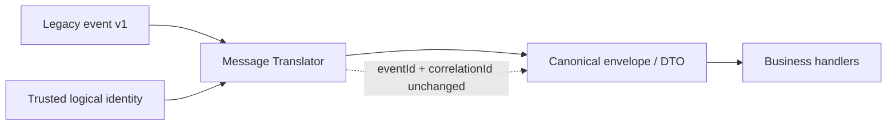
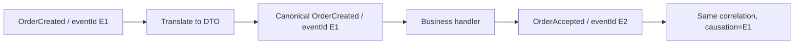
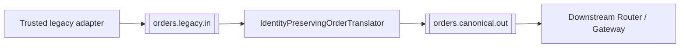
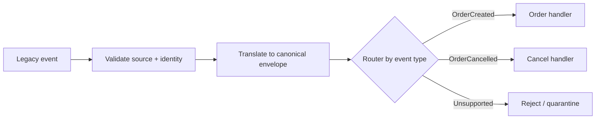
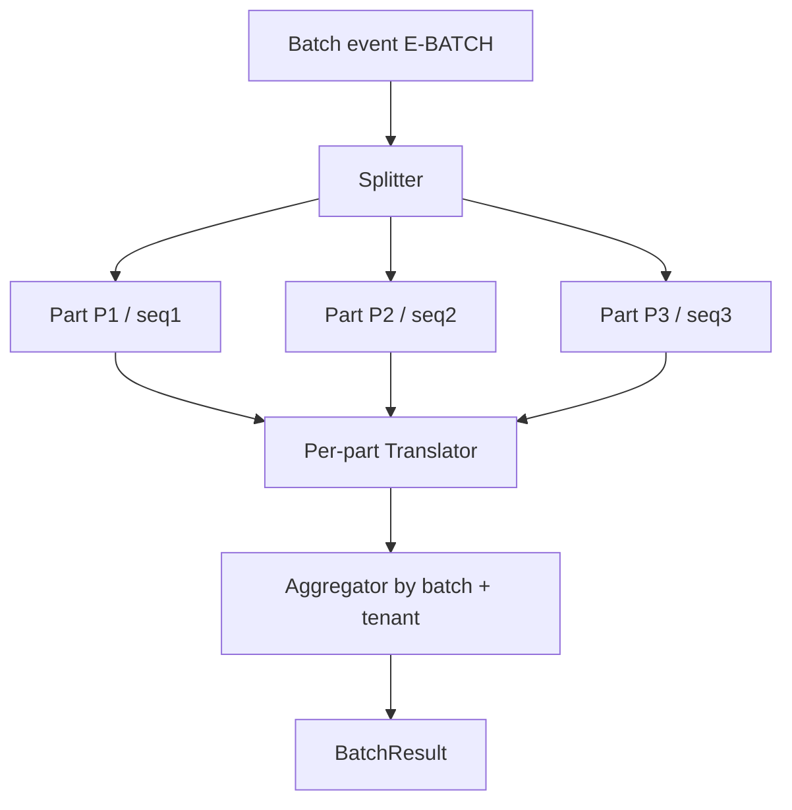
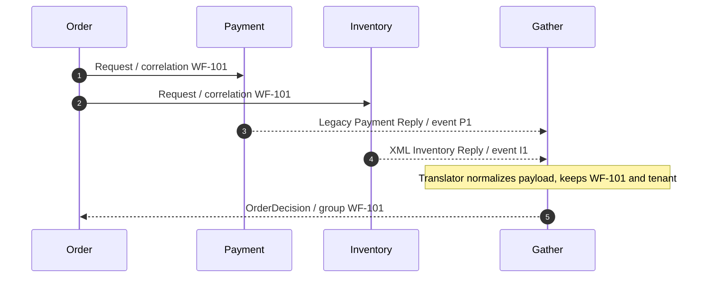
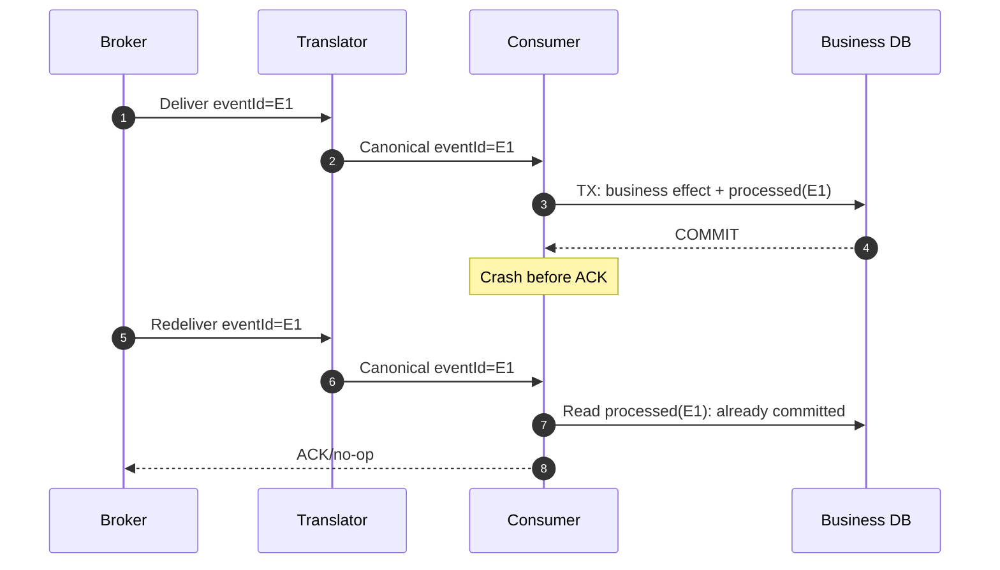
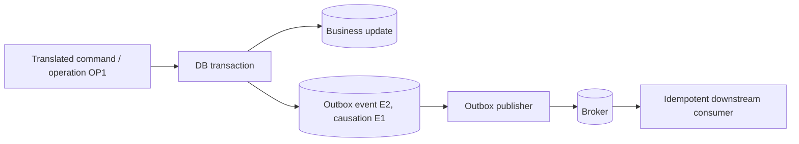

# Preserving Message Identity When Needed

An old producer emits an order event using JSON schema v1. At the integration boundary, a Spring Integration **Message Translator** converts the v1 format into the new system's `OrderCommand` object. The payload's types, field names, and structure have changed, yet it remains the **same logical event**. If the translation step generates a new `eventId` on every receipt, a broker redelivery will look like a brand-new event and could cause downstream to update the order, deduct inventory, or send notifications twice.

Conversely, after processing `OrderCreated`, the system emits a **new business event** named `OrderAccepted`. Keeping the old `eventId` for every new message could cause consumers to treat `OrderAccepted` as a duplicate of `OrderCreated`, or prevent audit systems from distinguishing the two events. You must know **when to preserve identity, when to issue a new identity, and which identity is being discussed**.

That is the focus of **"Preserving Message Identity When Needed"** in the **Message translator** chapter of module `SPRING_INTEGRATION_PATTERN`. On the path to implementing Enterprise Integration Patterns with Spring Integration for loosely coupled, extensible message flows, we apply these principles across **Router, Filter, Transformer, Splitter, Aggregator, Gateway, retry, error channel, and correlation**, while testing success paths, duplicates, schema changes, and error handling.

> **Core principle:** When a Message Translator only changes the **representation of the same logical message**, preserve the **business identities** needed for idempotency, correlation, and audit. When it leads to a **new business event or operation**, you usually need a **new identity for the new event/operation**, while preserving **correlation** and **causation** links to the origin event. Never equate these IDs with `MessageHeaders.ID` managed by Spring Messaging.

## 1. What is a Message Translator?

In Enterprise Integration Patterns, a **Message Translator** converts messages between different data models or formats so two applications can exchange data without forcing a shared schema. Spring Integration can implement it via a **Transformer**, adapters, message converters, or an `IntegrationFlow` with appropriate mapping steps.

Example:

```json
{
  "event_id": "evt-718",
  "flow_key": "wf-42",
  "customer_scope": "TENANT-A",
  "order_number": "ORD-101",
  "count": 2
}
```

translated into an envelope containing a canonical DTO:

```json
{
  "envelopeVersion": 1,
  "identity": {
    "eventId": "evt-718",
    "correlationId": "wf-42",
    "tenantId": "TENANT-A"
  },
  "payload": {
    "orderId": "ORD-101",
    "quantity": 2
  }
}
```

**The content changed representation**, yet `eventId=evt-718` and `correlationId=wf-42` stayed unchanged because this is still the **same logical event and workflow**. `tenantId` is also preserved from an **authenticated source**, never weakening access control just because field names changed.



### 1.1. A Message Translator does more than rename fields

It can:

- Convert `byte[]` or JSON strings into Java DTOs.
- Map `order_number` to `orderId`, `count` to `quantity`.
- Normalize enums, numeric types, dates/times, and units per contract.
- Convert JSON/XML/CSV into a canonical message.
- Wrap with a versioned envelope and authenticated metadata.
- Update `MessageHeaders.CONTENT_TYPE` to match the **actual representation**.
- Split incompatible data into a rejected outcome.

**What does NOT happen automatically:** a Message Translator does not authenticate tenants on its own, guarantee exactly-once processing, make two separate system transactions atomic, or solve duplicates merely by "keeping a header".

### 1.2. What does "when needed" mean?

Not every identity should be preserved across every boundary:

- A stable **business event ID** usually must survive translation and redelivery of the **same event**.
- A **correlation ID** must be kept if replies still need grouping in the same workflow.
- An **operation ID** must be kept if retries need to protect the same side effect.
- A **tenant context** must be preserved so data never crosses tenants, grounded in an **authenticated context**.
- A **technical Spring message ID** does not automatically need to stay identical when building a new `Message<?>`; understand the framework semantics.
- A **span ID** typically identifies one execution step and **should not be forced unchanged** when creating a new span.
- A **new event** must be identified as a new event, even when sharing correlation with a prior event.

Therefore, before writing a translator, define an **identity contract table**.

## 2. Types of identity to distinguish

| Identity | Question answered | Preserve when translating the same logical event? |
| --- | --- | --- |
| **Spring `MessageHeaders.ID`** | Which runtime `Message<?>` instance is this? | **Not required by default**; may be preserved or regenerated by builder/endpoint. |
| **Broker message ID / offset** | Which transport delivery/record is this? | Does not replace business event identity. |
| **`eventId`** | Which logical event is this? | **Yes** for the same event changing representation. |
| **`operationId`** | Which business operation / side effect is this? | **Yes** if it is the same operation; a distinct new operation may need a new ID. |
| **`correlationId`** | Which conversation/workflow/group does the message belong to? | **Yes** if it still belongs to the workflow needing correlation. |
| **`causationId`** | Which event/message directly caused the new event? | Assigned when a **new causal relationship** exists. |
| **`tenantId`** | Which security scope does the data/action belong to? | Preserve **after authentication**; never trust unverified raw claims. |
| **`traceId`** | Which spans belong to the same trace? | Managed by tracing instrumentation; not inherently a business identity. |
| **`spanId`** | Which specific processing step in the trace is this? | Usually **changes when creating a new span**. |
| **`sequenceNumber` / `sequenceSize`** | Which part position is this, and how many parts are expected? | Preserve within appropriate Splitter/Aggregator/Resequencer flows. |
| **`claimToken`** | Which stored payload record sits in the Claim Check store? | Not an event/correlation identity; tied to claim lifecycle. |

### 2.1. Example of multiple IDs coexisting

```text
Spring MessageHeaders.ID = UUID-msg-01234
Broker offset            = partition-2, offset-881
eventId                  = evt-718
operationId              = order-create-op-006
correlationId            = wf-42
tenantId                 = TENANT-A
causationId              = api-command-001
traceId                  = 4bf92f3577b34da6a3ce929d0e0e473
spanId                   = 00f067aa0ba902b7
```

Two redeliveries of `evt-718` can become **two new Spring `Message<?>` instances** with different technical IDs. **What must remain stable** for an Idempotent Receiver to recognize the same event is `eventId`/`operationId` per contract, not necessarily `MessageHeaders.ID`.

### 2.2. Correlation ID is not an idempotency key

One workflow `wf-42` may contain:

```text
PaymentRequested     eventId=evt-p1, corr=wf-42
InventoryRequested   eventId=evt-i1, corr=wf-42
PaymentResult        eventId=evt-p2, corr=wf-42
InventoryResult      eventId=evt-i2, corr=wf-42
```

If an Idempotent Receiver deduplicates using only `correlationId=wf-42`, it could block three valid messages after the first. If an Aggregator groups by `eventId`, the four replies cannot be grouped because their event IDs differ.

**Correlation** identifies a **group**, while **idempotency** identifies **one logical consumer operation**.

### 2.3. Causation captures the origin of a new event

```text
OrderCreated eventId=evt-718, corr=wf-42
    |
    | handler emits a new event
    v
OrderAccepted eventId=evt-719, corr=wf-42,
              causationId=evt-718
```

Do not reuse `evt-718` as the event ID for `OrderAccepted` if it is a **new event with its own identity contract**. Conversely, if you are merely parsing `OrderCreated` from JSON into a DTO, **do not invent `evt-719`**.

## 3. Which scenarios require preserving identity?

### 3.1. Translating schema v1 to v2

```text
LegacyOrderEvent(eventId=E1, orderNo=O1, count=2)
  → Translator
CanonicalOrderEvent(eventId=E1, orderId=O1, quantity=2)
```

This is **one logical event** under two representations; keep `eventId=E1`.

### 3.2. Converting wire format from XML to JSON

```text
XML envelope / eventId=E1
   → secure XML parser + schema validation
   → canonical DTO
   → JSON serializer
   → JSON envelope / eventId=E1
```

Bytes and Content-Type change, **event identity does not**. If the payload is digitally signed, the original signature over old bytes is not automatically valid after format conversion; verify first and re-sign if the contract requires it.

### 3.3. Broker retry/redelivery

```text
T1: Kafka record E1 → translator → downstream
T2: downstream commits DB
T3: consumer crashes before ACK/offset commit
T4: Kafka redelivers E1 → translator → downstream
```

If the translator mints a new `eventId` at T4, downstream struggles to recognize it as **the same logical event**. Preserving stable identity lets an Idempotent Receiver handle redelivery safely, **provided** it has proper state/transactions.

### 3.4. Crossing multiple transports

```text
HTTP request → Spring Integration → AMQP → Kafka bridge
```

Transports can alter header names, serialization, and technical message IDs. When crossing bridges, maintain a **wire envelope and header mapping contract** for event/operation/correlation IDs that must outlive a single JVM.

### 3.5. Splitter/Transformer/Resequencer

A batch message splits into parts. Those parts are **new technical messages** that can share group correlation while carrying **distinct part identities**:

```text
Batch B1
  Part P1: batchId=B1, partId=P1, seq=1/3
  Part P2: batchId=B1, partId=P2, seq=2/3
  Part P3: batchId=B1, partId=P3, seq=3/3
```

When a Transformer converts `P2` from a legacy DTO to a canonical DTO: **preserve `partId=P2`** as long as it is the same part. However, do not assign the batch's shared `eventId` as the **sole identity** of every part if each part triggers its own side effect.

## 4. Which scenarios do **not** keep all identities unchanged?

### 4.1. A business handler emits a new event



On the `E1 → C` edge, pure translation keeps `eventId=E1`. On the `H → E2` edge, a **new business event** needs a new event ID, while retaining correlation to link back to the existing workflow.

### 4.2. Creating new operations in a multi-step workflow

A `Checkout` workflow involves multiple operations:

```text
operationId=RESERVE-1  → Inventory reserve
operationId=CAPTURE-1  → Payment capture
operationId=SHIP-1     → Shipping create
```

Sharing a `correlationId` does not give them the same idempotency key. Each side effect has its **own operation identity**. When **retrying the same capture step**, keep `CAPTURE-1`; when initiating a genuinely new payment capture under the business contract, issue a new operation ID.

### 4.3. A new tracing span

A Translator may start a span to measure parse/map duration. That span typically gets a new `spanId` within the trace context managed by OpenTelemetry/Micrometer Tracing. **Do not force the old `spanId`** as if translation were not a distinct step.

### 4.4. A new security boundary

At external ingress, an arbitrary caller-supplied `correlationId` header or unverified `tenantId` **must not be preserved as trusted metadata**. You may need to:

- Validate permissions and tenant mappings.
- Issue a new **server-side correlation ID** or reconcile against an existing one.
- Record raw external request IDs in a separate field, never using them as group identity.
- Strip reserved headers like `replyChannel` and `errorChannel` from external data.

**Preserving identity "when needed" does not mean copying every untrusted header.**

## 5. Designing an identity contract before writing the Translator

Sample contract table:

| Metadata | Authoritative source | When translating same event | When emitting new event | Validation rules |
| --- | --- | --- | --- | --- |
| `tenantId` | Authenticated ingress/workflow. | Preserve after auth. | Keep if new event belongs to same tenant. | Ownership, tenant isolation. |
| `eventId` | Trusted event producer. | Preserve. | Mint new ID. | Non-blank, stable, uniqueness scope. |
| `operationId` | Command/workflow service. | Preserve for same operation. | Mint new ID for new operation. | Unchanged across retries of same side effect. |
| `correlationId` | Trusted workflow service. | Preserve. | Keep if still in same workflow. | Group scope/generation. |
| `causationId` | Event-producing handler. | Do not alter arbitrarily during parse/map. | Reference event causing the new event. | Valid causal relationship. |
| `traceparent` | Tracing instrumentation. | Propagate per tracing policy. | New span/context per instrumentation. | W3C format/privacy policy. |
| `MessageHeaders.ID` | Spring Messaging runtime. | Do not use as business identity. | Runtime-managed. | Do not override framework ID arbitrarily. |
| `sequenceNumber` | Trusted Splitter. | Preserve for same part. | Depends on new group/sequence semantics. | Consistent group sequence. |

### 5.1. Identity must be stable **logically**, not just lexically

An ID like `order-123` may only be unique within one tenant. If translation strips `tenantId`, two orders from different tenants can collide. If a workflow allows reprocessing an order under a new **generation**, correlation may need:

```text
groupKey = (tenantId, orderId, workflowGeneration)
```

Or an opaque unique `workflowId` backed by a trusted mapping to tenant/order/generation. Never rely solely on a string format that "looks like a UUID".

### 5.2. Do not hash the whole payload as a default fallback

If a legacy source lacks an event ID, a seemingly convenient trick is:

```java
String eventId = sha256(payloadBytes);
```

However:

- Two valid operations with **identical payloads** will collide.
- JSON with different field order or whitespace produces **different hashes** despite identical meaning.
- Payloads containing timestamps can cause retries to hash differently.
- Schema changes alter hashes even for the same logical event.
- Hashes do not replace authorization or unique business identity.

If a legacy source lacks an ID, design a **stable mapping/inbox record** built on trusted business keys, transport source identity, and replay semantics. A content hash can only be **one component** of a contract when uniqueness within scope is proven.

## 6. Header mapping: keeping essential metadata without blind copying

Spring Messaging provides `Message<?>` with a payload and `MessageHeaders`. A Spring Integration endpoint or Transformer may build a new message or return only a payload for the framework to wrap; **propagation semantics depend on the endpoint and how messages are built**. Never assume every header is preserved or every technical ID changes.

### 6.1. Headers to pay attention to

```java
import org.springframework.integration.IntegrationMessageHeaderAccessor;
import org.springframework.messaging.MessageHeaders;

String contentType = MessageHeaders.CONTENT_TYPE;
String replyChannel = MessageHeaders.REPLY_CHANNEL;
String errorChannel = MessageHeaders.ERROR_CHANNEL;
String correlationId =
    IntegrationMessageHeaderAccessor.CORRELATION_ID;
String sequenceNumber =
    IntegrationMessageHeaderAccessor.SEQUENCE_NUMBER;
String sequenceSize =
    IntegrationMessageHeaderAccessor.SEQUENCE_SIZE;
```

Some headers are **transport-specific** (e.g., Kafka `topic/partition/offset`), some only have meaning **within one runtime** (e.g., a `replyChannel` object), and `eventId`/`operationId` are **application-defined**. There is no universal "copy all" rule valid for every channel and broker.

### 6.2. Two strategies

**A. Keep identity inside a canonical envelope:**

```text
Message<LegacyOrderEvent>
    → translator
Message<CanonicalEnvelope<OrderCommand>>
    identity.eventId = old eventId
    identity.correlationId = old correlationId
```

Fits well for **cross-service serialization** or when multiple header mappers exist.

**B. Keep identity in selected trusted headers:**

```text
Message<OrderCommand>
    headers.eventId = validated event ID
    headers.correlationId = validated workflow ID
    headers.trustedTenantId = authenticated tenant
```

Fits **internal Spring Integration flows** using Router/Aggregator on headers. Both can be combined, provided a **mismatch policy** handles cases where body and headers disagree.

### 6.3. Never copy `MessageHeaders.ID` to "guarantee exactly-once"

Keeping a technical message ID does not mean side effects happen only once. If two distinct events are manually assigned the same ID, frameworks or stores may conflate them; if an adapter assigns a new ID on retry, deduplication using technical IDs will miss duplicates. Keep **separate stable logical identities** and enforce **Idempotent Receiver / DB transactions** at the side-effect boundary.

## 7. Java model: legacy event and canonical identity

This example implements **a translation of the same logical event**. The source sends an old schema; a **trusted adapter** has already verified source/tenant and wrapped the request into `TrustedLegacyOrder`. The Translator must:

1. Validate minimum identity and business constraints.
2. Reject tenant claims contradicting the authenticated tenant.
3. Convert the legacy structure to `CanonicalOrderCommand`.
4. Preserve `eventId`, `operationId`, and `correlationId` for the same logical event.
5. Take the tenant from the trusted adapter.
6. Mirror only the identity headers needed downstream, **never using raw external headers as authority**.

### 7.1. Legacy DTO and authenticated context

```java
// LegacyOrderEvent.java
public record LegacyOrderEvent(
    String eventId,
    String operationKey,
    String workflowKey,
    String claimedTenant,
    String orderNumber,
    int itemCount
) {}
```

```java
// TrustedLegacyOrder.java
public record TrustedLegacyOrder(
    String authenticatedTenant,
    LegacyOrderEvent event
) {}
```

`LegacyOrderEvent.claimedTenant` may arrive from the payload/wire. `TrustedLegacyOrder.authenticatedTenant` must be resolved by the adapter from **principal/producer identity and tenant authorization**, never blindly copied from the payload.

### 7.2. Canonical identity and payload

```java
// CanonicalIdentity.java
public record CanonicalIdentity(
    String tenantId,
    String eventId,
    String operationId,
    String correlationId
) {
    public CanonicalIdentity {
        if (tenantId == null || tenantId.isBlank()
                || eventId == null || eventId.isBlank()
                || operationId == null || operationId.isBlank()
                || correlationId == null || correlationId.isBlank()) {
            throw new IllegalArgumentException(
                "INVALID_LOGICAL_IDENTITY");
        }
    }
}
```

```java
// CanonicalOrderCommand.java
public record CanonicalOrderCommand(
    String orderId,
    int quantity
) {
    public CanonicalOrderCommand {
        if (orderId == null || orderId.isBlank()
                || quantity < 1 || quantity > 100) {
            throw new IllegalArgumentException(
                "INVALID_ORDER_COMMAND");
        }
    }
}
```

```java
// CanonicalEnvelope.java
import java.util.Objects;

public record CanonicalEnvelope<T>(
    int envelopeVersion,
    CanonicalIdentity identity,
    T payload
) {
    public CanonicalEnvelope {
        if (envelopeVersion != 1) {
            throw new IllegalArgumentException(
                "UNSUPPORTED_ENVELOPE_VERSION");
        }
        Objects.requireNonNull(identity, "identity");
        Objects.requireNonNull(payload, "payload");
    }
}
```

`CanonicalIdentity` relies on Java record **value semantics**, simplifying test comparisons and envelope transport. Still, **string equality alone does not prove two events came from the same trusted source**: validate tenant, provenance, schema, and permissions at ingress.

## 8. Java Transformer: preserving logical IDs independently of technical message IDs

### 8.1. Implementing `org.springframework.integration.transformer.Transformer`

```java
// IdentityPreservingOrderTranslator.java
import java.util.Objects;
import org.springframework.integration.IntegrationMessageHeaderAccessor;
import org.springframework.integration.transformer.Transformer;
import org.springframework.messaging.Message;
import org.springframework.messaging.support.MessageBuilder;

public final class IdentityPreservingOrderTranslator
        implements Transformer {

    @Override
    public Message<?> transform(Message<?> original) {
        if (!(original.getPayload()
                instanceof TrustedLegacyOrder inbound)) {
            throw new IllegalArgumentException(
                "EXPECTED_TRUSTED_LEGACY_ORDER");
        }

        LegacyOrderEvent legacy =
            Objects.requireNonNull(inbound.event(), "event");
        String tenant = inbound.authenticatedTenant();

        if (tenant == null || tenant.isBlank()) {
            throw new IllegalArgumentException(
                "MISSING_AUTHENTICATED_TENANT");
        }
        if (!tenant.equals(legacy.claimedTenant())) {
            throw new IllegalArgumentException(
                "TENANT_MISMATCH");
        }

        CanonicalIdentity identity = new CanonicalIdentity(
            tenant,
            legacy.eventId(),
            legacy.operationKey(),
            legacy.workflowKey());

        CanonicalOrderCommand command =
            new CanonicalOrderCommand(
                legacy.orderNumber(),
                legacy.itemCount());

        CanonicalEnvelope<CanonicalOrderCommand> envelope =
            new CanonicalEnvelope<>(1, identity, command);

        // Headers for downstream Spring Integration
        // endpoints that need group/operation identity.
        // Source is validated context/DTO,
        // DO NOT read raw headers from an external caller.
        return MessageBuilder.withPayload(envelope)
            .setHeader(
                IntegrationMessageHeaderAccessor.CORRELATION_ID,
                identity.correlationId())
            .setHeader("trustedTenantId",
                identity.tenantId())
            .setHeader("eventId",
                identity.eventId())
            .setHeader("operationId",
                identity.operationId())
            .build();
    }
}
```

### 8.2. Explaining each decision

**Payload translation:** `orderNumber → orderId`, `itemCount → quantity`. No new order is created; thus it remains the same logical event.

**Preserving business IDs:** `eventId`, `operationKey`, and `workflowKey` from the legacy event are retained after validation. In a real system, the adapter/protocol must verify they are trusted IDs with proper uniqueness and scope, not just non-blank strings.

**Protecting tenant:** output uses `authenticatedTenant`. If the raw claim mismatches, the translator **rejects** rather than routing the request to the producer-declared tenant.

**No blind copying of raw headers:** the builder constructs an output message with explicitly chosen metadata. This fits a translation boundary that has already validated its source. However, **Spring Integration endpoints/adapters can still propagate or map headers** outside this method; always verify actual flow behavior and adapter settings. Do not treat this method alone as a complete firewall.

**No promise to keep `MessageHeaders.ID`:** the runtime can assign a new technical ID to the output message depending on builder and flow behavior. Tests verify **logical identity** in payload/headers, **without requiring input and output technical IDs to match**.

**Not writing trace context manually:** tracing instrumentation creates and propagates parent-child spans. If `traceparent` must cross an adapter, enforce a separate contract rather than generating random trace/span IDs inside the business translator.

### 8.3. Why can the technical message ID change?

A Transformer may:

- Return **only a new payload**, letting the framework build the wrapper Message.
- Return **a new Message** with selected headers.
- Use `MessageBuilder.fromMessage(...)` on an already-trusted message.
- Pass through a broker adapter that emits a transport record and later produces a new inbound Spring Message.

Each case has different header-copy and ID-creation semantics. **Never tie idempotency correctness to an assumption that `MessageHeaders.ID` is preserved.** If a protocol requires retaining the original message ID, define a dedicated **`originalMessageRef` field with explicit scope/trust**, rather than overriding the framework's reserved ID.

## 9. Spring Integration Java DSL: wiring the Translator into a flow

### 9.1. Configuring a simple flow

```java
// MessageTranslatorConfiguration.java
import org.springframework.context.annotation.Bean;
import org.springframework.context.annotation.Configuration;
import org.springframework.integration.channel.QueueChannel;
import org.springframework.integration.config.EnableIntegration;
import org.springframework.integration.dsl.IntegrationFlow;

@Configuration
@EnableIntegration
public class MessageTranslatorConfiguration {

    @Bean
    IdentityPreservingOrderTranslator orderTranslator() {
        return new IdentityPreservingOrderTranslator();
    }

    @Bean("orders.canonical.out")
    QueueChannel canonicalOutput() {
        return new QueueChannel(16);
    }

    @Bean
    IntegrationFlow translateLegacyOrders(
            IdentityPreservingOrderTranslator translator) {
        return IntegrationFlow.from("orders.legacy.in")
            .transform(translator)
            .channel("orders.canonical.out")
            .get();
    }
}
```

Diagram:



In this demo:

1. `orders.legacy.in` receives `Message<TrustedLegacyOrder>` from a trusted adapter.
2. `.transform(translator)` validates tenant and converts to `CanonicalEnvelope<CanonicalOrderCommand>`.
3. Business identity headers are mirrored from the validated identity.
4. `orders.canonical.out` is an in-memory `QueueChannel` for test inspection, **not a durable queue** or production consumer.

**What the demo leaves out:** no Kafka/AMQP/HTTP configuration, database, tracing provider, transaction manager, or default error flow; the STEP 4 NEW lesson did not run build/Gradle or specialized Content QA. In a real project, verify Spring Integration dependency versions and endpoint behavior with integration tests.

### 9.2. Translator error handling

The Translator can throw `IllegalArgumentException` if:

```text
EXPECTED_TRUSTED_LEGACY_ORDER
MISSING_AUTHENTICATED_TENANT
TENANT_MISMATCH
INVALID_LOGICAL_IDENTITY
INVALID_ORDER_COMMAND
```

In a synchronous flow using `DirectChannel`, exceptions can propagate back to the sender. With an inbound adapter/poller/async flow, they can be wrapped into an `ErrorMessage` and sent to an `errorChannel` when configured. **Do not assume every translator failure automatically reaches the global `errorChannel`**; broker ACK/requeue/DLT behavior depends on adapter and transaction semantics.

### 9.3. When to use a Message Converter instead of a Transformer?

A `MessageConverter` typically handles **deserialization/serialization** between wire formats and Java objects. A Spring Integration `Transformer` handles **business/schema mapping**. In a clean flow:

```text
Raw Kafka bytes
  → transport deserializer
  → legacy DTO + trusted adapter context
  → IdentityPreservingOrderTranslator
  → canonical envelope
  → business handler
```

Do not mix **parsing an untrusted byte stream** with **preserving the identity of an authenticated business event** without clear validation and error boundaries.

## 10. JUnit 5: two deliveries represent the same event despite different technical IDs

### 10.1. Unit test for identity preservation

```java
// IdentityPreservingOrderTranslatorTest.java
import static org.junit.jupiter.api.Assertions.*;

import org.junit.jupiter.api.Test;
import org.springframework.integration.IntegrationMessageHeaderAccessor;
import org.springframework.messaging.Message;
import org.springframework.messaging.support.MessageBuilder;

class IdentityPreservingOrderTranslatorTest {

    private final IdentityPreservingOrderTranslator translator =
        new IdentityPreservingOrderTranslator();

    private static TrustedLegacyOrder sameEvent() {
        LegacyOrderEvent event = new LegacyOrderEvent(
            "evt-718", "order-create-op-006",
            "wf-42", "TENANT-A", "ORD-101", 2);
        return new TrustedLegacyOrder("TENANT-A", event);
    }

    @Test
    void preservesBusinessIdentityAcrossRepresentationChange() {
        Message<?> source = MessageBuilder
            .withPayload(sameEvent())
            .setHeader("externalRole", "SUPERADMIN")
            .build();

        Message<?> output = translator.transform(source);
        assertInstanceOf(CanonicalEnvelope.class, output.getPayload());

        CanonicalEnvelope<?> result =
            (CanonicalEnvelope<?>) output.getPayload();
        CanonicalIdentity identity = result.identity();

        assertEquals("evt-718", identity.eventId());
        assertEquals("order-create-op-006",
            identity.operationId());
        assertEquals("wf-42", identity.correlationId());
        assertEquals("TENANT-A", identity.tenantId());

        CanonicalOrderCommand command =
            (CanonicalOrderCommand) result.payload();
        assertEquals("ORD-101", command.orderId());
        assertEquals(2, command.quantity());

        assertEquals("wf-42", output.getHeaders().get(
            IntegrationMessageHeaderAccessor.CORRELATION_ID));
        assertEquals("evt-718",
            output.getHeaders().get("eventId"));
        assertNull(output.getHeaders().get("externalRole"));
    }

    @Test
    void retriesKeepLogicalIdentityWithoutDependingOnMessageId() {
        Message<?> first = MessageBuilder
            .withPayload(sameEvent()).build();
        Message<?> retry = MessageBuilder
            .withPayload(sameEvent()).build();

        // Two different Spring Messages are created for
        // the same logical event; do not use this ID for dedup.
        assertNotEquals(first.getHeaders().getId(),
            retry.getHeaders().getId());

        CanonicalEnvelope<?> result1 = (CanonicalEnvelope<?>)
            translator.transform(first).getPayload();
        CanonicalEnvelope<?> result2 = (CanonicalEnvelope<?>)
            translator.transform(retry).getPayload();

        assertEquals(result1.identity(), result2.identity());
        assertEquals(result1.payload(), result2.payload());
    }

    @Test
    void rejectsTenantSpoofingBeforeBusinessHandler() {
        TrustedLegacyOrder forged = new TrustedLegacyOrder(
            "TENANT-A",
            new LegacyOrderEvent(
                "evt-718", "order-create-op-006",
                "wf-42", "TENANT-B", "ORD-101", 2));

        IllegalArgumentException error = assertThrows(
            IllegalArgumentException.class,
            () -> translator.transform(MessageBuilder
                .withPayload(forged).build()));
        assertEquals("TENANT_MISMATCH",
            error.getMessage());
    }
}
```

**What the test proves:** the translator preserves logical IDs passed in from a trusted context, converts valid payloads, and does not rely on technical message IDs for event identity. It also verifies the **transformer method builds output with selected headers** without blindly copying raw `externalRole`. In a real flow, also test header propagation across the full endpoint/adapter.

**What the test does NOT prove:** broker redelivery, DB transactions, exactly-once side effects, ACL/authorization, trace propagation, or multi-instance execution.

### 10.2. Integration test for the DSL

```java
// MessageTranslatorFlowTest.java
import static org.junit.jupiter.api.Assertions.*;

import org.junit.jupiter.api.Test;
import org.springframework.beans.factory.annotation.Autowired;
import org.springframework.context.ApplicationContext;
import org.springframework.integration.channel.QueueChannel;
import org.springframework.messaging.Message;
import org.springframework.messaging.MessageChannel;
import org.springframework.messaging.support.MessageBuilder;
import org.springframework.test.context.junit.jupiter.SpringJUnitConfig;

@SpringJUnitConfig(MessageTranslatorConfiguration.class)
class MessageTranslatorFlowTest {

    @Autowired ApplicationContext context;

    @Test
    void translatedMessageCarriesOriginalLogicalEventId() {
        TrustedLegacyOrder input = new TrustedLegacyOrder(
            "TENANT-A",
            new LegacyOrderEvent(
                "evt-900", "order-create-op-900",
                "wf-900", "TENANT-A", "ORD-900", 5));

        MessageChannel inbound = context.getBean(
            "orders.legacy.in", MessageChannel.class);
        assertTrue(inbound.send(MessageBuilder
            .withPayload(input).build()));

        QueueChannel output = context.getBean(
            "orders.canonical.out", QueueChannel.class);
        Message<?> translated = output.receive(0);

        assertNotNull(translated);
        CanonicalEnvelope<?> envelope =
            (CanonicalEnvelope<?>) translated.getPayload();
        assertEquals("evt-900", envelope.identity().eventId());
        assertEquals("wf-900",
            envelope.identity().correlationId());
        assertEquals("TENANT-A",
            translated.getHeaders().get("trustedTenantId"));
        assertNull(output.receive(0));
    }
}
```

In the demo, channel and handler are synchronous and output is buffered in `QueueChannel`, so `receive(0)` works. When switching to an executor, poller, or broker, use a **bounded wait** and isolate state between tests. This test only observes message translation and executes no side effects.

### 10.3. Testing that a new event requires a new event ID

This is separate logic, **not part of the same-event translation in section 8**:

```java
// Illustrative example for a business-event producer.
public record AcceptedEventIdentity(
    String eventId,
    String causationId,
    String correlationId,
    String tenantId
) {}

AcceptedEventIdentity newAcceptedEvent(
        CanonicalIdentity original,
        String newlyAllocatedEventId) {
    if (newlyAllocatedEventId.equals(original.eventId())) {
        throw new IllegalArgumentException(
            "NEW_EVENT_REQUIRES_NEW_ID");
    }
    return new AcceptedEventIdentity(
        newlyAllocatedEventId,
        original.eventId(),
        original.correlationId(),
        original.tenantId());
}
```

`newlyAllocatedEventId` must be issued per the **event publishing contract**, avoiding generating a new ID on every retry of the **same outbox event**. A common approach is generating the event ID **once when writing the outbox row in the same transaction**, allowing the publisher to resend that exact outbox record with the **same event ID**.

## 11. Transformer, Message Translator, and Header Enricher

Spring Integration offers multiple ways to transform messages. Which to pick depends on your identity contract and representation.

### 11.1. Returning only a new payload

A simple Transformer can return a DTO:

```java
// Pure mapping illustration, NOT sufficient by itself
// to guarantee all identity metadata was preserved.
CanonicalOrderCommand translatePayload(
        LegacyOrderEvent source) {
    return new CanonicalOrderCommand(
        source.orderNumber(),
        source.itemCount());
}
```

In an `IntegrationFlow`, when a Transformer returns a payload, the framework builds the output Message and handles header propagation per endpoint. **Verify by test** that `eventId`, `correlationId`, `sequenceNumber`, and `replyChannel` remain intact, especially after adapters and before Aggregator/Gateway.

If downstream needs durable business identity across a broker, returning **only a payload** without a canonical envelope or header contract easily loses IDs.

### 11.2. Returning a new `Message<?>`

The `IdentityPreservingOrderTranslator` example in section 8:

```text
Message<TrustedLegacyOrder>
    → IdentityPreservingOrderTranslator
Message<CanonicalEnvelope<CanonicalOrderCommand>>
    headers:
       correlationId
       trustedTenantId
       eventId
       operationId
```

This lets the translator explicitly decide **which data moves to the output**, though it does not replace source authentication or external adapter configuration.

### 11.3. Selective use of `Header Enricher`

If the translator returns a canonical payload, a subsequent step can copy authenticated business headers from a **trusted source** or derive them from the envelope:

```java
// DSL pseudocode for an authenticated internal flow:
// .enrichHeaders(headers -> headers
//   .headerFunction("eventId", msg ->
//       ((CanonicalEnvelope<?>) msg.getPayload())
//           .identity().eventId())
//   .headerFunction(
//       IntegrationMessageHeaderAccessor.CORRELATION_ID,
//       msg -> ((CanonicalEnvelope<?>) msg.getPayload())
//           .identity().correlationId()))
```

Do not use `headerEnricher` to **mint a new `eventId` every time** when this is the **same logical event** being translated or redelivered. Never read `tenantId` from an unverified header to override trusted tenant scope.

### 11.4. `Content-Type` must describe the actual representation

Case:

```text
Input:
    payload: byte[] JSON
    contentType: application/json

Output:
    payload: CanonicalOrderCommand (Java object)
```

Do not assume the output is still **JSON bytes** merely because the old `application/json` header propagated. You may keep a media-type hint for an outbound converter, but define the **converter's contract** and test how it serializes the DTO into wire bytes.

When a translator converts XML bytes to JSON bytes, **update the content type after actual serialization**, rather than changing the header while leaving XML bytes intact.

## 12. Router and Filter: identity must be ready before branching

A Router selects branches based on `messageType`, tenant policy, or payload type. A Message Translator can **normalize the event type field** before the Router evaluates it.



### 12.1. Router does not replace correlation

`PAYMENT` and `INVENTORY` are **destination roles**, not correlation groups. If two replies in the same workflow travel through different channels, they still need the **same group identity** when arriving at the Aggregator.

Conversely, two messages on the same `orders.received` channel do not necessarily belong to the same workflow.

### 12.2. Tenant-aware routing requires trusted identity

If an external producer sends:

```text
headers:
  tenantId = TENANT-ADMIN
  routeTo = admin.internal
```

the Translator must not copy those values and let a Router pick arbitrary databases or channels. Require an **authenticated tenant context** and route allowlists. Even a trusted tenant ID in an envelope does not replace data-access authorization inside handlers.

### 12.3. Filters can drop terminal outcomes

Suppose a translator processes an Inventory reply and a downstream Filter discards `OUT_OF_STOCK`. If the Aggregator expects both Payment and Inventory, the group may wait forever.

```text
Wrong:
  Inventory OUT_OF_STOCK
    → Translator
    → Filter false
    → dropped
    → Aggregator only has Payment reply

Right for contracts needing terminal outcomes:
  Inventory OUT_OF_STOCK
    → Translator
    → InventoryOutcome(REJECTED)
    → Aggregator has all required roles
```

**Preserving identity properly** does not fix messages lost by a Filter. Define explicit release/expiry contracts for every group.

## 13. Splitter and Part Identity

An `OrderBatch` has three lines. The Splitter creates child messages, each potentially carrying:

```text
tenantId = TENANT-A
batchId = BATCH-101
partId = LINE-2
correlationId = BATCH-101
sequenceNumber = 2
sequenceSize = 3
```

When the Translator converts part `LINE-2` into a canonical `OrderLineCommand`:

- Preserve **tenant and batch/workflow correlation**.
- Preserve **`partId`/`lineId`** for the same logical part.
- Preserve **`sequenceNumber`/`sequenceSize`** if Aggregator/Resequencer needs them and they came from a trusted Splitter.
- Preserve **`operationId`** if the same step has side effects and retries may happen.
- Never reuse the batch's root event ID as the **sole identity** of every part when each part performs its own operation.



### 13.1. When is a part considered a new message?

**Technically**, a Splitter creates new child messages. **Semantically**, a part may be:

1. **A fragment of the same original event** (needs group/part ID for reassembly).
2. **A new per-line command** (needs its own operation ID for side effects).
3. **A new event representing the part's outcome** (needs its own event ID and causation pointing to the part request).

There is no blanket rule that "every part must keep the original event ID" or "every part must mint a new event ID". Define the **identity of the entity being processed**.

### 13.2. Duplicate parts and Aggregator release

```text
Expected: P1, P2, P3
Received: P1, P2, P2 (duplicate)
```

If the Aggregator only checks `group.size() == 3`, it can release prematurely while missing P3. Require **distinct part IDs** or a release strategy tracking required outcomes. The Message Translator must **preserve part identity**, never generating a different part ID for the duplicate P2.

### 13.3. Nested splitters

A file contains multiple orders, each with multiple lines:

```text
outer group = (tenantId, fileId, generation)
inner group = (tenantId, fileId, orderId, generation)
part identity = (tenantId, fileId, orderId, lineId)
```

If the translator keeps only one flat `correlationId` across all levels, the inner Aggregator can mix lines from different orders. Use **layered correlation scopes**—for example, `parentCorrelationId` or a typed context depending on your wire contract.

## 14. Aggregator and Content-Based Correlation

A Payment reply and an Inventory reply have different event IDs yet belong to the same workflow:

```text
PAYMENT eventId=EVT-P-101, corr=WF-101, tenant=A
INVENTORY eventId=EVT-I-101, corr=WF-101, tenant=A
```

The Translator normalizes both payloads into one `ProviderOutcome` DTO:

```java
public record ProviderOutcome(
    String source,
    String status,
    String eventId,
    String tenantId,
    String correlationId
) {}
```

The **group key** can be:

```java
public record BusinessGroupKey(
    String tenantId,
    String correlationId
) {}
```

Illustrative correlation strategy:

```java
// Pseudocode for AggregateSpec; requires application-implemented
// ReleaseStrategy and MessageGroupProcessor:
//
// .aggregate(spec -> spec
//     .correlationStrategy(message -> {
//         ProviderOutcome p =
//             (ProviderOutcome) message.getPayload();
//         return new BusinessGroupKey(
//             p.tenantId(), p.correlationId());
//     })
//     .releaseStrategy(requiredRolesReleaseStrategy)
//     .outputProcessor(providerGroupProcessor))
```

Here:

- **CorrelationStrategy** answers which group the reply belongs to.
- **ReleaseStrategy** answers whether all required sources/roles have arrived.
- **MessageGroupProcessor** produces the output upon release.

If the Translator drops `correlationId`, the group splits; if it drops `tenantId`, groups can bleed across tenants; if it issues a new event ID per redelivery, event-ID deduplication breaks. Yet **preserving all three IDs still does not guarantee proper release** when required sources are missing, conflicting, or arriving late.

### 14.1. Never use the Translator's `MessageHeaders.ID` for correlation

If each reply translates into a new technical message:

```text
Payment reply: input Message ID M1 → output Message ID M2
Inventory reply: input Message ID M3 → output Message ID M4
```

and the Aggregator groups by `MessageHeaders.ID`, the two replies land in separate groups. Use stable **business correlation** (or properly scoped EIP headers), never output technical IDs as group identity.

### 14.2. Timeouts and late replies

A group might expire at T1 while the Inventory reply arrives at T2. If the Translator preserves correlation without a **generation/completed-group policy**, an old reply can spawn a new group or re-trigger a finalized workflow. Use versions/generations, late-result policies, tombstones/completed states, and idempotent finalization.

## 15. Resequencer: preserve sequence identity, never fabricate order

A Resequencer needs to know **which group and position each part belongs to**. A message translator might process XML slower than JSON:

```text
input order: P1, P2, P3
completion order: P2, P3, P1
```

Do not assign `sequenceNumber=1` to `P2` simply because it finished translating first. Sequence must reflect the **order assigned by the source or business entity**, not arrival or completion order.

| ID | Purpose |
| --- | --- |
| `correlationId` | Sequence group. |
| `sequenceNumber` | Position within group. |
| `sequenceSize` | Expected part count, if known upfront. |
| `partId` | Distinct identity of the part for deduplication. |
| `eventId` | Logical event identity carrying the part/outcome. |

The Message Translator should preserve fields applicable to the same part while stripping untrusted raw metadata.

## 16. Scatter–Gather, Recipient List, and Publish–Subscribe

### 16.1. Scatter–Gather



Payment and Inventory may use different wire formats; Translators convert both into a canonical `ProviderOutcome`. What must be preserved:

- **Business correlation and tenant** from the trusted workflow.
- Authenticated **recipient role/source**.
- Distinct **event identity** for each reply.
- **Required recipients** per the actual request, never inferred from whichever messages happened to arrive.

If a translator treats every reply with the same correlation as a duplicate, Gather loses a role. If it assigns a fresh correlation to each reply, Gather never completes.

### 16.2. Dynamic Recipient List

A request calls Pricing and Inventory, skipping Promotions. The Translator must not "invent" an expected Promotions role just because the canonical schema has a promotions field. The release strategy must know the **exact set of recipients chosen** in the trusted workflow context.

### 16.3. Publish–Subscribe

An `OrderCreated` event may be broadcast to:

```text
Audit Consumer
Search Index Consumer
Notification Consumer
```

All three consumers see the same `eventId` and correlation, yet **each consumer has independent side effects**. Never use **one shared global dedup key based solely on `eventId`**, or Audit processing first would block Notification. Commonly used:

```text
idempotencyKey = (consumerName, tenantId, eventId)
```

This is the **consumer's event-processing identity**, not a correlation group.

## 17. Gateway request–reply and reply identity

A Java Gateway can be declared as:

```java
import org.springframework.integration.annotation.MessagingGateway;

@MessagingGateway(defaultRequestChannel = "orders.command.in")
interface OrderGateway {
    OrderReceipt submit(OrderCommand command);
}

// OrderCommand and OrderReceipt are application-defined DTOs;
// the flow needs a suitable reply path and converter/handler.
```

In a request–reply flow, **two distinct identities** exist:

1. **Business operation/correlation:** retries of the same request still belong to the same logical operation/workflow.
2. **Reply path:** the Gateway must know which caller gets the result, typically via Spring Messaging's **trusted `replyChannel`/request–reply contract**.

If a Translator constructs a new message and **drops the reply channel needed by the runtime**, the Gateway can time out even when the business handler produced a result. If it **copies `replyChannel` from raw external payloads/headers**, it can introduce routing or security vulnerabilities.

### 17.1. Gateway timeout does not make the operation disappear

```text
T0: Caller sends command OP-101
T1: Gateway times out; caller has no receipt yet
T2: Backend commits OP-101
T3: Caller retries command OP-101
```

The Translator must keep `operationId=OP-101` across retries of the same command. An Idempotent Receiver or result store returns the existing receipt **without executing the side effect twice**. Keeping `MessageHeaders.ID` alone does not guarantee this outcome.

### 17.2. Should a new reply keep the command's event ID?

If the reply is merely a **representation of the same message** on an internal channel, the identity contract may differ. However, if the system emits a **domain event `OrderAccepted`**, that is a **new event** requiring a new event ID and optionally carrying `causationId` pointing back to the source command/event.

**Never confuse "response to a request" with "a new domain event" just because both are `Message<?>` instances.**

## 18. Claim Check and Envelope Wrapper

A large payload can be stored in a `MessageStore` while the flow passes only a claim token:

```text
Original OrderEvent / eventId E1
    → Claim Check In
Token C1
    → Router / approval
    → Claim Check Out
Restored OrderEvent / eventId E1
    → Message Translator
Canonical OrderEvent / eventId E1
```

**Claim token C1** is not `eventId E1`, `correlationId`, or an idempotency key. At check-out, the Translator must:

- Verify claim owner/tenant before retrieval.
- Restore the **exact logical event identity** from the trusted store.
- Never infer `eventId` from the claim token unless the contract explicitly defines it.
- Preserve correlation/operation IDs across conversion.
- Avoid deleting the claim before all consumers that still need it finish.

If `check-out` removes on read, a retry can lose the original payload. Use read-many, lease, or retention policies aligned with fan-out and idempotency.

## 19. Wire identity: HTTP, Kafka, AMQP, JMS, and adapters

A Message Translator often sits between two transports. A Spring `Message<?>` is never sent verbatim to Kafka/JMS/HTTP by object copying; the adapter must serialize payloads, map headers, and handle transport-specific identities.

### 19.1. HTTP

```text
POST /orders
Authorization: Bearer ...
X-Request-ID: req-101
traceparent: 00-...-...-01
Body: legacy order JSON
```

**Rules:**

- Controller/HTTP adapter authenticates principal and tenant.
- Enforce body size limits and parse/validate schema before the translator or inside a clear error boundary.
- Client `X-Request-ID` can act as an **external request reference**, **not by default** a trusted event/operation/correlation identity.
- Issue or recover a stable `operationId` for retries per the API contract.
- Never copy `Authorization`/cookies into the business envelope or broker headers.
- Tracing instrumentation manages `traceparent`; never use it to decide whether an operation already ran.

If an HTTP caller retries the same operation with a **new HTTP request ID**, downstream still needs to recognize it as **the same operation**. Never confuse a request attempt with a logical command.

### 19.2. Kafka

A Kafka record has `topic, partition, offset`; Kafka headers carry bytes. In a pipeline:

```text
Kafka record:
  offset=881
  value=legacy event E1
    → inbound adapter/deserializer
    → Spring Message ID M1
    → Message Translator
    → canonical event E1
```

**`offset`** identifies a record's position within a partition, not a system-wide business event ID. Republishing the same event E1 to another topic assigns a different offset; retries/rebalances can produce a different Spring `MessageHeaders.ID`.

If the producer supplies a **stable `eventId`** and the consumer needs idempotency, store it in the **value envelope** or a clearly mapped/versioned/trusted header. When choosing a partition key:

- Key by tenant/business key when ordering is required.
- Do not expect identical correlation to always land in the same partition if partitioning policies differ.
- Never leak secrets in Kafka keys, headers, or logs.
- Test deserializers and header mappers with real byte payloads.

### 19.3. RabbitMQ/AMQP

AMQP defines properties, delivery tags, correlation IDs, and message IDs depending on producer/adapter settings. A `deliveryTag` supports acknowledgments on a specific channel/connection—it is **not a durable event identity**.

When a translator crosses AMQP:

1. The converter knows the wire format and body encoding.
2. Event/correlation/tenant metadata is mapped per contract.
3. Error handling defines when to ACK, NACK, requeue, or route to DLT.
4. Redelivery retains stable logical identity even when technical delivery metadata changes.
5. Never trust an AMQP correlation property set by an external producer as a business workflow ID without an explicit trust contract.

### 19.4. JMS

JMS defines `JMSMessageID` and `JMSCorrelationID`. Neither automatically equals `MessageHeaders.ID` or an application `eventId`. You may map `JMSCorrelationID` to business correlation **if** the producer/consumer agreement and security model explicitly define it. Never promote a transport-only ID into a business operation identity.

### 19.5. Files and batch replay

A job re-reading an old file can generate a **new file message ID** on every poll. If individual records inside the file lack stable identities, an Idempotent Receiver cannot detect replays. When integrating files:

- Define `sourceFileId`/`batchId`/`recordId` or a persisted mapping.
- Separate **file ingestion attempt** from **logical record identity**.
- Never use bare `lineNumber` alone as a global ID.
- Keep tenant/source/record version in the canonical envelope.
- Verify checksums when needed, without mistaking a checksum for an operation identity.

## 20. Retry and Idempotent Receiver: Identity is necessary, not sufficient

Accurate translation enables retry recognition:



**Crucial mechanism:** the translator preserves `eventId`, while the consumer checks `processed(E1)` using a **durable, concurrency-safe** store. If the consumer only uses an in-memory `Set`, a restart forgets E1.

### 20.1. First seen is not the same as business committed

Pitfall:

```text
putIfAbsent(E1) into metadata store
  → translator + handler
  → crash before DB commit
  → redelivery E1 gets dropped because key was already seen
```

Preventing lost work requires the **right transaction boundary**. If the business effect lives in the same database, record the deduplication row and business changes inside the same transaction/unique constraint. For remote payments, use provider idempotency keys, outboxes, and reconciliation.

### 20.2. Translation may run multiple times

Even a pure, deterministic translator can **execute multiple times** due to broker redeliveries. Never design a translator with side effects like:

```java
// Very dangerous if this is supposed to be only a conversion step:
OrderCommand translateAndCharge(LegacyOrderEvent event) {
    paymentApi.capture(event.operationKey());
    return new OrderCommand(
        event.orderNumber(), event.itemCount());
}
```

Mixing **data conversion** with **payment capture** makes idempotency and retry semantics hard to guarantee. Better: the translator only maps data, and the business handler calls payment with a **stable operation ID** and proper deduplication.

### 20.3. Same key, different payload

```text
eventId=E1, amount=100000
eventId=E1, amount=250000
```

If the contract says an event ID belongs to **one immutable event**, two different payloads with the same ID represent a **conflict**. Never silently drop the second message and hide the error; nor change the second message's ID to E2 to let it pass. Record a fingerprint/version, quarantine, or raise a conflict per contract.

When hashing canonical payloads, define JSON field ordering, numeric types, Unicode/charsets, and versions. **Payload hashing does not replace event identity.**

### 20.4. Retrying after partial transformation

A translator may have multiple steps:

```text
Legacy JSON
  → parse
  → normalize currency
  → enrich customer
  → canonical event
```

If an enrichment API call times out, a retry might receive data that changed between attempts. Decide:

- Is a different canonical result acceptable under the same logical event identity?
- Are snapshots or enrichment versions required for deterministic replay?
- Once downstream commits the first version, is the second treated as a duplicate or a new **state update event**?
- If enrichment has side effects, is it guarded by its own idempotency?

You cannot rely solely on "`eventId` is still the same" to resolve **business content conflicts**. When needed, store the chosen result/snapshot or data source version so replay remains well-defined.

### 20.5. Outbox and new event identity



If the publisher crashes after publishing but before marking the outbox row sent, it may republish the **same outbox event E2**. Therefore, **do not mint E3 on republish**; persist the event ID into the outbox record inside the transaction creating the business event. This illustrates why **representation translation** and **new event generation** must be separated by contract.

## 21. Technical errors, contract errors, and error channel

| Scenario | Error category | Typically appropriate action |
| --- | --- | --- |
| Invalid JSON/XML | Permanent input/schema. | Reject/quarantine/DLT; do not retry malformed payloads infinitely. |
| Missing required `eventId` | Identity contract. | Reject or repair using persisted trusted mapping. |
| Tenant claim differs from authenticated tenant | Security. | Deny/audit; never translate and route to the other tenant. |
| Same event ID with conflicting payload | Identity conflict. | Quarantine/reconcile; never silently mint a new ID. |
| Unsupported schema version | Compatibility. | Version-aware parser/migration or quarantine. |
| DB lookup temporarily unavailable | Transient. | Bounded retry with backoff/jitter. |
| Downstream committed, broker ACK lost | Redelivery. | Use same identity to deduplicate committed operation. |
| Gateway reply timeout | Caller deadline. | Reuse operation ID; query status / replay result. |
| Output channel full | Backpressure. | Retry budget and error handling; do not drop events. |
| Broken header mapping | Configuration/contract. | Alert; fail closed when identity cannot be proven. |

### 21.1. Translation failures before side effects

An `IllegalArgumentException` caused by invalid schema/tenant must be **classified as permanent** when retrying the same input cannot fix it. Letting the broker requeue infinitely creates:

```text
E1 missing eventId
  → Translator fails
  → broker requeues E1
  → Translator fails
  → ...
```

This is a poison message; route it to a rejected outcome or DLT/quarantine with a **data remediation process**.

### 21.2. `errorChannel` does not automatically guarantee rollback

In Spring Integration:

- Synchronous flows can propagate exceptions back to the sender.
- Pollers/adapters/async flows can emit an `ErrorMessage` to a configured error channel.
- An exception caught by a handler that returns success can cause the broker to ACK even though business work did not finish.

Always test **actual adapter acknowledgments, transactions, and error advice**. Creating a bean named `errorChannel` alone does not guarantee every exception retries or rolls back properly.

### 21.3. When is a fallback identity needed?

If a legacy source lacks `eventId`, there are two paths:

**A. Reject and require the producer to fix the contract.** Appropriate when identity is a mandatory invariant for side effects.

**B. Assign an ID via durable ingress mapping.** For example, derive a **source-specific event key** per contract and register it in an inbox/DB with a unique constraint; redeliveries look up the **already assigned ID**. Ensure the source and key cleanly separate distinct valid events, or collisions remain possible.

**Never generate a fresh UUID each time the translator receives a message and call it a "safe fallback".**

## 22. Schema evolution, normalization, and cross-version identity

A v1 producer sends:

```json
{
  "event_id": "evt-718",
  "flow_key": "wf-42",
  "order_number": "ORD-101",
  "count": 2
}
```

A v2 producer sends:

```json
{
  "eventId": "evt-718",
  "correlationId": "wf-42",
  "order": {
    "id": "ORD-101",
    "quantity": 2
  }
}
```

If both genuinely represent the **same immutable event**, the translator must map both to the **same canonical `eventId`**, without accidentally treating `payloadSchemaVersion` as a new event identity unless the contract requires it.

### 22.1. Should identity itself be versioned?

The **format of an identity** can be versioned:

```text
identityFormatVersion=1
  groupKey = (tenantId, orderId)

identityFormatVersion=2
  groupKey = (tenantId, orderId, workflowGeneration)
```

Changing how group keys are built while ignoring open v1 groups can split late replies into different groups. Define a clear migration/drain/compatibility strategy and test events emitted during rolling deployments.

**Upgrading a payload schema does not automatically require creating a new group key.** The two versions serve different responsibilities.

### 22.2. Canonicalization must follow explicit rules

A legacy ID:

```text
order_number = " ord-101 "
```

Should it be trimmed and uppercased to `ORD-101`? Only if the domain defines them as the same entity. Never blindly lowercase a case-sensitive identifier. Changing ID normalization rules between v1 and v2 can produce two different idempotency keys or merge two distinct valid IDs.

### 22.3. Irreversible data loss during translation

Suppose v1 includes `lineItemId` while the canonical v2 DTO retains only `orderId` and `quantity`. If downstream requires **per-line idempotency** and the translator dropped `lineItemId`, exact duplicate parts can no longer be distinguished. Before dropping any field, ask:

- Does this field participate in an operation identity or group key?
- Is this field needed for audit, error reconciliation, or replay?
- Should it move into trusted metadata or the canonical envelope?
- Must the original payload/reference be preserved via Claim Check?

**A Message Translator must not silently drop fields needed for workflow correctness**, even if the current business DTO does not display them.

## 23. Security: preserved identity must be trustworthy

An attacker might send:

```json
{
  "event_id": "evt-other-tenant",
  "flow_key": "wf-admin",
  "customer_scope": "TENANT-ADMIN",
  "order_number": "ORD-101",
  "count": 2
}
```

If a translator merely renames fields and lets Aggregator/Idempotent Receiver trust raw metadata, an attacker can:

- **Squat on a key** so a legitimate event gets treated as a duplicate.
- Inject forged replies into another tenant's workflow.
- Route messages to unauthorized data sources.
- Pollute logs/traces with colliding IDs to confuse audits.
- Exhaust group/key storage using random correlation IDs.

### 23.1. Minimum safeguards

1. **Authenticate the producer/caller** before trusting any identity.
2. **Authorize tenant and operation** at ingress, and enforce again at business data access.
3. Validate format, uniqueness scope, and length of event/operation/group keys.
4. Use an **allowlist header mapping**; never copy arbitrary `replyChannel`, `errorChannel`, roles, or credentials.
5. Map event/message types through an allowlist; never deserialize arbitrary class names.
6. Bound payload sizes, parser depth, part/group counts, and per-source quotas.
7. When messages are signed, verify signatures on the schema's wire bytes and re-sign if translation alters representation.
8. For trace context, rely on tracing instrumentation and privacy policies; never treat a trace ID as a bearer token.
9. Never log raw secrets, PII, or event bodies on parse failures.
10. Audit mismatches and forged metadata using opaque references.

### 23.2. Event ID is not authorization

Knowing `eventId=evt-718` does **not grant a consumer permission** to read or execute every operation linked to that event. An Event ID merely identifies an event; always enforce source, tenant, role, workflow state, and ACLs.

### 23.3. Avoid using PII as identity

Never use email addresses, phone numbers, account numbers, or bearer tokens as correlation/event IDs just for debugging convenience. Those values spread across brokers, logs, traces, and metrics. Use opaque IDs and keep mappings inside properly authorized systems.

### 23.4. Tracing `baggage` is not a trusted tenant context

A tracing header/baggage may be set upstream. Never treat `baggage.tenantId` as an **authoritative source** merely because the translator carried it across a transport. Business tenant must come from an authenticated context or validated workflow record.

## 24. Multi-instance, concurrency, and failure recovery

Two pods concurrently receive logical event `E1`:

```text
Pod A:
  Message ID M-A, logical eventId E1

Pod B:
  Message ID M-B, logical eventId E1
```

The Translator preserves `eventId=E1` on both. Yet **if each pod keeps its own in-memory dedup store**, both will still think the event has not been processed.

### 24.1. Shared durable state or single owner

Strategies:

- **Partition/single-owner** by business key, suitable when transport guarantees per-partition/consumer-group ordering within boundaries.
- **Shared inbox/`processed_messages` table** with a unique constraint and transactional side effects.
- **Atomic shared metadata store** paired with recovery/leases and business commit semantics.
- **Outbox** for new events published after a business commit.
- **Workflow state store** to manage completions, late replies, and replays.

Having the same event ID inside a payload does not create **distributed locking** or exactly-once semantics by itself.

### 24.2. Crash windows to evaluate

| Crash timing | Consequence | Protection required |
| --- | --- | --- |
| Before translator finishes | Input may redeliver. | Stable logical event ID, deterministic mapping. |
| After translator, before handler | Input may redeliver. | Never mark COMMITTED before side effect. |
| After first-seen metadata, before DB write | Risk of lost processing. | Marker + DB write in same transaction, or recovery state. |
| After DB commit, before ACK | Risk of duplicate delivery. | Idempotent handler keyed by stable operation key. |
| After outbox publish, before marking sent | Risk of duplicate event publish. | Keep outbox row's event ID; downstream deduplicates. |
| After Gateway timeout while backend runs | Caller retries in uncertain state. | Stable operation ID + stored result/status. |

### 24.3. Replicas may run different schemas

During a rolling deploy:

```text
Pod A: translator v1 → eventId from field legacy_id
Pod B: translator v2 → eventId from field event_id
```

If the same input yields **two different IDs**, deduplication breaks. Run cross-version contract tests, maintain a compatibility window, and provide migration mappings for in-flight events.

### 24.4. One workflow can span multiple traces

Trace context may be absent, sampled out, or replaced on replay. That must never change logical group or operation identity. Do not let tracing backend availability decide whether an event is processed idempotently.

## 25. Observability: verify identity preservation as an invariant

Do not measure only translated event counts; track whether **identities are being mistranslated**.

| Suggested metric | Meaning |
| --- | --- |
| `translator_messages_received_total` | Messages entering Translator. |
| `translator_messages_translated_total` | Messages yielding canonical output. |
| `translator_validation_failures_total` | Schema/type/field failures. |
| `translator_missing_identity_total` | Missing required event/operation/correlation ID. |
| `translator_tenant_mismatch_total` | Raw tenant claim differs from trusted tenant. |
| `translator_identity_conflicts_total` | Same key with conflicting payload/version. |
| `translator_identity_mapping_failures_total` | Failed mapping legacy identity to canonical. |
| `translator_unsupported_schema_total` | Unsupported input schema version. |
| `translator_header_mapping_failures_total` | Required header lost or mistyped at transport. |
| `translator_duplicate_deliveries_total` | Redeliveries caught at downstream identity gate. |
| `translator_latency_seconds` | Parse/convert/validate latency. |
| `translator_output_failures_total` | Failed sending canonical message to channel/adapter. |
| `aggregator_correlation_mismatches_total` | Reply got wrong group key after translation. |
| `gateway_reply_timeouts_total` | Caller timeout, distinct from translator failure. |
| `workflow_late_events_total` | Replies/events arriving after group completion/expiry. |

These are **application-suggested metric names**, not metrics automatically emitted in full by Spring Integration. Never use individual `eventId`, `orderId`, `operationId`, `correlationId`, or `traceId` values as metric labels due to high cardinality and PII risks. Use bounded labels: `translator=legacy-orders`, `schema_version=v1`, `outcome=IDENTITY_CONFLICT`.

### 25.1. Structured logs

```text
event=message_translation_completed
flow=legacyOrderIngress
input_schema=legacy-v1
output_schema=canonical-v1
logical_event_ref=opaque-ref
workflow_ref=opaque-wf
tenant_scope=authorized
identity_preserved=true
status=ACCEPTED
```

```text
event=message_translation_rejected
flow=legacyOrderIngress
error_code=TENANT_MISMATCH
source=legacy-adapter
logical_event_ref=opaque-ref
status=REJECTED
```

Logs should record **verified metadata in opaque form**, never dumping untrusted payloads/headers or secrets for debugging. Tracing links spans, yet **never use trace storage as the source of truth** for committed events or completed workflows.

### 25.2. How to diagnose when the same event is processed twice

1. Did the producer keep the same `eventId`/`operationId` across retries?
2. Did the translator generate a fresh UUID on every deserialization?
3. Did an adapter strip business identity headers across a broker?
4. Is the Idempotent Receiver keying by **`MessageHeaders.ID`** instead of business ID?
5. Do two consumers share a durable store with atomic uniqueness?
6. Was the processed marker committed atomically with the business effect?
7. Did the outbox publisher republish with a **new event ID**?
8. Is deduplication TTL shorter than the replay window?
9. Was a payload conflict silently ignored without auditing?
10. Was a legitimate new business operation misclassified as a duplicate?

### 25.3. How to diagnose when an Aggregator stalls

1. Do Payment and Inventory replies share the same **business correlation**?
2. Do tenant and generation match and pass authentication?
3. Did the translator preserve identity across schema mapping?
4. Did a Filter drop a terminal rejected outcome?
5. Did a Splitter/Resequencer lose sequence headers?
6. Did a duplicate from one source arrive while another source is missing?
7. Do multiple instances share a properly scoped/locked group store?
8. Did the group expire/close before the reply arrived?
9. Did building a new Message drop the output processor/Gateway reply path?
10. Is there a schema/identity format mismatch during a rolling deployment?

## 26. Message identity testing matrix

### 26.1. Happy paths and negative tests

| Scenario | Invariant to prove |
| --- | --- |
| Valid legacy event v1 | Accurate canonical payload and `eventId` preserved. |
| Two Spring Messages with different IDs for same event | Identical `CanonicalIdentity` after Translator. |
| Same eventId, same operationId, same tenant | Identity stays stable across retries of the same logical event. |
| Same eventId but different tenant | Reject/security audit; never route to wrong tenant. |
| Missing eventId | Reject before downstream Idempotent Receiver. |
| Missing correlationId when workflow gathers | Reject/repair via trusted mapping; never assign a shared fallback group. |
| Different operationId in same workflow | Not treated as duplicate solely due to shared correlation. |
| Same event ID, different payload | Conflict/quarantine per immutable event contract. |
| Translation changing only fields/format | Does not mint a new event ID. |
| Handler emits a new domain event | Mints new event ID; causation points to origin event. |
| Broker redelivery | Stable event/operation IDs; idempotent consumer never double-commits. |
| HTTP retry with new request ID | Operation identity still matches the original logical command. |
| Kafka offset changes on republish | Never relies on offset as logical event identity. |
| JMS/AMQP correlation ID differs from contract | Explicit mapping/tests; never equated automatically with business correlation. |
| Client-supplied raw `replyChannel`/`errorChannel` | Never accepted as internal routing authority. |
| Content-Type changes on serialization | Header matches actual representation; identity remains unchanged. |
| One Splitter part redelivered | Part ID/sequence unchanged; group never releases prematurely. |
| Nested Splitter | Inner and outer correlation scopes stay isolated. |
| Payment + Inventory replies | Grouped by tenant/workflow; released per required roles. |
| Filter drops a terminal reply | Test catches stalled group; enforces rejected outcome/expiry. |
| Gateway times out while backend commits | Retry with same operation ID recognized; no duplicate side effect. |
| Claim Check Out after retry | Restored original retains accurate logical identity and valid claim permissions. |
| Two pods process same event | Shared dedup/DB transaction protects side effects. |
| Rolling deploy schema v1/v2 | Same logical event maps to same identity. |
| Tracing context lost or changed | Business identity intact; trace affects observability only. |
| Error/DLT replay | Permanent failures do not retry infinitely; repaired items keep accurate identity. |

### 26.2. Unit tests for the translator

For the code in sections 8 and 10, test at minimum:

1. v1 DTO maps to canonical DTO with exact fields.
2. Identities match when input and output represent the **same event**.
3. Representation conversion never mints a new `eventId`.
4. Tenant mismatch is rejected.
5. Missing identity fields are rejected.
6. Invalid quantity/order ID is rejected before business handlers.
7. Output contains selected logical IDs in envelope/headers.
8. Raw external headers are not blindly copied by the transformer method.

**Important:** unit tests do not inspect endpoint or broker header mapper behavior. That is the responsibility of **integration/transport tests**.

### 26.3. Integration tests for the Spring Integration flow

Inside `@SpringJUnitConfig(MessageTranslatorConfiguration.class)`:

- Send `Message<TrustedLegacyOrder>` into `orders.legacy.in`.
- Receive `Message<CanonicalEnvelope<CanonicalOrderCommand>>` from `orders.canonical.out`.
- Assert `eventId`, `operationId`, `correlationId`, and `tenantId`.
- Verify translator exception propagation for invalid inputs.
- Test two deliveries sharing a logical ID with different technical message IDs.
- When adding outbound adapters, verify serialization and headers after the converter.
- When adding a Gateway, verify reply paths and timeouts rather than checking only the output queue.

### 26.4. Meaningful fault injection

**Crash after DB commit, before ACK:** simulate redelivery. Downstream must recognize the committed operation via the same key without repeating the business update.

**Crash after first-seen before DB commit:** must roll back or allow recovery rather than marking permanently completed.

**Altered header mapping:** an adapter may drop `correlationId` or leave Strings as bytes. Never proceed with an empty group key or wrong tenant.

**Two replicas processing the same event:** verify atomic uniqueness in the shared store; never use an in-memory `Set` and assume production safety.

**Repeated outbox publish:** new events retain their **assigned outbox event ID** instead of generating a new ID per publish attempt.

**Schema mismatch across pods:** v1 and v2 inputs for the same logical event must map to the same canonical identity if the contract requires it.

## 27. Common pitfalls

### Pitfall 1 — "Keeping `MessageHeaders.ID` is enough to prevent duplicates"

**Wrong.** Technical IDs have a different scope and lifecycle from business events. You need stable event/operation identities and durable idempotency at the side-effect boundary.

### Pitfall 2 — "Every Translator must mint a new `eventId`"

**Wrong.** Changing the ID when translating formats of the same event makes replays look like new events.

### Pitfall 3 — "A Translator must never create a new ID"

**Also wrong.** When a handler emits a **new business event**, its event identity must differ from the origin event and carry a causation link when needed.

### Pitfall 4 — "`correlationId` is the deduplication key for every message"

**Wrong.** One workflow contains many distinct events and operations. Group identity is not operation identity.

### Pitfall 5 — "Two identical payloads must be the same event"

**Wrong.** Two valid operations can have identical payloads; a content hash does not replace a stable event ID.

### Pitfall 6 — "`traceId` didn't change, so it's one business operation"

**Wrong.** A trace can span multiple operations and can change across retries or replays. Tracing is observability.

### Pitfall 7 — "Copying all headers preserves everything safely"

**Dangerous.** It can copy secrets, spoofed tenants/roles, and internal routing headers. Select metadata through a trust contract.

### Pitfall 8 — "A new `Message<?>` means a new business event"

**Wrong.** Translators and adapters frequently build new Messages for the **same logical event**.

### Pitfall 9 — "One shared `eventId` for the whole batch suffices for every line"

**Wrong if each line has independent side effects.** You need separate part/operation identities for deduplication and proper release.

### Pitfall 10 — "An Aggregator can group by output technical IDs"

**Wrong.** Replies need a business correlation/group key; output Message IDs from a Translator rarely match across replies.

### Pitfall 11 — "If a Filter drops an Inventory reply, the Aggregator still gets enough results"

**Wrong.** You need terminal outcomes or deliberate partial/expiry policies.

### Pitfall 12 — "A Gateway timeout rolls back the business transaction"

**Wrong.** The backend may have committed and the caller may retry. Stable operation IDs plus stored results/idempotency are required.

### Pitfall 13 — "A first-seen marker proves the handler committed"

**Wrong.** Crashing between writing the marker and committing the side effect can lose work. Transactions/recovery are required.

### Pitfall 14 — "Kafka offset / `JMSMessageID` is the business `eventId`"

**Not by default.** Those are transport-scoped; logical event identity must be contract-defined.

### Pitfall 15 — "Same tenant ID in payload means processing is authorized"

**Wrong.** Tenant must be authenticated/authorized; raw claims can be spoofed.

### Pitfall 16 — "The Translator can rewrite correlation so the Aggregator releases"

**Risky.** If group keys are wrong, fix the source identity and business scope; arbitrarily rewriting IDs can mix tenants or generations.

### Pitfall 17 — "`Content-Type` is an identity field"

**Wrong.** It describes representation; unrelated JSON events do not belong to the same workflow just because both are JSON.

### Pitfall 18 — "A durable queue means end-to-end exactly-once"

**Wrong.** Brokers, databases, and external APIs have separate transaction boundaries; idempotency, outboxes, and reconciliation are needed.

### Pitfall 19 — "A new schema doesn't need legacy identity mapping"

**Wrong.** If ID parsing or canonicalization rules drift, the same logical event can deduplicate differently during a rolling deploy.

### Pitfall 20 — "Logging all raw identities for debugging is safe"

**Not by default.** It can leak PII, tenant data, or business secrets; use opaque references and access-controlled logs.

## 28. Practice exercises

**Exercise 1 — Classify IDs.** Given `MessageHeaders.ID`, Kafka offset, `eventId`, `operationId`, `correlationId`, `causationId`, and `traceId`, explain what question each answers and which must be preserved when translating the same event.

**Exercise 2 — Legacy mapping.** Use `LegacyOrderEvent` from section 7 to translate `orderNumber` and `itemCount` into `CanonicalOrderCommand` while preserving full logical identity.

**Exercise 3 — Redelivery.** Build two `Message<?>` instances from the same `TrustedLegacyOrder`; verify technical message IDs differ while canonical event IDs match after the Translator.

**Exercise 4 — New event.** After processing `OrderCreated`, emit `OrderAccepted` with a new event ID, the existing correlation ID, and a causation ID pointing to the origin event.

**Exercise 5 — Tenant spoofing.** Send a legacy event claiming TENANT-B inside a TENANT-A context; verify the Translator rejects it before any business handler runs.

**Exercise 6 — Header propagation.** Attach raw `externalRole=ADMIN` on an inbound message. Test the Transformer directly and through `IntegrationFlow`; verify whether any adapter/endpoint propagates it unexpectedly.

**Exercise 7 — Content-Type.** Convert XML bytes to JSON bytes using a real parser and serializer. Set `application/json` after conversion and verify `eventId` stays unchanged.

**Exercise 8 — Splitter.** Three-line batch where part 2 redelivers twice. Design a stable `partId` and group key so the Aggregator never counts duplicates as new parts.

**Exercise 9 — Nested groups.** A file contains multiple orders, each with multiple lines. Define inner/outer correlation and per-line operation IDs.

**Exercise 10 — Scatter–Gather.** Payment replies in JSON, Inventory replies in XML. Write two Translators producing `ProviderOutcome`, preserving tenant/workflow and distinct event IDs per reply.

**Exercise 11 — Gateway timeout.** Caller retries the same `operationId` after backend commit. Design a result store and verify side effects do not run twice.

**Exercise 12 — Claim Check.** Store the original event and pass a token through the flow. After Check Out, verify original `eventId`/tenant/correlation remain intact.

**Exercise 13 — Idempotent Receiver.** Use an inbox/`processed_messages` table keyed uniquely by `(consumerName, tenantId, eventId)`; verify rollback alongside the business write when the handler fails.

**Exercise 14 — Outbox.** Business handler creates a new event and stores `eventId=E2` in the outbox within the same transaction. Publisher sends twice while downstream still sees the same logical event.

**Exercise 15 — Legacy lacking event ID.** Propose a source-specific stable key and persisted inbox mapping. Explain why payload hashes or per-retry UUIDs fall short.

**Exercise 16 — Tenant collision.** Two tenants share the same `orderId`. Verify correlation and idempotency keys never collide.

**Exercise 17 — Version migration.** V1 uses `legacy_id`, v2 uses `event_id`. Write a contract test proving both representations of the same logical event map to the same canonical ID.

**Exercise 18 — Kafka/AMQP mapping.** Test Spring headers and wire headers with real adapters; simulate a missing correlation header when the body envelope still carries identity.

**Exercise 19 — Tracing.** Add Micrometer Tracing/OpenTelemetry; create a span for the Translator without altering business correlation or operation IDs.

**Exercise 20 — Dashboard.** Propose metrics for identity mapping errors, tenant mismatches, duplicate deliveries, schema versions, and latency without using unique business IDs as labels.

## 29. Pre-production checklist for Message Translator

| Question | Condition to prove |
| --- | --- |
| Does the Translator only change representation or also emit new events? | Semantics defined before issuing/preserving IDs. |
| Is there a stable business event identity? | `eventId` preserved across same event, retries, and redeliveries. |
| Is there an operation identity? | `operationId` kept for retries of the same side effect, changed for new operations. |
| Is there a correlation contract? | Grouped by workflow/request/batch with appropriate tenant/generation. |
| Is there a causation contract? | New events reference their origin event when needed. |
| Are technical vs. logical IDs separated? | Never use `MessageHeaders.ID` or offsets as business event identity. |
| Is tenant authenticated/authorized? | Output takes tenant from trusted context and rejects mismatches. |
| Are source/roles trusted? | Routers/Aggregators never trust raw producer claims. |
| Is input schema/version explicit? | Legacy parsers/mappings are versioned and reject unsupported inputs. |
| Are output schema and content type accurate? | Actual representation is properly serialized and validated. |
| Is there a header allowlist? | Never copy secrets or arbitrary reply/errorChannel/roles. |
| Are selected identity headers present when needed? | Mirrored from trusted envelope/context with mismatch tests. |
| Are Splitter/part identities handled? | Appropriate group/part/sequence preserved without counting duplicates. |
| Are Aggregator/Resequencer handled? | Releases per expected roles/parts with properly scoped correlation. |
| Are Scatter–Gather/Recipient List handled? | Role replies share workflow correlation while keeping distinct event IDs. |
| Is Gateway reply path intact? | Trusted `replyChannel` preserved with explicit timeout/status policy. |
| Is Idempotent Receiver present? | Business effects guarded by durable atomic/transactional keys. |
| Is Claim Check handled? | Tokens never mistaken for event IDs; original metadata/ownership preserved. |
| Are broker adapters tested? | Header/value mapping verified across real HTTP/Kafka/AMQP/JMS. |
| Are retries and DLT configured? | Redeliveries preserve stable identity; poison messages never retry infinitely. |
| Is there an outbox for new events? | New event IDs issued once and retained across publish retries. |
| Are schema rolling deploys safe? | Canonical identity stays consistent across v1/v2 migrations. |
| Are concurrency/multi-instance safe? | Shared state, partition ownership, locking, and unique constraints verified. |
| Is trace context separated? | Tracing libraries manage spans; `traceId` never replaces business IDs. |
| Are security/privacy enforced? | Auth, tenant isolation, and zero PII in identifiers/metrics/logs. |
| Are failure tests run? | Crashes before/after commit, lost ACKs, missing headers, conflicts, version drift. |
| Are verification boundaries clear? | Unit/DSL tests separated from transport, transaction, and security tests. |

## Conclusion

**Preserving message identity when needed** is a vital principle of the **Message Translator** pattern in Spring Integration: a message may change JSON/XML formats, DTOs, schemas, content types, and Spring `Message<?>` instances while still representing the **same logical event**. In that case, preserve the **trusted event ID, operation ID, correlation ID, and tenant context** within their proper scopes; **never rely on technical message IDs, broker offsets, or trace IDs** as business identity.

When a handler genuinely creates a **new domain event or side effect**, issue a **new identity for that event/operation** while preserving appropriate correlation and causation. To avoid duplicates and corrupted groups, the Translator must coordinate with **Router, Filter, Splitter, Aggregator, Resequencer, Scatter–Gather, Gateway, Idempotent Receiver, Claim Check, retries, and error channels**, alongside **transactions, unique keys, outboxes, auth/tenant isolation, schema versioning, and clear boundary observability**. Defining the identity contract upfront lets systems **translate messages across many applications without losing event lineage, corrupting processing groups, or triggering unintended duplicate business actions**.
