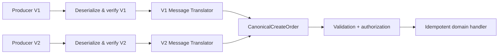
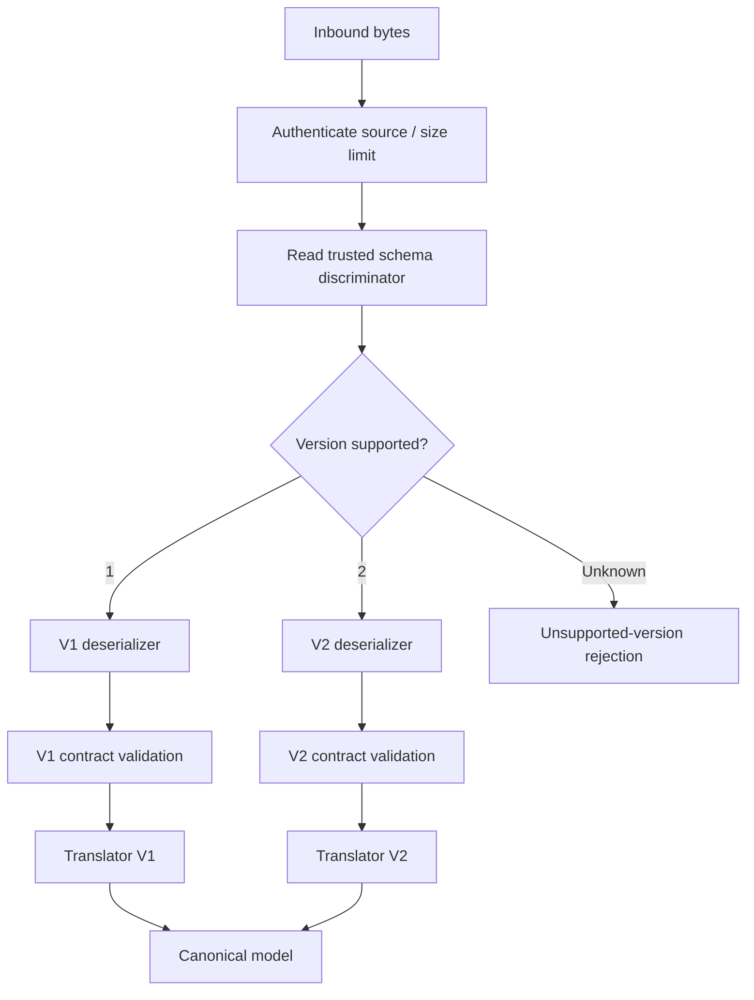
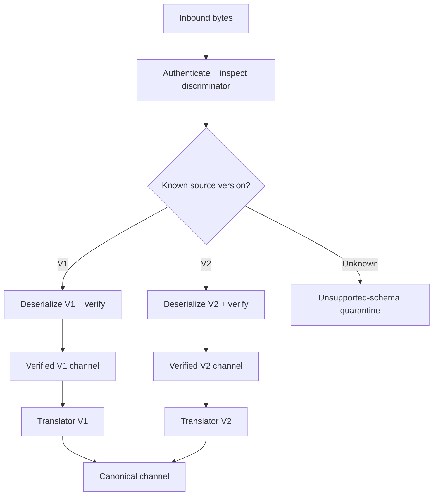
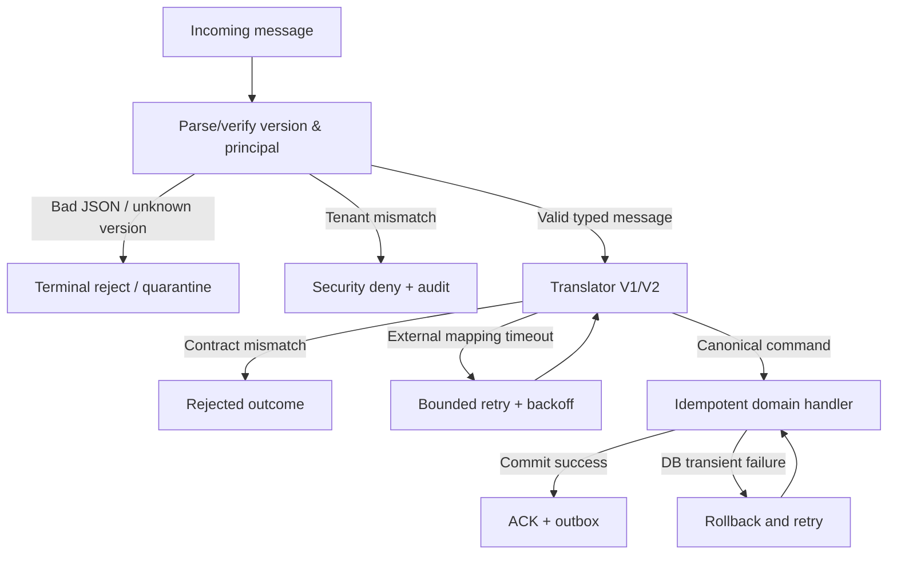

# Translator for Different Schema Versions

## 1. The problem: one business event, multiple schema versions

An order processing service connects to two groups of producers. The legacy system still emits `OrderPlaced` events using **schema V1**, while the new system has rolled out **schema V2**. Both represent creating an order, yet their field structures and data types differ.

Example V1 message:

```json
{
  "schemaVersion": 1,
  "metadata": {
    "tenantId": "tenant-a",
    "eventId": "evt-web-105",
    "occurredAt": "2026-11-21T04:00:00Z"
  },
  "order": {
    "orderRef": "WEB-105",
    "items": [
      {
        "sku": "SKU-A",
        "quantityText": "2",
        "unitPriceVnd": "25000"
      }
    ],
    "totalVnd": "50000"
  }
}
```

A V2 message carries the same business content with a different structure:

```json
{
  "schemaVersion": 2,
  "context": {
    "tenant": "tenant-a",
    "idempotencyEventKey": "evt-web-105",
    "occurredAtOffset": "2026-11-21T11:00:00+07:00"
  },
  "purchase": {
    "purchaseId": "WEB-105",
    "lines": [
      {
        "productSku": "SKU-A",
        "units": 2,
        "unitPrice": {
          "currency": "VND",
          "minorUnits": 25000
        }
      }
    ],
    "declaredTotal": {
      "currency": "VND",
      "minorUnits": 50000
    }
  }
}
```

If the business service must understand both V1 and V2, `if(version==1)` / `if(version==2)` branches proliferate across the codebase. A producer upgrading its schema can ripple into Routers, Filters, Service Activators, consumers, database mappers, and business tests.

**Message Translator** is the pattern that converts one message representation into another so two components with differing contracts can communicate. In this lesson, the translator accepts **different source schema versions** and produces a single **canonical application command** before passing it to business processing steps.

In the **Message translator** chapter of module **SPRING_INTEGRATION_PATTERN**, learners implement Enterprise Integration Patterns with Spring Integration to build loosely coupled, extensible message flows. Topics connect to Router, Filter, Transformer, Splitter, Aggregator, Gateway, retry, error channel, and correlation, while testing and observing multiple processing branches.



**Goal:** keep schema differences in the integration layer while **never masking real semantic changes**, such as currency conversions, altered event identifiers, or changed total calculation rules.

## 2. How Translator differs from Transformer, Normalizer, Converter, and Upcaster

| Concept | Responsibility | In this lesson |
| --- | --- | --- |
| **Message Translator** | Converts data contract A to B between two components | V1/V2 → `CanonicalCreateOrder` |
| **Message Transformer** | Endpoint/mechanism converting a payload or message in Spring Integration | Tool implementing the translator |
| **Normalizer** | Converges multiple input formats into one common structure | The combined V1+V2 diagram exhibits Normalizer traits |
| **Message Converter** | Converts bytes/JSON/Avro/Protobuf to Java objects or vice versa | Deserializes V1/V2 before translation |
| **Schema Upcaster** | Upgrades an older representation to a newer one via versioned rules | Can map V1 → V2 if semantics stay intact |
| **Envelope Wrapper** | Adds/strips packaging metadata around payload | `schemaVersion`/context layer at message boundary |
| **Content Enricher** | Enriches data from another source | Looks up SKU catalog if contract requires |
| **Content-Based Router** | Chooses branch by type/version/content | Selects V1 or V2 translator |
| **Idempotent Receiver** | Prevents repeated side effects for the same logical event | Runs **after** translation/validation |

Not every version must travel through an "upcaster chain". For two simple schemas, two independent translators targeting the same command are easy to read. With many versions and compatible semantics, a `V1 → V2 → V3 → Canonical` pipeline may make sense, provided every step has clear contract tests and error policies.

### 2.1. Translation is not arbitrary data fixing

Translating `quantityText="2"` into `quantity=2` is a meaningful type conversion if the source contract defines a positive integer.

Conversely, the following **must never be performed silently**:
- `quantityText="two" → 2` by guessing natural language.
- `currency="USD" → "VND"` without an exchange rate and rate timestamp.
- `occurredAtOffset` missing timezone → falling back to server timezone.
- `eventId=null → random UUID` when retrying the same event.
- `totalVnd` mismatching line items → silently rewriting the total without raising an error.
- Schema V2 changing the semantics of `purchaseId` while still treating it as V1's `orderRef`.

A Translator must **preserve meaning** or reject whenever safe conversion is impossible.

### 2.2. A canonical model is scoped to a bounded context, not the whole enterprise

The translator's target should be a command tailored to the **order-processing bounded context**, not necessarily a giant enterprise-wide schema. If the payment domain needs multiple currencies, a full `Money` type fits; this example uses **whole VND orders** to keep calculations transparent.

## 3. Schema version is a discriminator that must be verified

Before translating, the adapter must know **which schema the payload conforms to**. The discriminator may live in a JSON envelope, broker header, content type, schema registry ID, or a dedicated endpoint. The source establishing the version must follow an explicit contract and match the actual bytes.



**Never** try parsing as V1, catch an exception, and fall back to V2 until one happens not to throw. A V2 JSON payload can partially deserialize into a V1 DTO with null/default fields, causing silent misinterpretation.

### 3.1. Difference between source version and canonical version

A message can carry:

```text
sourceSchemaVersion     = 1
canonicalContractVersion = 3
translationRuleVersion  = "order-v1-to-canonical-v3/r4"
```

Meaning:
- `sourceSchemaVersion`: which contract the producer sent.
- `canonicalContractVersion`: which command/model version downstream reads.
- `translationRuleVersion`: which mapping rule revision was applied, for explainability and replay.

These three values are **not** the same number and must never substitute for an event ID or message ID. In the Java example, the command retains `sourceSchemaVersion`. In production with multiple active rule/contract revisions, record the mapping rule revision in audit/inbox or normalized source metadata as well.

### 3.2. Which changes are genuinely compatible?

| Source change | Can translate while preserving meaning? | Condition |
| --- | --- | --- |
| Rename `orderRef` to `purchaseId` | Yes | Identity semantics unchanged |
| `quantityText="2"` to integer `2` | Yes | Same value domain; parser rejects invalid inputs |
| Timestamp from UTC to ISO offset | Yes | Same instant; complete timezone info |
| Whole VND money from String to long | Yes | Guard overflow and currency |
| Add a new optional field | Possibly | Does not alter existing fields' semantics |
| Change `eventId` from event ID to delivery ID | **Not by default** | Breaks idempotency without a new key |
| Change `unitPrice` from VND to USD cents | **Breaking** | Requires new conversion policy/contract |
| Change `orderRef` from tenant-unique to daily-unique | **Breaking** | Needs additional scope/version |
| V2 total includes tax, V1 total excludes tax | **Breaking** | Do not merge into the same unclarified `totalVnd` |

A schema registry can detect **structural** changes per compatibility rules, but cannot by itself guarantee that **business semantic** changes are safe.

## 4. Source models V1 and V2 in Java

Examples use Java 17 records. These are DTOs describing the **deserialized** payload—they do not imply tenant/source authentication or business rule compliance yet.

### 4.1. DTOs for V1

```java
import java.util.List;

record OrderMetadataV1(
        String tenantId,
        String eventId,
        String occurredAt) {}

record OrderLineV1(
        String sku,
        String quantityText,
        String unitPriceVnd) {}

record OrderDataV1(
        String orderRef,
        List<OrderLineV1> items,
        String totalVnd) {}

record OrderEventV1(
        int schemaVersion,
        OrderMetadataV1 metadata,
        OrderDataV1 order) {}
```

V1 stores quantities and prices as strings. Do not assume the parser accepts `"2.0"`, `"25,000"`, or locale-specific commas when the contract allows only integer decimal text.

### 4.2. DTOs for V2

```java
import java.util.List;

record MoneyV2(
        String currency,
        long minorUnits) {}

record OrderContextV2(
        String tenant,
        String idempotencyEventKey,
        String occurredAtOffset) {}

record OrderLineV2(
        String productSku,
        int units,
        MoneyV2 unitPrice) {}

record OrderPurchaseV2(
        String purchaseId,
        List<OrderLineV2> lines,
        MoneyV2 declaredTotal) {}

record OrderEventV2(
        int schemaVersion,
        OrderContextV2 context,
        OrderPurchaseV2 purchase) {}
```

Introducing `MoneyV2` makes the currency **explicit**. Although the field is named `minorUnits` in V2, per the example contract `VND` uses whole units (0 decimal places); never assume every currency has 2 decimals. The Translator accepts only `VND` to match the lesson's canonical model.

### 4.3. Do not cram every version into one nullable DTO

Anti-pattern:

```java
record OrderEventAnyVersion(
        String orderRef,
        String purchaseId,
        String quantityText,
        Integer units,
        String unitPriceVnd,
        MoneyV2 unitPrice,
        String eventId,
        String idempotencyEventKey,
        Integer schemaVersion) {}
```

As optional fields grow, the mapper ends up guessing "if `orderRef` is null, it must be V2". A malformed payload can accidentally be interpreted as another version. **Separate versioned typed DTOs** keep translation branches from relying on null checks to guess schemas.

## 5. Canonical command: one common target, free of source DTOs

We define the command processed by the application service. Business elements **shared between V1 and V2** are strongly typed:

```text
CanonicalCreateOrder
  tenantId              String
  sourceEventId         String
  sourceSchemaVersion   int
  orderId               String
  occurredAt            Instant
  lines                 List<CanonicalLine>
  totalVnd              long
```

### 5.1. Immutable records with invariants

```java
import java.time.Instant;
import java.util.List;
import java.util.Objects;

record CanonicalLine(
        String sku,
        int quantity,
        long unitPriceVnd) {

    CanonicalLine {
        if (sku == null
                || !sku.matches("[A-Z0-9-]{1,32}")
                || quantity <= 0
                || unitPriceVnd < 0) {
            throw new IllegalArgumentException(
                    "INVALID_CANONICAL_LINE");
        }
    }

    long lineTotalVnd() {
        return Math.multiplyExact(
                (long) quantity, unitPriceVnd);
    }
}

record CanonicalCreateOrder(
        String tenantId,
        String sourceEventId,
        int sourceSchemaVersion,
        String orderId,
        Instant occurredAt,
        List<CanonicalLine> lines,
        long totalVnd) {

    CanonicalCreateOrder {
        if (tenantId == null || tenantId.isBlank()
                || sourceEventId == null || sourceEventId.isBlank()
                || sourceSchemaVersion < 1
                || orderId == null || orderId.isBlank()
                || occurredAt == null
                || lines == null || lines.isEmpty()
                || lines.size() > 1000) {
            throw new IllegalArgumentException(
                    "INVALID_CANONICAL_ORDER");
        }

        lines = List.copyOf(lines);
        long expected = 0L;
        for (CanonicalLine line : lines) {
            Objects.requireNonNull(line, "line");
            expected = Math.addExact(
                    expected, line.lineTotalVnd());
        }
        if (totalVnd != expected) {
            throw new IllegalArgumentException(
                    "CANONICAL_TOTAL_MISMATCH");
        }
    }
}
```

Key decisions:

1. `occurredAt` uses `Instant` to represent an exact point in time independent of server timezone.
2. `totalVnd` is a whole-VND integer; `Math.multiplyExact` and `Math.addExact` prevent silent overflow.
3. `List.copyOf` preserves a defensive snapshot; nested records hold only immutable primitives/Strings.
4. `sourceSchemaVersion` tracks source provenance, not a "domain entity version".
5. `sourceEventId` is a logical event identity **stable across redeliveries**, never replaced with `MessageHeaders.ID`.
6. The source's declared total must match the sum of lines; on mismatch, the translator **rejects** rather than overwriting the amount.
7. The constructor validates data consistency, not whether **the quoted price is authorized**; that belongs to business authorization / pricing services.

### 5.2. Domain port accepts a single type

```java
interface OrderApplicationService {
    void createOrder(CanonicalCreateOrder order);
}
```

The domain/application service never imports `OrderEventV1`, `OrderEventV2`, `MoneyV2`, raw JSON nodes, or Kafka headers. Adding a V3 producer (if expressible in the same contract) only requires a new translator without changing business handlers.

## 6. Trust boundary: typed verified input

Before translating, the adapter must authenticate the sender and cross-check the tenant. A V1/V2 payload may carry a client-supplied `tenantId`; that alone proves nothing about sender authority.

In this example, we represent the verified outcome using two types:

```java
record VerifiedOrderV1(
        OrderEventV1 wire,
        String authorizedTenantId) {}

record VerifiedOrderV2(
        OrderEventV2 wire,
        String authorizedTenantId) {}
```

**This only models an internal validated context.** A Java record can be instantiated directly; the Java type itself is not a signature or authentication certificate. Only an inbound adapter/guard using transport principals, mTLS, broker ACLs, or signed webhooks should emit data onto verified channels.

### 6.1. Validating tenant against authenticated identity

```java
import java.util.Objects;

final class VerifiedOrderFactory {

    VerifiedOrderV1 verifyV1(
            OrderEventV1 event, String authenticatedTenant) {
        Objects.requireNonNull(event, "event");
        if (authenticatedTenant == null
                || authenticatedTenant.isBlank()
                || event.metadata() == null
                || !authenticatedTenant.equals(
                        event.metadata().tenantId())) {
            throw new SecurityException(
                    "TENANT_IDENTITY_MISMATCH");
        }
        return new VerifiedOrderV1(event, authenticatedTenant);
    }

    VerifiedOrderV2 verifyV2(
            OrderEventV2 event, String authenticatedTenant) {
        Objects.requireNonNull(event, "event");
        if (authenticatedTenant == null
                || authenticatedTenant.isBlank()
                || event.context() == null
                || !authenticatedTenant.equals(
                        event.context().tenant())) {
            throw new SecurityException(
                    "TENANT_IDENTITY_MISMATCH");
        }
        return new VerifiedOrderV2(event, authenticatedTenant);
    }
}
```

`authenticatedTenant` **must come from a trusted source in the adapter**—never call `verifyV1(event, event.metadata().tenantId())` and pretend the message is authenticated.

### 6.2. Version and payload type must match

If `OrderEventV1.schemaVersion() != 1` or `OrderEventV2.schemaVersion() != 2`, the translator must reject. Never let a V2 payload deserialize into a V1 type and bypass version routing. At public boundaries, **verify both the discriminator** and **the payload conformance to that schema**.

## 7. Translation error contract

An untranslatable message needs a **stable error code** to drive reject/quarantine/retry decisions without parsing raw-payload exception messages.

```java
final class TranslationContractException
        extends IllegalArgumentException {

    private final String reasonCode;

    TranslationContractException(String reasonCode) {
        super(reasonCode);
        this.reasonCode = reasonCode;
    }

    String reasonCode() {
        return reasonCode;
    }
}
```

| Error | Suggested code | Classification |
| --- | --- | --- |
| Unsupported version | `UNSUPPORTED_SCHEMA_VERSION` | Terminal/quarantine |
| Missing required field | `REQUIRED_FIELD_MISSING` | Data contract |
| Unparseable V1 quantity | `V1_QUANTITY_INVALID` | Data contract |
| V2 currency is not VND | `UNSUPPORTED_CURRENCY` | Semantic contract |
| Timestamp missing offset | `TIMESTAMP_INVALID` | Data contract |
| Total amount mismatch | `TOTAL_MISMATCH` | Semantic contract |
| Price exceeds long | `AMOUNT_OUT_OF_RANGE` | Data contract |
| Source/tenant mismatch | `TENANT_IDENTITY_MISMATCH` | Security failure |
| Directory DB timeout | Do not treat as bad input | Transient infrastructure |
| Unknown source/producer | Do not treat merely as bad schema | Security/contract |

**Never catch every `RuntimeException` and convert it into `TranslationContractException`.** A `DataAccessException` or network timeout is potentially recoverable, and an unexpected `NullPointerException` is a programming bug. Treating everything as invalid data causes wrong ACKs and lost messages.

## 8. V1 Translator: strict parsing and identity preservation

V1 carries quantities and amounts as strings. The Translator must check the exact version, parse strictly, preserve the source event ID, and verify the declared total.

### 8.1. Translation rule helpers

```java
import java.time.Instant;
import java.util.List;

final class TranslationRules {
    private TranslationRules() {}

    static int positiveQuantity(String raw) {
        try {
            int value = Integer.parseInt(raw);
            if (value <= 0) {
                throw new NumberFormatException();
            }
            return value;
        } catch (NumberFormatException ex) {
            throw new TranslationContractException(
                    "V1_QUANTITY_INVALID");
        }
    }

    static long nonnegativeVnd(String raw, String code) {
        try {
            long value = Long.parseLong(raw);
            if (value < 0) {
                throw new NumberFormatException();
            }
            return value;
        } catch (NumberFormatException ex) {
            throw new TranslationContractException(code);
        }
    }

    static CanonicalCreateOrder command(
            String tenantId, String eventId, int version,
            String orderId, Instant occurredAt,
            List<CanonicalLine> lines, long declaredTotal) {
        try {
            return new CanonicalCreateOrder(
                    tenantId, eventId, version, orderId,
                    occurredAt, lines, declaredTotal);
        } catch (ArithmeticException ex) {
            throw new TranslationContractException(
                    "AMOUNT_OUT_OF_RANGE");
        } catch (IllegalArgumentException ex) {
            throw new TranslationContractException(
                    "TOTAL_OR_CANONICAL_INVARIANT_INVALID");
        }
    }
}
```

`parseInt`/`parseLong` will not "fix" invalid number strings. If an official producer permits locale-specific separators or decimals, add a versioned, tested parser rather than relying on the JVM's default locale.

### 8.2. `V1OrderTranslator` implementation

```java
import java.time.Instant;
import java.time.format.DateTimeParseException;
import java.util.ArrayList;
import org.springframework.stereotype.Component;

@Component
final class V1OrderTranslator {

    CanonicalCreateOrder translate(VerifiedOrderV1 verified) {
        if (verified == null || verified.wire() == null
                || verified.authorizedTenantId() == null) {
            throw new TranslationContractException(
                    "VERIFIED_V1_MISSING");
        }

        OrderEventV1 wire = verified.wire();
        if (wire.schemaVersion() != 1) {
            throw new TranslationContractException(
                    "UNSUPPORTED_SCHEMA_VERSION");
        }

        OrderMetadataV1 meta = wire.metadata();
        OrderDataV1 order = wire.order();
        if (meta == null || order == null
                || blank(meta.eventId())
                || blank(meta.occurredAt())
                || blank(order.orderRef())
                || blank(order.totalVnd())
                || order.items() == null
                || order.items().isEmpty()
                || order.items().size() > 1000) {
            throw new TranslationContractException(
                    "REQUIRED_FIELD_MISSING");
        }

        if (!verified.authorizedTenantId().equals(
                meta.tenantId())) {
            throw new SecurityException(
                    "TENANT_IDENTITY_MISMATCH");
        }

        Instant occurredAt;
        try {
            occurredAt = Instant.parse(meta.occurredAt());
        } catch (DateTimeParseException ex) {
            throw new TranslationContractException(
                    "TIMESTAMP_INVALID");
        }

        var lines = new ArrayList<CanonicalLine>();
        for (OrderLineV1 item : order.items()) {
            if (item == null || blank(item.sku())
                    || blank(item.quantityText())
                    || blank(item.unitPriceVnd())) {
                throw new TranslationContractException(
                        "V1_LINE_MISSING_FIELD");
            }
            int quantity = TranslationRules.positiveQuantity(
                    item.quantityText());
            long unitPrice = TranslationRules.nonnegativeVnd(
                    item.unitPriceVnd(), "V1_PRICE_INVALID");

            try {
                lines.add(new CanonicalLine(
                        item.sku(), quantity, unitPrice));
            } catch (IllegalArgumentException ex) {
                throw new TranslationContractException(
                        "V1_LINE_INVALID");
            }
        }

        long declaredTotal = TranslationRules.nonnegativeVnd(
                order.totalVnd(), "V1_TOTAL_INVALID");

        return TranslationRules.command(
                verified.authorizedTenantId(),
                meta.eventId(), 1, order.orderRef(),
                occurredAt, lines, declaredTotal);
    }

    private static boolean blank(String text) {
        return text == null || text.isBlank();
    }
}
```

**Never lose business identity:** a producer retrying the same V1 event must keep using the existing `meta.eventId()`. Never substitute a newly generated `MessageHeaders.ID` on each delivery attempt.

**Never legitimize invalid data:** the Translator passes the source's `declaredTotal`, and the canonical constructor checks it against the sum of lines. Bad fields must produce an error outcome rather than silently replacing them with a recomputed total.

## 9. V2 Translator: Money and offset timestamps

V2 supplies integer quantities and a `Money` type. The challenge is not parsing, but **interpreting units accurately**.

### 9.1. Accepting only VND per the lesson contract

```java
final class MoneyV2Translator {
    private MoneyV2Translator() {}

    static long requireVnd(MoneyV2 money) {
        if (money == null
                || !"VND".equals(money.currency())) {
            throw new TranslationContractException(
                    "UNSUPPORTED_CURRENCY");
        }
        if (money.minorUnits() < 0) {
            throw new TranslationContractException(
                    "V2_AMOUNT_INVALID");
        }
        return money.minorUnits();
    }
}
```

If V2 expands to USD/EUR, never cast USD cents into whole VND. A new canonical version would need `Money(currency, minorUnits)` and an explicit business conversion policy.

### 9.2. `V2OrderTranslator` implementation

```java
import java.time.Instant;
import java.time.OffsetDateTime;
import java.time.format.DateTimeParseException;
import java.util.ArrayList;
import org.springframework.stereotype.Component;

@Component
final class V2OrderTranslator {

    CanonicalCreateOrder translate(VerifiedOrderV2 verified) {
        if (verified == null || verified.wire() == null
                || verified.authorizedTenantId() == null) {
            throw new TranslationContractException(
                    "VERIFIED_V2_MISSING");
        }

        OrderEventV2 wire = verified.wire();
        if (wire.schemaVersion() != 2) {
            throw new TranslationContractException(
                    "UNSUPPORTED_SCHEMA_VERSION");
        }

        OrderContextV2 context = wire.context();
        OrderPurchaseV2 purchase = wire.purchase();
        if (context == null || purchase == null
                || blank(context.idempotencyEventKey())
                || blank(context.occurredAtOffset())
                || blank(purchase.purchaseId())
                || purchase.lines() == null
                || purchase.lines().isEmpty()
                || purchase.lines().size() > 1000) {
            throw new TranslationContractException(
                    "REQUIRED_FIELD_MISSING");
        }

        if (!verified.authorizedTenantId().equals(
                context.tenant())) {
            throw new SecurityException(
                    "TENANT_IDENTITY_MISMATCH");
        }

        Instant occurredAt;
        try {
            occurredAt = OffsetDateTime.parse(
                    context.occurredAtOffset()).toInstant();
        } catch (DateTimeParseException ex) {
            throw new TranslationContractException(
                    "TIMESTAMP_INVALID");
        }

        var lines = new ArrayList<CanonicalLine>();
        for (OrderLineV2 item : purchase.lines()) {
            if (item == null || blank(item.productSku())
                    || item.units() <= 0) {
                throw new TranslationContractException(
                        "V2_LINE_INVALID");
            }

            long unitPrice =
                    MoneyV2Translator.requireVnd(item.unitPrice());

            try {
                lines.add(new CanonicalLine(
                        item.productSku(),
                        item.units(), unitPrice));
            } catch (IllegalArgumentException ex) {
                throw new TranslationContractException(
                        "V2_LINE_INVALID");
            }
        }

        long total = MoneyV2Translator.requireVnd(
                purchase.declaredTotal());

        return TranslationRules.command(
                verified.authorizedTenantId(),
                context.idempotencyEventKey(),
                2, purchase.purchaseId(),
                occurredAt, lines, total);
    }

    private static boolean blank(String text) {
        return text == null || text.isBlank();
    }
}
```

In the opening examples, V1 timestamp `2026-11-21T04:00:00Z` and V2 timestamp `2026-11-21T11:00:00+07:00` represent the exact same `Instant`. Never fall back to the server timezone or treat offsets as decorative text.

### 9.3. A translator should avoid side effects

Do not deduct inventory, write invoices, send emails, or call payment APIs inside `translate`. Ideally the translator only converts and validates values; if SKU mapping lookup is required, use a versioned read-only service and distinguish missing mappings from outages. Place transactions and domain side effects **after** the command is successfully built.

## 10. Java DSL: two versions converging on one domain handler

Spring Integration lets you wire a Transformer per input type and route both branches into a shared channel.

```java
import org.springframework.context.annotation.Bean;
import org.springframework.context.annotation.Configuration;
import org.springframework.integration.channel.DirectChannel;
import org.springframework.integration.config.EnableIntegration;
import org.springframework.integration.dsl.IntegrationFlow;
import org.springframework.messaging.MessageChannel;

@Configuration
@EnableIntegration
class VersionedOrderIntegrationFlows {

    @Bean("orders.v1.verified")
    MessageChannel v1Input() {
        return new DirectChannel();
    }

    @Bean("orders.v2.verified")
    MessageChannel v2Input() {
        return new DirectChannel();
    }

    @Bean("orders.canonical")
    MessageChannel canonicalInput() {
        return new DirectChannel();
    }

    @Bean
    IntegrationFlow v1Flow(V1OrderTranslator translator) {
        return IntegrationFlow.from("orders.v1.verified")
                .transform(VerifiedOrderV1.class,
                        translator::translate)
                .channel("orders.canonical")
                .get();
    }

    @Bean
    IntegrationFlow v2Flow(V2OrderTranslator translator) {
        return IntegrationFlow.from("orders.v2.verified")
                .transform(VerifiedOrderV2.class,
                        translator::translate)
                .channel("orders.canonical")
                .get();
    }

    @Bean
    IntegrationFlow canonicalOrderFlow(
            OrderApplicationService service) {
        return IntegrationFlow.from("orders.canonical")
                .handle(CanonicalCreateOrder.class,
                        (command, headers) -> {
                            service.createOrder(command);
                            return null; // one-way handler
                        })
                .get();
    }
}
```

In this example:
- The V1 adapter/guard verifies and deserializes V1, sending `VerifiedOrderV1` to `orders.v1.verified`.
- The V2 adapter/guard sends `VerifiedOrderV2` to `orders.v2.verified`.
- Each translator outputs `CanonicalCreateOrder`.
- Both route to `orders.canonical`.
- The domain service exposes **one** API without knowing V1/V2 field names.

The Java DSL follows modern Spring Integration idioms; exact overloads in your project build should be verified during QA/compile later. `DirectChannel` demonstrates a synchronous in-JVM flow, **not a durable queue**. When switching to a broker or executor, design ACKs, retries, and error handling separately.

### 10.1. Channel convergence is not an Aggregator

Two translators feeding one channel **does not merge** two messages together. Each event flows into the domain handler individually. To collect multiple child messages into one batch, you need an Aggregator with correlation and release strategies, not just wiring both into a single channel.

### 10.2. A request–reply Gateway requires a reply path

`canonicalOrderFlow` returns `null` and the domain port returns `void`, so this is **one-way**. If a `MessagingGateway` expects a result, make the service return a typed result and design both success and rejection reply paths. A Filter silently discarding malformed V1 inputs can cause the Gateway to time out instead of returning a meaningful validation error.

### 10.3. Route `schemaVersion` at the adapter, never cast blindly



Never trust a caller-supplied `schemaVersion=2` header and cast `(OrderEventV2) message.getPayload()`. Verify the schema type/discriminator alongside the wire bytes and serializer contract. When version is missing, never try every parser and pick whichever "happens to succeed".

## 11. Correlation, headers, and stable event identity

A message flowing through integration can carry:
- `sourceEventId`: stable business logical event ID;
- `orderId`: order entity identifier;
- `sourceSchemaVersion`: producer's data representation;
- `MessageHeaders.ID`: mutable envelope ID;
- `CORRELATION_ID`: Splitter/Aggregator or request flow group ID;
- `traceId`: observability context;
- `REPLY_CHANNEL`/`ERROR_CHANNEL`: Spring messaging reply/error targets.

**Schema version is not event identity.** If a producer redelivers the same logical event as V2 after sending V1 first, an idempotent consumer may need to treat them as **the same event** when business facts match.

### 11.1. A clearly scoped idempotency key

```java
record OrderIdempotencyKey(
        String consumerName,
        String tenantId,
        String sourceSystem,
        String sourceEventId) {}
```

`sourceSystem` must come from authenticated identity; if producers have separate ID spaces and you omit source, two events sharing an `eventId` could falsely collide. If `eventId` is guaranteed tenant-wide unique, the source field may be unnecessary—**state that explicitly in the contract**.

Never include `sourceSchemaVersion` in the key solely to distinguish V1 and V2 representations of one logical event: doing so could execute the same operation twice. If V2 actually represents a **new business revision**, give it an intentional new event identity/revision.

### 11.2. Duplicates vs. key conflicts

When the same key was already processed:
- V1 `quantityText="2"` and V2 `units=2`, same price, same instant → likely a valid duplicate.
- V2 with the same event ID but `quantity=3` → **same key, different business content**, requiring conflict/reconciliation handling.
- V2 with a different offset string representing the same instant → not semantically different data.
- If catalog/exchange-rate versions changed between attempts, canonical results may differ; store mapping snapshots/versions for replay.

A canonical fingerprint requires stable encoding rules for fields, collection ordering, and money/time semantics; never hash an arbitrary `toString()` to detect duplicates.

### 11.3. Header propagation must be controlled

A Transformer builds a new payload, yet Spring Integration may preserve many source headers. That helps tracing, but poses risks when source headers are untrusted.

| Header | Policy |
| --- | --- |
| Tenant/source header | Cross-check against authenticated context |
| Business event ID | Derive/verify against canonical command |
| `MessageHeaders.ID` | Never use as logical `eventId` |
| `CORRELATION_ID` | Preserve if group semantics hold |
| `SEQUENCE_NUMBER/SIZE` | Preserve when Splitter/Aggregator need them |
| `REPLY_CHANNEL` | Preserve accurately in Gateway request–reply flows |
| `ERROR_CHANNEL` | Follow error handling contract |
| Trace context | Propagate per tracing policy |
| Schema version | Keep in appropriate audit/trace metadata |
| Raw credentials / tokens | Never copy across unnecessary channels |

Especially avoid unfiltered `copyHeaders(input.getHeaders())` when sending messages to an external broker. Use an explicit allowlist/mapper and test output messages across adapter boundaries.

## 12. Limits when retrying and replaying legacy schemas

A V1 event might sit in a DLQ for days while the consumer has moved on to V2. On replay, determine:
1. Is the V1 parser still supported?
2. Does the V1 → canonical translator still follow the contracted semantics?
3. Have SKU mappings or pricing rules changed?
4. Was the initial command/fingerprint saved for comparison?
5. Are the DLQ and pending state still within their retention window?
6. Does downstream idempotency prevent repeated side effects after ACK loss?

**Always using the latest mapping during replay is not always right.** For finance or inventory, maintain rule revisions or snapshots to explain why a given input produces a given outcome.

| Scenario | Error category | Policy |
| --- | --- | --- |
| `schemaVersion=99` | Unsupported version | Quarantine/terminal reject |
| V1 `quantityText="two"` | Malformed data | Reject; do not hot-retry |
| V2 `currency="USD"` | Unsupported semantics | Reject or use new contract translator |
| Missing `eventId` | Invalid identity contract | Never mint a random `eventId` for the same logical event |
| Tenant mismatch | Security | Deny and audit |
| Catalog database timeout | Transient dependency | Bounded retry/backoff |
| Business DB deadlock | Transient transaction | Rollback/retry |
| Gateway timeout | Request/reply liveness | Never treat as side-effect rollback |

## 13. Designing schema evolution and lossless conversion

Not every change between V1 and V2 is a "field rename". A schema upgrade strategy must separate **structural compatibility**, **semantic compatibility**, and **operational compatibility**.

### 13.1. Three kinds of changes

| Type | Example | How to evaluate |
| --- | --- | --- |
| **Representational compatibility** | V1 String `"2"` → V2 int `2` | Translatable if value domains match |
| **Conditional compatibility** | V2 adds optional `discountCode` | Does downstream need to apply discounts? |
| **Semantic incompatibility** | V2 total includes tax, V1 excludes tax | Requires new canonical contract/rules |

Treat these as breaking: changing currency units, changing timezone assumptions, changing identity scope, altering status meaning, or dropping a field needed for a business invariant. If lossless conversion lacks sufficient data, **reject** or upgrade the canonical contract rather than guessing defaults.

### 13.2. Direct translators vs. upcaster chain

**Design A — Direct translator per version:**

```text
OrderEventV1 ---> V1OrderTranslator --+
                                      +---> CanonicalCreateOrder
OrderEventV2 ---> V2OrderTranslator --+
```

Pros: clear per-version mapping with no dependency on intermediate version DTOs. Works well when few versions exist or structures diverge sharply. Cons: shared rules may repeat across mappers.

**Design B — Upcaster chain:**

```text
OrderEventV1 -> UpcastV1ToV2 -> OrderEventV2
                                   |
OrderEventV2 ----------------------+
                                   v
                              CanonicalOrder
```

Pros: one main canonical translator; easy to add future versions if upcasting is lossless. Risk: when V2 introduces a required field absent from V1, an upcaster might fabricate defaults, corrupt semantics, or silently lose info. Deep chains also complicate debugging and replay.

Pick based on version count, semantics, and replay needs. Never treat an upcaster chain as proof that all versions are equivalent.

### 13.3. Managing the support matrix

An operations document can maintain a version table:

| Source schema | Translator | Canonical contract | Status |
| --- | --- | --- | --- |
| V1 | V1OrderTranslator | CanonicalCreateOrder V1 | Supported during migration window |
| V2 | V2OrderTranslator | CanonicalCreateOrder V1 | Preferred |
| V3 | None yet | Not yet evaluated | Rejected/quarantine |
| Unversioned legacy | Approved legacy-specific adapter | Explicit assigned version | Never fall back arbitrarily |

Never guess V1 vs. V2 from deployment dates. Old producers, DLQ replays, and long-lived messages can linger. Publish the deprecation matrix before turning off older parsers/translators.

### 13.4. Keeping translation results explainable

Persist at least the audit metadata appropriate to your domain:

```text
sourceSchemaVersion   = 1
canonicalContract     = "create-order/1"
translatorRevision    = "v1-to-canonical/r3"
mappingRevision       = "catalog/2026-11"
logicalEventId        = "evt-web-105"
sourceSystem          = authenticated producer identity
canonicalFingerprint  = stable digest over business facts
```

These are **application-layer suggestions**, not fields automatically generated by Spring Integration. When SKU mappings or pricing rules change between replays, revisions/snapshots let you reproduce the original decision instead of merely saying "V1 translates differently from V2".

## 14. Unit testing V1/V2 and semantic equivalence testing

A key test goal is that **two versions representing the same business facts yield identical canonical business fields**. The full commands may still differ on `sourceSchemaVersion`—which is expected and meaningful.

### 14.1. Typed fixtures for both versions

```java
import java.util.List;

final class VersionedOrderFixtures {
    private VersionedOrderFixtures() {}

    static OrderEventV1 v1() {
        return new OrderEventV1(
                1,
                new OrderMetadataV1(
                        "tenant-a",
                        "evt-web-105",
                        "2026-11-21T04:00:00Z"),
                new OrderDataV1(
                        "WEB-105",
                        List.of(new OrderLineV1(
                                "SKU-A", "2", "25000")),
                        "50000"));
    }

    static OrderEventV2 v2() {
        return new OrderEventV2(
                2,
                new OrderContextV2(
                        "tenant-a",
                        "evt-web-105",
                        "2026-11-21T11:00:00+07:00"),
                new OrderPurchaseV2(
                        "WEB-105",
                        List.of(new OrderLineV2(
                                "SKU-A", 2,
                                new MoneyV2("VND", 25000))),
                        new MoneyV2("VND", 50000)));
    }
}
```

Fixtures V1 and V2 describe the same tenant, logical event, order ID, SKU, quantity, unit price, and instant. When building tests from real examples, use **synthetic data profiles** and never commit customer PII into the repository.

### 14.2. JUnit 5: matching canonical business facts

```java
import org.junit.jupiter.api.Test;
import static org.junit.jupiter.api.Assertions.*;

class VersionedOrderTranslatorTest {

    private final VerifiedOrderFactory verified =
            new VerifiedOrderFactory();
    private final V1OrderTranslator v1 =
            new V1OrderTranslator();
    private final V2OrderTranslator v2 =
            new V2OrderTranslator();

    @Test
    void differentVersionsPreserveSameBusinessMeaning() {
        var first = v1.translate(
                verified.verifyV1(
                        VersionedOrderFixtures.v1(), "tenant-a"));
        var second = v2.translate(
                verified.verifyV2(
                        VersionedOrderFixtures.v2(), "tenant-a"));

        assertEquals(first.tenantId(), second.tenantId());
        assertEquals(first.sourceEventId(),
                second.sourceEventId());
        assertEquals(first.orderId(), second.orderId());
        assertEquals(first.occurredAt(), second.occurredAt());
        assertEquals(first.lines(), second.lines());
        assertEquals(first.totalVnd(), second.totalVnd());

        // Provenance/representation is preserved separately.
        assertEquals(1, first.sourceSchemaVersion());
        assertEquals(2, second.sourceSchemaVersion());
        assertNotEquals(first, second);
    }

    @Test
    void v1RejectsNonIntegerQuantity() {
        var original = VersionedOrderFixtures.v1();
        var malformed = new OrderEventV1(
                1, original.metadata(),
                new OrderDataV1(
                        "WEB-105",
                        java.util.List.of(new OrderLineV1(
                                "SKU-A", "two", "25000")),
                        "50000"));

        var error = assertThrows(
                TranslationContractException.class,
                () -> v1.translate(
                        verified.verifyV1(
                                malformed, "tenant-a")));

        assertEquals("V1_QUANTITY_INVALID",
                error.reasonCode());
    }

    @Test
    void v2RejectsUnsupportedCurrency() {
        var original = VersionedOrderFixtures.v2();
        var wrongCurrency = new OrderEventV2(
                2, original.context(),
                new OrderPurchaseV2(
                        "WEB-105",
                        java.util.List.of(new OrderLineV2(
                                "SKU-A", 2,
                                new MoneyV2("USD", 25000))),
                        new MoneyV2("USD", 50000)));

        var error = assertThrows(
                TranslationContractException.class,
                () -> v2.translate(
                        verified.verifyV2(
                                wrongCurrency, "tenant-a")));

        assertEquals("UNSUPPORTED_CURRENCY",
                error.reasonCode());
    }

    @Test
    void sameIdentityWithWrongTenantIsSecurityFailure() {
        assertThrows(SecurityException.class,
                () -> verified.verifyV1(
                        VersionedOrderFixtures.v1(),
                        "tenant-b"));
    }

    @Test
    void unsupportedVersionDoesNotFallBackToAnotherMapper() {
        var validV1 = VersionedOrderFixtures.v1();
        var future = new OrderEventV1(
                9, validV1.metadata(), validV1.order());

        var error = assertThrows(
                TranslationContractException.class,
                () -> v1.translate(
                        verified.verifyV1(future, "tenant-a")));

        assertEquals("UNSUPPORTED_SCHEMA_VERSION",
                error.reasonCode());
    }
}
```

**Meaning of equivalence tests:** V1 and V2 produce two distinct Java objects because of `sourceSchemaVersion`, yet the business facts match when both describe the same logical event. Never strip `schemaVersion` from the command just to make `equals` pass; compare the defined **business projection** instead.

### 14.3. Testing total mismatch, overflow, and missing fields

Add tests for:

| Input | Expected outcome |
| --- | --- |
| V1 `quantityText="0"` | `V1_QUANTITY_INVALID` |
| V1 `unitPriceVnd="-1"` | `V1_PRICE_INVALID` |
| V1 `totalVnd="50000.0"` | `V1_TOTAL_INVALID` |
| V1 declared total 40,000 when lines sum to 50,000 | `TOTAL_OR_CANONICAL_INVARIANT_INVALID` |
| V1 timestamp missing timezone | `TIMESTAMP_INVALID` |
| V2 null money | `UNSUPPORTED_CURRENCY` or missing-field code per policy |
| V2 `currency="USD"` | `UNSUPPORTED_CURRENCY` |
| V2 quantity = 0 | `V2_LINE_INVALID` |
| V2 declaredTotal disagrees with sum | `TOTAL_OR_CANONICAL_INVARIANT_INVALID` |
| V2 timestamp without offset | `TIMESTAMP_INVALID` |
| V1 or V2 missing `eventId` | `REQUIRED_FIELD_MISSING` |
| V1 `schemaVersion=9` | `UNSUPPORTED_SCHEMA_VERSION` |
| Line price sum overflows `long` | `AMOUNT_OUT_OF_RANGE` |
| V1/V2 tenant differs from principal | `SecurityException` |

Do not assert stack trace formatting or full raw payloads in exception messages. Assert the **`reasonCode`** and that the **business service is never called** when translation fails.

### 14.4. Property-based tests for value domains

Properties to check:
- Positive V1 quantities formatted as canonical decimal integers parse to the exact value.
- V1 and V2 with identical integer prices and quantities in safe range yield identical line totals.
- Different offset timestamps representing the same instant produce identical canonical `occurredAt`.
- `long` boundary values overflow with an error instead of wrapping around.
- Mutating input lists or source objects after creating the canonical command does not mutate canonical lines.

Property-based tests do not replace integration tests with serializers or brokers; they verify pure mapping rules and invariants.

## 15. Integration test: both schemas reach a single application service

To prove there are no separate V1/V2 business branches, spin up a real Spring Integration context with both translators, channel configuration, and a mock implementation of the domain port.

### 15.1. Testing wiring

```java
import org.junit.jupiter.api.AfterEach;
import org.junit.jupiter.api.Test;
import org.mockito.ArgumentCaptor;
import org.springframework.beans.factory.annotation.Autowired;
import org.springframework.beans.factory.annotation.Qualifier;
import org.springframework.context.annotation.Bean;
import org.springframework.context.annotation.Configuration;
import org.springframework.messaging.MessageChannel;
import org.springframework.messaging.support.MessageBuilder;
import org.springframework.test.context.junit.jupiter.SpringJUnitConfig;

import static org.junit.jupiter.api.Assertions.*;
import static org.mockito.Mockito.*;

@SpringJUnitConfig(classes = {
        VersionedOrderIntegrationFlows.class,
        V1OrderTranslator.class,
        V2OrderTranslator.class,
        VersionedOrderFlowIT.Dependencies.class
})
class VersionedOrderFlowIT {

    @Autowired
    @Qualifier("orders.v1.verified")
    MessageChannel inputV1;

    @Autowired
    @Qualifier("orders.v2.verified")
    MessageChannel inputV2;

    @Autowired
    OrderApplicationService service;

    private final VerifiedOrderFactory verifier =
            new VerifiedOrderFactory();

    @AfterEach
    void resetMock() {
        reset(service);
    }

    @Test
    void bothVersionsUseExactlyOneCanonicalDomainPort() {
        var first = verifier.verifyV1(
                VersionedOrderFixtures.v1(),
                "tenant-a");
        var second = verifier.verifyV2(
                VersionedOrderFixtures.v2(),
                "tenant-a");

        assertTrue(inputV1.send(
                MessageBuilder.withPayload(first).build()));
        assertTrue(inputV2.send(
                MessageBuilder.withPayload(second).build()));

        var captor =
                ArgumentCaptor.forClass(
                        CanonicalCreateOrder.class);
        verify(service, times(2))
                .createOrder(captor.capture());

        var received = captor.getAllValues();
        assertEquals(2, received.size());
        assertEquals(1, received.get(0).sourceSchemaVersion());
        assertEquals(2, received.get(1).sourceSchemaVersion());
        assertEquals(
                received.get(0).lines(),
                received.get(1).lines());
        assertEquals(
                received.get(0).totalVnd(),
                received.get(1).totalVnd());
    }

    @Test
    void invalidV1NeverInvokesDomainPort() {
        var original = VersionedOrderFixtures.v1();
        var bad = new OrderEventV1(
                1, original.metadata(),
                new OrderDataV1(
                        "WEB-105",
                        java.util.List.of(new OrderLineV1(
                                "SKU-A", "bad", "25000")),
                        "50000"));

        assertThrows(RuntimeException.class,
                () -> inputV1.send(
                        MessageBuilder.withPayload(
                                verifier.verifyV1(
                                        bad, "tenant-a")).build()));

        verifyNoInteractions(service);
    }

    @Configuration
    static class Dependencies {
        @Bean
        OrderApplicationService applicationService() {
            return mock(OrderApplicationService.class);
        }
    }
}
```

**Test limitations:**
- `DirectChannel` is synchronous, so Mockito verification runs immediately after `send()`. With an `ExecutorChannel` or broker, use Awaitility/latches with a deadline.
- Constructing verified objects directly in tests **does not test real** mTLS/broker identity; test the security adapter separately.
- Requires compatible Spring Integration, Spring Test, Mockito, and JUnit versions.
- This is educational code; build/Gradle has not been run in STEP 4 NEW. The next Content QA pass should confirm the Java DSL overloads and dependencies.

### 15.2. Testing round-trip from bytes to domain

A more realistic test uses the transport's converter/schema registry:
1. Receive V1 bytes with a valid discriminator/registry ID.
2. Deserialize into the V1 DTO and verify identity from a trusted source.
3. Run the V1 translator to create `CanonicalCreateOrder`.
4. Assert the domain port receives the exact business fields.
5. Repeat with V2 bytes.
6. Test unknown V3 → no domain call, unsupported-schema outcome produced.
7. Test tenant spoofing → security rejection.
8. Test malformed JSON → conversion error **before the translator**.
9. Test redelivery of the same event → transactional Idempotent Receiver prevents duplicate writes.
10. Verify schema/version metadata and tracing across adapter hops.

Do not treat DTO-mapping unit tests as proof that serializers or broker version routing are configured correctly.

## 16. Translation errors and retry/error channels in workflows

A sound error policy separates error sources:



### 16.1. Typed rejected outcome when callers need an error response

If an import API needs rejection reasons, a variant can return an outcome instead of only throwing exceptions:

```java
sealed interface TranslationOutcome
        permits TranslatedOrder, RejectedOrderEvent {}

record TranslatedOrder(CanonicalCreateOrder order)
        implements TranslationOutcome {}

record RejectedOrderEvent(
        String trustedTrackingId,
        String reasonCode,
        int sourceSchemaVersion)
        implements TranslationOutcome {}
```

The boundary can catch **specifically** `TranslationContractException` and construct a `RejectedOrderEvent` free of raw sensitive payloads. `SecurityException`, timeouts, and provider bugs need separate handling paths. Never embed raw customer-submitted data inside a `reasonCode` sent to metrics/logs.

If a Router splits outcomes, the accepted branch unwraps `TranslatedOrder.order()` before passing `CanonicalCreateOrder` to the domain handler. The rejected branch needs a clear persistence/quarantine/reply policy; never silently drop messages awaited by a Gateway or Aggregator.

### 16.2. Error channel does not provide durability by itself

With `DirectChannel`, synchronous errors propagate back to the sender. With pollers, brokers, or executors, errors can become `ErrorMessage` payloads depending on configuration.

Yet `errorChannel` does not by itself:
- Persist raw bytes/source events in a durable DLQ;
- ACK/NACK on behalf of the adapter;
- Determine schema version and retry classification;
- Preserve pending Gateway requests across restarts;
- Prevent repeated domain side effects after redelivery.

Configure error handling, retry advice, persistent storage, and an Idempotent Receiver per transport.

### 16.3. An error should not be interpreted differently after a deploy

A V1 message with `quantityText="two"` will not become valid after a retry unless the **parser contract intentionally changes**. If you update the parser in a new release without recording rule revisions, the same raw event may be processed differently at different times.

Maintain:
- Explicit source schema version;
- Translator revision/decision logs;
- Quarantine reason codes and manual replay policies;
- Stable business event identity;
- Audits when transitioning from rejected to accepted after input correction;
- A new event revision if business content actually changed.

## 17. Deployment and multi-version rollout

A safe upgrade rarely forces every producer to switch schemas at the same instant.

### 17.1. Expand → migrate → contract pattern

1. **Expand:** Deploy the consumer supporting both V1 and V2, instrumented with per-version metrics.
2. **Verify:** Run contract tests and V2 canaries with synthetic events, comparing business projections across V1/V2 where equivalent.
3. **Migrate:** Producers gradually shift to V2; if dual-publishing the same logical event, the receiver needs idempotency to avoid executing side effects twice.
4. **Observe:** Monitor unknown versions, translation failures, V1 traffic, DLQ age, and version skew.
5. **Contract:** Turn off V1 only after legacy sources, DLQs, and replay windows expire and dependencies are confirmed clear.

### 17.2. Do not confuse dual-publishing with two distinct events

If a producer temporarily emits **both V1 and V2 for the same event** to verify compatibility, downstream receives two deliveries. Never use `(eventId, schemaVersion)` unconditionally as an idempotency key, or each version becomes an independent operation.

Conversely, if V2 is a **new business revision** (the user edited quantity), give it its own event ID or revision; do not block it as a duplicate just because `orderId` matches.

### 17.3. Turning off V1 support must account for DLQs and archives

A V1 message may sit in a DLQ for 30 days or in an archive for months. Removing the V1 parser before retention/replay windows expire breaks manual replays. Options:
- Keep the V1 compatibility reader for an agreed window;
- Provide a tested offline migration/upcast tool;
- Convert archives into canonical snapshots with provenance;
- Publicly sunset V1 support with clear conditions for manual recovery.

Never assume "zero V1 traffic today" means all historical stores are free of V1 messages.

## 18. Observability, security, and resource limits

### 18.1. Recommended metrics and alerts

| Suggested metric | Meaning |
| --- | --- |
| `translator.input.total` | Messages by source schema version |
| `translator.output.total` | Successfully emitted canonical commands |
| `translator.rejected.total` | Data/semantic contract failures |
| `translator.unsupported.version.total` | Unrecognized new schemas |
| `translator.duration` | P50/P95/P99 translation latency |
| `translator.currency.unsupported` | Currencies outside the contract |
| `translator.total.mismatch` | Declared total differs from computed sum |
| `translator.tenant.denied` | Tenant/source identity mismatches |
| `translator.conversion.error` | Pre-translator deserialization failures |
| `translator.rule.version.skew` | Two instances running different mapping revisions |
| `translator.quarantine.backlog` | Messages awaiting investigation/replay |
| `orders.idempotent.duplicate` | Duplicates caught after translation |
| `orders.outbox.backlog` | Unpublished domain events |
| `orders.gateway.timeout` | Replies missing SLA |

These are **suggested metric names**, not built-in metrics automatically emitted by Spring Integration. Bound labels to version, verified source category, and error category; never use `eventId`, tokens, or user IDs as high-cardinality metric labels.

### 18.2. Do not log full raw payloads

Logs can record trusted tracking ID, source/schema version, translator revision, outcome, reason code, line count, processing latency, and trace context per policy. Never print raw `OrderEvent` objects containing PII, signatures, access tokens, or entire `MessageHeaders`. If raw events must be retained for remediation, use a quarantine store with ACLs, encryption, and explicit retention.

### 18.3. Limits before deserializing

A message may contain huge JSON, arrays of millions of items, or massive number strings. Checking `lines.size() <= 1000` inside the translator helps, yet **after deserialization** objects already occupy heap memory. Enforce:
- Message byte limits at HTTP/broker adapters;
- JSON depth and collection size limits where converters support them;
- Rate limiting and authentication;
- Strict schema discriminators;
- Bounded validation error details;
- Protection against expensive regex/parsing;
- Monitoring of CPU, heap, and latency.

Never let an error handler dump entire heavy messages into logs on every retry.

## 19. Common anti-patterns

1. **Letting domain services accept both `OrderEventV1` and `OrderEventV2`**, coupling business logic to external schemas.
2. **Guessing version from null fields** instead of a verified schema discriminator.
3. **Using one DTO with dozens of nullable fields** for every version and casting everywhere.
4. **Trusting a producer-supplied `schemaVersion` header and casting payload** without checking bytes/types.
5. **Treating currency unit changes as field renames**, silently turning USD cents into VND.
6. **Using the JVM default timezone** when a source timestamp lacks an offset.
7. **Defaulting unparseable quantities to 0 or 1** to keep the message moving.
8. **Recomputing an incorrect `declaredTotal` without reporting a mismatch**, hiding data corruption.
9. **Minting a new `eventId` on retry**, invalidating idempotency.
10. **Using `MessageHeaders.ID` as `sourceEventId`** across broker adapters.
11. **Putting `schemaVersion` unconditionally into the idempotency key**, executing the same event twice.
12. **Omitting schema version from audits**, making replays unexplainable.
13. **Copying headers without an allowlist**, leaking credentials, `replyChannel`, or wrong correlations across service boundaries.
14. **Sharing one translator across versions and catching all exceptions**, masking bugs and outages.
15. **Infinitely hot-retrying malformed inputs**, creating a poison-message storm.
16. **Letting a Filter silently drop unsupported versions**, stalling Gateways on timeouts or hanging Aggregators.
17. **Skipping semantic equivalence tests between V1 and V2**, asserting only non-null outputs.
18. **Deleting the V1 parser while V1 messages sit in the DLQ**, breaking manual replays.
19. **Replaying against unversioned latest catalog mappings**, making outputs non-deterministic.
20. **Calling domain side effects inside the translator**, leaving partial effects when the last line fails.
21. **Assuming a schema registry guarantees money/identity semantics**, when it only checks structure.
22. **Treating a shared channel as an Aggregator** or assuming automatic exactly-once delivery.
23. **Failing to distinguish schema V2 from a new business revision**, blocking valid updates or duplicating processing.
24. **Lacking adapter/header-propagation integration tests**, discovering bugs only upon deployment.

## 20. Practice exercise and self-assessment

**Exercise:** A system receives `InvoiceIssued` from a supplier with V1, V2, and an upcoming V3. V1 sends an `amountVnd` String and UTC timestamp; V2 sends Money/currency and an offset timestamp; V3 adds discounts and taxes that can alter the meaning of the total.

1. Write immutable DTOs for V1/V2 and describe a trustworthy discriminator.
2. Design a canonical command with `invoiceId`, `eventId`, `tenant`, `occurredAt`, `lines`, and total amount with explicit currency.
3. Choose between two independent translators or an upcaster chain; state trade-offs and compatibility assumptions.
4. Translate V1 quantity/price Strings into typed values with a strict parser, without auto-fixing malformed inputs.
5. Translate V2 Money with currency; reject unsupported currencies instead of coercing values.
6. Normalize UTC and offset timestamps into `Instant`; test two strings representing the same instant.
7. Verify declared totals match lines without ignoring overflow.
8. Use verified identity to prevent tenant/source spoofing at ingress.
9. Build a Spring Integration flow where V1/V2 converge onto one canonical handler.
10. Write JUnit tests comparing business projections across versions while preserving provenance/`sourceSchemaVersion`.
11. Write an integration test proving the domain handler never receives raw DTOs.
12. Test malformed JSON and unsupported `schemaVersion`, classifying them differently.
13. Test V3 totals including tax vs. V1/V2 excluding tax: explain why lossless automatic translation is impossible.
14. Design a stable idempotency key when the same event is dual-published as V1 and V2.
15. Test two messages with the same event key and different amounts; define a conflict/reconciliation policy.
16. Design DLQ retention and V1 replay paths after V2 becomes primary.
17. Build a support matrix, expand/migrate/contract rollout plan, and V1 traffic alerts.
18. Measure latency, rejections, unsupported versions, and duplicates using low-cardinality labels.
19. Verify header allowlists, `replyChannel`, and correlation when the flow crosses a Gateway/Splitter.
20. Document `translationRuleVersion` and how historical outputs are reproduced.
21. Create contract tests using synthetic events from each producer.
22. Explain when a canonical contract V2 is required instead of forcing every schema into an old command.

**Self-assessment:** How does schema compatibility differ from semantic compatibility? Why is an unverified `schemaVersion` header insufficient for casting payloads? For the same logical event republished in V2, which idempotency key should be used? Why is `Money(currency, minorUnits)` clearer than a unitless `long price` field? If V3 adds tax to the total while V1 excludes tax, do both messages still share canonical semantics? When a DLQ holds V1 messages after the consumer dropped the V1 parser, what happens during replay? Does a Translator automatically provide transactions or exactly-once processing?

**Translator for different schema versions** lets producers evolve independently while application/domain services consume one clean internal contract. In Spring Integration, place versioned translators at ingress—after schema identification and source authentication—and converge onto a canonical channel before business processing. What matters most is not merely renaming fields, but **preserving the semantics of money, time, tenants, and event identity**, backed by V1/V2 contract tests, versioned migration/replay, explicit error policies, and an Idempotent Receiver so schema changes never corrupt data or duplicate side effects.
