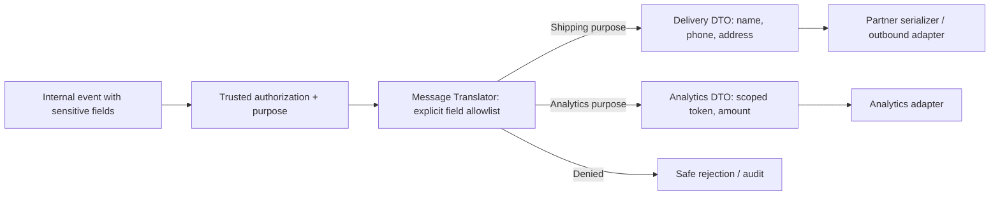
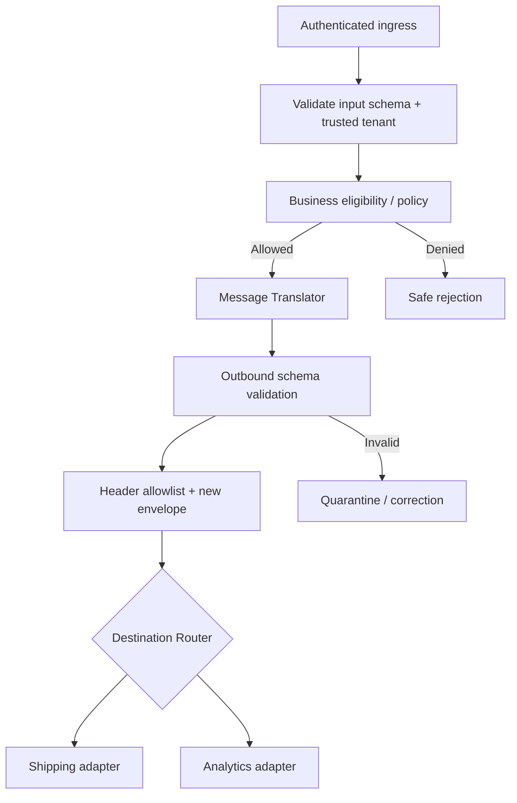
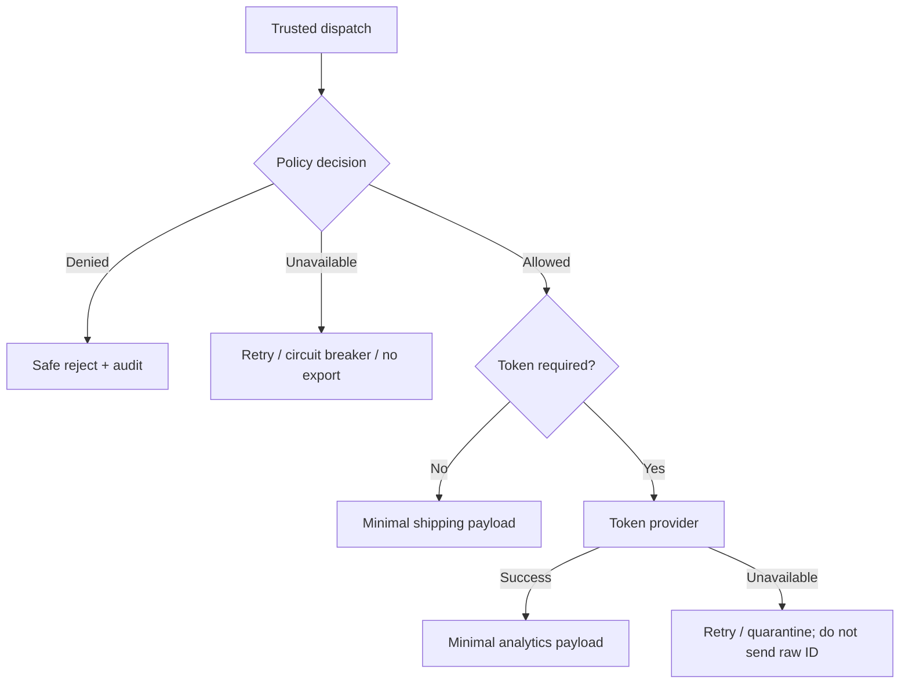
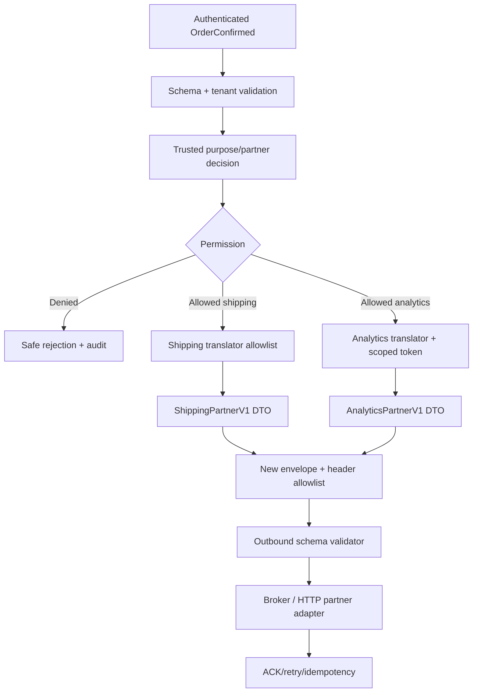

# Mapping Sensitive Data

An integration system may receive messages containing names, phone numbers, delivery addresses, email addresses, customer identifiers, tax IDs, payment data, or internal business notes. Yet not every downstream consumer in the flow is authorized to receive **all** of those fields. A shipping partner may need the name, contact number, and address; an analytics system may need only a tokenized customer ID and total amount; a notification service may need a contact channel without needing a legal identification number.

**Message Translator** is an Enterprise Integration Pattern that converts a message from the sender's data contract to the receiver's contract. When sensitive data is involved, the translator does more than rename fields, change types, or convert formats; it must decide **which fields are authorized to cross the boundary**, which must be dropped, replaced with pseudonyms, or fetched only via a controlled service. That is the focus of **"Mapping Sensitive Data"** in the **Message translator** chapter of module `SPRING_INTEGRATION_PATTERN`.

The module's scope is learning to implement Enterprise Integration Patterns with Spring Integration to build loosely coupled and extensible message flows; practicing Router, Filter, Transformer, Splitter, Aggregator, Gateway, retry, error channel, and correlation, while testing and monitoring processing branches. Accordingly, this lesson focuses on **message contracts and transformation flows**, without turning a single translator into an enterprise-wide data governance engine.

**Learning objectives:**

- Distinguish **standard mapping** from **sensitive-data-aware mapping**.
- Define field classification, processing purpose, recipient authorization, and **field allowlists**.
- Know when to choose **omission**, **masking**, **redaction**, **pseudonymization/tokenization**, **hashing/HMAC**, or **encryption**, and each technique's limitations.
- Design distinct DTOs for shipping partners, analytics, and a rejection channel.
- Write Java 17, Spring Integration Java DSL, and JUnit examples verifying **zero leakage of fields outside the allowlist**.
- Protect **payloads, headers, error channels, logs, traces, DLQs, retries, and serializers**, not just one Java object.
- Position mapping accurately relative to authentication, Router, Filter, Envelope Wrapper, Idempotent Receiver, and Gateway.
- Build a test matrix, observability plan, and rollout process for contract changes without accidentally exposing new data.

## 1. Why is mapping sensitive data different from renaming fields?

Suppose the internal system holds an `Order` containing:

```text
orderId             = ORD-100
customerId          = CUST-7
recipientName       = Nguyen A
recipientPhone      = 090...
deliveryAddress     = 12 Example Street
email               = user@example.invalid
governmentId        = <restricted>
internalSupportNote = <confidential>
amountMinor         = 30000
currency            = VND
```

The delivery service only has an approved need for **order, recipient, contact number, and address**. If an automatic object mapper copies every matching property name into an external DTO, new fields added to the internal model later could accidentally leak to the recipient.



**Key difference:** A regular translator prioritizes preserving needed data while changing structure; a translator at a sensitive boundary must **intentionally omit** fields the recipient has neither the authority nor the purpose to use. This is a **deliberately lossy** transformation, not a missing-data bug.

### Questions to answer before writing code

1. Who is the **trusted source** of the data and tenant identity?
2. Which recipient is requesting the data?
3. What is the exact **purpose** of this message?
4. Which fields does the recipient's contract permit, and for how long?
5. Does it require original content, masked content, a token, or an aggregated result?
6. Can data escape via **headers, logs, exceptions, DLQs, or caches** outside the payload?
7. When policy/lookup/token services fail, will the flow **fail closed or retry**?

Until these are answered, simply "converting an internal DTO to a partner DTO" does not prove data safety.

## 2. An applicable field classification taxonomy

Below is an example of an **application/organization-defined classification**, not a universal legal standard:

| Level | Examples | Usage in integration |
| --- | --- | --- |
| **Public** | Public event names, schema versions. | May be emitted when contract permits. |
| **Internal** | Rule codes, queue names, technical IDs. | Not exposed automatically to external partners. |
| **Confidential** | Order status, email, phone number, address. | Sent only for valid purpose, authorized recipient, and minimal scope. |
| **Restricted** | Legal IDs, health data, sensitive documents, credentials. | Requires heightened controls; many fields **should never travel in regular messages**. |

The same field can carry different classifications by context. For instance, `orderId` may look harmless yet allow linking transactions to an individual when combined with other sources. **Never assume a field is safe merely because it contains no person's name.**

### Never classify by simple keywords

The word `"token"` in a field name does not prove a value has been safely tokenized; a field named `"customerRef"` might still hold an email or national ID. When reviewing mappings, inspect **semantics and data provenance**, not just variable names.

### A foundational principle

> **Default deny for outbound fields:** Only fields explicitly approved in the target contract are constructed into the outbound payload.

This is stronger than a blocklist of forbidden fields, because internal models continually gain new fields.

## 3. Purpose- and recipient-driven data minimization

Two different recipients must never share one DTO full of optional fields:

| Internal field | Shipping partner | Internal/partner analytics | Notes |
| --- | --- | --- | --- |
| `orderId` | May need delivery reference code. | Policy-dependent; may need only event ID. | Not public by default. |
| `recipientName` | May be needed for delivery. | Not needed for plain statistics. | Personal data. |
| `recipientPhone` | May be needed to coordinate delivery. | Not needed. | Requires valid purpose and authority. |
| `deliveryAddress` | May need delivery address. | No street-level address needed. | Can substitute statistical region if allowed. |
| `email` | Not needed in example. | Not needed in example. | Excluded from both DTOs. |
| `governmentId` | Forbidden in example. | Forbidden. | Restricted. |
| `internalSupportNote` | Forbidden. | Forbidden. | May hold free-form/sensitive notes. |
| `customerId` | Not needed in delivery payload. | Can use **partner-scoped token**. | Do not send raw ID unnecessarily. |
| `amountMinor` + `currency` | Not needed in shipping example. | May be needed for aggregation. | Follow analytics contract. |
| `eventId` | Yes, for deduplication/tracing per contract. | Yes, if approved. | Never log as metric label. |

**Never assume "a shipping partner always gets name and address".** The table shows **one example of an approved decision** for purpose `FULFILL_ORDER`. If a partner only needs a pickup code or an intermediate warehouse handles delivery, the payload can be minimized further.

### Avoid large DTOs with many nullable fields

```java
// Do not apply as a default contract:
record PartnerMessage(
        String name,
        String phone,
        String address,
        String email,
        String governmentId,
        String internalNote,
        String analyticsToken,
        Long amountMinor
) {}
```

Setting fields to `null` and hoping the serializer always skips nulls is inferior to **not declaring sensitive fields on the recipient DTO at all**. Separate DTOs make code reviews and contract testing clear.

## 4. How allowlisting differs from denylisting

Suppose an internal object has 10 fields today; a month later someone adds `bankAccount`:

```java
// Risky: copying all properties first and then clearing a few fields.
PartnerDto dto = beanMapper.map(internal, PartnerDto.class);
dto.setGovernmentId(null);
dto.setInternalNote(null);
```

A default mapper, reflection-based copier, or `ObjectMapper.convertValue(internal, Map.class)` can accidentally emit `bankAccount` when the target DTO/schema evolves. That approach depends on **knowing everything that must be cleared**.

**Allowlist:**

```java
new ShippingPartnerV1(
        source.eventId(),
        source.orderId(),
        source.recipientName(),
        source.recipientPhone(),
        source.deliveryAddress()
);
```

Only fields explicitly written in code appear; new fields on the source **cannot slip through** without editing and reviewing the mapper.

### Three separate allowlist layers

1. **Destination allowlist:** Which partners/services are permitted to receive this event type?
2. **Field allowlist:** Which fields are permitted inside the target DTO?
3. **Metadata/header allowlist:** Which headers are permitted across external transports?

A translator with a safe payload whose outbound adapter **copies all headers** can still leak credentials, tenant context, cookies, or internal routing info.

## 5. Omission, masking, redaction, tokenization, hashing, and encryption

These techniques are often lumped together as "hiding data", yet their reversibility and purposes differ.

| Technique | Example | Reversible? | When to use |
| --- | --- | --- | --- |
| **Omit/drop field** | Exclude `governmentId` from DTO. | No, from target message. | Whenever the recipient does not need the data. |
| **Redaction** | Replace value with `[REDACTED]`. | No, from replaced value. | Safe logs/representations, though many fields are better **omitted entirely**. |
| **Masking** | Show only last 4 characters per policy. | Cannot recover full value from mask; may allow partial inference. | Only when the remaining characters are genuinely needed. |
| **Tokenization** | `customerId` → partner-scoped token. | Reversible via token service if designed so. | Link records under authorization without revealing original IDs. |
| **Pseudonymization** | Replace direct identifier with stable alias. | May still be linkable or re-identified via auxiliary data. | Reduces direct exposure; not automatically anonymous. |
| **Hashing** | Input digest. | Not directly invertible mathematically, but predictable inputs can be brute-forced. | Integrity/controlled comparison; does not ensure privacy by itself. |
| **Keyed HMAC** | HMAC using scoped secret/key. | Cannot decrypt original, yet linkable within same scope. | Controlled pseudonym when keys are protected and policy permits. |
| **Encryption** | Ciphertext + decryption context. | Yes, with valid key. | Protects storage/transit to parties authorized to decrypt. |

**Do not equate pseudonymization with anonymization.** A stable token can track an individual across activities; the data may still count as personal data depending on regulations and linkability.

### Why plain `SHA-256(email)` is usually insufficient

Email addresses and phone numbers have predictable value spaces. Anyone with a dictionary can precompute hashes and match them. If a stable pseudonym is required, consider a securely managed keyed HMAC scoped by tenant/partner/purpose with rotation rules. When preventing cross-party linkage, **per-recipient tokens** are usually safer than a global token.

### Encryption does not replace authorization

Sending ciphertext to a partner holding the decryption key is still **sharing data** with that partner. Decide contracts and permissions before encrypting; never encrypt everything and declare it safe regardless of who receives it.

## 6. Mapping is a policy decision, not just type conversion

A policy may evaluate:

```text
trustedTenant
destinationPartner
processingPurpose
eventType
dataClassification
authorization
retentionWindow
contractVersion
```

Example:

```text
tenant         = TENANT-A
destination    = SHIPPING_PARTNER
purpose        = FULFILL_ORDER
eventType      = OrderReadyForDelivery
policyDecision = ALLOW_MINIMAL_DELIVERY_FIELDS
```

Same internal event, different destination:

```text
destination    = ANALYTICS_PARTNER
purpose        = AGGREGATE_REPORTING
policyDecision = ALLOW_TOKEN_AND_AMOUNT_ONLY
```

If a caller self-declares a `purpose=FULFILL_ORDER` header to request data, that is **not a trustworthy policy decision**. Derive identity, destination, and purpose from a **trusted gateway, authorization service, or governed workflow**, and verify them in the translator.

### Do not let payload inputs manipulate policy selection

If routing or allowed field sets are selected from a string pulled directly from a partner-submitted message, the sender can choose a higher-privilege branch. Message Translator needs a strict boundary: **untrusted input values** must never substitute for **trusted authorization context**.

## 7. Invariants to uphold in a sensitive-data translator

| ID | Invariant | Risk if violated |
| --- | --- | --- |
| **S1 — Purpose bound** | Every mapping has a verified purpose and recipient. | Data used outside approved scope. |
| **S2 — Explicit field allowlist** | Outbound DTO contains only approved fields. | New internal fields leak accidentally. |
| **S3 — Deny by default** | No permission/policy → produce no sensitive payload. | Fail open when policy service errors. |
| **S4 — Integrity** | Amounts, units, IDs/correlation translate accurately. | Business errors even without data leaks. |
| **S5 — Trusted context** | Tenant, destination, and permissions never blindly read from client headers. | Cross-tenant exposure. |
| **S6 — Safe failure** | Rejections, logs, and DLQs contain no raw sensitive input. | Data leakage on error paths. |
| **S7 — Scoped tokens** | Tokens prevent linkage outside approved scope. | Cross-partner / cross-purpose tracking. |
| **S8 — Tested serialization** | Wire payload matches exact allowlist with no auto-added fields. | DTO looks safe while serializer leaks extras. |
| **S9 — Lifecycle** | Retries/replays and retention do not keep data longer than needed. | Uncontrolled accumulation of sensitive copies. |

A single test like `assertNotNull(translated)` proves none of these sensitivity invariants.

## 8. Placement of mapping in a Spring Integration flow

Suggested topology:



**Why map after authentication?** To have a trusted context for tenant, destination, and purpose. **Why validate output after mapping?** Because a translator might omit a required field, mistype a value, confuse units, or emit an uncontracted field.

### Translator and Filter

- `Filter` decides whether a message **may proceed** down a branch.
- `Translator` decides **which representation is sent** and **which fields are allowed**.
- Policy may route to a `REJECTED` branch, but must not silently drop messages and hang Gateways.

### Translator and Content Enricher

Content Enricher fetches external data. Without permission to export email, **never enrich email into an outbound payload** just because CRM has it. Enrichment must obey the exact same classification and purpose policy.

## 9. Java 17 contract: internal event vs. partner DTOs

The example below uses order data. Sensitive fields inside the internal object exist only to illustrate mapping; **never put access tokens, passwords, or secrets into shared event brokers**. Note for any `record` holding sensitive data: Java's generated `toString()` prints every component, so the demo overrides `toString()`.

```java
enum Destination {
    SHIPPING_PARTNER,
    ANALYTICS_PARTNER
}

enum Purpose {
    FULFILL_ORDER,
    AGGREGATE_REPORTING
}

record InternalOrderEvent(
        String eventId,
        String tenantId,
        String orderId,
        String customerId,
        String recipientName,
        String recipientPhone,
        String deliveryAddress,
        String email,
        String governmentId,
        String internalSupportNote,
        long amountMinor,
        String currency
) {
    @Override
    public String toString() {
        return "InternalOrderEvent[sensitiveFields=REDACTED]";
    }
}

record TrustedDispatch(
        InternalOrderEvent order,
        String authenticatedTenantId,
        Destination destination,
        Purpose purpose,
        String auditId
) {
    @Override
    public String toString() {
        return "TrustedDispatch[details=REDACTED]";
    }
}
```

**Important:** `TrustedDispatch` is created **only after the gateway/authorization service verifies the caller and chooses the route**. Putting `Trusted` in a record name **does not create security by itself**; if an HTTP controller binds client JSON directly into this record, the trust boundary is broken.

### Two completely separate target DTOs

```java
sealed interface PartnerPayload
        permits ShippingPartnerV1, AnalyticsPartnerV1 {}

record ShippingPartnerV1(
        String eventId,
        String orderRef,
        String recipientName,
        String contactPhone,
        String deliveryAddress
) implements PartnerPayload {
    @Override
    public String toString() {
        return "ShippingPartnerV1[sensitiveFields=REDACTED]";
    }
}

record AnalyticsPartnerV1(
        String eventId,
        String customerToken,
        long amountMinor,
        String currency
) implements PartnerPayload {
    @Override
    public String toString() {
        return "AnalyticsPartnerV1[sensitiveFields=REDACTED]";
    }
}

record MappingFailure(
        String auditId,
        String reasonCode
) {}
```

Neither `governmentId`, `email`, nor `internalSupportNote` exists on **any target DTO**. In the sample delivery contract, `recipientName`, `contactPhone`, and `deliveryAddress` remain personal data, shared solely for an **approved purpose** with an authorized recipient.

Redacting `toString()` helps, yet **is not enough** to prevent sensitive logging: debuggers, JSON serializers, APM instrumentation, exception messages, or heap dumps can still inspect actual fields. Control each surface separately.

## 10. Policy and token service ports

Instead of letting the translator compute `SHA-256(customerId)` itself, place token generation behind a **dedicated service** with explicit scoping and key management.

```java
interface PartnerPermissionPort {
    boolean permitted(
            String authenticatedTenant,
            Destination destination,
            Purpose purpose,
            String orderId
    );
}

interface RecipientTokenPort {
    String scopedToken(
            String authenticatedTenant,
            Destination destination,
            String customerId
    );
}
```

`PartnerPermissionPort` may call a policy engine or check a safely cached authorization decision. `RecipientTokenPort` may call a token vault or HMAC service backed by keys in a key management system; **never hardcode secrets in source code**.

### When should the token service NOT be called?

The **shipping** branch in the example does not need a customer token, so never call the token service on that branch merely because the class holds the dependency. Likewise, the analytics branch must not read or hash the email or recipient name to build tokens.

### Tokens must be scoped

The same `customerId` may require different tokens per `tenantId`, partner, or purpose:

```text
Token(TENANT-A, ANALYTICS_PARTNER, CUST-7)
    != Token(TENANT-A, SHIPPING_PARTNER, CUST-7)
    != Token(TENANT-B, ANALYTICS_PARTNER, CUST-7)
```

This is a **contract principle**; the values are illustrative and do not imply every tokenization system emits distinct tokens in every configuration. When policy demands unlinkability, vault/key derivation design must enforce it.

## 11. Allowlist-enforcing mapping service

The following translator verifies scope, purpose, and permission before building a partner payload. **Failures in the policy or token service must never silently default to `allowed=true`.**

```java
import org.springframework.stereotype.Service;

record MappingOutcome(
        PartnerPayload payload,
        String rejectionCode,
        String auditId
) {
    boolean accepted() {
        return payload != null;
    }

    static MappingOutcome pass(
            PartnerPayload payload, String auditId) {
        return new MappingOutcome(payload, null, auditId);
    }

    static MappingOutcome reject(
            String code, String auditId) {
        return new MappingOutcome(null, code, auditId);
    }

    @Override
    public String toString() {
        return "MappingOutcome[details=REDACTED]";
    }
}

@Service
final class SensitivePartnerTranslator {
    private final PartnerPermissionPort permission;
    private final RecipientTokenPort tokens;

    SensitivePartnerTranslator(
            PartnerPermissionPort permission,
            RecipientTokenPort tokens) {
        this.permission = permission;
        this.tokens = tokens;
    }

    MappingOutcome translate(TrustedDispatch request) {
        if (request == null || request.order() == null
                || blank(request.auditId())) {
            return MappingOutcome.reject(
                    "INVALID_DISPATCH", "unknown-audit");
        }

        InternalOrderEvent order = request.order();
        if (blank(request.authenticatedTenantId())
                || !request.authenticatedTenantId()
                        .equals(order.tenantId())) {
            return MappingOutcome.reject(
                    "TENANT_MISMATCH", request.auditId());
        }

        if (request.destination() == null
                || request.purpose() == null
                || !purposeMatches(
                        request.destination(), request.purpose())) {
            return MappingOutcome.reject(
                    "PURPOSE_NOT_ALLOWED", request.auditId());
        }

        if (blank(order.eventId())
                || blank(order.orderId())) {
            return MappingOutcome.reject(
                    "IDENTITY_INVALID", request.auditId());
        }

        // Port queries permissions using the authenticated context.
        // Infrastructure exceptions must go to the retry/error policy,
        // never converted into 'allow'.
        boolean allowed = permission.permitted(
                request.authenticatedTenantId(),
                request.destination(),
                request.purpose(),
                order.orderId());

        if (!allowed) {
            return MappingOutcome.reject(
                    "EXPORT_DENIED", request.auditId());
        }

        if (request.destination() == Destination.SHIPPING_PARTNER) {
            if (blank(order.recipientName())
                    || blank(order.recipientPhone())
                    || blank(order.deliveryAddress())) {
                return MappingOutcome.reject(
                        "DELIVERY_FIELDS_MISSING", request.auditId());
            }

            // Fixed allowlist: no email, governmentId,
            // customerId, supportNote, or amountMinor.
            return MappingOutcome.pass(
                    new ShippingPartnerV1(
                            order.eventId(),
                            order.orderId(),
                            order.recipientName(),
                            order.recipientPhone(),
                            order.deliveryAddress()),
                    request.auditId());
        }

        if (blank(order.customerId())
                || order.amountMinor() < 0
                || !"VND".equals(order.currency())) {
            return MappingOutcome.reject(
                    "ANALYTICS_FIELDS_INVALID",
                    request.auditId());
        }

        String token = tokens.scopedToken(
                request.authenticatedTenantId(),
                request.destination(),
                order.customerId());

        if (blank(token)) {
            return MappingOutcome.reject(
                    "TOKEN_UNAVAILABLE", request.auditId());
        }

        // Do not send raw customerId, name, phone, email,
        // address, governmentId, or internalSupportNote.
        return MappingOutcome.pass(
                new AnalyticsPartnerV1(
                        order.eventId(),
                        token,
                        order.amountMinor(),
                        order.currency()),
                request.auditId());
    }

    private static boolean purposeMatches(
            Destination destination, Purpose purpose) {
        return (destination == Destination.SHIPPING_PARTNER
                    && purpose == Purpose.FULFILL_ORDER)
                || (destination == Destination.ANALYTICS_PARTNER
                    && purpose == Purpose.AGGREGATE_REPORTING);
    }

    private static boolean blank(String value) {
        return value == null || value.isBlank();
    }
}
```

### Example limitations

- `permitted(...)` is an application contract, **not a built-in authentication mechanism**. Ensure `authenticatedTenantId` comes from an authenticated source.
- Mapping is not full validation for addresses, phone numbers, or currency units. Fields need proper **schema and business validation** before or at export time.
- The analytics branch calls a token service; if it times out, let the exception route to retry/error recovery rather than emitting the raw ID or a default token.
- `TOKEN_UNAVAILABLE` in this example handles an empty token return; infrastructure outages require a separate **transient failure** classification.
- Target DTOs still carry PII where authorized. Redacting `toString()` does not stop a JSON serializer from emitting allowed fields—which is the DTO's intended purpose.
- A policy returning `allowed=true` **does not prove** the recipient needs every field; field allowlists and contract reviews remain mandatory.
- Never serialize raw `TrustedDispatch` onto Kafka outside this boundary.

## 12. Do not propagate headers automatically into outbound messages

Even when the translator returns a 5-field `ShippingPartnerV1`, a Spring Integration endpoint may **forward headers from the input** when building reply messages. If the inbound message carries:

```text
Authorization: Bearer SECRET
x-internal-customer-id: CUST-7
x-support-note: classified
traceId: ...
tenantId: TENANT-A
```

and an outbound adapter copies all headers, **a safe payload still leaks data through metadata**.

**Safer contract:** at a dedicated outbound boundary, construct a **new message with allowlisted headers**. Never call `MessageBuilder.fromMessage(inbound)` or `copyHeaders(inbound.getHeaders())` unconditionally.

Example:

```java
import org.springframework.messaging.Message;
import org.springframework.messaging.support.MessageBuilder;

final class SafePartnerMessageFactory {

    Message<PartnerPayload> build(PartnerPayload payload) {
        String eventType =
                payload instanceof ShippingPartnerV1
                ? "ShippingDispatchV1"
                : "AnalyticsExportV1";

        return MessageBuilder.withPayload(payload)
                .setHeader("partner.eventType", eventType)
                .setHeader("partner.schemaVersion", 1)
                .build();
    }
}
```

`MessageBuilder` adds **technical headers** like `id` and `timestamp`; these are not business data and normally should not serialize onto brokers. The **outbound header mapper** must continue allowlisting **headers actually emitted on the transport** and be tested at the wire payload level. Never assume "building a new message" prevents every adapter from adding other headers.

### Risk of a `Header Enricher`

A Header Enricher is convenient for adding correlation or content-type, yet must never accidentally copy:

```text
headers['authorization']
headers['cookie']
headers['internalCustomerId']
headers['debugPayload']
headers['errorMessage']
```

onto external transports. Fields lacking a reason in the recipient contract **must never be exported**.

## 13. Spring Integration Java DSL: translation and safe egress

An illustrative flow receives `TrustedDispatch` from an **authenticated internal channel**, invokes the mapper, and forwards the result to a **bridge building a fresh message**. For rejected outcomes, the bridge emits only **audit ID and reason code**, without the raw customer event.

```java
import org.springframework.beans.factory.annotation.Qualifier;
import org.springframework.context.annotation.Bean;
import org.springframework.context.annotation.Configuration;
import org.springframework.integration.channel.DirectChannel;
import org.springframework.integration.channel.QueueChannel;
import org.springframework.integration.config.EnableIntegration;
import org.springframework.integration.dsl.IntegrationFlow;
import org.springframework.messaging.MessageChannel;

final class SafePartnerOutboundBridge {
    private final MessageChannel shipping;
    private final MessageChannel analytics;
    private final MessageChannel rejected;
    private final SafePartnerMessageFactory messages =
            new SafePartnerMessageFactory();

    SafePartnerOutboundBridge(
            MessageChannel shipping,
            MessageChannel analytics,
            MessageChannel rejected) {
        this.shipping = shipping;
        this.analytics = analytics;
        this.rejected = rejected;
    }

    void forward(MappingOutcome outcome) {
        if (!outcome.accepted()) {
            boolean sent = rejected.send(
                    org.springframework.messaging.support.MessageBuilder
                            .withPayload(new MappingFailure(
                                    outcome.auditId(),
                                    outcome.rejectionCode()))
                            .build());

            if (!sent) {
                throw new IllegalStateException(
                        "REJECTION_DELIVERY_FAILED");
            }
            return;
        }

        org.springframework.messaging.Message<PartnerPayload> safe =
                messages.build(outcome.payload());

        MessageChannel destination =
                outcome.payload() instanceof ShippingPartnerV1
                        ? shipping : analytics;

        if (!destination.send(safe)) {
            throw new IllegalStateException(
                    "PARTNER_CHANNEL_DELIVERY_FAILED");
        }
    }
}

@Configuration
@EnableIntegration
class SensitiveMappingFlowConfig {

    @Bean
    DirectChannel trustedPartnerDispatches() {
        return new DirectChannel();
    }

    @Bean
    QueueChannel shippingPartnerOutput() {
        return new QueueChannel();
    }

    @Bean
    QueueChannel analyticsPartnerOutput() {
        return new QueueChannel();
    }

    @Bean
    QueueChannel rejectedPartnerMappings() {
        return new QueueChannel();
    }

    @Bean
    SafePartnerOutboundBridge safePartnerOutboundBridge(
            @Qualifier("shippingPartnerOutput") MessageChannel shipping,
            @Qualifier("analyticsPartnerOutput") MessageChannel analytics,
            @Qualifier("rejectedPartnerMappings") MessageChannel rejected) {
        return new SafePartnerOutboundBridge(
                shipping, analytics, rejected);
    }

    @Bean
    IntegrationFlow sensitivePartnerMappingFlow(
            SensitivePartnerTranslator translator,
            SafePartnerOutboundBridge bridge) {
        return IntegrationFlow.from("trustedPartnerDispatches")
                .handle(TrustedDispatch.class,
                        (dispatch, headers) ->
                                translator.translate(dispatch))
                .handle(MappingOutcome.class,
                        (outcome, headers) -> {
                            bridge.forward(outcome);
                            return null; // terminal, outbound bridge dispatches directly
                        })
                .get();
    }
}
```

**This configuration is for instructional purposes:** it uses `DirectChannel` for ease of testing and `QueueChannel` to inspect messages routed to each destination. There is no Kafka/AMQP/HTTP outbound adapter, schema serializer, real policy implementation, or durable store yet. A `send()` call returning `true` **does not prove the partner received or processed the message successfully**.

In production, never rely on an in-memory queue for delivery guarantees. When mapping results must be reliably sent after a business commit, consider **Transactional Outbox**, bounded retries, and idempotent downstream consumers.

### Why not simply `.transform(...).channel("shipping")`?

A single `.transform()` works when there is one destination and an already-isolated output schema. Here we need:

- **Policy checks** before emission.
- **Two distinct DTOs** for two distinct purposes.
- **A rejection branch** that leaks no content.
- **Zero copying of inbound headers**.
- **Keeping transient exceptions separate from business rejections**.

That is why responsibilities are split across mapper, outbound bridge, and adapter instead of cramming everything into one lambda.

## 14. Distinguishing intentional rejections from technical errors

A rejected mapping is not always an infrastructure error to retry.

| Scenario | Classification | Response |
| --- | --- | --- |
| Input tenant mismatches trusted tenant | Security/contract rejection. | Fail closed, audit; export nothing. |
| Purpose not permitted for destination | Policy rejection. | Return bounded reason; never bypass via retries. |
| Partner policy returns denied | Policy rejection. | Produce no partner DTO. |
| Missing address when delivery needs it | Data validation rejection. | Request data fix or valid enrichment workflow. |
| Token service returns blank | Data/operational issue per contract. | Quarantine/retry with exact reason; never substitute raw ID. |
| Token/policy service timeout | Transient infrastructure error. | Retry/backoff/circuit breaker; **never fail open**. |
| Outbound serializer emits forbidden field | Contract/security defect. | Block publish, alert, review mapper. |
| Partner endpoint times out after send | Uncertain outcome. | Use idempotency key and reconcile; never send an arbitrary different payload. |
| Audit/quarantine storage failure | Recovery failure. | Do not mark completed when contract demands durable storage. |

**Never catch all `Exception`s and return `MappingFailure("INVALID_DATA")`.** Doing so hides retryable outages, obscures security events, and can cause ACKs that silently drop work.

## 15. Unit tests: mapper leaks no fields outside the allowlist

A solid test asserts not only that expected fields appear, but also that **sensitive fields are strictly absent** from serialized DTOs.

### Fixture with canary strings to detect leakage

```java
import static org.junit.jupiter.api.Assertions.*;
import org.junit.jupiter.api.Test;

class SensitivePartnerTranslatorTest {

    private final PartnerPermissionPort allowAllForTest =
            (tenant, destination, purpose, orderId) -> true;

    private final RecipientTokenPort fakeToken =
            (tenant, destination, customerId) ->
                    "TEST-PARTNER-SCOPED-TOKEN";

    private final SensitivePartnerTranslator translator =
            new SensitivePartnerTranslator(
                    allowAllForTest, fakeToken);

    private InternalOrderEvent sensitiveOrder() {
        return new InternalOrderEvent(
                "evt-100",
                "TENANT-A",
                "ORD-100",
                "CUST-SECRET-CANARY",
                "Recipient Example",
                "0900000000",
                "12 Example Street",
                "email-secret@example.invalid",
                "ID-SECRET-CANARY",
                "SUPPORT-SECRET-CANARY",
                30_000L,
                "VND");
    }

    @Test
    void shippingMappingContainsOnlyApprovedFields() {
        MappingOutcome mapped = translator.translate(
                new TrustedDispatch(
                        sensitiveOrder(),
                        "TENANT-A",
                        Destination.SHIPPING_PARTNER,
                        Purpose.FULFILL_ORDER,
                        "audit-100"));

        assertTrue(mapped.accepted());
        assertInstanceOf(
                ShippingPartnerV1.class, mapped.payload());

        ShippingPartnerV1 payload =
                (ShippingPartnerV1) mapped.payload();

        assertEquals("ORD-100", payload.orderRef());
        assertEquals("Recipient Example", payload.recipientName());
        assertEquals("0900000000", payload.contactPhone());
        assertEquals("12 Example Street",
                payload.deliveryAddress());
    }

    @Test
    void analyticsMappingUsesPartnerScopedTokenNotRawId() {
        MappingOutcome mapped = translator.translate(
                new TrustedDispatch(
                        sensitiveOrder(),
                        "TENANT-A",
                        Destination.ANALYTICS_PARTNER,
                        Purpose.AGGREGATE_REPORTING,
                        "audit-101"));

        assertTrue(mapped.accepted());
        assertInstanceOf(
                AnalyticsPartnerV1.class, mapped.payload());

        AnalyticsPartnerV1 payload =
                (AnalyticsPartnerV1) mapped.payload();

        assertEquals(
                "TEST-PARTNER-SCOPED-TOKEN",
                payload.customerToken());
        assertEquals(30_000L, payload.amountMinor());
        assertEquals("VND", payload.currency());
    }

    @Test
    void wrongTenantNeverMapsSensitivePayload() {
        MappingOutcome mapped = translator.translate(
                new TrustedDispatch(
                        sensitiveOrder(),
                        "TENANT-B",
                        Destination.SHIPPING_PARTNER,
                        Purpose.FULFILL_ORDER,
                        "audit-102"));

        assertFalse(mapped.accepted());
        assertNull(mapped.payload());
        assertEquals(
                "TENANT_MISMATCH", mapped.rejectionCode());
    }

    @Test
    void unauthorizedPurposeIsRejected() {
        MappingOutcome mapped = translator.translate(
                new TrustedDispatch(
                        sensitiveOrder(),
                        "TENANT-A",
                        Destination.ANALYTICS_PARTNER,
                        Purpose.FULFILL_ORDER,
                        "audit-103"));

        assertFalse(mapped.accepted());
        assertEquals(
                "PURPOSE_NOT_ALLOWED", mapped.rejectionCode());
    }
}
```

These tests verify **mapper logic with fake policy/token ports**; they do not prove the real policy engine granted access, tokens are irreversible, or partner transports strip headers.

### Limitation of testing only field accessors

Asserting `payload.recipientName()` is correct is not enough. **Serialize the real DTO** to confirm `email`, `governmentId`, `customerId`, or `internalSupportNote` never appear via Jackson annotations, property accessors, mixins, or reflection settings.

## 16. Serialization contract tests: verify both allowed and forbidden fields

```java
import static org.junit.jupiter.api.Assertions.*;

import java.util.Set;
import java.util.HashSet;
import java.util.Iterator;

import com.fasterxml.jackson.databind.JsonNode;
import com.fasterxml.jackson.databind.ObjectMapper;
import org.junit.jupiter.api.Test;

class PartnerPayloadSerializationTest {

    private final ObjectMapper mapper = new ObjectMapper();

    @Test
    void shippingWireShapeIsExactlyAllowlisted() {
        ShippingPartnerV1 payload =
                new ShippingPartnerV1(
                        "evt-100",
                        "ORD-100",
                        "Recipient Example",
                        "0900000000",
                        "12 Example Street");

        JsonNode json = mapper.valueToTree(payload);
        Set<String> fields = new HashSet<>();
        Iterator<String> names = json.fieldNames();
        names.forEachRemaining(fields::add);

        assertEquals(Set.of(
                "eventId", "orderRef", "recipientName",
                "contactPhone", "deliveryAddress"),
                fields);

        String wire = json.toString();
        assertFalse(wire.contains("email-secret"));
        assertFalse(wire.contains("governmentId"));
        assertFalse(wire.contains("internalSupportNote"));
        assertFalse(wire.contains("customerId"));
    }

    @Test
    void analyticsWireShapeIsExactlyAllowlisted() {
        AnalyticsPartnerV1 payload =
                new AnalyticsPartnerV1(
                        "evt-100", "TOK-100",
                        30_000L, "VND");

        JsonNode json = mapper.valueToTree(payload);
        Set<String> fields = new HashSet<>();
        json.fieldNames().forEachRemaining(fields::add);

        assertEquals(Set.of(
                "eventId", "customerToken",
                "amountMinor", "currency"), fields);

        assertFalse(json.has("recipientName"));
        assertFalse(json.has("email"));
        assertFalse(json.has("deliveryAddress"));
        assertFalse(json.has("governmentId"));
    }
}
```

An **exact-field-set assertion** is especially valuable: if someone modifies `ShippingPartnerV1` to add `email` without review, the test fails. Asserting only `email == null` could still let serializers emit the field name or pull data from another getter.

### Serialization to other formats must also be tested

If a partner uses XML, CSV, Avro, or Protobuf, test DTOs/tags and encoder defaults in the **corresponding wire representation**. Never infer from a Jackson JSON test that an XML serializer will omit sensitive fields.

## 17. Integration test: zero header leakage across Spring Integration

A `TrustedDispatch` may arrive carrying internal headers; the outbound bridge **must construct a new message** and never let them enter the partner channel.

Spring context test example:

```java
import static org.junit.jupiter.api.Assertions.*;

import org.junit.jupiter.api.Test;
import org.springframework.beans.factory.annotation.Autowired;
import org.springframework.beans.factory.annotation.Qualifier;
import org.springframework.context.annotation.Bean;
import org.springframework.context.annotation.Configuration;
import org.springframework.integration.channel.QueueChannel;
import org.springframework.messaging.Message;
import org.springframework.messaging.MessageChannel;
import org.springframework.messaging.support.MessageBuilder;
import org.springframework.test.annotation.DirtiesContext;
import org.springframework.test.context.junit.jupiter.SpringJUnitConfig;

@SpringJUnitConfig({
        SensitiveMappingFlowConfig.class,
        SensitiveMappingFlowTest.TestPorts.class
})
@DirtiesContext(classMode = DirtiesContext.ClassMode.AFTER_EACH_TEST_METHOD)
class SensitiveMappingFlowTest {

    @Configuration
    static class TestPorts {
        @Bean
        PartnerPermissionPort partnerPermissionPort() {
            return (tenant, dest, purpose, orderId) -> true;
        }

        @Bean
        RecipientTokenPort recipientTokenPort() {
            return (tenant, dest, customerId) ->
                    "TEST-TOKEN-100";
        }

        @Bean
        SensitivePartnerTranslator sensitivePartnerTranslator(
                PartnerPermissionPort permissions,
                RecipientTokenPort tokens) {
            return new SensitivePartnerTranslator(
                    permissions, tokens);
        }
    }

    @Autowired @Qualifier("trustedPartnerDispatches")
    MessageChannel input;

    @Autowired @Qualifier("shippingPartnerOutput")
    QueueChannel shipping;

    @Autowired @Qualifier("analyticsPartnerOutput")
    QueueChannel analytics;

    @Autowired @Qualifier("rejectedPartnerMappings")
    QueueChannel rejected;

    private static InternalOrderEvent order() {
        return new InternalOrderEvent(
                "evt-200", "TENANT-A", "ORD-200",
                "CUST-SENSITIVE",
                "Recipient Example", "0900000000",
                "12 Example Street",
                "private-email@example.invalid",
                "PRIVATE-GOV-ID",
                "PRIVATE-SUPPORT-NOTE",
                30_000L, "VND");
    }

    @Test
    void shippingOutputDoesNotCopyIncomingPrivateHeaders() {
        TrustedDispatch request = new TrustedDispatch(
                order(), "TENANT-A",
                Destination.SHIPPING_PARTNER,
                Purpose.FULFILL_ORDER,
                "audit-200");

        Message<TrustedDispatch> incoming =
                MessageBuilder.withPayload(request)
                        .setHeader(
                                "Authorization",
                                "Bearer HEADER-SECRET")
                        .setHeader(
                                "internalCustomerId",
                                "CUST-SENSITIVE")
                        .build();

        assertTrue(input.send(incoming));

        Message<?> outbound = shipping.receive(1_000);
        assertNotNull(outbound);
        assertInstanceOf(
                ShippingPartnerV1.class,
                outbound.getPayload());

        assertFalse(outbound.getHeaders()
                .containsKey("Authorization"));
        assertFalse(outbound.getHeaders()
                .containsKey("internalCustomerId"));

        assertEquals(
                "ShippingDispatchV1",
                outbound.getHeaders().get("partner.eventType"));

        assertNull(analytics.receive(0));
        assertNull(rejected.receive(0));
    }

    @Test
    void deniedTenantProducesOnlySafeFailure() {
        TrustedDispatch request = new TrustedDispatch(
                order(), "TENANT-B",
                Destination.SHIPPING_PARTNER,
                Purpose.FULFILL_ORDER,
                "audit-201");

        assertTrue(input.send(
                MessageBuilder.withPayload(request).build()));

        Message<?> failure = rejected.receive(1_000);
        assertNotNull(failure);
        assertInstanceOf(
                MappingFailure.class, failure.getPayload());

        MappingFailure payload =
                (MappingFailure) failure.getPayload();
        assertEquals(
                "TENANT_MISMATCH", payload.reasonCode());
        assertEquals("audit-201", payload.auditId());

        assertNull(shipping.receive(0));
        assertNull(analytics.receive(0));
    }
}
```

This is an **in-JVM** test using fake policy/token ports and `QueueChannel`. It proves the bridge does not copy two deliberately injected headers; it does **not** prove real Kafka/HTTP header mappers or networks are safe. Production requires testing real adapters/serializers and inspecting wire events in a consumer sandbox.

**Spring wiring note:** the snippets show both `@Service SensitivePartnerTranslator` in section 11 and `@Bean` in the test; when creating a Spring context, pick **one** bean registration style to avoid duplicate beans. The sample configuration disables component scanning, making `@Bean` intentional here. When copying into a Spring Boot project with component scanning, adjust the fixture or bean override accordingly.

## 18. Negative/forbidden-field security testing

For sensitive data, **testing for absence** is often as important as testing for presence.

| Case | When does it PASS? |
| --- | --- |
| Internal model adds `bankAccount` | No new field appears in partner DTO or wire output. |
| Shipping message | No email, raw customer ID, government ID, support note, or out-of-contract amount. |
| Analytics message | No name, phone, address, email, government ID, or internal note. |
| Unauthorized tenant | Zero partner payload emitted; only audit reason. |
| Wrong purpose/destination | Zero sensitive mapping emitted. |
| Incoming headers include Authorization | Header is never copied to egress. |
| Error message from translator | No raw input, full stack trace, or PII in outbound errors. |
| Partner serializer upgrades version | Exact wire field set reviewed and tested. |
| Token service fails | Never falls back to raw customer ID. |
| Policy engine times out | Never defaults to `allowed=true`. |
| Duplicate/replayed message | Causes no unintended duplicate side effects. |
| Test fixture carries canary secrets | Absent from inspected JSON, headers, logs, and DLQs. |

One way to increase assurance is injecting **canary strings** in test inputs and scanning wire outputs, rejections, and logs in test environments. Never log or fabricate real personal data just for testing; use synthetic values instead.

## 19. Masking in logs vs. mapping for partners

A common mistake is calling the same `maskPhone()` helper for both logs and shipping messages:

```text
Log:
  phone = ******0000   (acceptable if permitted)

Shipping partner:
  phone = ******0000   (cannot call the recipient)
```

**Log minimization** and **partner contracts** serve different goals. A shipping partner may be authorized to receive the full phone number **strictly for orders needing delivery**, whereas operational logs do not need it. Do not mask authorized business fields if it breaks fulfillment; conversely, never dump full PII into logs just because a partner receives it.

### Avoid "regex redaction" as the sole defense

A phone-number regex can miss new identifiers, nested fields, or entries inside `Map<String, Object>`. A stronger defense is **never logging raw payloads**, writing structured audits with an **allowlist**, and keeping redaction solely as defense in depth.

### Java record `toString()` is a concrete hazard

Java records auto-generate `toString()` containing every component. Logging like:

```java
log.info("Translating {}", internalOrder);
```

can expose email, phone, address, and government ID. In the demo, `toString()` is overridden; real code must still **forbid logging sensitive input DTOs** and enforce log scrubbers/diagnostic policies. An exception message containing `payload.toString()` can also propagate to an error channel.

## 20. Error channel, retry, and DLQ: overlooked leakage surfaces

In Spring Integration, an `ErrorMessage` can carry an exception plus **`failedMessage`**, depending on endpoint and topology. If `failedMessage` holds `InternalOrderEvent`, serializing the entire `ErrorMessage` or logging `exception.toString()` leaks sensitive data.

```text
InternalOrderEvent
   -> translator
      -> exception
         -> errorChannel
            -> generic logger / DLQ serializer
               -> sensitive payload leaked
```

**Design error paths explicitly:**

1. Separate `EXPORT_DENIED`, `TENANT_MISMATCH`, and `MAPPING_INVALID` from `TOKEN_SERVICE_TIMEOUT` and `BROKER_UNAVAILABLE`.
2. Emit a `SafeErrorRecord(auditId, reasonCode, stage)` instead of forwarding raw `failedMessage` to unprivileged consumers.
3. If raw payloads must be saved for investigation, use a **protected quarantine store** with dedicated access controls and retention, not a shared DLQ topic open to every team.
4. Never turn policy denials into infinite retries.
5. For infrastructure timeouts, retry with deadlines/backoff while preserving stable business identity.
6. If audit/quarantine persistence fails when the contract requires durability, never ACK and drop work unconditionally.
7. When escalating incidents to ticketing systems, never copy raw PII from exceptions into tickets.

### Never assume `errorChannel` always catches every exception

In synchronous flows over `DirectChannel`, exceptions propagate directly to the caller. In pollers, executors, or broker listeners, error handlers or configured `errorChannel` beans govern `ErrorMessage` emission. Test your system's exact topology; never assume every runtime exception creates a DLQ record.

## 21. Retries, idempotency, and token stability

If a partner endpoint times out **after receiving a message**, the system may retry. Generating a fresh random event ID or token on every retry can prevent the partner from recognizing both messages as the same command.

A sound contract:

```text
businessEventId = evt-100
partner         = SHIPPING_PARTNER
operation       = CREATE_DELIVERY
idempotencyKey  = (tenant, partner, eventId, operation)
```

Keep the **same business identity** across retries. Analytics tokens may need stability within a **partner/tenant/purpose scope** so recipients can link records, without being stable across unrelated partners unnecessarily.

### What about token service key rotation?

Key or token rotation can produce a different token for the same customer ID. Define policies for:

- Can older tokens still be decoded or reconciled within the replay window?
- Should an old event replayed after rotation use the old token or the new token?
- Does partner idempotency key on event ID or token?
- Could migration accidentally link two datasets meant to stay isolated?
- Should token version/issuer metadata be included in the contract?

Never pick **the token as the sole idempotency key** if tokens rotate or a single customer can have multiple valid events.

### "Exactly once" does not come from the translator

The Translator is a mapping step. If business DB, Kafka, and remote partner are three independent systems, they do not automatically share an end-to-end atomic transaction. To ensure reliable delivery without repeated side effects, use **outboxes, inboxes/idempotent receivers, properly timed broker ACKs, and downstream idempotency/reconciliation**.

## 22. Envelope Wrapper and versioning sensitive data

A target payload may include an envelope:

```json
{
  "envelopeVersion": 1,
  "eventType": "ShippingDispatch",
  "payloadSchemaVersion": 1,
  "eventId": "evt-100",
  "data": {
    "orderRef": "ORD-100",
    "recipientName": "Recipient Example",
    "contactPhone": "0900000000",
    "deliveryAddress": "12 Example Street"
  }
}
```

**Note:** Even when envelope metadata holds no PII, `data` still carries PII. When the delivery purpose is approved, that sharing is intentional—pair it with transport encryption, access controls, retention, and auditing.

### Schema changes can widen exposure

Suppose `ShippingPartnerV2` adds `email`. This is not merely a schema change; it **expands the scope of shared data**. Contract review must verify:

- Exactly why is email needed for the purpose?
- Is the partner authorized to receive and retain it?
- Can an internal notification service handle it instead of sharing email?
- Does the partner run V1/V2 concurrently or require dropping the field on rollback?
- Do negative contract tests catch unexpected new fields?

Never treat an **optional** field as automatically privacy-safe.

## 23. Version compatibility and previously emitted data

A translator may support:

```text
InternalOrderV1 -> ShippingPartnerV1
InternalOrderV2 -> ShippingPartnerV1
InternalOrderV2 -> ShippingPartnerV2 (only after authorization)
```

When the internal model adds a new confidential field, V1 output must stay **unchanged**. When a partner upgrades its contract, test **backward/forward compatibility and data-access changes** separately.

| Change | Required tests |
| --- | --- |
| Internal model adds sensitive field | V1 exact output field set stays identical. |
| Partner adds optional field | Can V1 readers handle V2? Did privacy review approve the new field? |
| Partner changes field/encoding | Semantics and schema version map accurately. |
| Replace `customerId` with token | Required idempotency/correlation stay intact. |
| Partner stops receiving raw phone | Phone absent from JSON, headers, logs, and retry payloads. |
| Analytics adds regional aggregation | Customer token may no longer be needed; minimize further. |
| Old messages in DLQ replayed | Current policies and contract migrations apply consistently. |

**Both data contracts and sharing policies need versioning and review.** An old message might be schema-valid yet **no longer authorized for export** under current policy; replay is never a privilege to bypass authorization.

## 24. Router, Filter, Splitter, and Aggregator with sensitive data

### Router

A Router can dispatch the same internal event to two destinations. **Never fan out the full sensitive payload hoping each consumer filters itself** when branches lack authority to read the original content.

```text
Trusted event
   -> policy decision
   -> translate for destination A
   -> translate for destination B
   -> deliver separate minimal DTOs
```

A publish-subscribe channel carrying full PII can unintentionally widen data exposure. Establish trust boundaries before fan-out or use channels with separate access controls.

### Filter

Filters block ineligible events; when an event is rejected due to unauthorized export, **record an audit reason** instead of silently dropping it. When a Gateway awaits a reply, a Filter discard needs an appropriate response.

### Splitter

An order with three parcels can be split by a Splitter into three delivery messages. Do not copy the entire `InternalOrderEvent` into each parcel if each parcel worker only needs **recipient/contact/address and item refs**. Either split **after creating minimal per-shipment DTOs**, or pair an internal splitter with per-child translators.

### Aggregator

When an Aggregator collects results, its group store may persist **full message payloads** for extended periods. If messages are unsanitized, the group store becomes a **new sensitive-data store**. Store minimal results, enforce TTL/retention, and use tenant-aware correlation keys.

### Scatter–Gather

If one request fans out to multiple partners, each recipient needs its **own DTO**. Never send a single "superset" object containing fields needed by any partner just because there are many branches.

## 25. Gateway and responses: preventing reverse-direction leaks

A request–reply Gateway can return results or errors from a partner. Beyond outbound requests, the **reply translator** also requires controlled mapping:

```text
External partner reply:
  deliveryId
  status
  partnerInternalNote
  rawTrackingMetadata
  externalCustomerReference

Internal caller reply:
  orderId
  deliveryStatus
  approvedTrackingRef
```

Returning the raw partner payload to a client can expose partner internals or fields outside the caller's authorization. Hence **outbound and inbound mappings are two distinct contracts**.

### Duplicate retries also need safe replies

If a client retries the same `commandId`, an Idempotent Receiver can return a cached outcome. A cached response must never bypass authorization merely because the caller knows the ID. The Gateway must verify principal and tenant **before returning the stored result**.

### Error replies are also data egress

Never let HTTP error responses include `MappingRejected: governmentId=...`, stack traces, or raw serialized DTOs. Return `errorCode`, audit ID, and non-disclosing messages wherever possible.

## 26. Relationship with Claim Check and large payloads

Claim Check moves large or sensitive payloads out of messages and replaces them with a ticket. Yet a ticket **is not an authorization decision**.

```text
Internal sensitive document
    -> Claim Check In (secure store)
    -> claim ticket
    -> workflow
    -> authorized checkout
    -> minimal partner-specific mapping
```

Verify:

- Tickets are scoped by tenant, expiry, and operation.
- Only authorized components can check out the original data.
- Partners never receive internal tickets if those tickets grant access to raw documents.
- Cleanup and retention neither break retries nor retain sensitive payloads too long.
- Claim metadata and outbox/broker have clear consistency and recovery policies.
- Mappers never emit signed URLs or sensitive object keys unless governed by time-bound, access-controlled contracts.

**Hiding a payload behind a ticket is not data minimization.** If a ticket lets the recipient retrieve the entire payload, sharing the ticket can be worse than sharing a minimal DTO.

## 27. When policy/token services are unavailable

A translator may depend on a policy engine and a token service. These are two critical failure boundaries:



**Never fail open:** when the policy engine times out, never default to allow "to protect throughput". When the token service fails, never send raw customer IDs to keep the service running. Instead:

- Retry with exponential backoff, jitter, and deadlines.
- Cache **policy decisions** only if the cache is securely designed, valid, and scoped by principal/scope/version—never blindly cache `allow` forever.
- Route events to pending/quarantine with proper retention so messages are not lost.
- Return `PENDING` to callers if the workflow supports it.
- Alert infrastructure teams and maintain recovery runbooks.

**Failing closed does not mean dropping data without a trace.** Reliable systems maintain audits, recovery, and source ACKs per contract.

## 28. Concurrency: never mix data between two messages

A Spring singleton mapper can handle multiple messages concurrently via executors or broker listeners. **Never store per-request state in mutable mapper fields**:

```java
// Wrong: request A can be overwritten while B runs concurrently.
private String currentTenant;

PartnerPayload translate(TrustedDispatch input) {
    currentTenant = input.authenticatedTenantId();
    // another request mutates currentTenant mid-flight
    ...
}
```

`SensitivePartnerTranslator` in section 11 holds only port dependencies; per-request state lives in **local variables**, preventing tenant/destination cross-talk across invocations. Injected ports must also be thread-safe per contract.

### Purposeful concurrency tests

Run parallel batches:

```text
A: TENANT-A -> SHIPPING -> order A -> recipient A
B: TENANT-B -> ANALYTICS -> order B -> token B
C: TENANT-A -> ANALYTICS -> order C -> token C
```

Assert each event's output has the **exact destination, audit ID, tenant scope, token, and field set**, never leaking recipient A into analytics B. Tests should run **multiple worker threads with varied interleavings** rather than a sequential `for` loop.

**Races in token vaults or policy caches** also require separate testing if they maintain mutable state or hot-reload policies at runtime.

## 29. Performance without sacrificing minimization

Mapping via reflection, JSON trees, or remote policy lookups can add overhead. Optimize without bypassing authorization.

Options:

- Precompile **schemas and field mappings** per version instead of parsing rules per message.
- Cache policies keyed by **tenant, partner, purpose, policy version, principal/scope, and expiry** with clear invalidation.
- Batch tokenization where permitted, preserving request isolation and rate limits.
- Avoid building full `Map<String, Object>` copies of every field only to strip fields afterward, reducing sensitive heap copies.
- Bound input sizes, nesting depth, header counts, and outbound payload sizes.
- Configure separate outbound serializers and header mappers per partner contract.
- Use backpressure, bounded queues, and retry budgets to avoid accumulating sensitive payloads in RAM.

### Why policy caching is risky

A stale cached `ALLOW` can continue allowing data sharing after permissions are revoked. Design TTLs/invalidation and define how long stale decisions remain acceptable. Never treat a "cache hit" as unconditional proof that authorization is still valid.

### Java memory is not an absolute secret vault

Immutable Java `String` instances can linger in heap until GC with no guarantee of immediate zeroing. For ultra-sensitive secrets, architect systems to avoid placing secrets in general messages and use vaults/HSMs/secure enclaves; swapping `String` for `char[]` helps only when lifetimes and zeroing are strictly controlled.

## 30. Observability: measuring mapping without creating a new leak

Operations needs to know how many messages were exported, rejected, or waiting on token services, without using PII as metric labels.

| Illustrative metric | Purpose |
| --- | --- |
| `translator_received_total{destination}` | Messages requiring mapping by bounded destination. |
| `translator_approved_total{purpose}` | Permitted decisions by purpose. |
| `translator_rejected_total{reason}` | Denials/contract errors by bounded reason code. |
| `translator_duration_seconds{destination}` | Mapping/policy/token latency. |
| `translator_token_failure_total{reason}` | Token service errors or invalid outputs. |
| `translator_policy_failure_total{reason}` | Policy engine unavailable/timeouts. |
| `translator_outbound_schema_failure_total` | DTO/wire mismatches against contract. |
| `translator_header_leak_test_failure_total` | Tests/scans detecting non-allowlisted headers. |
| `translator_retry_total{reason}` | Retries along transient failure paths. |
| `translator_quarantine_write_total{outcome}` | Durable rejection persistence outcomes. |

These are **suggested metric names**, not guaranteed Spring Integration metrics. Never put customer ID, phone, email, order ID, token, or full event ID in metric labels due to high cardinality and linkage risks.

Structured log:

```text
auditId=map-a100
destination=SHIPPING_PARTNER
purpose=FULFILL_ORDER
outcome=ACCEPTED
schema=ShippingPartnerV1
traceRef=trace-a100

auditId=map-a101
destination=ANALYTICS_PARTNER
purpose=FULFILL_ORDER
outcome=REJECTED
reason=PURPOSE_NOT_ALLOWED
traceRef=trace-a101
```

Log IDs must follow organizational policy; if an audit ID is a bearer secret or directly resolves PII, avoid logging it raw. **Never log raw payloads, partner tokens, or recipient data** for "debugging convenience".

## 31. Pre-production test matrix

| ID | Scenario | Expectation |
| --- | --- | --- |
| MAP-01 | Shipping with valid tenant/purpose and complete data. | Shipping DTO has only the 5 approved fields. |
| MAP-02 | Analytics with valid purpose and token. | Analytics DTO has only `eventId`/token/amount/currency. |
| MAP-03 | Internal model adds new email/identifier. | No new field emitted onto the wire. |
| MAP-04 | Trusted tenant differs from `order.tenantId`. | Reject; zero partner output. |
| MAP-05 | Destination/purpose mismatch. | Reject `PURPOSE_NOT_ALLOWED`. |
| MAP-06 | Policy returns denied. | No sensitive DTO constructed. |
| MAP-07 | Policy service times out. | Fail closed, retry/error policy; never default `ALLOW`. |
| MAP-08 | Token service times out. | Never fall back to raw customer ID. |
| MAP-09 | Token service returns blank. | Reject/recover per policy. |
| MAP-10 | Shipping missing address. | Reject; emit no broken payload. |
| MAP-11 | Analytics negative amount or unsupported currency. | Reject per semantic constraints. |
| MAP-12 | Customer token scoped by tenant/partner. | Never conflate tokens across scopes. |
| HEADER-01 | Inbound contains `Authorization`/cookie. | Absent from outbound headers. |
| HEADER-02 | Inbound contains `internalCustomerId`. | Never reaches partner transport. |
| HEADER-03 | Internal `replyChannel` present. | Channel object never serialized to external broker. |
| SERIAL-01 | Jackson JSON serialization. | Exact field set; zero private fields. |
| SERIAL-02 | Partner adds new field in V2. | Privacy review and contract test before release. |
| ERROR-01 | Policy denial through error flow. | Only audit ID/reason code, zero raw payload. |
| ERROR-02 | Exception containing `failedMessage`. | DLQ/logger exposes zero PII. |
| ERROR-03 | Quarantine storage unavailable. | Recovery/ACK policy prevents data loss. |
| RETRY-01 | Partner times out after receipt. | Idempotent resend/reconciliation via event identity. |
| RETRY-02 | Replay after token rotation. | No unintended duplicates or cross-scope linkage. |
| IDEMP-01 | Same event redelivered. | No new side effects if already completed. |
| TENANT-01 | Two tenants share an order ID. | Permissions, receipts, and tokens stay properly scoped. |
| SPLIT-01 | One order has multiple parcels. | Each item receives only required fields. |
| AGGR-01 | Aggregator group store persists messages. | Never stores raw restricted data without authorization. |
| GATE-01 | Client retries same command ID. | Cached reply is re-authorized before returning. |
| CONC-01 | Concurrent parallel requests. | Never mixes tenant, destination, or PII. |
| OBS-01 | Metrics/traces. | Zero PII/tokens in sensitive labels or attributes. |
| PERF-01 | Payloads/headers near size limits. | Bounded resource usage; never fails open. |

**A mocked unit test proves only mapper branch logic.** Confirming zero end-to-end leakage requires testing serializers, broker/HTTP adapters, header mappers, DLQ/error handling, log/trace pipelines, and sandbox consumers.

## 32. Practice scenario: order fulfillment and analytics

**Context:** An e-commerce system receives `OrderConfirmed`. The internal event contains customer details and address. Two partners receive data:

- **Shipping carrier:** authorized to receive recipient name, contact number, and address for delivery.
- **Analytics partner:** authorized to receive event ID, scoped customer token, total amount, and currency—never name, email, phone, or address.

Messages may be redelivered by the broker. Spring Integration uses a Router to pick destinations, a Transformer to build DTOs, an Outbound Gateway/Adapter to send, and an `errorChannel` for failures. The system runs across multiple instances and requires auditing.



### Design requirements

1. **Data classification:** assign sensitivity levels to every field, including event ID, order ID, and address.
2. **Purpose:** who determines `FULFILL_ORDER`/`AGGREGATE_REPORTING`, and how do you block clients from escalating privileges via headers?
3. **Allowlist:** which exact fields belong in each target DTO? Should email ever go to shipping?
4. **Tokenization:** how are customer tokens scoped by tenant/partner/purpose, rotated, and retained?
5. **Security:** what happens during a policy service outage? When is caching decisions allowed?
6. **Spring Integration:** place the translator before or after Router/Filter, and where is header propagation blocked?
7. **Error flow:** when mapping fails, what enters `errorChannel`, DLQ, and logs?
8. **Gateway reply:** for synchronous HTTP callers, do rejections return a structured reply or hang until timeout?
9. **Idempotency:** on broker redelivery after a lost partner ACK, should a retry emit a different event ID?
10. **Schema version:** if partner V2 wants to add email, what review is required before updating the DTO?
11. **Batch:** when a Splitter emits per-parcel messages, what correlation does the Aggregator use and what does the group store retain?
12. **Retention:** how long are raw events, tokens, outboxes, retries, DLQs, and audit records retained?
13. **Tests:** verify exact wire field sets, inbound private headers, tenant mismatches, policy denials, token outages, canary logging, concurrency, and retries.
14. **Observability:** which metrics distinguish policy denials from token service outages without exposing identities?

### Self-assessment questions

**Question 1:** If a JSON serializer omits `null` fields, is keeping `governmentId` on the partner DTO and always setting it to `null` just as safe as omitting the field declaration? **No.** Serializer settings can change, and the DTO remains capable of representing forbidden data.

**Question 2:** Does a `ShippingPartnerV1` containing only approved fields prove zero data leakage? **Not yet.** Headers, error channels, DLQs, logs, traces, and serializers/adapters can still leak data.

**Question 3:** Does hashing `SHA-256(email)` automatically anonymize data? **No.** Emails are predictable and linkable; evaluate re-identification risk, scoped tokens/HMACs, and policies.

**Question 4:** When the token service fails, can you send raw `customerId` instead to avoid interrupting the flow? **No**, unless a separate explicitly approved contract allows it; this scenario requires failing closed and recovering safely.

**Question 5:** Does a client-supplied `tenantId=TENANT-A` header prove authority to export TENANT-A data? **No.** A trusted authentication context and authorization are required.

**Question 6:** Does `MessageBuilder.withPayload(partnerDto)` guarantee the transport emits no technical or private headers? **Not completely.** Outbound header mappers and wire tests must still confirm it.

**Question 7:** Can retrying after a timeout with a new event ID create duplicates at the partner? **Yes.** Use a stable event ID / idempotency key and reconcile outcomes.

**Question 8:** Is adding `email` as an optional field to partner schema V2 purely a technical change needing no privacy review? **No.** It changes the scope of shared data.

## 33. Implementation review checklist

- [ ] Data classification and processing purpose defined for every sensitive field.
- [ ] Export permissions verified via trusted tenant/principal/partner context.
- [ ] Per-destination/operation allowlists configured, defaulting to deny when policy disallows.
- [ ] Target DTOs are separate from internal DTOs; zero whole-object reflection copying.
- [ ] Unnecessary sensitive fields are **absent** from DTOs/wire schemas.
- [ ] Mask/redact/tokenize/encrypt chosen per purpose, not used interchangeably.
- [ ] Pseudonyms/tokens analyzed for scoping, key rotation, and linkability.
- [ ] No credentials, passwords, or long-lived secrets placed in shared messages.
- [ ] Inbound headers are never copied wholesale onto outbound transports.
- [ ] Outbound schema/serialization contract tests verify exact field sets.
- [ ] Never log `record.toString()` containing PII; sanitize error channels and DLQs.
- [ ] Policy/token outages never fail open or fall back to raw identifiers.
- [ ] Rejections emit only reason codes/audit IDs, never raw payloads to unauthorized channels.
- [ ] Routers/Filters/Gateways produce explicit branches and replies without silent drops.
- [ ] Splitters/Aggregators avoid replicating or retaining sensitive data unnecessarily.
- [ ] Idempotency, ACKs, and retries keep business identity stable on redelivery.
- [ ] Privacy/contract review runs whenever schema V2 adds fields, even optional ones.
- [ ] TTL, retention, deletion, and audit rules defined for payloads, tokens, and quarantine.
- [ ] Metrics, logs, and traces avoid customer IDs, emails, tokens, or PII as labels.
- [ ] Coverage includes unit tests, Spring Integration wiring tests, and wire/DLQ/error/log leakage tests.
- [ ] Academic QA, compilation, and end-to-end tests against real infrastructure run in a dedicated verification phase.

## Summary

- **Mapping sensitive data** in a Message Translator is more than renaming fields or converting types; it is a **purpose-, recipient-, and authorization-driven transformation** that intentionally omits data the destination has no right to use.
- **Explicit allowlists and per-partner DTOs** are safer and easier to audit than copying an internal "superset" object and stripping fields with a denylist. New source fields cannot leak externally automatically.
- **Omission, redaction, masking, tokenization, HMAC, and encryption** solve different problems; hashing emails or using static tokens does not automatically achieve anonymity or grant access rights.
- **Trusted authorization context** must exist before exporting data; client-declared headers, valid schema versions, or valid tokens never replace authentication, authorization, and privacy policies.
- **Payloads, Spring headers, outbound serializers, logs, traces, `errorChannel`, `failedMessage`, DLQs, caches, and Claim Check tickets** are all potential leakage surfaces. Audit the entire pipeline, not just the mapper method.
- With Spring Integration, separate **policy → translator → safe outbound bridge → schema validator → adapter**; when policy/token services fail, fail closed with retry/recovery rather than substituting raw data.
- Test both **allowed and disallowed fields** across wire payloads, headers, rejections, errors, and side effects; maintain idempotency/correlation and re-review data permissions whenever schemas or partner contracts change.
