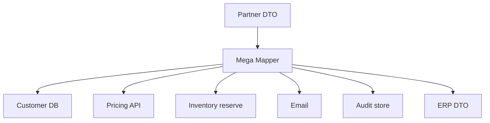
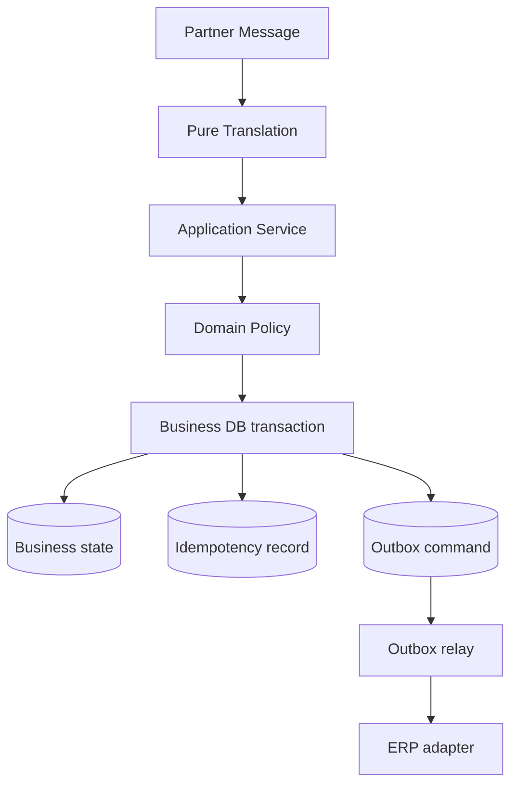
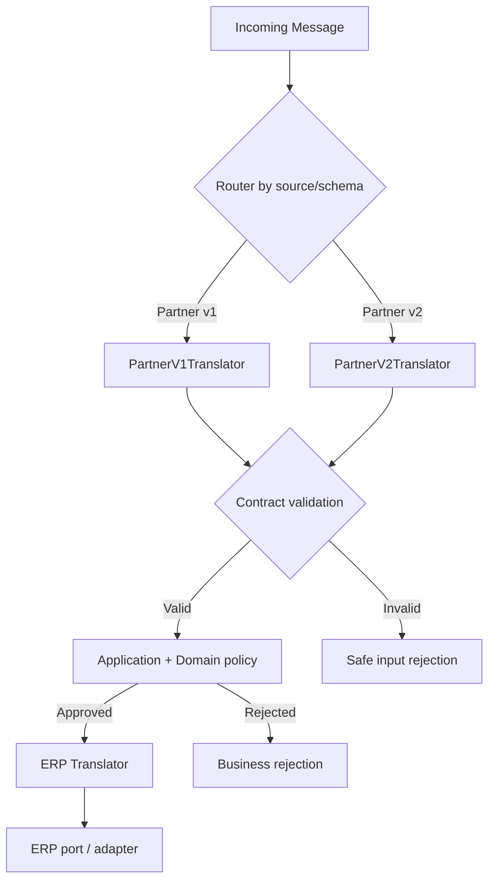

# Keeping Heavy Business Logic Out of Mapping

In an integration system, a partner sends an order creation request with an amount of `"49.95"` USD, customer code `CUS-9`, and line items. ERP instead expects the amount in cents, an ERP account ID, and different field names. A **Message Translator** converts the partner's data format into an ERP command; that is the purpose of this Enterprise Integration Patterns (EIP) pattern, enabling two systems to communicate without directly sharing data models.

Problems arise when `mapPartnerToErp()` gradually starts **querying the customer database, checking credit limits, calling a pricing API, reserving inventory, applying discounts, sending emails, and retrying ERP commands itself**. At that point, a function named *mapping* is actually a monolithic application service: schema changes accidentally drag along business policy changes, unit tests require DB/HTTP, retries can duplicate side effects, and network outages can be mistaken for data errors.

**Principle:** A Translator should only be responsible for converting **Message contracts**: structure, fields, types, enums, units, versions, and required metadata. **Domain policy** decides whether to approve an order; the **application service** fetches data and orchestrates; **ports/adapters** handle I/O, transactions, transport, and side-effecting operations. Not every `if` check in a mapper is wrong: validating format and data representability is legitimately part of translation. Separate **contract translation logic** from **heavy business rules and side effects on external systems**.

The lesson **Keeping Heavy Business Logic Out of Mapping** belongs to the **Message translator** chapter of module `SPRING_INTEGRATION_PATTERN`. The module goal is learning Enterprise Integration Patterns with Spring Integration to build loosely coupled, extensible Message flows, practicing Router, Filter, Transformer, Splitter, Aggregator, Gateway, retry, error channel, and correlation, while testing and monitoring branches. This lesson uses a **Partner API → Canonical Order → Domain Approval → ERP** scenario and provides Java 17, Spring Integration DSL, JUnit, failure windows, and a design checklist.

## 1. Separating three kinds of responsibility in one flow

Partner sends:

```json
{
  "tenantId": "tenant-7",
  "eventId": "evt-1001",
  "orderId": "ORD-1001",
  "customerRef": "CUS-9",
  "expectedTotalText": "49.95",
  "currency": "USD",
  "lines": [
    {"lineNo": 1, "sku": "BOOK-01", "quantity": 2},
    {"lineNo": 2, "sku": "PEN-02", "quantity": 5}
  ]
}
```

ERP requires a command with `totalMinorUnits=4995`, `customerAccount="ERP-CUS-9"`, and `positions[].materialCode`. Before sending, however, the system must check whether the customer is permitted to place orders, whether server pricing matches the customer-declared total, and whether the credit limit suffices.

| Task | Example | Responsible component |
| --- | --- | --- |
| Read and convert source contract | String `"49.95"` → `BigDecimal("49.95")`, field names | Partner Translator |
| Fetch trusted context | Customer profile, current product prices | Application service calling ports |
| Make business decisions | Customer active, valid quote, credit limit | Domain policy |
| Convert to target contract | `BigDecimal USD` → `long` cents, ERP field names | ERP Translator |
| Send command to ERP | HTTP/broker request, timeouts, and retries | ERP port and adapter |


In this lesson, `ApprovedOrder` means **internal policy permitted sending the command**, not that ERP has committed or fulfilled it.

## 2. Message Translator, Transformer, and Anti-Corruption Layer

An EIP Message Translator is typically implemented using a **Message Transformer** in Spring Integration. The two terms differ in **architectural intent**:

| Concept | Focus | Example |
| --- | --- | --- |
| Message Translator | Enabling two systems with different contracts to interoperate | Partner v1 → ERP v2 |
| Message Transformer | Technique transforming payload/Message inside a flow | String → DTO, unit conversion |
| Normalizer | Multiple formats into one canonical shape | CRM/ERP/CSV → CanonicalOrder |
| Envelope Wrapper | Wrapping payload with integration metadata | EventEnvelope carrying source/event ID |
| Channel Adapter | Connecting external transport | HTTP outbound gateway, Kafka |
| Router | Selecting route based on Message info | Source version → matching translator |
| Domain policy | Business decision | Approving credit limits |

An **Anti-Corruption Layer (ACL)** may contain several Translators, validators, and adapters to stop external models from leaking into the domain. Yet ACL is an **architectural boundary**, not an excuse to jam the entire ACL logic into one `map()` method.

### 2.1. Many lines of mapping do not automatically mean bad design

A 150-line mapper can be completely reasonable if it maps 50 fields with type, enum, version, and precision validation. A 20-line mapper already crosses the boundary if it calls `paymentGateway.charge()` or `inventory.reserve()`. What matters is **side effects, dependencies, and decision-making authority**, not line count alone.

### 2.2. A Canonical Data Model is not needed in every case

With just two systems, direct Partner → ERP translation may suffice. When many sources and targets exist, a canonical model lets you share policies without duplicating business rules inside every mapper. A canonical model should represent **genuinely shared semantics**, not a union of every system-specific field.

## 3. Anti-pattern: a Mega Mapper that does everything

```java
// ANTI-PATTERN: shown only to recognize the problem, never use in production.
public ErpCreateOrder map(PartnerOrderV1 order) {
    var customer = customerRepository.find(
            order.customerRef());
    if (!customer.isActive()) {
        throw new IllegalStateException("Inactive customer");
    }
    var quote = pricingClient.quote(order);
    if (quote.total().compareTo(customer.creditLimit()) > 0) {
        emailClient.sendRejectedNotice(order.orderId());
        throw new IllegalStateException("Credit limit exceeded");
    }
    inventoryService.reserve(order.lines());
    auditRepository.save(order.eventId());
    return erpDtoFrom(order, quote);
}
```

This code mixes at least five distinct responsibilities:

1. `customerRepository.find()` is **reading external state**.
2. `pricingClient.quote()` is **making a network call**.
3. Credit limit checking is a **business decision**.
4. `inventoryService.reserve()`, email, and audit create **side effects**.
5. Only `erpDtoFrom()` is **translation to the ERP contract**.



If Retry Advice re-executes `map()` after a timeout, emails or reservations can trigger multiple times. If the database or pricing API fails, callers receive a mapper exception that blurs **bad input** with **infrastructure failures**. When Partner v2 arrives, developers copy-paste the whole block, scattering the same credit rules across multiple mappers.

**Renaming `map` to `process` without changing I/O and domain boundaries does not fix coupling.** Decompose dependencies and assign clear owners to each decision.

## 4. Rule of thumb for which conditions belong in a mapper

A mapper should resemble a pure function:

\[
f(\text{source DTO},\text{mapping rules})=\text{target DTO}
\]

Given the same input and mapping version, it returns the same output and **never** mutates databases, sends emails, publishes events, or fetches from networks.

| Question | Suggested home | Why? |
| --- | --- | --- |
| Can the string parse into a decimal? | Translator / contract validation | Data representation |
| Can the decimal convert exactly to cents? | ERP Translator | Target unit contract |
| Is a required field missing? | Input contract validator | Cannot translate safely |
| Which ERP enum code applies? | Target Translator | Target transport enum table |
| Is the customer currently allowed to order? | Domain policy | Business condition |
| How much Gold discount applies? | Pricing/Promotion domain | Evolving business policy |
| Is credit sufficient with 2 concurrent orders? | Domain service/transaction | Depends on state and concurrency |
| Send via Kafka or HTTP? | Channel adapter | Transport |
| On timeout, retry or query ERP status? | Application/error policy | Reliability |

Some checks like `quantity > 0` may live in **contract validation** or **domain invariants**, depending on the system. Record that decision in the contract and test consistently—never silently duplicate logic across every source mapper.

### 4.1. Distinguish unit conversion from pricing

`49.95 USD → 4995 cents` is **the same value expressed in a different unit**. `49.95 → 44.955` because Gold customers get 10% off is a **pricing decision**. Rounding, taxes, shipping fees, and discount eligibility belong to the pricing/domain layer per policy, not field renaming.

### 4.2. Avoid hidden time dependencies

If a mapper calls `Instant.now()` to check whether a campaign is active, translation depends on the wall clock. Replaying the same payload on a different day yields a different result. The application service or policy should receive an **explicit time context or versioned campaign snapshot**.

## 5. Why separating layers reduces coupling

Suppose three sources—Partner v1, Partner v2, and CSV—all create orders:

```text
Partner v1 ── Translator v1 ─┐
Partner v2 ── Translator v2 ─┤
CSV import ── CSV Translator ┴─> CanonicalOrder
                                      |
                            DomainApprovalPolicy
                                      |
                                 ApprovedOrder
                                      |
                              ERP v2 Translator
```

When the company updates credit limit rules, you edit the policy and its tests. When Partner v2 switches money from decimal strings to integer minor units, you edit **`PartnerV2Translator`**. When ERP changes schema, you edit **`ErpV3Translator`**. Independent axes of change no longer force the entire flow to change together.

That is the practical meaning of **low coupling** in `SPRING_INTEGRATION_PATTERN`, not merely splitting code across files.

### 5.1. Avoid overengineering

You do not need an interface for every `String → BigDecimal` helper. Introduce boundaries when there is I/O, distinct ownership, distinct contract versions, or real multiple implementations. A simple domain policy can be a plain class without heavy frameworks.

## 6. Recommended flow and the source of truth for pricing

A Partner request includes `expectedTotalText`. That is a **client-declared claim**; it does not automatically become the authorized selling price. In this example:

1. Partner Translator parses it into `CanonicalOrder.expectedTotal`.
2. `PricingPort` produces a `PriceQuote` from an application-controlled price catalog.
3. Domain policy compares `expectedTotal` against the quote and checks customer status and credit limit.
4. Once approved, ERP Translator uses the **approved quote's price**, never raw input text.
5. ERP port sends the command per the target contract.

```text
Partner total = 49.95 (input claim)
    |
    v
CanonicalOrder.expectedTotal = BigDecimal("49.95")

Server price catalog:
  2 × BOOK-01 (10.00) = 20.00
  5 × PEN-02  (5.99)  = 29.95
  total = 49.95
    |
    v
Domain policy: match? customer active? credit limit?
    |
    v
ApprovedOrder.quote.total = 49.95
    |
    v
ErpCreateOrder.totalMinorUnits = 4995
```

Crucial point: **never create a fake quote by copying `expectedTotal` and labeling it authoritative**, as that renders price comparison meaningless. The demo's fake pricing uses its own price table; production needs a real pricing engine handling taxes, promotions, currencies, and concurrency.

## 7. DTO types across different boundaries

The Java 17 `record`s below are **illustrative models**, grouped inside one container class so subsequent examples can import them easily.

```java
package example.integration;

import java.math.BigDecimal;
import java.util.List;

public final class OrderContracts {

    private OrderContracts() {
    }

    public record PartnerLine(int lineNo, String sku, int quantity) {
    }

    public record PartnerOrderV1(
            String tenantId,
            String eventId,
            String orderId,
            String customerRef,
            String expectedTotalText,
            String currency,
            List<PartnerLine> lines) {
    }

    public record CanonicalLine(int lineNo, String sku, int quantity) {
    }

    public record CanonicalOrder(
            String tenantId,
            String eventId,
            String orderId,
            String customerRef,
            BigDecimal expectedTotal,
            String currency,
            List<CanonicalLine> lines) {
        public CanonicalOrder {
            lines = List.copyOf(lines);
        }
    }

    public record CustomerProfile(
            String tenantId,
            String customerRef,
            boolean active,
            BigDecimal creditLimit) {
    }

    public record PriceQuote(
            BigDecimal total,
            String currency,
            String priceListVersion) {
    }

    // Approved by policy to send to ERP, not yet completed by ERP.
    public record ApprovedOrder(
            CanonicalOrder order,
            PriceQuote quote) {
    }

    public record ErpLine(
            int position, String materialCode, int units) {
    }

    public record ErpCreateOrder(
            String tenant,
            String sourceEventId,
            String externalDocumentId,
            String customerAccount,
            long totalMinorUnits,
            String currencyCode,
            List<ErpLine> positions,
            String idempotencyKey) {
    }

    public record ErpReceipt(
            String sourceEventId,
            String externalDocumentId,
            String erpDocumentId,
            String resultCode) {
    }

    public record PartnerReceipt(
            String eventId,
            String orderId,
            String erpReference,
            String status) {
    }
}
```

Distinguishing the types:

- `PartnerOrderV1`: source data under Partner's contract.
- `CanonicalOrder`: normalized data before business approval.
- `CustomerProfile` and `PriceQuote`: context fetched by the application service from trusted sources.
- `ApprovedOrder`: policy decision permitting command creation—**not** confirmation of remote success.
- `ErpCreateOrder`: outbound contract sent to ERP.
- `ErpReceipt`: outcome in ERP's language.
- `PartnerReceipt`: response in Partner's language.

`List.copyOf` prevents list mutation after constructing `CanonicalOrder`, but does not replace validation, serialization, and access control. Production requires schema versions, nullability policies, authentication, and domain-specific invariants.

## 8. Pure Partner Translator: handles only the input contract

```java
package example.integration;

import java.math.BigDecimal;
import java.util.HashSet;
import java.util.List;
import java.util.Set;

import example.integration.OrderContracts.*;

public final class PartnerTranslator {

    public CanonicalOrder toCanonical(PartnerOrderV1 source) {
        if (source == null) {
            throw new IllegalArgumentException(
                    "PARTNER_ORDER_REQUIRED");
        }

        String tenant = requiredId(source.tenantId(), "TENANT");
        String event = requiredId(source.eventId(), "EVENT");
        String order = requiredId(source.orderId(), "ORDER");
        String customer = requiredId(
                source.customerRef(), "CUSTOMER");
        String currency = requireUsd(source.currency());
        BigDecimal expected = parseAmount(source.expectedTotalText());
        List<CanonicalLine> lines = mapLines(source.lines());

        return new CanonicalOrder(
                tenant, event, order, customer,
                expected, currency, lines);
    }

    private static String requiredId(String value, String kind) {
        if (value == null
                || !value.matches("[A-Za-z0-9_-]{1,80}")) {
            throw new IllegalArgumentException(
                    "INVALID_" + kind + "_ID");
        }
        return value;
    }

    private static String requireUsd(String currency) {
        // Demo only translates the USD contract with two decimal places.
        if (!"USD".equals(currency)) {
            throw new IllegalArgumentException(
                    "UNSUPPORTED_CURRENCY");
        }
        return currency;
    }

    private static BigDecimal parseAmount(String value) {
        if (value == null
                || !value.matches("[0-9]{1,12}(\\.[0-9]{1,2})?")) {
            throw new IllegalArgumentException(
                    "INVALID_AMOUNT_FORMAT");
        }
        return new BigDecimal(value).setScale(2);
    }

    private static List<CanonicalLine> mapLines(
            List<PartnerLine> source) {
        if (source == null || source.isEmpty()
                || source.size() > 100) {
            throw new IllegalArgumentException(
                    "INVALID_LINE_COUNT");
        }
        Set<Integer> positions = new HashSet<>();
        return source.stream().map(line -> {
            if (line == null
                    || line.lineNo() < 1
                    || line.lineNo() > source.size()
                    || !positions.add(line.lineNo())) {
                throw new IllegalArgumentException(
                        "INVALID_LINE_POSITION");
            }
            if (line.quantity() <= 0) {
                throw new IllegalArgumentException(
                        "INVALID_LINE_QUANTITY");
            }
            return new CanonicalLine(
                    line.lineNo(),
                    requiredId(line.sku(), "SKU"),
                    line.quantity());
        }).toList();
    }
}
```

### 8.1. Why does the mapper still have several `if` checks?

Those conditions verify the **contract**, not credit policies: well-formed IDs, parseable money, representable quantities, unique `lineNo`. If a project views positive quantity as a domain invariant rather than a schema constraint, move that check into the domain; the key is never copying **volatile business rules** into every source mapper.

### 8.2. Never let the mapper call `Instant.now()` or external data sources

The mapper receives complete input to construct the canonical DTO. It invents no prices, calls no repositories, reserves no inventory, and sends no emails. For the same input, it produces identical canonical output and can be unit-tested **without a Spring context**.

### 8.3. Never use `double` for money

`BigDecimal("49.95")` avoids binary representation errors inherent to floating-point. For an ERP accepting cents, conversion to `long` must be **exact**, never casting with silent truncation.

## 9. Ports supplying business context to policy

The application service needs trusted customer profiles and price quotes, yet the mapper **must never fetch them itself**. Define ports:

```java
package example.integration;

import example.integration.OrderContracts.*;

@FunctionalInterface
public interface CustomerProfilePort {
    CustomerProfile find(String tenantId, String customerRef);
}
```

```java
package example.integration;

import example.integration.OrderContracts.*;

@FunctionalInterface
public interface PricingPort {
    PriceQuote price(CanonicalOrder order);
}
```

Real implementations may use JDBC, REST, caches, or domain services. Connection failures from these ports must be classified as **dependency failures**, never disguised as `INVALID_AMOUNT_FORMAT`.

**Do not create a port for every String conversion.** An interface adds value when there is an external resource, multiple implementations, or a real ownership boundary. It is a tool for separating responsibilities, not an end in itself.

## 10. Pure domain policy: one home for order approval rules

```java
package example.integration;

import java.math.BigDecimal;
import java.util.Objects;

import example.integration.OrderContracts.*;

public final class DomainApprovalPolicy {

    public static final class Rejection
            extends RuntimeException {
        private final String code;

        public Rejection(String code) {
            super(code);
            this.code = code;
        }

        public String code() {
            return code;
        }
    }

    public ApprovedOrder approve(
            CanonicalOrder order,
            CustomerProfile customer,
            PriceQuote quote) {

        Objects.requireNonNull(order, "order");
        Objects.requireNonNull(customer, "customer");
        Objects.requireNonNull(quote, "quote");

        if (!order.tenantId().equals(customer.tenantId())
                || !order.customerRef().equals(
                        customer.customerRef())) {
            throw new Rejection("CUSTOMER_SCOPE_MISMATCH");
        }
        if (!customer.active()) {
            throw new Rejection("CUSTOMER_INACTIVE");
        }
        // Example business rule; not a Spring Integration limit.
        if (order.lines().size() > 20) {
            throw new Rejection("ORDER_TOO_MANY_LINES");
        }
        if (quote.total() == null
                || quote.total().compareTo(BigDecimal.ZERO) < 0
                || !"USD".equals(quote.currency())) {
            throw new Rejection("PRICE_QUOTE_INVALID");
        }
        if (order.expectedTotal().compareTo(quote.total()) != 0) {
            throw new Rejection("ORDER_TOTAL_MISMATCH");
        }
        if (customer.creditLimit() == null
                || quote.total().compareTo(
                        customer.creditLimit()) > 0) {
            throw new Rejection("CREDIT_LIMIT_EXCEEDED");
        }
        return new ApprovedOrder(order, quote);
    }
}
```

The policy accepts only value objects and returns a decision; it neither reads databases nor calls pricing HTTP endpoints. This is **heavy business logic that deserves independent testing and versioning**, distinct from currency-unit conversion in a Translator.

### 10.1. The demo credit limit is illustrative, not complete financial control

Real credit limits depend on balances, pending liabilities, currencies, concurrent orders, and reservations. Comparing a quote to `creditLimit` demonstrates **separating policy from mapper**, not production overspend protection. Real financial invariants require transactions, locking, or reservation protocols.

### 10.2. Why return `ApprovedOrder`?

`ApprovedOrder` is a **type carrying an explicit decision**. The ERP Translator accepts that type instead of allowing direct invocation from an unapproved DTO. Where domains need richer outcomes, a `Decision.Approved/Rejected` type may fit better; this lesson uses a coded `Rejection` exception to highlight business errors.

## 11. Application service: I/O and orchestration in the right place

`OrderApplicationService` is permitted to call ports to **fetch verified data**, then delegate the decision to policy:

```java
package example.integration;

import java.util.Objects;

import example.integration.OrderContracts.*;

public final class OrderApplicationService {

    private final CustomerProfilePort customers;
    private final PricingPort pricing;
    private final DomainApprovalPolicy policy;

    public OrderApplicationService(
            CustomerProfilePort customers,
            PricingPort pricing,
            DomainApprovalPolicy policy) {
        this.customers = Objects.requireNonNull(customers);
        this.pricing = Objects.requireNonNull(pricing);
        this.policy = Objects.requireNonNull(policy);
    }

    public ApprovedOrder prepare(CanonicalOrder order) {
        CustomerProfile customer =
                customers.find(order.tenantId(), order.customerRef());
        PriceQuote quote = pricing.price(order);
        return policy.approve(order, customer, quote);
    }
}
```

Three clear steps inside:

1. `customers.find(...)`: fetches state outside the domain policy.
2. `pricing.price(...)`: retrieves a quote from an application-trusted source.
3. `policy.approve(...)`: evaluates business rules **with zero I/O**.

`prepare()` does not yet call ERP or commit a business transaction. When reserving credit, holding inventory, or persisting outbound commands, wrap the application service with an appropriate **transaction boundary, outbox, or workflow**. Never push those responsibilities back into `PartnerTranslator` merely because the mapper sits at the start of the pipeline.

### 11.1. Never turn the client's price into the source of truth

A subtle anti-pattern:

```java
PriceQuote quote = new PriceQuote(
        order.expectedTotal(), order.currency(), "server-price");
```

This merely relabels the client's price as `"server-price"`. Comparing `expectedTotal` with `quote.total()` always passes and offers **zero protection** against price tampering.

In the upcoming demo, `DemoPricingPort` uses its own **independent price catalog**, letting learners observe an input with valid decimal syntax that fails price verification.

## 12. ERP Translator: only converts `ApprovedOrder` to the ERP contract

ERP v2 uses `long totalMinorUnits`, `customerAccount`, `positions`, and `sourceEventId`. The target Translator converts types and units **without re-running approval logic**.

```java
package example.integration;

import java.math.BigDecimal;
import java.util.List;

import example.integration.OrderContracts.*;

public final class ErpTranslator {

    public ErpCreateOrder toErp(ApprovedOrder approved) {
        if (approved == null || approved.order() == null
                || approved.quote() == null) {
            throw new IllegalArgumentException(
                    "APPROVED_ORDER_REQUIRED");
        }

        CanonicalOrder order = approved.order();
        PriceQuote quote = approved.quote();

        if (!"USD".equals(quote.currency())) {
            throw new IllegalArgumentException(
                    "UNSUPPORTED_ERP_CURRENCY");
        }

        long cents = toMinorUnits(quote.total());
        List<ErpLine> positions = order.lines().stream()
                .map(line -> new ErpLine(
                        line.lineNo(),
                        line.sku(),
                        line.quantity()))
                .toList();

        String idempotencyKey =
                order.tenantId() + ":PARTNER_API:"
                + order.eventId() + ":CREATE_ORDER";

        return new ErpCreateOrder(
                order.tenantId(),
                order.eventId(),
                order.orderId(),
                "ERP-" + order.customerRef(),
                cents,
                quote.currency(),
                positions,
                idempotencyKey);
    }

    private static long toMinorUnits(BigDecimal amount) {
        if (amount == null || amount.signum() < 0) {
            throw new IllegalArgumentException(
                    "INVALID_ERP_AMOUNT");
        }
        try {
            // Must be exact: fractional cents or overflow are both invalid.
            return amount.multiply(new BigDecimal("100"))
                    .longValueExact();
        } catch (ArithmeticException ex) {
            throw new IllegalArgumentException(
                    "ERP_AMOUNT_NOT_REPRESENTABLE", ex);
        }
    }

    public PartnerReceipt toPartnerReceipt(ErpReceipt response) {
        if (response == null) {
            throw new IllegalArgumentException(
                    "ERP_RECEIPT_REQUIRED");
        }
        return switch (response.resultCode()) {
            case "ACCEPTED" -> new PartnerReceipt(
                    response.sourceEventId(),
                    response.externalDocumentId(),
                    response.erpDocumentId(),
                    "SUBMITTED");
            case "REJECTED" -> new PartnerReceipt(
                    response.sourceEventId(),
                    response.externalDocumentId(),
                    null,
                    "REJECTED");
            default -> throw new IllegalArgumentException(
                    "UNKNOWN_ERP_RESULT");
        };
    }
}
```

### 12.1. The price sent to ERP comes from the approved quote

`totalMinorUnits` is derived from `approved.quote().total()`, **never** re-parsed from Partner's raw `expectedTotalText`. Thus the target mapper cannot accidentally bypass domain policy decisions.

### 12.2. Converting 49.95 USD to 4995 cents is not pricing

This transforms **the exact same value across two unit representations**. Deciding whether discounts apply, how much to discount, or which taxes to add belongs to the pricing/promotion domain. The demo supports only USD; never assume every currency has two decimal places.

### 12.3. Assumptions to replace in production

In the example, `customerAccount="ERP-" + customerRef` and SKU codes stay unchanged. In practice, CRM/Partner customer IDs and ERP account IDs often live in unrelated namespaces. When lookup is required, the application service should fetch `ResolvedCustomerIdentity` via a dedicated port and **pass it into the target Translator**—never bury HTTP/database lookups inside the mapper.

Likewise, mapping fake ERP `ACCEPTED` to `SUBMITTED` reflects only the **demo contract**; a real ERP may distinguish accepted, posted, committed, and fulfilled. Map statuses according to the real contract.

## 13. Fake ports: simulating business context and ERP transport

To test the flow without PostgreSQL or a REST server, we create fakes for the ports. Fakes must never be mistaken for production integrations.

```java
package example.integration;

import java.math.BigDecimal;

import example.integration.OrderContracts.*;

public final class DemoCustomerProfilePort
        implements CustomerProfilePort {

    @Override
    public CustomerProfile find(
            String tenantId, String customerRef) {
        if (!"tenant-7".equals(tenantId)
                || !"CUS-9".equals(customerRef)) {
            throw new DomainApprovalPolicy.Rejection(
                    "CUSTOMER_NOT_FOUND");
        }
        return new CustomerProfile(
                tenantId, customerRef, true,
                new BigDecimal("100.00"));
    }
}
```

`DemoPricingPort` uses the demo server's own price list:

```java
package example.integration;

import java.math.BigDecimal;

import example.integration.OrderContracts.*;

public final class DemoPricingPort implements PricingPort {

    @Override
    public PriceQuote price(CanonicalOrder order) {
        BigDecimal total = BigDecimal.ZERO;
        for (CanonicalLine line : order.lines()) {
            BigDecimal unitPrice = switch (line.sku()) {
                case "BOOK-01" -> new BigDecimal("10.00");
                case "PEN-02" -> new BigDecimal("5.99");
                default -> throw new DomainApprovalPolicy.Rejection(
                        "SKU_NOT_PRICED");
            };
            total = total.add(unitPrice.multiply(
                    BigDecimal.valueOf(line.quantity())));
        }
        return new PriceQuote(
                total, "USD", "demo-price-list-v1");
    }
}
```

With two books and five pens:

\[
2\times 10.00+5\times 5.99=49.95\ \text{USD}
\]

The ERP port is a separate boundary:

```java
package example.integration;

import example.integration.OrderContracts.*;

@FunctionalInterface
public interface ErpSubmissionPort {
    ErpReceipt submit(ErpCreateOrder command);
}
```

A fake implementation records invocation counts:

```java
package example.integration;

import java.util.concurrent.atomic.AtomicInteger;
import java.util.concurrent.atomic.AtomicReference;

import example.integration.OrderContracts.*;

public final class RecordingErpSubmissionPort
        implements ErpSubmissionPort {

    private final AtomicInteger calls = new AtomicInteger();
    private final AtomicReference<ErpCreateOrder> last =
            new AtomicReference<>();

    @Override
    public ErpReceipt submit(ErpCreateOrder command) {
        last.set(command);
        calls.incrementAndGet();
        return new ErpReceipt(
                command.sourceEventId(),
                command.externalDocumentId(),
                "ERP-DOC-777",
                "ACCEPTED");
    }

    public int submissionCount() {
        return calls.get();
    }

    public ErpCreateOrder lastCommand() {
        return last.get();
    }
}
```

The fake port **has no idempotency**: calling `submit()` twice increments `calls` to two. This is intentional, proving **pure mapping does not make ERP side effects run at most once**. In production, address ERP idempotency, durable state, lost responses, and reconciliation.

## 14. Java DSL: expressing boundaries with separate endpoints

A Spring Integration flow wires the steps cleanly:

```text
partnerOrdersInput
  -> PartnerTranslator.toCanonical
  -> OrderApplicationService.prepare
  -> ErpTranslator.toErp
  -> ErpSubmissionPort.submit
  -> ErpTranslator.toPartnerReceipt
  -> partnerReceipts
```

```java
package example.integration;

import org.springframework.context.annotation.Bean;
import org.springframework.context.annotation.Configuration;
import org.springframework.integration.channel.DirectChannel;
import org.springframework.integration.channel.QueueChannel;
import org.springframework.integration.config.EnableIntegration;
import org.springframework.integration.dsl.IntegrationFlow;
import org.springframework.messaging.MessageChannel;
import org.springframework.messaging.PollableChannel;

import example.integration.OrderContracts.*;

@Configuration
@EnableIntegration
public class SeparatedTranslatorFlowConfiguration {

    @Bean
    public MessageChannel partnerOrdersInput() {
        return new DirectChannel();
    }

    @Bean
    public PollableChannel partnerReceipts() {
        return new QueueChannel(20);
    }

    @Bean
    public PartnerTranslator partnerTranslator() {
        return new PartnerTranslator();
    }

    @Bean
    public DomainApprovalPolicy approvalPolicy() {
        return new DomainApprovalPolicy();
    }

    @Bean
    public CustomerProfilePort customerProfilePort() {
        return new DemoCustomerProfilePort();
    }

    @Bean
    public PricingPort pricingPort() {
        return new DemoPricingPort();
    }

    @Bean
    public OrderApplicationService applicationService(
            CustomerProfilePort customers,
            PricingPort pricing,
            DomainApprovalPolicy policy) {
        return new OrderApplicationService(
                customers, pricing, policy);
    }

    @Bean
    public ErpTranslator erpTranslator() {
        return new ErpTranslator();
    }

    @Bean
    public RecordingErpSubmissionPort erpSubmissionPort() {
        return new RecordingErpSubmissionPort();
    }

    @Bean
    public IntegrationFlow partnerToErpFlow(
            PartnerTranslator partnerTranslator,
            OrderApplicationService application,
            ErpTranslator erpTranslator,
            ErpSubmissionPort erpPort) {

        return IntegrationFlow.from("partnerOrdersInput")
                .transform(PartnerOrderV1.class,
                        partnerTranslator::toCanonical)
                .handle(CanonicalOrder.class,
                        (order, headers) -> application.prepare(order))
                .transform(ApprovedOrder.class,
                        erpTranslator::toErp)
                .handle(ErpCreateOrder.class,
                        (command, headers) -> erpPort.submit(command))
                .transform(ErpReceipt.class,
                        erpTranslator::toPartnerReceipt)
                .channel("partnerReceipts")
                .get();
    }
}
```

### 14.1. Why alternate `.transform` and `.handle`?

| Endpoint | Role |
| --- | --- |
| `transform(PartnerOrderV1, ...)` | Translates source contract to canonical DTO |
| `handle(CanonicalOrder, ...)` | Calls application service: data lookup and domain decision |
| `transform(ApprovedOrder, ...)` | Translates to ERP command |
| `handle(ErpCreateOrder, ...)` | Calls ERP port; the side-effect boundary |
| `transform(ErpReceipt, ...)` | Translates ERP response to Partner receipt |

Picking appropriate DSL endpoints **does not enforce architectural boundaries by itself**. A developer could still put HTTP calls inside `.transform(...)`; boundaries must be protected by code reviews, dependency rules, and tests.

### 14.2. This configuration is a synchronous demo

`DirectChannel` runs on the caller thread; `QueueChannel(20)` at the end lets demos/tests inspect results. That queue **is not durable across restarts**. The flow has no DB transactions, broker ACKs, durable outbox, or real remote ERP—build those explicitly at real boundaries.

### 14.3. An output queue does not automatically wire a Gateway

If using `@MessagingGateway`, configure proper request/reply routing and timeouts. Never assume a Gateway receives replies automatically just because a flow ends at an arbitrary `QueueChannel`; test Gateways with realistic reply channel configurations. For async ERP over a broker, track completion state and cross-transport correlation.

## 15. Demo: one order crossing translation, policy, and ERP port

```java
package example.integration;

import java.util.List;

import org.springframework.context.annotation.AnnotationConfigApplicationContext;
import org.springframework.messaging.Message;
import org.springframework.messaging.MessageChannel;
import org.springframework.messaging.PollableChannel;
import org.springframework.messaging.support.MessageBuilder;

import example.integration.OrderContracts.*;

public class SeparatedTranslatorDemo {

    public static void main(String[] args) {
        try (var context = new AnnotationConfigApplicationContext(
                SeparatedTranslatorFlowConfiguration.class)) {

            MessageChannel input = context.getBean(
                    "partnerOrdersInput", MessageChannel.class);
            PollableChannel output = context.getBean(
                    "partnerReceipts", PollableChannel.class);
            RecordingErpSubmissionPort erp = context.getBean(
                    RecordingErpSubmissionPort.class);

            PartnerOrderV1 order = new PartnerOrderV1(
                    "tenant-7", "evt-1001", "ORD-1001",
                    "CUS-9", "49.95", "USD",
                    List.of(
                            new PartnerLine(1, "BOOK-01", 2),
                            new PartnerLine(2, "PEN-02", 5)));

            input.send(MessageBuilder.withPayload(order).build());

            Message<?> message = output.receive(0);
            if (message == null) {
                throw new IllegalStateException(
                        "Expected PartnerReceipt");
            }
            PartnerReceipt receipt =
                    (PartnerReceipt) message.getPayload();

            System.out.println(receipt.status()); // SUBMITTED
            System.out.println(erp.submissionCount()); // 1
            System.out.println(
                    erp.lastCommand().totalMinorUnits()); // 4995
            System.out.println(
                    erp.lastCommand().idempotencyKey());
            // tenant-7:PARTNER_API:evt-1001:CREATE_ORDER
        }
    }
}
```

In the demo, the fake ERP returns `ACCEPTED`, so `PartnerReceipt.status=SUBMITTED` reflects **assumed mapping rules**, not proof that an ERP created or committed an order. A real ERP contract defines whether `ACCEPTED` means queued, validated, posted, or fulfilled.

## 16. JUnit 5: Partner Mapper needs only input, not Spring

Mapper unit tests should answer whether data translates accurately *without* touching databases or mocking HTTP.

```java
package example.integration;

import static org.junit.jupiter.api.Assertions.*;

import java.math.BigDecimal;
import java.util.List;

import org.junit.jupiter.api.Test;

import example.integration.OrderContracts.*;

class PartnerTranslatorTest {

    private final PartnerTranslator translator =
            new PartnerTranslator();

    static PartnerOrderV1 validRequest() {
        return new PartnerOrderV1(
                "tenant-7", "evt-1001", "ORD-1001",
                "CUS-9", "49.95", "USD",
                List.of(
                        new PartnerLine(1, "BOOK-01", 2),
                        new PartnerLine(2, "PEN-02", 5)));
    }

    @Test
    void mapsShapeWithoutRunningBusinessDecision() {
        CanonicalOrder order =
                translator.toCanonical(validRequest());

        assertEquals("evt-1001", order.eventId());
        assertEquals("CUS-9", order.customerRef());
        assertEquals(new BigDecimal("49.95"),
                order.expectedTotal());
        assertEquals("BOOK-01", order.lines().get(0).sku());
        assertEquals(5, order.lines().get(1).quantity());
    }

    @Test
    void sameInputProducesSameCanonicalData() {
        assertEquals(
                translator.toCanonical(validRequest()),
                translator.toCanonical(validRequest()));
    }

    @Test
    void malformedAmountIsContractError() {
        PartnerOrderV1 bad = new PartnerOrderV1(
                "tenant-7", "evt-1001", "ORD-1001",
                "CUS-9", "49.999", "USD",
                List.of(new PartnerLine(1, "BOOK-01", 2)));

        var ex = assertThrows(
                IllegalArgumentException.class,
                () -> translator.toCanonical(bad));
        assertEquals("INVALID_AMOUNT_FORMAT", ex.getMessage());
    }

    @Test
    void duplicateLineNumbersAreRejected() {
        PartnerOrderV1 bad = new PartnerOrderV1(
                "tenant-7", "evt-1001", "ORD-1001",
                "CUS-9", "49.95", "USD",
                List.of(
                        new PartnerLine(1, "BOOK-01", 2),
                        new PartnerLine(1, "PEN-02", 5)));
        assertThrows(IllegalArgumentException.class,
                () -> translator.toCanonical(bad));
    }
}
```

**This is an important architectural signal:** you do not need to mock repositories, pricing APIs, clocks, or ERP ports just to test `String → BigDecimal`. The mapper can be rerun to verify formatting without mutating inventory or sending commands.

Unit tests alone cannot stop a developer from adding a network call later; reinforce boundaries with dependency rules, static analysis, or code reviews where strict isolation is required.

## 17. JUnit 5: domain policy knows nothing about Partner v1 input

Construct canonical data and domain context directly to test business rules:

```java
package example.integration;

import static org.junit.jupiter.api.Assertions.*;

import java.math.BigDecimal;
import java.util.List;

import org.junit.jupiter.api.Test;

import example.integration.OrderContracts.*;

class DomainApprovalPolicyTest {

    private final DomainApprovalPolicy policy =
            new DomainApprovalPolicy();

    private static CanonicalOrder order() {
        return new CanonicalOrder(
                "tenant-7", "evt-1001", "ORD-1001",
                "CUS-9", new BigDecimal("49.95"), "USD",
                List.of(
                        new CanonicalLine(1, "BOOK-01", 2),
                        new CanonicalLine(2, "PEN-02", 5)));
    }

    private static CustomerProfile customer(
            boolean active, String limit) {
        return new CustomerProfile(
                "tenant-7", "CUS-9", active,
                new BigDecimal(limit));
    }

    private static PriceQuote quote(String total) {
        return new PriceQuote(
                new BigDecimal(total), "USD", "price-list-v1");
    }

    @Test
    void approvesMatchingTrustedQuoteForActiveCustomer() {
        ApprovedOrder result = policy.approve(
                order(), customer(true, "100.00"), quote("49.95"));
        assertEquals("ORD-1001", result.order().orderId());
        assertEquals(new BigDecimal("49.95"),
                result.quote().total());
    }

    @Test
    void rejectsInactiveCustomerByBusinessRule() {
        var ex = assertThrows(
                DomainApprovalPolicy.Rejection.class,
                () -> policy.approve(
                        order(), customer(false, "100.00"),
                        quote("49.95")));
        assertEquals("CUSTOMER_INACTIVE", ex.code());
    }

    @Test
    void validDecimalButMismatchedPriceIsBusinessRejection() {
        var ex = assertThrows(
                DomainApprovalPolicy.Rejection.class,
                () -> policy.approve(
                        order(), customer(true, "100.00"),
                        quote("49.96")));
        assertEquals("ORDER_TOTAL_MISMATCH", ex.code());
    }

    @Test
    void creditLimitRuleChangesWithoutChangingMapper() {
        var ex = assertThrows(
                DomainApprovalPolicy.Rejection.class,
                () -> policy.approve(
                        order(), customer(true, "40.00"),
                        quote("49.95")));
        assertEquals("CREDIT_LIMIT_EXCEEDED", ex.code());
    }
}
```

These tests run **without Spring Context, Partner DTOs, or ERP DTOs**. This separation lets business rules evolve independently of inbound/outbound contracts.

### 17.1. Policy unit tests do not prove financial consistency

Two concurrent transactions can both observe sufficient remaining credit before either persists a reservation. To prevent overspending, test real transactions, locking, or reservation protocols. The example only shows **where business decisions live**.

## 18. JUnit 5: ERP mapping and full flow in a Spring context

### 18.1. Testing ERP Translator with `ApprovedOrder`

```java
package example.integration;

import static org.junit.jupiter.api.Assertions.*;

import java.math.BigDecimal;
import java.util.List;

import org.junit.jupiter.api.Test;

import example.integration.OrderContracts.*;

class ErpTranslatorTest {

    @Test
    void approvedOrderMapsExactlyToErpCents() {
        CanonicalOrder order = new CanonicalOrder(
                "tenant-7", "evt-1001", "ORD-1001",
                "CUS-9", new BigDecimal("49.95"), "USD",
                List.of(new CanonicalLine(1, "BOOK-01", 2)));

        ApprovedOrder approved = new ApprovedOrder(
                order,
                new PriceQuote(new BigDecimal("49.95"),
                        "USD", "price-v1"));

        ErpCreateOrder command = new ErpTranslator().toErp(approved);
        assertEquals(4995L, command.totalMinorUnits());
        assertEquals("ERP-CUS-9", command.customerAccount());
        assertEquals("BOOK-01",
                command.positions().get(0).materialCode());
        assertEquals(
                "tenant-7:PARTNER_API:evt-1001:CREATE_ORDER",
                command.idempotencyKey());
    }

    @Test
    void acceptedReplyMeansSubmittedInThisDemoContract() {
        PartnerReceipt receipt = new ErpTranslator()
                .toPartnerReceipt(new ErpReceipt(
                        "evt-1001", "ORD-1001",
                        "ERP-DOC-777", "ACCEPTED"));
        assertEquals("SUBMITTED", receipt.status());
        assertEquals("ERP-DOC-777", receipt.erpReference());
    }
}
```

### 18.2. Integration test traversing real endpoints

```java
package example.integration;

import static org.junit.jupiter.api.Assertions.*;

import java.util.List;

import org.junit.jupiter.api.Test;
import org.springframework.context.annotation.AnnotationConfigApplicationContext;
import org.springframework.messaging.Message;
import org.springframework.messaging.MessageChannel;
import org.springframework.messaging.PollableChannel;
import org.springframework.messaging.support.MessageBuilder;

import example.integration.OrderContracts.*;

class SeparatedTranslatorFlowIntegrationTest {

    private static PartnerOrderV1 request(String total) {
        return new PartnerOrderV1(
                "tenant-7", "evt-1001", "ORD-1001",
                "CUS-9", total, "USD",
                List.of(
                        new PartnerLine(1, "BOOK-01", 2),
                        new PartnerLine(2, "PEN-02", 5)));
    }

    @Test
    void approvedOrderReachesErpAfterPolicy() {
        try (var context = new AnnotationConfigApplicationContext(
                SeparatedTranslatorFlowConfiguration.class)) {

            MessageChannel input = context.getBean(
                    "partnerOrdersInput", MessageChannel.class);
            PollableChannel output = context.getBean(
                    "partnerReceipts", PollableChannel.class);
            RecordingErpSubmissionPort port = context.getBean(
                    RecordingErpSubmissionPort.class);

            assertTrue(input.send(
                    MessageBuilder.withPayload(
                            request("49.95")).build()));

            Message<?> result = output.receive(0);
            assertNotNull(result);
            PartnerReceipt receipt = (PartnerReceipt) result.getPayload();
            assertEquals("SUBMITTED", receipt.status());
            assertEquals("evt-1001", receipt.eventId());
            assertEquals(1, port.submissionCount());
            assertEquals(4995L,
                    port.lastCommand().totalMinorUnits());
            assertNull(output.receive(0));
        }
    }

    @Test
    void validFormatButRejectedByPolicyNeverCallsErp() {
        try (var context = new AnnotationConfigApplicationContext(
                SeparatedTranslatorFlowConfiguration.class)) {

            MessageChannel input = context.getBean(
                    "partnerOrdersInput", MessageChannel.class);
            PollableChannel output = context.getBean(
                    "partnerReceipts", PollableChannel.class);
            RecordingErpSubmissionPort port = context.getBean(
                    RecordingErpSubmissionPort.class);

            // "49.96" has valid format, yet differs from trusted price 49.95.
            assertThrows(RuntimeException.class, () ->
                    input.send(MessageBuilder.withPayload(
                            request("49.96")).build()));

            assertEquals(0, port.submissionCount());
            assertNull(output.receive(0));
        }
    }
}
```

The second test is crucial: `PartnerTranslator` **parses** `"49.96"` cleanly, yet the domain policy compares against the catalog price and rejects it. The ERP port is never called—proving business rules **do not live inside the mapper**.

The Java/JUnit snippets in this lesson **have not been executed in STEP 4**. When applying them to a project, verify the Spring Integration DSL version, compile, and run unit/integration/adapter tests; in-JVM tests alone do not prove durability or idempotency over real ERP transport.

## 19. Error taxonomy: never turn technical errors into mapping errors

When boundaries are separated, each failure has a **distinct meaning and handling policy**:

| Where it occurs | Example | Reasonable conclusion | Handling |
| --- | --- | --- | --- |
| Partner Translator | `INVALID_AMOUNT_FORMAT` | Input unparseable per source contract | Reject/quarantine; usually do not retry |
| Domain policy | `CUSTOMER_INACTIVE` | Policy rejects order | Business rejection; never retry like a timeout |
| Domain policy | `CREDIT_LIMIT_EXCEEDED` | Insufficient limit at check time | Business rejection / review |
| PricingPort | Pricing server connection timeout | True price unknown | Bounded retry or circuit breaker |
| CustomerProfilePort | Database connection failure | Cannot verify customer state | Technical failure |
| ERP Translator | Amount not exact in cents | Target contract incompatible | Block ERP send; investigate mapping |
| ERP port | HTTP 503 | ERP unavailable; outcome depends on request state | Retry with key; check remote state |
| ERP port | Timeout after request may have reached ERP | Unknown whether ERP created the order | Lookup/reconciliation; never assume rejected |
| ERP response | Valid `REJECTED` | ERP rejected per contract | Map to business receipt |
| ERP response | Unknown result code | Source/target protocol drift | Quarantine and upgrade version |

Anti-pattern:

```java
try {
    return giantMapper.process(order);
} catch (Exception ex) {
    return new PartnerReceipt(
            order.eventId(), order.orderId(),
            null, "INVALID_INPUT");
}
```

If `giantMapper` makes HTTP calls, a **network outage** gets labeled **invalid input**. Callers do not retry, work is lost, and metrics hide the real root cause. Separating layers makes errors and their owners clear.

### 19.1. Business rejections do not always have to throw Exceptions

The demo uses `DomainApprovalPolicy.Rejection` for brevity. Production can use a sealed result:

```java
// Design sketch only, not a class used in the demo.
public sealed interface ApprovalResult {
    record Approved(ApprovedOrder value)
            implements ApprovalResult {}
    record Rejected(String safeCode)
            implements ApprovalResult {}
}
```

When a flow must reply to a Gateway, a `Rejected` result can map cleanly into a safe response DTO; technical exceptions still route through separate retry/error policies. Choosing result types vs. exceptions depends on system contracts and transaction boundaries.

### 19.2. `errorChannel` and `discardChannel` do not mean the same thing

A Spring Integration Filter can send Messages failing its predicate to `discardChannel`. Technical failures in a poller, executor, or adapter can route to `errorChannel` per configuration. A `DomainApprovalPolicy.Rejection` on the demo's synchronous `DirectChannel` propagates back to the caller; it does not automatically become a `PartnerReceipt` or land on an error channel by default.

**Never use a Filter to swallow exceptions:** business rule rejections, transport errors, and schema violations require distinct observability and retry strategies.

## 20. Transactions and side effects do not belong in the mapper

Consider this sequence:

```text
BEGIN business DB transaction
  UPDATE order
  CALL ERP HTTP  -> ERP created order
  INSERT audit  -> SQL failure
ROLLBACK local DB
```

A DB rollback **cannot roll back the ERP call**. Putting `@Transactional` on a method named `map()` cannot enlist database, ERP, broker, and email into one shared transaction.

When an ERP command must be sent only after business state commits, design:



Sharing the **same database and transaction manager**, business updates, deduplication markers, and outbox intents commit or roll back atomically. After commit, the relay dispatches to ERP; the remote ERP still requires idempotency/reconciliation because the relay can resend.

### 20.1. Failure windows to design for

| Timing | Risk | Requirement |
| --- | --- | --- |
| Mapper fails before side effects | No ERP request sent from this attempt | Clear error code; never infinitely retry poison inputs |
| Pricing service fails | No quote to decide with | Bounded retry; never fake business rejection |
| Domain approves, before ERP send | Crash before delivery | Outbox/durable workflow if needed |
| ERP creates order, response lost | Client may retry | Stable event ID + remote lookup/idempotency |
| DB commits, input ACK not sent | Input message redelivered | Deduplicate inside business transaction |
| Outbox publishes, relay crashes before marking sent | ERP receives command twice | Idempotent ERP receiver |
| Outbound broker down for long period | Outbox backlog grows | Backpressure, retry/DLQ, metrics |

Separating mappers from I/O makes the **boundary where side effects begin** explicit in both code and Flow, though it does not create exactly-once semantics automatically. Engineer reliability per resource.

### 20.2. Transaction context and asynchronous flows

`DirectChannel` executes synchronously on the current thread. Switching to `ExecutorChannel` or a broker means the previous thread's transaction context **does not propagate** across threads. Application services running on worker threads need their own transaction boundaries when accessing DBs.

### 20.3. When should you NOT retry?

A pure mapper can safely run again, yet **invalid format** errors will keep failing whenever inputs stay unchanged. Never infinitely retry a Message with `"expectedTotalText": "NaN"`. Conversely, a pricing port connection timeout warrants bounded retries with backoff, attempt caps, and stopping policies.

## 21. Idempotency: safe retranslation is not enough for safe ERP resending

A command may arrive multiple times due to at-least-once broker delivery:

```text
Event evt-1001:
  PartnerTranslator.toCanonical() -> OK
  DomainApprovalPolicy.approve()  -> OK
  ERP created order               -> OK
  Process crashes before input ACK
  Broker redelivers evt-1001
```

`PartnerTranslator` and `ErpTranslator` can rerun with zero side effects. However, `ErpSubmissionPort.submit()` is a **remote side effect** that can create duplicate orders unless ERP enforces deduplication.

A stable key per logical operation:

```text
tenantId + ":" + sourceSystem + ":" + eventId
  + ":" + consumerOperation

tenant-7:PARTNER_API:evt-1001:CREATE_ORDER
```

Depending on the system, you need:

1. ERP supporting idempotency keys and returning stored outcomes.
2. Durable deduplication/completion state in the integration app.
3. Lookup capability on ERP by external ID after remote timeouts.
4. Atomic deduplication paired with business transactions or outboxes.
5. Every retry preserving the **exact same event ID and operation**, never generating random new IDs.

### 21.1. Correlation ID is not an idempotency key

A Splitter workflow may produce many child Messages sharing one correlation ID; they are **not duplicates**. Deduplicate by stable event/child/operation keys. Spring Messaging's `MessageHeaders.ID` can also change when creating new Messages, so it is not a durable business identity.

### 21.2. Same key with different data

If `evt-1001` first arrives with total `49.95`, then arrives again with the same key and total `149.95`, never silently treat it as a valid duplicate. Enforce a **key reuse conflict** rule backed by request fingerprints/versions and proper auditing.

### 21.3. The Translator needs no knowledge of broker retry policies

Never inject `RetryTemplate`, `KafkaTemplate`, HTTP clients, or JDBC transactions into a mapper. Build retries around I/O endpoints aligned with idempotency semantics, while mappers take data and translate **per contract**.

## 22. Combining Router, Filter, Splitter, Aggregator, and Gateway

Separating mapping from policy lets the rest of the EIP toolbox operate cleanly:



### 22.1. Router picks versions, never business approvals

A Router can select `PartnerV1Translator` or `PartnerV2Translator` using an authenticated schema version. Never route on an unverified client-supplied `sourceSystem` header.

### 22.2. Filters should clarify rejected branches

Filters can reject contract-violating DTOs before reaching business services. For request-reply Gateways, discarding a Message without emitting a rejection response causes caller timeouts. Define explicit reply/error policies.

### 22.3. Splitters and Aggregators do not replace domain policies

When splitting an order batch into child Messages, each child needs proper business identity and correlation/sequence headers. An Aggregator collects results by `batchAttemptId` and releases when complete; **authorizing sales** remains domain policy's job. Never hide credit rules inside aggregation expressions via correlation keys.

### 22.4. Content Enrichers can supply context to Translators

If target ERP needs `erpAccountId` while Partner only sends `customerRef`, use a Content Enricher/service to resolve the mapping:

```text
CanonicalOrder
   -> CustomerMappingPort.resolve(tenant, customerRef)
   -> Enriched/ResolvedCustomerIdentity
   -> ErpTranslator(ApprovedOrder, ResolvedCustomerIdentity)
```

That way, the Translator receives **already-resolved mapping data** without opening database connections mid-translation.

### 22.5. Gateways need reply/correlation contracts

With `@MessagingGateway`, replies return to the caller only when flow, correlation, and reply routing are properly configured. The lesson's flow ends at a `QueueChannel` for demo purposes; it **does not prove** a Gateway receives replies across every adapter and timeout.

## 23. Never conflate schema versions with policy versions

A system may track distinct versions:

| Version | Meaning | Example |
| --- | --- | --- |
| `sourceSchemaVersion` | Which contract decodes Partner payloads | `partner-order-v1` |
| `canonicalSchemaVersion` | Canonical model shape | `canonical-order-v1` |
| `targetSchemaVersion` | API/DTO version expected by ERP | `erp-order-v2` |
| `mappingVersion` | Field/unit conversion rules in use | `partner-erp-map-v1` |
| `policyVersion` | Credit/order approval ruleset | `approval-policy-demo-v1` |
| `priceListVersion` | Price catalog used for quoting | `demo-price-list-v1` |

ERP switching from `totalMinorUnits` to `Money {amountMinor, currency}` may bump the **target mapping version** without touching credit policies. Launching a 10% Gold discount updates **pricing/promotion policy** while leaving Partner DTOs unchanged.

### 23.1. Why not bury campaign logic inside a mapper?

Campaigns depend on timestamps, tenants, customer tiers, usage caps, inventory, and extra rules. If a mapper reads `LocalDate.now()` and deducts 10%, replaying an old event with the new mapper changes totals without clarifying whether **business policy** or **schema** changed.

### 23.2. Replay-as-was vs. reprocess-as-new

When replaying:

- **Replay-as-was:** reproduce historical results using the original source schema, mapping version, and quote/policy snapshots if retained.
- **Reprocess-as-new:** apply current policies and versions, recording this as a new execution with appropriate ID and side-effect policies.

Pure mappers make replays predictable, yet if the application service queries live prices or credit limits, approval decisions **can still differ**. Design version metadata and snapshots around audit needs.

## 24. Security and access control: mapping is not authorization

An input:

```text
tenantId    = tenant-admin
customerRef = CUS-9
```

may pass `PartnerTranslator`'s regex checks, yet that **does not prove** the sender is authorized to place orders for `tenant-admin`.

A proper security boundary requires:

1. Inbound adapter **authenticating** the source (mTLS, OAuth, broker ACLs per environment).
2. Verifying **tenant authorization** and stripping/overwriting untrusted headers.
3. Contract validator checking schema, types, sizes, and versions.
4. Domain policy verifying business permissions and required state.
5. Outbound adapter emitting only ERP-needed fields per allowlist.
6. Logs and audits enforcing redaction, access controls, and retention.

### 24.1. Never trust `isAdmin=true` from a `MessageHeader`

If a mapper skips credit checks based on `headers.get("isAdmin")`, unauthenticated producers can spoof headers. Authority must originate from a **trusted security context**, passed to application services/domains as verified data—never from an arbitrary string in the payload.

### 24.2. Never log raw Messages to debug mapping failures

Payloads can hold emails, addresses, prices, phone numbers, and tokens. `logger.info("{}", message)` exposes both headers and payloads; SQL/HTTP exception messages can leak URLs or credentials. Emit **safe error codes** and access-controlled correlation IDs; never interpolate raw client input into public reasons.

### 24.3. Header mapping across HTTP/Kafka/AMQP

Spring Integration `MessageHeaders` may carry `replyChannel`, `errorChannel`, or JVM metadata objects. Across external transports, apply **adapter-specific allowlists** and test actual serialization. Never serialize entire `MessageHeaders` into ERP requests or outbound envelopes for convenience.

## 25. Observability: measure failures accurately by layer

Illustrative structured log:

```json
{
  "stage": "erp-order-submission",
  "sourceSystem": "PARTNER_API",
  "sourceSchema": "partner-order-v1",
  "canonicalSchema": "canonical-order-v1",
  "targetSchema": "erp-order-v2",
  "mappingVersion": "partner-erp-map-v1",
  "policyVersion": "approval-demo-v1",
  "eventId": "evt-1001",
  "outcome": "SUBMITTED"
}
```

This is an **application-proposed log schema**, not a Spring Integration default structure.

| Suggested metric | Meaning |
| --- | --- |
| `translation.source.success` | Inputs converted to canonical successfully |
| `translation.source.failure` | Source schema/format errors |
| `domain.approval.accepted` | Policy approved processing |
| `domain.approval.rejected` | Policy rejected |
| `application.customer.lookup.failure` | Failed to fetch customer context |
| `application.pricing.failure` | Pricing service errors |
| `translation.target.failure` | Failed converting to ERP contract |
| `erp.submission.success` | ERP acknowledged per contract |
| `erp.submission.timeout` | Uncertain remote outcome |
| `erp.submission.rejected` | ERP business rejection |
| `integration.retry.count` | Transport retries |
| `outbox.pending.count` | Durable commands awaiting dispatch |

These metric names are **instrumentation suggestions**, not guaranteed built-in Micrometer names. Use bounded-cardinality tags like source/schema/version/outcome; never tag metrics with `eventId`, `orderId`, `customerRef`, or exception messages due to high cardinality and security risks.

### 25.1. Tracing across a workflow

`eventId` identifies logical inputs, `correlationId` links workflow steps, `mappingVersion` explains conversions, and `policyVersion` explains decisions. Never substitute `MessageHeaders.ID` for all of these identifiers.

### 25.2. Every layer has an operational owner

On `INVALID_AMOUNT_FORMAT`, investigators check the producer contract. On `CREDIT_LIMIT_EXCEEDED`, policy/customer operations engages. On `PRICING_TIMEOUT`, dependency/infra teams respond. On `ERP_REMOTE_TIMEOUT`, integration/reconciliation handles it. Layer separation prevents **operational causes from being buried inside a single `HugeMapperException`**.

## 26. How to refactor an overloaded mapper

No need to rewrite everything in one shot. A controlled roadmap:

1. **Inventory dependencies:** databases, HTTP, brokers, emails, clocks, mutable caches inside the mapper.
2. **Document current mapping tables:** fields, types, units, statuses, schema versions, and defaults.
3. **Write characterization tests** for current inputs/outputs using anonymized data.
4. **Separate source, canonical, and target DTOs**, eliminating single classes holding every system's fields.
5. **Extract pure parsing/conversion** into Translators; test with zero I/O.
6. **Extract business decisions** into policies/services taking explicit inputs.
7. **Extract I/O** into ports/adapters; have the application service call them in order.
8. **Define transaction boundaries** and where deduplication, outbox, and completion states live.
9. **Classify errors:** contract, business rejection, dependency, remote timeout, and unknown outcome.
10. **Express each step in Spring Integration DSL**, avoiding cramming everything back into one lambda.
11. **Add unit tests, flow integration tests, adapter contract tests, and failure-injection tests.**
12. **Shift traffic incrementally**, watching metrics per mapping/policy version with a rollback plan.

Before:

```java
.transform(PartnerOrderV1.class, megaMapper::processEverything)
.channel("erpOutput")
```

After:

```java
.transform(PartnerOrderV1.class, partnerTranslator::toCanonical)
.handle(CanonicalOrder.class,
        (order, headers) -> application.prepare(order))
.transform(ApprovedOrder.class, erpTranslator::toErp)
.handle(ErpCreateOrder.class,
        (command, headers) -> erpPort.submit(command))
```

The real shift is not turning one step into four, but giving **each step a clear responsibility and test boundary**. Never accept a "refactor" that drops `tenantId`, stable event IDs, correlation, source versions, or monetary semantics required for auditing and retries.

## 27. Pre-production review checklist

- Can the mapper be called **with only the source DTO and mapping config**, or does it need DB/network?
- Does the mapper reserve inventory, deduct balances, write audits, send emails, or call ERP?
- Do active-customer, credit-limit, and promotion rules live in **domain policy** rather than copied across mappers?
- Is input price ever treated as **authoritative server price**?
- Is `BigDecimal → cents` conversion exact and tested for range/precision?
- Are source contract errors, domain rejections, and technical failures clearly distinguished?
- Does the application service own I/O, transactions, and retries?
- Does the ERP port enforce stable idempotency keys and lookup/reconciliation on remote timeouts?
- When adding Partner v2 or ERP v3, does domain policy stay untouched when business rules haven't changed?
- Can domain policy be unit-tested **without Spring, HTTP, or JDBC**?
- Does the mapper have unit tests for fields, units, enums, schema versions, and missing data?
- Does `IntegrationFlow` test both approved and rejected paths, confirming ERP port is never called erroneously?
- Do Gateway/Filter paths enforce reply/error contracts so callers never hang indefinitely?
- Do Splitters/Aggregators use business-scoped correlation and release strategies?
- Are transactions, ACKs, and outboxes designed per real resource instead of assuming exactly-once?
- Do header mappings use allowlists and adapter serialization tests?
- Are tenant authorization and raw-error redaction enforced at boundaries?
- Do metrics separate mapper, policy, and port without high-cardinality tags?

## 28. Exercise: upgrading to ERP v3 and adding a Gold customer policy

The product owner presents two requirements:

1. Gold customers receive a 10% discount on eligible products during a campaign window, with a dedicated campaign version.
2. ERP v3 replaces `totalMinorUnits` with a `Money {amountMinor, currency}` object.

A developer proposes:

```java
// ANTI-PATTERN: discount logic and remote DB calls inside mapper.
public ErpCreateOrderV3 map(PartnerOrderV1 raw) {
    var customer = customerRepository.find(raw.customerRef());
    var total = parseAmount(raw.expectedTotalText());
    if (customer.isGold() && LocalDate.now().isBefore(campaignEnd)) {
        total = total.multiply(new BigDecimal("0.90"));
    }
    inventory.reserve(raw.lines());
    return toErpV3(raw, total);
}
```

**Answer:**

1. Why should Gold-tier queries, campaign dates, and inventory reservations never live inside the mapper?
2. If Partner v1's schema stays unchanged, does `PartnerTranslator` need changes?
3. Based on which data and versions should prices and discounts be computed in `PricingPort` or the Promotion domain?
4. Does ERP v3 changing the target contract force changes to `DomainApprovalPolicy`?
5. If the client's expected total differs from the post-discount quote, is that a format error or a domain price mismatch?
6. If ERP creates an order then times out before returning a receipt, should you retry with a new event ID?
7. Which tests are needed to prove ERP is never called on policy rejection, no double-discounting occurs, and remote side effects are never duplicated?

**Solution direction:** keep the source Translator focused on contract conversion; let the pricing/promotion domain compute authorized prices using campaign rules and a controlled time context; let policy decide using the verified quote; let `ErpV3Translator` only convert `ApprovedOrder` into ERP v3's `Money`; and keep side effects in the application service/adapters with idempotency and reconciliation. Test mapping, policy, integration flows, adapter wire bytes, and failure windows separately.

---

**Keeping heavy business logic out of mapping does not mean stripping all checks from Translators.** A Translator must still convert contracts with **accurate types, units, versions, and preserved critical identifiers**. Yet questions like *whether to approve an order, which price is valid, how to reserve inventory, and when to commit, ACK, or retry* belong in domain policies, application services, and adapters. Used this way in Spring Integration, flows become looser-coupled, testable layer by layer, and safer when schemas, business rules, or target systems evolve.
