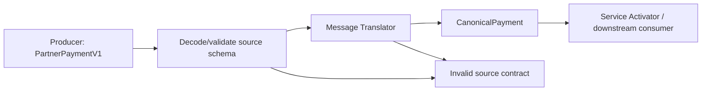
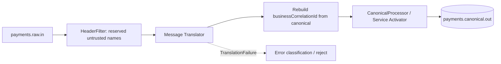
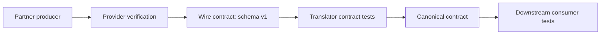
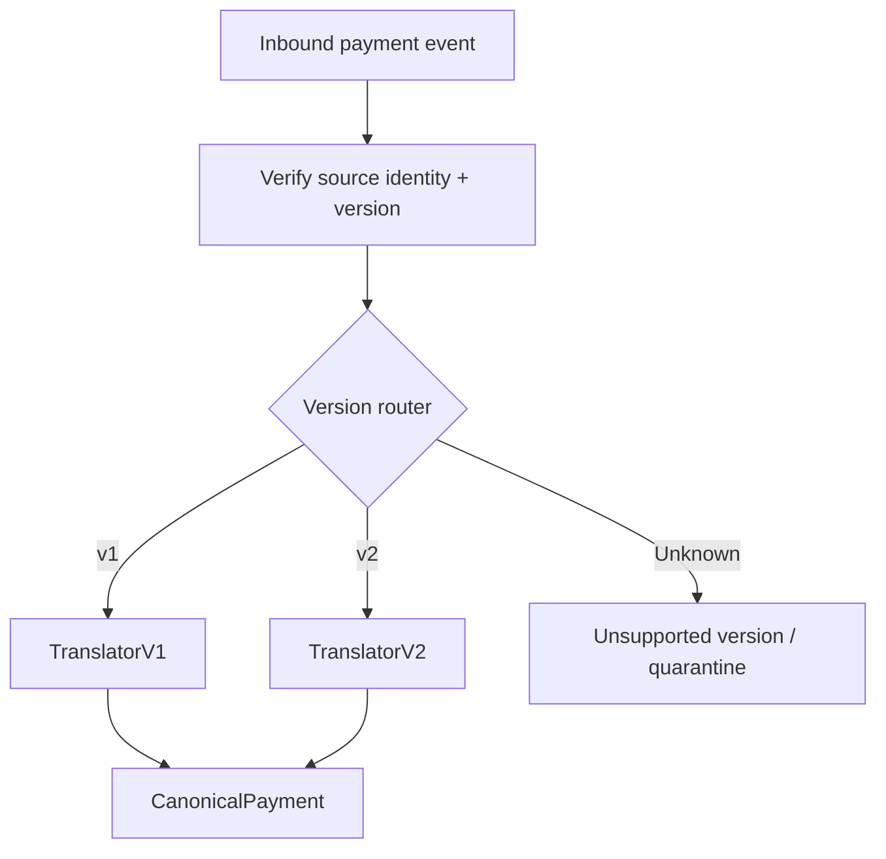
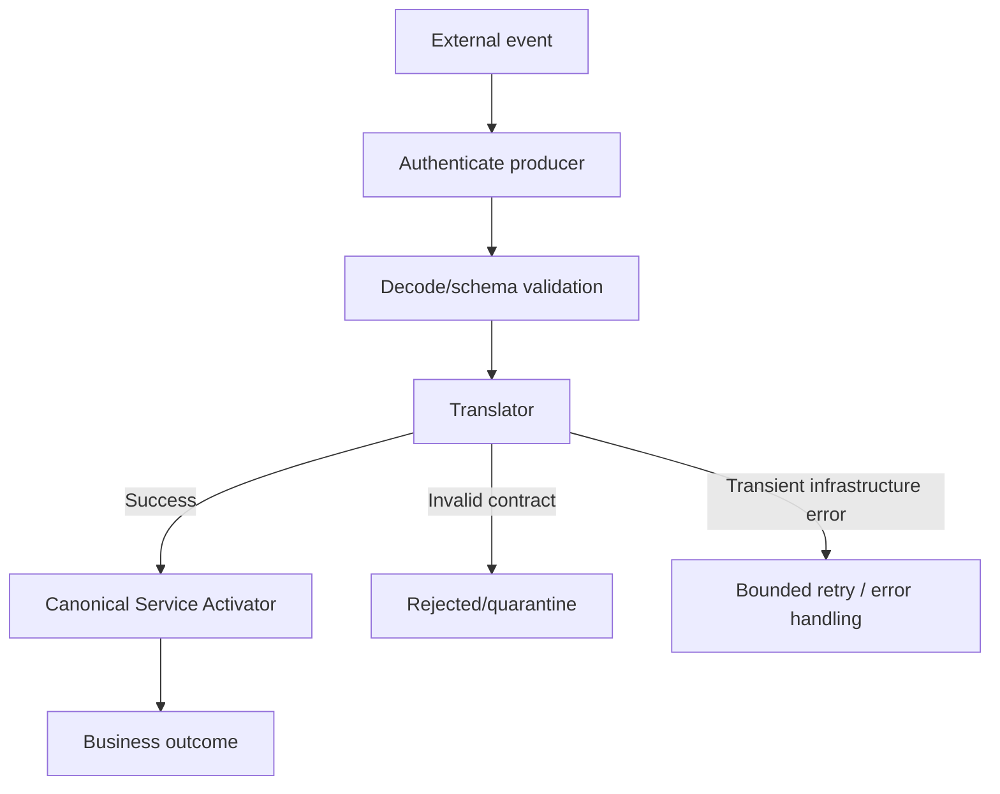

# Contract Testing a Message Translator in Spring Integration

## Learning objectives

A partner payment service sends a `PartnerPaymentV1` event:

```json
{
  "schemaVersion": 1,
  "eventId": "EVT-42",
  "paymentReference": "PAY-42",
  "grossText": "1250.50",
  "currencyCode": "USD",
  "partnerStatus": "CAPTURED",
  "eventTime": "2026-11-21T12:00:00+07:00",
  "generation": 1
}
```

The receiving application uses a different internal model: `CanonicalPayment` with money in **minor units** (`amountMinor=125050`), status `SETTLED`, and a UTC `Instant` timestamp. A `Message Translator` converts the source message into the target contract.

If the conversion code returns a non-null object yet **multiplies the amount off by 100x**, guesses an unfamiliar currency as USD, swaps `DECLINED` into `SETTLED`, drops correlation across the Transformer, or silently reads a spoofed `tenantId` from a header, tests checking only "a message reached the output channel" will **PASS while the system misbehaves**.

**Contract testing a translator** must simultaneously prove: **input data definitions**, **mapping rules**, **output invariants**, **responses to invalid inputs**, **header/trust boundary rules**, and **version compatibility**. When messages flow through Spring Integration, tests must also verify how the Translator interacts with channels, Routers, Filters, Aggregators, Gateways, retries, and error paths.

This lesson belongs to the **Message translator** chapter of module **SPRING_INTEGRATION_PATTERN**. The module teaches how to implement Enterprise Integration Patterns with Spring Integration to build loosely coupled, extensible message flows; practicing Router, Filter, Transformer, Splitter, Aggregator, Gateway, retry, error channel, and correlation, while testing and monitoring processing branches.

After this lesson, you will be able to:

1. Define a **testable contract** for a Translator: source schema, destination schema, field mapping, semantics, and failure policy.
2. Separate **unit tests of the translation function** from **`IntegrationFlow` integration tests** and **consumer-driven/producer compatibility tests**.
3. Use Java 17, Java DSL, JUnit 5, and AssertJ to verify money, status, timestamp, required fields, and version mappings.
4. Verify invalid inputs are rejected **before the Service Activator**, emitting no bogus canonical messages.
5. Test header propagation, correlation, reserved-header spoofing, and Kafka/HTTP/JMS boundaries.
6. Distinguish **accurately translating values** from **correct side effects**, **idempotency**, **authorization**, and **distributed tracing**.
7. Build regression/golden fixtures, test forward/backward compatibility, and manage intentional contract changes.

---

## 1. How does a Message Translator differ from a Transformer?

In Enterprise Integration Patterns, a **Message Translator** converts information from one system's representation or data language into a representation another system understands. A Translator focuses on **semantics and contracts between two parties**, not just swapping Java types.

In Spring Integration, one or more **Transformer endpoints** are typically how a Message Translator is implemented. The pattern name describes the **integration responsibility**, whereas `.transform(...)` is a concrete technical API.



Examples of decisions a translator must make:

- Does `grossText="1250.50"` mean 1,250.50 USD or a string in some locale?
- `currencyCode="USD"` has **2** minor-unit digits in the demo contract; `VND` has **0**.
- `partnerStatus="CAPTURED"` maps to `SETTLED`; it **does not mean** downstream should call the provider to capture payment again.
- `eventTime` with offset `+07:00` must convert to a UTC instant; never turn it into an ambiguous local time without a timezone.
- `tenantId` comes from the authenticated ingress context, never from partner-declared JSON or headers.
- `schemaVersion=2` when the consumer only supports v1 must be **rejected in a controlled manner**, never assuming fields remain equivalent.

### A Translator can "run" yet still violate the contract

A dangerous mistake:

```java
long cents = (long) (Double.parseDouble(grossText) * 100);
```

This suffers from binary floating-point rounding errors, overflows, sign issues, and unspecified locale parsing. For money, use `BigDecimal`, specify decimal places, convert to minor units with **exact** arithmetic, and check bounds.

Another mistake:

```java
PaymentState state =
    "CAPTURED".equals(status)
        ? PaymentState.SETTLED
        : PaymentState.AUTHORIZED;
```

Every unrecognized status—including `DECLINED`—becomes `AUTHORIZED`. That is a **contract bug** even if `assertNotNull(output)` passes.

---

## 2. Layers of contract that must be tested

| Layer | Question to answer | Evidence |
| --- | --- | --- |
| **Source schema** | Correct fields, types, nullability, and version? | Decode/JSON schema tests, fixtures |
| **Semantic mapping** | Money, timezone, statuses, IDs interpreted accurately? | Table-driven unit tests and boundary cases |
| **Destination invariants** | Canonical DTO holds valid values without losing required data? | Assertions on output |
| **Failure contract** | Bad input fails/routes reject with which code? | Negative tests emitting no output |
| **Message envelope** | Headers, correlation, and identity handled properly? | IntegrationFlow tests |
| **Consumer contract** | Does the next consumer understand the translator's real output? | Producer/consumer contract tests |
| **Operational contract** | Are retry, DLQ, error channel, timeout, idempotency consistent? | Integration/fault tests |
| **Security contract** | Tenant/issuer from trusted source? Any data leaked? | Negative security/boundary tests |
| **Compatibility contract** | Does producer v2 break consumer v1? | Version matrix + fixture regressions |

**No single test proves everything.** Separate **fast, pure Java** mapping tests from **Spring-booting** message flow tests, then add another layer testing over real brokers and adapters before deployment.

### A contract is a concrete statement, not "JSON parses"

Example contract:

> Given a schema v1 event, `currency=USD`, `grossText` as a non-negative decimal with at most two decimal places after the dot, and `status=CAPTURED`, the Translator must return `amountMinor` exact to the cent, `state=SETTLED`, and `happenedAt` in UTC. Given invalid input or an unsupported version, it must reject before invoking the Service Activator.

Such a statement is concrete enough to turn directly into test cases.

---

## 3. Specifying input/output before writing the Translator

### Partner v1 input

```java
public record PartnerPaymentV1(
    int schemaVersion,
    String eventId,
    String paymentReference,
    String grossText,
    String currencyCode,
    String partnerStatus,
    String eventTime,
    int generation
) {}
```

`tenantId` and `issuer` are **absent from the partner DTO**. The application obtains them from an authenticated ingress context.

### Canonical output

```java
public enum PaymentState {
    AUTHORIZED, SETTLED, REJECTED
}

public record CanonicalPayment(
    String tenantId,
    String issuer,
    String eventId,
    String paymentId,
    long amountMinor,
    String currency,
    PaymentState state,
    java.time.Instant happenedAt,
    int generation
) {}
```

### v1 mapping table

| Source field | Target field | Rule |
| --- | --- | --- |
| Trusted caller tenant | `tenantId` | Take from verified context, never external headers |
| Trusted caller issuer | `issuer` | Attach authenticated source, never infer from payload |
| `eventId` | `eventId` | Non-empty; matches accepted ID regex |
| `paymentReference` | `paymentId` | Stable business ID, never a new Message ID |
| `grossText` + `currencyCode` | `amountMinor` | `BigDecimal`, scaled per currency, exact math |
| `currencyCode` | `currency` | Only `USD`/`VND` in exercise; uppercase if contract permits |
| `partnerStatus=AUTHORIZED` | `state=AUTHORIZED` | Does not imply captured |
| `partnerStatus=CAPTURED` | `state=SETTLED` | Describes status only; triggers no new capture |
| `partnerStatus=DECLINED` | `state=REJECTED` | Never convert to authorized/settled |
| `eventTime` | `happenedAt` | Parse offset timestamp and convert to `Instant` |
| `generation` | `generation` | Must be > 0, separates workflow runs |
| `schemaVersion` | Checked, not injected into every business op | Accepts only `1` in v1 translator |

### Monetary rules for the example

- `USD`: exact to 2 decimal places; `"1" → 100`, `"1.20" → 120` minor units.
- `VND`: whole currency units; `"1200" → 1200`, `"1200.00"` accepted since fractional part is 0.
- Decimal point only; `"1,200.50"` or `"1.200,50"` is **rejected**, never locale-guessed.
- Disallow scientific notation, negative signs, internal whitespace, more than two decimal places, or zero.
- Never convert through `double`; never round outside the contract.
- Reject results exceeding `long` range instead of overflowing silently.

**These are demo rules**, not representative of every currency or payment provider. Production may use a `Money` value object, a governed minor-units/version table, or consistent `BigDecimal` per business contract.

---

## 4. Translation contract test matrix

### Happy paths must verify every field's value

| Input | Expected |
| --- | --- |
| USD `"1250.50"`, CAPTURED | `125050`, `SETTLED` |
| USD `"1"`, AUTHORIZED | `100`, `AUTHORIZED` |
| USD `"0.01"`, DECLINED | `1`, `REJECTED` |
| VND `"1200"`, CAPTURED | `1200`, `SETTLED` |
| VND `"1200.00"`, CAPTURED | `1200`, `SETTLED` |
| `"usd"`, `"1.50"` | `currency="USD"`, `amountMinor=150` |
| `"2026-11-21T12:00:00+07:00"` | `2026-11-21T05:00:00Z` |

### Negative cases must confirm intentional error codes

| Input | Expected error code |
| --- | --- |
| `schemaVersion=2` | `UNSUPPORTED_SCHEMA_VERSION` |
| `eventId=""` | `INVALID_EVENT_ID` |
| `paymentReference="PAY|42"` | `INVALID_PAYMENT_ID` |
| `generation=0` | `INVALID_GENERATION` |
| `grossText=null` | `AMOUNT_REQUIRED` |
| `grossText="0"` | `AMOUNT_NOT_POSITIVE` |
| `grossText="-1"` | `AMOUNT_FORMAT_INVALID` |
| `grossText="1,20"` | `AMOUNT_FORMAT_INVALID` |
| `grossText="1.234"` | `AMOUNT_FORMAT_INVALID` |
| VND `grossText="1.50"` | `AMOUNT_PRECISION_INVALID` |
| `currencyCode="ABC"` | `UNSUPPORTED_CURRENCY` |
| `partnerStatus="PENDING_CAPTURE"` | `UNKNOWN_PARTNER_STATUS` |
| `eventTime="2026-11-21T12:00:00"` | `INVALID_EVENT_TIME` |
| Amount exceeding `long` | `AMOUNT_OUT_OF_RANGE` |

Every row in the table is a **required assertion**, not merely documentation. A full suite can turn these into parameterized tests or `@MethodSource` datasets.

---

## 5. A pure Java Translator with zero messaging dependencies

Start with translation logic **requiring no Spring context**. This keeps unit tests fast and verifies exact failure codes.

### Example trust model

`VerifiedSource` is a value object created by the **authenticated ingress component**. In the demo, it is injected once with `tenant-a` and `partner-payments` for testing. Production must derive/re-verify context per request, partition, or real consumer identity—never use a mutable singleton `currentTenant`.

### Complete Translator (Java 17+)

```java
import java.math.BigDecimal;
import java.math.RoundingMode;
import java.time.Instant;
import java.time.OffsetDateTime;
import java.time.format.DateTimeParseException;
import java.util.Locale;
import java.util.Objects;
import java.util.Set;
import java.util.regex.Pattern;

public final class PartnerPaymentTranslator {

    public record VerifiedSource(
        String tenantId,
        String issuer
    ) {}

    public record PartnerPaymentV1(
        int schemaVersion,
        String eventId,
        String paymentReference,
        String grossText,
        String currencyCode,
        String partnerStatus,
        String eventTime,
        int generation
    ) {}

    public enum PaymentState {
        AUTHORIZED, SETTLED, REJECTED
    }

    public record CanonicalPayment(
        String tenantId,
        String issuer,
        String eventId,
        String paymentId,
        long amountMinor,
        String currency,
        PaymentState state,
        Instant happenedAt,
        int generation
    ) {}

    public static final class TranslationFailure
            extends RuntimeException {

        private final String code;

        public TranslationFailure(String code) {
            super(code);
            this.code = code;
        }

        public String code() {
            return code;
        }
    }

    private static final Pattern ID_PATTERN =
        Pattern.compile("[A-Za-z0-9_-]{1,80}");

    private static final Pattern MONEY_PATTERN =
        Pattern.compile("[0-9]+(\\.[0-9]{1,2})?");

    private static final Set<String> CURRENCIES =
        Set.of("USD", "VND");

    private final VerifiedSource source;

    public PartnerPaymentTranslator(VerifiedSource source) {
        this.source = Objects.requireNonNull(
            source, "verifiedSource");

        if (!validId(source.tenantId())
                || !validId(source.issuer())) {
            throw new IllegalArgumentException(
                "INVALID_VERIFIED_SOURCE");
        }
    }

    private static boolean validId(String id) {
        return id != null
            && ID_PATTERN.matcher(id).matches();
    }

    public CanonicalPayment translate(PartnerPaymentV1 raw) {
        if (raw == null) {
            throw new TranslationFailure("INPUT_REQUIRED");
        }

        if (raw.schemaVersion() != 1) {
            throw new TranslationFailure(
                "UNSUPPORTED_SCHEMA_VERSION");
        }

        if (!validId(raw.eventId())) {
            throw new TranslationFailure(
                "INVALID_EVENT_ID");
        }

        if (!validId(raw.paymentReference())) {
            throw new TranslationFailure(
                "INVALID_PAYMENT_ID");
        }

        if (raw.generation() < 1) {
            throw new TranslationFailure(
                "INVALID_GENERATION");
        }

        String currency = normalizeCurrency(
            raw.currencyCode());

        long amountMinor = parseAmountMinor(
            raw.grossText(), currency);

        PaymentState state = mapStatus(
            raw.partnerStatus());

        Instant happenedAt = parseEventTime(
            raw.eventTime());

        return new CanonicalPayment(
            source.tenantId(),
            source.issuer(),
            raw.eventId(),
            raw.paymentReference(),
            amountMinor,
            currency,
            state,
            happenedAt,
            raw.generation());
    }

    private static String normalizeCurrency(String input) {
        if (input == null) {
            throw new TranslationFailure(
                "UNSUPPORTED_CURRENCY");
        }

        String value = input.toUpperCase(Locale.ROOT);

        if (!CURRENCIES.contains(value)) {
            throw new TranslationFailure(
                "UNSUPPORTED_CURRENCY");
        }

        return value;
    }

    private static long parseAmountMinor(
        String amountText,
        String currency
    ) {
        if (amountText == null || amountText.isBlank()) {
            throw new TranslationFailure(
                "AMOUNT_REQUIRED");
        }

        if (amountText.length() > 40
                || !MONEY_PATTERN.matcher(
                    amountText).matches()) {
            throw new TranslationFailure(
                "AMOUNT_FORMAT_INVALID");
        }

        BigDecimal value = new BigDecimal(amountText);

        if (value.signum() <= 0) {
            throw new TranslationFailure(
                "AMOUNT_NOT_POSITIVE");
        }

        int scale = "USD".equals(currency) ? 2 : 0;

        try {
            // Do not round: if VND has a non-zero fractional part,
            // setScale(0, UNNECESSARY) will throw.
            BigDecimal exact =
                value.setScale(
                    scale, RoundingMode.UNNECESSARY);

            return exact.movePointRight(scale)
                .longValueExact();

        } catch (ArithmeticException ex) {
            // Simplified for this example:
            // separate precision errors from overflow.
            if (value.scale() > scale) {
                try {
                    value.setScale(
                        scale, RoundingMode.UNNECESSARY);
                } catch (ArithmeticException precisionFailure) {
                    throw new TranslationFailure(
                        "AMOUNT_PRECISION_INVALID");
                }
            }
            throw new TranslationFailure(
                "AMOUNT_OUT_OF_RANGE");
        }
    }

    private static PaymentState mapStatus(
        String partnerStatus
    ) {
        if (partnerStatus == null) {
            throw new TranslationFailure(
                "UNKNOWN_PARTNER_STATUS");
        }

        return switch (partnerStatus) {
            case "AUTHORIZED" -> PaymentState.AUTHORIZED;
            case "CAPTURED" -> PaymentState.SETTLED;
            case "DECLINED" -> PaymentState.REJECTED;
            default -> throw new TranslationFailure(
                "UNKNOWN_PARTNER_STATUS");
        };
    }

    private static Instant parseEventTime(
        String eventTime
    ) {
        if (eventTime == null) {
            throw new TranslationFailure(
                "INVALID_EVENT_TIME");
        }

        try {
            return OffsetDateTime.parse(eventTime)
                .toInstant();
        } catch (DateTimeParseException ex) {
            throw new TranslationFailure(
                "INVALID_EVENT_TIME");
        }
    }
}
```

### Why avoid API or DB calls inside the Translator?

The Translator is responsible for **converting representations**. If it writes to a DB or calls a payment provider, mapping unit tests stop being independent and Transformer-level retries can trigger side effects. Let the Service Activator execute business logic after the Translator produces valid canonical data.

### Never collapse errors into an "UNKNOWN" value and proceed

What not to do:

```java
// Wrong: new statuses map to a default state.
PaymentState state = switch (partnerStatus) {
    case "CAPTURED" -> PaymentState.SETTLED;
    default -> PaymentState.AUTHORIZED;
};
```

When the partner adds `"REFUNDED"`, this code silently mistranslates it. Contract tests must require new statuses to be **rejected or mapped under an approved new version**.

### Distinguishing parse failure, precision, and overflow

These three errors differ:

- `"1,50"` violates source grammar → `AMOUNT_FORMAT_INVALID`.
- VND `"1.50"` matches grammar yet has disallowed decimals → `AMOUNT_PRECISION_INVALID`.
- A huge USD amount produces minor units exceeding `long` → `AMOUNT_OUT_OF_RANGE`.

Never let a raw `NumberFormatException` or `ArithmeticException` get mapped to `NETWORK_TIMEOUT` and retried infinitely.

### Limitations of the demo code

- Only handles decimal-point notation; this is a **contract decision**.
- Does not support all global currencies.
- Accepts only ASCII IDs in the example, not a universal requirement.
- Lacks a version registry, mapping history, or signed-envelope policy.
- `VerifiedSource` comes from a fixture rather than production authentication.
- Does not record business idempotency results, as that is outside the Translator's job.

---

## 6. Unit tests: exact contract mapping

### JUnit 5 and AssertJ

```java
import static org.assertj.core.api.Assertions.assertThat;
import static org.assertj.core.api.Assertions.assertThatThrownBy;

import java.time.Instant;

import org.junit.jupiter.api.Test;

class PartnerPaymentTranslatorTest {

    private final PartnerPaymentTranslator translator =
        new PartnerPaymentTranslator(
            new PartnerPaymentTranslator.VerifiedSource(
                "tenant-a", "partner-payments"));

    private PartnerPaymentTranslator.PartnerPaymentV1 base() {
        return new PartnerPaymentTranslator.PartnerPaymentV1(
            1,
            "EVT-42",
            "PAY-42",
            "1250.50",
            "USD",
            "CAPTURED",
            "2026-11-21T12:00:00+07:00",
            1);
    }

    @Test
    void mapsAllBusinessFieldsNotOnlyObjectPresence() {
        var canonical = translator.translate(base());

        assertThat(canonical.tenantId())
            .isEqualTo("tenant-a");
        assertThat(canonical.issuer())
            .isEqualTo("partner-payments");
        assertThat(canonical.eventId())
            .isEqualTo("EVT-42");
        assertThat(canonical.paymentId())
            .isEqualTo("PAY-42");
        assertThat(canonical.amountMinor())
            .isEqualTo(125_050L);
        assertThat(canonical.currency())
            .isEqualTo("USD");
        assertThat(canonical.state())
            .isEqualTo(
                PartnerPaymentTranslator.PaymentState.SETTLED);
        assertThat(canonical.happenedAt())
            .isEqualTo(
                Instant.parse("2026-11-21T05:00:00Z"));
        assertThat(canonical.generation()).isEqualTo(1);
    }

    @Test
    void mapsDeclinedAndAuthorizedAsDifferentStates() {
        var authorized =
            new PartnerPaymentTranslator.PartnerPaymentV1(
                1, "EVT-A", "PAY-A", "1", "USD",
                "AUTHORIZED",
                "2026-11-21T05:00:00Z", 1);

        var declined =
            new PartnerPaymentTranslator.PartnerPaymentV1(
                1, "EVT-B", "PAY-B", "0.01", "USD",
                "DECLINED",
                "2026-11-21T05:00:00Z", 1);

        assertThat(translator.translate(authorized).state())
            .isEqualTo(
                PartnerPaymentTranslator.PaymentState.AUTHORIZED);

        assertThat(translator.translate(declined).state())
            .isEqualTo(
                PartnerPaymentTranslator.PaymentState.REJECTED);

        assertThat(translator.translate(declined).amountMinor())
            .isEqualTo(1L);
    }

    @Test
    void normalizesCurrencyOnlyAsDefinedByContract() {
        var event =
            new PartnerPaymentTranslator.PartnerPaymentV1(
                1, "EVT-C", "PAY-C", "1.50", "usd",
                "CAPTURED",
                "2026-11-21T05:00:00Z", 1);

        var result = translator.translate(event);

        assertThat(result.currency()).isEqualTo("USD");
        assertThat(result.amountMinor()).isEqualTo(150L);
    }

    @Test
    void vndIntegralAmountWithZeroFractionIsExact() {
        var event =
            new PartnerPaymentTranslator.PartnerPaymentV1(
                1, "EVT-D", "PAY-D", "1200.00", "VND",
                "CAPTURED",
                "2026-11-21T05:00:00Z", 1);

        assertThat(translator.translate(event).amountMinor())
            .isEqualTo(1_200L);
    }

    @Test
    void unsupportedVersionFailsClosed() {
        var v2 =
            new PartnerPaymentTranslator.PartnerPaymentV1(
                2, "EVT-E", "PAY-E", "1.00", "USD",
                "CAPTURED",
                "2026-11-21T05:00:00Z", 1);

        assertThatThrownBy(() -> translator.translate(v2))
            .isInstanceOf(
                PartnerPaymentTranslator.TranslationFailure.class)
            .hasMessage("UNSUPPORTED_SCHEMA_VERSION");
    }

    @Test
    void unknownStatusDoesNotDefaultToSuccess() {
        var unknown =
            new PartnerPaymentTranslator.PartnerPaymentV1(
                1, "EVT-F", "PAY-F", "1.00", "USD",
                "REFUNDED",
                "2026-11-21T05:00:00Z", 1);

        assertThatThrownBy(() -> translator.translate(unknown))
            .isInstanceOf(
                PartnerPaymentTranslator.TranslationFailure.class)
            .hasMessage("UNKNOWN_PARTNER_STATUS");
    }

    @Test
    void amountCannotBeRoundedSilently() {
        var invalid =
            new PartnerPaymentTranslator.PartnerPaymentV1(
                1, "EVT-G", "PAY-G", "1.50", "VND",
                "CAPTURED",
                "2026-11-21T05:00:00Z", 1);

        assertThatThrownBy(() -> translator.translate(invalid))
            .isInstanceOf(
                PartnerPaymentTranslator.TranslationFailure.class)
            .hasMessage("AMOUNT_PRECISION_INVALID");
    }

    @Test
    void malformedMoneyCannotBeGuessedAsLocale() {
        var malformed =
            new PartnerPaymentTranslator.PartnerPaymentV1(
                1, "EVT-H", "PAY-H", "1,250.50", "USD",
                "CAPTURED",
                "2026-11-21T05:00:00Z", 1);

        assertThatThrownBy(() -> translator.translate(malformed))
            .isInstanceOf(
                PartnerPaymentTranslator.TranslationFailure.class)
            .hasMessage("AMOUNT_FORMAT_INVALID");
    }

    @Test
    void timestampWithoutOffsetIsRejected() {
        var noOffset =
            new PartnerPaymentTranslator.PartnerPaymentV1(
                1, "EVT-I", "PAY-I", "1.00", "USD",
                "CAPTURED",
                "2026-11-21T12:00:00", 1);

        assertThatThrownBy(() -> translator.translate(noOffset))
            .isInstanceOf(
                PartnerPaymentTranslator.TranslationFailure.class)
            .hasMessage("INVALID_EVENT_TIME");
    }

    @Test
    void hugeValueMustNotOverflowLong() {
        var huge =
            new PartnerPaymentTranslator.PartnerPaymentV1(
                1, "EVT-J", "PAY-J",
                "99999999999999999999.99", "USD",
                "CAPTURED",
                "2026-11-21T05:00:00Z", 1);

        assertThatThrownBy(() -> translator.translate(huge))
            .isInstanceOf(
                PartnerPaymentTranslator.TranslationFailure.class)
            .hasMessage("AMOUNT_OUT_OF_RANGE");
    }
}
```

### Why assert every single field?

A test checking only:

```java
assertThat(translator.translate(event)).isNotNull();
```

proves only that the translator returned an object. It does not verify `amountMinor`, currency, status, timestamp, tenant, generation, or event identity. **Contract testing verifies data meaning**, not just data types.

### Error tests should assert against the contract, not stack traces

`TranslationFailure` in the demo uses stable codes like `INVALID_EVENT_TIME`. Unit tests assert that code. Never couple tests to exact English sentences from `DateTimeParseException`, which vary across JDK versions and inputs.

---

## 7. Parameterized tests: covering the decision table without duplication

Instead of writing dozens of near-identical methods, use `@ParameterizedTest` with `@CsvSource` or `@MethodSource`. Use data-driven tests when cases share identical structure and assertions.

```java
import static org.assertj.core.api.Assertions.assertThat;

import org.junit.jupiter.params.ParameterizedTest;
import org.junit.jupiter.params.provider.CsvSource;

class PartnerPaymentAmountMatrixTest {

    private final PartnerPaymentTranslator translator =
        new PartnerPaymentTranslator(
            new PartnerPaymentTranslator.VerifiedSource(
                "tenant-a", "partner-payments"));

    @ParameterizedTest
    @CsvSource({
        "USD, 1,       100",
        "USD, 1.20,    120",
        "USD, 0.01,    1",
        "VND, 1200,    1200",
        "VND, 1200.00, 1200",
        "usd, 2.05,    205"
    })
    void validAmountsMapToExactMinorUnits(
        String currency,
        String amount,
        long expectedMinor
    ) {
        var event = new PartnerPaymentTranslator.PartnerPaymentV1(
            1, "EVT-M", "PAY-M", amount, currency,
            "CAPTURED", "2026-11-21T05:00:00Z", 1);

        var actual = translator.translate(event);
        assertThat(actual.amountMinor())
            .isEqualTo(expectedMinor);
    }
}
```

### Use `@MethodSource` for complex payloads

`@CsvSource` fits simple scalars. For payloads with nulls, empty strings, Unicode, nested JSON, schema versions, or statuses, `@MethodSource` lets you name cases and keep typed arguments.

Conceptual example:

```java
static java.util.stream.Stream<
    org.junit.jupiter.params.provider.Arguments
> invalidCases() {
    return java.util.stream.Stream.of(
        org.junit.jupiter.params.provider.Arguments.of(
            "comma decimal", "1,20",
            "AMOUNT_FORMAT_INVALID"),
        org.junit.jupiter.params.provider.Arguments.of(
            "three decimals", "1.234",
            "AMOUNT_FORMAT_INVALID"),
        org.junit.jupiter.params.provider.Arguments.of(
            "zero", "0",
            "AMOUNT_NOT_POSITIVE")
    );
}
```

This is an **illustrative data-source helper**; to execute it, add `@ParameterizedTest @MethodSource("invalidCases")` alongside a method building the event, calling the translator, and asserting the error code.

### Do not add test cases merely to inflate counts

Every case should cover a real boundary class or decision branch: zero, overflow, currency, timezone, schema version, unknown status, identity, null, whitespace, locale format, precision, and retries.

---

## 8. Spring Integration Java DSL: the Translator inside a message flow

Unit tests do not verify message headers, channel wiring, or the path to the Service Activator. Register a real flow:



In this example:

- Raw messages might carry spoofed `tenantId` or `businessCorrelationId` headers; the flow strips them.
- The Translator is injected with a **mocked** trusted `VerifiedSource` for testing.
- The Translator returns a `CanonicalPayment` **payload** rather than constructing a new `Message<?>`.
- In-process headers `traceId`/`requestId` pass through per standard framework behavior.
- After translation, the flow computes `businessCorrelationId` from the canonical payload, using `overwrite=true` for explicit precedence.
- The Service Activator sees only canonical data.
- When translation fails on `DirectChannel`, exceptions propagate per topology; the output channel receives no canonical message.

### Full configuration

```java
import java.util.concurrent.atomic.AtomicInteger;

import org.springframework.context.annotation.Bean;
import org.springframework.context.annotation.Configuration;
import org.springframework.integration.channel.DirectChannel;
import org.springframework.integration.channel.QueueChannel;
import org.springframework.integration.config.EnableIntegration;
import org.springframework.integration.dsl.IntegrationFlow;
import org.springframework.messaging.MessageChannel;
import org.springframework.messaging.PollableChannel;

@Configuration
@EnableIntegration
public class PartnerTranslationFlowConfig {

    public static final class CanonicalProcessor {
        private final AtomicInteger calls = new AtomicInteger();

        public PartnerPaymentTranslator.CanonicalPayment process(
            PartnerPaymentTranslator.CanonicalPayment payment
        ) {
            calls.incrementAndGet();
            // Return payload only in demo; no DB/provider writes.
            return payment;
        }

        public int invocations() {
            return calls.get();
        }
    }

    @Bean
    PartnerPaymentTranslator partnerPaymentTranslator() {
        // Trusted fixture for test/demo. Do not use this constant
        // tenant as a substitute for production authentication.
        var verified =
            new PartnerPaymentTranslator.VerifiedSource(
                "tenant-a", "partner-payments");

        return new PartnerPaymentTranslator(verified);
    }

    @Bean
    CanonicalProcessor canonicalProcessor() {
        return new CanonicalProcessor();
    }

    @Bean("payments.raw.in")
    MessageChannel rawInput() {
        return new DirectChannel();
    }

    @Bean("payments.canonical.out")
    PollableChannel normalizedOutput() {
        return new QueueChannel();
    }

    @Bean
    IntegrationFlow partnerTranslationFlow(
        PartnerPaymentTranslator translator,
        CanonicalProcessor processor
    ) {
        return IntegrationFlow.from("payments.raw.in")

            // Do not let client headers overwrite tenant/issuer.
            .headerFilter(
                "tenantId",
                "issuer",
                "businessCorrelationId")

            // Translate per source contract v1.
            .transform(
                PartnerPaymentTranslator.PartnerPaymentV1.class,
                translator::translate)

            // ID for business correlation, derived from
            // canonical payload instead of trusting initial headers.
            .enrichHeaders(h -> h.headerFunction(
                "businessCorrelationId",
                message -> {
                    var payment =
                        (PartnerPaymentTranslator.CanonicalPayment)
                            message.getPayload();

                    return payment.tenantId() + "|"
                        + payment.paymentId() + "|"
                        + payment.generation();
                },
                true))

            // Service Activator sits after the validated boundary.
            .handle(
                PartnerPaymentTranslator.CanonicalPayment.class,
                (payment, headers) ->
                    processor.process(payment))

            .channel("payments.canonical.out")
            .get();
    }
}
```

### Explaining the limits of `headerFilter`

`headerFilter(...)` removes only **the listed header names** on messages passing through the endpoint. It does not authenticate the sender, validate raw JSON, or strip arbitrary dangerous headers against a full allowlist. On a public inbound adapter, pair it with an outbound/inbound header mapper allowlist and independent authentication.

### Why didn't the Translator return a full `Message<?>`?

Per the Spring Integration Reference, when a Transformer returns a **payload**, inbound headers are typically forwarded; when a Transformer returns a **complete `Message<?>`**, the developer owns the entire outbound message and headers. This lesson returns the payload to keep contract mapping straightforward to test.

**Never treat header propagation as an invariant across every topology.** HTTP/Kafka/JMS adapters, custom Transformers, header filters, and message-building endpoints can alter or drop metadata. Test at real boundaries.

### A Transformer must never `return null` to drop a message

In Spring Integration, a Transformer returning `null` to mean "untranslatable" triggers a `MessageTransformationException`. Choose an explicit policy:

- **Fail fast** with `TranslationFailure` (this demo), handling errors at the caller/adapter.
- **Typed outcome** like `Accepted`/`Rejected`, routed by a Router down two branches.
- **Filter** before the Translator if the contract allows predicate-based drops, paired with appropriate discard/reply policies.

Never infer from an empty output queue that a message was rejected per contract; it may have been lost due to wiring bugs.

---

## 9. Integration tests: headers, service side effects, and routing

Use Spring Test + JUnit 5 for a flow with `DirectChannel` and `QueueChannel`. Because the handler holds a counter and the queue lives in the Spring context, tests use `@DirtiesContext` to isolate state between cases.

```java
import static org.assertj.core.api.Assertions.assertThat;
import static org.assertj.core.api.Assertions.assertThatThrownBy;

import org.junit.jupiter.api.Test;
import org.springframework.beans.factory.annotation.Autowired;
import org.springframework.beans.factory.annotation.Qualifier;
import org.springframework.messaging.Message;
import org.springframework.messaging.MessageChannel;
import org.springframework.messaging.PollableChannel;
import org.springframework.messaging.support.MessageBuilder;
import org.springframework.test.annotation.DirtiesContext;
import org.springframework.test.context.junit.jupiter.SpringJUnitConfig;

@SpringJUnitConfig(PartnerTranslationFlowConfig.class)
@DirtiesContext(
    classMode = DirtiesContext.ClassMode.AFTER_EACH_TEST_METHOD)
class PartnerTranslationFlowTest {

    @Autowired
    @Qualifier("payments.raw.in")
    MessageChannel input;

    @Autowired
    @Qualifier("payments.canonical.out")
    PollableChannel output;

    @Autowired
    PartnerTranslationFlowConfig.CanonicalProcessor processor;

    private PartnerPaymentTranslator.PartnerPaymentV1 event(
        String amount,
        String status,
        int version
    ) {
        return new PartnerPaymentTranslator.PartnerPaymentV1(
            version,
            "EVT-42",
            "PAY-42",
            amount,
            "USD",
            status,
            "2026-11-21T12:00:00+07:00",
            1);
    }

    @Test
    void translatesAndPreservesSafeTracingHeaders() {
        var inbound = MessageBuilder
            .withPayload(event("1250.50", "CAPTURED", 1))
            .setHeader("tenantId", "spoofed-tenant")
            .setHeader("issuer", "spoofed-issuer")
            .setHeader(
                "businessCorrelationId", "wrong-group")
            .setHeader("traceId", "trace-42")
            .setHeader("requestId", "REQ-42")
            .build();

        assertThat(input.send(inbound)).isTrue();

        Message<?> result = output.receive(2_000);
        assertThat(result).isNotNull();
        assertThat(result.getPayload()).isInstanceOf(
            PartnerPaymentTranslator.CanonicalPayment.class);

        var canonical =
            (PartnerPaymentTranslator.CanonicalPayment)
                result.getPayload();

        assertThat(canonical.amountMinor())
            .isEqualTo(125_050L);
        assertThat(canonical.state()).isEqualTo(
            PartnerPaymentTranslator.PaymentState.SETTLED);
        assertThat(canonical.tenantId())
            .isEqualTo("tenant-a");
        assertThat(canonical.issuer())
            .isEqualTo("partner-payments");

        assertThat(result.getHeaders().get("traceId"))
            .isEqualTo("trace-42");
        assertThat(result.getHeaders().get("requestId"))
            .isEqualTo("REQ-42");
        assertThat(
            result.getHeaders().get("businessCorrelationId"))
            .isEqualTo("tenant-a|PAY-42|1");

        assertThat(result.getHeaders())
            .doesNotContainKeys("tenantId", "issuer");

        assertThat(processor.invocations()).isEqualTo(1);
        assertThat(output.receive(0)).isNull();
    }

    @Test
    void unsupportedSchemaCannotReachServiceActivator() {
        assertThatThrownBy(() ->
            input.send(MessageBuilder
                .withPayload(event("1.00", "CAPTURED", 2))
                .build()))
            .isInstanceOf(RuntimeException.class);

        assertThat(processor.invocations()).isZero();
        assertThat(output.receive(0)).isNull();
    }

    @Test
    void invalidStatusCannotReachServiceActivator() {
        assertThatThrownBy(() ->
            input.send(MessageBuilder
                .withPayload(
                    event("1.00", "REFUNDED", 1))
                .build()))
            .isInstanceOf(RuntimeException.class);

        assertThat(processor.invocations()).isZero();
        assertThat(output.receive(0)).isNull();
    }

    @Test
    void independentEventsAreBothTranslated() {
        var first = event("1.00", "AUTHORIZED", 1);

        var second = new PartnerPaymentTranslator.PartnerPaymentV1(
            1, "EVT-43", "PAY-43",
            "2.50", "USD", "CAPTURED",
            "2026-11-21T05:00:00Z", 1);

        assertThat(input.send(
            MessageBuilder.withPayload(first).build())).isTrue();
        assertThat(input.send(
            MessageBuilder.withPayload(second).build())).isTrue();

        Message<?> a = output.receive(2_000);
        Message<?> b = output.receive(2_000);

        assertThat(a).isNotNull();
        assertThat(b).isNotNull();

        assertThat(
            ((PartnerPaymentTranslator.CanonicalPayment)
                a.getPayload()).paymentId())
            .isEqualTo("PAY-42");

        assertThat(
            ((PartnerPaymentTranslator.CanonicalPayment)
                b.getPayload()).paymentId())
            .isEqualTo("PAY-43");

        assertThat(processor.invocations()).isEqualTo(2);
        assertThat(output.receive(0)).isNull();
    }
}
```

**These tests prove** valid input → valid canonical payload, spoofed headers are not treated as authenticated tenant, trace/request metadata flows through the internal example, and pre-handler errors emit no output or service calls.

**These tests do NOT yet prove** real adapter JSON deserialization, broker redelivery, Kafka header mappers, multi-instance execution, DB transactions, or signature authentication. Never call this suite "end-to-end production proof".

### Errors differ between synchronous and asynchronous flows

On `DirectChannel`, exceptions thrown by the Translator propagate back to `send(...)`, optionally wrapped by the framework. With pollers, executors, or brokers, errors route to an error flow depending on adapter/configuration. Unit tests assert exact `TranslationFailure.code()`; integration tests assert **zero processor calls** and **zero output**, complemented by tests for real boundary error mapping.

---

## 10. Golden fixtures and "expected contract snapshots"

A strong contract suite includes **approved sample inputs and outputs**. Fixtures can live in test repositories, though this STEP 4 presents samples inline in Markdown—creating no extra test/JSON files.

### Golden input

```json
{
  "schemaVersion": 1,
  "eventId": "EVT-42",
  "paymentReference": "PAY-42",
  "grossText": "1250.50",
  "currencyCode": "USD",
  "partnerStatus": "CAPTURED",
  "eventTime": "2026-11-21T12:00:00+07:00",
  "generation": 1
}
```

### Golden canonical output

```json
{
  "tenantId": "tenant-a",
  "issuer": "partner-payments",
  "eventId": "EVT-42",
  "paymentId": "PAY-42",
  "amountMinor": 125050,
  "currency": "USD",
  "state": "SETTLED",
  "happenedAt": "2026-11-21T05:00:00Z",
  "generation": 1
}
```

To keep snapshot tests from breaking spuriously when technical fields are added, use two levels:

- **Semantic assertions:** check key business fields via typed assertions—consistent and readable.
- **Schema/serialization assertions:** check field names, types, nullability, enum representation, decimal digits, and naming policies at the boundary.

Do not compare raw JSON strings verbatim if field ordering is not part of the contract; parse into a tree/DTO per policy to compare semantic equality.

### Golden fixtures must stay independent of translator code

If a test computes expected values using the same `toMinorUnits(...)` helper used in production, a bug in that helper causes **both actual and expected to be wrong identically**. For baseline money cases, write approved literal values like `125050L` instead of calling the function under test to calculate expectations.

---

## 11. Schema/serialization testing: clean JSON can still be wrong

A valid Java DTO does not prove the JSON wire contract is valid. Serialization details include:

- Field casing: `paymentReference` vs. `payment_reference`?
- Missing fields: do absent keys and explicit `null` behave differently?
- Enums: `SETTLED` vs. `settled`?
- Time: ISO-8601 with offset vs. epoch milliseconds?
- Money: JSON numbers can lose precision on some clients; did the source contract pick String?
- Unknown new fields: ignore, reject, or capture in an extension map?
- Does schema version live in the payload or a transport header?
- Character encoding and Unicode normalization.

### Jackson binding test example (dependency-dependent)

```java
import static org.assertj.core.api.Assertions.assertThat;

import com.fasterxml.jackson.databind.ObjectMapper;
import org.junit.jupiter.api.Test;

class PartnerJsonBindingTest {

    private final ObjectMapper mapper = new ObjectMapper();

    @Test
    void partnerV1JsonFieldsBindToExpectedNames() throws Exception {
        String json = """
            {
              "schemaVersion": 1,
              "eventId": "EVT-42",
              "paymentReference": "PAY-42",
              "grossText": "1.20",
              "currencyCode": "USD",
              "partnerStatus": "CAPTURED",
              "eventTime": "2026-11-21T05:00:00Z",
              "generation": 1
            }
            """;

        var raw = mapper.readValue(
            json,
            PartnerPaymentTranslator.PartnerPaymentV1.class);

        assertThat(raw.grossText()).isEqualTo("1.20");
        assertThat(raw.schemaVersion()).isEqualTo(1);
        assertThat(raw.partnerStatus()).isEqualTo("CAPTURED");
    }
}
```

This is an **optional supplemental test when the project uses Jackson** and matching mapper config. When deserialization relies on custom annotations/settings, use the **exact `ObjectMapper`/serializer used by the inbound adapter**, rather than creating a default mapper and assuming production contracts are tested.

### Missing, null, and primitive defaults

The record declares `int generation`. A binding library may assign `0` when the field is absent, which the translator catches via `generation < 1`. Still, missing/null behavior depends on serializer settings and strict mode. **Contract tests must verify raw JSON missing fields** against the real configured mapper.

To distinguish "omitted" from "sent 0", use boxed `Integer` or validate at the raw JSON schema/binding layer. A Translator cannot tell where a defaulted primitive `0` originated once bound.

---

## 12. Contract tests with producers and consumers

Translator unit tests verify code **according to our understanding of the contract**. Yet a partner can change fields or semantics without warning. Therefore, align contracts between **provider/producer** and **consumer**.

### Three checkpoints to verify

1. **Does the producer emit the agreed data?** Producer-side fixture/contract tests.
2. **Does the Translator understand that data accurately?** Consumer-side mapping unit and integration tests.
3. **Do downstream systems understand the canonical output?** Consumer contract tests between the translator and downstream processors.



### Consumer-driven contract testing (CDC)

In teams using Pact or a contract registry, consumers specify the request/response or event shapes they require; producers run verification to prove they still satisfy the contract.

Still, CDC **does not automatically verify** that `CAPTURED` should become `SETTLED` or that `1250.50` must become `125050`. That is **business semantic contract** logic requiring dedicated Translator tests.

Especially for asynchronous messaging, check how the contract tool supports **message payload + headers + metadata**, and clearly separate consumer vs. broker responsibilities.

### What to avoid

- Testing the producer against consumer-written JSON samples the producer never confirmed.
- Ignoring schema versions and accepting all unknown fields assuming "adding fields is always backward compatible".
- Testing only schema shapes without testing enum semantics and monetary precision.
- Exposing internal canonical DTOs in the partner's public contract so internal refactors break producers.
- Using `MockWebServer` tests and claiming real adapters/brokers are compatible.

---

## 13. Compatibility matrix: v1, v2, new enums, and new fields

Suppose the partner releases v2:

```json
{
  "schemaVersion": 2,
  "eventId": "EVT-42",
  "paymentReference": "PAY-42",
  "grossMinor": 125050,
  "currencyCode": "USD",
  "partnerStatus": "CAPTURED",
  "eventTime": "2026-11-21T05:00:00Z",
  "generation": 1
}
```

V2 switches from `grossText` to `grossMinor`. If a v1 consumer silently reads v2 as v1, it may drop the amount or read a wrong default.

### Matrix

| Producer | Translator | Expectation |
| --- | --- | --- |
| v1 | v1 | Accepts valid v1 values |
| v1 | v2 supporting legacy | Accepts and preserves v1 semantics |
| v2 | v1 | **Reject unsupported schema version**; never guess |
| v2 | v2 | Accepts and maps `grossMinor` accurately |
| v1 sends new enum `REFUNDED` | v1 lacks mapping | Fail closed / quarantine per policy |
| v2 adds optional field with unchanged meaning | Consumer configured to ignore | Potentially compatible, must still test |
| v2 adds permission/classification field | Consumer v1 ignores it | Potentially **incompatible** for safety |

### Changes that typically demand regression tests

- Renaming or changing field types.
- Switching string amounts to numeric/minor units.
- Adding or altering status enums.
- Changing offset timestamps to local times.
- Changing timezone or source of `eventTime`.
- Adding tenant/issuer classification.
- Replacing stable IDs with per-delivery IDs.
- Dropping a previously required field.
- Changing semantics of `generation`/revision.
- Changing missing/null/default policies.

**Schema version is not a decorative label.** It drives Translator selection and conversion rules.

### Organizing multiple translators



Never let unknown versions fall into a default v1 route and process money. When v2 alters business semantics, test **v1, v2, and mixed-version traffic**.

---

## 14. Testing failure contracts: zero partial success

A Translator can fail at any step: parsing money, mapping status, parsing time, validating IDs. Enforce **no half-built canonical output**.

```text
PartnerPaymentV1
   -> validate required fields
   -> normalize currency
   -> parse exact money
   -> map status
   -> parse Instant
   -> construct CanonicalPayment
```

In the demo code, `CanonicalPayment` is constructed only after all checks above pass. Any failure throws `TranslationFailure(code)`.

### Common anti-patterns

**Mistake 1 — Silently falling back to a default**

```java
// Wrong: undefined "REFUNDED" turns into AUTHORIZED.
PaymentState state = "CAPTURED".equals(input)
    ? PaymentState.SETTLED
    : PaymentState.AUTHORIZED;
```

**Mistake 2 — Catching the error and continuing**

```java
// Wrong: malformed data can still reach the service.
try {
    translator.translate(raw);
} catch (RuntimeException ex) {
    log.warn("translation failed");
}
service.process(fallbackPayment);
```

**Mistake 3 — Returning null to act as a Filter**

```java
// Wrong for Spring Integration Transformer:
.transform(PartnerPaymentV1.class, raw ->
    isSupported(raw) ? translator.translate(raw) : null)
```

**Mistake 4 — Collapsing every error into one `UNKNOWN`**

If missing schema version, money overflow, and bad time all report `UNKNOWN`, operators cannot tell whether the producer broke the contract or the system has a bug.

### Fail fast or typed rejection?

| Policy | When used | Caveats |
| --- | --- | --- |
| Throw `TranslationFailure` | Message violates contract; caller/error flow classifies it | Async adapters need mapping to DLQ/rejected |
| Return `Accepted`/`Rejected` then Router | Want explicit terminal outcomes, especially request-reply or batch | Rejected branch must have consumer/reply |
| Quarantine malformed raw event | Need repair/replay after schema deploys | Protect PII and govern retention |
| Discard with Filter | Only when contract allows silent drops without outcome | Never use on commands expecting replies |

No single choice fits every message. **Contract tests must assert the chosen policy**, not merely "didn't crash".

---

## 15. Tests must not turn business services into mapping test harnesses

An inefficient testing approach:

```text
Send raw event -> hit real DB -> query DB -> guess translator worked.
```

When that fails, the culprit could be the translator, DB transaction, migration, service validation, or async consumer. For message contracts, split:

- **Pure unit tests:** Translator returns exact `CanonicalPayment` or `TranslationFailure`.
- **`IntegrationFlow` tests:** `HeaderFilter`/Transformer/Handler/Channel wiring.
- **Adapter binding tests:** Real JSON/Avro/Protobuf/header transport codecs.
- **Provider verification / CDC:** Producer emits the agreed contract.
- **End-to-end / fault tests:** Broker, DB, retries, idempotency, DLQ, and metrics.

### Choosing appropriate test doubles

| Goal | Test double | What to avoid |
| --- | --- | --- |
| Test pure mapping | None needed | Mocking the function under test |
| Verify Service Activator stays uncalled on invalid input | Counter/fake or Mockito `verifyNoInteractions` | Asserting only empty output |
| Test broker mapping | Embedded broker / Testcontainers when available | Sending Messages directly and claiming broker passes |
| Test transient registry failures | Stub registry throwing timeout | Turning exceptions into rejected input arbitrarily |
| Test downstream consumer | Contract fixture or mocked handler | Testing only DTOs emitted by the same code |
| Test exactly-once effects | Ledger/transaction + fault injection | Counting handler calls in-JVM only |

### Spring Integration Test Framework

Spring Integration provides `spring-integration-test-support` and `spring-integration-test`. When replacing or spying on a `MessageHandler` in a running flow, `@SpringIntegrationTest` and `MockIntegrationContext` can substitute handlers and `resetBeans()` after tests.

That is an **optional test layer**, unnecessary for demos using `QueueChannel` and counters. When mocking endpoints, make sure you do not accidentally mock away the very Transformer under test.

---

## 16. Properties to preserve: identical input, identical semantics

Beyond example tables, verify the **properties** of the Translator.

### Determinism

Given identical `PartnerPaymentV1` and `VerifiedSource`, outputs must be equal:

```java
var first = translator.translate(raw);
var second = translator.translate(raw);

assertThat(first).isEqualTo(second);
```

`eventTime` comes from the message; the Translator never replaces it with `Instant.now()`. If emitting a "translated at" audit timestamp, put it in a separate technical field or inject a `Clock` and state clearly it is **not** business `eventTime`.

### No rounding

```text
USD "1.23" -> 123
USD "1.234" -> REJECT

VND "10.00" -> 10
VND "10.50" -> REJECT
```

Two raw amounts with differing business values must never round to the same canonical amount unless the contract **explicitly** mandates rounding.

### Tenant isolation

Two `VerifiedSource`s for different tenants translating the same raw event must yield distinct `CanonicalPayment.tenantId` and business correlations:

```text
source tenant-a + PAY-42 -> tenant-a|PAY-42|1
source tenant-b + PAY-42 -> tenant-b|PAY-42|1
```

This is a **scoping** property, provided `VerifiedSource` is authenticated; letting callers pick `tenantId` breaks security boundaries.

### Monotonic? Not always true

Never assume `AUTHORIZED → SETTLED` is a strict arrival-time ordering invariant, or that `DECLINED` always terminates every workflow. Domains and payment providers can emit corrections or reversals. A Translator simply maps source statuses to target models per contract; validating **legal state transitions** usually belongs to service/domain state machines.

### Property-based testing

Use jqwik/QuickTheories or similar generators to synthesize thousands of money strings, timestamps, and IDs. Worthwhile properties:

- Never outputs negative or zero `amountMinor` under this contract.
- Every output currency belongs to the allowlist.
- Every output issuer/tenant comes from verified context.
- Never accepts unsupported statuses or source schemas.
- Every output `paymentId` is non-blank and matches format.
- For valid USD amounts, output equals `BigDecimal.movePointRight(2).longValueExact()`; note **the test oracle should stay independent** of production code to catch real bugs.

Property tests broaden coverage; you still need domain-reviewed **golden examples** so you never repeat the same mistake in both implementation and oracle.

---

## 17. Metamorphic tests: varying one input dimension to predict output

Metamorphic testing shines when exhaustive input enumeration is impossible.

| Input transformation | Expected result |
| --- | --- |
| `eventTime` from `12:00+07:00` to `05:00Z` | **Identical** output `Instant` |
| `currencyCode="usd"` to `"USD"` | Same currency and minor amount |
| `grossText="1.2"` to `"1.20"` | Same USD minor amount |
| `paymentReference` from `PAY-42` to `PAY-43` | Payment ID/correlation change; money unchanged |
| `generation` from 1 to 2 | Business correlation changes; money unchanged |
| `partnerStatus` CAPTURED to DECLINED | Only state changes per contract |
| `schemaVersion` 1 to 2 | Zero canonical output; fails unsupported |

UTC equivalence example:

```java
var utc = new PartnerPaymentTranslator.PartnerPaymentV1(
    1, "EVT-1", "PAY-1", "1.00", "USD",
    "CAPTURED", "2026-11-21T05:00:00Z", 1);

var plusSeven = new PartnerPaymentTranslator.PartnerPaymentV1(
    1, "EVT-1", "PAY-1", "1.00", "USD",
    "CAPTURED", "2026-11-21T12:00:00+07:00", 1);

assertThat(translator.translate(utc).happenedAt())
    .isEqualTo(translator.translate(plusSeven).happenedAt());
```

This snippet assumes the `translator` fixture initialized as in section 6.

---

## 18. Round-trip and lossy translation: do not demand the impossible

Sometimes systems implement both directions:

```text
PartnerPaymentV1 -> CanonicalPayment
CanonicalPayment -> PartnerPaymentV1
```

A perfect inverse does not always exist:

- `"usd"` and `"USD"` both normalize to `"USD"`.
- `"1.2"` and `"1.20"` both yield `120` cents.
- `12:00+07:00` and `05:00Z` represent the same `Instant`.
- Many-to-one status mappings lose distinctions.
- Translators may drop obsolete source fields.

Hence, asserting:

```text
translateBack(translate(raw)).equals(raw)
```

can be **wrong per contract** even when both directions work properly.

### Better round-trip assertions

```text
translateBack(translate(raw))
  -> semantically equivalent to raw
```

Or:

```text
translate(translateBack(canonical))
  -> same canonical fields
```

Explicitly specify which fields must survive, how timestamps/amounts/IDs normalize, and whether status mapping is 1-to-1 or many-to-1. If raw formatting must be kept for audits, store the raw source or normalized representation separately with proper retention and access controls.

---

## 19. Headers and correlation are part of the contract too

`Message Translator` converts payloads; yet in long workflows, messages must still correlate accurately to requests and branches.

Example inbound headers:

```text
traceId=trace-42
requestId=REQ-42
tenantId=spoofed-tenant
businessCorrelationId=spoofed-group
replyChannel=<internal channel>
```

An internal contract might stipulate:

1. `traceId`/`requestId` are preserved across endpoints within the same trust boundary.
2. Client-supplied `tenantId` is stripped/rejected; canonical DTO tenant comes from verified context.
3. `businessCorrelationId` is **recomputed** from canonical tenant/paymentId/generation.
4. `replyChannel`/`errorChannel` are preserved only when request-reply topology needs them; never send channel objects over brokers.
5. Never put sensitive raw payloads into headers, traces, or metrics.

### Correlation is not Message ID

- `MessageHeaders.ID` is the technical ID of a message instance.
- `businessCorrelationId` links **the same payment workflow**.
- `traceId` tracks distributed spans and may change across long retries.
- `idempotencyKey` guards a side effect; e.g., `tenant + operation + paymentId + generation`.

A Translator can preserve payload business identity while cross-adapter hops create new Message IDs. **Never write tests requiring the output Message ID to equal the original Message ID**, unless your topology and contract explicitly require it.

### When downstream uses an Aggregator

The correlation header must match the **group to aggregate**, not merely one branch's event ID. If three branches each have their own `eventId`, never aggregate by `eventId`. Pick `tenant + paymentId + generation` or another clearly scoped group ID.

### Header collisions across brokers

When Kafka/JMS/HTTP header mappers may drop `businessCorrelationId`, receivers must reconstruct it from the canonical payload or carry metadata inside the schema—while authenticating the source. Test round-trips over real adapters whenever business correlation spans processes.

---

## 20. Invalid input: Filter, Router, errorChannel, or DLQ?

A Message Translator usually sits inside a larger flow:



### Pure Translator, expected data errors

`TranslationFailure("UNKNOWN_PARTNER_STATUS")` or `UNSUPPORTED_SCHEMA_VERSION` indicates the producer sent a value the current consumer does not yet support. Without input or contract changes, immediate retries will not make it valid.

### Infrastructure errors

If a real Translator depends on a schema registry or currency metadata service and that service times out, that is a **transient** failure, not bad input. It requires bounded retries/backoff, metrics, and an appropriate error flow.

### Filter and discard

A Filter can block sources outside the program. However, if the message is a **reconciliation-critical business event**, silent drops hide the fact that the producer changed contracts. Use a rejected outcome or quarantine instead.

### Error channel depends on topology

- With the synchronous `DirectChannel` in the demo, exceptions typically propagate back to the caller.
- With a poller/executor/broker, exceptions can flow into an `ErrorMessage`/error flow or be handled by the adapter.
- Do not claim every `TranslationFailure` reaches `errorChannel` without configuring and testing the actual path.

### Sample quarantine record

```json
{
  "source": "partner-payments",
  "eventRef": "EVT-42",
  "schemaVersion": 1,
  "reasonCode": "UNKNOWN_PARTNER_STATUS",
  "mappingVersion": "partner-payment-v1.3",
  "traceRef": "trace-42",
  "rawPayloadRef": "protected-storage-reference"
}
```

This is an **application-designed** schema. Never put raw card data, tokens, or raw payloads into logs; if storing the original payload, enforce TTL, encryption, access control, and auditing.

---

## 21. Request-reply and Gateway: avoiding timeouts when contracts fail

A Gateway invoking a Translator and then a Service Activator may wait for a reply:

```text
Caller -> Gateway -> Translator
                     |
                     +-- Accepted -> canonical result
                     |
                     +-- Rejected -> explicit error/result
```

If a Filter merely discards invalid messages without producing a reply, the caller can wait until timeout even though the real cause is simply `INVALID_EVENT_TIME`.

Two recommended contracts:

- **Fail-fast exception** mapped by the gateway/controller into a 4xx error or appropriate domain reply.
- **Typed outcome** returning `Accepted(CanonicalPayment)` or `Rejected(code)` and routing to the proper reply channel.

A Translator does not need to know HTTP status codes; the **adapter boundary** decides how errors are represented in the external protocol.

### Do not reply twice

If a Router dispatches one input to multiple branches, ensure there is **one terminal outcome** per request. With Splitter/Scatter-Gather, branches may produce multiple part outcomes, yet the Gateway should receive an aggregated result per contract.

---

## 22. Splitter/Aggregator and per-part contracts

A batch contains 3 payment events:

```text
Splitter emits 3 parts:
  #1 valid -> CanonicalPayment
  #2 invalid status -> rejected
  #3 valid -> CanonicalPayment
```

If a downstream Aggregator sees only 2 accepted parts while still waiting for `sequenceSize=3`, the group may never release.

### Design an explicit contract

You can emit a `TranslationOutcome` for **every part**:

```java
public sealed interface TranslationOutcome
    permits TranslationAccepted, TranslationRejected {}

public record TranslationAccepted(
    String partId,
    PartnerPaymentTranslator.CanonicalPayment payment
) implements TranslationOutcome {}

public record TranslationRejected(
    String partId,
    String errorCode
) implements TranslationOutcome {}
```

Then the Aggregator receives all outcomes; the success branch continues to the Service Activator, while the rejected branch is recorded in the summary.

If the batch policy requires failing the entire batch when any part is invalid, validate/translate all parts before any side effect and then **do not commit the batch**; that is a different contract. Never choose implicitly by discarding a single part.

### Sequence/correlation is not part of the source schema

`sequenceNumber`/`sequenceSize`/`correlationId` headers are flow metadata. The Translator should not arbitrarily alter them when converting payloads. If grouping levels must change, establish an explicit strategy and test nested Splitter/Aggregator flows.

---

## 23. Idempotency does not live inside translation

An `EVT-42` event may be delivered multiple times by a broker. A pure, deterministic Translator returns **the same CanonicalPayment** every time—good for reproducibility, yet it does not guarantee the Service Activator writes to the DB or calls the provider only once.

```text
T1 EVT-42 -> translate -> CanonicalPayment -> DB commit
T2 ACK lost
T3 EVT-42 redelivery -> translate -> same CanonicalPayment
T4 Service calls provider again if there is no business ledger
```

Protect side effects with:

- A stable idempotency key, e.g. `tenant + paymentId + generation + operation`.
- A unique constraint/transaction on business writes.
- A result/terminal-state ledger to return the prior outcome.
- Transactional outbox if emitting downstream events is needed.
- Provider idempotency key/reconciliation when calling external APIs.

**Never turn the Translator into a store marking "message already processed" before the business commit**; a crash after marking and before the DB write can cause retries to be dropped even though work never completed.

### Two-tier testing

- Unit: identical raw input → equal canonical DTOs.
- Integration/fault: redelivered command → **business effect** is not duplicated per policy.

These two test tiers have **different meanings**.

---

## 24. Translator security: never translate privileges from forged headers

A Translator can produce a valid canonical DTO with the wrong **authority source**.

### Attack example

```text
Authenticated client: partner-service for tenant-a
Untrusted header: tenantId=tenant-b
Payload paymentId: PAY-42
```

If the Translator picks the tenant from the header, the payment could be recorded under tenant-b.

### Secure design

1. Authenticate the producer/service at ingress.
2. Determine tenant, issuer, and contract version from a trusted identity/registry.
3. Strip or reject untrusted reserved headers.
4. Translate the business payload according to the selected source schema.
5. Attach trusted metadata to the canonical DTO/envelope.
6. Check authorization against business objects in the service.
7. Verify signed envelopes/transport identity when traversing untrusted brokers.
8. Never turn business correlation or event IDs into access tokens.
9. Restrict raw payload logging; redact PII/tokens/credentials.
10. Maintain tests for cross-tenant cases, spoofed sources, and unknown schemas.

### Testing more than stripping a header once

For strong evidence, build a test suite covering:

- `tenantId=tenant-b` header is stripped when verified tenant is `tenant-a`.
- A forged tenant code inside the body (if present in the schema) is cross-checked and rejected.
- Two distinct inbound service principals with the same paymentId never share or mix business ledgers.
- Cross-broker header mappings never re-admit unknown/sensitive headers as trusted.
- Remote calls never accept serialized `replyChannel` Java objects or raw security contexts from other processes.

The lesson demo tests **stripping spoofed headers**, which is not a complete producer authentication suite.

---

## 25. Observability: knowing which Translator breaks the contract

Observe each failure class individually rather than a single "transform failed" counter.

| Suggested metric | Purpose |
| --- | --- |
| `translator_received_total{source,version}` | Inbound count received |
| `translator_accepted_total{version}` | Count translated successfully |
| `translator_rejected_total{reason}` | Contract errors by code |
| `translator_unsupported_version_total` | Unknown versions |
| `translator_unknown_status_total` | Unknown statuses needing mapping updates |
| `translator_money_precision_rejected_total` | Invalid scale/minor units |
| `translator_time_parse_rejected_total` | Invalid timestamp/offset |
| `translator_header_conflict_total{header}` | External source header conflicting with policy |
| `translator_latency_seconds{version}` | Translation latency |
| `translator_quarantine_write_failed_total` | Failed to persist rejected message |
| `translator_replay_total{outcome}` | Reprocessed after repair/deploy |
| `translator_downstream_failure_total` | Post-translation errors, not mixed with translator errors |

These are **custom application-defined metric names**, not metrics emitted out of the box by Spring Integration. Never put raw `eventId`/`paymentId`/`correlationId` into high-cardinality metric labels.

### Suggested structured logs

```text
event=translation_accepted
source=partner-payments schemaVersion=1
mappingVersion=partner-payment-v1.3
currency=USD state=SETTLED
traceId=trace-42 eventRef=<redacted>

event=translation_rejected
source=partner-payments schemaVersion=2
reason=UNSUPPORTED_SCHEMA_VERSION
traceId=trace-43 eventRef=<redacted>

event=translation_replayed
source=partner-payments schemaVersion=1
reason=PRIOR_UNKNOWN_STATUS_RESOLVED
traceId=trace-44 eventRef=<redacted>
```

Never log raw account numbers, payment credentials, tokens, HMAC secrets, or personal data. When investigating a specific payment, look it up in an access-controlled audit store using a redacted reference or surrogate key.

---

## 26. Consumer contract evolution and release workflow

### Before updating a Translator

1. Collect the producer's official schema and examples.
2. Determine whether the new mapping alters status/money/time semantics.
3. Add golden fixtures with expected outputs **signed off by the business owner**.
4. Update the decision table for valid and invalid cases.
5. Run unit, parameterized, serialization, and integration tests for all supported versions.
6. Run provider verification/CDC if contract tooling and brokers exist.
7. Review data classification, tenant/provenance, and log redaction.
8. Check compatibility with downstream canonical consumers.
9. Test rollback/replay of an old message after the new deployment.
10. Define the deprecation sunset period for old mappings.

### When an unknown enum appears in production

```text
Partner adds: PARTIALLY_CAPTURED
Translator v1: unknown status
-> reject/quarantine with UNKNOWN_PARTNER_STATUS
-> alert contract owner
-> review domain meaning
-> implement explicit mapping and tests
-> controlled replay if appropriate
```

Never add a quick `default -> SETTLED` line to unblock processing; that turns an unverified meaning into a potentially wrong payment state.

### Examine "forward compatibility" rules carefully

Some producers add optional fields that consumers can safely ignore; that may be backward compatible. However, if a new field such as `fraudHold` or `dataClassification` changes **semantics or permission constraints**, ignoring it can be a severe bug. Compatibility is a **semantic contract**, not merely parsing without error.

---

## 27. Common failure diagnostics table

| Symptom | Likely root cause | Test / remediation |
| --- | --- | --- |
| USD `1.20` becomes 1 or 12000 | Wrong scale or using double | Assert minor=120, property tests |
| VND `1.50` gets rounded | Not using exact scaling | Reject AMOUNT_PRECISION_INVALID |
| Timestamp off by 7 hours | Local time parsed ignoring offset | UTC equivalence test |
| `DECLINED` becomes `AUTHORIZED` | Default enum mapping | Negative tests for all unknown statuses |
| Schema v2 processed as v1 | Missing version check | Unsupported version test |
| Output has fields yet wrong customer tenant | Trusted client-sent header | Forged header integration test |
| Transform returning null breaks flow | Using Transformer as a Filter | Typed outcome or fail fast |
| Tracing lost after transform | Returning new Message without copying headers | Header propagation test |
| Spoofed `businessCorrelationId` kept | Not overridden/rejected | Derive from trusted canonical payload |
| Gateway times out on invalid raw input | Filter discards without replying | Error mapper / typed rejection |
| DLQ contains full sensitive payload | Error flow/log forwards raw data | Redaction / secure quarantine |
| Unknown enum causes infinite retries | Permanent error treated as transient | Error classification policy |
| Aggregator waits forever for one part | Translator rejects without emitting terminal outcome | PartOutcome(REJECTED) |
| Same EVT-42 writes DB twice | Retry redelivery lacking idempotency | Business ledger + unique key |
| JSON test passes yet broker fails | Test ObjectMapper differs from adapter | Real adapter/serializer contract test |
| Producer alters field unannounced | Missing provider verification | CDC / schema registry checks |
| Unit test expected matches buggy code | Test oracle reuses production helper | Golden literals and independent oracle |
| Test fails intermittently | Shared QueueChannel/context or async race | Isolation, deterministic clock, bounded wait |
| Negative money overflow on `long` | Double conversion or narrowing cast | BigDecimal + longValueExact |
| New canonical field breaks consumer | Downstream contract suite not run | Compatibility matrix + consumer verification |
| Metrics system slows down | Raw IDs used as metric labels | Low-cardinality labels, IDs in logs |
| Bad data assigned a default currency | Unapproved fallback | Fail closed and review mapping |

---

## 28. Practice exercises

### Exercise 1 — Write a testable mapping table

For `PartnerPaymentV1` and `CanonicalPayment`, write a row per field: source, target, conversion rule, null handling, and corresponding error. Do not omit tenant/issuer even though they do not come from JSON.

### Exercise 2 — Complete mapping unit test

Use `PartnerPaymentTranslatorTest`. Assert every field of a CAPTURED/USD event, including `Instant` converted from offset `+07:00` to UTC.

### Exercise 3 — Decimal precision

Write a parameterized test: USD `"1"`, `"1.2"`, `"1.20"`, `"0.01"`, VND `"1200.00"`, `"1200.50"`. Never use `double` in the expected oracle.

### Exercise 4 — Unknown enum

Send `"PARTIALLY_CAPTURED"` and `"REFUNDED"`. Assert they do not map to a default state; require the contract owner to decide the new semantics.

### Exercise 5 — Schema v2

Create a v2 payload with `grossMinor` and version 2. Verify the v1 translator rejects it. Then write a separate `TranslatorV2`, test mixed-version traffic, and confirm equivalent canonical outputs when two inputs share the same business meaning.

### Exercise 6 — Missing/null/JSON binding

Construct JSON missing `eventId`, missing `generation`, and with `grossText=null`. Use the real adapter's `ObjectMapper` and verify errors surface at the expected decode or translator layer.

### Exercise 7 — IntegrationFlow contract

Send inputs to `payments.raw.in`; verify outputs on `payments.canonical.out`, `traceId`/`requestId` metadata, and business correlation recomputed from canonical fields.

### Exercise 8 — MessageHeader spoofing

Send `tenantId=tenant-b`, `issuer=evil`, and `businessCorrelationId=wrong` in inbound headers. Assert canonical output remains tied to the verified tenant and control headers cannot be hijacked.

### Exercise 9 — Invalid inputs never invoke Service Activator

Use a counter or Mockito to prove wrong version/status/time never invokes `CanonicalProcessor` and emits no output.

### Exercise 10 — Producer contract verification

Write a standard producer v1 sample event; verify the JSON payload and headers emitted by the producer match the schema. Run consumer mapping tests using that mutually approved fixture.

### Exercise 11 — CDC and semantics

Design a consumer-driven contract for `grossText` and `partnerStatus`. List bugs CDC cannot catch (wrong cent conversion, wrong state) and write complementary unit tests.

### Exercise 12 — Metamorphic timezone

Express one instant as `05:00Z` and `12:00+07:00`. Assert the Translator returns the same `Instant`.

### Exercise 13 — Round-trip semantics

Write the reverse Translator `CanonicalPayment → PartnerPaymentV1`. Distinguish exact raw-string equality from semantic equivalence; build tests aligned to the contract goal.

### Exercise 14 — Splitter/Aggregator

Batch three payment events where one has an unknown status. Choose either fail-whole-batch or emitting `PartOutcome(REJECTED)` so the Aggregator does not wait forever; verify correlation and `sequenceSize`.

### Exercise 15 — Broker adapter round trip

Send a real event through a Kafka/AMQP/JMS test environment if available. Verify adapter header mapping, serializer, schema version, timestamp, and business correlation stay intact.

### Exercise 16 — Replay/idempotency

Have the broker redeliver the same `eventId` after the service commits to the DB. The Translator may still return the same canonical DTO, yet the service must not create a second side effect. Add a business ledger/unique key and fault injection.

### Exercise 17 — Performance and fuzz tests

Generate very long money strings, large ID fields, unusual Unicode, null values, and malformed timestamps. Measure parsing latency and enforce payload bounds so a single message cannot exhaust CPU/RAM.

### Exercise 18 — Contract change workflow

The partner proposes status `"PARTIALLY_CAPTURED"`. Write out the schema update, mapping review, golden fixture, unit tests, provider verification, feature rollout, and replay plan for quarantined events.

---

## 29. Pre-merge / pre-deploy checklist for a Translator change

1. **Have the source schema, `schemaVersion`, and expected producer been confirmed?**
2. Are the canonical target schema and business invariants documented?
3. Does the mapping table cover **all fields**, including intentionally dropped fields?
4. Do amounts/currencies use exact arithmetic and minor units matching the contract?
5. Are timestamps, timezones/offsets, and UTC conversions tested?
6. Are status enums explicitly mapped with no dangerous defaults?
7. Do missing/null/blank/invalid-type/unknown-version inputs have defined failure policies?
8. Are oversized numbers or invalid precisions rejected rather than wrapped/rounded?
9. Are there golden fixtures with **expected values independent** of the implementation?
10. Are there parameterized tests covering equivalence classes and boundary values?
11. Are there **IntegrationFlow** tests covering message headers and Channels?
12. Are there tests proving **invalid messages never invoke the Service Activator**?
13. Does the Transformer avoid returning null to act as a Filter?
14. When the Translator returns `Message<?>`, is deliberate header propagation tested?
15. Do tenant/issuer come from a trusted identity rather than raw message headers?
16. Are business correlation and trace metadata preserved or rebuilt per policy?
17. Are there contract tests against the real serializer/broker adapter where needed?
18. Is there provider verification/consumer-driven contract or producer-consumer agreement?
19. Are v1/v2 compatibility matrices, unknown enums/new fields, and rollback tested?
20. Do Gateway/error paths have terminal responses rather than dropping and causing timeouts?
21. With Splitter/Aggregator, do invalid parts have terminal outcomes or timeout policies?
22. Does error handling separate permanent schema errors from transient infrastructure errors?
23. Does quarantine have auditing, redaction, access control, and a replay policy?
24. Do retries/redeliveries have business idempotency protection at commit time?
25. Are rejection reasons, mapping versions, and latency observed without logging sensitive payloads?
26. Does the test suite use deterministic fixtures/clocks and state isolation without flakiness?
27. Were semantic changes reviewed with the business owner rather than relying solely on compile/test PASS?
28. Is documentation updated so consumers know when to adopt new contracts and versions?
29. Is there a retirement plan for old mappings after an approved sunset period?
30. Is it stated clearly **which layer** "tests pass" refers to: unit, integration, provider contract, or end-to-end?

### Takeaways

A **Message Translator** bridges two data models with **different semantics**. A Transformer running without errors does not mean it satisfies its contract; contract tests must verify **field-by-field mapping**, money and timezone rules, status enums, IDs, versions, handling of null/unknown inputs, and canonical output invariants.

In Spring Integration, separate **pure Java Translators** for unit/parameterized tests, **`IntegrationFlow`** for channel/header/routing tests, **serializer/adapter tests** for wire contracts, and **provider/consumer contract verification** for cross-system compatibility. A Transformer returning a payload typically forwards headers; a Transformer returning `Message<?>` owns outbound headers; never use `return null` to drop messages.

When retries, broker redelivery, multi-tenancy, or batching are present, add **security, correlation, idempotency, and terminal-outcome** test layers. Those layers do not alter the Translator's core duty: **translate accurately, deterministically, without inventing data silently, and fail explicitly when the contract cannot be satisfied**.

### References

- [Enterprise Integration Patterns — Message Translator](https://www.enterpriseintegrationpatterns.com/patterns/messaging/MessageTranslator.html)
- [Spring Integration Reference — Transformer](https://docs.spring.io/spring-integration/reference/transformer.html)
- [Spring Integration Reference — Message / Header Propagation](https://docs.spring.io/spring-integration/reference/message.html)
- [Spring Integration Reference — Testing Support](https://docs.spring.io/spring-integration/reference/testing.html)
- [Spring Integration Reference — Java DSL](https://docs.spring.io/spring-integration/reference/dsl.html)
- [Spring Integration Reference — Header Filter](https://docs.spring.io/spring-integration/reference/transformer.html#header-filter)
- [Spring Integration Reference — Error Handling](https://docs.spring.io/spring-integration/reference/error-handling.html)
- [Spring Integration Reference — Aggregator](https://docs.spring.io/spring-integration/reference/aggregator.html)
- [Spring Integration API — BaseIntegrationFlowDefinition](https://docs.spring.io/spring-integration/api/org/springframework/integration/dsl/BaseIntegrationFlowDefinition.html)
- [Spring Integration API — HeaderEnricherSpec](https://docs.spring.io/spring-integration/api/org/springframework/integration/dsl/HeaderEnricherSpec.html)
- [JUnit 5 — Parameterized Tests](https://junit.org/junit5/docs/current/user-guide/#writing-tests-parameterized-tests)
