# Service Activator Invoking Application Methods from Messages

A **Service Activator** is an Enterprise Integration Pattern (EIP) that connects **the messaging world** with **a method that executes application logic**. A message arrives at an endpoint; the endpoint selects and invokes the appropriate method, converts the payload/headers into arguments, and then, depending on the result, emits a reply message or terminates the flow.

For example, the system receives a `PlaceOrder` via the `orders.commands` channel. We want to call `OrderApplicationService.place(command)`—a plain Java method—instead of forcing the business layer to know about brokers, channel names, or the mechanism for receiving `Message<?>`. That is the role of the Service Activator.

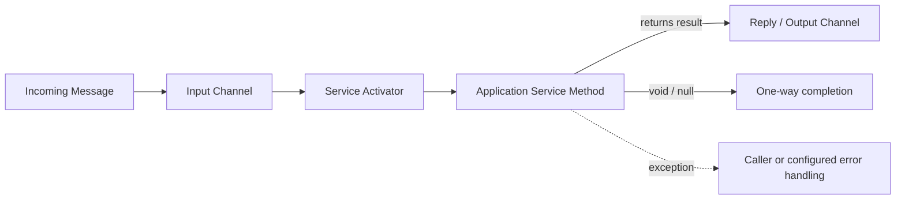

The lesson **“Service Activator Invoking Application Methods from Messages”** belongs to the **Service activator** chapter of the **SPRING_INTEGRATION_PATTERN** module. The module focuses on implementing Enterprise Integration Patterns with Spring Integration to build loosely coupled, extensible message flows; coordinating Router, Filter, Transformer, Splitter, Aggregator, Gateway, retry, error channel, correlation, while testing and observing execution branches.

**Learning objectives:** understand how a Service Activator differs from a Transformer/Gateway; implement it using `@ServiceActivator` or Java DSL `.handle(...)`; choose how to pass payload and headers; control replies, exceptions, transactions, and idempotency; and write unit/integration tests proving the endpoint actually invokes the business method in a controlled manner.

> **Key takeaway:** A Service Activator is an **adapter at the boundary between messaging and the application**, not a place that forces every business service to know infrastructure details.

## 1. The problem when messages need to invoke Java logic

An order-processing flow might look like this:

1. An HTTP inbound gateway or broker adapter receives the request.
2. A Decoder/Validator produces a valid `PlaceOrder`.
3. A Router classifies the command types.
4. An endpoint invokes `OrderApplicationService.place(...)`.
5. The resulting `OrderReceipt` is emitted to an output channel or reply channel.

If repository code, email sending, HTTP clients, and business rules are placed directly inside every message handler, the logic becomes tightly coupled to Spring Integration. It becomes very hard to reuse it from a REST controller, a scheduled job, or a plain Java unit test.

With a Service Activator:

```text
Messaging concern:
  receive Message<PlaceOrder>
  resolve handler method
  bind parameters
  send reply / propagate failure

Business concern:
  place(PlaceOrder)
  validate domain invariants
  persist order
  return OrderReceipt
```

The business layer does not need to depend on `MessageChannel` just to create an order. The messaging endpoint is responsible for **invoking the right method** and forwarding the result according to the contract.

## 2. How Service Activator differs from adjacent patterns

| Pattern/component | Primary responsibility | Relationship to Service Activator |
| --- | --- | --- |
| **Service Activator** | Invoke an application method from a message | Connection point between message → business logic |
| **Transformer** | Convert data/message into another form | Can run before/after a handler |
| **Filter** | Allow only messages meeting a condition to proceed | Can block invalid input before the handler |
| **Router** | Select one or more channels/handlers | Decides which endpoint receives the message |
| **Gateway** | Provide a request-reply or one-way interface to callers | Typically sends requests to a flow containing a Service Activator |
| **Splitter** | Split one message into multiple parts | Each part can travel to a Service Activator |
| **Aggregator** | Combine results by correlation/release policy | Can receive replies from multiple Service Activators |
| **Channel Adapter** | Connect a transport system and a message channel | Brings messages into/out of the flow |
| **Error Channel** | Carries `ErrorMessage` when an error handler publishes an exception | Does not replace business rejections/replies |

**Do not distinguish them solely by “whether the method returns an object.”** A Transformer can also invoke a Java method, and a Service Activator can also return a different payload. The key difference is the **design role**: a Service Activator triggers an application operation; a Transformer focuses on changing the message representation.

### Example of a coordinated flow

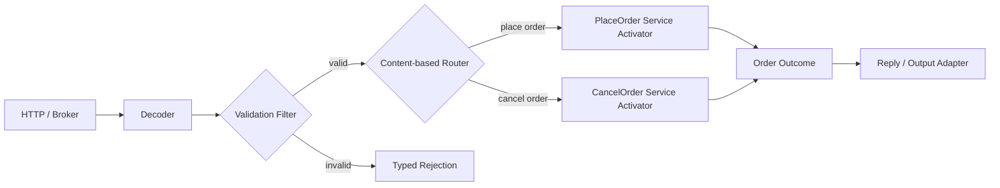

Each endpoint has a single responsibility; do not cram all routing conditions, mappings, and business logic into one monolithic handler.

## 3. Four core steps of a Service Activator

When a message arrives at the input channel, Spring Integration typically executes according to this diagram:

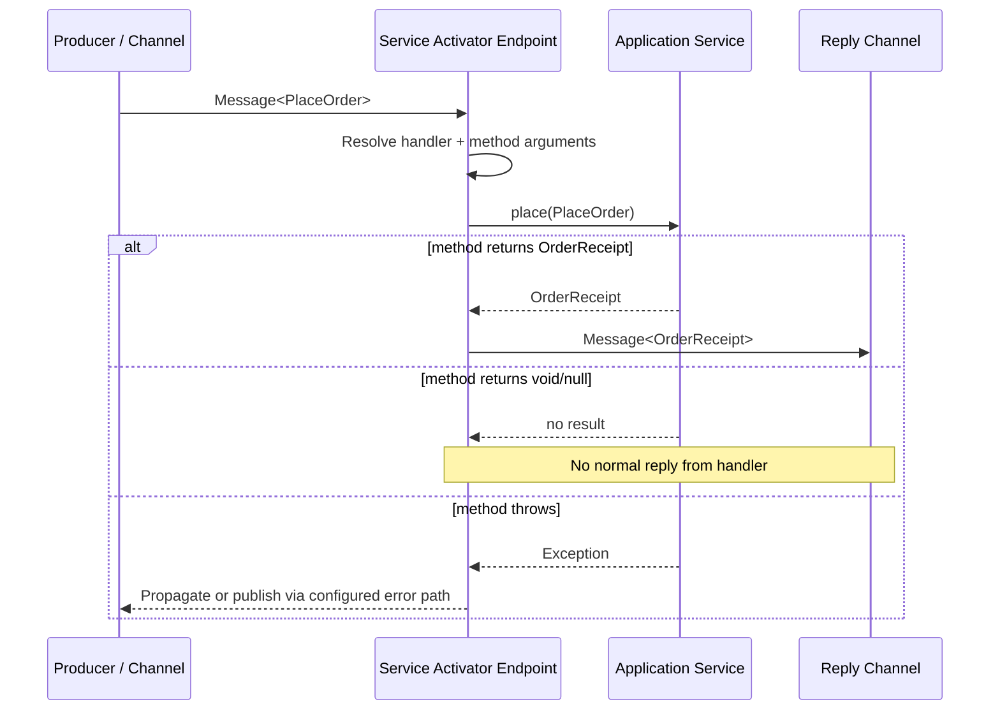

The four steps:

1. **Receive message:** A channel dispatcher or poller delivers the message to the endpoint.
2. **Select method:** The endpoint uses configuration, annotations, method name, and parameter signatures to determine the method.
3. **Invoke application:** Payload/headers/message values are passed to the method according to the endpoint's rules.
4. **Handle result:** A return value can become the payload of a reply message; `void`/`null` means no normal reply; exceptions follow the semantics of the execution context.

**Do not assume** that any handler returning `null` signals “success” to a Gateway. A caller waiting for a reply may hit a reply timeout or a required-reply error depending on configuration.

## 4. Order contract for the running example

Use Java 17+ and simple records. Business contract:

- `tenantId`, `orderId`, and `customerId` must have values.
- Each line has `sku` and `quantity > 0`.
- The `PlaceOrder` command creates an order by identity `(tenantId, orderId)`.
- The result has status `CREATED` or `ALREADY_EXISTS`.
- Multiple submissions of the same command do not create two duplicate orders.
- Format-valid input does not automatically mean the caller is authorized for the tenant.

```java
import java.util.List;

record OrderLine(String sku, int quantity) {}

record PlaceOrder(
    String tenantId,
    String orderId,
    String customerId,
    List<OrderLine> lines
) {
    PlaceOrder {
        if (lines != null) {
            lines = List.copyOf(lines);
        }
    }
}

record OrderReceipt(
    String tenantId,
    String orderId,
    String status
) {}
```

These records are illustrative DTOs. Do not assume the constructor has verified the tenant or guaranteed business invariants. In production, place validation/authorization at the trust boundary and verify invariants in the service where needed.

### A corresponding message

```json
{
  "tenantId": "tenant-a",
  "orderId": "ORD-101",
  "customerId": "CUS-9",
  "lines": [
    {"sku": "SKU-1", "quantity": 2}
  ]
}
```

This payload will be the direct input to the application method `place(PlaceOrder)`.

## 5. The application layer remains plain Java

First, define the repository contract:

```java
interface OrderRepository {
    // Must be atomic and enforce business uniqueness.
    // true if newly created, false if the same (tenantId, orderId) already exists.
    boolean insertIfAbsent(PlaceOrder command);
}
```

Then write the service:

```java
class InvalidOrderException extends RuntimeException {
    InvalidOrderException(String code) {
        super(code);
    }
}

class OrderApplicationService {
    private final OrderRepository repository;

    OrderApplicationService(OrderRepository repository) {
        this.repository = repository;
    }

    public OrderReceipt place(PlaceOrder command) {
        validate(command);

        boolean created = repository.insertIfAbsent(command);

        return new OrderReceipt(
            command.tenantId(),
            command.orderId(),
            created ? "CREATED" : "ALREADY_EXISTS");
    }

    private static void validate(PlaceOrder command) {
        if (command == null
                || blank(command.tenantId())
                || blank(command.orderId())
                || blank(command.customerId())
                || command.lines() == null
                || command.lines().isEmpty()) {
            throw new InvalidOrderException(
                "ORDER_INPUT_INVALID");
        }

        for (OrderLine line : command.lines()) {
            if (line == null || blank(line.sku())
                    || line.quantity() <= 0) {
                throw new InvalidOrderException(
                    "ORDER_LINE_INVALID");
            }
        }
    }

    private static boolean blank(String s) {
        return s == null || s.isBlank();
    }
}
```

**Key point:** `OrderApplicationService` does not import `Message<?>`, `IntegrationFlow`, or `MessageChannel`. This class can be called in plain Java tests, from a REST controller, a batch job, or a Service Activator.

### In-memory repository for learning tests

```java
import java.util.concurrent.ConcurrentHashMap;
import java.util.concurrent.ConcurrentMap;

class InMemoryOrderRepository implements OrderRepository {
    private record OrderKey(String tenantId, String orderId) {}

    private final ConcurrentMap<OrderKey, PlaceOrder> orders =
        new ConcurrentHashMap<>();

    @Override
    public boolean insertIfAbsent(PlaceOrder command) {
        OrderKey key = new OrderKey(
            command.tenantId(), command.orderId());

        return orders.putIfAbsent(key, command) == null;
    }

    int size() {
        return orders.size();
    }
}
```

This is a **test double**, not a production repository. It is not durable, does not support transactions, and does not check the case where `orderId` is duplicated with different content. For critical business logic, use a unique constraint, payload fingerprint, or domain conflict-detection rules.

## 6. Service Activator using the `@ServiceActivator` annotation

A familiar declarative style in Spring Integration is annotating the method to be invoked.

```java
import org.springframework.integration.annotation.ServiceActivator;
import org.springframework.stereotype.Component;

@Component
class AnnotatedOrderEndpoint {
    private final OrderApplicationService service;

    AnnotatedOrderEndpoint(OrderApplicationService service) {
        this.service = service;
    }

    @ServiceActivator(
        inputChannel = "orders.annotation.in",
        outputChannel = "orders.annotation.out")
    public OrderReceipt handle(PlaceOrder order) {
        return service.place(order);
    }
}
```

Here:

- `@ServiceActivator` specifies the **input channel** and **output channel**.
- `handle(PlaceOrder order)` receives the payload matching the method.
- The actual business logic lives in `service.place(order)`.
- `OrderReceipt` is sent to the output channel as the handler's result.
- When the method throws an exception, error handling depends on the channel/endpoint context.

The channels must exist in the application context; the `OrderApplicationService` bean must also be registered. The annotated-method example and the Java DSL example below are **two independent alternatives**. Do not accidentally register both subscribers for the same input and conclude there is only a single handler.

### Annotating directly on a service

You can place `@ServiceActivator` directly on a method of a Spring-managed service if that service truly is an endpoint. However, in larger codebases, a **thin adapter layer** like `AnnotatedOrderEndpoint` keeps the business service less coupled to the framework and easier to test independently.

**Do not turn every business method into an integration endpoint.** Expose only the operations that the messaging flow needs to invoke; avoid letting internal-only methods become entrypoints that can be triggered via messages.

## 7. Java DSL configuration with `.handle(...)`

Spring Integration Java DSL lets you build flows and declare a Service Activator endpoint using `.handle(...)`.

Example:

```java
import org.springframework.context.annotation.Bean;
import org.springframework.context.annotation.Configuration;
import org.springframework.integration.channel.DirectChannel;
import org.springframework.integration.channel.QueueChannel;
import org.springframework.integration.config.EnableIntegration;
import org.springframework.integration.dsl.IntegrationFlow;
import org.springframework.messaging.MessageChannel;
import org.springframework.messaging.PollableChannel;

@Configuration
@EnableIntegration
class OrderServiceActivatorConfiguration {

    @Bean("orders.commands")
    MessageChannel ordersCommands() {
        return new DirectChannel();
    }

    @Bean("orders.receipts")
    PollableChannel orderReceipts() {
        // For testing: in-memory, not durable.
        return new QueueChannel();
    }

    @Bean
    InMemoryOrderRepository exampleOrderRepository() {
        return new InMemoryOrderRepository();
    }

    @Bean
    OrderApplicationService orderApplicationService(
            InMemoryOrderRepository repository) {
        return new OrderApplicationService(repository);
    }

    @Bean
    IntegrationFlow placeOrderFlow(
            OrderApplicationService service) {
        return IntegrationFlow.from("orders.commands")
            .handle(PlaceOrder.class,
                (order, headers) -> service.place(order))
            .channel("orders.receipts")
            .get();
    }
}
```

### Step-by-step reading

1. `orders.commands` is a `DirectChannel`, so the handler usually runs on the sender's call stack.
2. `handle(PlaceOrder.class, ...)` receives a `PlaceOrder` payload.
3. The lambda calls `OrderApplicationService.place`.
4. The return value `OrderReceipt` becomes the handler's message result.
5. `orders.receipts` is a `QueueChannel` so tests can poll it.
6. The bean configuration uses a test-double repository; production needs a durable repository and appropriate transactions.

**The handler does not read an arbitrary payload type and cast it to `PlaceOrder` by itself**. If the input is raw string/JSON, a decoder/converter and type validation are needed **before** this endpoint.

### Another DSL form: invoking a method by name

When you have a Spring bean with a clear method, you can configure a method-invoking Service Activator:

```java
@Bean
IntegrationFlow placeOrderViaMethod(
        OrderApplicationService service) {
    return IntegrationFlow.from("orders.method.in")
        .handle(service, "place")
        .channel("orders.method.out")
        .get();
}
```

This is an **alternative option**, requiring `orders.method.in` and `orders.method.out` to be registered. Do not copy it into the configuration above without those two channels.

Specifying the method name explicitly avoids ambiguity when a bean has multiple methods. With **overloaded methods**, message-to-method resolution may not be obvious; prefer an adapter entrypoint with a clear signature and test method selection.

## 8. `@ServiceActivator` vs. `.handle(...)`: which to choose?

| Criterion | Annotation | Java DSL |
| --- | --- | --- |
| Where declared | On a Spring bean method | Inside an `IntegrationFlow` bean |
| Message topology visibility | Scattered across classes | Centralized per flow |
| Ease of keeping business service pure | Use a thin endpoint adapter | Use a lambda or method-invoking adapter |
| When suitable | Small endpoints, minimal config | Multi-step flows where order matters |
| Method selection | Annotation and signature | Explicit lambda/method name |
| Key tests | Method actually subscribed to right channel | Flow receives/routes to right channels |
| Risks | Annotation not scanned; wrong channel name | Wrong DSL route; overloaded method; reply semantics |

There is no need to argue “annotations are always better than DSL” or vice versa. In a multi-module project, establish a **consistent convention** so operators can easily trace messages from source to business method.

### Avoid two competing endpoints on the same channel

If there are two subscribers on a `DirectChannel`, a point-to-point channel's dispatcher normally picks one subscriber per dispatch strategy and **does not broadcast** the same message to both. If you want to send to multiple handlers, use a `PublishSubscribeChannel` or `Recipient List` with a fan-out contract.

Do not register both `@ServiceActivator(inputChannel="orders.commands")` and a DSL handler on the same input just because you are testing both styles and then assume every command will always run one fixed endpoint.

## 9. Method arguments: payload, headers, or the full message?

A Service Activator can invoke methods with several framework-supported signatures, depending on handler method resolution and annotations.

### Receiving the payload directly

```java
public OrderReceipt handle(PlaceOrder payload) {
    return service.place(payload);
}
```

This works best when the business method only needs the business data.

### Receiving the full Spring message

```java
import org.springframework.messaging.Message;

public OrderReceipt handle(Message<PlaceOrder> message) {
    PlaceOrder order = message.getPayload();

    // Only use verified metadata/contracts.
    return service.place(order);
}
```

Suitable when the endpoint adapter needs tracing or routing headers, but **do not automatically turn `Message<?>` into a domain parameter across all services**.

### Extracting a specific header

```java
import org.springframework.messaging.handler.annotation.Header;
import org.springframework.messaging.handler.annotation.Payload;

public OrderReceipt handle(
        @Payload PlaceOrder payload,
        @Header("businessTenantId") String tenantId) {

    if (!payload.tenantId().equals(tenantId)) {
        throw new InvalidOrderException("TENANT_MISMATCH");
    }

    return service.place(payload);
}
```

Header binding may require the header's presence and matching type. **A raw client header named `businessTenantId` is not inherently trustworthy**: upstream must authenticate the principal/producer and construct internal headers from a verified source.

### Optional access to all headers

Spring Messaging supports accessing `MessageHeaders`/`@Headers` in appropriate method invocations. However, avoid passing all headers into domain code if only one or two metadata fields are needed.

**Deliberately choosing method signatures** keeps the Service Activator as a thin adapter rather than mixing routing, security, and business logic.

## 10. Type conversion and overloaded methods

Input may arrive from HTTP/JMS/Kafka as bytes, strings, JSON maps, or DTOs.

```text
Kafka bytes / HTTP JSON
    -> Message Converter / Decoder
    -> PlaceOrder object
    -> Service Activator
    -> OrderApplicationService.place(PlaceOrder)
```

Do not expect `place(PlaceOrder)` to automatically accept any JSON `String` and have Spring Integration coerce it properly. If the application has a registered message conversion service, conversion is **configuration-dependent**, and it still does not replace schema validation, strict JSON type checks, or authorization.

### Dangerous overloaded methods

```java
class AmbiguousHandler {
    public Object handle(Object input) {
        return "generic";
    }

    public Object handle(PlaceOrder input) {
        return "order";
    }
}
```

An endpoint selecting a method by the name `"handle"` can cause **complex method resolution** when payloads or conversions vary. Even though the framework has mechanisms to pick the best method, tests must prove behavior across real inputs.

Ways to reduce ambiguity:

- Define a specific method such as `handlePlaceOrder(PlaceOrder)`.
- Use `.handle(PlaceOrder.class, (payload, headers) -> ...)`.
- Split message types via a Router to separate handlers.
- Do not use a broad `Object` parameter to mask mismatched type contracts.
- Test invalid input types and conversion errors at ingress.

A type mismatch is typically a **contract/decoder error**, not a business rejection like “invalid order quantity.”

## 11. How does a return value become a reply message?

When a method returns a **payload object**, Spring Integration can create a reply message and route it to the configured output channel or appropriate reply destination.

```java
public OrderReceipt handle(PlaceOrder command) {
    return service.place(command);
}
```

The `OrderReceipt` result can be wrapped into a `Message<OrderReceipt>`. Certain headers may be propagated depending on the reply-creation/endpoint mechanism and configuration; **you should not assume all original headers are preserved** across every Transformer/handler.

### If the method returns a Message

```java
import org.springframework.messaging.Message;
import org.springframework.messaging.support.MessageBuilder;

public Message<OrderReceipt> handle(Message<PlaceOrder> incoming) {
    OrderReceipt result = service.place(incoming.getPayload());

    return MessageBuilder.withPayload(result)
        .setHeader("businessEventId",
            incoming.getHeaders().get("businessEventId"))
        .build();
}
```

Here the method controls the reply message explicitly. **Allowlist headers that have a business reason**, and do not copy `replyChannel`/`errorChannel` from untrusted sources.

The library has rules for merging headers when converting a `Message<?>` into a reply, and behavior can depend on configuration. For exact control, write integration tests observing reply headers on the specific Spring Integration version in use.

### When to return an object vs. a Message?

- Return a DTO if only the **business result** is needed.
- Return `Message<DTO>` if the endpoint needs to emit **specific reply metadata** per the contract.
- Do not make the business service depend on `MessageBuilder` if metadata is a transport/adapter concern.

## 12. One-way Service Activator: `void` or `null` methods

Not every command requires request-reply. An event consumer may persist data or forward a command downstream and finish.

```java
interface AuditSink {
    void append(String tenantId, String orderId);
}

class AuditCommandHandler {
    private final AuditSink sink;

    AuditCommandHandler(AuditSink sink) {
        this.sink = sink;
    }

    public void record(PlaceOrder command) {
        sink.append(command.tenantId(), command.orderId());
    }
}
```

One-way DSL:

```java
@Bean
IntegrationFlow oneWayAuditFlow(AuditCommandHandler handler) {
    return IntegrationFlow.from("orders.audit.in")
        .handle(PlaceOrder.class, (order, headers) -> {
            handler.record(order);
            return null; // Do not emit a normal reply.
        })
        .get();
}
```

The channels/beans in the snippet must be registered when assembled into an application. This suits fire-and-forget/event consumers **when the contract does not require a reply**. **One-way does not mean asynchronous**: when using `DirectChannel`, the method can still execute synchronously on the sender's thread—it simply produces no normal reply; to make it asynchronous, choose the corresponding channel/adapter and execution model.

### Do not put a one-way handler behind a Gateway that expects a reply

If a Gateway is waiting for an `OrderReceipt`, a `void` handler returning no reply can cause a timeout or required-reply failure. Decide clearly:

- Request-reply: the method returns a receipt/outcome, with a clear error path.
- One-way: the caller only knows the command was sent/accepted per channel semantics, **not by default that business state committed**.
- Async command: store the outcome and let the caller query or receive a callback later.

**Do not fabricate a fake `"OK"` reply just because the sender timed out** when the handler may not have finished or side effects are uncertain.

## 13. Request-reply: output channel and replyChannel

A Service Activator has two common reply destination sources:

1. **Explicit output channel** from the annotation/DSL.
2. **`replyChannel` header** used in request-reply flows/Gateways when the endpoint does not designate another destination.

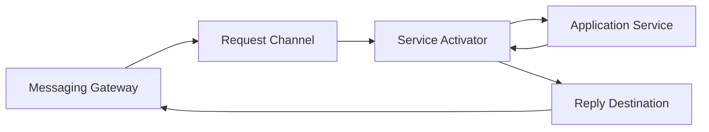

In a flow with `.channel("orders.receipts")` after the handler, the reply goes to the channel declared in the flow. In a request-reply Gateway, destination configuration must align so the reply **returns to the right caller**.

### Reply channel is not business correlation

`replyChannel` serves to **deliver the reply back to the caller**, not to replace `orderId`, `businessEventId`, or workflow `correlationId`. When there are multiple concurrent callers, gateway infrastructure must coordinate replies; do not force idempotency or Aggregator grouping onto the reply address.

### Security boundary

Do not take a raw `replyChannel` or `errorChannel` from an HTTP header and resolve it into an internal Spring `MessageChannel`. That is control-plane metadata; letting clients specify it allows them to hijack reply or error routing.

## 14. Gateway invoking a Service Activator via an interface

A Messaging Gateway lets Java callers use an interface just like a normal method:

```java
import org.springframework.integration.annotation.Gateway;
import org.springframework.integration.annotation.MessagingGateway;

@MessagingGateway
interface OrderGateway {
    @Gateway(requestChannel = "orders.gateway.in")
    OrderReceipt place(PlaceOrder command);
}
```

Another flow handles the request:

```java
@Bean
IntegrationFlow gatewayOrderFlow(OrderApplicationService service) {
    return IntegrationFlow.from("orders.gateway.in")
        .handle(PlaceOrder.class,
            (order, headers) -> service.place(order))
        .get();
}
```

This is an **independent alternative** to the `orders.commands` channel from the earlier example; the gateway bean and input channel must be registered according to the application.

How it works:

- The caller invokes `gateway.place(command)`.
- The Gateway builds a message and sends it to `orders.gateway.in`.
- The Service Activator processes it and returns `OrderReceipt`.
- The reply follows the Gateway's request-reply mechanism.
- Exceptions/timeouts must have a clear contract at the caller.

### Timeout risk

A Gateway timeout **does not prove the business transaction rolled back**. If the repository committed but the reply was lost, the caller may retry and must be protected by an idempotency key/domain uniqueness.

Do not use a timeout as a reason to generate a brand-new command with a new ID; that can lead to duplicate orders or payments.

## 15. Header binding and metadata must be verified

Suppose a message has:

```text
payload:
  tenantId = tenant-a
  orderId  = ORD-101

headers:
  businessTenantId = tenant-a
  businessEventId  = evt-101
  businessCorrelationId = corr-77
```

The Service Activator can read `businessTenantId` and `businessEventId`, but must distinguish:

| Data | Role | Trustworthy source? |
| --- | --- | --- |
| `payload.tenantId` | Which tenant the business operation targets | Trusted only after authorization |
| `businessTenantId` header | Verified internal scope | Only when the adapter builds it from a trusted principal |
| `businessEventId` | Event identity for idempotency | Must be stable from a trusted producer/ingress |
| `MessageHeaders.ID` | Framework message ID | Does not replace business event identity |
| `businessCorrelationId` | Workflow/batch identity | Requires permission/manifest checks |
| `replyChannel` | Internal reply destination | Must not be arbitrarily set by clients |
| `errorChannel` | Internal error destination | Must not be arbitrarily set by clients |

A helper at trusted ingress can build headers:

```java
import org.springframework.messaging.Message;
import org.springframework.messaging.support.MessageBuilder;

final class TrustedOrderMessageFactory {
    Message<PlaceOrder> wrap(
            PlaceOrder order, String verifiedTenant,
            String businessEventId) {
        if (order == null
                || !verifiedTenant.equals(order.tenantId())) {
            throw new InvalidOrderException("TENANT_MISMATCH");
        }

        return MessageBuilder.withPayload(order)
            .setHeader("businessTenantId", verifiedTenant)
            .setHeader("businessEventId", businessEventId)
            .build();
    }
}
```

**This illustrates message construction and does not perform authentication itself.** The caller must obtain `verifiedTenant` from a trusted source; `businessEventId` must also be validated/authorized per the contract. Do not blindly copy raw HTTP headers onto the message.

## 16. Validation and authorization before calling the service

A Service Activator may receive a DTO that is **well-typed but out of domain range** or contains another tenant's ID. Protection is needed at two layers:

- **Ingress:** decoding, schema validation, authentication, authorization, and rate limits.
- **Application service/domain:** verify critical invariants and permissions before side effects; do not rely solely on an upstream Filter if the service can be invoked through other paths.

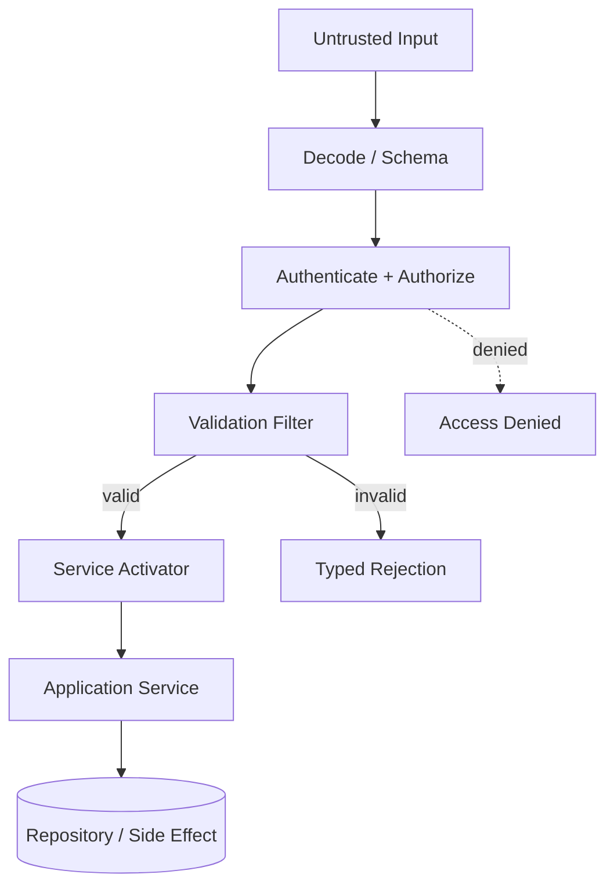

**Business validation failures** like `quantity=-2` should usually produce a typed rejection rather than infinite retries. **Authorization failures** need an access-appropriate response; do not use an `ORDER_LINE_INVALID` code to mask a tenant error.

If the validator depends on a Catalog Service and that service times out, the status is `VALIDATION_UNAVAILABLE`, not “SKU does not exist.” An infrastructure error handler may need bounded retry, hold/quarantine, or an error message depending on the execution context.

## 17. Synchronous exceptions: `DirectChannel` can throw back to the sender

A `DirectChannel` normally invokes its subscriber on the sender's thread. If `OrderApplicationService.place(...)` throws an exception, the exception can propagate back to `send(...)` or the Gateway call, potentially wrapped by the framework in a messaging exception.

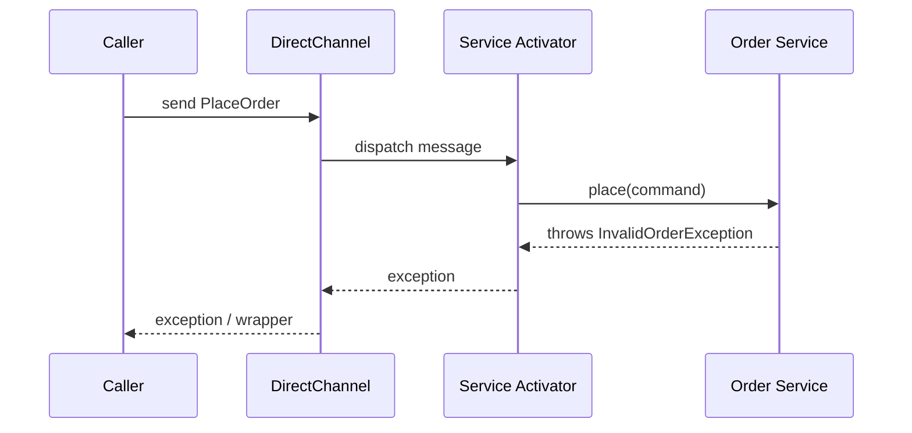

**A global `errorChannel` does not automatically catch all synchronous exceptions.** When a caller expects HTTP 400/422, an adapter/controller/advice must classify the exception into a safe API response.

Do not assume the exception class at the boundary matches the exact domain type; a `MessageHandlingException` or another wrapper may hold the original cause. Integration tests should inspect the **cause/category**, rather than relying on free-form message strings.

## 18. Asynchronous exceptions: `ErrorMessage` depends on the error handler

When a flow runs on an `ExecutorChannel`, poller, inbound adapter, or broker consumer, exceptions can be caught by an error handler and published as a **Spring `ErrorMessage`**.

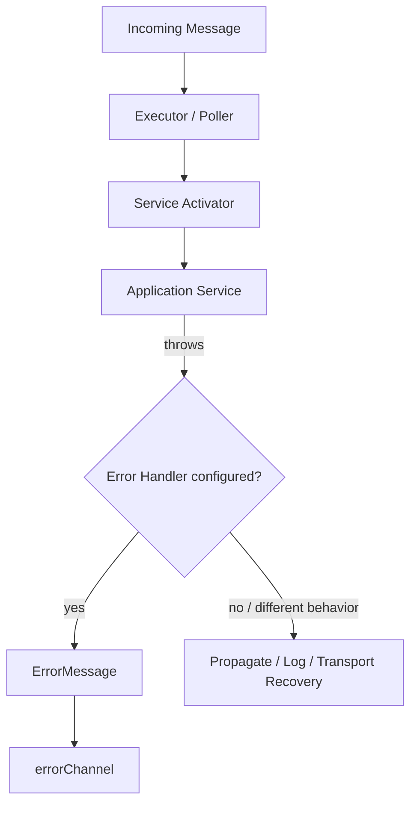

**There is no rule that “every Service Activator error automatically goes to `errorChannel`.”** Behavior depends on the source adapter, channel, transaction, advice, thread context, and error publisher.

Notes:

- `ErrorMessage` has a `Throwable` payload, **not** an `OrderReceipt` or a typed domain rejection.
- `MessagingException.failedMessage` may contain sensitive payloads.
- If a Service Activator **returns `null`** normally, that is not an exception and does not automatically generate an `ErrorMessage`.
- An async source may ACK before business processing or ACK after commit depending on transport/configuration; do not infer this merely from `errorChannel` receiving messages.

### When a notification requires informing the caller of an error

If the caller already received HTTP `202 Accepted` and the system processes asynchronously, you cannot return HTTP 422 on the closed connection. You need a **status resource, callback, reply topic, or rejection event**.

## 19. Typed rejection vs. exception

For critical business operations, define an explicit output contract:

```java
import java.util.List;

record OrderRejected(
    String tenantId,
    String orderId,
    String errorCode,
    List<String> violationCodes
) {}
```

Example:

```json
{
  "tenantId": "tenant-a",
  "orderId": "ORD-101",
  "errorCode": "ORDER_VALIDATION_FAILED",
  "violationCodes": [
    "QUANTITY_MUST_BE_POSITIVE"
  ]
}
```

You can design a validation step **before the Service Activator** to route invalid messages to a rejected channel, ensuring the handler only receives valid `PlaceOrder` commands. Or the service can throw a domain exception that the API boundary maps to an error DTO.

**Do not catch every `Throwable` and return `OrderRejected(errorCode="INVALID_INPUT")`.** Database outages, bugs, and remote API timeouts do not mean the input is invalid. They require different retry/recovery and monitoring.

If the domain chooses to return a typed `Result<Success,Rejection>` union, the flow after the Service Activator needs an appropriate Router/Transformer to route accepted vs. rejected outputs.

## 20. Service Activator and transaction boundaries

A handler may write multiple pieces of business data. If all data resides in the **same database/transaction manager**, wrap the service method or orchestration call in an explicit transaction.

```java
import org.springframework.transaction.annotation.Transactional;

class TransactionalOrderApplicationService {
    private final OrderRepository repository;
    private final OrderOutbox outbox;

    TransactionalOrderApplicationService(
            OrderRepository repository, OrderOutbox outbox) {
        this.repository = repository;
        this.outbox = outbox;
    }

    @Transactional
    public OrderReceipt place(PlaceOrder command) {
        // Validation and tenant authorization are assumed to happen
        // at the designated boundary.
        boolean created = repository.insertIfAbsent(command);

        if (created) {
            outbox.enqueueOrderPlaced(command);
        }

        return new OrderReceipt(
            command.tenantId(), command.orderId(),
            created ? "CREATED" : "ALREADY_EXISTS");
    }
}

interface OrderOutbox {
    void enqueueOrderPlaced(PlaceOrder command);
}
```

Conditions for the example to achieve the expected semantics:

- `TransactionalOrderApplicationService` must be a **Spring-managed bean** invoked via the appropriate proxy/interceptor; do not instantiate it with `new` and expect `@Transactional` to take effect.
- The repository and outbox must share the **same transaction manager/resource** for atomic commits.
- `insertIfAbsent` must rely on a unique constraint or atomic write, not a race-prone `SELECT EXISTS` followed by `INSERT`.
- If outbox enqueueing fails inside the transaction, both business state and outbox must roll back per policy.
- If calling systems **outside the database**, `@Transactional` cannot roll back external side effects.
- Do not treat the in-memory repository example as a durable transaction.

### Service Activator does not automatically create a transaction

Using `.handle(service, "place")` does not make every handler transactional. Transactions can live at the service layer, poller, advice chain, or inbound transaction boundary; choose the right place aligned with ACK mechanics and resources.

## 21. Idempotency: receiving a message twice does not mean creating two orders

In at-least-once systems, the broker can redeliver the same message after the business method committed but before ACK.

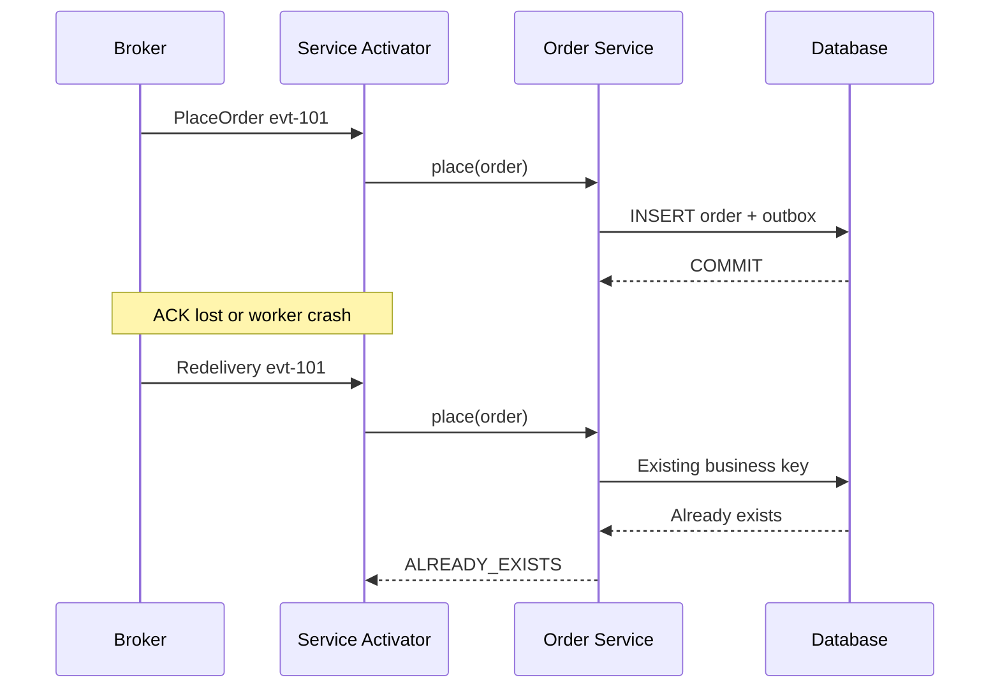

A Service Activator **does not automatically deduplicate**. Mechanisms to consider:

- **Idempotent Receiver** before side effects.
- **Unique constraint** per business operation (e.g., tenantId + orderId for “create order”).
- **Stable `businessEventId`** across retries/replays.
- **Transactional inbox/outbox** when multiple consumers/producers are involved.
- **Outcome store** to return the previous result to a Gateway when a response is lost.
- **Conflict detection** if the same idempotency key arrives with a different payload.
- **Retention window** long enough to cover retries, DLQ, and manual replay horizons.

In the learning example, `ALREADY_EXISTS` does not distinguish an exact duplicate from a different command using the same order ID. Production must define when to return `ALREADY_EXISTS`, when to return `IDEMPOTENCY_KEY_CONFLICT`, and when reconciliation is required.

**Do not deduplicate by `MessageHeaders.ID`** if identity can change across a Transformer or broker. Use a stable business key with the right scope.

## 22. Retry can re-invoke the entire application method

A retry advice around a Service Activator can re-invoke `place(...)` after an exception. If the method already performed a side effect before throwing, retry can **repeat the effect**.

Dangerous example:

```text
place(command):
  chargePaymentGateway()  // remote service already charged
  saveOrder()             // database operation times out
  throw exception

retry:
  chargePaymentGateway()  // could charge again
```

How to handle this:

1. **Classify errors:** do not endlessly retry deterministic validation failures on the same message.
2. **Bounded retry:** configure max attempts, backoff, and retryable exception types.
3. **Idempotency key:** forward the same key to providers that support it.
4. **Reconciliation:** when an external call's outcome is unknown, query status instead of retrying blindly.
5. **Outbox/Saga/compensation:** use when business logic coordinates multiple resources.
6. **Circuit breaker/bulkhead:** prevent one failing dependency from taking down all handlers.
7. **Error recovery:** record uncertain state rather than declaring definitive failure prematurely.

A Service Activator throwing an exception does not prove no side effect occurred. Crash/retry tests must verify this.

## 23. Concurrency: endpoints do not implicitly guarantee strict ordering

A Service Activator executes according to how the channel delivers messages:

| Channel/source | Characteristics | What to verify |
| --- | --- | --- |
| `DirectChannel` | Usually dispatches synchronously on caller thread | Long-running handlers can block the sender |
| `ExecutorChannel` | Dispatches via an executor | Can run in parallel; completion order is not guaranteed |
| `QueueChannel` + poller | Decouples producer and consumer | Polling, batch size, transactions, error handling |
| Kafka/JMS inbound adapter | Depends on consumer/thread/partition/session config | ACK/redelivery/ordering and concurrency |
| Publish-subscribe channel | Fans out to multiple subscribers | Do not assume each handler is called only once |

**A Service Activator does not automatically serialize requests by `orderId`.** Two commands for the same order can run concurrently across two instances; repository/business state must use locking, optimistic versioning, or unique constraints.

### Handlers and thread safety

If a Spring handler bean is a singleton and invoked concurrently, avoid using mutable fields for per-request state:

```java
// Avoid using a shared field to hold the current request:
class UnsafeOrderHandler {
    private String currentOrderId;

    public void handle(PlaceOrder command) {
        currentOrderId = command.orderId();
        // Another thread may overwrite the field before the method finishes.
    }
}
```

Prefer local variables, immutable DTOs, and synchronized durable state. `ThreadLocal` or request-scoped contexts must also be managed when crossing threads via `ExecutorChannel`.

## 24. Method resolution and Spring bean lifecycle

A handler method must actually be registered as an endpoint.

Common configuration mistakes:

- Forgetting `@Component` or bean registration, so annotated methods are never scanned.
- Misspelling a channel name, leaving the input without a subscriber.
- Two endpoints listening on the same point-to-point channel and competing for messages.
- Overloaded methods causing unexpected invocation selection.
- Instantiating a handler object with `new`, losing `@Transactional`/AOP or dependencies.
- Calling a private/internal method that proxies or reflection cannot handle properly.
- Bean initialized, but the endpoint is stopped or the poller is not running.
- Handler returning `null` when the Gateway requires a reply.
- Raw JSON input when the method only accepts a DTO and no converter is configured.

An integration test should verify that **a real Spring context has an active subscribed endpoint**, rather than only calling `service.place(...)` in a unit test and concluding the annotation/DSL works.

## 25. Service Activator in a Transformer and Filter chain

A flow can look like:

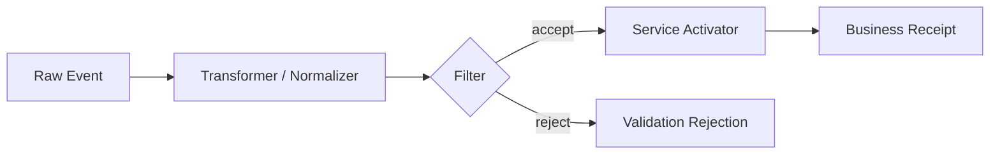

Benefits:

- **Transformer** converts input into a contract-compliant `PlaceOrder`.
- **Filter** blocks non-compliant data at ingress.
- **Service Activator** invokes the business method.
- **Outcome handler** emits replies or stores results per the contract.

However, a Filter is not enough to protect the domain if the Service Activator can also be invoked from another source. The business service should check critical invariants before committing.

### Do not use `.handle(...)` to emulate a Transformer that drops output

A one-way handler returning `null` stops normal reply flow. If you want to modify the payload and continue, use `.transform(...)` or a service method that returns a result per the contract. Do not write `.handle(...); .channel("next")` and expect output when the method always returns `null`.

## 26. Service Activator after Splitter and before Aggregator

Suppose a batch has three items. A Splitter creates three messages, each invoking an independent service method. Replies must be gathered properly by an Aggregator.

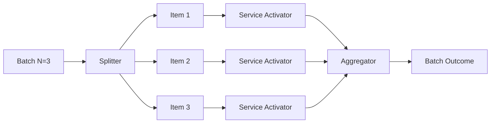

Ensure:

1. **Correlation key** is stable per tenant/batch/generation.
2. **Part ID** is unique to prevent duplicates.
3. **Sequence metadata** is preserved when ordering/release depends on it.
4. If the Service Activator returns `null`, the Aggregator may miss a reply.
5. If a handler throws an exception, provide an `ItemResult(FAILED)` or fail-fast policy; do not treat an error as a completed part with no outcome.
6. **Release strategy** should not merely count raw messages, since broker redelivery could insert the same item into a group twice.
7. Clear timeout and late-arrival policies; do not let an error or Filter discard stall a group forever.

### When per-item replies are needed

```java
record ItemCommand(
    String batchId,
    String itemId,
    int quantity
) {}

record ItemResult(
    String batchId,
    String itemId,
    String status
) {}

class ItemApplicationService {
    public ItemResult process(ItemCommand command) {
        if (command.quantity() <= 0) {
            return new ItemResult(
                command.batchId(), command.itemId(), "REJECTED");
        }
        return new ItemResult(
            command.batchId(), command.itemId(), "COMPLETED");
    }
}
```

This is the **typed item outcome** pattern: each part returns an acknowledged result, whether succeeded or rejected. Add tenant/generation and provenance when supporting multi-tenancy or repeated batches with the same ID.

## 27. Service Activator in Publish-Subscribe and Recipient List

An `OrderPlaced` event can be distributed to:

- Ledger handler.
- Notification handler.
- Analytics handler.

If each subscriber is a Service Activator, **each consumer scope must have its own idempotency**. Processing an event once in the ledger **does not mean** the notification has already been sent.

```text
(tenant-a, ledger-consumer, evt-101)
(tenant-a, notification-consumer, evt-101)
(tenant-a, analytics-consumer, evt-101)
```

If endpoints share a single global idempotency key and store, the first subscriber may mark it “seen” and cause subsequent subscribers to skip it.

Furthermore, fan-out delivers one message to multiple handlers; do not rely on a point-to-point `DirectChannel` when broadcasting is required. When subscribers handle sensitive data, restrict the payload sent according to permissions; not every recipient of an `eventId` should receive full order details.

## 28. Correlation, causation, and reply identity

Three concepts frequently appear alongside Service Activators:

| Concept | Use for | Do not use for |
| --- | --- | --- |
| `businessEventId` | Identifying an event for dedup/audit | Replacing security authorization |
| `businessCorrelationId` | Linking messages in the same workflow/batch | Determining the reply recipient by itself |
| `causationId` | Linking a new event to the event that caused it | Replacing event ID by default |
| Spring `MessageHeaders.ID` | Identifying the framework message | Business deduplication across transports |
| `replyChannel` | Reply path for the exchange | Business group key |
| `errorChannel` | Error publishing path when configured | Default DTO validation |

If a Service Activator creates a **new business event** (e.g., `OrderPlaced` after `PlaceOrder`), it should have its own event ID/causation. If it only **returns a receipt** for the same command, the business request ID can still be used for correlation, but do not assume the receipt shares the exact same identity as the original command event.

Do not wholesale-copy all input headers onto a new event; keep scope and ownership explicit.

## 29. Observing a Service Activator in production

Suggested metrics:

```text
service_activator_messages_total{flow="orders",handler="place",outcome="success"}
service_activator_messages_total{flow="orders",handler="place",outcome="validation_rejected"}
service_activator_messages_total{flow="orders",handler="place",outcome="failed"}
service_activator_duration_seconds{flow="orders",handler="place"}
service_activator_retries_total{flow="orders",handler="place"}
service_activator_inflight{flow="orders",handler="place"}
service_activator_timeouts_total{flow="orders",handler="place"}
service_activator_idempotent_duplicates_total{flow="orders"}
```

These are **application-instrumented suggested metrics**, not metric names automatically generated by Spring Integration. If using Micrometer/Spring Integration management, check naming/registration for your actual version and configuration.

Do not put `orderId`, `eventId`, `correlationId`, email, or raw payloads in metric labels due to high cardinality and sensitive-data risks.

### Safe structured logs

```json
{
  "event": "service_activator_completed",
  "flow": "orders",
  "handler": "place",
  "businessEventId": "evt-101",
  "tenantScope": "tenant-a",
  "orderId": "ORD-101",
  "durationMs": 12,
  "outcome": "CREATED"
}
```

This example is a recommended application log schema. Logs may require masking/authorization and separate retention. Do not log full `PlaceOrder` objects containing PII, and do not log `ErrorMessage.failedMessage` verbatim.

### A useful trace

```text
HTTP inbound / broker receive
  -> decode/validate span
  -> router span
  -> service-activator: place span
     -> db insert span
     -> outbox insert span
  -> reply/publish span
```

Traces help locate bottlenecks, but **a trace ID does not replace a business idempotency key**.

## 30. Unit testing the service without Spring

Because the business service has no messaging dependencies, we can test it as plain Java.

```java
import static org.junit.jupiter.api.Assertions.*;
import java.util.List;
import org.junit.jupiter.api.Test;

class OrderApplicationServiceTest {
    private final InMemoryOrderRepository repository =
        new InMemoryOrderRepository();
    private final OrderApplicationService service =
        new OrderApplicationService(repository);

    private PlaceOrder validCommand() {
        return new PlaceOrder(
            "tenant-a", "ORD-101", "CUS-9",
            List.of(new OrderLine("SKU-1", 2)));
    }

    @Test
    void firstCommandCreatesAnOrder() {
        OrderReceipt receipt =
            service.place(validCommand());

        assertEquals("CREATED", receipt.status());
        assertEquals("ORD-101", receipt.orderId());
        assertEquals(1, repository.size());
    }

    @Test
    void duplicateBusinessKeyDoesNotCreateSecondOrder() {
        OrderReceipt first =
            service.place(validCommand());
        OrderReceipt replay =
            service.place(validCommand());

        assertEquals("CREATED", first.status());
        assertEquals("ALREADY_EXISTS", replay.status());
        assertEquals(1, repository.size());
    }

    @Test
    void invalidQuantityDoesNotReachRepository() {
        PlaceOrder invalid = new PlaceOrder(
            "tenant-a", "ORD-102", "CUS-9",
            List.of(new OrderLine("SKU-1", -2)));

        assertThrows(InvalidOrderException.class,
            () -> service.place(invalid));
        assertEquals(0, repository.size());
    }
}
```

This unit test proves business logic and in-memory uniqueness **within the same process**; it **does not prove** the Spring endpoint subscribes to the right channel, nor does it test real transactions or proper broker ACK/redelivery.

Separate tests are needed for the production repository, especially unique constraints and multi-instance race conditions.

## 31. Spring Integration integration test: messages actually invoke the method

Using `OrderServiceActivatorConfiguration` from section 7.

```java
import static org.junit.jupiter.api.Assertions.*;
import java.util.List;
import org.junit.jupiter.api.Test;
import org.springframework.beans.factory.annotation.Autowired;
import org.springframework.beans.factory.annotation.Qualifier;
import org.springframework.messaging.Message;
import org.springframework.messaging.MessageChannel;
import org.springframework.messaging.PollableChannel;
import org.springframework.messaging.support.MessageBuilder;
import org.springframework.test.context.junit.jupiter.SpringJUnitConfig;

@SpringJUnitConfig(OrderServiceActivatorConfiguration.class)
class OrderServiceActivatorIntegrationTest {

    @Autowired
    @Qualifier("orders.commands")
    MessageChannel input;

    @Autowired
    @Qualifier("orders.receipts")
    PollableChannel replies;

    @Autowired
    InMemoryOrderRepository repository;

    @Test
    void invokesBusinessMethodAndPublishesReply() {
        PlaceOrder command = new PlaceOrder(
            "tenant-a", "ORD-101", "CUS-9",
            List.of(new OrderLine("SKU-1", 2)));

        assertTrue(input.send(MessageBuilder
            .withPayload(command).build()));

        Message<?> reply = replies.receive(1_000);
        assertNotNull(reply);

        OrderReceipt result =
            (OrderReceipt) reply.getPayload();

        assertEquals("ORD-101", result.orderId());
        assertEquals("CREATED", result.status());
        assertEquals(1, repository.size());

        assertNull(replies.receive(50));
    }
}
```

When running multiple test methods on the same `ApplicationContext`, use a **unique `orderId` per test** or reset the repository/queue to avoid state pollution. Do not run tests in parallel on a shared queue and expect each test to receive only its own reply.

### Testing the failure path

With `DirectChannel`, sending a `PlaceOrder` with negative quantity may raise a `MessagingException` wrapping the domain exception depending on framework version.

```java
// Outline inside a Spring integration test:
PlaceOrder invalid = new PlaceOrder(
    "tenant-a", "ORD-invalid", "CUS-9",
    java.util.List.of(new OrderLine("SKU-1", -2)));

Exception failure = assertThrows(Exception.class, () ->
    input.send(MessageBuilder.withPayload(invalid).build()));

// Verify that the cause chain contains InvalidOrderException;
// do not just assert that any exception passes.
// Assert that the repository does not contain order "ORD-invalid"
// and that the queue did not emit a successful OrderReceipt.
```

This is an **outline**, not a standalone test. Production tests need more specific assertions on the cause chain, exception category, and repository state to prove the handler **produces no side effects when validation fails**.

## 32. Testing annotated methods and header binding

When using `@ServiceActivator`, the test must build a context containing:

- `@EnableIntegration` and component scanning or bean registration for the endpoint.
- Input/output channels such as `orders.annotation.in`/`orders.annotation.out`.
- `AnnotatedOrderEndpoint` managed by Spring.
- `OrderApplicationService` and its dependencies.
- A test sending `PlaceOrder` to input and asserting the receipt.

To test `@Header("businessTenantId")`:

1. Send tenant A payload with trusted tenant A header → accepted.
2. Send tenant A payload with tenant B header → handler rejects.
3. Send missing required header → clear binding/invocation failure.
4. Send wrong-type header → conversion/binding error per contract.
5. Send self-asserted raw client header without verification → ingress authorization must block before the endpoint.

**Do not just call the annotated method directly in a unit test and conclude the annotation works.** Direct calls bypass message-to-method binding, header resolution, channel dispatch, and reply channels.

## 33. Testing null, wrong types, and serialization boundaries

Ordinary Spring `Message` instances normally require a **non-null payload**. Therefore:

```java
MessageBuilder.withPayload(null).build();
```

is not a valid fixture to test `OrderApplicationService.place(null)` through a Service Activator.

If the HTTP body is empty or JSON root is `null`, test at the **inbound decoder/gateway** before building a message. You can unit-test `service.place(null)` separately to guard the domain, but do not assume `null` travels through an ordinary Spring Message that way.

### Malformed JSON types

Example:

```json
{
  "tenantId": "tenant-a",
  "orderId": "ORD-101",
  "customerId": "CUS-9",
  "lines": "not-an-array"
}
```

The decoder may fail before the Service Activator. Validate JSON/schema at the adapter; do not assume `.handle(PlaceOrder.class, ...)` will produce a typed `OrderRejected` for every mapping error.

### Message carrying the wrong Java type

If a `Message<String>` is sent to a channel expecting `PlaceOrder`, a method argument conversion/binding error may occur depending on the converter. Contract tests should assert:

- The business service is **not** called with invalid data.
- No `OrderReceipt("CREATED")` is emitted.
- Errors are emitted through the proper error boundary of the execution context.
- Raw input is not logged verbatim if it contains sensitive data.

If the application intentionally supports multiple payload types, use a Router or type guard before the endpoint rather than an arbitrary `handle(Object)` method.

## 34. Testing retry, crash, and concurrency

Some tests only make sense with **real infrastructure or a test double with controllable failure points**:

| Scenario | What must be proven |
| --- | --- |
| Two messages with same key arrive concurrently | Unique constraint/atomic insert, only one order |
| Business commit succeeds, ACK lost | Redelivery causes no duplicate side effect |
| Transaction rolls back before commit | Retry can execute again without losing work |
| Outbox insert fails inside transaction | Order is not committed without the event |
| Remote provider succeeds, response lost | No blind re-call; reconciliation/idempotency |
| Gateway timeout after commit | Caller retries with same business key |
| Service Activator returns null | Reply channel receives no successful reply |
| Service Activator throws validation exception | Invalid message is not retried endlessly |
| Handler throws infrastructure exception | Proper bounded retry/recovery |
| ExecutorChannel receives messages concurrently | Handler is thread-safe, ordering contract honored |
| Shared store across multiple instances | Ownership/locking and idempotent outcomes |
| Downstream output publish fails | Client is not told “published” when uncertain |
| Error channel handler itself fails | Does not create an infinite error-handling loop |
| Splitter emits multiple parts | Each part has proper result/correlation |
| Recipient List fans out to subscribers | Idempotency per consumer scope |

### Testing concurrency with clear boundaries

Use a real database or Testcontainers with a unique constraint and a `CountDownLatch`/barrier so two requests attempt to insert the same key simultaneously. After both finish, assert **one domain row and the expected outcome policy**, not merely that “both threads threw no exception.”

### Testing external side effects

Use a mock server/provider to simulate “API succeeded but response was lost.” If the Service Activator retries, the provider must receive the **same idempotency key** or the application must query the outcome rather than repeating a dangerous transaction.

## 35. Performance and backpressure

A Service Activator is where business logic may:

- Query or write to a database.
- Call a REST/gRPC service.
- Write to an outbox.
- Generate reports.
- Send notifications.
- Run CPU-intensive transformations.

Putting a slow handler on a `DirectChannel` blocks the sender due to synchronous semantics. Switching to an `ExecutorChannel` can raise throughput, but requires managing:

- Thread pool limits and queue capacity.
- Backpressure/rejection policy.
- Timeouts and circuit breakers for downstream dependencies.
- Database connection pool sizing.
- Maximum in-flight work per tenant/consumer.
- Idempotency under high contention.
- Behavior when queues are full or the app restarts.
- Preserving correlation/trace context across thread hops.

**Adding more workers does not automatically make business operations safe in parallel.** When commands on the same entity require ordering, enforce per-key serialization, optimistic locks, or domain version guards per SLA.

Do not pass huge payloads across many channels when Claim Check with proper retention/permissions can be used.

## 36. Security when methods are triggered from messages

A Service Activator may invoke privileged methods: charging payments, creating users, changing order status, sending emails. Thus, an input channel must never be treated as automatically safe.

Minimum threat model:

- Client spoofs `tenantId` or `businessTenantId`.
- Client sets `replyChannel`/`errorChannel` to redirect messages.
- Producer sends a `payloadType` mismatched with the business operation.
- A message is replayed after the actor's permissions changed.
- A header containing an API token is accidentally logged in `failedMessage`.
- Oversized payloads or deeply nested structures cause DoS.
- A second listener accidentally subscribes to a channel containing PII.
- An error handler exposes raw `Throwable` details externally.

Countermeasures:

1. Authenticate the source/producer at the adapter.
2. Authorize the tenant and operation before side effects.
3. Map only allowlisted headers from trusted contexts.
4. Select methods/handlers via configuration; never let clients specify bean/method names.
5. Validate payload type, format, and domain rules.
6. Enforce size, concurrency, and timeout limits.
7. Use business idempotency keys.
8. Mask logs, restrict DLQ/error channels, and audit permissions.
9. Test cross-tenant/forged headers right at ingress.
10. Do not expose stack traces or raw messages to callers.

**Do not use `MessageHeaders.ID` or `traceId` as proof of authorization.** They serve messaging/observability, not verifying whether an actor is permitted to execute an operation.

## 37. Service Activator testing matrix

| ID | Scenario | Expectation |
| --- | --- | --- |
| SA01 | Valid `PlaceOrder` message | Service method is invoked |
| SA02 | Method returns `OrderReceipt` | Reply channel receives expected payload |
| SA03 | Method returns `null` | No normal reply |
| SA04 | `void` method | One-way flow completes per contract |
| SA05 | Invalid quantity | No order created, proper exception/rejection |
| SA06 | Missing Spring message payload | Error at message/ingress boundary |
| SA07 | Raw JSON violates schema | Decoder fails before handler |
| SA08 | Wrong Java payload type | Type/conversion error, service not called |
| SA09 | Missing `businessTenantId` header | Binding/validation rejects |
| SA10 | Header tenant differs from payload | Rejected, no cross-tenant write |
| SA11 | Authenticated actor lacks tenant permission | Authorization denied despite valid format |
| SA12 | `@ServiceActivator` registration | Real endpoint subscribes to input channel |
| SA13 | Java DSL method invocation | Correct method invoked, no overload ambiguity |
| SA14 | Two subscribers on `DirectChannel` | Do not assume broadcast |
| SA15 | Valid Gateway request-reply | Reply reaches right caller |
| SA16 | Gateway calls one-way method | Timeout/required-reply policy tested |
| SA17 | Exception on `DirectChannel` | Caller receives expected exception/cause |
| SA18 | Exception on async handler | `ErrorMessage` reaches right error channel if configured |
| SA19 | Invalid business input with retry | Not retried endlessly |
| SA20 | Transient infrastructure error | Bounded retry, correlation preserved |
| SA21 | Duplicate event | No repeated side effect |
| SA22 | Two concurrent requests for same order | Atomic uniqueness |
| SA23 | Commit succeeds but ACK lost | Safe redelivery |
| SA24 | Transaction rollback | No stale `COMPLETED` idempotency record left behind |
| SA25 | Outbox publish failure | Recovery/outcome remains accurate |
| SA26 | Transformer creates reply `Message` | Proper header allowlist/propagation |
| SA27 | Handler after Splitter | Part identity and correlation preserved |
| SA28 | Handler returns null in Aggregator flow | Missing reply/timeout policy tested |
| SA29 | Recipient List across multiple scopes | Each consumer processes once |
| SA30 | Slow handler/full queue | Clear backpressure and timeouts |
| SA31 | `ErrorMessage` contains PII | Raw payload not logged/echoed |
| SA32 | App restart with in-memory state | Do not claim durable/exactly-once |
| SA33 | Broker serializer drops `businessEventId` | Contract test FAILS |
| SA34 | Different trace ID on replay | Business event identity still preserved |
| SA35 | Method signature changed | Caught by contract/integration tests |
| SA36 | Multi-instance deployment | Handler and repository are thread-safe |

Split the suite into **unit service**, **Spring Integration channel/method binding**, **transport/Gateway**, **transaction/idempotency**, **security**, and **async/performance**, rather than writing one huge test class where failure causes are hard to isolate.

## 38. Common misconceptions

**“Service Activator is just another name for a REST controller.”** It is a message-driven endpoint; an HTTP controller/gateway is merely one possible message source.

**“Putting `@ServiceActivator` on a method is enough.”** The method must be Spring-managed, the endpoint must be registered, and the input channel must actually receive messages.

**“Every handler must return a reply.”** One-way methods can be `void`/`null`; however, Gateways expecting a reply require a different contract.

**“Returning `null` means ACK/commit succeeded properly.”** ACK/transactions depend on the transport and execution context.

**“Adding `.channel("next")` after a null handler produces output.”** There is no reply payload to send if the handler is one-way.

**“The input channel name is the method name.”** Channels and methods are wired by configuration; you should not—and must not—let clients choose methods.

**“If a method accepts `PlaceOrder`, Spring automatically parses any JSON string.”** Conversion/decoding must be designed and tested.

**“`MessageHeaders.ID` is the business event ID.”** It is not guaranteed to remain stable across transformations or replays.

**“If `errorChannel` exists, every exception is automatically published there.”** Synchronous `DirectChannel` flows can propagate exceptions directly back to the caller.

**“Service Activator handles duplicates automatically.”** No; you need business keys, a backing store, and idempotency.

**“`@Transactional` rolls back external payment API calls.”** No; database transactions do not cover remote calls.

**“Increasing `ExecutorChannel` threads solves all latency issues.”** You still need backpressure, limits, and ordering/state controls.

**“Calling the method directly in JUnit proves messaging works.”** No; you need integration tests sending/receiving through channels.

**“Putting annotations on final classes/private methods and proxies always works.”** AOP/proxies and method visibility depend on configuration; use Spring-managed services and test real transactions.

**“Every subscriber gets to read the full event payload.”** Fan-out requires authorization and data minimization per recipient.

**“Just log the whole `ErrorMessage` for easier debugging.”** `failedMessage` and `Throwable` can contain PII/secrets.

## 39. Exercise: Service Activator for order payment processing

A system receives `CapturePayment` via a broker. Flow:

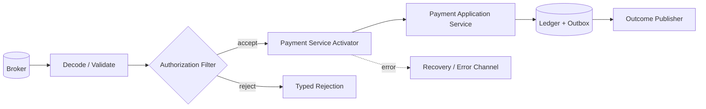

Constraints:

- Each command has `tenantId`, `paymentId`, `eventId`, `amountMinor`, and `currency`.
- Consumers may receive duplicates due to lost ACKs.
- A payment must never be captured twice.
- The payment provider has an API idempotency key, but key lifetime is finite.
- Database ledger and outbox share the same transaction.
- The handler must return a `PaymentReceipt` or typed outcome for request-reply, and can use a one-way consumer for the broker.
- Some payloads have domain errors; some errors are provider timeouts.
- Correlation must be preserved across errors/retries for reconciliation.
- Producers must not choose internal reply/error channels.

**Practical tasks:**

1. Write `PaymentApplicationService.capture(command)` with no `MessageChannel` dependency.
2. Build a Java DSL flow using `.handle(CapturePayment.class, ...)`.
3. Create a `@ServiceActivator` alternative annotated on an endpoint adapter.
4. Distinguish a handler returning `PaymentReceipt` vs. a one-way `void` handler.
5. Explain how Gateways receive replies properly, and what happens when a method returns `null`.
6. Design a stable idempotency key by tenant/payment/operation.
7. Protect against two messages for the same payment arriving concurrently using an atomic constraint.
8. Design the ledger + outbox transaction and handle post-commit publishing.
9. When an external provider succeeds but the reply is lost, why is blind retry dangerous?
10. Distinguish an invalid amount from a provider timeout in the error policy.
11. Write a standalone business service test without Spring.
12. Write an integration test sending `Message<CapturePayment>` and asserting the reply channel.
13. Test missing/wrong Java payload types at the decoder/boundary.
14. Test forged tenant headers from clients.
15. Test duplicate events via broker redelivery.
16. Test the error channel when the handler runs asynchronously.
17. Test queue pressure and slow processing times.
18. If Scatter-Gather is added, does every branch need to return a result? Why?

**Completion criteria:** Pure business method, a Service Activator that actually calls the right method, clear request-reply/one-way semantics, validation/tenant guards, safe transactions and idempotency, plus tests for happy path, errors, concurrency, and replay.

## 40. Service Activator implementation checklist

- [ ] Business operation is defined as a method with a clear name and contract.
- [ ] Service Activator acts as an adapter without stuffing all business logic into the flow.
- [ ] Spring bean/endpoint is registered and subscribed to the right input channel.
- [ ] `@ServiceActivator` or DSL `.handle(...)` is chosen according to project convention.
- [ ] No accidental registration of two competing subscribers on a `DirectChannel`.
- [ ] Handler method has no ambiguous overloads or overly broad `Object` parameter.
- [ ] Decoder/conversion guarantees payload type before the handler runs.
- [ ] Required headers come from trusted ingress and are checked for consistency.
- [ ] Clients cannot control internal `replyChannel`/`errorChannel`.
- [ ] Validation, authorization, and resource limits run before side effects.
- [ ] Business service enforces critical invariants when invoked from multiple entrypoints.
- [ ] Return value, `Message<?>` return, and `void`/`null` semantics are clear.
- [ ] Request-reply/Gateway receives at the right destination with defined timeout policies.
- [ ] One-way handlers do not sit behind a reply-requiring Gateway unless another outcome exists.
- [ ] `DirectChannel` exception propagation is tested.
- [ ] Async error publishing is configured and tested per execution context.
- [ ] Domain rejections are not conflated with infrastructure errors.
- [ ] Retries apply only to appropriate errors, with limits and backoff.
- [ ] Business idempotency key remains stable across retries/broker redelivery.
- [ ] Unique constraints/locking protect concurrent operations across multiple instances.
- [ ] Transaction boundary covers repository/outbox when sharing the same DB.
- [ ] External side effects have idempotency/reconciliation; do not assume DB rolls back remote APIs.
- [ ] Splitter/Aggregator flows preserve correlation, part identity, and expected replies.
- [ ] Fan-out subscribers have separate idempotency scopes and data permissions.
- [ ] Thread safety and backpressure fit the channel/executor.
- [ ] Metrics/traces track handler duration, success, rejection, retry, and error.
- [ ] Do not log raw `Message`/`failedMessage` containing sensitive data.
- [ ] Unit tests exist for the plain Java service method.
- [ ] Integration tests send messages to channels and observe replies.
- [ ] Tests cover invalid input, missing headers, wrong types, retries, and gateway timeouts.
- [ ] Concurrency, crash recovery, and database idempotency tests exist where needed.
- [ ] Java DSL/annotation/transaction behavior verified against actual Spring Integration and Spring Framework versions.

## Key takeaways

**A Service Activator invokes application methods from messages** by connecting an input channel to a Java method. In Spring Integration, `@ServiceActivator` and Java DSL `.handle(...)` are two ways to declare endpoints; payloads, headers, or the entire `Message<?>` can be bound to parameters per configuration/signature. A return value can produce a reply message; `void`/`null` normally produces no normal reply.

A high-quality Service Activator **keeps the business service independent of messaging**, distinguishes request-reply from one-way, never trusts raw headers/tenants from clients, and never assumes exceptions always route through `errorChannel` or that transactions roll back remote side effects. Combine validation, authorization, bounded retries, idempotency, transaction/outbox, and observability so handlers stay safe under duplicates, concurrency, and failures.

**Proper testing does not merely call the method directly in JUnit; it sends a message through the Spring Integration flow, observes the result/reply or error at the exact boundary, and proves business side effects are not executed improperly.**
