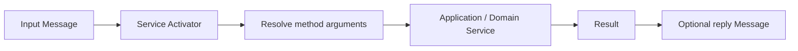
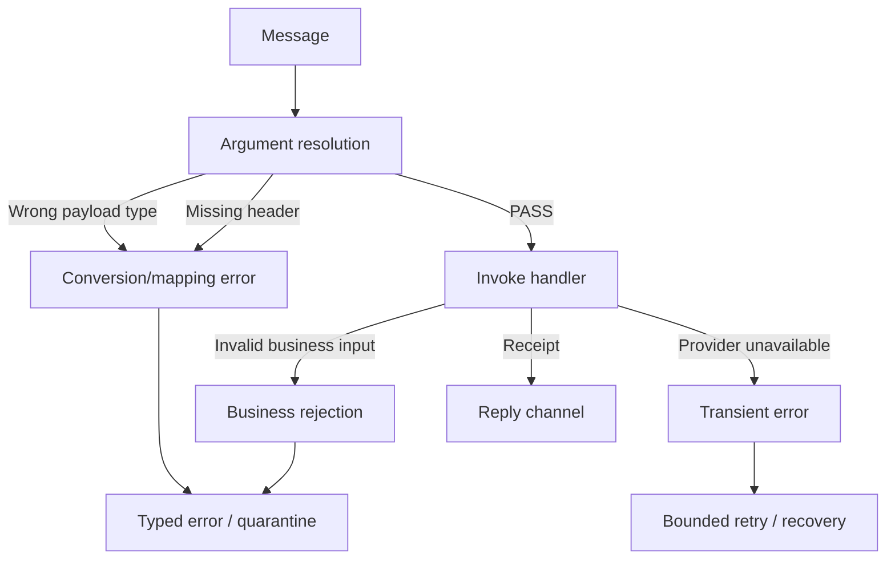
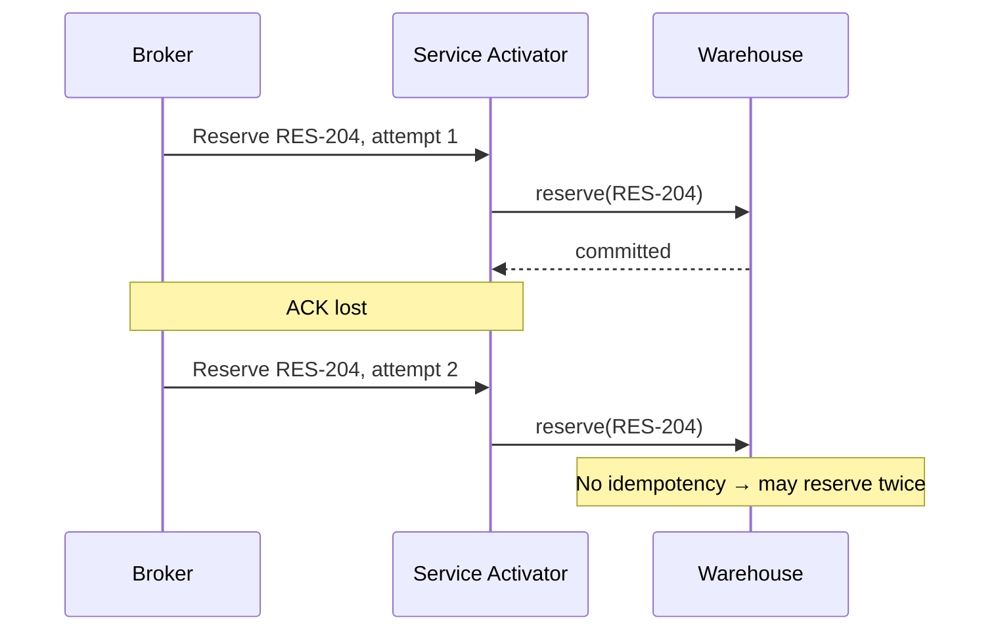

# Mapping Payloads to Method Arguments

## 1. The problem: one Message, but the method needs multiple facts

A warehouse management system receives a stock reservation command:

```text
Message<ReserveStockRequest>
  payload:
    reservationId = "RES-204"
    sku           = "SKU-RED-01"
    quantity      = 2
  headers:
    verifiedTenantId = "tenant-A"
    requestRef       = "req-701"
    traceRef         = "trace-801"
```

When a message arrives at a **Service Activator**, Spring Integration needs to know which method arguments come from the payload, which come from headers, and whether the method needs the entire `Message<?>`.

A hard-to-maintain implementation often looks like this:

```java
// Anti-pattern: mixing integration headers with business logic.
public Object reserve(Message<?> message) {
    String tenant = (String) message.getHeaders()
        .get("verifiedTenantId");
    String trace = (String) message.getHeaders()
        .get("traceRef");
    ReserveStockRequest request =
        (ReserveStockRequest) message.getPayload();

    // The business layer starts depending on Message, trace, and headers.
    return warehouse.reserve(request, tenant, trace);
}
```

A better approach is to make **argument mapping explicit at the integration boundary** and invoke a domain port using typed command/value objects.

The lesson **“Mapping Payloads to Method Arguments”** belongs to the **Service activator** chapter, module **SPRING_INTEGRATION_PATTERN**. The module teaches how to implement Enterprise Integration Patterns with Spring Integration to build loosely coupled and extensible message flows, practicing Router, Filter, Transformer, Splitter, Aggregator, Gateway, retry, error channel, correlation, and testing and observing execution branches.

After this lesson, you will be able to:

1. Distinguish passing the payload, the full `Message<T>`, individual headers, and the headers map into a method.
2. Write `@ServiceActivator` with `@Payload`, `@Header`, and `@Headers`.
3. Use Java DSL `.handle(...)` to map payload/headers into a domain command.
4. Understand errors caused by payload types, required/optional headers, and conversion.
5. Handle method results returning a payload, `Message`, or `void` for reply flows.
6. Write tests proving Spring actually resolves method arguments.
7. Keep domain logic independent of transport and trusted header naming.
8. Separate mapping from authorization, error handling, retry, and idempotency.

## 2. Service Activator in Enterprise Integration Patterns

A **Service Activator** connects a messaging system to a service/method that executes business logic. It receives a message, invokes the appropriate action, and can then emit a result message.



A method returning an object does not automatically make it a Transformer. Compare:

| Pattern | Goal | Example |
| --- | --- | --- |
| Service Activator | Connect a message to behavior/service | Reserve stock in a warehouse |
| Transformer | Change data representation | String JSON → ReserveStockRequest |
| Filter | Decide whether to continue or reject | Quantity exceeds limit |
| Router | Choose channel/branch | EXPRESS → priority |
| Gateway | Connect caller with messaging flow | API waiting for ReservationReceipt |
| Idempotent Receiver | Prevent duplicate business side effects | One reservationId does not reserve twice |
| Aggregator | Combine multiple messages into a result | Multiple line receipts → OrderSummary |

A Service Activator does not automatically guarantee transactions, retries, idempotency, or business authorization. Those are contracts that must be designed separately.

## 3. Message and argument data sources

Spring Messaging models:

```text
Message<T>
  ├── payload: T
  └── headers: MessageHeaders
        ├── id
        ├── timestamp
        ├── correlationId
        ├── requestRef
        └── verifiedTenantId
```

From a message, a method can receive:

```mermaid
flowchart TD
    M["Message<ReserveStockRequest>"] --> P["@Payload ReserveStockRequest"]
    M --> H["@Header(\"verifiedTenantId\") String"]
    M --> HS["@Headers Map<String,Object>"]
    M --> ALL["Message<ReserveStockRequest>"]
    P --> F["Handler invocation"]
    H --> F
    HS --> F
    ALL --> F
```

**This does not mean all four styles must be used together.** Each method should receive only the facts it needs. A domain method handling inventory should only know about meaningful business commands; trace IDs and broker offsets can stay in the integration layer.

## 4. Methods receiving only the payload

For a message with `ReserveStockRequest` as its payload, the simplest form is:

```java
public ReservationReceipt handle(ReserveStockRequest request) {
    return service.reserve(new ReserveStockCommand(
        "tenant-A",
        request.reservationId(),
        request.sku(),
        request.quantity()));
}
```

Spring Integration can invoke a POJO method based on its payload when the endpoint is configured accordingly. Note that hardcoding the tenant in this example is purely illustrative; production must use a trusted identity.

This style fits when:

- All business facts are already inside the payload/application command.
- The method does not need correlation/header metadata.
- The service needs to be easy to unit test.
- Upstream ingress has already converted the message into the right type.

If the input is still a `Message<String>` containing JSON, it **does not automatically become a record on its own**. A suitable converter/deserializer/Transformer is needed before invoking the handler.

## 5. Methods receiving the full `Message<T>`

An integration-facing handler can declare:

```java
import org.springframework.messaging.Message;

public ReservationReceipt handle(
        Message<ReserveStockRequest> message) {

    ReserveStockRequest request = message.getPayload();
    Object tenantValue =
        message.getHeaders().get("verifiedTenantId");

    // The adapter layer processes headers; do not pass raw Message
    // into the domain service.
    return service.reserve(
        mapToDomain(request, tenantValue));
}
```

Advantages:

- Access payload and headers together.
- Fits integration components needing correlation, sequence, or reply context.
- Can construct a reply `Message` with adapter-controlled metadata.

Disadvantages:

- The handler depends on Spring Messaging.
- Easy to confuse delivery IDs with business IDs.
- If every service accepts `Message`, the domain gradually becomes transport-coupled.
- Requires manual header casting when no typed resolver is used.

Keep `Message<T>` at the boundary; domain ports should use command/value objects.

## 6. `@Payload` maps the payload to a parameter

Annotation:

```java
import org.springframework.messaging.handler.annotation.Payload;

public ReservationReceipt handle(
        @Payload ReserveStockRequest request) {

    // request comes from inbound Message.getPayload()
}
```

When the message holds the matching type, the parameter is resolved directly. If the payload has another type, Spring may use a configured conversion service/message converter **when the handler mechanism supports it**, or fail with an error.

Do not assume:

```text
Message<String> JSON
  → @Payload ReserveStockRequest
```

will always work without a deserializer/converter.

### When mapping from multiple schemas is needed

```text
Raw JSON / Legacy DTO
    ↓ Adapter / Transformer / Normalizer
ReserveStockRequest
    ↓ Service Activator
ReservationReceipt
```

Separating the normalization step from the business handler makes schema errors easy to test and keeps the method signature stable.

### Do not split a payload into multiple arguments automatically

```java
// Avoid expecting the framework to unpack fields by parameter name.
public ReservationReceipt handle(String sku, int quantity) {
    // ...
}
```

Better:

```java
public ReservationReceipt handle(
        @Payload ReserveStockRequest request) {
    String sku = request.sku();
    int quantity = request.quantity();
    // ...
}
```

If you want to extract nested fields with expressions, rely on supported APIs/argument resolvers and test explicitly; a typed DTO is usually safer than scattered SpEL expressions.

## 7. `@Header` maps a single metadata field

```java
import org.springframework.messaging.handler.annotation.Header;

public ReservationReceipt handle(
        @Payload ReserveStockRequest request,
        @Header("verifiedTenantId") String tenantId) {
    // ...
}
```

Spring looks up the header by the declared name. When a required header is missing or cannot be resolved to the parameter type, method invocation may fail.

### Required and optional

```java
public void observe(
        @Payload ReserveStockRequest request,
        @Header("verifiedTenantId") String tenantId,
        @Header(name = "traceRef", required = false)
            String traceRef) {
    // traceRef may be null when absent.
}
```

Notes:

- `@Header("verifiedTenantId")` requires the header to be present by default.
- For optional headers, use a reference type that can accept `null`.
- Do not use `traceRef` as proof of authorization.
- Header names must match the contract exactly.
- If a header arrives with an unexpected type, do not treat successful conversion as trustworthy data.

For example, converting an integer header `42` into the String `"42"` **does not prove** the sender was granted access to tenant 42.

## 8. `@Headers` retrieves a metadata map

```java
import org.springframework.messaging.handler.annotation.Headers;
import java.util.Map;

public void inspect(
        @Payload ReserveStockRequest request,
        @Headers Map<String, Object> headers) {

    Object requestRef = headers.get("requestRef");
    Object traceRef = headers.get("traceRef");
}
```

Use this when an adapter needs multiple metadata fields or audit/tracing info. If you only need one field, a specific `@Header` is usually clearer.

Avoid passing a raw `Map<String,Object>` deep into the domain; otherwise type casts, header names, and security logic end up scattered.

Do not mutate the injected Map expecting the `Message` to change. To add or modify headers in Spring Integration, use a Header Enricher or build a new message with properly constructed headers.

## 9. How to choose an argument signature

| Need | Suggested signature | Notes |
| --- | --- | --- |
| Process a typed payload | `method(PayloadType)` | Concise and easy to test |
| Explicitly mark payload source | `method(@Payload PayloadType)` | Clear in multi-arg methods |
| Need one header | `method(@Payload P, @Header H)` | Easy to control |
| Need multiple metadata fields at integration boundary | `method(@Payload P, @Headers Map)` | Do not pull raw Map into domain |
| Handle Message-aware protocol | `method(Message<P>)` | Integration code, not default for domain |
| Use Java DSL lambda | `.handle(P.class, (payload, headers) -> ...)` | Explicit mapping in the flow |
| Invoke POJO bean method | `.handle(bean, "methodName")` | Avoid ambiguous overloads |

A multi-argument method should still have **one clear payload source**; metadata arguments should use annotations or a mapping function rather than guesswork.

## 10. End-to-end business model

Use a request for the integration flow, a command for the domain, and a receipt for the reply:

```java
record ReserveStockRequest(
        String reservationId,
        String sku,
        int quantity) {}

record ReserveStockCommand(
        String tenantId,
        String reservationId,
        String sku,
        int quantity) {}

record ReservationReceipt(
        String tenantId,
        String reservationId,
        String sku,
        String status) {}
```

- `ReserveStockRequest` is a typed payload produced by an inbound adapter or Transformer.
- `tenantId` must be obtained from trusted ingress, not from a self-asserted client header.
- `ReserveStockCommand` carries business identity and is used by the domain.
- `ReservationReceipt` does not depend on Kafka/HTTP response classes.

Domain service:

```java
import java.util.concurrent.atomic.AtomicInteger;

final class WarehouseReservationService {

    private final AtomicInteger attempts =
        new AtomicInteger();

    ReservationReceipt reserve(ReserveStockCommand command) {
        if (command == null
                || blank(command.tenantId())
                || blank(command.reservationId())
                || blank(command.sku())
                || command.quantity() <= 0
                || command.quantity() > 100) {
            throw new IllegalArgumentException(
                "Invalid reserve-stock command");
        }

        attempts.incrementAndGet();

        return new ReservationReceipt(
            command.tenantId(),
            command.reservationId(),
            command.sku(),
            "SIMULATED_RESERVED");
    }

    int attempts() {
        return attempts.get();
    }

    private static boolean blank(String value) {
        return value == null || value.isBlank();
    }
}
```

**Demo limitation:** the service only simulates reservation without a real database or provider. It does not guarantee idempotency on retry, execute transactions, or check permissions on inventory resources.

### Why doesn't the command contain the trace ID?

Trace ID is integration/observability metadata. It can stay in the message headers throughout the flow. The domain does not need it to make a reservation decision. If the business logic truly needs `actorId`, `policyVersion`, or `businessDeadline`, model them as semantic fields rather than passing a raw Header Map.

## 11. Mapper converting payload and trusted header into a domain command

```java
import java.util.Map;

final class ReservationArgumentMapper {

    private ReservationArgumentMapper() {}

    static ReserveStockCommand toCommand(
            ReserveStockRequest request,
            Map<String, Object> headers) {

        if (request == null) {
            throw new IllegalArgumentException(
                "Missing reservation payload");
        }

        Object rawTenant =
            headers.get("verifiedTenantId");

        if (!(rawTenant instanceof String tenantId)
                || tenantId.isBlank()) {
            throw new IllegalArgumentException(
                "Missing verified tenant");
        }

        return new ReserveStockCommand(
            tenantId,
            request.reservationId(),
            request.sku(),
            request.quantity());
    }
}
```

The mapper belongs at the **integration/application boundary**, not in a domain entity. It handles the source/typing of metadata, not actual authentication.

```text
Message:
  payload: ReserveStockRequest("RES-204","SKU-RED-01",2)
  verifiedTenantId: tenant-A
    ↓ ReservationArgumentMapper
ReserveStockCommand("tenant-A","RES-204","SKU-RED-01",2)
    ↓ WarehouseReservationService
ReservationReceipt
```

Unit tests on the mapper can verify missing/wrong-type headers before running a Spring context.

## 12. Java DSL `.handle(Payload.class, (payload, headers) -> ...)`

A Service Activator declared directly inside a flow:

```java
.handle(ReserveStockRequest.class,
    (request, headers) -> {
        ReserveStockCommand command =
            ReservationArgumentMapper.toCommand(
                request, headers);
        return reservationService.reserve(command);
    })
```

- `request` is the typed payload.
- `headers` is the header map/context corresponding to the incoming message.
- Mapping stays at the integration boundary.
- The domain service receives a plain Java command.
- The handler returns `ReservationReceipt`, producing a reply in the flow.

With this DSL lambda, do not put `@Payload`/`@Header` on the two lambda parameters: the `GenericHandler` type and callback already define the signature. The two declarative models are **different styles achieving the same goal**.

### Avoid overly long lambdas

Do not put business rules, queries, retries, output serialization, and security policies inside a 200-line lambda. Separate:

```text
IntegrationFlow
  → ReservationArgumentMapper
  → WarehouseReservationService
  → Outbound adapter
```

That keeps the domain easy to unit test and allows transport migration without editing business code.

## 13. Full Spring Integration Java DSL configuration


```java
import org.springframework.context.annotation.Bean;
import org.springframework.context.annotation.Configuration;
import org.springframework.integration.channel.DirectChannel;
import org.springframework.integration.channel.QueueChannel;
import org.springframework.integration.config.EnableIntegration;
import org.springframework.integration.dsl.IntegrationFlow;

@Configuration
@EnableIntegration
public class ReservationDslConfig {

    @Bean
    WarehouseReservationService warehouseReservationService() {
        return new WarehouseReservationService();
    }

    @Bean("warehouse.reserve.in")
    DirectChannel reserveInput() {
        return new DirectChannel();
    }

    @Bean("warehouse.reserve.out")
    QueueChannel reserveOutput() {
        return new QueueChannel();
    }

    @Bean
    IntegrationFlow reserveFlow(
            WarehouseReservationService service) {

        return IntegrationFlow
            .from("warehouse.reserve.in")
            .handle(
                ReserveStockRequest.class,
                (request, headers) ->
                    service.reserve(
                        ReservationArgumentMapper.toCommand(
                            request, headers)))
            .channel("warehouse.reserve.out")
            .get();
    }
}
```

Responsibilities:

1. An authorized adapter sends `Message<ReserveStockRequest>` to `warehouse.reserve.in`.
2. The `verifiedTenantId` header has already been authenticated at the adapter.
3. The Service Activator receives the payload and maps headers via the mapper.
4. The domain service returns `ReservationReceipt`.
5. The flow routes the reply to `warehouse.reserve.out`.

`DirectChannel` and `QueueChannel` here support synchronous testing. `QueueChannel` is not configured with persistence; it does not survive restarts or coordinate across multiple pods.

### Using a bean method instead of a lambda

Spring Integration DSL also supports:

```java
// Illustrates an option when a bean has a suitable public method.
.handle(reservationInboundBean, "handleReservation")
```

This is a method-invoking handler. If the bean has multiple overloads, choose distinct method names/parameters or extract a facade to avoid ambiguity.

**Do not use all approaches simultaneously.** Each endpoint should have one clear, expected execution path per message.

## 14. `@ServiceActivator` and mapping via annotations

A Spring-managed integration-facing handler can use `@Payload` and `@Header`:

```java
import org.springframework.integration.annotation.ServiceActivator;
import org.springframework.messaging.handler.annotation.Payload;
import org.springframework.messaging.handler.annotation.Header;
import org.springframework.stereotype.Component;

@Component
public class ReservationInboundHandler {

    private final WarehouseReservationService service;

    public ReservationInboundHandler(
            WarehouseReservationService service) {
        this.service = service;
    }

    @ServiceActivator(
        inputChannel = "warehouse.annotation.in",
        outputChannel = "warehouse.annotation.out")
    public ReservationReceipt handleReservation(
            @Payload ReserveStockRequest request,
            @Header("verifiedTenantId") String tenantId,
            @Header(name = "requestRef", required = false)
                String requestRef) {

        return service.reserve(new ReserveStockCommand(
            tenantId,
            request.reservationId(),
            request.sku(),
            request.quantity()));
    }
}
```

Explanation:

- `@ServiceActivator` creates an endpoint receiving/sending on the specified channels.
- `@Payload` maps the inbound payload.
- `@Header("verifiedTenantId")` extracts a required header.
- `@Header(required=false)` allows `requestRef` to be absent.
- `service.reserve(...)` only receives a typed domain command.

Configuration registering the annotated handler, **as an alternative** to the DSL example:

```java
import org.springframework.context.annotation.Bean;
import org.springframework.context.annotation.Configuration;
import org.springframework.context.annotation.Import;
import org.springframework.integration.channel.DirectChannel;
import org.springframework.integration.channel.QueueChannel;
import org.springframework.integration.config.EnableIntegration;

@Configuration
@EnableIntegration
@Import(ReservationInboundHandler.class)
public class ReservationAnnotationConfig {

    @Bean
    WarehouseReservationService warehouseReservationService() {
        return new WarehouseReservationService();
    }

    @Bean("warehouse.annotation.in")
    DirectChannel annotationInput() {
        return new DirectChannel();
    }

    @Bean("warehouse.annotation.out")
    QueueChannel annotationOutput() {
        return new QueueChannel();
    }
}
```

You can use component scanning instead of `@Import`. Do not register duplicate beans if the project already scans the same class.

**Note:** the method should be public, channel names must match, the bean must be Spring-managed, and annotation processing should be verified against your version. The two examples use two separate sets of channels and are tested in two separate Spring test contexts.

## 15. DSL vs. annotation: which should you choose?

| Aspect | Java DSL `.handle(...)` | `@ServiceActivator` |
| --- | --- | --- |
| Flow definition | Centralized in `IntegrationFlow` | Placed on a bean method |
| Payload mapping | `GenericHandler` typed lambda | Parameter resolver + `@Payload` |
| Header mapping | Header map in callback | `@Header`, `@Headers` |
| Advantages | Topology easy to read in one place | Method signature expresses contract |
| Risks | Bloated lambdas, manual header casts | Unclear overload/annotation resolution |
| Domain testing | Separate service and mapper | Separate facade and service |
| Best suited for | Multi-step flows, DSL-first projects | Annotated endpoint conventions |
| Automatic idempotency? | No | No |

**Neither approach is inherently “more correct”** if domain boundaries and failure policies are designed equally well. Choose consistently according to project conventions.

## 16. JUnit 5: testing DSL argument mapping

Place the DTOs, mapper, service, and configuration in the same package or add the corresponding imports. JUnit 5 + Spring Test + AssertJ:

```java
import static org.assertj.core.api.Assertions.assertThat;
import static org.assertj.core.api.Assertions.assertThatThrownBy;

import org.junit.jupiter.api.Test;
import org.springframework.beans.factory.annotation.Autowired;
import org.springframework.beans.factory.annotation.Qualifier;
import org.springframework.integration.channel.QueueChannel;
import org.springframework.messaging.Message;
import org.springframework.messaging.MessageChannel;
import org.springframework.messaging.support.MessageBuilder;
import org.springframework.test.context.junit.jupiter.SpringJUnitConfig;

@SpringJUnitConfig(ReservationDslConfig.class)
class ReservationDslFlowTest {

    @Autowired
    @Qualifier("warehouse.reserve.in")
    MessageChannel input;

    @Autowired
    @Qualifier("warehouse.reserve.out")
    QueueChannel output;

    @Autowired
    WarehouseReservationService service;

    private ReserveStockRequest request(
            String reservationId, int quantity) {

        return new ReserveStockRequest(
            reservationId, "SKU-RED-01", quantity);
    }

    private void send(
            ReserveStockRequest request,
            String tenantId) {

        MessageBuilder<ReserveStockRequest> builder =
            MessageBuilder.withPayload(request);

        if (tenantId != null) {
            builder.setHeader("verifiedTenantId", tenantId);
        }

        assertThat(input.send(builder
            .setHeader("requestRef", "req-" + request.reservationId())
            .build())).isTrue();
    }

    @Test
    void payloadAndHeaderBecomeDomainCommand() {
        int before = service.attempts();

        send(request("RES-204", 2), "tenant-A");

        Message<?> reply = output.receive(1_000);
        assertThat(reply).isNotNull();

        ReservationReceipt receipt =
            (ReservationReceipt) reply.getPayload();

        assertThat(receipt.tenantId()).isEqualTo("tenant-A");
        assertThat(receipt.reservationId()).isEqualTo("RES-204");
        assertThat(receipt.sku()).isEqualTo("SKU-RED-01");
        assertThat(receipt.status())
            .isEqualTo("SIMULATED_RESERVED");
        assertThat(service.attempts() - before).isEqualTo(1);
        assertThat(output.receive(0)).isNull();
    }

    @Test
    void missingVerifiedTenantNeverCallsService() {
        int before = service.attempts();

        assertThatThrownBy(() ->
            send(request("RES-205", 2), null))
            .isInstanceOf(RuntimeException.class);

        assertThat(service.attempts() - before).isZero();
        assertThat(output.receive(0)).isNull();
    }

    @Test
    void negativeQuantityIsRejected() {
        int before = service.attempts();

        assertThatThrownBy(() ->
            send(request("RES-206", -1), "tenant-A"))
            .isInstanceOf(RuntimeException.class);

        assertThat(service.attempts() - before).isZero();
        assertThat(output.receive(0)).isNull();
    }

    @Test
    void differentOperationsEachProduceReply() {
        int before = service.attempts();

        send(request("RES-207", 1), "tenant-A");
        send(request("RES-208", 1), "tenant-A");

        ReservationReceipt first =
            (ReservationReceipt) output.receive(1_000)
                .getPayload();
        ReservationReceipt second =
            (ReservationReceipt) output.receive(1_000)
                .getPayload();

        assertThat(first.reservationId()).isEqualTo("RES-207");
        assertThat(second.reservationId()).isEqualTo("RES-208");
        assertThat(service.attempts() - before).isEqualTo(2);
    }
}
```

The tests use distinct IDs to minimize state interference. When Spring Test caches the context, beans and queues can be reused; do not run these tests in parallel on the same context unless fixtures are isolated.

**Scope proven:** payload/header map properly, the handler invokes the domain and produces a reply. It does not prove real authentication, durable brokers, transactions, or exactly-once semantics.

## 17. Integration test for `@Payload` and `@Header`

Calling `handler.handleReservation(request,tenant,null)` directly **does not test the annotation resolver**, because the test itself supplies the arguments.

To verify framework mapping, send a message into the annotated channel:

```java
import static org.assertj.core.api.Assertions.assertThat;
import static org.assertj.core.api.Assertions.assertThatThrownBy;

import org.junit.jupiter.api.Test;
import org.springframework.beans.factory.annotation.Autowired;
import org.springframework.beans.factory.annotation.Qualifier;
import org.springframework.integration.channel.QueueChannel;
import org.springframework.messaging.MessageChannel;
import org.springframework.messaging.support.MessageBuilder;
import org.springframework.test.context.junit.jupiter.SpringJUnitConfig;

@SpringJUnitConfig(ReservationAnnotationConfig.class)
class ReservationAnnotationFlowTest {

    @Autowired
    @Qualifier("warehouse.annotation.in")
    MessageChannel input;

    @Autowired
    @Qualifier("warehouse.annotation.out")
    QueueChannel output;

    private void send(
            String reservationId,
            String tenantId,
            boolean withOptionalRef) {

        MessageBuilder<ReserveStockRequest> builder =
            MessageBuilder.withPayload(
                new ReserveStockRequest(
                    reservationId, "SKU-BLUE-02", 3));

        if (tenantId != null) {
            builder.setHeader("verifiedTenantId", tenantId);
        }
        if (withOptionalRef) {
            builder.setHeader("requestRef", "req-" + reservationId);
        }
        assertThat(input.send(builder.build())).isTrue();
    }

    @Test
    void annotatedParametersResolveFromMessage() {
        send("RES-301", "tenant-B", true);

        ReservationReceipt receipt = (ReservationReceipt)
            output.receive(1_000).getPayload();

        assertThat(receipt.tenantId()).isEqualTo("tenant-B");
        assertThat(receipt.reservationId()).isEqualTo("RES-301");
    }

    @Test
    void optionalHeaderCanBeAbsent() {
        send("RES-302", "tenant-B", false);

        ReservationReceipt receipt = (ReservationReceipt)
            output.receive(1_000).getPayload();

        assertThat(receipt.reservationId()).isEqualTo("RES-302");
    }

    @Test
    void missingRequiredHeaderFails() {
        assertThatThrownBy(() ->
            send("RES-303", null, true))
            .isInstanceOf(RuntimeException.class);

        assertThat(output.receive(0)).isNull();
    }
}
```

**Note:** Exceptions from argument resolvers may be wrapped by the framework. Across Spring versions, verify the root cause and that **no successful reply is emitted**, rather than coupling to a fixed exception message string.

## 18. Unit testing the domain service independently of Spring

```java
import static org.assertj.core.api.Assertions.assertThat;
import static org.assertj.core.api.Assertions.assertThatThrownBy;

import org.junit.jupiter.api.Test;

class WarehouseReservationServiceTest {

    @Test
    void validCommandReturnsReceipt() {
        WarehouseReservationService service =
            new WarehouseReservationService();

        ReservationReceipt receipt = service.reserve(
            new ReserveStockCommand(
                "tenant-A", "RES-500",
                "SKU-RED-01", 2));

        assertThat(receipt.status())
            .isEqualTo("SIMULATED_RESERVED");
        assertThat(receipt.tenantId())
            .isEqualTo("tenant-A");
        assertThat(service.attempts()).isEqualTo(1);
    }

    @Test
    void invalidQuantityCannotTriggerAttempt() {
        WarehouseReservationService service =
            new WarehouseReservationService();

        assertThatThrownBy(() ->
            service.reserve(
                new ReserveStockCommand(
                    "tenant-A", "RES-501",
                    "SKU-RED-01", -2)))
            .isInstanceOf(IllegalArgumentException.class);

        assertThat(service.attempts()).isZero();
    }
}
```

Domain tests do not import `Message<?>`, annotation resolvers, or a Spring context. This separation helps distinguish **wiring errors** from **business errors**.

## 19. Payload type mismatch and conversion

Different inputs:

```text
Message<ReserveStockRequest> → method(ReserveStockRequest)
Message<String> JSON         → needs decode/conversion
Message<LegacyReservation>   → needs version/semantics mapping
Message<Map<String,Object>>  → needs schema validation
```

Avoid arbitrary casting:

```java
ReserveStockRequest request =
    (ReserveStockRequest) message.getPayload();
```

If the payload is a `String`, a runtime cast fails. You can convert input at ingress:

```text
HTTP/Kafka adapter
    ↓ deserialize JSON/schema
Transformer/Normalizer
    ↓ ReserveStockRequest
Service Activator
    ↓ ReservationReceipt
```

If relying on `ConversionService`/`MessageConverter`, verify bean/configuration, target types, exceptions, and test with real data. **Do not assume automatic JSON-to-record mapping is always enabled.**

### Conversion vs. validation

Converting `quantity="2"` into an integer only solves representation. Business logic must still validate positive quantity, limits, and stock availability. A typed payload does not itself prove tenant permission or that the operation has not already been processed.

## 20. Overloaded methods and ambiguity

Hard-to-maintain example:

```java
ReservationReceipt handle(ReserveStockRequest request) {
    // ...
}

ReservationReceipt handle(String json) {
    // ...
}

ReservationReceipt handle(Object input) {
    // ...
}
```

If configuration invokes by method name and input types vary, ambiguity or selecting an unintended method can occur. Better:

1. Decode/normalize input into a single typed payload beforehand.
2. Name methods by use case: `reserveStock`, `parseLegacy`.
3. Use `.handle(bean,"reserveStock")` when targeting a specific method.
4. Avoid overloads differing only by annotation/header source.
5. Test subtypes, proxies, method visibility, and framework versions.
6. Do not rely on reflection order as a processing contract.

One public handler method with a single payload argument and clear header annotations is usually much easier to maintain than a set of ambiguous overloads.

## 21. Replies: returning payload, `Message`, or `void`

When a method returns a POJO:

```java
public ReservationReceipt reserve(
        @Payload ReserveStockRequest request) {
    return new ReservationReceipt(
        "tenant-A",
        request.reservationId(),
        request.sku(),
        "SIMULATED_RESERVED");
}
```

The framework creates/routes the reply message per endpoint/output-channel/Gateway semantics.

```text
Input Message<ReserveStockRequest>
    ↓ Service Activator
ReservationReceipt
    ↓ reply message
Output Message<ReservationReceipt>
```

If the method returns `Message<?>`, the integration handler can control reply headers:

```java
import org.springframework.messaging.Message;
import org.springframework.messaging.support.MessageBuilder;

public Message<ReservationReceipt> handle(
        Message<ReserveStockRequest> input) {

    ReservationReceipt receipt = new ReservationReceipt(
        "tenant-A",
        input.getPayload().reservationId(),
        input.getPayload().sku(),
        "SIMULATED_RESERVED");

    return MessageBuilder.withPayload(receipt)
        .setHeader(
            "businessOperationRef",
            input.getPayload().reservationId())
        .build();
}
```

**Do not assume all inbound headers are automatically preserved** when constructing a reply `Message` yourself or sending over a transport. Test any headers/correlation that must be preserved.

### One-way handler

```java
@ServiceActivator(inputChannel = "audit.events.in")
public void record(@Payload AuditEvent event) {
    auditService.record(event);
}
```

A `void` method produces no reply payload. If a request–reply Gateway is waiting for a response, the caller may time out unless another result path exists. Do not “fix” this with a larger timeout; design an explicit reply/ack contract.

A similar one-way DSL can use:

```java
.handle(AuditEvent.class, (event, headers) -> {
    auditService.record(event);
    return null;
})
```

Use this only in flows whose semantics truly require no reply.

## 22. Header propagation and correlation

A message has headers:

```text
requestRef = req-204
correlationId = group-101
verifiedTenantId = tenant-A
traceRef = trace-801
```

After the Service Activator, the result may need to retain `requestRef`, correlation, or trace to return to the right Gateway/caller.

However:

- Transformers or handlers building their own `Message` can alter headers.
- Kafka/AMQP/HTTP adapters have their own header mappers.
- `replyChannel`/`errorChannel` are internal objects not serializable across transports by default.
- Client-supplied headers may not be trustworthy.
- Messaging correlation IDs are not necessarily business operation IDs.

When crossing a broker, use serializable reply topics/addresses and correlation contracts. Test the real transport path, not just an in-JVM Spring `DirectChannel`.

## 23. Security: argument mapping is not authentication

A handler:

```java
@Header("tenantId") String tenantId
```

merely reads a value. If a client sends `tenantId=tenant-B`, the method can still receive that value. **Annotations do not grant authorization proof.**

Proper flow:

1. The adapter verifies the actor/producer using JWT, mTLS, ACL, or signature.
2. The adapter determines the authorized tenant/scope.
3. The adapter creates a server-owned `verifiedTenantId` on the internal message.
4. The handler only maps the trusted context into the domain command.
5. The domain/application service checks resource ownership and authorization at the point of action.
6. Never allow external callers to overwrite trusted headers.
7. Never log tokens/secrets or raw headers to error paths.
8. If permissions can change while a message waits in a queue, have a policy to re-check before side effects.

A DTO or header named `verified` does not become trusted if ingress lets senders supply it themselves.

## 24. Error handling during mapping and invocation



| Scenario | Error category | Handling |
| --- | --- | --- |
| Missing `verifiedTenantId` | Security/context | Reject; never fall back to a default tenant |
| Unsupported payload schema | Validation/conversion | Reject/quarantine |
| Wrong payload Java type | Mapping | Fix adapter/Transformer |
| Negative quantity | Domain validation | Permanent rejection |
| Warehouse DB timeout | Infrastructure | Bounded retry/alert |
| Provider outcome unknown | Reconciliation | Do not automatically issue a new operation ID |
| Duplicate `reservationId` | Idempotency | Return stored result/ACK |
| Missing reply channel | Wiring | Fix configuration/Gateway contract |
| Exception in async poller | Infrastructure | Error channel/recovery callback |

**Not every exception goes to the global `errorChannel`**. Over synchronous `DirectChannel`, exceptions can propagate to the sender. Over pollers/executors/broker listeners, error flows depend on the endpoint and container. When testing, know which thread invokes the handler and who ACKs the message.

## 25. Retry and idempotency do not arise from a correct signature alone



To handle side effects properly:

- Use a stable business ID like `reservationId`, never `MessageHeaders.ID`.
- Scope the key: `(tenantId, RESERVE_STOCK, reservationId)`.
- Use a shared ledger with unique constraints/atomic claims and states `PROCESSING`/`COMPLETED`/`UNKNOWN`.
- If the provider supports an idempotency key, send the **same key** on retry.
- If a response is ambiguous, reconcile before creating a new operation.
- Match retention to broker/DLQ replay windows.
- Use transaction/outbox when publishing events after state updates.

Mapping payloads/headers only ensures the right method is called; **it does not guarantee exactly-once processing**.

## 26. Concurrency and multi-instance

If two workers both receive `RES-204`, each instance can invoke the domain method even when the method signature is completely right. A local `ConcurrentHashMap` per pod is not enough for system-wide idempotency.

Production may need:

- A shared transactional ledger.
- Atomic key claim/unique part IDs.
- Partitioning/collocation by business key.
- Optimistic locking or atomic inventory reservation.
- Expiry/leases/fencing and recovery.
- Reconciliation for remote outcomes.
- Bounded retries with backoff and DLQ.

**Check-then-act is not atomic**: two consumers both seeing 1 item left can both reserve it without proper contention control.

## 27. Tracing and observability

Suggested log:

```text
event=service_activator_invoked
handler=ReservationInboundHandler.handleReservation
payloadType=ReserveStockRequest
tenantScope=tenant-A
operationRef=RES-204
argumentMapping=SUCCESS
resultType=ReservationReceipt
durationMs=3
```

On failure:

```text
event=service_activator_argument_error
handler=ReservationInboundHandler.handleReservation
reason=MISSING_VERIFIED_TENANT
retryable=false
```

This is a recommended application schema, not logs automatically emitted by Spring Integration.

| Metric | Role |
| --- | --- |
| `service_activator.invocations.total{handler}` | Method invocation count |
| `service_activator.mapping_errors.total{reason}` | Payload/header errors |
| `service_activator.duration{handler}` | Latency |
| `service_activator.replies.total{type}` | Reply types |
| `service_activator.domain_rejections.total{reason}` | Business errors |
| `service_activator.infrastructure_errors.total{source}` | Database/provider errors |
| `service_activator.duplicates.total` | Duplicate business operations |
| `service_activator.unknown_outcomes.total` | Remote outcomes needing reconciliation |

Do not include full payloads, tokens, trace IDs, or reservation IDs as high-cardinality metric labels. Use access-controlled logs/traces to investigate individual requests.

## 28. Troubleshooting

| Symptom | Possible cause | Resolution |
| --- | --- | --- |
| Handler does not receive DTO | Input is still String/Map | Add adapter/converter/Transformer |
| `@Header` becomes null | Header absent/optional | Check mapping and required contract |
| Wrong tenant | Client chose header | Trusted ingress + authorization |
| Method never runs | Bean not scanned/imported | Check annotations and bean registration |
| Wrong overload selected | Ambiguous method selection | Target a specific method |
| Two handlers alternate receiving messages | Multiple subscribers on same `DirectChannel` | Use publish-subscribe when broadcasting |
| Service returns object but Gateway times out | Reply channel/wiring mismatch | Test the reply contract |
| `void` handler causes Gateway timeout | No reply produced | Use one-way or explicit receipt |
| Message ID changes after Transformer | Framework creates new message | Never use technical ID as business key |
| Errors skip global `errorChannel` | Sync `DirectChannel`/adapter semantics | Check the execution model |
| Header lost after broker | Header mapper/serialization | Test real transport |
| Valid quantity reserved twice | Broker redelivery, not idempotent | Ledger/operation ID |
| Test passes alone, fails in suite | Shared `ApplicationContext`/`QueueChannel` | Isolate fixtures/context |
| Numeric header converted to string | Conversion not tied to auth | Validate trusted type first |
| AOP/transaction not applied | Proxy/method visibility | Verify proxy invocation |
| Missing output channel | Wiring/config mismatch | Context integration test |

## 29. Essential testing matrix

| Case | Expectation |
| --- | --- |
| Typed payload | Method receives expected payload |
| `@Payload` annotated | Resolved properly via channel |
| `@Header` required | Receives value or fails |
| `@Header(required=false)` | Can be absent |
| `@Headers Map` | Reads required metadata |
| Input is `Message<P>` | Handler reads payload/headers |
| Input String JSON | Must have decode/conversion |
| Wrong payload type | Rejected or handled deterministically |
| Header wrong type | Fails safely |
| Untrusted tenant header | Never treated as authorized |
| Valid DTO | Returns `ReservationReceipt` |
| Business reject | Does not produce success reply |
| Handler returns `Message` | Reply header contract honored |
| `void` handler | One-way, no reply expected |
| Gateway reply | Proper correlation and timeout |
| Method overload | Clear method selection |
| Splitter → handler | Part identity and correlation preserved |
| Broker redelivery | No repeated business effect |
| Two pods same command | Shared idempotency/atomicity |
| Provider timeout | Recovery/reconciliation |
| Async handler exception | Error flow/DLQ works |
| Transport header mapping | Required fields preserved |
| Retry after deploy | Schema/method compatibility |
| PII/secrets in headers | Never logged raw |

## 30. Practice exercises

### Exercise 1 — Choose method signatures

For three needs—processing only a DTO, needing one verified tenant header, and needing full metadata for auditing—choose respectively among `method(Payload)`, `@Payload + @Header`, `@Headers Map`, and `Message<P>`. Explain why the domain port should accept a plain Java command.

### Exercise 2 — Java DSL

Run `ReservationDslConfig`, send `ReserveStockRequest("RES-204","SKU-RED-01",2)` with `verifiedTenantId=tenant-A`. Assert `ReservationReceipt` and the domain method invocation count.

### Exercise 3 — Annotation resolver

Register `ReservationInboundHandler` and send a `Message` through `warehouse.annotation.in`. Test that `@Payload` and `@Header` resolve properly; do not merely call the handler method directly.

### Exercise 4 — Missing header

Send a request missing `verifiedTenantId`. Verify the flow fails and the domain service does not run. Try sending an `Integer` tenant header to test type validation.

### Exercise 5 — Optional header

Send `requestRef` both present and absent. Test that the handler processes the business command without requiring trace/`requestRef`; do not use those fields as idempotency keys.

### Exercise 6 — JSON conversion

Send a `Message<String>` containing JSON. Add a Transformer or `MessageConverter` to produce `ReserveStockRequest`. Test that malformed JSON and unsupported versions never reach the business handler.

### Exercise 7 — Method overloads

Create overloads `handle(String)`, `handle(ReserveStockRequest)`, and `handle(Object)`. Test varying inputs and analyze ambiguity; refactor to a single typed method plus upstream normalization.

### Exercise 8 — Request–reply vs. one-way

Create a `void` audit handler and a handler returning `ReservationReceipt`. Verify a request–reply Gateway is never configured to wait for a reply from the `void` handler.

### Exercise 9 — Reply headers

Have an integration handler return `Message<ReservationReceipt>` with `businessOperationRef`. Test header propagation/correlation while keeping the domain result independent of Spring `Message`.

### Exercise 10 — Security

The client claims `tenant-B`, while ingress authenticates `tenant-A`. Design an adapter that creates a server-owned `verifiedTenantId` and verifies resource ownership in the application service. Test that trusted headers cannot be overridden.

### Exercise 11 — Retry/idempotency

The broker redelivers `RES-204` after the warehouse committed but ACK was lost. Design a ledger keyed by `(tenantId,RESERVE_STOCK,reservationId)` and return the stored outcome instead of reserving twice.

### Exercise 12 — Async error flow

Switch the flow to an async/poller or Kafka listener. Have the handler throw a transient error; configure retry, error channel, DLQ, and observability. Do not endlessly retry a missing required header.

### Exercise 13 — Splitter/Aggregator

An order has three lines; a Splitter emits `ReserveStockRequest` items, and each Service Activator handles one part. The Aggregator releases by expected unique part IDs and trusted correlation, not by duplicate message count.

### Exercise 14 — Production runbook

Write a runbook for when, after a consumer upgrade, 20% of Messages fail argument mapping. Distinguish `String` payloads, dropped headers, method overloads, and proxy/annotation registration before changing business rules.

**Completion criteria:** learners explain which payload/header maps to which method, write mapping tests through a Spring context, keep the domain transport-independent, and distinguish invocation errors from business errors, retries, and idempotency.

## 31. Pre-production checklist

- [ ] Input payload type and schema of each channel are explicit.
- [ ] Service Activator has a focused responsibility instead of holding the entire flow.
- [ ] `@Payload`/`@Header` are used with clear intent.
- [ ] Required/optional headers, names, and types have a defined contract.
- [ ] Trusted tenant/identity is created only by authorized ingress.
- [ ] Full headers/`Message` are not passed into domain ports unnecessarily.
- [ ] JSON/legacy DTOs are converted/normalized before the handler.
- [ ] Type/semantic validation and authorization are never bypassed.
- [ ] No ambiguous method overloads exist.
- [ ] Annotated beans are properly scanned/imported by Spring.
- [ ] DSL payload/header mapping tests exist.
- [ ] Annotation-based argument resolver tests run through a `MessageChannel`.
- [ ] Domain logic has unit tests independent of Spring.
- [ ] Reply methods have an explicit output/reply channel contract.
- [ ] One-way methods do not leave a Gateway waiting forever.
- [ ] Header propagation/correlation across transports is tested.
- [ ] Error handling differentiates permanent, transient, and unknown outcomes.
- [ ] Retries are bounded with stable operation identities.
- [ ] An idempotent receiver/ledger exists for important side effects.
- [ ] Transaction/outbox/recovery exist when using external APIs or brokers.
- [ ] Multi-instance/concurrent processing is verified.
- [ ] Logs/metrics do not expose PII, tokens, or raw headers.
- [ ] Java DSL and annotation overloads are verified against project dependency versions.

## 32. Summary

**Mapping payloads to method arguments** is how Spring Integration turns a message into arguments passed to a Service Activator.

```text
Message<ReserveStockRequest>
   ├── payload → @Payload ReserveStockRequest
   ├── header  → @Header("verifiedTenantId") String
   ├── headers → @Headers Map
   └── full message → Message<ReserveStockRequest>

       Service Activator
               ↓
       Domain command
               ↓
       Application service
               ↓
       ReservationReceipt / reply Message
```

- With **`@ServiceActivator`**, mapping is expressed on method parameters.
- With **Java DSL `.handle(...)`**, the callback receives a typed payload and headers context.
- When the handler only needs business facts, pass a **typed domain command** instead of forcing it to know Kafka/HTTP headers.
- Conversion, validation, security, reply behavior, error channels, and idempotency are related contracts that **do not arise automatically just from a matching signature**.

**Use argument mapping to sharpen the boundary between messaging and business logic: read the right payload, extract only the needed headers, and invoke the domain in the domain's own language.**

## References

- [Enterprise Integration Patterns — Service Activator](https://www.enterpriseintegrationpatterns.com/patterns/messaging/MessagingAdapter.html)
- [Spring Integration Reference — Service Activator](https://docs.spring.io/spring-integration/reference/service-activator.html)
- [Spring Integration Reference — Java DSL](https://docs.spring.io/spring-integration/reference/dsl.html)
- [Spring Integration Reference — Message Transformation](https://docs.spring.io/spring-integration/reference/transformer.html)
- [Spring Integration Reference — Message Channels](https://docs.spring.io/spring-integration/reference/channel.html)
- [Spring Integration Reference — Messaging Gateways](https://docs.spring.io/spring-integration/reference/gateway.html)
- [Spring Integration Reference — Error Handling](https://docs.spring.io/spring-integration/reference/error-handling.html)
- [Spring Integration Reference — Idempotent Receiver](https://docs.spring.io/spring-integration/reference/handler-advice/idempotent-receiver.html)
- [Spring Framework — Messaging](https://docs.spring.io/spring-framework/reference/integration.html)

Examples use Java 17+, Spring Integration Java DSL, Spring Messaging annotations, and JUnit 5/AssertJ. The warehouse service only simulates reservations. In real applications, verify APIs/overloads, argument resolvers, conversion, proxies, header mapping, authentication, transactions, and retries against your project's dependencies/frameworks. This lesson belongs to STEP 4 NEW; compilation, infrastructure testing, and specialized Content QA are performed in a separate step.
