# Void Methods and Output Channels in Spring Integration Service Activators

> **Chapter:** Service activator  
> **Lesson:** Void methods and output channels  
> **Module:** `SPRING_INTEGRATION_PATTERN` — learning to implement Enterprise Integration Patterns with Spring Integration to build loosely coupled, extensible message flows; practicing Router, Filter, Transformer, Splitter, Aggregator, Gateway, retry, error channel, correlation, and testing execution branches.
>
> **Focus:** Distinguish **a handler receiving a message to perform an action with no return result** from **a handler producing a reply for an output channel**. Explain the impact of `void`, `null`, output channels, reply channels, Gateways, errors, and async execution; provide tests for each contract.

## 1. Scenario: output channel configured, yet no message appears

An application receives an order-created event and wants to record an audit entry. The developer writes:

```java
@ServiceActivator(
    inputChannel = "auditRequests",
    outputChannel = "auditResults")
public void writeAudit(OrderCreated event) {
    auditRepository.save(event);
}
```

Later, another component waits for messages on `auditResults`, yet nothing arrives. Many assume configuring `outputChannel="auditResults"` means **the framework will automatically emit something after the method finishes**. In reality, a `void` method **has no reply payload to emit**.

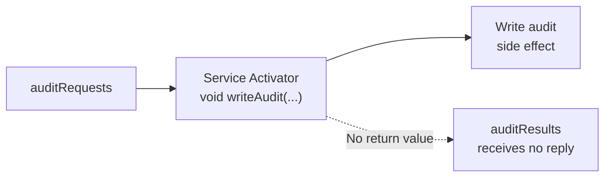

Points to remember:

- `inputChannel` specifies where the endpoint receives messages from.
- `void` indicates the method provides no return value.
- `outputChannel` specifies **the destination for a reply if the endpoint produces one**; it does not turn a `void` method into a result-emitting producer.
- Invoking a handler successfully does not mean downstream automatically receives a message.
- When a handler needs to **report a processing outcome**, design a return value/reply message or a dedicated outbound event.
- For callers using a **Messaging Gateway**, having no reply can make the call wait until timeout unless the contract is one-way or another reply path exists.

### Contrasting example

```java
@ServiceActivator(
    inputChannel = "auditRequests",
    outputChannel = "auditResults")
public AuditReceipt writeAudit(OrderCreated event) {
    auditRepository.save(event);

    return new AuditReceipt(
        event.eventId(),
        "RECORDED");
}
```

This time the method returns an `AuditReceipt` object, so the endpoint has data to send to `auditResults` per Spring Integration's reply rules.

## 2. Learning objectives

After this lesson, you will be able to:

1. Explain how a Service Activator receives and processes messages.
2. Distinguish `void`, returning `null`, returning a payload, and returning `Message<?>`.
3. Understand that input channel, output channel, and `replyChannel` have different responsibilities.
4. Avoid assuming an output channel receives messages automatically when a handler only performs side effects.
5. Write both one-way and reply-producing `@ServiceActivator` methods in Java.
6. Write the equivalent flows using Spring Integration Java DSL.
7. Test **no output** after a `void` handler using synchronous channels.
8. Test **actual output** when a handler returns `AuditReceipt`.
9. Recognize how `requiresReply` turns a missing reply into an error.
10. Distinguish completion, acknowledgement, commit, and reply.
11. Design Gateways, async channels, and error channels with accurate semantics.
12. Connect Router, Filter, Splitter, Aggregator, idempotency, transactions, and observability.
13. Build a checklist for choosing `void` vs. a return value in a production flow.

## 3. Service Activator in Enterprise Integration Patterns

A **Service Activator** is an endpoint connecting a message flow to a business-processing method/service. It turns a message into a Java method invocation and, **if the method returns a result**, can turn that result into a reply message.

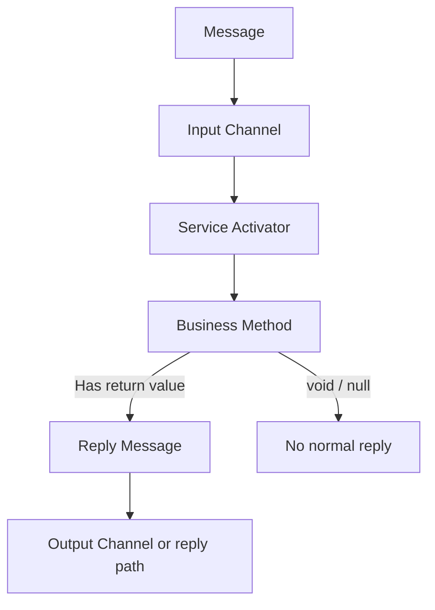

Key interpretations:

- **Message endpoint** decides which messages are dispatched to the method.
- **Service method** executes domain logic and may affect a DB/API.
- **Return value** determines whether a reply payload exists for the next stage.
- **Output channel** is the route for the reply; it is **not** a command to invent a reply.
- **Error handling** deals with exceptions or reply-required violations per configuration rather than generating a business result from a `void` method.

### How does Service Activator differ from Transformer?

| Criterion | Service Activator | Transformer |
| --- | --- | --- |
| Purpose | Invoke a service/method to execute business logic | Transform payload/message |
| Side effects | May exist; often the bridge to domain/services | Should normally be minimized |
| Return result | Can be `void` or return a value | Normally must produce output to continue transformation |
| One-way use case | Write audits, emit metrics, call non-reply services | Not typical |
| Reply use case | Produce `AuditReceipt`, `OrderResult` | Produce canonical DTO |
| Key tests | Invocation, effect, reply/no reply, errors | Payload/headers before and after |

A `void` method does not make a Service Activator “wrong”; it fits a **one-way endpoint** perfectly when no consumer awaits a reply.

## 4. Model of `Message`, `inputChannel`, `outputChannel`, and `replyChannel`

A Spring `Message` consists of:

```java
org.springframework.messaging.Message<T> {
    T getPayload();
    MessageHeaders getHeaders();
}
```

Example:

```text
Message<OrderCreated>
  payload:
    OrderCreated(eventId=EV-101, orderId=ORD-101)
  headers:
    id=runtime-uuid
    timestamp=...
    businessCorrelationId=order:ORD-101
    replyChannel=... (only when request/reply is needed)
```

### Input channel

`inputChannel` is the channel the Service Activator subscribes to / consumes from:

```text
"ordersForAudit" -> Service Activator
```

### Output channel

`outputChannel` is the channel **for replies created by the handler**, when a return value exists and the endpoint turns it into a message.

```text
Service Activator -> "auditReceipts"
```

### Reply channel in message headers

A request can carry a `replyChannel` header set by a Messaging Gateway or framework endpoint to indicate where to send replies. A reply-producing handler can use it when no fixed output channel is configured, per endpoint reply rules.

**Do not confuse the two concepts:**

- `outputChannel`: reply destination configured on the endpoint.
- `replyChannel`: reply destination attached to a specific message/request.

When an explicit output channel is configured, replies can go to that fixed route rather than the caller's header. Therefore, test real request/reply behavior whenever an endpoint sits inside a Gateway flow.

### When the return value is `void`

There is no normal return value to route, so configuring `outputChannel` or `replyChannel` **does not cause a reply to materialize**.

## 5. Semantics table for return types

| Method contract | Normal reply? | What does output channel receive? |
| --- | --- | --- |
| `void handle(OrderCreated)` | No | No message merely because the method finished |
| `Void handle(...)` returning `null` | No | No normal reply |
| `AuditReceipt handle(...)` returning object | Yes | A message with `AuditReceipt` payload |
| `Message<AuditReceipt> handle(...)` | Yes | Reply message per handler framework and header policy |
| `Object handle(...)` returning `null` | No | No normal reply |
| Handler throws exception | Not a normal reply | Exception/error flow per configuration |
| Handler sends manually to another channel and returns `void` | Message **from explicit send call** | Depends on manual send target, not return reply |
| Handler returns `CompletionStage`/reactive type | Depends on endpoint/support and async contract | Cannot be inferred from `void` |

Points to distinguish:

1. **No reply** differs from a reply with a `null` payload. Ordinary Spring `Message` instances require non-null payloads; a method returning `null` is normally treated as having no normal reply.
2. `void` does not mean exception. A one-way handler succeeding without a reply is valid when the endpoint does not require one.
3. `requiresReply=true` can turn a missing reply into an error, but **does not manufacture a result**.
4. A method returning `Message<?>` can customize reply headers; never use it to copy all external headers blindly.
5. If a handler sends to another channel as a side effect and also returns a value, it can emit **two messages** on separate paths. Keep names and contracts explicit.

## 6. One-way vs. request–reply: two different contracts

### One-way

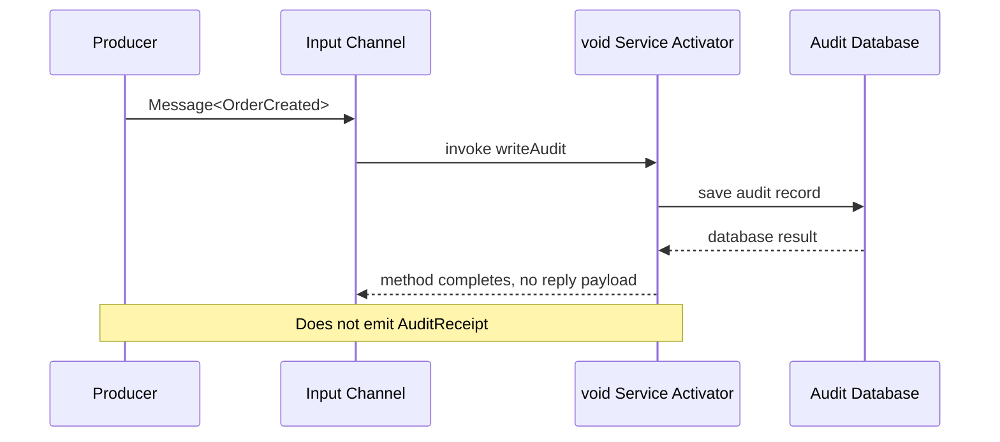

With a synchronous `DirectChannel`, the caller of `send(...)` may wait for the method to finish or catch an exception. Yet `send` returning **is not** a reply message and does not guarantee durability when a broker is involved.

### Request–reply

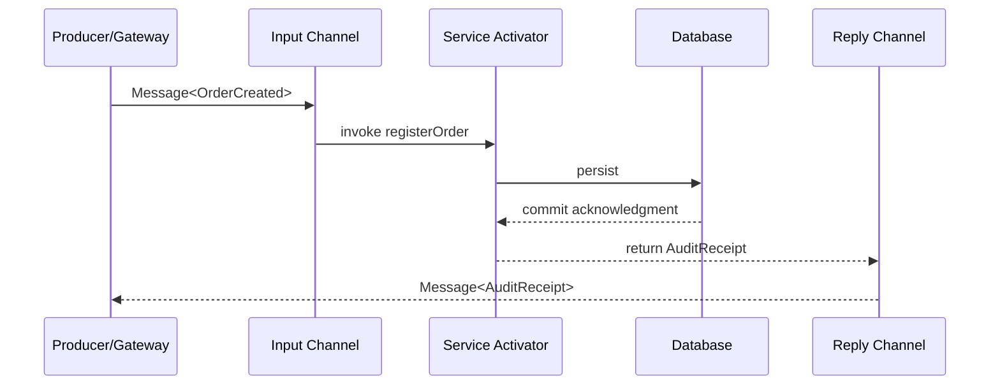

If the caller needs `AuditReceipt`, the method should return a meaningful object, or another service should emit the result over a **dedicated reply protocol**. Never try to fix this by adding `outputChannel` onto a `void` method hoping the framework creates a reply.

## 7. Design options when you do not want to return a payload

There are three common contract styles:

**A. Fire-and-forget domain event:**

```java
public void recordAudit(OrderCreated event) {
    // record audit; produce no business reply
}
```

**B. Return processing status:**

```java
public AuditReceipt recordAudit(OrderCreated event) {
    // record audit
    return new AuditReceipt(event.eventId(), "RECORDED");
}
```

**C. Return acknowledgement on external protocol, process asynchronously:**

```text
HTTP API:
  202 Accepted + operationId

Async event flow:
  void audit handler

Result store:
  GET /operations/{operationId}
```

Option C is useful when work takes time and you do not want to hold a Gateway open until the business effect finishes. `202 Accepted` means the system **accepted the request per contract**, not that the final DB effect has succeeded.

### Anti-pattern: boolean pretending to be a reply

```java
public boolean process(OrderCreated event) {
    auditRepository.save(event);
    return true;
}
```

This may work if `true` has a documented meaning. However, an ambiguous `true` reveals nothing about commits, duplicates, warnings, or reconciliation. If consumers need richer states, a typed receipt/result is clearer and easier to test.

## 8. Running use case: order audit logging

We will build a simple application:

- Producer sends `OrderCreated`.
- One-way Service Activator writes the audit and returns no reply.
- Another Service Activator does the same work **but returns a receipt**.
- Tests verify the one-way channel emits no output.
- Tests verify the reply-producing channel receives an accurate `AuditReceipt`.
- Tests verify the error path when the repository throws an exception.
- Tests examine Gateways when a reply is expected.
- Discussion covers idempotency, retries, and concurrency for the business effect.

### Domain records

```java
package example.integration;

import java.time.Instant;

public record OrderCreated(
    String tenantId,
    String orderId,
    String eventId,
    Instant occurredAt
) {
    public OrderCreated {
        if (tenantId == null || tenantId.isBlank()
                || orderId == null || orderId.isBlank()
                || eventId == null || eventId.isBlank()
                || occurredAt == null) {
            throw new IllegalArgumentException(
                "OrderCreated missing required field");
        }
    }
}
```

```java
package example.integration;

public record AuditReceipt(
    String tenantId,
    String eventId,
    String status
) {
    public AuditReceipt {
        if (tenantId == null || eventId == null
                || status == null) {
            throw new IllegalArgumentException(
                "Invalid AuditReceipt");
        }
    }
}
```

Each `public record` belongs in its own `.java` file in a real project. This lesson uses Java 17+ record syntax; for older Java versions, use immutable POJOs.

### Distinguishing business ID from message ID

`eventId` identifies a logical domain event. `MessageHeaders.id` is the ID of a Spring `Message` instance. On broker redelivery or message reconstruction, the Message ID can change; therefore, if duplicate audits must be prevented, never use the Message ID as the business idempotency key.

## 9. Fake service repository to observe side effects

Define a port so the Service Activator stays decoupled from infrastructure:

```java
package example.integration;

public interface AuditStore {
    void append(OrderCreated event);
}
```

In-memory test implementation:

```java
package example.integration;

import java.util.ArrayList;
import java.util.List;

public final class InMemoryAuditStore implements AuditStore {

    private final List<OrderCreated> records =
        new ArrayList<>();

    @Override
    public synchronized void append(OrderCreated event) {
        records.add(event);
    }

    public synchronized int count() {
        return records.size();
    }

    public synchronized List<OrderCreated> snapshot() {
        return List.copyOf(records);
    }
}
```

### Why synchronize the test store?

If you want to test multiple sender threads, `ArrayList` is not thread-safe. `synchronized` prevents races in the test fixture, yet **does not** turn this store into a database with transactions, durability, rollbacks, or multi-pod visibility.

### Why not put repository calls inside a Transformer?

`append(...)` is a business side effect, not a pure payload conversion. A Service Activator is the natural integration point between a message flow and a domain service. When data needs transformation before persistence, place a Transformer ahead of the Service Activator.

## 10. One service with two methods and different reply contracts

```java
package example.integration;

import java.util.Objects;

public final class AuditApplicationService {

    private final AuditStore store;

    public AuditApplicationService(AuditStore store) {
        this.store = Objects.requireNonNull(store);
    }

    // One-way: executes side effect without returning a reply.
    public void recordWithoutReply(OrderCreated event) {
        store.append(event);
    }

    // Request-reply: returns a payload for the output channel.
    public AuditReceipt recordWithReceipt(OrderCreated event) {
        store.append(event);

        return new AuditReceipt(
            event.tenantId(),
            event.eventId(),
            "RECORDED");
    }
}
```

Both methods perform **the same kind of side effect**, differing only in how they communicate with the message flow:

```text
recordWithoutReply:
  OrderCreated -> void

recordWithReceipt:
  OrderCreated -> AuditReceipt
```

### Important: a receipt does not prove a real commit by itself

In the `InMemoryAuditStore` example, `append` only updates a list. In production, `recordWithReceipt` should return `RECORDED` only after the business logic genuinely reaches the state promised by the contract (such as transaction commit or outbox record persistence). If the method returns a receipt before transaction commit and the commit fails, the caller receives premature confirmation.

### Regarding async methods

Do not change a signature to `void` and fire `CompletableFuture.runAsync` just to fake asynchronous processing without handling errors or transactions. An async Service Activator needs explicit executor ownership, acknowledgements, error handling, and completion semantics.

## 11. `@ServiceActivator`: declaring input and output channels

This is the classic annotation style. Declare the channels in configuration:

```java
package example.integration;

import org.springframework.context.annotation.Bean;
import org.springframework.context.annotation.Configuration;
import org.springframework.integration.channel.DirectChannel;
import org.springframework.integration.channel.QueueChannel;
import org.springframework.integration.config.EnableIntegration;
import org.springframework.messaging.MessageChannel;

@Configuration
@EnableIntegration
public class AnnotatedActivatorConfiguration {

    @Bean
    public MessageChannel voidAuditRequests() {
        return new DirectChannel();
    }

    @Bean
    public QueueChannel unusedVoidReplies() {
        return new QueueChannel();
    }

    @Bean
    public MessageChannel receiptAuditRequests() {
        return new DirectChannel();
    }

    @Bean
    public QueueChannel receiptAuditReplies() {
        return new QueueChannel();
    }

    @Bean
    public InMemoryAuditStore inMemoryAuditStore() {
        return new InMemoryAuditStore();
    }

    @Bean
    public AuditApplicationService auditApplicationService(
            InMemoryAuditStore store) {
        return new AuditApplicationService(store);
    }
}
```

We can place `@ServiceActivator` methods in a separate Spring bean, inject `AuditApplicationService`, and reference channels by name:

```java
package example.integration;

import org.springframework.integration.annotation.ServiceActivator;
import org.springframework.stereotype.Component;

@Component
public class AnnotatedAuditEndpoints {

    private final AuditApplicationService service;

    public AnnotatedAuditEndpoints(AuditApplicationService service) {
        this.service = service;
    }

    @ServiceActivator(
        inputChannel = "voidAuditRequests",
        outputChannel = "unusedVoidReplies")
    public void consumeWithoutReply(OrderCreated event) {
        service.recordWithoutReply(event);
    }

    @ServiceActivator(
        inputChannel = "receiptAuditRequests",
        outputChannel = "receiptAuditReplies")
    public AuditReceipt consumeWithReceipt(OrderCreated event) {
        return service.recordWithReceipt(event);
    }
}
```

### Points to observe

- `consumeWithoutReply` **does not** return `AuditReceipt`. `unusedVoidReplies` receives no normal reply merely because it was declared.
- `consumeWithReceipt` returns an object, so `receiptAuditReplies` receives a message when processing succeeds.
- `inputChannel` defines where messages arrive, not where results go.
- Do not name a channel `unusedVoidReplies` in a real system without reason; here it is declared to build a **test proving `outputChannel` cannot generate a reply from `void`**.

### Note on bean registration

If using `@Component`, package scanning must discover `AnnotatedAuditEndpoints`. In a test context listing only `AnnotatedActivatorConfiguration.class`, add `@Import(AnnotatedAuditEndpoints.class)` on the configuration or declare the endpoint bean explicitly; **never assume every test context scans packages automatically**.

Example test-supporting configuration:

```java
@Configuration
@EnableIntegration
@org.springframework.context.annotation.Import(
    AnnotatedAuditEndpoints.class)
public class AnnotatedActivatorConfiguration {
    // Keep the @Bean definitions above unchanged.
}
```

This adds an annotation to the configuration above—do not declare **two** classes with the same name in one project.

## 12. Why doesn't `outputChannel` turn `void` into a reply?

The right mental model is a conditional pipeline:

```text
Input Message
    |
    v
Invoke Service Method
    |
    +-- returns AuditReceipt ---> build reply -> outputChannel
    |
    +-- returns void/null ------> no reply value
```

`outputChannel` answers **“where should the reply go?”**, not **“what reply should be invented?”**.

An implementation may allow a handler to return a full Spring `Message<?>` or a plain payload. Even when the framework wraps a returned object into a message, it cannot invent a meaningful `AuditReceipt` if the method returns nothing.

### Same side effect, different message semantics

```text
void recordAudit(OrderCreated):
  database write = 1
  normal reply = 0

AuditReceipt recordAudit(OrderCreated):
  database write = 1
  normal reply = 1
```

That expectation applies to a single input in a synchronous demo, not as an exactly-once guarantee under broker redelivery.

### What if `@SendTo` is used?

Result-routing annotations do not magically give a `void` method a result. Check the actual endpoint API/flow configuration; never infer reply behavior merely from an annotation name.

## 13. Java DSL: one-way flows and reply-producing flows

Spring Integration Java DSL lets you describe pipelines directly inside `@Configuration`.

### 13.1. One-way flow ending at a `void` handler

```java
package example.integration;

import org.springframework.context.annotation.Bean;
import org.springframework.context.annotation.Configuration;
import org.springframework.integration.channel.DirectChannel;
import org.springframework.integration.channel.QueueChannel;
import org.springframework.integration.config.EnableIntegration;
import org.springframework.integration.dsl.IntegrationFlow;
import org.springframework.messaging.MessageChannel;

@Configuration
@EnableIntegration
public class AuditDslConfiguration {

    @Bean
    public MessageChannel voidDslInput() {
        return new DirectChannel();
    }

    @Bean
    public MessageChannel receiptDslInput() {
        return new DirectChannel();
    }

    @Bean
    public QueueChannel receiptDslOutput() {
        return new QueueChannel();
    }

    @Bean
    public InMemoryAuditStore auditStore() {
        return new InMemoryAuditStore();
    }

    @Bean
    public AuditApplicationService auditService(
            InMemoryAuditStore store) {
        return new AuditApplicationService(store);
    }

    @Bean
    public IntegrationFlow auditOneWay(
            AuditApplicationService service) {

        return IntegrationFlow.from("voidDslInput")
            .handle(service, "recordWithoutReply")
            .get();
    }

    @Bean
    public IntegrationFlow auditWithReply(
            AuditApplicationService service) {

        return IntegrationFlow.from("receiptDslInput")
            .handle(service, "recordWithReceipt")
            .channel("receiptDslOutput")
            .get();
    }
}
```

These are two entry points for two distinct contracts:

```text
voidDslInput
  -> recordWithoutReply(OrderCreated)
  -> end of one-way flow

receiptDslInput
  -> recordWithReceipt(OrderCreated)
  -> receiptDslOutput (AuditReceipt)
```

### Why does the one-way flow omit `.channel(...)` at the end?

Because a `void` handler is an endpoint that **produces no normal reply**, placing an output stage right after it would create a dead pipe or cause configuration confusion. The clearest DSL style is to let a one-way flow **terminate at the handler**.

To see the exact case where **`outputChannel` is declared yet no reply arrives**, refer to `@ServiceActivator(inputChannel=..., outputChannel=...)` in section 11 and its test in section 16.

### How to produce output after a `void` operation if needed?

- Return an `AuditReceipt` from the service method.
- Replace the one-way handler with an explicit reply-producing adapter/handler.
- Run a separate downstream step after the effect finishes by explicitly forwarding the **input message** through a designed flow (e.g., pub/sub or wire tap), rather than relying on a reply from `void`.
- Emit an independent event via an outbound gateway/adapter/outbox with its own semantics and idempotency.

Do not assume the DSL automatically propagates the input payload past `.handle(...)` when the handler returns no result.

## 14. Comparing `@ServiceActivator` and Java DSL `.handle(...)`

Both approaches implement the same EIP using different configuration styles.

| Aspect | Annotation | Java DSL |
| --- | --- | --- |
| Declare input | `@ServiceActivator(inputChannel="...")` | `IntegrationFlow.from(...)` |
| Bind service method | Annotation on method | `.handle(service, "method")` |
| Output | `outputChannel="..."` | `.channel("...")` when a reply exists |
| Read multi-step pipeline | Multiple endpoint declarations | Chained DSL stages |
| Void semantics | No normal reply | No normal reply |
| Return payload | Reply produced if handler supports it | Subsequent stages can be chained after handler |
| Testing | Verify listener/channel wiring | Verify `IntegrationFlow` beans |

### When to use annotations?

When services are small, a single endpoint maps directly to one method, and no long pipeline is needed.

### When to use DSL?

When composing validation → Router/Filter/Transformer → Service Activator → response channel in a readable flow with clear branches.

### A common configuration mistake

Do not accidentally register **the same handler** on **the same input channel** with both annotations and DSL. On a `DirectChannel` with multiple subscribers, dispatch normally sends each message to one selected subscriber, not “every handler runs”; if you want fan-out, use a `PublishSubscribeChannel` or Recipient List as required.

## 15. Designing integration tests: measure both effect and output

To prove `void` creates no reply, checking the output channel alone is not enough. If the input was never received, output would also be empty, making the test meaningless.

A reliable test needs three pieces of evidence:

1. **The message reached the endpoint.**
2. **The simulated side effect ran once** in the test.
3. **No normal reply** appeared on the output channel.

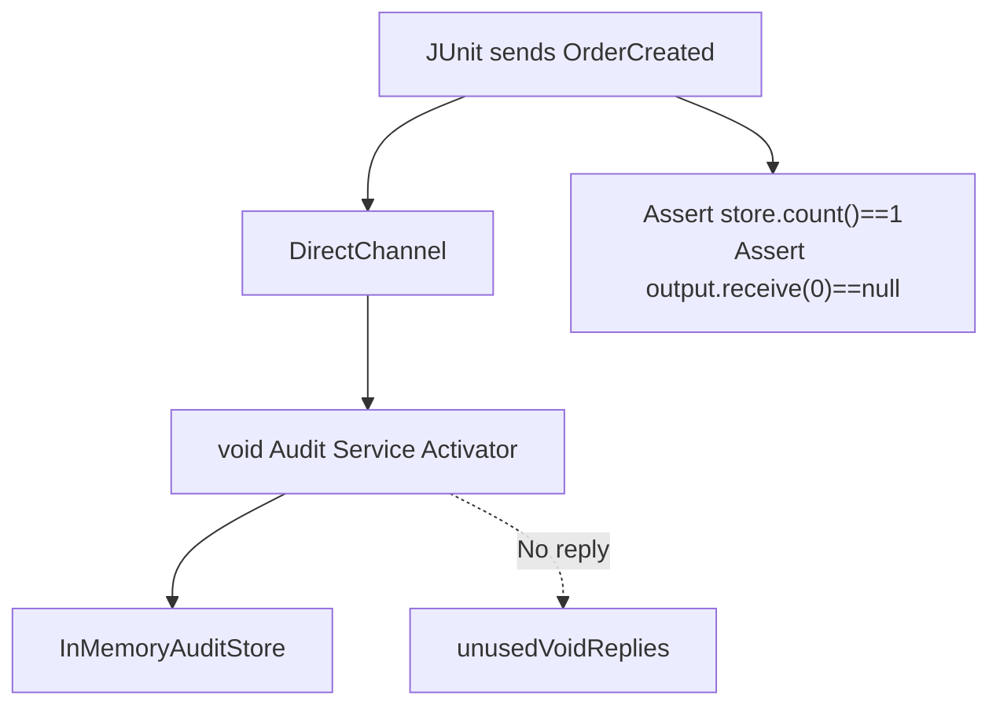

### Why use `DirectChannel`?

In synchronous examples, `DirectChannel.send(...)` dispatches to the handler on the sending thread; once it returns without exception, we can inspect the store immediately. `QueueChannel.receive(0)` is appropriate to verify **no message is waiting in the queue at that moment**.

If switched to an `ExecutorChannel` or broker, a single `receive(0)` before processing finishes does not prove the handler emits no reply; use latch/completion synchronization, timeouts, and metrics or effect state.

### What this test does not prove

- No duplicates under broker redelivery.
- Real durable database commits.
- Producer transport ACKs.
- Gateways waiting for replies completing per contract.
- Absence of late outputs from async handlers.

Those aspects are analyzed in later sections.

## 16. JUnit 5: `void` method runs while output channel remains empty

Use the annotation configuration from section 11 after adding `@Import(AnnotatedAuditEndpoints.class)` to `AnnotatedActivatorConfiguration`.

```java
package example.integration;

import static org.junit.jupiter.api.Assertions.*;

import java.time.Instant;

import org.junit.jupiter.api.Test;
import org.springframework.beans.factory.annotation.Autowired;
import org.springframework.beans.factory.annotation.Qualifier;
import org.springframework.integration.channel.QueueChannel;
import org.springframework.messaging.MessageChannel;
import org.springframework.messaging.support.MessageBuilder;
import org.springframework.test.annotation.DirtiesContext;
import org.springframework.test.context.junit.jupiter.SpringJUnitConfig;

@SpringJUnitConfig(AnnotatedActivatorConfiguration.class)
@DirtiesContext(
    classMode = DirtiesContext.ClassMode.AFTER_EACH_TEST_METHOD)
class VoidServiceActivatorTest {

    @Autowired
    @Qualifier("voidAuditRequests")
    MessageChannel voidInput;

    @Autowired
    @Qualifier("unusedVoidReplies")
    QueueChannel unusedReplies;

    @Autowired
    @Qualifier("receiptAuditRequests")
    MessageChannel receiptInput;

    @Autowired
    @Qualifier("receiptAuditReplies")
    QueueChannel receipts;

    @Autowired
    InMemoryAuditStore store;

    private OrderCreated order() {
        return new OrderCreated(
            "shop-01",
            "ORD-101",
            "EV-101",
            Instant.parse("2026-11-21T08:30:00Z"));
    }

    @Test
    void voidMethodExecutesSideEffectButSendsNoReply() {
        assertTrue(voidInput.send(
            MessageBuilder.withPayload(order()).build()));

        assertEquals(1, store.count());
        assertEquals(order(), store.snapshot().get(0));

        // The output channel is declared in the annotation,
        // yet the void method returns no payload to send there.
        assertNull(unusedReplies.receive(0));
    }
}
```

### Analyzing the assertions

- `voidInput.send(...)` returns true here because `DirectChannel` has a subscriber and dispatched the message. This is **not** confirmation of a broker ACK or durable commit.
- `store.count()==1` shows the handler executed the simulated side effect.
- `unusedReplies.receive(0)==null` shows the endpoint emitted no normal reply in this configuration.
- The test sends a single message and does not assume exactly-once behavior under redelivery.
- `@DirtiesContext` isolates queues and stores between tests.

### A misleading test

```java
assertNull(unusedReplies.receive(0));
```

if executed **before sending a message** proves nothing about `void` semantics. Always verify side effects or invocation counts after a successful send.

## 17. JUnit 5: method returning `AuditReceipt` produces a reply

Add the following method to `VoidServiceActivatorTest`:

```java
@Test
void returnedReceiptIsDeliveredToOutputChannel() {
    assertTrue(receiptInput.send(
        MessageBuilder.withPayload(order()).build()));

    org.springframework.messaging.Message<?> output =
        receipts.receive(1_000);

    assertNotNull(output);
    assertInstanceOf(
        AuditReceipt.class, output.getPayload());

    AuditReceipt receipt =
        (AuditReceipt) output.getPayload();

    assertEquals("shop-01", receipt.tenantId());
    assertEquals("EV-101", receipt.eventId());
    assertEquals("RECORDED", receipt.status());

    assertEquals(1, store.count());
    assertNull(receipts.receive(0));
}
```

### Why is this control comparison necessary?

Same input event, same service/store, yet:

- `void`: side effect executes, output channel receives **no** normal reply.
- `AuditReceipt`: side effect executes, output channel receives **one** reply.

This contrast helps diagnose bugs when a developer sets `outputChannel` but forgets a return value: the channel stays empty not because of a Router, Filter, or broker, but because of **the handler's contract**.

### Do not emit receipts “just in case”

If downstream does not consume the receipt, one-way may be better. Do not emit millions of unnecessary success receipts that add queue/broker overhead. Only produce results when a business contract requires them.

## 18. Java DSL integration test for both flow types

Verify DSL bean wiring independently of annotations:

```java
package example.integration;

import static org.junit.jupiter.api.Assertions.*;

import java.time.Instant;

import org.junit.jupiter.api.Test;
import org.springframework.beans.factory.annotation.Autowired;
import org.springframework.beans.factory.annotation.Qualifier;
import org.springframework.integration.channel.QueueChannel;
import org.springframework.messaging.Message;
import org.springframework.messaging.MessageChannel;
import org.springframework.messaging.support.MessageBuilder;
import org.springframework.test.annotation.DirtiesContext;
import org.springframework.test.context.junit.jupiter.SpringJUnitConfig;

@SpringJUnitConfig(AuditDslConfiguration.class)
@DirtiesContext(
    classMode = DirtiesContext.ClassMode.AFTER_EACH_TEST_METHOD)
class AuditDslFlowTest {

    @Autowired
    @Qualifier("voidDslInput")
    MessageChannel voidInput;

    @Autowired
    @Qualifier("receiptDslInput")
    MessageChannel receiptInput;

    @Autowired
    @Qualifier("receiptDslOutput")
    QueueChannel output;

    @Autowired
    InMemoryAuditStore store;

    private OrderCreated order(String eventId) {
        return new OrderCreated(
            "shop-01",
            "ORD-101",
            eventId,
            Instant.parse("2026-11-21T08:30:00Z"));
    }

    @Test
    void oneWayDslFlowTerminatesAfterVoidHandler() {
        assertTrue(voidInput.send(
            MessageBuilder.withPayload(
                order("EV-VOID")).build()));

        assertEquals(1, store.count());

        // The receipt flow is a separate endpoint;
        // one-way input produces no output here.
        assertNull(output.receive(0));
    }

    @Test
    void replyDslFlowEmitsReceipt() {
        assertTrue(receiptInput.send(
            MessageBuilder.withPayload(
                order("EV-REPLY")).build()));

        Message<?> reply = output.receive(1_000);
        assertNotNull(reply);
        assertInstanceOf(
            AuditReceipt.class, reply.getPayload());

        assertEquals(
            "EV-REPLY",
            ((AuditReceipt) reply.getPayload()).eventId());

        assertEquals(1, store.count());
        assertNull(output.receive(0));
    }
}
```

### Be careful interpreting the one-way DSL test

In `AuditDslConfiguration`, `receiptDslOutput` is wired **only to `receiptDslInput`**. The one-way test confirms the void branch sends nothing into the receipt flow. The stronger test for **declaring `outputChannel` on the `void` endpoint itself** is the annotation test in section 16.

### When using `ExecutorChannel`

If `voidDslInput` is changed to an `ExecutorChannel`, `send` may return before the handler finishes. Checking `store.count()==1` immediately after `send` becomes flaky. Use fixture synchronization/latches instead of `Thread.sleep`. That concerns **channel dispatch semantics**, without changing the fact that `void` produces no normal reply.

## 19. Methods returning `null`: same reply outcome, different signature

A method declared to return an object can still return `null`:

```java
public AuditReceipt handlePossiblySkipped(
        OrderCreated event) {

    if (event.orderId().startsWith("SKIP-")) {
        return null;
    }

    return new AuditReceipt(
        event.tenantId(),
        event.eventId(),
        "RECORDED");
}
```

If a handler returns `null` and the endpoint does not require a reply, normally **no normal reply is sent**. However, there is an important **programmatic distinction** compared to `void`:

- `void`: the contract states the handler is not expected to provide a result.
- Nullable `AuditReceipt`: the contract may or may not produce a result depending on the branch.
- Returning `null` sometimes acts as an implicit “filter/drop,” but if business rejection is meant, define an explicit Filter, error outcome, or typed result.

### Why do `null` replies easily cause bugs?

A Gateway may be waiting for output. If the handler returns `null` because data was invalid, the caller sees only a timeout instead of receiving a meaningful error or validation outcome.

### Remedies

- For invalid data: throw a classified exception, or return `OrderRejected`/`ProcessingResult`.
- For messages that do not need processing: put a Filter before the handler with a logged discard policy.
- For one-way workflows: keep the method `void` and never put a synchronous reply-waiting Gateway in front of it.
- For optional business responses: define explicit states `SKIPPED`/`RECORDED`/`FAILED`.

## 20. When `requiresReply` is enabled

Several reply-producing endpoints in Spring Integration support a `requiresReply` setting. When enabled, the endpoint refuses to accept `null` returns when the contract requires a reply.

```text
Handler returns null
  -> requiresReply=false: no normal reply
  -> requiresReply=true: reply-required failure
```

For a `void` method, setting `requiresReply=true` does not “force the framework to invent a reply”; it can raise an error when the handler yields no result.

### Proper interpretation

- `requiresReply` is a **contract assertion**.
- It surfaces unexpected null-return bugs early.
- It does not automatically forward the original event to the output channel.
- Exceptions follow the endpoint/channel error mechanism, not a success reply.

### Design example

An order-validation service must always produce a `ValidationDecision`:

```java
public ValidationDecision validate(OrderCreated event) {
    // return ACCEPTED/REJECTED; never null.
}
```

When a pipeline/gateway requires a reply, enable reply-required mode on the endpoint if supported by your API/version, and test that the null path fails explicitly.

### Do not enable `requiresReply` on a legitimate one-way handler

`AuditApplicationService.recordWithoutReply` is intentionally one-way; enabling required replies turns a valid success into a failure. Design the flow properly before adding constraints.

### Note on version APIs

How `requiresReply` is configured can vary by endpoint type or Java DSL builder/version. Here the exercise focuses on semantics; in a real project, check the API/configuration on your actual dependency version and verify with integration tests.

## 21. Reply payload vs. reply `Message`

A handler can return a payload:

```java
public AuditReceipt recordWithReceipt(OrderCreated event) {
    return new AuditReceipt(
        event.tenantId(),
        event.eventId(),
        "RECORDED");
}
```

Or return a full Spring `Message`:

```java
public org.springframework.messaging.Message<AuditReceipt>
        recordWithReceiptMessage(OrderCreated event) {

    AuditReceipt receipt = new AuditReceipt(
        event.tenantId(),
        event.eventId(),
        "RECORDED");

    return org.springframework.messaging.support.MessageBuilder
        .withPayload(receipt)
        .setHeader(
            "businessCorrelationId",
            "order:" + event.tenantId()
                + ":" + event.orderId())
        .setHeader("receiptSchemaVersion", 1)
        .build();
}
```

### When to return a `Message`?

When the reply requires explicit headers beyond the payload, such as `businessCorrelationId`, `receiptSchemaVersion`, or custom status markers.

### Risks when building a new `Message`

- Failing to preserve reply/error context needed by a Gateway.
- Copying headers from untrusted sources.
- Overwriting an Aggregator's `correlationId`.
- Carrying stale channel objects across a broker.
- Losing idempotency identity if source event IDs lived only in headers.
- Treating a fresh `MessageHeaders.id` as a brand-new business event.

Define an explicit **header contract** instead of blindly copying raw `MessageHeaders`.

## 22. Emitting downstream events without returning a reply

A `void` Service Activator can invoke a separate service that publishes business events:

```java
public void approveAndPublish(OrderCreated event) {
    orderService.approve(event);
    eventPublisher.publish(
        new OrderApproved(event.orderId()));
}
```

In this case:

- Normal reply from the method: **none**.
- Message/event sent by `eventPublisher.publish(...)`: **may exist**.
- That is an **explicit side effect**, not a reply generated by the Service Activator framework.
- If the publisher sends before DB transaction commit, the event might be published while business state rolls back.
- If the DB commits and publishing fails, the event may be lost.

### Recommendation: transactional outbox

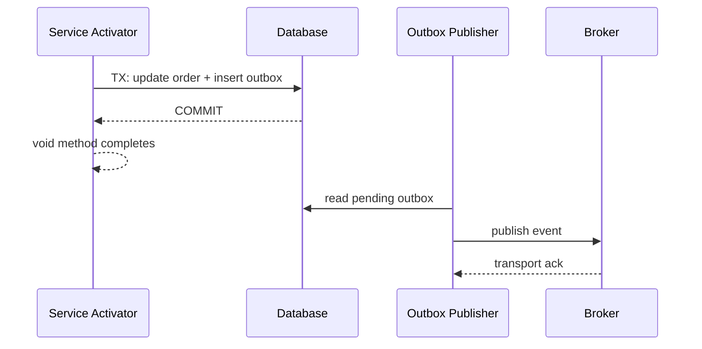

**You do not need to turn a `void` method into a return-producing method just to emit a domain event.** Distinguish:

- *Reply:* response to the current request.
- *Domain event:* announcement of a business fact to downstream subscribers.
- *ACK:* transport delivery acknowledgement.
- *Commit:* side effect durably persisted.

Each has its own lifecycle, failure modes, and idempotency requirements.

## 23. Can a Gateway wait for a reply from a `void` Service Activator?

A Messaging Gateway exposes a request/reply Java interface:

```java
public interface OrderAuditGateway {
    AuditReceipt record(OrderCreated event);
}
```

This interface **promises callers** the method returns an `AuditReceipt`. If the flow behind the Gateway invokes a `void` Service Activator and nothing else produces a reply, the Gateway has no result to fulfill the contract.

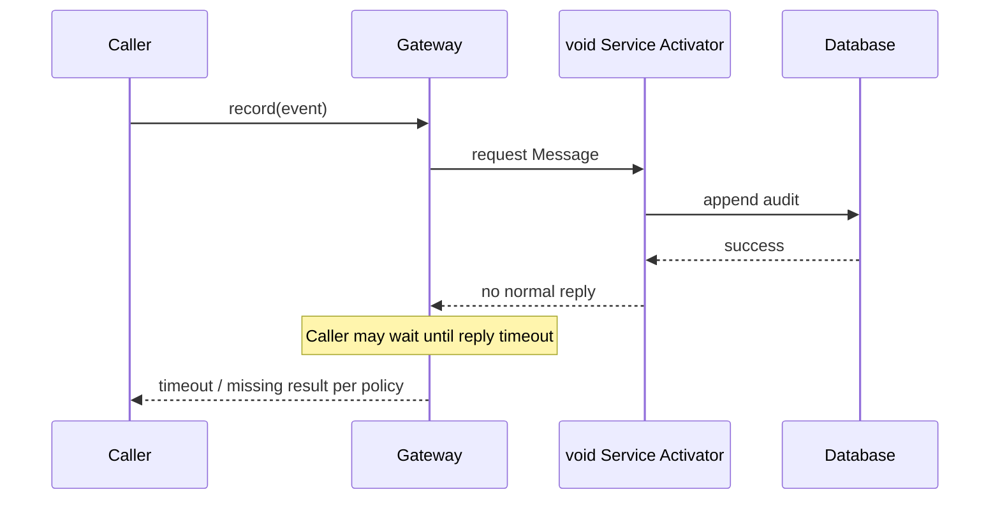

### Why does the Gateway time out even when the DB write succeeded?

Because **reply lifecycle differs from effect lifecycle**:

- The handler ran and may have committed to the DB.
- The handler returned no result.
- The Gateway is waiting for a reply to return to the caller.
- No reply ⇒ timeout or failure per gateway contract.
- Caller retries after timeout can execute the business effect a second time without idempotency.

This is one of the most common sources of duplicate events: **the effect succeeded, yet the caller thinks the operation failed**.

### Proper designs

**If a synchronous result is needed:**

```text
Gateway -> AuditReceipt-returning Service Activator
        -> replyChannel back to caller
```

**If only sending a one-way command:**

```text
One-way gateway / message sender
        -> void Service Activator
        -> effect
        -> no business reply awaited
```

**If processing takes a long time:**

```text
HTTP/Gateway -> Accepted(operationId)
Async command -> void handler
Result store -> caller polling/callback
```

Do not turn a `void` method into `AuditReceipt` merely to mask a timeout without a clear commitment of what the receipt represents.

## 24. Using dynamic `replyChannel` instead of a fixed output channel

A Gateway usually needs replies delivered to the channel attached to the request. If a Service Activator returns a value yet has a **fixed output channel pointing away from the Gateway**, the caller can still time out.

### Two routing styles

```text
Explicit output channel:
  @ServiceActivator(outputChannel="auditResults")
  -> reply goes to auditResults

Dynamic request reply:
  MessageHeaders.REPLY_CHANNEL = callerReplyChannel
  @ServiceActivator(inputChannel="auditRequests")
  -> reply goes to callerReplyChannel (when no fixed output is set)
```

Verify actual precedence rules in your Spring Integration endpoint/version, and by design avoid having **two competing reply targets** without an explicit policy.

### Dynamic test with a result-returning method

Use an ad-hoc channel as the reply destination:

```java
org.springframework.integration.channel.QueueChannel callerReply =
    new org.springframework.integration.channel.QueueChannel();

Message<OrderCreated> request =
    MessageBuilder.withPayload(order())
        .setHeader(
            org.springframework.messaging.MessageHeaders.REPLY_CHANNEL,
            callerReply)
        .build();

// Send request to an endpoint returning AuditReceipt
// WITHOUT a fixed outputChannel configured.
assertTrue(dynamicReceiptInput.send(request));

Message<?> reply = callerReply.receive(1_000);
assertNotNull(reply);
assertInstanceOf(AuditReceipt.class, reply.getPayload());
```

This is a **fragment**: `dynamicReceiptInput` must be wired to a reply-producing Service Activator with no fixed output channel.

### Same test with `void`

```java
org.springframework.integration.channel.QueueChannel callerReply =
    new org.springframework.integration.channel.QueueChannel();

Message<OrderCreated> request =
    MessageBuilder.withPayload(order())
        .setHeader(
            org.springframework.messaging.MessageHeaders.REPLY_CHANNEL,
            callerReply)
        .build();

assertTrue(dynamicVoidInput.send(request));

// The void handler finishes without emitting a normal reply.
assertNull(callerReply.receive(0));
```

This is also a fragment requiring `dynamicVoidInput` wired to a void endpoint. It shows that **having `replyChannel` on the request does not turn `void` into a response**.

### Trust boundary note

A Spring `replyChannel` object is only valid within an appropriate runtime/context. Never accept a raw `replyChannel` header from an HTTP client and treat it as authority to pick an internal destination. Across brokers, use protocol-level reply destinations and correlation IDs rather than serializing Java channel objects.

## 25. When a `void` method throws an exception, what does the output channel receive?

Suppose the repository fails:

```java
public void recordWithoutReply(OrderCreated event) {
    store.append(event); // throws IllegalStateException
}
```

The result is an **exception/error path**, not a normal business reply.

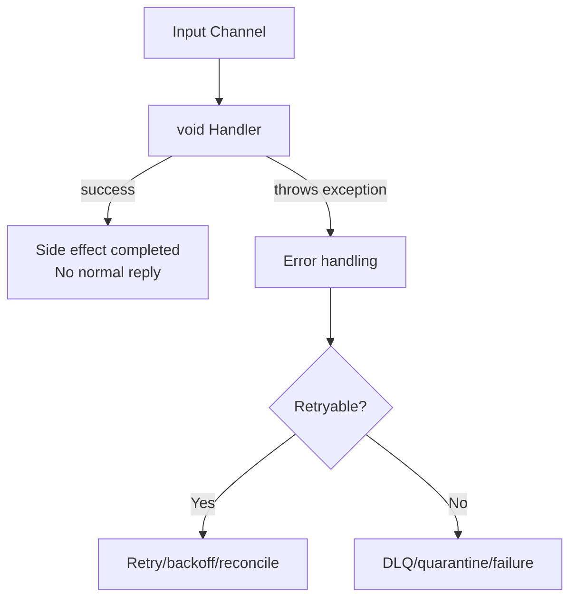

### In synchronous `DirectChannel`

Exceptions from the handler can propagate/wrap up to the thread calling `send(...)`. Caller code must inspect error types/causes rather than assuming `send(...)` returning `false` is the only error signal.

### In `ExecutorChannel` or async adapters

The handler can run on an executor or listener thread. Exceptions may be converted into `ErrorMessage` and sent to a configured `errorChannel`. Depending on the adapter, this also affects ACK/requeue/retry behavior.

**Do not assume** all exceptions across every topology automatically go to the global `errorChannel`.

### Error channel vs. output channel

| Channel | Purpose |
| --- | --- |
| `outputChannel` | Receives **normal replies** produced by the handler |
| `replyChannel` | Receives replies for a specific request |
| `errorChannel` | Receives errors per integration error-handling contract |
| `discardChannel` | Receives messages discarded by a Filter if configured |
| `deadLetterChannel`/DLQ | Stores failed events after retry policy exhaustion |

A `void` handler can emit zero normal output **and** still need an error channel to observe exceptions.

## 26. Unit testing a thrown error instead of a reply

We can create an `AuditStore` that always fails:

```java
package example.integration;

public final class FailingAuditStore implements AuditStore {

    @Override
    public void append(OrderCreated event) {
        throw new IllegalStateException(
            "Simulated storage failure");
    }
}
```

Pure service test:

```java
@Test
void voidHandlerPropagatesFailureFromStore() {
    AuditApplicationService service =
        new AuditApplicationService(
            new FailingAuditStore());

    OrderCreated input = new OrderCreated(
        "shop-01", "ORD-X", "EV-X",
        java.time.Instant.parse("2026-11-21T08:30:00Z"));

    IllegalStateException error =
        assertThrows(IllegalStateException.class, () ->
            service.recordWithoutReply(input));

    assertEquals(
        "Simulated storage failure",
        error.getMessage());
}
```

### To test a real `errorChannel`

Write a dedicated integration test with an async endpoint or adapter wired to an `errorChannel`, send a message, and assert the `ErrorMessage` carries the right exception/cause. A one-way `DirectChannel` test without an error flow configured is **insufficient** to prove the global error channel receives messages.

### Never treat exceptions as implicit reply payloads

If callers need `AuditFailed` as a business result, design an explicit handler/exception translator. Never catch all errors and return `"FAILED"` while ignoring idempotency, rollback, or transaction state.

## 27. Async channels: no reply vs. not yet completed are two different things

When using `ExecutorChannel`, the sending thread may continue before the handler finishes.

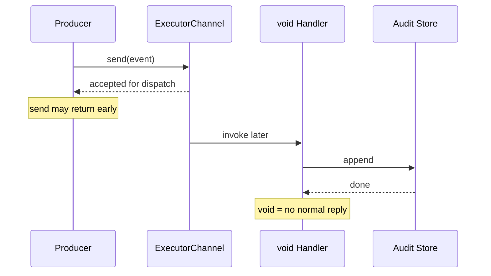

### Common testing mistake

```java
input.send(message);
assertEquals(1, store.count());
```

Right after `send`, the handler may not have run yet if the executor dispatches asynchronously. This assertion is flaky.

### Use a latch in the test fixture

Example test store signaling completion:

```java
package example.integration;

import java.util.concurrent.CountDownLatch;
import java.util.concurrent.TimeUnit;
import java.util.concurrent.atomic.AtomicInteger;

public final class LatchingAuditStore implements AuditStore {

    private final CountDownLatch completed =
        new CountDownLatch(1);

    private final AtomicInteger invocations =
        new AtomicInteger();

    @Override
    public void append(OrderCreated event) {
        invocations.incrementAndGet();
        completed.countDown();
    }

    public boolean awaitOne(long timeoutMillis)
            throws InterruptedException {

        return completed.await(
            timeoutMillis, TimeUnit.MILLISECONDS);
    }

    public int count() {
        return invocations.get();
    }
}
```

The test can send to `ExecutorChannel`, wait on `store.awaitOne(2_000)`, assert invocation, and then check the output queue with an appropriate window.

### What the test must make clear

- The latch proves **the handler invoked the store**.
- The latch does not prove durable transactions or broker ACKs.
- If the store does further work after `countDown`, place the latch **after** the completion point being measured.
- `QueueChannel.receive(0)` after the latch shows no message **at the instant of inspection**; proving no delayed reply arrives from another branch requires knowing the topology and lifecycle of every publisher.

## 28. A `void` Service Activator does not block other subscribers

A `PublishSubscribeChannel` can fan out the same event to multiple subscribers:

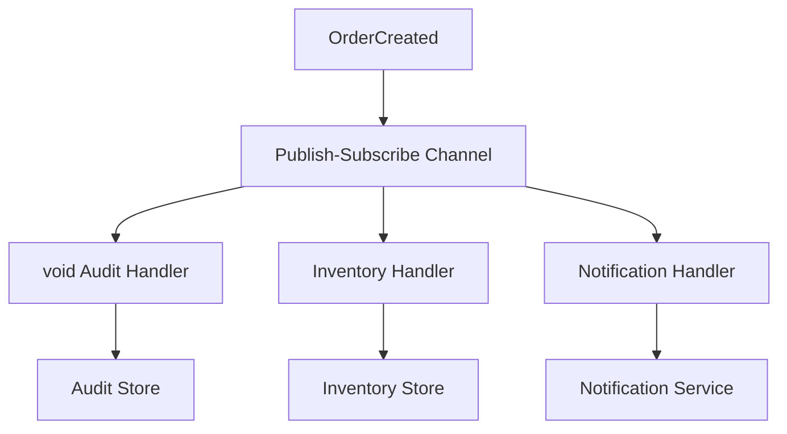

Here:

- The audit handler returning `void` does not stop Inventory or Notification from receiving the message.
- The channel actively distributes input to its subscribers.
- There is no **reply** from the audit handler, yet other subscribers still receive **their own input message**.
- One failing subscriber can impact others depending on synchronous/asynchronous dispatch and error policies.
- Publish-Subscribe does not automatically guarantee atomic completion across all subscribers.

### Contrast with a sequential pipeline

```text
Sequential chain:
  Input -> void Handler -> next stage
  => void Handler provides no reply to next stage

Publish-subscribe:
  Input -> PubSub
     +-> void Handler
     +-> Other Handler
  => Other Handler receives the message via PubSub fan-out,
     not because void Handler returned a message.
```

This is a critical distinction when reviewing integration topologies.

### Wire Tap

If you need to write audits **without blocking the main flow**, use a `Wire Tap` to copy messages to an audit channel:

```text
Main flow:
  Input -> WireTap("auditChannel") -> Business Handler

Side flow:
  auditChannel -> void Audit Service Activator
```

A Wire Tap creates a **separate side-channel branch**; it does not need the audit handler to return a reply to the main flow. Verify dispatch setup, retry/error isolation, and side-effect duplication.

## 29. Router and Filter: where do `void` handlers fit?

### Content-based Router

A Router chooses the right channel for a message:

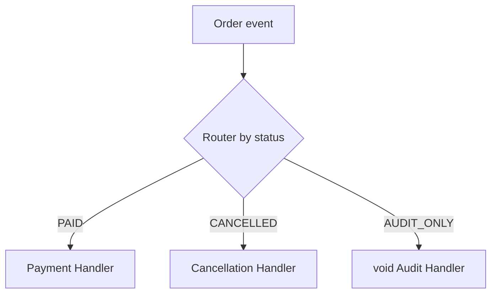

If routed to the `void` Audit handler, that branch can end at the side effect. Other branches produce replies only when their handlers are configured to return results.

### Filter

A Filter can drop messages before invoking a Service Activator. If a test sees only empty output, there are two possibilities:

1. **The Filter dropped the message**, so the Service Activator never ran.
2. The message passed the Filter, the `void` Service Activator ran, and it emitted no reply.

To tell them apart, inspect invocation counts/side effects, discard channels, and Filter reasons.

### Do not use a `void` method to silently drop invalid data

If a validation method is declared `void` and merely “returns when invalid,” a Gateway or downstream caller may hang waiting. Use a Filter, explicit validation result, or error path to surface rejections.

## 30. Splitter → `void` Service Activator → Aggregator: the missing-elements trap

A batch has 3 lines:

```text
Splitter:
  Child 1/3
  Child 2/3
  Child 3/3
```

If each child goes through a `void` Service Activator while an Aggregator waits for **processing results**, the Aggregator may receive zero child outcomes:

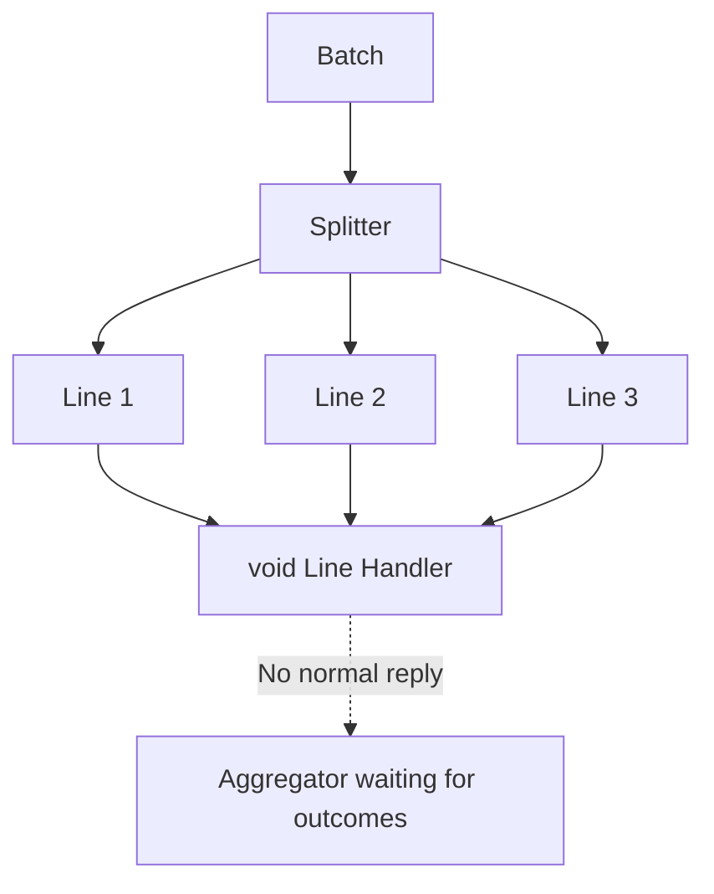

### Fix 1: return a `PartOutcome`

```java
public record PartOutcome(
    String batchId,
    int partIndex,
    boolean success,
    String reasonCode
) {}
```

```java
public PartOutcome processLine(OrderLine line) {
    lineService.process(line);

    return new PartOutcome(
        line.batchId(),
        line.index(),
        true,
        null);
}
```

Now each child produces a result for the Aggregator, and `ReleaseStrategy` can wait for all verified outcomes.

### Fix 2: aggregate before the side effect

If the Aggregator only needs original data, combine parts **before** calling a `void` handler that persists the final summary.

```text
Splitter -> per-line pure transform -> Aggregator
         -> BatchSummary -> void PersistBatchSummary
```

### Fix 3: emit dedicated completion events

If each child runs asynchronously, emit a `LineProcessed` event once its business transaction commits. The Aggregator collects **completion events**, rather than waiting for replies from a `void` handler. Explicit correlation, idempotency, timeouts, and recovery are required.

### Why not “fix” this by lowering `sequenceSize`?

If the Splitter emitted 3 parts, missing replies do not mean the batch had 0 or 2 parts. Never alter `sequenceSize` arbitrarily just to force the Aggregator to release early with wrong results.

## 31. `void` handlers and Resequencer

A Resequencer relies on messages having `correlationId`/`sequenceNumber` and an appropriate release policy. Placing a `void` handler **before a Resequencer** expecting it to forward the original message can halt the chain right there.

Better designs:

```text
Input -> Resequencer -> void Business Handler
```

or:

```text
Input -> void side branch (Wire Tap)
      -> Resequencer -> Reply-producing downstream
```

**Without a return value**, there is no new message for downstream to reorder. Place Resequencers only where messages actually flow through.

### Nested group/sequence metadata

A service using multiple Splitters/Aggregators/Resequencers may use different group keys. When returning `Message<?>` or creating side-branch events, know which headers serve the current group rather than replacing everything with a single business correlation ID.

## 32. Idempotent Receiver: `void` does not mean idempotent

Suppose the broker redelivers the same `OrderCreated(eventId=EV-101)` twice. A `void` Service Activator can write the audit **twice**:

```text
Delivery #1 -> void recordAudit -> append EV-101
Delivery #2 -> void recordAudit -> append EV-101
Final store count = 2
```

`void` only says the handler returns no normal reply; it **does not** limit how many times the handler is invoked.

### Proper idempotency key

```text
(tenantId, eventId, operationType)
= (shop-01, EV-101, WRITE_AUDIT)
```

A key like `MessageHeaders.id` is unsuitable if redelivery constructs a new `Message` instance.

### Test exposing duplicates

```java
@Test
void withoutIdempotencyDuplicateEventWritesTwice() {
    OrderCreated same = order();

    assertTrue(voidInput.send(
        MessageBuilder.withPayload(same).build()));

    assertTrue(voidInput.send(
        MessageBuilder.withPayload(same).build()));

    // Test demonstrates demo limitation, NOT desired
    // production system behavior.
    assertEquals(2, store.count());
    assertNull(unusedReplies.receive(0));
}
```

Add this test to `VoidServiceActivatorTest`. It proves a `void` method **does not prevent duplicates automatically**.

### How to protect business effects

- Use an Idempotent Receiver keyed by logical identity, backed by an appropriate store/transaction.
- Enforce unique constraints on business keys in the DB.
- Track `processing`/`completed` states if retries can occur after claiming.
- Use an outbox for domain events emitted after transactions.
- Implement reconciliation when external effects have uncertain outcomes.
- Retain keys/completion records across the relevant replay window.

Never treat adding a per-pod `ConcurrentHashMap.newKeySet()` as a durable multi-instance solution.

## 33. Transactions: a `void` method finishing is not a DB commit guarantee

A Service Activator may call a `@Transactional` service. The method returning does not guarantee every external system has committed.

### Within the same DB transaction

```text
Receive message
  -> begin transaction
  -> write audit record
  -> write outbox record
  -> commit transaction
  -> handler completes
```

If the transaction wraps the method/service cleanly with no intervening async boundary, the handler can finish or return after the transaction commits. Still, **verify transaction advice/proxy ordering** to determine exact commit timing relative to reply dispatch.

### Publishing events before commit is dangerous

```text
write DB
publish "AuditRecorded"
transaction rollback
```

Other consumers receive the event even though the audit record never persisted. A transactional outbox ties persisting business state and publishing intent inside the same DB transaction.

### Crash after commit, before broker ACK

The consumer may redeliver the same event. If the handler is `void` without idempotency, the audit is recorded twice. The output channel has nothing to do with this issue.

### `@Transactional` self-invocation

With Spring proxy-based transactions, calling a `@Transactional` method via `this.someMethod()` on the same bean can bypass the proxy. Define clear transaction boundaries on container-managed service beans and test real rollbacks/commits, rather than merely checking that the annotation exists.

## 34. Is a return value an ACK to the producer?

Not automatically.

```text
Producer/Client
   -> Broker/HTTP
   -> Spring Message
   -> Service Activator
   -> AuditReceipt return
```

`AuditReceipt` is a **business reply payload**. It differs from:

- Kafka consumer offset commit.
- RabbitMQ `basicAck`/`nack`.
- HTTP status 200/202.
- Database transaction commit.
- Outbound broker publisher confirms.

Depending on the inbound adapter and Gateway, a business reply may be translated into an HTTP response or broker reply message, but that requires **explicit response mapping/protocol handling**.

### Layered testing

| Test | What does it prove? |
| --- | --- |
| Service method unit test | Return type and simulated side effect |
| `DirectChannel` integration test | Endpoint invocation and local output |
| DB integration test | Transactions and unique constraints |
| HTTP Gateway test | Response status/body, timeouts |
| Broker adapter test | ACK/redelivery, error paths |
| Multi-pod test | Shared state/idempotency, concurrency |
| Failure injection | Crash windows and recovery |

Never claim exactly-once processing or producer ACKs solely from a test receiving `AuditReceipt` on a `QueueChannel`.

## 35. Observability: separating side-effect state and reply state

A useful observability pipeline distinguishes:

```text
MESSAGE_RECEIVED
  -> HANDLER_INVOKED
  -> SIDE_EFFECT_COMMITTED
  -> REPLY_CREATED (only if present)
  -> REPLY_DISPATCHED (only if present)
```

For a `void` handler, `REPLY_CREATED` and `REPLY_DISPATCHED` do not appear—and that can be **expected behavior**.

### Illustrative logs

```text
eventId=EV-101 tenantId=shop-01
endpoint=voidAudit
stage=HANDLER_INVOKED

eventId=EV-101 tenantId=shop-01
endpoint=voidAudit
stage=SIDE_EFFECT_COMMITTED
replyExpected=false

eventId=EV-102 tenantId=shop-01
endpoint=receiptAudit
stage=REPLY_DISPATCHED
replyType=AuditReceipt
```

### Suggested metrics

| Metric | Meaning |
| --- | --- |
| `activator.messages.received` | Messages arriving at the endpoint |
| `activator.invocations` | Business method invocation count |
| `activator.success` | Invocations ending successfully |
| `activator.failed` | Exceptions/failures |
| `activator.side_effect.commits` | Actual commits where measurable |
| `activator.replies.produced` | Return values turned into replies |
| `activator.replies.missing` | Missing replies on reply-requiring endpoints |
| `activator.gateway.timeouts` | Gateway calls receiving no reply |
| `activator.retry.attempts` | Actual local retry attempts |
| `activator.duplicate.received` | Duplicate logical events |
| `activator.error_backlog` | Errors awaiting processing |
| `activator.latency` | Processing latency per endpoint |

These are **application-suggested metric names**, not all emitted automatically by Spring Integration. Never alert on a `void` endpoint simply because `replies.produced=0`; that is normal by design. Meaningful alerts target `requiresReply endpoint missing reply` or `rising Gateway timeouts`.

### Avoid high-cardinality labels

`eventId`, `orderId`, and `businessCorrelationId` belong in structured logs/traces under security policies, not as arbitrary metric labels. Use labels like endpoint, result status, exception class, and low-cardinality operation type.

## 36. Testing multiple sender threads: `void` still emits no replies

A singleton Service Activator can receive messages from multiple threads. When a service method uses only thread-safe collaborators and holds no mutable per-request state, invocations can proceed independently.

### Testing distinct events concurrently

Add this method to `VoidServiceActivatorTest` from section 16:

```java
@Test
void concurrentVoidEventsAllReachStoreWithoutReplies()
        throws Exception {

    final int count = 8;
    var executor = java.util.concurrent.Executors
        .newFixedThreadPool(count);

    var ready =
        new java.util.concurrent.CountDownLatch(count);
    var start =
        new java.util.concurrent.CountDownLatch(1);

    var futures = new java.util.ArrayList<
        java.util.concurrent.Future<?>>();

    try {
        for (int i = 1; i <= count; i++) {
            final int index = i;

            futures.add(executor.submit(() -> {
                ready.countDown();

                if (!start.await(
                        5,
                        java.util.concurrent.TimeUnit.SECONDS)) {
                    throw new IllegalStateException(
                        "Concurrent start timeout");
                }

                OrderCreated event = new OrderCreated(
                    "shop-01",
                    "ORD-" + index,
                    "EV-" + index,
                    java.time.Instant.parse(
                        "2026-11-21T08:30:00Z"));

                assertTrue(voidInput.send(
                    MessageBuilder.withPayload(event)
                        .build()));

                return null;
            }));
        }

        assertTrue(ready.await(
            5, java.util.concurrent.TimeUnit.SECONDS));

        start.countDown();

        for (var future : futures) {
            future.get(5,
                java.util.concurrent.TimeUnit.SECONDS);
        }

        assertEquals(count, store.count());

        java.util.Set<String> ids = store.snapshot().stream()
            .map(OrderCreated::eventId)
            .collect(java.util.stream.Collectors.toSet());

        assertEquals(count, ids.size());
        assertNull(unusedReplies.receive(0));
    } finally {
        start.countDown();
        executor.shutdownNow();
    }
}
```

### Why not assert record ordering?

Across multiple threads, the order in `store.snapshot()` can differ from task submission order. If business logic requires ordering, enforce a partition/sequence contract rather than assuming JVM thread scheduling preserves order.

### What this test proves

- Every event with a distinct ID reaches the one-way handler.
- The thread-safe store fixture records all events.
- The output channel receives no normal replies.
- The handler does not hold a global mutable `currentEvent` field that mixes up IDs.

### What this test does not prove

- Multi-instance shared database transactions.
- External API exactly-once semantics.
- Broker redelivery/reordering.
- Authentication and tenant authorization.
- Whether one thread crashing rolls back transactions.

Never treat a single concurrency test as a substitute for resilience tests at the remaining boundaries.

## 37. Testing “sent successfully, yet effect failed” states

Common outcome combinations:

| Scenario | Producer `send` | Side effect | Normal reply | What to do |
| --- | --- | --- | --- | --- |
| `DirectChannel`, `void` handler succeeds | Dispatch succeeds | Invoked | None | Follows one-way contract |
| `DirectChannel`, reply handler succeeds | Dispatch succeeds | Invoked | Receipt produced | Verify receipt |
| `DirectChannel`, handler throws | May throw | Not run / partial | Not a success reply | Classify exception |
| `ExecutorChannel` accepts message, handler pending | May return early | Not yet | Not yet | Await completion/monitor |
| Handler committed, caller timed out | Request may time out | Committed | Reply missed caller | Idempotency/result lookup |
| Filter drops message before `void` handler | Dispatched upstream | Never ran | None | Verify discard policy |
| `void` handler emits domain event via publisher | Dispatch finishes | Side effect executed | None | Verify event publishing separately |
| Gateway expects reply, handler is `void` | Gateway sends request | May have committed | None | Timeout/reply contract |
| Broker redelivers same event | Multiple deliveries | May run multiple times | Depends on flow | Business idempotency |

### Why are three kinds of logs needed?

`message dispatched`, `handler completed`, and `business committed` are three distinct events. Logging “success” immediately after `send` in an async flow can mislead operators into thinking the DB write succeeded.

## 38. Real-world debugging: in what order should you debug an empty output channel?

Suppose operations reports: “The Service Activator ran, yet nothing appeared on `auditResults`.”

Before changing channel names, check in order:

1. **Was the message sent to the right input channel?** Use integration tests and the `messages.received` metric.
2. **Does the channel have a subscriber for the right endpoint?** On `DirectChannel`, having no subscriber causes dispatch failure.
3. **Did an upstream Filter/Router drop or reroute the message?** Check discard and error routes.
4. **Was the method actually invoked?** Use an invocation counter or test store instead of relying only on logs.
5. **Is the method signature `void`?** If so, do not expect a normal reply.
6. **Does one branch return `null`?** A conditional branch can leave output empty.
7. **Did an exception occur before returning?** Check stack traces and error channels.
8. **Is `requiresReply` enabled?** It can turn a missing reply into an error.
9. **Is a fixed output channel configured somewhere other than where the consumer listens?** Check route precedence.
10. **Are a Gateway and dynamic `replyChannel` involved?** Check request/reply correlation and timeouts.
11. **Is there an async boundary?** Wait for completion rather than calling `receive(0)` immediately.
12. **Are there multiple subscribers or concurrent consumers?** Another consumer may have drained the `QueueChannel`.
13. **Did serialization fail across an adapter?** Headers/types/codecs can break publishing.
14. **Was output sent, then dropped by a downstream Filter?** Separate publisher checks from consumer checks.
15. **Did a duplicate/idempotency gate suppress processing?** Check business keys and completion states.

### Decision tree

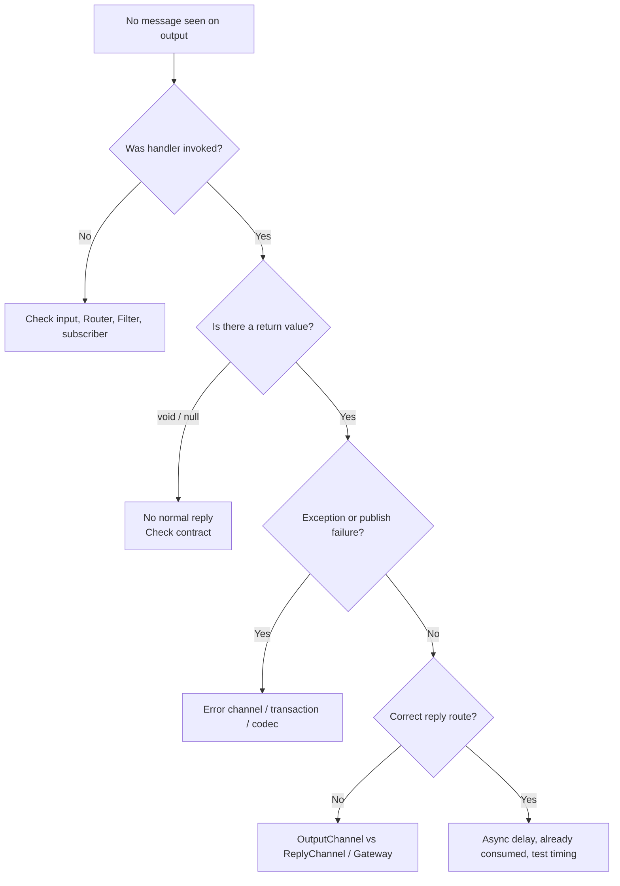

**Debugging takeaway:** “empty output” does not prove the method never ran; and “the method ran” does not prove output received a reply.

## 39. Common anti-patterns

### 39.1. Declaring `outputChannel` on a `void` method and expecting results

`outputChannel` does not invent payloads. Change the method to return a typed result or drop the reply expectation.

### 39.2. Returning `null` to represent business errors

Gateways easily time out; use a typed rejection/error contract.

### 39.3. Enabling `requiresReply=true` on a fire-and-forget handler

Turns valid completions into reply-required failures.

### 39.4. Treating `MessageChannel.send` as a broker ACK or DB commit

Dispatch semantics differ from transaction/ACK semantics.

### 39.5. Adding `.channel("next")` after a `void` handler expecting input to keep flowing

A reply-producing stage requires an actual return value; `void` does not automatically pass through the input message.

### 39.6. Placing a `void` handler on the result-producing path into an Aggregator

The Aggregator receives no contributions to release properly, even though child side effects ran.

### 39.7. Using a `void` handler as an implicit Filter

Produces no output and no discard reason; hard to observe and retry.

### 39.8. Manually sending to an output channel and also returning a receipt

Can emit two messages onto two paths; explicitly design a single producer responsibility.

### 39.9. Writing audits from a Wire Tap assuming a shared transaction

The side branch may be async or fail independently; business effects and audits can diverge.

### 39.10. Dropping `replyChannel` when building a new `Message` in a Gateway flow

Callers time out even though the handler returned data; preserve trusted reply context per contract or redesign the topology.

### 39.11. Copying raw `replyChannel` from untrusted input

Exposes internals, enables unwanted routing, or introduces stale channel objects.

### 39.12. Counting `void` invocations as exactly-once effects

Brokers can redeliver; side effects need idempotency and transactions.

### 39.13. Enabling uncontrolled retries on a non-idempotent `void` handler

An error after commit can execute the side effect a second time on retry.

### 39.14. Testing `receive(0)` before an async handler completes

Tests can pass falsely or turn flaky; use latches or completion events.

### 39.15. Confusing business correlation with request/reply correlation

Two callers for the same order can have different reply destinations; keep IDs properly scoped.

### 39.16. Logging “success” before transaction commit

Misleading observability; log milestones at actual side-effect boundaries.

### 39.17. Ignoring failures in one-way handlers

Having no reply does not mean errors vanish; configure error channels and monitoring.

### 39.18. Emitting a success receipt not backed by any business guarantee

Consumers assume commit or remote API success when only an async task was queued.

## 40. Architecture comparison: where does the Service Activator belong?

| Architecture | How `void` is used | When appropriate | Notes |
| --- | --- | --- | --- |
| `Input -> void Handler` | Terminal consumer | Fire-and-forget one-way | Error/idempotency |
| `Input -> returning Handler -> output` | Do not use `void` | Request-reply / next stage | Result contract |
| `Input -> Wire Tap -> main flow` | `void` on side branch | Audit/log/metrics without blocking main flow | Side-effect reliability |
| `Input -> PubSub -> multiple handlers` | `void` on a branch | Fan-out events | Error isolation |
| `Splitter -> result handlers -> Aggregator` | Avoid `void` if Aggregator needs outcomes | Batch/composite results | Unique parts, release |
| `Aggregator -> void Persist` | Terminal side effect | Persist final batch result | Transactions |
| `Gateway -> returning Handler` | Do not use `void` if reply required | Synchronous API | Timeout/correlation |
| `Accepted response -> async void handler` | `void` after accepted command | Long-running workflows | Result store/recovery |
| `DB TX + outbox -> void publisher trigger` | `void` executes command | Event-driven architecture | Atomic record/dispatch |
| `Resequencer -> void Handler` | Terminal consumer after ordering | Ordered side effects | Stateful grouping |

### Quick selection rule

If the answer to “does anyone need an **immediate business result** from this call?” is **no**, consider a one-way `void` handler.

If the answer is **yes**, the handler should return meaningful data or feed a clearly designed reply-producing downstream endpoint.

If results only arrive minutes later, use a workflow/result store instead of keeping a Gateway waiting indefinitely.

## 41. Practice lab A: proving `void` produces no output

### Requirements

1. Create `OrderCreated` with `tenantId`, `orderId`, `eventId`, `occurredAt`.
2. Create a thread-safe `InMemoryAuditStore`.
3. Create `AuditApplicationService` with `recordWithoutReply` and `recordWithReceipt`.
4. Configure `voidAuditRequests`, `unusedVoidReplies`, `receiptAuditRequests`, and `receiptAuditReplies`.
5. Declare `@ServiceActivator` for both methods.
6. Test sending an event into the `void` input.
7. Assert `store.count()==1`.
8. Assert `unusedVoidReplies.receive(0)==null`.
9. Send the same event type into the receipt input in a separate test context.
10. Assert the output contains `AuditReceipt(status=RECORDED)`.
11. Change the receipt method to conditionally return `null` and observe the missing output.
12. Define the policy when a Gateway requires a reply.

### Results table

| Input / Handler | Store count | Output message |
| --- | ---: | --- |
| One event -> `void` Service Activator | 1 | 0 |
| One event -> receipt Service Activator | 1 | 1 |
| Method returns `null` (without `requiresReply`) | Per implementation | 0 |
| Method returns `null` (`requiresReply`) | Per implementation | Reply-required error |
| Method throws before append | 0 | Exception/error |
| Method throws after append | May be 1 | Exception/error; outcome needs reconciliation |

**Counts in the table describe a single-input demo, not broker or multi-pod deployment guarantees.**

## 42. Practice lab B: Gateway and timeouts

**Scenario:** An API expects `AuditReceipt`, yet internally uses a `void` handler.

### Steps

1. Create a Gateway interface expecting `AuditReceipt`.
2. Wire it to the `void` endpoint.
3. Configure a small, bounded reply timeout in the test.
4. Send an event and verify the side effect can succeed even though the caller gets no reply.
5. Record the actual exception/timeout result per Gateway configuration.
6. Change the handler to return `AuditReceipt`.
7. Remove any fixed output channel if the Gateway needs a dynamic `replyChannel`.
8. Verify the caller receives the expected receipt.
9. Send two concurrent requests and verify replies are never delivered to the wrong caller.
10. Simulate the handler committing followed by a reply dispatch failure; retry the same logical event.
11. Add an idempotency key by tenant/event/operation.
12. Design stored-result replay or a status endpoint for retried requests.

### Practice question

**If the Gateway times out yet the store already holds the audit record, what error should the API return?**

No single HTTP status code fits every system. Distinguish **known outcomes** from **uncertain outcomes**. If the operation is known to have committed, look up/replay the stored result. If uncertain, return a pending/unknown status per contract and do not blindly retry the side effect.

## 43. Practice lab C: Splitter, Aggregator, and event-driven completion

**Context:** An order has 3 lines. Each line must be processed, and then the caller wants to know whether all succeeded or any failed.

### Broken design to simulate

```text
Splitter(3 lines)
   -> void processLine()
   -> Aggregator(expect 3 replies)
```

Tests show `processLine` can run three times yet the Aggregator never receives three reply messages.

### Fixed design

```text
Splitter(3 lines)
   -> processLine() returns PartOutcome
   -> Aggregator(3 unique outcomes)
   -> BatchResult
```

Or:

```text
Splitter(3 lines)
   -> async void command handlers
   -> each publishes LineProcessed after commit
   -> Aggregator consumes LineProcessed events
   -> BatchResult
```

### Testing requirements

1. Send 3 lines in order `3,1,2`.
2. Assert handlers executed the expected number of times.
3. For the broken design, assert no normal reply outcomes arrive.
4. For the fixed design, assert all `PartOutcome`s arrive per group key.
5. Assert unique part indexes `1,2,3`.
6. Send a duplicate part and verify idempotency before the Aggregator.
7. Make line 2 fail; decide whether to return a `FAILED PartOutcome`.
8. If line 2 is dropped, test the timeout/expiry policy.
9. Test two interleaved batches A/B without mixing correlations.
10. Verify output ordering by part index rather than arrival order.

### Core principle

**`CorrelationStrategy`, `ReleaseStrategy`, and output processors only operate on messages that actually arrive at the Aggregator.** A `void` handler does not create a new message for the next stage merely by finishing its side effect.

## 44. Self-assessment questions

**Question 1.** Does placing `outputChannel` on a `void` `@ServiceActivator` method emit a message automatically?

*No. `outputChannel` is the destination for a reply if one exists; `void` has no normal return value to emit.*

**Question 2.** Why can `store.count()==1` with `unusedReplies.receive(0)==null` be the exact right result?

*The side effect executed, while the method returned no result. Those are two independent properties.*

**Question 3.** Is a method declared to return `AuditReceipt` that returns `null` identical to `void`?

*Similar in producing no normal reply for that invocation, yet the signature and contract differ; `null` may represent a skip/error branch requiring explicit handling.*

**Question 4.** Does enabling `requiresReply` on a `void` method create an `AuditReceipt`?

*No. It can cause the missing reply to be treated as an error.*

**Question 5.** Is `outputChannel` the same as the `replyChannel` header?

*No. `outputChannel` is configured on the endpoint; `replyChannel` can be the destination for a specific request, especially from a Gateway.*

**Question 6.** Why can a Gateway calling a `void` handler time out even after the DB committed?

*Because the Gateway waits for a reply message, not merely for a side effect to happen.*

**Question 7.** Can `MessageChannel.send` returning `true` serve as proof of a DB commit?

*No. The meaning of `send` depends on channel/dispatch semantics; ACKs and commits have separate lifecycles.*

**Question 8.** Does a `void` handler on a `PublishSubscribeChannel` block other subscribers?

*No, per PubSub fan-out semantics; subscribers receive messages from the channel, not from the `void` handler's reply.*

**Question 9.** What problem does a Wire Tap solve with a `void` audit handler?

*It splits auditing onto a side branch while the main message continues without waiting for a reply from the audit handler.*

**Question 10.** Why can placing a `void` handler before an Aggregator keep the group from releasing?

*If the Aggregator awaits per-part outputs and the `void` handler emits no replies, the group never receives enough contributions.*

**Question 11.** Is a `void` method automatically idempotent?

*No. Redelivering the same logical event can execute the side effect repeatedly.*

**Question 12.** Is testing `receive(0)==null` right after `send` on an `ExecutorChannel` enough to prove no reply exists?

*No. The handler may not have run yet or output may not have been dispatched yet. Use synchronization/timeouts/topology-aware assertions.*

**Question 13.** Can a `void` method emit another domain event?

*Yes, if it explicitly calls a publisher or writes an outbox. However, that is an explicit side effect, not a normal method reply.*

**Question 14.** How does returning `Message<AuditReceipt>` differ from returning `AuditReceipt`?

*The handler can provide explicit reply headers; pay attention to header propagation and Gateway/correlation contracts.*

**Question 15.** How do you confirm the final completion status of a long-running workflow without holding a Gateway open?

*Use an accepted response, operation ID, persistent result store, and callback/polling contracts with idempotency/recovery.*

## 45. Production deployment checklist

- **Contract:** decide whether the handler is one-way or request-reply before choosing a return type.
- **Void:** understand that `void` produces no normal reply.
- **Null:** handle skips/rejections explicitly rather than letting Gateways time out blindly.
- **Output channel:** route only replies that actually exist.
- **Reply channel:** keep Gateway/request context separate from unintended fixed output channels.
- **`requiresReply`:** use for endpoints requiring results, never on valid one-way handlers.
- **Annotation/DSL:** avoid accidentally registering duplicate competing subscribers.
- **Side effects:** verify transactions/commits rather than mere invocations.
- **ACK:** separate broker/HTTP acknowledgements from business replies.
- **Async:** use latches/completion signals, never brittle timing-based tests.
- **Error channel:** verify exception handling across `DirectChannel`, `ExecutorChannel`, and inbound adapters.
- **Retry:** distinguish transient errors, deterministic business failures, and uncertain outcomes.
- **Idempotency:** anchor on logical event/operation identity, never Spring Message ID.
- **Outbox:** tie DB writes and publish intent atomically when possible.
- **Gateway:** define reply timeouts, late replies, request correlation, and stored-result replay.
- **Router:** identify non-reply routes and reply-required routes.
- **Filter:** define explicit discard/failure policies; never use `void` as an implicit Filter.
- **PubSub:** independent fan-out; a `void` subscriber generates no data for sibling branches.
- **Wire Tap:** audit side effects carry their own reliability considerations.
- **Splitter/Aggregator:** wait only for outputs that are actually emitted, with correlation/sequence metadata.
- **Resequencer:** preserve group metadata when needed, and place `void` handlers at the end of the chain when appropriate.
- **Serialization:** never send Java `replyChannel` objects over a broker.
- **Security:** trusted tenant and business identity never come from unverified raw headers.
- **Observability:** separate received, invoked, committed, and replied metrics.
- **Tests:** cover side effect + no reply, return receipt, `null`, exceptions, Gateways, concurrency, duplicates, and async flows.
- **Scale:** enforce multi-pod unique effect constraints and message stores/partitioning where needed.
- **Runbook:** distinguish “no reply by contract” from “missing reply due to runtime error.”

## 46. Conclusion

**Void methods and output channels** illustrate a core principle of Service Activators in Spring Integration: **finishing business processing does not mean producing a reply message**. A `void` method can write to a DB, call services, or emit domain events through its own mechanisms, yet it **does not automatically send a normal reply to `outputChannel`**. For downstream stages to receive an `AuditReceipt` or for a Gateway to get a response, there must be an actual return value or a valid reply-producing flow.

The surest way to internalize this is to write two endpoints differing only in return type and test **both the side effect and the output channel**. For a one-way method, tests must prove the handler ran while output stays empty; for a reply-producing method, tests must verify the right output payload arrives. As you add `requiresReply`, Gateways, `ExecutorChannel`, Router/Filter, Splitter/Aggregator, idempotency, and retries, preserve that distinction.

In production, choosing `void` vs. returning a result must start from **the business contract and end-to-end pipeline reliability**, not from an annotation or channel name. Designing replies, errors, transactions, ACKs, correlation, and observability carefully keeps Enterprise Integration Patterns workflows testable, extensible, and free from “processed yet never replied” or “waiting forever for a reply that never comes” failures.
