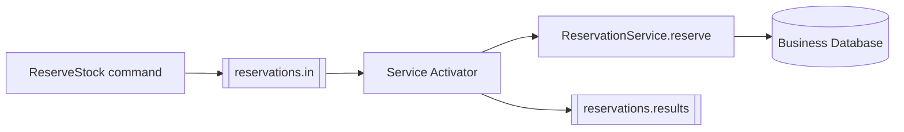
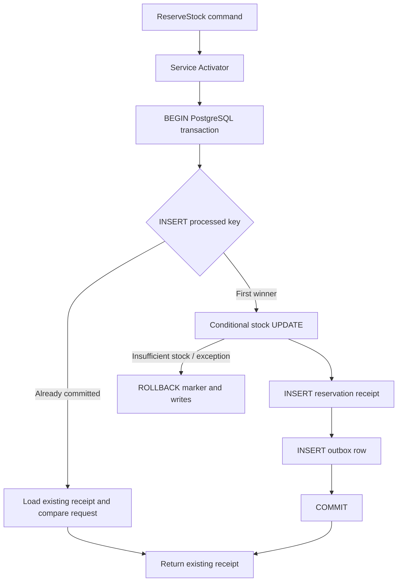
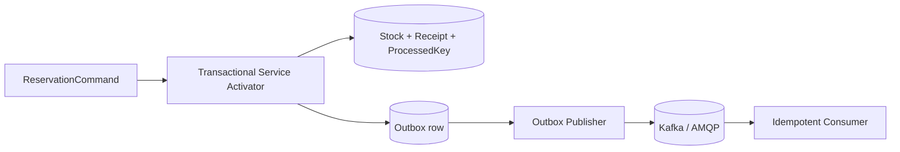
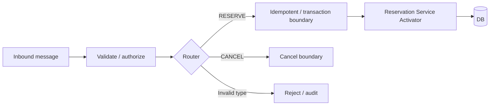
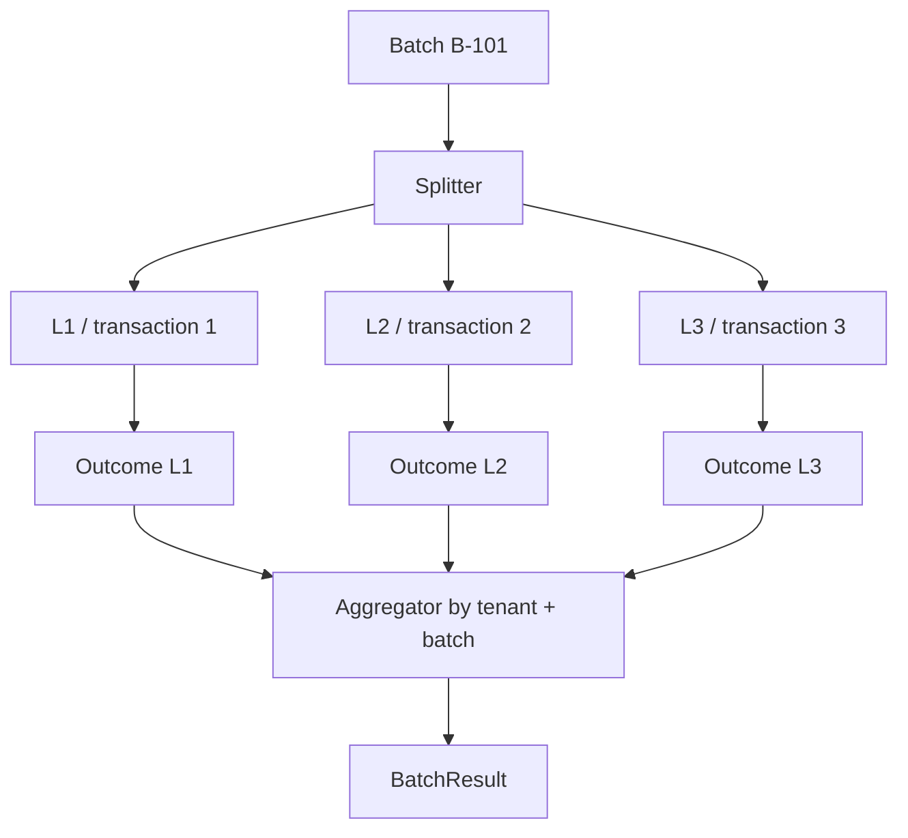

# Transactional Service Activators

A `ReserveStock` message arrives in Spring Integration. A **Service Activator** receives the message and calls a Java service to decrement inventory and create a reservation record. The database commits successfully, yet the application stops before the broker receives an acknowledgment. The broker redelivers the same message. If the handler repeats the stock decrement, the customer may have inventory reserved twice for **a single business operation**.

Another scenario: the Service Activator decrements stock and then publishes a `StockReserved` event to another system. The broker experiences a transient failure. If the database transaction and the publish operation are treated as **a single transaction** without an appropriate mechanism, the system can end up with **stock decremented without an event**, or **an event published while the database rolled back**.

A **transactional Service Activator** is how you design a Spring Integration endpoint to invoke a business service inside a **clearly defined transaction boundary**, protecting updates that **can commit/roll back together**, while deliberately handling steps **outside the transaction** such as broker acknowledgments, outbound HTTP, Payment APIs, or separate databases.

This lesson belongs to the **Service activator** chapter, module `SPRING_INTEGRATION_PATTERN`, supporting the study of **Enterprise Integration Patterns with Spring Integration**: building loosely coupled, extensible message flows; practicing Router, Filter, Transformer, Splitter, Aggregator, Gateway, retry, error channel, and correlation, while testing and observing execution branches. Here, the focus is the **transaction boundary of a Service Activator**, not merely placing an annotation and assuming end-to-end exactly-once semantics.

> **Principle:** `@Transactional` on a business method can protect **operations participating in the same transaction manager**, typically SQL statements against one database. It **does not automatically cover** messages sent to another broker, HTTP calls, messages on another thread, or steps after the method returns. **ACK timing and idempotency state** must be designed separately.

## 1. What is a Service Activator in EIP?

A **Service Activator** is an endpoint connecting a **message flow** to a **service method** that executes business logic. In Spring Integration, we commonly use:

- `@ServiceActivator(inputChannel = "...")` on a method/endpoint.
- Java DSL `.handle(service, "method")` or `.handle(PayloadType.class, (payload, headers) -> ...)`.
- A `MessageHandler` or service method invoked by the framework from a message channel.

Example route:



A Service Activator is **not synonymous with** a transaction manager. It is the **trigger point** for the business service. When the method is called through a Spring-managed transactional proxy and the transaction manager is configured properly, business operations inside the method can participate in a transaction.

### 1.1. What can a `.handle(...)` do?

| Example handler | Needs a transaction? | Notes |
| --- | --- | --- |
| Pure price total calculation from DTO | Usually no. | If no state mutates, a transaction may not be needed. |
| Decrement stock and insert reservation in same DB | Yes. | Requires DB atomicity and constraints. |
| Read data and return DTO | Depends on consistency; maybe `readOnly`. | `readOnly=true` is a hint/semantics depending on DB/transaction manager. |
| Call HTTP Payment API | Not protected by local DB transaction alone. | Requires idempotency, timeouts, and reconciliation. |
| Write DB then publish Kafka event | Local `@Transactional` is not atomic with Kafka alone. | Consider transactional outbox. |
| Write multiple independent databases | One local manager is insufficient. | Requires distributed transaction design or saga/outbox per requirements. |

### 1.2. Service Activator vs. Message Translator

A **Message Translator** changes message representation. A **Service Activator** calls a service that may perform **side effects**. A clean flow typically separates:

```text
Wire message
  → parse/normalize/validate
  → Router / Filter
  → Service Activator
  → transactional business service
  → result / outbox / response
```

If a Transformer sneaks in stock decrements or payment charges while converting formats, retrying the translation step can cause hard-to-control side effects. **Placing side effects at an explicit business boundary** puts transactions, idempotency, and tests in the right place.

## 2. What does a transaction actually protect?

A **database transaction** aims for ACID properties within the scope of its database/transaction manager. For integration applications, ask specifically:

1. **Atomicity:** do the deduplication marker, stock update, and reservation record commit together or roll back together?
2. **Consistency:** how are unique constraints, check constraints, and business invariants enforced?
3. **Isolation:** can two workers reserving the same SKU concurrently drive stock negative or double-reserve?
4. **Durability:** the DB returned a successful commit; if the broker ACK is lost, how is redelivery handled?

### 2.1. The transaction boundary is not the entire `IntegrationFlow`

With a service:

```java
@Transactional
public ReservationReceipt reserve(ReservationCommand command) {
    // Business SQL operations...
}
```

the transaction boundary is typically:

```text
IntegrationFlow:
   input channel
      → Service Activator invokes proxy
           BEGIN TRANSACTION
             SQL 1
             SQL 2
             SQL 3
           COMMIT
      → next endpoint / output channel
```

If the next endpoint fails **after `reserve(...)` returns and the transaction has committed**, `reserve(...)`'s local transaction **does not rewind time to roll back**. That is one of the most important misconceptions when using `@Transactional` in a message flow.

### 2.2. Boundary diagram

```mermaid
sequenceDiagram
    autonumber
    participant C as Message Channel
    participant A as Service Activator
    participant P as Spring Transaction Proxy
    participant D as Business DB
    participant O as Output Channel
    C->>A: ReservationCommand
    A->>P: reserve(command)
    P->>D: BEGIN
    P->>D: processed key + stock + reservation + outbox
    D-->>P: COMMIT
    P-->>A: ReservationReceipt
    A->>O: Send result
    Note over O: Send happens after method transaction; not rolled back by the already-committed transaction
```

### 2.3. The transaction manager must match the resource

A `DataSourceTransactionManager` manages JDBC connections for **one `DataSource`** under Spring's mechanism. `JpaTransactionManager` serves a JPA persistence context and its resource. Kafka/JMS transactions have their own resource semantics.

There is no magic like:

```text
@Transactional
  ├── PostgreSQL
  ├── remote Payment API
  ├── Kafka broker
  └── email server
```

Assuming plain `@Transactional` commits/rolls back all four uniformly is **wrong**. Even when frameworks offer transaction coordination or synchronization, check their exact **guarantees and crash windows** before claiming end-to-end atomicity.

## 3. Two different places to configure transactions

### 3.1. Transaction at the business service

```text
Message enters flow
  → Service Activator
      → @Transactional ReservationService.reserve(...)
          → local DB operations
      ← COMMIT / ROLLBACK
  → next endpoint
```

This is the clearest choice when **business invariants** and the SQL statements that must commit together live inside a single service method.

### 3.2. Transaction at the poller/consumer boundary

A **polling endpoint** can pull a message from a `QueueChannel`, JDBC poller, or message source and run downstream inside a **transaction opened by poller advice**. When configured properly, the transaction can wrap **the poll plus downstream synchronous processing** on the same thread.

```text
Poller transaction advice:
    BEGIN
      receive/poll
      synchronous handler chain
    COMMIT / ROLLBACK
```

**Differences:**

| Criterion | `@Transactional` on business service | Poller transaction advice |
| --- | --- | --- |
| Starts | When the Spring transactional proxy invokes the method. | When the poll task/advice starts per configuration. |
| Scope | Method body and participating resources. | Polling + downstream **in the same execution context** when wrapped by advice. |
| With `DirectChannel` | Yes; handler normally runs on `send()` caller thread. | Can keep one transaction across sync handlers. |
| Across `ExecutorChannel`/async | Does not propagate automatically to new threads. | Does not span onto other threads automatically. |
| Across remote broker/HTTP | Not atomic from annotation alone. | Not atomic from advice alone. |
| Role | Enforces business invariants at the service. | Coordinates receive/processing within a polling boundary. |

Do not apply **both** without understanding propagation: they may **join the same transaction** (`REQUIRED`) or create nested/separate boundaries (`REQUIRES_NEW`), affecting rollbacks and visibility.

## 4. The message channel determines whether a transaction can continue

### 4.1. `DirectChannel`: same thread, yet no automatic transaction

`DirectChannel` normally dispatches handlers **synchronously** on the sending thread. If the caller already has an active transaction and the handler uses the same transaction manager, operations can join that transaction. However, **channel synchronicity does not start a transaction by itself**.

```text
DirectChannel:
  thread A → handler 1 → handler 2 → return
```

**Note:** If a transaction is opened **inside** handler 1 and commits when handler 1 returns, handler 2 runs on the same thread but **is no longer inside that transaction**.

### 4.2. `ExecutorChannel`: thread boundary

```text
thread A → ExecutorChannel → queue
                               └─ thread B → handler
```

Spring's transaction context is normally **thread-bound**. Never assume thread B inherits thread A's transaction. If handler B needs a DB transaction, start a **separate transaction at B** or design an appropriate transactional consumer.

### 4.3. `QueueChannel`: receiving later does not keep the old transaction

A `QueueChannel` may buffer messages in memory for later polling. Sending a message into the queue and processing it in a poller happen at **two separate points in time**; the sender's transaction does not stretch across the wait.

If the queue is full, `send` can fail or time out per configuration, yet that **does not automatically roll back previously committed SQL**. Decide whether to use an outbox, bounded retries, or an appropriate transactional store/queue.

### 4.4. Quick comparison

| Channel/boundary | Same thread? | Automatically in same local transaction? | What to test |
| --- | --- | --- | --- |
| `DirectChannel` | Normally yes. | Only if an active transaction is shared per configuration. | If a later handler fails, is it in the same boundary? |
| `ExecutorChannel` | No. | Not by default. | Does the task open its own transaction? |
| `QueueChannel` + poller | Separate send/receive boundary. | Not by default; poller advice may open a new transaction. | Poller retries, rollbacks, duplicates. |
| Kafka/AMQP/JMS adapter | Depends on container/executor/ack mode. | No single universal answer. | Listener transactions, ACK/offset, DLT. |
| HTTP outbound Gateway | Remote request. | Not inside the local DB transaction. | Timeouts and unknown remote outcomes. |

**Testing rule:** draw transaction boundaries **across the topology diagram and by thread**, instead of saying “the whole flow is transactional” without specifying who opens, commits, and handles failures.

## 5. Spring AOP: does `@Transactional` actually run?

A typical Spring transaction setup uses **proxy-based advice**. The annotation takes effect when calls go through a **Spring-managed proxy**, with the right transaction manager and compatible method visibility.

### 5.1. Correct case

```text
Spring Integration handler
   → Spring bean proxy: ReservationService.reserve(...)
       → @Transactional interceptor
           → business SQL
```

### 5.2. Common mistake

```java
public class ReservationService {

    public void handle(ReservationCommand command) {
        // Calls within the same object (self-invocation).
        reserve(command);
    }

    @Transactional
    public void reserve(ReservationCommand command) {
        // If invoked only via this.handle(...),
        // proxy-based transaction advice may not run.
    }
}
```

In **proxy mode**, `this.reserve(...)` is self-invocation; it bypasses the proxy. This easily causes you to think a transaction is active while SQL actually runs in auto-commit or under a different boundary.

### 5.3. Conditions to watch

- The bean must be **Spring-managed**; never instantiate `new ReservationService(...)` and expect annotations to work.
- Enable `@EnableTransactionManagement`/auto-configuration and configure the matching `PlatformTransactionManager`.
- Invoke through the proxy, not via internal calls inside the same class.
- Respect method visibility/proxy compatibility for JDK or class proxies; **`public` methods** are the clearest choice for examples.
- `@Transactional` normally rolls back on **unchecked exceptions/`Error`**, not all checked exceptions by default; specify `rollbackFor` when the contract requires it.
- If a method catches an exception and **swallows it**, transaction advice sees a normal return and commits.
- When multiple transaction managers exist, specify the right manager/qualifier and avoid pointing a handler at the wrong `DataSource`.

### 5.4. Swallowing exceptions can turn a rollback into a commit

```java
@Transactional
public void unsafe(ReservationCommand command) {
    try {
        inventoryRepository.decrement(command);
        reservationRepository.insert(command);
    } catch (RuntimeException ex) {
        log.warn("failed", ex);
        // Dangerous: swallowing the error and returning normally.
    }
}
```

Without marking rollback-only or rethrowing per policy, the method may **commit partial state changes**. Never use `errorChannel` or a catch block just for logging in a way that breaks transaction semantics.

## 6. Transaction propagation: `REQUIRED`, `REQUIRES_NEW`, and `NESTED`

Examples:

| Propagation | General meaning | Risk in a Service Activator |
| --- | --- | --- |
| `REQUIRED` | Join existing transaction; create one if none exists. | Fits business services when boundaries are clear. |
| `REQUIRES_NEW` | Suspend current transaction and open an independent one. | Audit/markers can commit **even if the outer business transaction rolls back**. |
| `NESTED` | Savepoint inside transaction if manager supports it. | Not equivalent to a distributed nested transaction; relies on JDBC/savepoints. |
| `SUPPORTS` | Participate if present, otherwise run non-transactionally. | Easily runs auto-commit if caller opened no transaction. |
| `MANDATORY` | Require an existing transaction. | Fails fast when a service must only run inside another boundary. |
| `NOT_SUPPORTED` | Run outside any transaction. | Unsuitable for updates needing atomicity. |

### 6.1. Why does `REQUIRES_NEW` require caution?

```text
Outer transaction:
  reserve stock
  → AuditService.record(REQUIRES_NEW): commit
  → outer throws, rollback stock

Result: audit record still exists
```

This **may be intentional** for technical auditing, yet wrong if the audit record implies the business reservation committed. Similarly, if an idempotency marker is written under `REQUIRES_NEW` while the stock update stays in the outer transaction, a crash/rollback can leave a “processed” marker even though the business effect never occurred.

### 6.2. Nested service calls and rollback-only

If an inner `REQUIRED` method throws an exception that marks the transaction rollback-only, an outer method catching the error and returning normally can hit `UnexpectedRollbackException` on commit. Test propagation and error handling **for real** rather than assuming catching an exception keeps things safe.

## 7. Running problem: reserve stock once per operation

We choose the **Reserve Stock** problem. A command contains:

```json
{
  "tenantId": "TENANT-A",
  "operationId": "RESERVE-101",
  "orderId": "ORD-101",
  "sku": "PEN-01",
  "quantity": 3
}
```

A Service Activator needs to:

1. Validate the request/schema and trusted tenant context.
2. Detect whether **the same operation** already committed earlier.
3. If not, **conditionally decrement inventory**, never allowing negative stock.
4. Persist the **reservation receipt** and result so retries can return it.
5. Persist a `StockReserved` **outbox event** for a publisher to emit later.
6. **Commit marker, stock, reservation, and outbox in one DB transaction**.
7. Let the adapter ACK per transport policy after the handler finishes/commits.



**Deliberate boundary:** all of these tables live in **one PostgreSQL database with one transaction manager**. The event is **not published to the broker inside the transaction**; only the outbox row is written with the commit. Afterward, an outbox worker publishes and retries as needed.

### 7.1. Why is an operation key needed?

If the broker redelivers:

```text
Attempt 1: operationId=RESERVE-101 → stock -3 → COMMIT
Attempt 2: operationId=RESERVE-101 → duplicate
```

The consumer needs to know the second attempt is **the same committed operation**, not a new request. The key should include **consumer/operation scope** and **tenant** where appropriate:

```text
idempotency key = (consumerName, tenantId, operationId)
```

Do not use `orderId` alone, because one order can have multiple line reservations or different operation generations. Do not use `MessageHeaders.ID`, because an adapter/Transformer can build a new Message on redelivery.

### 7.2. What if the same key arrives with a different payload?

```text
RESERVE-101, sku=PEN-01, quantity=3
RESERVE-101, sku=PEN-01, quantity=8
```

These two commands **must not be treated as the same valid request** merely because `operationId` matches. Store and compare immutable fields (or a canonical payload fingerprint) against the committed receipt. On mismatch, throw **idempotency conflict** instead of re-running stock updates.

### 7.3. What if stock is insufficient?

There are two different business policies:

- **Retryable stock failure:** insufficient stock rolls back the marker; a later attempt after stock replenishment can succeed under the same operation ID.
- **Terminal business rejection:** persist **a terminal `REJECTED` result** (requiring both idempotency record and result) so retries with the same operation always return the prior rejection even if stock increases later.

The code example below chooses **rollback so retries are possible** on insufficient stock. That is a **lesson design choice**, not the only default for retail systems.

## 8. PostgreSQL schema: constraints in the database

We use PostgreSQL to illustrate `ON CONFLICT DO NOTHING` and `JSONB`. Tables:

```sql
CREATE TABLE stock_levels (
    tenant_id VARCHAR(80) NOT NULL,
    sku VARCHAR(80) NOT NULL,
    available INTEGER NOT NULL CHECK (available >= 0),
    PRIMARY KEY (tenant_id, sku)
);

CREATE TABLE processed_commands (
    consumer_name VARCHAR(100) NOT NULL,
    tenant_id VARCHAR(80) NOT NULL,
    operation_id VARCHAR(120) NOT NULL,
    processed_at TIMESTAMPTZ NOT NULL DEFAULT now(),
    PRIMARY KEY (consumer_name, tenant_id, operation_id)
);

CREATE TABLE reservation_records (
    receipt_id UUID PRIMARY KEY,
    tenant_id VARCHAR(80) NOT NULL,
    operation_id VARCHAR(120) NOT NULL,
    order_id VARCHAR(120) NOT NULL,
    sku VARCHAR(80) NOT NULL,
    quantity INTEGER NOT NULL CHECK (quantity > 0),
    UNIQUE (tenant_id, operation_id)
);

CREATE TABLE outbox_events (
    event_id UUID PRIMARY KEY,
    tenant_id VARCHAR(80) NOT NULL,
    aggregate_id VARCHAR(120) NOT NULL,
    event_type VARCHAR(80) NOT NULL,
    payload_json JSONB NOT NULL,
    created_at TIMESTAMPTZ NOT NULL DEFAULT now(),
    published_at TIMESTAMPTZ NULL
);
```

**Meaning of the constraints:**

- `stock_levels` has a primary key on tenant/SKU and a `CHECK (available >= 0)` constraint.
- `processed_commands` enforces unique identity per **consumer + tenant + operation**, preventing two instances from winning the same operation.
- `reservation_records` stores the receipt and command details so duplicates return the **same result** and conflicts are detected.
- `outbox_events` stores an event ID **allocated once inside the transaction**, allowing publishers to retry with the same event ID.

### 8.1. Atomic update preventing oversell

```sql
UPDATE stock_levels
SET available = available - :quantity
WHERE tenant_id = :tenant_id
  AND sku = :sku
  AND available >= :quantity;
```

The application must verify the updated row count **equals 1**. If `0`, the SKU may not exist or stock is insufficient per contract; throw an error to roll back the entire transaction (under the example's retryable policy).

The `available >= quantity` condition is evaluated at the **database write boundary** rather than checking a stale inventory copy beforehand. Under PostgreSQL's concurrency and isolation, this conditional `UPDATE` with row locking/transactions prevents two valid concurrent operations from over-decrementing capacity.

### 8.2. Why must `INSERT marker` be in the same transaction?

```text
BEGIN;
INSERT processed_commands ... ON CONFLICT DO NOTHING;
UPDATE stock_levels ...;
INSERT reservation_records ...;
INSERT outbox_events ...;
COMMIT;
```

If any step after the marker fails **before commit**, the transaction rolls back the marker as well. Broker redelivery will not see a bogus `COMPLETED` marker with no reservation. Conversely, if commit succeeded and ACK failed, redelivery sees the marker and **does not decrement stock again**.

**Never place the marker in an independent Redis `SETNX` and treat it as part of the same transaction.** An atomic first-seen claim does not mean the business effect committed.

### 8.3. Unique key scope must match business semantics

In this schema, an `operationId` is unique **per tenant for the reservation Service Activator**. If the deduplication table is shared across consumers, the primary key already includes `consumer_name`. If `reservation_records` serves multiple operation types/services, add `operation_type` or adjust the unique scope accordingly. Never copy a schema verbatim to another domain without reviewing its identity contract.

## 9. Java DTOs and domain exceptions

The code uses Java 17+ records and text blocks. The classes are standalone examples for an illustrative module; a real project needs matching imports, packages, and Spring/Jackson/JDBC dependencies.

### 9.1. Command received at trusted ingress

```java
// ReservationCommand.java
public record ReservationCommand(
    String tenantId,
    String operationId,
    String orderId,
    String sku,
    int quantity
) {
    public ReservationCommand {
        if (tenantId == null || tenantId.isBlank()
                || operationId == null || operationId.isBlank()
                || orderId == null || orderId.isBlank()
                || sku == null || sku.isBlank()
                || quantity <= 0 || quantity > 100) {
            throw new IllegalArgumentException(
                "INVALID_RESERVATION_COMMAND");
        }
    }
}
```

`tenantId` in the DTO **must be verified by a trusted adapter** via authentication and tenant ownership; the record constructor only checks non-blank strings and **does not replace authorization**. The quantity cap of 100 is an illustrative business rule.

### 9.2. Receipt and outbound event

```java
// ReservationReceipt.java
import java.util.UUID;

public record ReservationReceipt(
    UUID receiptId,
    String operationId,
    String orderId,
    String sku,
    int quantity
) {}
```

```java
// StockReservedEvent.java
import java.util.UUID;

public record StockReservedEvent(
    UUID eventId,
    String tenantId,
    String operationId,
    String orderId,
    String sku,
    int quantity,
    UUID receiptId
) {}
```

### 9.3. Exceptions for Spring Transaction rollback

```java
// InsufficientStockException.java
public final class InsufficientStockException
        extends RuntimeException {
    public InsufficientStockException() {
        super("INSUFFICIENT_STOCK");
    }
}
```

```java
// IdempotencyConflictException.java
public final class IdempotencyConflictException
        extends RuntimeException {
    public IdempotencyConflictException() {
        super("IDEMPOTENCY_KEY_CONFLICT");
    }
}
```

Both are **unchecked exceptions**, matching `@Transactional`'s default rollback rule when no override policy exists. If the domain wants to persist a terminal rejection instead of rolling back, implement an explicit **in-transaction error-result persistence path**.

## 10. Business service with `@Transactional`

This is the **core code**: a Spring-managed service updating all four tables via one `JdbcTemplate` sharing the same `DataSourceTransactionManager`.

```java
// TransactionalReservationService.java
import com.fasterxml.jackson.core.JsonProcessingException;
import com.fasterxml.jackson.databind.ObjectMapper;
import java.util.Objects;
import java.util.UUID;
import org.springframework.jdbc.core.JdbcTemplate;
import org.springframework.transaction.annotation.Transactional;

public class TransactionalReservationService {

    private static final String CONSUMER = "stock-reservation";

    private final JdbcTemplate jdbc;
    private final ObjectMapper mapper;

    public TransactionalReservationService(
            JdbcTemplate jdbc, ObjectMapper mapper) {
        this.jdbc = Objects.requireNonNull(jdbc);
        this.mapper = Objects.requireNonNull(mapper);
    }

    @Transactional
    public ReservationReceipt reserve(ReservationCommand command) {
        Objects.requireNonNull(command, "command");

        int inserted = jdbc.update("""
            INSERT INTO processed_commands
                (consumer_name, tenant_id, operation_id)
            VALUES (?, ?, ?)
            ON CONFLICT DO NOTHING
            """,
            CONSUMER, command.tenantId(), command.operationId());

        if (inserted == 0) {
            // Duplicate of an already-committed operation.
            // Same key with a different request => conflict.
            ReservationReceipt previous =
                loadCommittedReceipt(command);
            if (!previous.orderId().equals(command.orderId())
                    || !previous.sku().equals(command.sku())
                    || previous.quantity() != command.quantity()) {
                throw new IdempotencyConflictException();
            }
            return previous;
        }

        // Conditional SQL update preventing oversell.
        int updated = jdbc.update("""
            UPDATE stock_levels
            SET available = available - ?
            WHERE tenant_id = ?
              AND sku = ?
              AND available >= ?
            """,
            command.quantity(), command.tenantId(),
            command.sku(), command.quantity());

        if (updated != 1) {
            // Throws RuntimeException, rolling back the marker too.
            throw new InsufficientStockException();
        }

        UUID receiptId = UUID.randomUUID();
        jdbc.update("""
            INSERT INTO reservation_records
              (receipt_id, tenant_id, operation_id,
               order_id, sku, quantity)
            VALUES (?, ?, ?, ?, ?, ?)
            """,
            receiptId,
            command.tenantId(), command.operationId(),
            command.orderId(), command.sku(), command.quantity());

        // Allocate eventId only when creating the outbox row the FIRST time;
        // duplicates never enter this branch.
        UUID eventId = UUID.randomUUID();
        StockReservedEvent event = new StockReservedEvent(
            eventId,
            command.tenantId(), command.operationId(),
            command.orderId(), command.sku(),
            command.quantity(), receiptId);

        String json;
        try {
            json = mapper.writeValueAsString(event);
        } catch (JsonProcessingException ex) {
            throw new IllegalStateException(
                "OUTBOX_SERIALIZATION_FAILED", ex);
        }

        jdbc.update("""
            INSERT INTO outbox_events
              (event_id, tenant_id, aggregate_id,
               event_type, payload_json)
            VALUES (?, ?, ?, ?, CAST(? AS jsonb))
            """,
            eventId, command.tenantId(), command.orderId(),
            "StockReserved", json);

        return new ReservationReceipt(
            receiptId,
            command.operationId(), command.orderId(),
            command.sku(), command.quantity());
    }

    private ReservationReceipt loadCommittedReceipt(
            ReservationCommand command) {
        return jdbc.queryForObject("""
            SELECT receipt_id, operation_id, order_id, sku, quantity
            FROM reservation_records
            WHERE tenant_id = ? AND operation_id = ?
            """,
            (rs, rowNum) -> new ReservationReceipt(
                rs.getObject("receipt_id", UUID.class),
                rs.getString("operation_id"),
                rs.getString("order_id"),
                rs.getString("sku"),
                rs.getInt("quantity")),
            command.tenantId(), command.operationId());
    }
}
```

### 10.1. What happens on first delivery?

1. The Spring proxy opens a transaction before executing `reserve(...)`.
2. `INSERT processed_commands` claims first winner for key `(stock-reservation, TENANT-A, RESERVE-101)`.
3. `UPDATE stock_levels` decrements stock **if enough stock remains**.
4. `INSERT reservation_records` stores the receipt so callers can receive it again on retry.
5. `INSERT outbox_events` stores an event ID stable across publish retries.
6. The method returns `ReservationReceipt`; **the transaction commits before the proxied call completes**.

### 10.2. What happens on redelivery after commit?

1. `INSERT ... ON CONFLICT DO NOTHING` returns update count `0`.
2. The service loads the saved receipt from `reservation_records`.
3. The service compares `orderId`, `sku`, and `quantity` to detect **same key, different payload**.
4. If identical, it returns the **same receipt**.
5. It does not decrement stock or insert another reservation or outbox event.

### 10.3. Why can't two instances both win?

The PostgreSQL primary key constraint is the shared guard. Two transactions contending on the same primary key wait for one another. If the first commits, the second hits conflict/no-op and loads the receipt. If the first rolls back, the other can become the winner and process the operation.

This **relies on real database concurrency, isolation, and active transactions**. Never infer from an in-JVM `HashSet` that two pods are protected.

### 10.4. What happens when stock is insufficient?

`updated != 1` throws `InsufficientStockException`. Because this unchecked exception exits the `@Transactional` method, the transaction rolls back:

- No uncommitted processed marker remains.
- The stock update is not committed.
- No new receipt/outbox row exists.

If in your domain **insufficient stock is a terminal failure** that must be remembered long-term, do not use this rollback policy as the final outcome. Instead, use a state machine persisting the rejection/idempotency result **within the transaction**, so callers get the terminal result when retrying with the same key.

### 10.5. Never let an exception partially commit

If instead you wrote:

```java
if (updated != 1) {
    return new ReservationReceipt(...); // Fake result
}
```

the initial marker could commit even though **no stock was reserved**. If returning for a terminal business rejection, persist a **consistent terminal outcome record**; returning merely to avoid throwing an exception causes lost work.

### 10.6. Scope of the JSON outbox

`ObjectMapper` serializes `StockReservedEvent` into `JSONB` **inside the transaction**. Payload serialization failures roll back all database writes. A separate **outbox publisher** reads rows, publishes to Kafka/AMQP, and updates delivery status per policy. If the publisher dies after the broker accepted the message but before marking `published_at`, the event may be republished with the **same persisted `eventId`**.

**Never call `broker.send(...)` directly inside the method assuming it rolls back with the JDBC transaction.**

## 11. Configuring Spring transactions and `IntegrationFlow`

This example uses Spring Framework/Spring Integration Java DSL. `DataSource` is a bean provided by the application environment, while `ReservationFlowConfiguration` declares a `DataSourceTransactionManager` for that exact `DataSource`.

```java
// ReservationFlowConfiguration.java
import com.fasterxml.jackson.databind.ObjectMapper;
import javax.sql.DataSource;
import org.springframework.context.annotation.Bean;
import org.springframework.context.annotation.Configuration;
import org.springframework.integration.channel.QueueChannel;
import org.springframework.integration.config.EnableIntegration;
import org.springframework.integration.dsl.IntegrationFlow;
import org.springframework.jdbc.core.JdbcTemplate;
import org.springframework.jdbc.datasource.DataSourceTransactionManager;
import org.springframework.transaction.PlatformTransactionManager;
import org.springframework.transaction.annotation.EnableTransactionManagement;

@Configuration
@EnableIntegration
@EnableTransactionManagement
public class ReservationFlowConfiguration {

    @Bean
    PlatformTransactionManager transactionManager(
            DataSource dataSource) {
        return new DataSourceTransactionManager(dataSource);
    }

    @Bean
    JdbcTemplate reservationJdbc(DataSource dataSource) {
        return new JdbcTemplate(dataSource);
    }

    @Bean
    ObjectMapper reservationJsonMapper() {
        return new ObjectMapper();
    }

    @Bean
    TransactionalReservationService reservationService(
            JdbcTemplate reservationJdbc,
            ObjectMapper reservationJsonMapper) {
        return new TransactionalReservationService(
            reservationJdbc, reservationJsonMapper);
    }

    @Bean("reservations.results")
    QueueChannel reservationResults() {
        return new QueueChannel(32);
    }

    @Bean
    IntegrationFlow reserveStockFlow(
            TransactionalReservationService reservationService) {
        return IntegrationFlow.from("reservations.in")
            .handle(ReservationCommand.class,
                (command, headers) ->
                    reservationService.reserve(command))
            .channel("reservations.results")
            .get();
    }
}
```

**Important notes:**

- `reservationService` is a **Spring bean**, so the Spring transaction proxy can apply `@Transactional`. The DSL invokes `reservationService.reserve(...)` through the injected bean, **never instantiating it with `new` inside the handler**.
- `JdbcTemplate` uses the same `DataSource` as `DataSourceTransactionManager`; SQL in the method joins the same local JDBC transaction.
- Input `reservations.in` is created by the DSL with default channel configuration, typically direct/synchronous in this example. Verify actual topology when integrating.
- Output is an in-memory `QueueChannel` for test inspection; it has no durability and is not part of the PostgreSQL transaction.
- If the project already has a Spring Boot auto-configured transaction manager, **do not add a duplicate bean mechanically**. Select the right manager for your resources.
- Examples assume compatible Java/Spring versions supporting these APIs; STEP 4 NEW does not run Gradle/builds.

### 11.1. Same logic via the `@ServiceActivator` annotation

Instead of DSL, you can annotate an adapter/service method:

```java
import org.springframework.integration.annotation.ServiceActivator;

public final class ReservationEndpoint {
    private final TransactionalReservationService service;

    public ReservationEndpoint(
            TransactionalReservationService service) {
        this.service = service;
    }

    @ServiceActivator(
        inputChannel = "reservations.annotation.in",
        outputChannel = "reservations.annotation.out")
    public ReservationReceipt handle(ReservationCommand command) {
        return service.reserve(command);
    }
}
```

**This is an alternative example**; do not enable it alongside the DSL on the same channel without a recipient/competing-consumer design. When using annotations, `ReservationEndpoint` must be registered as a Spring bean and `reservations.annotation.in/out` channels must be configured or declared accordingly.

Here the transaction lives inside **`service.reserve(...)`**, not opened by `@ServiceActivator` itself. The endpoint calls through the bean proxy so `@Transactional` takes effect.

### 11.2. What if the output channel fails after commit?

`ReservationReceipt` was already created and committed inside the service before the output message was dispatched to `reservations.results`. If the output queue is full or sending fails:

```text
DB transaction COMMITTED
    → output channel send FAILED
    → caller sees exception / timeout
    → caller or broker retries
```

The retry must return the **same receipt** without decrementing stock again. If the business also needs to notify another system, the **committed outbox row** ensures the publisher has work to deliver; never rely on an in-memory output queue as the sole source of truth.

### 11.3. Is `@Transactional` on a handler lambda valid?

`.handle((payload, headers) -> service.reserve(payload))` does not require the lambda itself to carry an annotation. What matters is calling the **business service proxy**. Never assume `@Transactional` placed on a private helper or an unproxied lambda will work naturally.

## 12. JUnit 5 testing with real PostgreSQL

To prove **transactional rollback, unique constraints, and concurrent deduplication**, use **PostgreSQL/Testcontainers** or a database matching production semantics. A test using only a mocked `JdbcTemplate` cannot verify database transactions.

### 12.1. Preparing the test environment

This example uses Spring Test/JUnit 5 with **Testcontainers PostgreSQL**. Dependencies must match: Spring Integration, Spring JDBC/TX, Spring Test, Jackson, PostgreSQL driver, and Testcontainers JDBC/PostgreSQL.

Apply the **four `CREATE TABLE` statements from section 8** to the test database before running tests, via Flyway/Liquibase or test setup. The example below assumes the schema already exists and resets data between tests; **it is not a standalone test that runs without creating the schema first**.

```java
// ReservationFlowIntegrationTest.java
import static org.junit.jupiter.api.Assertions.*;

import javax.sql.DataSource;
import org.junit.jupiter.api.BeforeEach;
import org.junit.jupiter.api.Test;
import org.springframework.beans.factory.annotation.Autowired;
import org.springframework.context.ApplicationContext;
import org.springframework.context.annotation.Bean;
import org.springframework.context.annotation.Configuration;
import org.springframework.integration.channel.QueueChannel;
import org.springframework.jdbc.core.JdbcTemplate;
import org.springframework.jdbc.datasource.DriverManagerDataSource;
import org.springframework.messaging.Message;
import org.springframework.messaging.MessageChannel;
import org.springframework.messaging.support.MessageBuilder;
import org.springframework.test.context.junit.jupiter.SpringJUnitConfig;
import org.testcontainers.containers.PostgreSQLContainer;

@SpringJUnitConfig({
    ReservationFlowConfiguration.class,
    ReservationFlowIntegrationTest.PostgresTestConfig.class
})
class ReservationFlowIntegrationTest {

    static final PostgreSQLContainer<?> POSTGRES =
        new PostgreSQLContainer<>("postgres:16-alpine");

    static {
        POSTGRES.start();
    }

    @Configuration
    static class PostgresTestConfig {
        @Bean
        DataSource dataSource() {
            DriverManagerDataSource ds =
                new DriverManagerDataSource();
            ds.setDriverClassName("org.postgresql.Driver");
            ds.setUrl(POSTGRES.getJdbcUrl());
            ds.setUsername(POSTGRES.getUsername());
            ds.setPassword(POSTGRES.getPassword());
            return ds;
        }
    }

    @Autowired ApplicationContext context;
    @Autowired JdbcTemplate jdbc;
    @Autowired TransactionalReservationService service;

    @BeforeEach
    void reset() {
        // Precondition: migration from section 8 has run.
        jdbc.execute("""
            TRUNCATE TABLE outbox_events, reservation_records,
                           processed_commands, stock_levels
            """);
        jdbc.update("""
            INSERT INTO stock_levels (tenant_id, sku, available)
            VALUES (?, ?, ?)
            """, "TENANT-A", "PEN-01", 5);
    }

    private ReservationCommand command(String id, int qty) {
        return new ReservationCommand(
            "TENANT-A", id, "ORD-101", "PEN-01", qty);
    }

    private ReservationReceipt send(ReservationCommand command) {
        MessageChannel in = context.getBean(
            "reservations.in", MessageChannel.class);
        assertTrue(in.send(
            MessageBuilder.withPayload(command).build()));

        QueueChannel out = context.getBean(
            "reservations.results", QueueChannel.class);
        Message<?> result = out.receive(1000);
        assertNotNull(result);
        return (ReservationReceipt) result.getPayload();
    }

    private int stock() {
        return jdbc.queryForObject("""
            SELECT available FROM stock_levels
            WHERE tenant_id = ? AND sku = ?
            """, Integer.class, "TENANT-A", "PEN-01");
    }

    private long count(String table) {
        // Test-only helper with fixed table names from code;
        // NEVER build SQL from untrusted input in production.
        return switch (table) {
            case "markers" -> jdbc.queryForObject(
                "SELECT count(*) FROM processed_commands", Long.class);
            case "receipts" -> jdbc.queryForObject(
                "SELECT count(*) FROM reservation_records", Long.class);
            case "outbox" -> jdbc.queryForObject(
                "SELECT count(*) FROM outbox_events", Long.class);
            default -> throw new IllegalArgumentException();
        };
    }

    @Test
    void redeliveryDoesNotReserveTwice() {
        ReservationCommand c = command("RESERVE-101", 3);

        ReservationReceipt first = send(c);
        ReservationReceipt duplicate = send(c);

        assertEquals(first.receiptId(), duplicate.receiptId());
        assertEquals(2, stock());
        assertEquals(1, count("markers"));
        assertEquals(1, count("receipts"));
        assertEquals(1, count("outbox"));
    }

    @Test
    void insufficientStockRollsBackProcessedMarker() {
        ReservationCommand c = command("RESERVE-102", 8);

        RuntimeException error = assertThrows(
            RuntimeException.class, () -> send(c));
        // In real flows the exception may be wrapped by the framework
        // in MessagingException/MessageHandlingException.
        assertTrue(hasCause(error,
            InsufficientStockException.class));

        assertEquals(5, stock());
        assertEquals(0, count("markers"));
        assertEquals(0, count("receipts"));
        assertEquals(0, count("outbox"));
    }

    @Test
    void sameOperationIdDifferentPayloadIsConflict() {
        send(command("RESERVE-103", 2));

        RuntimeException error = assertThrows(
            RuntimeException.class,
            () -> send(command("RESERVE-103", 4)));
        assertTrue(hasCause(error,
            IdempotencyConflictException.class));

        assertEquals(3, stock());
        assertEquals(1, count("markers"));
        assertEquals(1, count("receipts"));
        assertEquals(1, count("outbox"));
    }

    private static boolean hasCause(
            Throwable error, Class<?> expected) {
        for (Throwable current = error;
                current != null;
                current = current.getCause()) {
            if (expected.isInstance(current)) {
                return true;
            }
        }
        return false;
    }
}
```

**Explanation of assertions:**

- **Happy path + redelivery:** stock decreases only once; one marker, one receipt, and one outbox row.
- **Insufficient stock:** exception must propagate to trigger rollback; the processed key must not stay “stuck” as processed.
- **Same key, different payload:** results in conflict; neither the initial reservation nor stock changes.
- **Real PostgreSQL container:** verifies SQL `ON CONFLICT`, unique keys, and transaction semantics rather than inferring from mocks.

**Technical note:** The example starts Testcontainers in a static initializer to focus on logic; in real test suites, use JUnit Testcontainers lifecycle or Spring Boot service connections/`DynamicPropertySource` to centralize startup, cleanup, and migrations. Spring context caching, test parallelism, and DB state can affect test isolation. Docker/builds are not executed during this content-authoring step.

### 12.2. Testing rollback when failure happens **after** stock update

The `insufficientStock` test above rolls back after the marker but **before** reservation/outbox. Add fault injection after `UPDATE stock_levels` or during `INSERT outbox_events`:

```text
BEGIN
  processed_commands inserted
  stock_levels decremented
  reservation_records inserted
  outbox_events INSERT fails (simulated)
ROLLBACK
```

What must be proven:

| Table | Before attempt | After rollback |
| --- | --- | --- |
| `stock_levels.available` | 5 | 5 |
| `processed_commands` | 0 rows | 0 rows |
| `reservation_records` | 0 rows | 0 rows |
| `outbox_events` | 0 rows | 0 rows |

You can add a test seam/fault-injection strategy in the service, a test database constraint/trigger, or simulated serialization failure. **Never catch the error and return a successful receipt**; tests must prove real JDBC/DB rollback.

### 12.3. Testing contention between two consumers

Have two threads/pods concurrently invoke `reserve(command("RESERVE-104", 3))`:

1. Synchronize start timing to maximize race likelihood.
2. Both hit **the same PostgreSQL database**, not two separate H2 instances.
3. Verify both eventually receive the **same receipt**, or one call retries per policy on lock timeout.
4. Verify only one stock decrement, one marker, and one outbox event commit.
5. Test timeout/deadlock policies under real load.

**Do not claim race safety just by running sequentially twice.** `redeliveryDoesNotReserveTwice` tests post-commit duplicates; concurrency races require dedicated tests using executors/barriers and **shared state**.

### 12.4. Verifying the transaction proxy is actually present

An extra check can verify the Spring bean is proxied (e.g., `AopUtils.isAopProxy(service)`), yet **proxy presence is not enough**. Testing DB rollback when an exception is thrown through the endpoint is what proves the transaction participates in the right resource. If `@Transactional` runs while `JdbcTemplate` points to another `DataSource`, rolling back the transaction manager will not protect those SQL statements.

## 13. Crash windows: commit, ACK, and redelivery

A matrix that must be satisfied before calling a consumer safe:

| Crash occurs | DB marker | Business effect | Broker ACK | After redelivery |
| --- | --- | --- | --- | --- |
| Before handler starts | None | None | No | Processed normally on first try. |
| Inside transaction, after marker insert | Uncommitted | Uncommitted or partially uncommitted | No | Rolled back; retry is not dropped mistakenly. |
| After stock update, before commit | Uncommitted | Uncommitted | No | Both stock and marker roll back. |
| After commit, before ACK | Committed | Committed | No | Duplicate branch returns old receipt. |
| After ACK | Committed | Committed | Yes | Normally no redelivery; if replayed, still no-op. |
| After outbox publish, before marking published | Committed | Committed | Not directly coupled | Publisher may resend **same event ID**; downstream deduplicates. |

### 13.1. ACK before commit is a lost-work window

```text
Consumer receives message
  → ACK broker immediately
  → DB update
  → JVM crashes before commit

Broker considers message done;
business transaction never completed.
```

Never assume every adapter shares the same ACK mode. For Kafka, offset commits and DB transactions are separate resources; for AMQP/JMS, ACK/rollback/redelivery depend on listener containers, transactions, and broker policies.

### 13.2. Commit before ACK can create duplicates, and that must be accepted

```text
DB COMMIT completed
  → JVM crashes
  → broker never received ACK
  → broker redelivers
```

An **at-least-once delivery + idempotent business effect** design accepts duplicate delivery to avoid losing messages, then uses a unique processed key to avoid double effects.

Do not loosely call this **end-to-end exactly-once**. Distinguish:

- **At-least-once delivery:** an event may be delivered multiple times.
- **At-most-once delivery:** an event may be lost on failure.
- **Effectively-once business outcome:** duplicate deliveries produce no extra committed effects within the protected scope.
- **Exactly-once** inside a broker transaction: typically has a specific scope and does not automatically cover external databases or HTTP services.

### 13.3. When ACK fails after DB commit

Keep the **same `operationId`** across all retries. If a producer issues a brand-new operation ID after a timeout, an operation-ID duplicate gate cannot recognize it as **the same action**. API contracts must specify when a logical operation gets its key and how long it is retained.

## 14. Transactional outbox: DB and broker do not magically commit together

The **Transactional Outbox** pattern fits a Service Activator that both writes to a DB and emits events:



**What it guarantees:** if the stock reservation commits, the outbox record commits too. The publisher can read the row afterward, publish, and mark it sent. If publishing fails transiently, the row stays available for retry.

**What it does not guarantee automatically:** the publisher can publish twice if it crashes after the broker accepts the message but before updating `published_at`. Therefore:

- The event ID is generated **once inside the outbox transaction**.
- Publish retries keep the **same event ID/payload contract**.
- Downstream Idempotent Receivers protect their own side effects.
- Monitor outbox backlog, age, retry counts, and dead-letter policies.

### 14.1. Can events be sent directly inside the DB transaction?

You can **call** an outbound adapter inside a `@Transactional` method, but if the broker accepts the message and the DB rolls back, the event escaped even though the business effect never committed. If the DB commits and the network send fails, the event can be lost. **A local transaction does not span the broker**, unless using a coordination mechanism with proven guarantees.

### 14.2. Should XA/2PC be used?

XA/two-phase commit can be considered when participating resources/managers truly support it and consistency demands justify the cost and complexity. However, **do not assume** Kafka, AMQP, HTTP, and databases all participate in a single XA transaction. For many microservice architectures, **outbox + idempotent consumers + reconciliation** is the more practical choice.

## 15. Configuring transactions at the poller: useful, yet source-dependent

When consuming from a `PollableChannel` or a `MessageSource`, transaction advice can be configured on the poller. Here is a Java DSL example **for a separate flow**—do not register it concurrently with `reserveStockFlow` from section 11 on the same input to avoid competing consumers:

```java
// Polling transaction demonstration.
// Illustrative imports:
// org.springframework.integration.channel.QueueChannel
// org.springframework.integration.dsl.IntegrationFlow
// org.springframework.integration.dsl.Pollers
// org.springframework.transaction.PlatformTransactionManager

@Bean("reservations.pollable")
QueueChannel pollableReservations() {
    return new QueueChannel(100);
}

@Bean
IntegrationFlow pollableReservationFlow(
        PlatformTransactionManager transactionManager,
        TransactionalReservationService service) {
    return IntegrationFlow.from("reservations.pollable",
            e -> e.poller(Pollers.fixedDelay(1000)
                .transactional(transactionManager)))
        .handle(ReservationCommand.class,
            (command, headers) -> service.reserve(command))
        .channel("reservations.pollable.results")
        .get();
}
```

**Notes when applying this snippet:** `reservations.pollable.results` must be declared with a matching channel/consumer; never drop this verbatim alongside `reserveStockFlow` without resolving channel ownership. `Pollers.fixedDelay(...).transactional(...)` overloads and polling source endpoints may vary by Spring Integration version; verify against your API/version before building.

### 15.1. What falls inside the poller's transaction?

Transaction advice can wrap the **poll task and synchronous downstream execution** depending on the message source/endpoint. If the handler invokes a `@Transactional(REQUIRED)` service using the same manager, it can **join** the active transaction.

However, with an **in-memory `QueueChannel`**, removing a message from the queue **is not automatically a rollback-capable database operation**. If SQL rolls back, do not assume the polled message automatically returns to the `QueueChannel` unless the source/channel has proper transactional semantics and configuration.

### 15.2. JDBC `MessageStore` and brokers need different configurations

A **JDBC polling adapter/message store** can support transactions tied to the same `DataSource`, though you must verify how it claims/deletes rows, locks, retries, and recovers.

A **Kafka/AMQP/JMS inbound listener** has its transport container's ACK/transaction semantics. Putting a **poller transaction on a `QueueChannel`** does not create atomicity between Kafka offsets and PostgreSQL, or between AMQP ACKs and database commits.

### 15.3. When errors and retries happen in a poller

```text
poller starts transaction
  → receive message
  → handler throws
  → advice marks rollback
  → message-source / DB / broker recovery policy
```

To conclude that messages are redelivered and the DB rolls back accurately, verify:

- Does the message source support rollback/recovery?
- Does the exception reach the transaction advice?
- Did an error handler swallow the exception and make the task return success?
- Does the transaction manager cover the handler's `DataSource`?
- Is retry advice placed **inside or outside** the transaction boundary?
- Did execution switch to an executor/async thread before the handler?

**Right mindset:** a transactional poller is a tool for coordinating receive/process, not a promise of exactly-once semantics for every channel type.

## 16. Retry advice and transaction boundaries

Spring Integration can combine retry advice (e.g., `RequestHandlerRetryAdvice`) with a Service Activator. However, **where retry sits relative to the transaction** determines which transaction each attempt uses.

### 16.1. Retry **outside** the transactional service

```text
Retry advice
  attempt 1 → @Transactional service → BEGIN → FAIL → ROLLBACK
  attempt 2 → @Transactional service → BEGIN → COMMIT
```

With each fresh call through the service proxy, the business transaction opens/rolls back **independently** when there is no outer transaction. This is usually the cleanest pattern for transient DB failures.

### 16.2. Retry **inside** an outer transaction wrapping the whole poller

```text
Outer transaction BEGIN
  attempt 1 → DB operation → exception / rollback-only
  attempt 2 → still inside outer transaction?
Outer commit → may throw UnexpectedRollbackException
```

If retry attempts share an outer transaction already marked rollback-only—or a PostgreSQL transaction already in aborted state after an SQL error—in-place retries can fail even if the second attempt would otherwise succeed. Design so **each attempt gets a clean transaction**, or let the whole polling task roll back and redeliver/retry at an outer boundary.

**Never copy a boilerplate `retryAdvice` setup blindly while ignoring advice/transaction/ACK ordering.**

### 16.3. Which transient errors should be retried?

| Error | Policy |
| --- | --- |
| Deadlock, lock timeout, transient DB disconnect | Bounded retry **after rollback/recovery**, with backoff+jitter. |
| Deterministic invalid input validation | Reject/quarantine; never retry the same bad payload endlessly. |
| Duplicate already-committed operation | Return stored receipt; do not retry business updates. |
| Same operation key, different payload | Conflict/alert; never auto-generate a new key. |
| Insufficient stock | Domain-dependent: retryable (this example) or terminal outcome. |
| External Payment API timeout | Outcome is uncertain; use provider ID and reconciliation. |
| Outbox publisher error | Retry publishing **same event ID**; do not re-run DB business handler. |
| Auth/tenant mismatch | Do not retry as an infrastructure error; audit. |

### 16.4. Retry storms

An operation might be retried by an HTTP caller, Gateway, handler advice, broker, and outbox worker. If every layer retries independently, total attempts multiply rapidly, causing lock contention, DB load, and duplicate deliveries. Establish:

- One **retry owner** per boundary.
- **Max attempts**, deadlines, and exponential backoff/jitter.
- A stable operation ID across all attempts for the same business action.
- Circuit breakers/bounded concurrency for external dependencies.
- Poison-message DLT/quarantine policies.
- Metrics on rollbacks, redeliveries, duplicates, and exhausted retries.

## 17. Error channels: errors may go elsewhere, yet transactions must stay accurate

A Service Activator can throw:

```text
InvalidCommandException
InsufficientStockException
IdempotencyConflictException
DataAccessException
ExternalDependencyTimeoutException
```

In Spring Integration:

- **Synchronous:** errors from a handler on `DirectChannel` normally propagate back to the caller, potentially wrapped in `MessagingException`.
- **Poller/async/inbound adapter:** errors may be wrapped in an `ErrorMessage` sent to an `errorChannel` when configured.
- **Transport listener:** errors can affect ACK/NACK, requeueing, and DLT per container/transaction policy.

### 17.1. Never swallow errors to “avoid crashing”

```java
try {
    service.reserve(command);
} catch (RuntimeException ex) {
    errorChannel.send(errorMessage);
    // Swallows exception and finishes handler normally.
}
```

If this boundary governs ACK/commit, **swallowing the exception** can make the adapter think “processing succeeded” and ACK the message even though the DB never committed. Choose deliberately:

1. **Detect error, log, and rethrow** when rollback/retry is required.
2. **Convert into a terminal business outcome** and commit status per policy when it is a valid rejection.
3. **Quarantine/DLT with explicit acknowledgment** for permanently invalid payloads.

**An error channel is an error-routing path**; it does not roll back a transaction manager by itself, nor does it decide whether a message is requeued.

### 17.2. Do not conflate business failure with output-reply failure

```text
Case A: SQL failed → service transaction ROLLBACK
Case B: SQL committed → output channel failed
```

Case B must not be treated like Case A. If the caller retries, the Idempotent Receiver/receipt store returns the existing result. If output replies are critical, provide a durable reply/status mechanism or recovery. You cannot roll back an already-committed transaction merely by retrying output delivery.

### 17.3. DLT replays must preserve operation identity

A record sent to DLT due to timeouts or schema errors may be fixed and replayed:

- If the replay represents **the same logical operation**, preserve the original `operationId` and classify committed/failed/unknown states.
- If the business intentionally creates a **new operation**, assign a new ID/generation and link causation.
- If the payload changed under the same key, enforce **conflict policy** instead of silently overwriting.
- Never let operators replay without authorization and business-state checks.

## 18. Gateways: a completed transaction does not mean the caller got the reply

A Gateway hides message-flow details:

```java
import org.springframework.integration.annotation.MessagingGateway;

@MessagingGateway(defaultRequestChannel = "reservations.in")
public interface ReservationGateway {
    ReservationReceipt reserve(ReservationCommand command);
}
```

This Gateway illustrates **request–reply** from a Java caller to a Service Activator. For it to work, a proper reply path must exist; `reserveStockFlow` in section 11 intentionally routes results to a `QueueChannel` for testing and is **not a suitable default for a synchronous Gateway**.

### 18.1. Why can `.channel("reservations.results")` make a Gateway time out?

In a request–reply flow, the Gateway typically relies on a **runtime-established trusted reply channel/header** to receive responses. If the Service Activator sends results to a fixed queue with **nothing forwarding them back to the caller**, the Gateway can miss the reply.

A flow **dedicated to a Gateway** can simply terminate after the handler returns its result:

```java
// Alternative to the QueueChannel flow in section 11
// when implementing synchronous request–reply.
@Bean
IntegrationFlow gatewayReservationFlow(
        TransactionalReservationService service) {
    return IntegrationFlow.from("reservations.gateway.in")
        .handle(ReservationCommand.class,
            (command, headers) -> service.reserve(command))
        .get();
}
```

Then `@MessagingGateway(defaultRequestChannel = "reservations.gateway.in")` must point to that channel, and the framework must be configured to preserve request–reply semantics. Never register two flows listening on the same channel name unless competing subscribers are intended.

**Key takeaway:** the business transaction can commit **before the reply reaches the caller**. If the Gateway times out after commit, the caller must retry with the **same operation ID**, and the Service Activator returns the **same receipt**.

### 18.2. Do not wrap an entire HTTP request in a transaction to “force everything atomic”

Holding a DB transaction open while waiting on HTTP Gateways/remote services can:

- Hold row locks and connections too long.
- Increase contention/deadlocks and reduce throughput.
- Leave remote calls running even after the client times out.
- Fail to roll back external APIs alongside the DB.

Usually it is better to split into **short local transactions**, outbox/inbox, and explicit asynchronous workflows. When stronger cross-system consistency is required, design a realistic coordination mechanism with explicit trade-offs.

### 18.3. Reply timeout vs. transaction timeout

| Timeout | What expires? | Proves DB rolled back? |
| --- | --- | --- |
| Gateway `replyTimeout` | Caller stops waiting for a reply. | **No.** |
| Transaction timeout | Transaction manager detects expiration per implementation. | May trigger rollback, depending on propagation/resource semantics. |
| HTTP client timeout | Remote reply did not arrive in time. | **No.** |
| Broker send timeout | No timely confirmation received. | **Cannot conclude** the broker did not accept it. |
| Aggregator group timeout | Not enough parts/replies arrived yet. | **Cannot conclude** part handlers rolled back. |

## 19. Router and Filter: validation occurs before side effects



### 19.1. A Router should not open one transaction for every branch

In practice, each branch has different **side effects and resource managers**. For example:

- `RESERVE`: updates stock/receipt/outbox in a DB transaction.
- `CANCEL`: updates reservation state, possibly inserting a new outbox event.
- `READ`: read-only query with appropriate isolation.
- `PAYMENT`: external provider requiring idempotency/reconciliation rather than DB rollbacks.

Define **transactions per business boundary** instead of putting an annotation on a Router assuming every remote call becomes atomic.

### 19.2. Can a Filter drop messages after DB writes?

If a Filter after the Service Activator receives `ReservationReceipt` and drops it due to a display rule, the database reservation **has already committed**. If that was a terminal result needed by a caller/Gather, silent drops cause timeouts and unnecessary retries. Instead:

- Validate input early before side effects.
- Distinguish **rejected requests** from **business results excluded from one branch**.
- Provide discard/rejected channels with real consumers and ACK policies.
- Never use a Filter to pretend an already-committed transaction rolled back.

### 19.3. Same key without tenant authorization

`(consumerName, tenantId, operationId)` is a processed-record key, **not a license** to access a tenant. A caller authorized only for `TENANT-A` must never pass `tenantId=TENANT-B` and a valid `operationId` to read a cached receipt. Enforce authorization **before the duplicate branch**.

## 20. Splitter and Aggregator: one transaction does not span parallel parts

A batch has three lines to reserve:

```text
Batch B-101
  line L1: quantity 2
  line L2: quantity 3
  line L3: quantity 1
```

A Splitter emits three messages. If each part runs in a separate Service Activator and thread/container, there can be **three independent transactions**:



### 20.1. Do not assume all-or-nothing

If `L1` and `L2` commit while `L3` lacks stock, rolling back `L3`'s transaction **does not roll back** the other two committed transactions. Options:

1. **All-or-nothing in one database:** validate/lock/update the whole batch inside **one business transaction** before fanning out async work, if contract and throughput allow.
2. **Partial success:** each part produces a terminal outcome and the Aggregator builds a summary.
3. **Saga/compensation:** if the whole batch must revert when one part fails after independent commits, implement idempotent **release-reservation** steps and recovery state.

Never assume an Aggregator releasing `FAILED` automatically rolls back committed SQL for individual parts.

### 20.2. Per-part correlation and idempotency

Suitable keys can be:

```text
group key   = (tenantId, batchId, batchGeneration)
effect key  = (tenantId, batchId, lineId, operationType)
```

Using only `batchId` as the effect key would cause the first part to mark subsequent parts as duplicates. Using only `sequenceNumber` collides across batches that all have part 1. Use distinct **stable line/operation identities**.

### 20.3. Failed parts need a terminal outcome

Suppose `L3` lacks stock and the Service Activator throws `InsufficientStockException`. An Aggregator waiting for **3 outcomes** may receive only `L1` and `L2`. If policy permits partial batches, add a handler translating **business rejections** into:

```json
{
  "batchId": "B-101",
  "lineId": "L3",
  "status": "REJECTED",
  "reason": "INSUFFICIENT_STOCK"
}
```

Outcomes must preserve verified **tenant/group/part identities** and follow the right route. For **technical failures** requiring retries, never emit a terminal rejection before exhausting retry policy. Aggregator release strategies must count **unique parts/roles**, not raw message totals under duplicate redelivery.

### 20.4. Resequencer does not replace transactions

A Resequencer can output `L1, L2, L3` in sequence after parts arrive out of order. It **does not make the three prior transactions atomic**, deduplicate them, or perform compensation. Ordering, idempotency, and transactions are three separate responsibilities.

## 21. Scatter–Gather and Recipient List

An order must invoke two services:

```text
Scatter:
  Payment Service Activator
  Inventory Service Activator

Gather:
  PaymentOutcome + InventoryOutcome
```

If Payment captures successfully while Inventory is out of stock:

- Inventory DB rollback does not roll back **remote Payment**.
- Gather may emit a business result of `REJECTED`, yet the capture still exists.
- **Compensation/refund/reversal** is needed if the contract requires it.
- Each external step needs a **stable operation ID** and idempotency.
- Persist workflow state so Gather can recover after crashes.

### 21.1. Two replies do not mean both services answered

```text
PAYMENT APPROVED
PAYMENT APPROVED (duplicate)
INVENTORY missing
```

If the release strategy checks `group.size() == 2`, the system can release prematurely. Check **distinct required roles** (Payment, Inventory) and correlate by **tenant + workflow/generation**.

### 21.2. Recipient List selecting dynamic branches

An order might need only Inventory and skip Payment for free items. Required outcomes depend on the **selected recipients**, not a hardcoded list of every service. Each service's transaction does not replace business decisions on required recipients and deadlines.

### 21.3. Why not hold a DB transaction open while scattering?

Waiting for remote calls, retries, and asynchronous replies while holding a JDBC transaction locks connections/tables for long durations and still **does not achieve distributed atomicity**. Usually it is better to structure as:

```text
TX 1: Persist workflow + outbox commands
async send to recipients
TX 2..N: Each recipient commits locally
TX final: Persist Aggregate decision + outbox result
```

Each TX has its own idempotency and events, linked by correlation.

## 22. Content Enricher and outbound Gateways

A Content Enricher needs product prices from a Pricing API before reserving. If Pricing times out while holding a DB transaction:

- JDBC connections/locks can be held until timeout.
- Internal retries prolong the transaction.
- Pricing may respond late or with stale values.
- Local DB rollback does not cancel remote requests.

When only reading prices/metadata for validation, usually perform the **remote lookup before opening a short database transaction**, then **re-check business invariants at the commit boundary**. If the remote lookup causes side effects, enforce provider-side idempotency.

### 22.1. TOCTOU still happens even after validation

```text
T0: Inventory lookup says stock=5
T1: Another order reserves 4
T2: Current order wants 3
```

Never treat the lookup at T0 as proof that T2 still has enough stock. `UPDATE ... WHERE available >= quantity` inside the `@Transactional` service is what actually protects the invariant.

### 22.2. Gateway timeouts do not necessarily stop external calls

If a Java/HTTP Gateway times out, the remote service may already have committed. Never resend payment capture with a new operation ID; use the **provider idempotency key** and query/reconciliation per API contract. Local `@Transactional` cannot determine remote outcomes when a timeout leaves them unknown.

## 23. Claim Check and `MessageStore`

For large payloads, Claim Check stores original data in a `MessageStore` and passes a token. A Service Activator needing the original document will:

1. Verify tenant/claim ownership.
2. Restore payload (Claim Check Out) per policy.
3. Parse/validate the payload.
4. Execute the business DB transaction.
5. Clean up the claim per **completion/retention**, not immediately after first read.

**Claim store and business database may be separate resources.** If a claim is deleted **before business commit** and the handler crashes, retries may be unable to recover the payload. With remove-on-read/one-time claims, design transaction coordination or recovery carefully.

### 23.1. An Aggregator's `MessageGroupStore` also has a transaction boundary

An Aggregator may persist message groups in JDBC/Redis. The business Service Activator updates the Order DB in another resource. Never assume the group store's transaction and business transaction are one, even when both appear in the same `IntegrationFlow`.

If effectively-once group finalization is needed, consider:

- A durable `FINALIZED` state machine.
- Unique keys for business results/events.
- Group locks/partition ownership across multiple instances.
- Atomic DB writes when group state and business effects **genuinely share one resource**, or outbox/saga otherwise.
- Idempotent handling if a group re-releases or replays.

## 24. Multi-instance: protecting shared side effects, not just each JVM

Two Spring Integration instances receive the same logical command:

```text
Pod A: RESERVE-101, TENANT-A
Pod B: RESERVE-101, TENANT-A
```

If each pod keeps an in-memory `Set<String> processedIds` or `SimpleMetadataStore`, both can treat the command as **new**. Preserving the same operation ID on the message is **not enough** on its own to prevent double effects.

### 24.1. Shared mechanism

In our example:

- PostgreSQL primary key `(consumer_name, tenant_id, operation_id)` guards **one committed operation**.
- `stock_levels` uses conditional updates to prevent overselling across **two distinct operations**.
- `reservation_records` has its own unique key per tenant/operation.
- `outbox_events` has a unique event ID per committed event.

These protections apply **within the same database**. If moving the reservation store or markers to another database/cluster, re-evaluate atomicity.

### 24.2. One unique key does not solve every race

Two **different** operations:

```text
RESERVE-101: quantity 3
RESERVE-102: quantity 3
Stock initial: 5
```

There is no duplicate identity here; two valid commands contend for stock. Conditional SQL `UPDATE` and database constraints protect the **state invariant**. Idempotent Receiver only handles **the same operation redelivered**, not overselling across distinct valid operations.

### 24.3. Isolation levels and lock timeouts

In PostgreSQL, `READ COMMITTED` is typically the default transaction isolation level. Conditional `UPDATE` uses row-locking semantics; unique indexes mediate operation-key contention. Still:

- Transactions may wait on locks.
- Deadlocks or serialization failures can occur if tables are updated in inconsistent orders.
- Retries must occur after proper rollback, never repeating SQL inside an aborted transaction.
- Proper indexes are required to avoid costly locks/scans.
- Higher isolation levels can raise contention; measure and test realistically.

Never blindly set `SERIALIZABLE` on every transaction just because it sounds “safer”; understand load, retry semantics, and business invariants.

### 24.4. Rolling deployments

If pod v1 uses key:

```text
(tenantId, operationId)
```

while pod v2 uses:

```text
(tenantId, orderId, operationId, generation)
```

the same command can be identified differently during a rolling deploy. Version/migrate idempotency keys and inbox records, or establish a **canonical identity** fixed across versions.

### 24.5. Transaction timeouts, pools, and capacity

Holding transactions too long can exhaust connection pools and increase lock waits and overall latency. A transactional Service Activator should:

- Execute only DB writes that must commit together.
- Never sleep or run long HTTP retries inside a transaction.
- Bound concurrency/poller rates to connection-pool capacity.
- Enforce transaction and query timeouts per SLA.
- Measure p95/p99 transaction latency, lock waits, and pool waits.
- Use an outbox for slow or unreliable outbound integrations.

## 25. Security and tenant isolation at the transaction boundary

### 25.1. `tenantId` cannot be trusted merely as a String field

A producer might send:

```json
{
  "tenantId": "TENANT-B",
  "operationId": "RESERVE-101",
  "orderId": "ORD-101",
  "sku": "PEN-01",
  "quantity": 3
}
```

If the caller is only authorized for `TENANT-A`, the Service Activator must never use `TENANT-B` to update stock or look up receipts by key. The **ingress/authorization layer** must match principal/producer identity to the tenant. Business services should enforce tenant scope at the data-access boundary per policy:

```sql
SELECT available
FROM stock_levels
WHERE tenant_id = :authenticated_tenant
  AND sku = :sku;
```

**Defense in depth:** DTO validation, authentication, authorization, tenant predicates in SQL / row-level security where appropriate, auditing, and tenant-scoped unique keys.

### 25.2. Duplicate receipts must not leak to unauthorized callers

The `inserted == 0` branch loads an existing receipt. That is still **reading business data that requires authorization**. Never skip authorization merely because an operation was already processed.

### 25.3. Attacker-chosen idempotency keys

An attacker might reuse someone else's operation ID to try to:

- “Claim” keys so legitimate later requests look like duplicates.
- Receive cached results containing unauthorized data.
- Bloat processed tables with unbounded unique keys.
- Send mismatched payloads under the same key to cause noise.

Define **key provenance, scope, TTL/retention, and rate limits**. When callers supply operation IDs, enforce ownership, schema contracts, and anti-abuse controls. A UUID is not an authorization token.

### 25.4. Outbox and DLT must not retain unintended secrets

Outbox payloads and DLT messages may be backed up, replicated, or read by operations teams. Never place raw access tokens, payment cards, passwords, or unnecessary sensitive fields inside `payload_json`. Apply retention, ACLs, encryption, and auditing matching data sensitivity.

### 25.5. Correlation and tracing

`correlationId` groups messages of a workflow; `traceId` aids observability. Never use `traceId` as an idempotency key, never take tenant from unverified tracing baggage, and never treat an external `replyChannel` header as a trusted destination.

## 26. Observability: how do you know transactions protect properly?

Observe at least four layers: **message delivery**, **transactions**, **business effects**, and **outbox/replies**.

| Suggested metric | Meaning |
| --- | --- |
| `service_activator_received_total` | Total messages reaching the endpoint. |
| `service_activator_completed_total` | Handler calls finishing without exceptions. |
| `service_activator_failed_total` | Failed handler calls by error category. |
| `reservation_first_commit_total` | Unique operations committed for the first time. |
| `reservation_duplicate_completed_total` | Redeliveries returning stored receipts. |
| `reservation_idempotency_conflict_total` | Same key, different immutable request. |
| `reservation_stock_rejected_total` | Business rejections for insufficient stock. |
| `reservation_transaction_rollbacks_total` | Transaction rollbacks by cause. |
| `reservation_transaction_duration_seconds` | Duration/p95/p99 of local DB transactions. |
| `reservation_lock_wait_seconds` | Time spent waiting on DB locks where measurable. |
| `reservation_optimistic_conflicts_total` | Version conflicts when using optimistic locking. |
| `reservation_outbox_pending_total` | Unpublished outbox events. |
| `reservation_outbox_oldest_age_seconds` | Age of oldest pending outbox event. |
| `reservation_outbox_publish_retries_total` | Outbox publish retry count. |
| `reservation_broker_redelivery_total` | Redeliveries reported by adapter metadata. |
| `reservation_reply_failures_total` | DB committed yet reply/output delivery failed. |
| `reservation_gateway_timeouts_total` | Caller timeouts (not equivalent to rollbacks). |
| `reservation_error_channel_total` | Errors entering configured error flows. |

These are **application-instrumented metric suggestions**, not all automatically emitted by `@Transactional` or `.handle(...)`. Keep labels low-cardinality, such as `result=COMMITTED`, `error_code=DEADLOCK`, `consumer=stock-reservation`. **Never use `operationId`, `eventId`, `orderId`, or `traceId` as metric labels**.

### 26.1. Safe structured logs

```text
event=reservation_operation_committed
consumer=stock-reservation
tenant_scope=authorized
operation_ref=opaque-operation-ref
receipt_ref=opaque-receipt-ref
result=COMMITTED
transaction_boundary=postgresql
```

```text
event=reservation_operation_replayed
consumer=stock-reservation
operation_ref=opaque-operation-ref
result=DUPLICATE_COMMITTED
side_effect_executed=false
```

```text
event=reservation_transaction_rolled_back
consumer=stock-reservation
error_code=INSUFFICIENT_STOCK
retry_policy=BUSINESS_DEFINED
```

Never log unvalidated full payloads, payment details, or credentials. Use access-controlled correlation/tracing in your observability stack for case-by-case lookups instead of embedding individual IDs in metric tags.

### 26.2. Diagnosing when stock decrements twice

1. Do both deliveries share the **same logical `operationId`**?
2. Did a Transformer/adapter generate a fresh UUID on retry?
3. Was `MessageHeaders.ID` used instead of a business key?
4. Do both pods point to the same processed table and unique index?
5. Did `@Transactional` actually execute through a Spring proxy?
6. Do `JdbcTemplate` and the transaction manager share the same `DataSource`?
7. Was the marker written under `REQUIRES_NEW` or in an independent Redis store?
8. Did the business `UPDATE` run even when `inserted == 0`?
9. Did TTL/cleanup delete processed records before a manual replay?
10. Were there two distinct valid business operations that merely looked like duplicates?

### 26.3. Diagnosing lost message processing

1. Did the broker ACK before DB commit?
2. Did error advice swallow a handler exception into success?
3. Did a marker commit separately before the business write and then the handler crashed?
4. Did a poller pull from an in-memory queue, roll back SQL, and fail to requeue the message?
5. Did DLT/quarantine publishing fail while the source still ACKed?
6. Was the unique key overly broad, blocking valid commands?
7. Did a Filter/Router drop the message before the Service Activator without a terminal outcome?
8. Did a group store expire before required replies arrived?
9. Did the output channel fill up after commit with no caller query/retry?
10. Was a payment/HTTP request timeout mistakenly treated as a rollback?

**Seeing low rollback counts is not enough** if the system is **ACKing improperly or dropping unprocessed messages**. Cross-check delivered, committed, acknowledged, and outbox metrics together.

## 27. Transaction testing matrix for Service Activators

| Scenario | What to verify |
| --- | --- |
| New command, sufficient stock | One processed marker, one reservation, one outbox event commit together; stock decreases accurately. |
| Redelivery of same operation | Stock does not decrease twice; same receipt ID returned. |
| Two Spring Messages with different technical IDs | Still recognized as the same logical operation via stable key. |
| Same key, different order/SKU/quantity | Conflict; committed effect is not overwritten. |
| Insufficient stock | Marker and all writes roll back; retryable/terminal policy is explicit. |
| Throw after marker, before stock update | Marker rolls back; subsequent retry is not blocked mistakenly. |
| Throw after stock `UPDATE`, before receipt `INSERT` | Stock rolls back, marker rolls back. |
| Throw during outbox `INSERT` | Stock, receipt, and marker roll back in the same transaction. |
| Crash after commit, before broker ACK | Redelivery returns old receipt; no double reservation. |
| Crash before commit | No partial committed effects in DB. |
| Output `QueueChannel` full after commit | DB still retains receipt/outbox; retry returns stored result. |
| Two pods with the same key | Unique constraint/locking allows at most one committed effect. |
| Two distinct keys for same SKU, insufficient stock for both | Conditional `UPDATE` prevents negative stock. |
| `@Transactional` self-invocation | Test catches missing rollback or missing proxy boundary. |
| `@Transactional(rollbackFor=...)` with checked exception | Rolls back properly when required by domain policy. |
| `REQUIRES_NEW` idempotency marker | Test catches marker committing erroneously on outer business rollback. |
| Retry advice inside outer poller TX | Test catches rollback-only/aborted transaction; avoid retrying inside broken TX. |
| Poller receives in-memory message then SQL rolls back | Do not assume automatic requeue; verify source recovery policy. |
| Kafka/AMQP/JMS listener failure | ACK/NACK/offset/DLT behavior matches real adapter/container. |
| HTTP Gateway timeout | Backend may have committed; retry with same operation ID is safe. |
| Outbox republishes an event | Same outbox `eventId`; downstream consumer is idempotent. |
| Splitter with three parts, one part fails | Do not assume one DB transaction rolls back already-committed parts. |
| Aggregator receives two duplicate Payments, missing Inventory | Does not release early based on total group size. |
| Unauthorized tenant | Rejected before the duplicate-receipt branch. |
| Invalid schema/operation ID | Does not write processed key or ACK improperly. |
| PostgreSQL unavailable mid-transaction | Failure/retry budget respected, no partial committed state. |
| Rolling deploy changes key format | Stable dedup/generation migration with no double effects. |

### 27.1. Splitting tests by boundary

**Unit tests**: command validation, terminal/retryable rejection policies, result mapping, payload conflict checks.

**Spring Integration flow tests**: `.handle(...)` receives expected payloads, service bean is injected, output/rejected/error paths behave clearly.

**PostgreSQL integration tests**: real rollback/commit, unique keys, conditional `UPDATE`, `@Transactional` proxy, Testcontainers concurrency.

**Transport tests**: adapter ACK/NACK/offset commit, broker redelivery, and DLQ; never treat unit tests as proof of broker guarantees.

**Fault-injection tests**: crashes between SQL stages, after commit before ACK, after outbox publish before `published_at` update, and DB/provider downtime.

**Load tests**: contention on the same SKU, connection pools, transaction latency, and outbox backlog.

## 28. Common misconceptions

### Misconception 1 — “`@ServiceActivator` opens a transaction automatically”

**False.** It is an endpoint invoking a service. Transactions require a `@Transactional` proxy or properly configured advice/manager.

### Misconception 2 — “Putting `@Transactional` on any method is enough”

**False.** Self-invocation, objects created via `new`, non-proxied methods, missing managers, or wrong `DataSource`s can leave SQL unprotected.

### Misconception 3 — “`@Transactional` covers the entire `IntegrationFlow`”

**Not by default.** The method boundary differs from downstream output channels/async handlers, even on a `DirectChannel`.

### Misconception 4 — “`DirectChannel` is synchronous so it has a transaction automatically”

**False.** `DirectChannel` normally shares a thread, yet does not start transactions itself. Callers/handlers/advice define boundaries.

### Misconception 5 — “`ExecutorChannel` continues the sending thread's transaction”

**Not by default.** Thread-local transactions do not automatically transfer across executor threads.

### Misconception 6 — “`QueueChannel` poller transactions always requeue messages on DB rollback”

**False.** An in-memory queue does not roll back message removal alongside a DB transaction. You need transactional source/store semantics or explicit retry/recovery.

### Misconception 7 — “Catching and logging errors still lets the transaction roll back”

**False.** If a handler swallows unchecked exceptions, the proxy sees a normal return and commits.

### Misconception 8 — “All checked exceptions roll back by default”

**False.** Default rules usually roll back on `RuntimeException`/`Error`; configure `rollbackFor` where needed.

### Misconception 9 — “A `SEEN` marker in Redis proves processing succeeded”

**False.** Crashing before business commit can cause redeliveries to be mistakenly dropped.

### Misconception 10 — “`REQUIRES_NEW` is always safer”

**False.** An independent marker/audit transaction can commit while the outer business operation rolls back.

### Misconception 11 — “If DB committed and broker ACK failed, re-run the business SQL”

**False.** Redelivery must be recognized by stable operation ID and return the committed outcome.

### Misconception 12 — “Broker exactly-once is enough for a remote DB”

**Not by default.** Broker guarantees have their own scope; databases and HTTP side effects live in different boundaries.

### Misconception 13 — “Calling Kafka publish inside `@Transactional` is atomic with PostgreSQL”

**False with only a local JDBC transaction.** Use an outbox or a coordination mechanism with proven guarantees.

### Misconception 14 — “Writing an outbox row and publishing once guarantees no duplicates”

**False.** The publisher can crash right after publishing and send again; downstream needs deduplication by the same event ID.

### Misconception 15 — “Using only `orderId` as the idempotency key is enough”

**Insufficient** when the same order has multiple valid operations, lines, or generations.

### Misconception 16 — “Insufficient stock must always be retried”

**Depends on the domain.** It may be a terminal rejection; if persisting terminal outcomes, retries must return the recorded result.

### Misconception 17 — “Rolling back one part's transaction rolls back the whole batch”

**False.** Splitter/parallel handlers may have already committed other parts. Use an all-or-nothing boundary or saga/partial-result policies.

### Misconception 18 — “Aggregator release equals business transaction commit”

**False.** Group release and business DB commits are two separate events unless resources/transactions are explicitly coordinated.

### Misconception 19 — “A Gateway timeout means the service method rolled back”

**False.** The backend may have committed and replied late. Use stable operation IDs and status stores.

### Misconception 20 — “Transactions automatically handle authorization”

**False.** Transactional SQL will still write to the wrong tenant if tenant identity was never verified.

### Misconception 21 — “Idempotency means the handler only ever runs once”

**Inaccurate.** A handler may be invoked multiple times due to redelivery, while **committed business effects occur only once**.

### Misconception 22 — “No need for database tests since Mockito passed”

**False.** Mocks never prove unique constraints, row locks, transaction rollbacks, or multi-instance contention.

## 29. Practice exercises

**Exercise 1 — Draw transaction boundaries.** From `reservations.in → Service Activator → reservations.results`, mark BEGIN/COMMIT and explain why output send errors can occur after commit.

**Exercise 2 — Distinguish endpoint and service.** Build one flow using `@ServiceActivator` and one using Java DSL `.handle(...)`, both calling `TransactionalReservationService`. Explain which component executes the business transaction.

**Exercise 3 — Proxies.** Write a self-invocation method calling `@Transactional reserve(...)` on the same object and test rollback; fix it by moving the business method to an injected Spring-managed bean.

**Exercise 4 — Propagation.** Use `REQUIRES_NEW` for the marker and `REQUIRED` for stock updates. Inject a failure after the marker to demonstrate lost-work risk; redesign them into one transaction.

**Exercise 5 — PostgreSQL schema.** Create the four tables from section 8, and explain the roles of unique constraints, `CHECK(available >= 0)`, and the outbox.

**Exercise 6 — Successful reserve.** Send `RESERVE-101 quantity=3` when stock=5. Verify stock becomes 2 and marker/receipt/outbox each have exactly one row.

**Exercise 7 — Duplicate.** Resend `RESERVE-101`. Verify it returns the same `receiptId` without decrementing stock again.

**Exercise 8 — Conflict.** Send `RESERVE-101 quantity=2` then `RESERVE-101 quantity=4`. Verify `IDEMPOTENCY_KEY_CONFLICT` without modifying the old result.

**Exercise 9 — Rollback.** Inject an error right before outbox `INSERT`. Verify marker, stock, and receipt all roll back.

**Exercise 10 — Concurrency.** Two threads/pods send the same operation ID simultaneously. Use the PostgreSQL unique index to verify only one committed effect.

**Exercise 11 — Oversell.** Two different operation IDs each reserve `quantity=3` from `stock=5`. Prove conditional `UPDATE` prevents negative stock.

**Exercise 12 — Poller transactions.** Configure a polling flow and compare it with `@Transactional` on the service. Test SQL rollback and observe whether messages requeue on an in-memory `QueueChannel`.

**Exercise 13 — Retry advice.** Place retry advice outside the service transaction vs. inside an outer poller transaction. Simulate a deadlock or SQL failure and explain rollback-only behavior.

**Exercise 14 — Kafka redelivery.** Commit DB successfully then simulate lost ACK/offset commit. Resend the same command and verify no second reservation occurs.

**Exercise 15 — Outbox.** After commit, have the publisher deliberately publish the same row twice. Downstream Idempotent Receiver must deduplicate by stable event ID.

**Exercise 16 — Gateway timeout.** Caller times out before backend returns the receipt. Retry with the old operation ID; inspect how the service returns the saved receipt.

**Exercise 17 — Splitter.** A three-part batch where `L3` lacks stock. Design `PARTIAL_SUCCESS` or compensation without assuming three transactions roll back together.

**Exercise 18 — Scatter–Gather.** Payment capture succeeds while Inventory reservation fails. Design an idempotent saga step to refund/release.

**Exercise 19 — Security.** Client A tries sending a command with `tenantId=TENANT-B` and B's operation ID. Test that it is rejected before reading any cached receipt.

**Exercise 20 — Observability.** Design a dashboard tracking delivered, committed, rollback, duplicate, conflict, outbox backlog, and reply timeout metrics, plus alerts when outbox age exceeds SLA.

## 30. Checklist for implementing transactional Service Activators

| Question | Passing condition |
| --- | --- |
| Are business side effects that must commit together listed? | SQL statements inside one local DB transaction are clearly scoped. |
| Does the Service Activator invoke the right bean? | Spring-managed proxy, no accidental self-invocation. |
| Is the right transaction manager configured? | Same `DataSource`/`EntityManager` as business writes. |
| Does `@Transactional` roll back on the right exceptions? | Runtime/checked/`rollbackFor` policies are tested. |
| Are any exceptions swallowed? | Error handling never turns failed transactions into fake successes. |
| Is propagation intentional? | `REQUIRED`/`REQUIRES_NEW`/`NESTED` do not break atomicity. |
| Do channels switch threads? | Direct/Executor/Queue boundaries are documented. |
| Does the poller have transactions? | Poll source and message-removal semantics are tested. |
| Is there an inbound broker? | ACK/NACK/offset commit happens after the business boundary per contract. |
| Is a stable operation ID present? | Never uses technical Message ID or random keys per retry. |
| Is there a unique processed key? | Scoped by consumer/tenant/operation and atomically enforced by DB. |
| Is there a same-key payload conflict policy? | Never silently ignores requests with differing content. |
| Does the marker share a transaction with business writes? | Rolls back alongside stock/receipt/outbox on failure. |
| Are there concurrency guards across distinct operations? | Conditional `UPDATE`/locking/versioning protects business invariants. |
| Are results stored for duplicates? | Retries can receive the same receipt or terminal outcome. |
| Are there external side effects? | Payments/HTTP use provider idempotency and reconciliation. |
| Are there outgoing events? | Transactional outbox and downstream idempotency. |
| What if output reply fails after commit? | Query/retry/result store; never execute the business effect twice. |
| Are there Gateway timeouts? | Caller timeouts are distinguished from transaction rollbacks. |
| Are Splitter/Aggregator/Resequencer used? | Group/part identity, partial/compensation/expiry policies are explicit. |
| Is Scatter–Gather used? | Required roles and sagas across independent services. |
| Are `MessageStore`/Claim Check used? | Cleanup/ownership never outrun needed commits/retries. |
| Are retry/error channel/DLT configured? | Permanent vs. transient, no retry storms, no false ACKs. |
| Are multiple instances running? | Shared unique keys/stores, lock timeouts, concurrency tests. |
| Are migrations/rolling deploys handled? | Stable idempotency key format; versioned outbox events. |
| Is tenant isolation enforced? | Auth before duplicate branch, SQL tenant predicates, and ACLs. |
| Is observability in place? | Metrics for DB commits, rollbacks, duplicates, outbox lag, reply timeouts. |
| Is fault injection tested? | Crashes before/after commit, output failures, broker ACK loss, publisher retries. |
| Are tests run against a real database? | PostgreSQL/Testcontainers verify rollback/uniqueness/concurrency. |
| Are guarantee boundaries understood? | Local atomicity differs from distributed exactly-once. |

## Conclusion

**A transactional Service Activator** is a way to build a **business execution point with clear commit/rollback boundaries** in Spring Integration. The Service Activator receives a message and invokes a business service; `@Transactional` via a **Spring-managed proxy** protects resources participating in the matching transaction manager. When combining **DirectChannel, ExecutorChannel, QueueChannel, pollers, Gateways, or broker adapters**, understand **execution threads, transaction advice, and ACK boundaries** so you never mistake a local transaction for the entire message flow.

In the stock-reservation problem, **the processed marker, conditional stock update, receipt, and outbox row are written in a single PostgreSQL transaction**. Redelivery uses **stable operation identity** to return the committed result without decrementing stock again; failures before commit roll everything back. Side effects over HTTP, Payment APIs, Kafka/AMQP, and parallel Service Activators require **idempotency, outbox, sagas, retry/error policies, and reconciliation** in the right places rather than relying solely on `@Transactional`.

When integrating with **Router, Filter, Transformer, Splitter, Aggregator, Resequencer, Scatter–Gather, Gateway, Claim Check, correlation, Idempotent Receiver, and observability**, make explicit **what belongs in the same transaction, what can only be retried, and what needs compensation**. That is the foundation for integration systems that **do not lose business work, do not repeat unintended side effects, and recover verifiably from crashes and redeliveries**.
