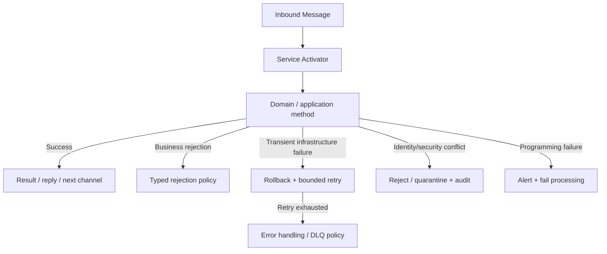
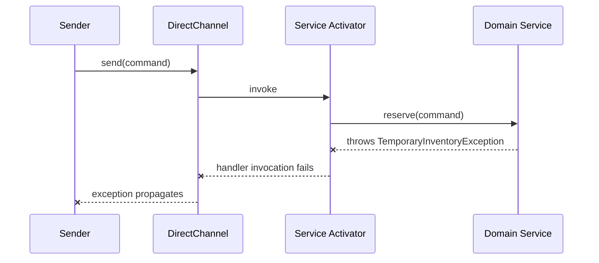
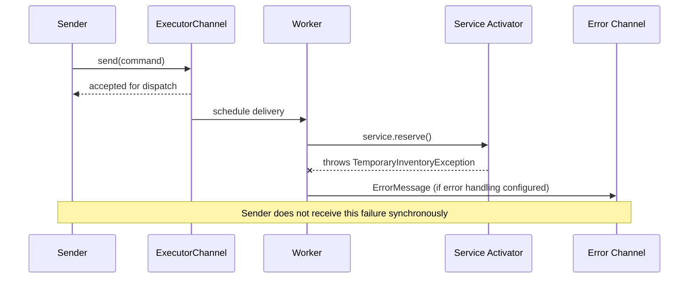
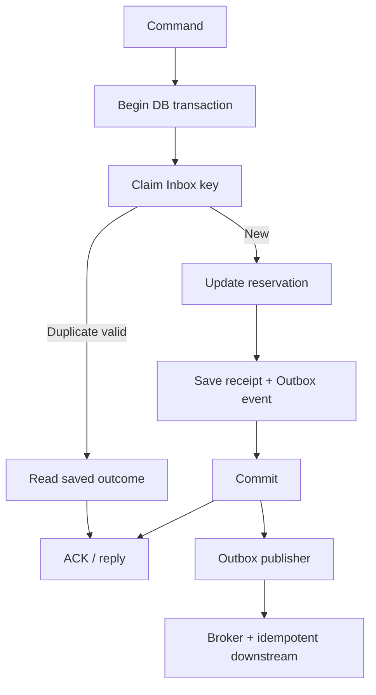

# Handling Exceptions from Service Methods

## 1. The problem: a service method throws an exception inside a message flow

A system receives a stock-reservation request before confirming an order. A message enters Spring Integration, a Service Activator calls `InventoryReservationService.reserve(...)`, and the method can return a result or throw an exception:

```text
ReservationRequested(tenant-a, order-105, SKU-A, qty=2)
    -> Service Activator
    -> InventoryReservationService.reserve(...)
       |
       +-- reservation succeeds         -> ReservationReceipt
       +-- insufficient stock           -> StockUnavailableException
       +-- eventId reused with diff data -> ReservationConflictException
       +-- database temporarily down    -> TemporaryInventoryException
```

The application **cannot treat these four outcomes identically**. For a business error, the caller needs a clear answer; for a temporary database outage, retries may help; for an identity conflict, quarantine/investigation is needed; for a programming bug, never disguise it as “out of stock.”

A **Service Activator** is an Enterprise Integration Pattern (EIP) that connects a message to an application execution method. When the method throws an exception, the exception does not automatically turn into a valid business message. How it is handled depends on the channel type, endpoint, gateway, transaction, and adapter.

In the **Service activator** chapter of the **SPRING_INTEGRATION_PATTERN** module, we learn to build loosely coupled, extensible Enterprise Integration Patterns flows with Spring Integration—combining Router, Filter, Transformer, Splitter, Aggregator, Gateway, retry, error channel, and correlation, while practicing testing and observing multiple execution branches.



**Focus:** Keep a clear boundary between **service exceptions**, **how Spring Messaging transports exceptions**, and **business decisions for failures**. Never treat every exception as bad input, and never assume every error automatically routes to the global `errorChannel`.

## 2. What does a Service Activator do—and not do?

In Spring Integration, a Service Activator can be registered with `@ServiceActivator` or Java DSL `.handle(...)`. It reads payload/headers from a message, invokes a Java method, and may emit a reply message if the method returns a result.

| Component | Responsibility |
| --- | --- |
| **Inbound adapter** | Receives HTTP/broker/JMS/file inputs and manages transport |
| **Message converter** | Deserializes into a typed Java payload |
| **Filter/Router** | Selects accepted messages and processing destinations |
| **Service Activator** | Invokes application logic from a message |
| **Domain/Application service** | Enforces business invariants, executes use case, transactions |
| **Error handler** | Classifies, observes, retries, or records failures |
| **MessageChannel** | Governs message dispatch mechanics and thread boundaries |
| **Gateway** | Provides a request–reply API for callers |
| **Idempotent Receiver** | Prevents repeated side effects when delivery is retried |

**A Service Activator does not automatically create transactions or exactly-once semantics.** If a service throws an exception after sending an email or calling an external API, unwinding the Java stack does not undo that side effect. To roll back a database, define proper transaction boundaries; to retry safely, enforce idempotency.

### 2.1. Two result shapes

A Service Activator can be request–reply:

```java
ReservationReceipt reserve(ReservationCommand command);
```

or one-way:

```java
void onReservedEvent(ReservationEvent event);
```

With request–reply, the caller can expect `ReservationReceipt` **or a contracted error outcome**. With `void`/`null`, never assume the framework automatically produces a reply for a waiting Gateway. When a method throws, how exceptions are observed and propagated to callers differs between synchronous and asynchronous paths.

### 2.2. An exception is not synonymous with an `ErrorMessage`

```text
service method throws exception
            |
            v
endpoint invokes method and handles throwable
            |
            +-- synchronous path: may propagate exception to sender/Gateway
            |
            +-- async/poller path: can publish an ErrorMessage
            |   when an error-handling strategy is configured
            |
            +-- application catches typed business error
                and returns a normal typed rejection result
```

`ErrorMessage` is a Spring Messaging message whose payload is a `Throwable`. It is not generated automatically in every scenario. In particular, on a `DirectChannel`, sending normally runs on the same call stack; errors can propagate directly back to the `send()` caller instead of traveling through an error channel as learners often assume.

## 3. Modeling `ReservationCommand`, results, and exceptions

A Java 17 example using records to focus on error-handling behavior.

### 3.1. Payload with stable identity

```java
record ReservationCommand(
        String tenantId,
        String eventId,
        String orderId,
        String sku,
        int quantity) {

    ReservationCommand {
        if (tenantId == null || tenantId.isBlank()
                || eventId == null || eventId.isBlank()
                || orderId == null || orderId.isBlank()
                || sku == null || sku.isBlank()
                || quantity <= 0) {
            throw new IllegalArgumentException(
                    "INVALID_RESERVATION_COMMAND");
        }
    }
}

record ReservationReceipt(
        String tenantId,
        String eventId,
        String reservationId,
        int reservedQuantity) {}
```

`eventId` is a **logical event/operation** identifier kept stable across retries, not the envelope message ID generated by Spring. `tenantId` must be verified against an authenticated identity at ingress: a non-blank check in the constructor **is not authorization**.

### 3.2. Exceptions with distinct semantics

```java
final class StockUnavailableException
        extends RuntimeException {
    StockUnavailableException() {
        super("STOCK_UNAVAILABLE");
    }
}

final class ReservationConflictException
        extends RuntimeException {
    ReservationConflictException() {
        super("RESERVATION_IDENTITY_CONFLICT");
    }
}

final class TemporaryInventoryException
        extends RuntimeException {
    TemporaryInventoryException(Throwable cause) {
        super("INVENTORY_TEMPORARILY_UNAVAILABLE", cause);
    }
}

final class InvalidReservationException
        extends RuntimeException {
    InvalidReservationException(String code) {
        super(code);
    }
}
```

**Do not put sensitive data inside exception messages.** Tenant IDs, customer IDs, account numbers, and raw payloads should never be printed into exception stacks or exposed publicly. For investigation, use tracking IDs and a secure audit store.

### 3.3. Classifying errors to make the right decision

| Exception or scenario | Category | Typical decision |
| --- | --- | --- |
| `StockUnavailableException` | Business rejection | Return `OUT_OF_STOCK`, no infinite hot-retry |
| `InvalidReservationException` | Contract/validation error | Return rejection or quarantine |
| `ReservationConflictException` | Same key, different payload | Reject/quarantine; never treat as a valid duplicate |
| `TemporaryInventoryException` | Transient dependency | Rollback + bounded retry/backoff |
| `TransientDataAccessException` | Transient DB | Retry transaction if policy permits |
| `SecurityException` | Unauthorized | Deny + security audit |
| Unexpected `NullPointerException` | Programming defect | Alert, fail processing; never label as user error |
| Gateway timeout | Liveness/reply deadline | Do not assume business operation rolled back |
| Broker ACK lost | Delivery uncertainty | Redelivery + idempotent receiver |

An “out of stock” business rule can change over time, yet for **the current order request** it is typically a rejection based on snapshot/contract. If business rules allow waiting for restocking, model `BACKORDER/PENDING` and its own SLA explicitly rather than hot-retrying every few milliseconds.

## 4. Service methods belong in the business layer; adapters only invoke and translate

Define a port independent of Spring Messaging:

```java
interface InventoryReservationService {
    ReservationReceipt reserve(ReservationCommand command);
}
```

A real implementation might:
1. Verify tenant ownership and ordering permissions.
2. Atomically claim idempotency key `(consumer, tenantId, eventId)`.
3. Compare payloads on duplicates.
4. Check available stock using appropriate transactions/locking.
5. Write reservation and outbox in the same transaction.
6. Return the receipt on first run or replay the outcome on duplicates.
7. Throw a typed exception if a business rule or infrastructure check fails.

Keep `Message<?>`, `replyChannel`, `errorChannel`, and Kafka/Rabbit objects out of the domain port. The integration layer turns messages into commands and translates exceptions into **transport/application outcomes**.

### 4.1. Annotation-based Service Activator

```java
import org.springframework.integration.annotation.ServiceActivator;
import org.springframework.stereotype.Component;

@Component
final class ReservationEndpoint {
    private final InventoryReservationService service;

    ReservationEndpoint(InventoryReservationService service) {
        this.service = service;
    }

    @ServiceActivator(inputChannel = "reservations.requests")
    public ReservationReceipt handle(ReservationCommand command) {
        // Service exceptions are not swallowed here.
        return service.reserve(command);
    }
}
```

In this flow, `handle` returns normally on success. If `service.reserve` throws, the exception may be wrapped by the framework in `MessageHandlingException` or another exception depending on the endpoint/call path. **Do not write tests tightly coupled to one exact wrapper exception type** when verifying a business cause.

### 4.2. Input channel configuration for the synchronous path

```java
import org.springframework.context.annotation.Bean;
import org.springframework.context.annotation.Configuration;
import org.springframework.integration.channel.DirectChannel;
import org.springframework.integration.config.EnableIntegration;
import org.springframework.messaging.MessageChannel;

@Configuration
@EnableIntegration
class ReservationChannels {
    @Bean("reservations.requests")
    MessageChannel requests() {
        return new DirectChannel();
    }
}
```

To run this example, the application needs component scanning or registration for `ReservationEndpoint`, plus a bean implementing `InventoryReservationService`. Under normal dispatch, `DirectChannel` invokes subscribers on the sender's thread, so synchronous exceptions typically propagate back to the sender.

### 4.3. Java DSL alternative

```java
import org.springframework.context.annotation.Bean;
import org.springframework.context.annotation.Configuration;
import org.springframework.integration.dsl.IntegrationFlow;

@Configuration
class ReservationDslFlow {

    @Bean
    IntegrationFlow reservationServiceFlow(
            InventoryReservationService service) {
        return IntegrationFlow.from("reservations.requests")
                .handle(ReservationCommand.class,
                        (command, headers) ->
                                service.reserve(command))
                .get();
    }
}
```

**This is an alternative topology**; do not register both `ReservationEndpoint` from section 4.1 and `ReservationDslFlow` on the same `DirectChannel`. A `DirectChannel` normally delivers each message to **one** subscriber per dispatch strategy; two competing endpoints cause unpredictable behavior. Pick one wiring style for a given test or application.

## 5. Exceptions on `DirectChannel`: what does the caller observe?

With a synchronous flow:



Illustrative caller code:

```java
import org.springframework.messaging.MessageChannel;
import org.springframework.messaging.support.MessageBuilder;

void sendReservation(
        MessageChannel requests,
        ReservationCommand command) {
    requests.send(MessageBuilder
            .withPayload(command)
            .build());
}
```

If the service throws, `send(...)` can throw a messaging exception carrying the cause, rather than returning `false`. A `send()` call returning `true` only means the message was accepted for dispatch per channel semantics; **it is not proof of a DB transaction commit across all channel types**.

### 5.1. Do not confuse error channels with caller catches

With a direct `DirectChannel`, exceptions travel up the sender's call stack. Defining a bean named `errorChannel` **does not guarantee** every synchronous exception becomes an `ErrorMessage`. To turn errors into outcomes on a request–reply path, use a typed adapter boundary, contracted Gateway error handling, or specific advice.

### 5.2. What if the service method returns `null`?

If a request–reply handler returns `null`, the reply path may have no message to send back to a waiting Gateway. `null` does not equal “structured processing failure.” A one-way handler returning `void` is valid; however, if callers expect a result, return `ReservationReceipt` or `ReservationRejected` instead of silently dropping it.

### 5.3. Exception cause chains

Exceptions from a service method can be wrapped by Spring Integration/Messaging; unwrapping the cause chain is useful for logging and classification, but bound the depth, avoid cycles, and preserve stack trace info. A `MessagingException` may reference `failedMessage` (carrying sensitive payloads/headers). **Never log the entire `failedMessage`** in public/unrestricted logs.

## 6. Synchronous Gateways: exceptions, rejected replies, and timeouts

A Gateway turns a Java method call into a message flow:

```java
import org.springframework.integration.annotation.Gateway;
import org.springframework.integration.annotation.MessagingGateway;

@MessagingGateway
interface ReservationGateway {
    @Gateway(
            requestChannel = "reservations.requests",
            replyTimeout = 5_000)
    ReservationReceipt reserve(ReservationCommand command);
}
```

To create the Gateway proxy, the application must enable component scanning for the interface, such as `@IntegrationComponentScan` or equivalent configuration in a context with `@EnableIntegration`. With a `DirectChannel` + receipt-returning Service Activator, reply routing is managed per call by the framework/Gateway.

**Three states that must never be conflated:**

| State | What caller observes | Meaning |
| --- | --- | --- |
| Handler returns `ReservationReceipt` | Successful reply | Result delivered per contract |
| Handler throws exception | Error propagates through Gateway, possibly wrapped | Not a receipt |
| Handler produces no reply before deadline | Timeout/missing reply per config | No certainty the backend stopped |

A Gateway timeout **does not automatically roll back** downstream side effects if the service or remote worker is still running. When callers retry, use a stable `eventId` and an Idempotent Receiver to prevent creating two reservations.

### 6.1. When to return a typed business rejection?

For user-facing APIs, “out of stock” is often an **expected business outcome**. You can model the outcome:

```java
sealed interface ReservationOutcome
        permits Reserved, Rejected {}

record Reserved(ReservationReceipt receipt)
        implements ReservationOutcome {}

record Rejected(
        String tenantId,
        String eventId,
        String reasonCode)
        implements ReservationOutcome {}
```

An integration adapter can catch **specific typed business exceptions** and return `Rejected`. Database/network errors and bugs must go through the failure path—**never** convert everything into `Rejected("UNKNOWN")` and ACK success.

### 6.2. Gateway return types must be consistent

If a Gateway declares `ReservationReceipt` as its return type, one branch cannot suddenly return `Rejected` and expect the caller to receive the right type. When both are needed, declare the Gateway returning `ReservationOutcome` (or a status-bearing response DTO) and configure the reply path for both accepted and rejected cases rather than returning an unexpected type.

### 6.3. A boundary helper translating business exceptions into outcomes

```java
final class ReservationOutcomeAdapter {
    private final InventoryReservationService service;

    ReservationOutcomeAdapter(InventoryReservationService service) {
        this.service = service;
    }

    ReservationOutcome reserve(ReservationCommand command) {
        try {
            return new Reserved(service.reserve(command));
        } catch (StockUnavailableException expected) {
            return new Rejected(
                    command.tenantId(),
                    command.eventId(),
                    "STOCK_UNAVAILABLE");
        } catch (InvalidReservationException expected) {
            return new Rejected(
                    command.tenantId(),
                    command.eventId(),
                    "INVALID_RESERVATION");
        }
        // Transient DB, security, and programming errors
        // still propagate to the failure path.
    }
}
```

This is an **alternative endpoint option** when the Gateway contract is `ReservationOutcome`. Do not use this helper while still declaring the Gateway to return `ReservationReceipt`. To avoid leaving business rejections “unprocessed” across redeliveries, decide whether rejection outcomes are terminal and persisted by event ID.

## 7. Classify exceptions by type, not by message strings

Some systems write:

```java
// ANTI-PATTERN:
if (exception.getMessage().contains("timeout")) {
    retry();
}
```

This breaks easily when exception messages change language, providers/versions upgrade, exceptions are wrapped, or messages contain user input. Use **stable exception types and error codes**.

### 7.1. Failure dispositions

```java
enum FailureDisposition {
    BUSINESS_REJECT,
    RETRY_TRANSIENT,
    SECURITY_DENY,
    QUARANTINE_CONFLICT,
    FAIL_FAST
}

record FailureDecision(
        FailureDisposition disposition,
        String reasonCode) {}
```

A decision only states **how an error category should be handled**. It does not ACK a broker, roll back a transaction, or write to a DLQ by itself. Those actions belong to the configured error handler/adapter.

### 7.2. Classifier decoupled from transport

```java
import org.springframework.dao.TransientDataAccessException;

final class ReservationFailureClassifier {

    FailureDecision classify(Throwable thrown) {
        Throwable current = thrown;

        for (int depth = 0; depth < 8 && current != null;
                depth++, current = current.getCause()) {
            if (current instanceof StockUnavailableException) {
                return new FailureDecision(
                        FailureDisposition.BUSINESS_REJECT,
                        "STOCK_UNAVAILABLE");
            }
            if (current instanceof InvalidReservationException) {
                return new FailureDecision(
                        FailureDisposition.BUSINESS_REJECT,
                        "INVALID_RESERVATION");
            }
            if (current instanceof ReservationConflictException) {
                return new FailureDecision(
                        FailureDisposition.QUARANTINE_CONFLICT,
                        "RESERVATION_IDENTITY_CONFLICT");
            }
            if (current instanceof SecurityException) {
                return new FailureDecision(
                        FailureDisposition.SECURITY_DENY,
                        "NOT_AUTHORIZED");
            }
            if (current instanceof TemporaryInventoryException
                    || current instanceof TransientDataAccessException) {
                return new FailureDecision(
                        FailureDisposition.RETRY_TRANSIENT,
                        "TEMPORARY_INFRASTRUCTURE_FAILURE");
            }
        }
        return new FailureDecision(
                FailureDisposition.FAIL_FAST,
                "UNCLASSIFIED_PROCESSING_FAILURE");
    }
}
```

**Example limitations:** an exception whose cause happens to be `StockUnavailableException` while the outer context is a different logic bug may need outer-exception precedence. If production uses deep wrapper hierarchies (`CompletionException`, `MessagingException`, HTTP exceptions), adjust and test the classifier so an incidental cause never overrides policy. Never treat all `IllegalArgumentException`s as bad user input; they can also be bugs.

## 8. Async channels: exceptions are no longer on the sender's call stack

With `ExecutorChannel`, the service runs on a different worker thread. The sender returns once the message is accepted for dispatch, **before the service method finishes**.



**Important condition:** worker failures can be sent via `MessagePublishingErrorHandler` to an error channel depending on channel/endpoint configuration. An executor rejecting a task at submission time can still throw on the sender's thread. Never assume every async exception automatically goes to a global `errorChannel`.

### 8.1. Configuring `ExecutorChannel` and a dedicated error channel

```java
import org.springframework.beans.factory.annotation.Qualifier;
import org.springframework.context.annotation.Bean;
import org.springframework.context.annotation.Configuration;
import org.springframework.integration.channel.DirectChannel;
import org.springframework.integration.channel.ExecutorChannel;
import org.springframework.integration.config.EnableIntegration;
import org.springframework.messaging.MessageChannel;
import org.springframework.scheduling.concurrent.ThreadPoolTaskExecutor;

@Configuration
@EnableIntegration
class AsyncReservationChannels {

    @Bean("reservationTaskExecutor")
    ThreadPoolTaskExecutor reservationTaskExecutor() {
        var executor = new ThreadPoolTaskExecutor();
        executor.setCorePoolSize(2);
        executor.setMaxPoolSize(4);
        executor.setQueueCapacity(50);
        executor.setThreadNamePrefix("reservation-");
        return executor;
    }

    @Bean("reservations.async.work")
    MessageChannel asyncWork(
            @Qualifier("reservationTaskExecutor")
            ThreadPoolTaskExecutor executor) {
        return new ExecutorChannel(executor);
    }

    @Bean("reservations.async.errors")
    MessageChannel asyncErrors() {
        return new DirectChannel();
    }
}
```

This is a **separate topology** from the synchronous `reservations.requests` channel. To complete it, register a handler on `reservations.async.work` and an `ErrorMessage` handler on `reservations.async.errors`.

An internal publisher can attach the error channel:

```java
import org.springframework.messaging.MessageChannel;
import org.springframework.messaging.MessageHeaders;
import org.springframework.messaging.support.MessageBuilder;

void publishAsync(
        MessageChannel asyncWork,
        MessageChannel asyncErrors,
        ReservationCommand command) {

    asyncWork.send(MessageBuilder.withPayload(command)
            .setHeader(MessageHeaders.ERROR_CHANNEL, asyncErrors)
            .build());
}
```

For each endpoint/adapter, write integration tests proving the error handler **actually receives `ErrorMessage`** and verify behavior when no subscriber/error channel exists. Never let untrusted callers pick error destinations arbitrarily; adapters must supply/allowlist internal channels.

### 8.2. One-way Service Activator

```java
import org.springframework.integration.annotation.ServiceActivator;
import org.springframework.stereotype.Component;

@Component
final class AsyncReservationEndpoint {
    private final InventoryReservationService service;

    AsyncReservationEndpoint(InventoryReservationService service) {
        this.service = service;
    }

    @ServiceActivator(inputChannel = "reservations.async.work")
    public void handle(ReservationCommand command) {
        service.reserve(command);
    }
}
```

A `void` method fits when the caller does not wait for a receipt via the same messaging call. If the workflow needs results, persist a queryable outcome, emit an event via outbox, or use a dedicated request–reply flow. A successful `send()` **does not prove a database commit** in an async handler.

### 8.3. Observing `ErrorMessage` safely

```java
import org.springframework.integration.annotation.ServiceActivator;
import org.springframework.messaging.MessagingException;
import org.springframework.messaging.support.ErrorMessage;
import org.springframework.stereotype.Component;

interface ReservationFailureReporter {
    void report(String reasonCode, String throwableType);
}

@Component
final class ReservationErrorObserver {
    private final ReservationFailureClassifier classifier =
            new ReservationFailureClassifier();
    private final ReservationFailureReporter reporter;

    ReservationErrorObserver(ReservationFailureReporter reporter) {
        this.reporter = reporter;
    }

    @ServiceActivator(inputChannel = "reservations.async.errors")
    public void observe(ErrorMessage error) {
        Throwable throwable = error.getPayload();
        FailureDecision decision = classifier.classify(throwable);
        reporter.report(
                decision.reasonCode(),
                throwable.getClass().getSimpleName());

        if (throwable instanceof MessagingException messaging) {
            // May contain failedMessage holding raw payload/headers.
            // Do not log or forward this object verbatim.
            var failedMessage = messaging.getFailedMessage();
        }
    }
}
```

The observer only measures/records errors; it **does not** perform rollbacks, ACK/NACK, retries, or DLQ persistence. If the error observer itself fails, failures can be lost if the error channel is only in-memory. Critical flows need dedicated durability and recovery policies.

### 8.4. Global `errorChannel` and dispatch

If the global error channel has multiple consumers, do not assume `DirectChannel` broadcasts errors to all of them: it normally picks **one subscriber**. When multiple observers are needed, consider `PublishSubscribeChannel` or emitting a durable error event for independent consumers.

## 9. Pollers and `QueueChannel`: no automatic requeue after exceptions

With `QueueChannel` and a poller, the sender has already left the call stack before the Service Activator runs.

```text
Producer -> QueueChannel -> Poller -> Service Activator
                                      -> method throws
                                 -> configured error handler
                                 -> recovery / retry policy
```

Questions you must answer:
- Which transaction manager/advice does the poller use?
- When is the message considered removed from the source?
- Does an exception return the message to the source?
- If the source is a broker, who decides ACK/NACK/DLQ?
- If `QueueChannel` is in-memory, do messages survive restarts?
- Is the error channel durable or only in-JVM?

Never assume “when the method throws, `QueueChannel` automatically puts the message back.” That depends on the source, adapter, poller, and transaction configuration.

### 9.1. Database transactions vs. broker transactions

A JDBC transaction manager does not automatically cover Kafka/Rabbit/JMS ACKs. One way to reduce risk is **Inbox + business update + Outbox in the same DB transaction** plus an Idempotent Receiver; if ACK fails after commit, the broker redelivers while the domain side effect never runs twice.

## 10. Retries must be bounded by exception type

Retries help on DB lock timeouts, brief connection drops, or transient dependencies. Do not hot-retry all errors:

```java
// ANTI-PATTERN: infinitely retrying every error.
try {
    service.reserve(command);
} catch (RuntimeException ignored) {
    retryForever(command);
}
```

For out-of-stock, identity conflicts, tenant spoofing, or code bugs, re-running the same input will never fix the root cause and can trigger retry storms.

### 10.1. `RequestHandlerRetryAdvice` with Spring Retry

```java
import java.util.HashMap;
import java.util.Map;
import org.springframework.context.annotation.Bean;
import org.springframework.context.annotation.Configuration;
import org.springframework.dao.TransientDataAccessException;
import org.springframework.integration.handler.advice.RequestHandlerRetryAdvice;
import org.springframework.retry.RetryPolicy;
import org.springframework.retry.backoff.ExponentialBackOffPolicy;
import org.springframework.retry.policy.SimpleRetryPolicy;
import org.springframework.retry.support.RetryTemplate;

@Configuration
class ReservationRetryConfiguration {

    @Bean
    RequestHandlerRetryAdvice reservationRetryAdvice() {
        Map<Class<? extends Throwable>, Boolean> retryable =
                new HashMap<>();
        retryable.put(TemporaryInventoryException.class, true);
        retryable.put(TransientDataAccessException.class, true);

        RetryPolicy policy =
                new SimpleRetryPolicy(3, retryable, true);

        var backoff = new ExponentialBackOffPolicy();
        backoff.setInitialInterval(100L);
        backoff.setMultiplier(2.0);
        backoff.setMaxInterval(1_000L);

        var template = new RetryTemplate();
        template.setRetryPolicy(policy);
        template.setBackOffPolicy(backoff);

        var advice = new RequestHandlerRetryAdvice();
        advice.setRetryTemplate(template);
        return advice;
    }
}
```

`SimpleRetryPolicy` illustrates traversing nested causes of framework exceptions, capped at three attempts. This is an **illustrative policy**; production needs max total attempts, deadlines, jitter/circuit breakers where appropriate, and a Spring Retry version compatible with your Spring Integration version.

### 10.2. Attaching advice to a Service Activator with Java DSL

```java
import org.springframework.context.annotation.Bean;
import org.springframework.context.annotation.Configuration;
import org.springframework.integration.dsl.IntegrationFlow;
import org.springframework.integration.handler.advice.RequestHandlerRetryAdvice;

@Configuration
class ReservationRetryFlow {

    @Bean
    IntegrationFlow retryReservationHandler(
            InventoryReservationService service,
            RequestHandlerRetryAdvice reservationRetryAdvice) {

        return IntegrationFlow.from("reservations.retry.input")
                .handle(ReservationCommand.class,
                        (command, headers) ->
                                service.reserve(command),
                        endpoint ->
                                endpoint.advice(reservationRetryAdvice))
                .get();
    }
}
```

Register a bean for the input channel `reservations.retry.input` when using this topology. Do not register another competing handler on the same channel unintentionally.

Once retries are exhausted, the exception normally continues down the endpoint/adapter's failure path. Advice **does not automatically create a durable DLQ**. Any recovery callback (if used) must reliably record the terminal disposition before reporting “handled.”

### 10.3. Retries must create transaction attempts properly

A common mistake is opening one DB transaction **outside the entire retry block** and re-running queries inside an already aborted/rollback-only transaction. The intended design is usually:

```text
Retry advice (outer)
  attempt 1 -> transaction A -> rollback
  backoff
  attempt 2 -> transaction B -> commit
```

If the `@Transactional` service is invoked through its Spring proxy inside each attempt, a fresh transaction can open per propagation rules. If retries run **inside** an outer transaction or self-invocation bypasses the proxy, behavior changes. Test against a real DB and real transaction manager, not just mocked methods.

### 10.4. Multiple retry layers multiply call counts

A Gateway client retrying 3 times, advice retrying 3 times, and a broker redelivering 3 times can produce many attempts. Idempotency stops duplicate side effects but does not eliminate DB/CPU load. Enforce retry budgets, backoff, deadlines, per-attempt metrics, and quarantine when recovery fails.

## 11. Exceptions and rollbacks do not undo external side effects

A service might do:

```text
BEGIN DB transaction
  update inventory
  send email / payment request / broker event
  throw exception
ROLLBACK DB
```

A database rollback **does not recall** an already-sent email, payment, or broker event. When the message is redelivered, external side effects can repeat.

### 11.1. Inbox/Outbox and idempotent receivers



When the Inbox claim, domain update, receipt, and outbox are written in the same DB transaction, they commit or roll back together. Broker ACKs and external APIs are **not** part of that transaction without dedicated coordination.

### 11.2. ACK lost after commit

```text
t0: reserve() commits DB
t1: ACK fails due to network error
t2: broker redelivers same eventId
t3: Inbox detects duplicate -> returns saved receipt
t4: stock is not reserved a second time
```

The idempotency key should be `(consumerName, tenantId, eventId)`, adding a verified source when event IDs are unique only per source. **Same key, different content** must be treated as a conflict, never silently ACKed as a valid duplicate.

### 11.3. Errors requiring distinct decisions

| Scenario | Handling |
| --- | --- |
| DB uncommitted, exception | Rollback, bounded retry if transient |
| DB committed, broker ACK fails | Redelivery + idempotent replay |
| External payment status unknown | Query/reconcile via stable payment idempotency key |
| `ErrorMessage` only in memory | Do not assume durability |
| Duplicate already committed | Replay outcome; do not re-run side effects |
| Same `eventId` but different SKU/quantity | Conflict/quarantine |
| Service programmer bug | Alert and failure path; do not disguise as terminal input rejection |

## 12. Broker ACK/NACK, `ErrorMessage`, and DLQ differ

When the inbound adapter comes from Kafka, RabbitMQ, or JMS, a Service Activator exception **can** affect ACK/NACK/requeueing depending on the listener container, error handler, retry, and transaction configuration. The `@ServiceActivator` annotation itself does not define broker ACK policy.

| Failure point | What can happen | What to guarantee |
| --- | --- | --- |
| Before DB commit | Business transaction rolls back | Event can be retried if transient |
| DB commit before ACK | Broker redelivery | Side effect still executes only once |
| ACK before commit | Crash loses the event | Never ACK early before meeting processing criteria |
| `ErrorMessage` sent to in-memory `DirectChannel` | App crash loses trace | Durable failure record if needed |
| Durable quarantine/DLQ | Manual replay possible | Retention, access control, idempotency |
| Retries exhausted | Budget spent | Explicit terminal/recovery disposition |

**Error channels are not DLQs**: an in-memory `ErrorMessage` does not durably store the raw broker message. Only issue a terminal ACK once the failure disposition is persisted per contract; never write `catch(Exception ignored) { ack(); }`.

### 12.1. Distinguishing retryable vs. non-retryable

- `StockUnavailableException`: return business outcome per contract; no infinite hot-retry.
- `InvalidReservationException`: reject/quarantine invalid input.
- `ReservationConflictException`: conflict; investigate source/replay.
- `TemporaryInventoryException`: bounded retry with backoff.
- `SecurityException`: deny + audit; never retry like a DB timeout.
- Unexpected NPE: alert/code fix; never return success.
- Broker adapter error: check where the exception came from (conversion, scheduling, handler, ACK) rather than lumping everything into domain failure.

## 13. Error contract for callers and operations

Callers need to know whether stock was reserved, rejected, still pending, or in an uncertain state. Ops need error categories, attempt counts, correlation, and replay targets.

```java
enum ReservationStatus {
    RESERVED, REJECTED, PENDING, UNKNOWN
}

record ReservationResult(
        String tenantId,
        String eventId,
        ReservationStatus status,
        String reservationId,
        String reasonCode) {}
```

| Result | Meaning |
| --- | --- |
| `RESERVED` | Receipt/DB commit confirmed per contract |
| `REJECTED` | Terminal business decision |
| `PENDING` | Async work still in flight |
| `UNKNOWN` | Timeout or state cannot yet be verified |

**Never turn a Gateway timeout into a business `FAILURE`**: the backend service may have committed. Callers should retain a stable `eventId` and use a status-lookup/reconciliation API for safe retries.

### 13.1. Example error mapping to HTTP/APIs

| Case | Suggested HTTP response | Messaging outcome |
| --- | --- | --- |
| Success | 200/201 per use case | `ReservationReceipt` |
| Invalid input | 400/422 | Rejected with reason code |
| Out of stock | 409 or business code | `STOCK_UNAVAILABLE` |
| Idempotency conflict | 409 | Conflict/quarantine |
| Temporary service outage | 503/504 or `PENDING` | Recoverable failure |
| Unauthorized | 401/403 per auth state | Deny |
| Uncertain after timeout | 202/`PENDING` or status query | Correlation/reconciliation |

These HTTP codes are **suggested protocol choices**; Spring Integration does not derive them from the Java exception types in this lesson automatically. Never expose raw stack traces or `failedMessage` in public responses.

## 14. Observability and protecting error data

Useful fields:
- Trusted event ID, stage, source, correlation/trace context;
- Stable error category/reason code;
- Attempt count, retry budget/exhaustion;
- Transaction commit/rollback when state is known;
- Latency and durable DLQ/quarantine reference;
- Indicators for redelivery or duplicates.

### 14.1. Suggested metrics

| Metric | Meaning |
| --- | --- |
| `service_activator.invocations.total` | Total handler invocations |
| `service_activator.success.total` | Successful executions |
| `service_activator.business_reject.total` | Business rejections |
| `service_activator.transient_failure.total` | DB/network failures |
| `service_activator.security_deny.total` | Security failures |
| `service_activator.retry.attempts` | Retried attempts |
| `service_activator.retry.exhausted.total` | Exhausted retry budgets |
| `service_activator.error_publish.failed.total` | Failures publishing error events |
| `service_activator.processing.duration` | P50/P95/P99 |
| `service_activator.transaction.rollback.total` | DB rollbacks |
| `service_activator.dlq.backlog` | Items awaiting recovery |
| `service_activator.duplicate.suppressed.total` | Redeliveries causing no extra side effects |

These are **application-instrumented names**, not a list Spring Integration auto-exposes in every version. Metric labels should come from finite sets like `consumer`, `disposition`, `exceptionFamily`, and `stage`; never use high-cardinality `eventId`, `tenantId`, or raw SKU as labels.

### 14.2. Never log raw `Throwable`s containing `failedMessage`

`MessagingException.getFailedMessage()` may contain sensitive payloads/headers. Never dump the full `Throwable`/`Message` to unrestricted logs. Emit a sanitized error summary with tracking ID, reason code, and trace reference; store raw payloads only in a secure quarantine store if needed, with ACLs, encryption, and retention.

## 15. Unit tests: exception classification and business rejection

A key test verifies **business errors are not retried like infrastructure errors**, while `TemporaryInventoryException` is never turned into a `Rejected` result that ACKs and drops the message. The tests below use JUnit 5 without a broker or database.

### 15.1. Typed-exception classifier

```java
import org.junit.jupiter.api.Test;
import org.springframework.messaging.MessageHandlingException;
import org.springframework.messaging.support.MessageBuilder;

import static org.junit.jupiter.api.Assertions.*;

class ReservationFailureClassifierTest {

    private final ReservationFailureClassifier classifier =
            new ReservationFailureClassifier();

    @Test
    void businessRejectionIsNotTransient() {
        var result = classifier.classify(
                new StockUnavailableException());

        assertEquals(FailureDisposition.BUSINESS_REJECT,
                result.disposition());
        assertEquals("STOCK_UNAVAILABLE", result.reasonCode());
    }

    @Test
    void temporaryFailureMayBeRetried() {
        var result = classifier.classify(
                new TemporaryInventoryException(
                        new IllegalStateException("connection lost")));

        assertEquals(FailureDisposition.RETRY_TRANSIENT,
                result.disposition());
    }

    @Test
    void nestedMessagingExceptionPreservesCause() {
        var command = new ReservationCommand(
                "tenant-a", "evt-105",
                "order-105", "SKU-A", 2);

        var wrapped = new MessageHandlingException(
                MessageBuilder.withPayload(command).build(),
                new StockUnavailableException());

        var result = classifier.classify(wrapped);
        assertEquals(FailureDisposition.BUSINESS_REJECT,
                result.disposition());
    }

    @Test
    void conflictIsQuarantinedNotRetried() {
        var result = classifier.classify(
                new ReservationConflictException());

        assertEquals(FailureDisposition.QUARANTINE_CONFLICT,
                result.disposition());
    }

    @Test
    void programmingErrorIsNotSilentlyMarkedInvalid() {
        var result = classifier.classify(
                new NullPointerException("unexpected"));

        assertEquals(FailureDisposition.FAIL_FAST,
                result.disposition());
    }
}
```

Test classification by **exception type**, not by comparing full stack traces or message strings. If the app uses deep `CompletionException`/`MessagingException` wrappers, add tests for nested causes and outer/inner precedence rules.

### 15.2. Outcome adapter does not swallow transient errors

```java
import org.junit.jupiter.api.Test;
import static org.junit.jupiter.api.Assertions.*;
import static org.mockito.Mockito.*;

class ReservationOutcomeAdapterTest {
    private final ReservationCommand command =
            new ReservationCommand(
                    "tenant-a", "evt-105",
                    "order-105", "SKU-A", 2);

    @Test
    void outOfStockReturnsTypedBusinessRejection() {
        var service = mock(InventoryReservationService.class);
        when(service.reserve(command))
                .thenThrow(new StockUnavailableException());

        var outcome = new ReservationOutcomeAdapter(service)
                .reserve(command);

        assertInstanceOf(Rejected.class, outcome);
        assertEquals("STOCK_UNAVAILABLE",
                ((Rejected) outcome).reasonCode());
        verify(service).reserve(command);
    }

    @Test
    void dbOutageStillPropagates() {
        var service = mock(InventoryReservationService.class);
        when(service.reserve(command))
                .thenThrow(new TemporaryInventoryException(
                        new IllegalStateException("db outage")));

        assertThrows(TemporaryInventoryException.class,
                () -> new ReservationOutcomeAdapter(service)
                        .reserve(command));
    }
}
```

This tests the adapter contract; it does not prove gateway/error-channel wiring. Integration tests cover those.

## 16. Integration test: exceptions from Service Activator over `DirectChannel`

Calling `service.reserve(command)` directly does not show whether `@ServiceActivator` was processed by Spring. Use Spring Test to register the channel, endpoint, and a mock domain port.

### 16.1. Spring Integration context with `DirectChannel`

```java
import org.junit.jupiter.api.AfterEach;
import org.junit.jupiter.api.Test;
import org.springframework.beans.factory.annotation.Autowired;
import org.springframework.beans.factory.annotation.Qualifier;
import org.springframework.context.annotation.Bean;
import org.springframework.context.annotation.Configuration;
import org.springframework.messaging.MessageChannel;
import org.springframework.messaging.support.MessageBuilder;
import org.springframework.test.context.junit.jupiter.SpringJUnitConfig;

import static org.junit.jupiter.api.Assertions.*;
import static org.mockito.Mockito.*;

@SpringJUnitConfig(classes = {
        ReservationChannels.class,
        ReservationEndpoint.class,
        ReservationServiceActivatorIT.Dependencies.class
})
class ReservationServiceActivatorIT {

    @Autowired
    @Qualifier("reservations.requests")
    MessageChannel input;

    @Autowired
    InventoryReservationService service;

    private final ReservationCommand command =
            new ReservationCommand(
                    "tenant-a", "evt-105",
                    "order-105", "SKU-A", 2);

    @AfterEach
    void resetMocks() {
        reset(service);
    }

    @Test
    void happyPathCallsDomainOnce() {
        when(service.reserve(command)).thenReturn(
                new ReservationReceipt(
                        "tenant-a", "evt-105", "res-105", 2));

        // A reply-producing handler needs a reply destination.
        var replies = new org.springframework.integration.channel.QueueChannel();
        assertTrue(input.send(
                MessageBuilder.withPayload(command)
                        .setHeader(
                                org.springframework.messaging.MessageHeaders.REPLY_CHANNEL,
                                replies)
                        .build()));
        var reply = replies.receive(1_000);
        assertNotNull(reply);
        assertInstanceOf(ReservationReceipt.class, reply.getPayload());
        verify(service).reserve(command);
    }

    @Test
    void serviceExceptionPropagatesToSender() {
        when(service.reserve(command))
                .thenThrow(new StockUnavailableException());

        RuntimeException failure = assertThrows(
                RuntimeException.class,
                () -> input.send(
                        MessageBuilder.withPayload(command).build()));

        assertTrue(hasCause(
                failure, StockUnavailableException.class));
        verify(service).reserve(command);
    }

    private static boolean hasCause(
            Throwable error, Class<? extends Throwable> kind) {
        Throwable current = error;
        for (int i = 0; i < 12 && current != null; i++) {
            if (kind.isInstance(current)) {
                return true;
            }
            current = current.getCause();
        }
        return false;
    }

    @Configuration
    static class Dependencies {
        @Bean
        InventoryReservationService reservationService() {
            return mock(InventoryReservationService.class);
        }
    }
}
```

**How to read this test:** `DirectChannel` executes synchronously, so verifying the mock right after `send()` makes sense. Because the handler returns `ReservationReceipt`, the test sets `REPLY_CHANNEL` to a `QueueChannel` so the result has a valid destination. The test also verifies the exception contains the business cause, **without claiming** it enters a global error channel or that the caller must see one fixed wrapper class. To verify real Gateway reply handling, register the Gateway and test through its request–reply interface.

### 16.2. Gateway test scenarios

| Service method / flow | What to assert |
| --- | --- |
| Returns receipt successfully | Caller receives matching `eventId`/receipt |
| Throws `StockUnavailableException` | Caller gets typed rejection or contracted exception |
| Throws `TemporaryInventoryException` | Retry/error path is triggered |
| Handler returns `null` | No receipt magically appears |
| Handler slower than `replyTimeout` | Timeout per Gateway configuration |
| Worker commits yet reply is lost | State must be reconciled, not assumed rolled back |
| Two requests arrive and replies return out of order | Never cross-wired to wrong caller |
| `replyChannel` header lost in Transformer | Test catches broken reply routing |

If the Gateway return type is `ReservationReceipt`, you cannot arbitrarily return `Rejected` on one branch without updating the interface/contract. Pick a unified outcome type or map exceptions at the API boundary.

## 17. Testing async error channels and transactions/retries

### 17.1. Integration scenario for `ExecutorChannel`

```text
Given:
  ExecutorChannel reservations.async.work
  ERROR_CHANNEL = reservations.async.errors
  Service method throws TemporaryInventoryException

When:
  Producer sends message
  Worker invokes service and fails

Then:
  Sender need not see domain exception synchronously
  Configured error handler receives an ErrorMessage
  Failure classifier returns RETRY_TRANSIENT
  Reporter records sanitized reasonCode
  No success event is published
```

With asynchronous processing, tests use `CountDownLatch` or Mockito `timeout(5000)` for bounded waiting, never `Thread.sleep(...)` as proof. If the error observer does not receive `ErrorMessage`, check the actual endpoint error handler, `ERROR_CHANNEL` header, subscribers, executor rejections, and how that Spring Integration version dispatches errors. Never “make a test green” by skipping the error path.

### 17.2. Unit testing the observer is not testing error delivery

You can manually construct `new ErrorMessage(new TemporaryInventoryException(...))` and send it to `reservations.async.errors` to test the observer. That **only** proves the observer handles a message; it **does not prove** service errors on worker threads actually route to that channel. Testing wiring separately is essential.

### 17.3. Testing with a real DB/transaction

| Scenario | What must be verified |
| --- | --- |
| Throw before commit | Business update and Inbox roll back together |
| First retry fails, second succeeds | Both attempts have valid transactions; final commit happens once |
| Two concurrent deliveries with same `eventId` | One side effect committed |
| ACK lost after commit | Redelivery only replays the receipt |
| Same key, different payload | Conflict; wrong duplicate rejected |
| Outbox insert fails | Business update rolls back |
| Outbox publish succeeds, publisher ACK lost | Downstream remains idempotent |
| Domain service self-invocation with `@Transactional` | Real proxy and transaction scope verified |
| Gateway timeout after commit | Status query reflects commit; no new ID created |
| Error channel has no subscriber | Failure does not vanish under a false success |

Mock repositories cannot prove locking, transaction isolation, or unique constraints. When testing atomicity, use a production-equivalent database such as PostgreSQL Testcontainers with the real schema.

### 17.4. Assert state rather than only method call counts

A valid retry may call the method twice—first rolling back, second committing—which is **not** a duplicate business side effect. For durability tests, assert:
- Final DB state has only one reservation;
- Inbox records one logical event;
- Outbox has a stable event ID;
- Retry attempts and transaction rollbacks are observed;
- No unreconcilable external side effects occurred;
- Redeliveries do not alter the outcome.

## 18. Troubleshooting: diagnosing exceptions from service methods

Not every symptom originates inside the service method itself. The same exception behaves differently across a Gateway, `ExecutorChannel`, poller, or broker adapter.

| Symptom | Likely cause | Where to check |
| --- | --- | --- |
| `send()` throws immediately | `DirectChannel` handler failed or executor scheduling failed | Channel type, root cause, thread |
| `send()` succeeds yet DB does not update | Async worker failed after dispatch | Error handler, worker logs, transaction |
| `errorChannel` receives no `ErrorMessage` | Synchronous error path or wrong error handler config | Endpoint type, `ERROR_CHANNEL` header, subscribers |
| Gateway just times out when out of stock | Handler dropped/`null`, no rejection reply | Gateway contract and reply path |
| Service method called twice | Retry advice, broker redelivery, duplicate subscribers | Retry attempts, `eventId`, unique Inbox |
| Method called once yet DB duplicates | Transaction/SQL update outside Idempotent Receiver | DB state and unique constraints |
| DB rolled back yet email was sent | External side effect outside transaction | Outbox or provider idempotency |
| Retries keep failing on DB | Retrying inside an aborted transaction or non-transient error | Transaction order, rollback-only |
| Security error gets retried | Overly broad classifier | Typed exceptions, security denial path |
| Error observer logs error yet broker still retries | Observer does not control ACK | Listener container error handler |
| Two error observers, only one called | Competing `DirectChannel` dispatch | `PublishSubscribeChannel`/durable event |
| Header lost when Transformer runs | Missing reply/correlation context propagation | Header propagation tests |
| Cannot locate root cause | Deeply wrapped exceptions | Bounded cause inspection, sanitized logging |
| DLQ replay creates another reservation | Inbox retention expired or `eventId` changed | Stable key, retention window |
| Unclassified exceptions spike after deploy | Bug/dependency change or new exception | Release diff, classifier contract |
| CPU spikes abnormally during DB outage | Layered retries without backoff | Attempt budgets, circuit breakers, metrics |

### 18.1. Investigating along a single logical event

For `eventId=evt-105`, trace:
1. Did the inbound adapter verify tenant/source and deserialize properly?
2. Which channel did the message enter, with what `MessageHeaders.ID` and `eventId`?
3. How many Service Activator invocations and attempts occurred?
4. Did the exception occur **before**, **during**, or **after** the DB transaction?
5. Did Inbox/outbox/receipt commit or roll back?
6. Was an `ErrorMessage` published? To which channel? Is there a subscriber?
7. Was the broker record ACKed, NACKed, requeued, or sent to DLQ per adapter policy?
8. If the caller timed out, is the current business state queryable?
9. Do redeliveries share the same stable `eventId` and fingerprint?
10. Were any external side effects unprotected by transactions?

Do not rely solely on Service Activator logs. The **source of truth** for whether a reservation occurred is usually the DB/business ledger, not how many times a Java method ran.

### 18.2. When scaling up or changing channel types

Refactoring from `DirectChannel` to `ExecutorChannel` can alter:
- Execution thread;
- When the sender observes failures;
- Where `ErrorMessage` is published;
- Whether transaction context propagates;
- Backpressure/executor queue saturation;
- Message processing order;
- How tests must await results;
- Correlation between request and reply.

Never treat changing channel types as a purely performance-related tweak with no semantic impact. Re-run exception, transaction, idempotency, and Gateway test suites whenever channels change.

## 19. Common anti-patterns

1. **Catching every exception in a Service Activator and returning success** so the system looks “stable.”
2. **Retrying every `RuntimeException`** and accidentally retrying security, validation, or conflict errors.
3. **Assuming `ErrorMessage` is always created** whenever a service method throws.
4. **Assuming `DirectChannel` always routes errors to global `errorChannel`**, ignoring exceptions at the sender.
5. **Assuming `ExecutorChannel` returns worker exceptions to an already-completed `send()` call**.
6. **Treating an in-memory `ErrorMessage` as a durable DLQ**, losing error traces on app restart.
7. **Letting a Gateway receive `null` when a receipt is required**, then treating timeouts as business rejections.
8. **Declaring a Gateway returning `ReservationReceipt` while error branches return `Rejected`** with inconsistent types.
9. **Matching substrings of exception messages to decide retries**, instead of typed error policies.
10. **Placing retries inside a rollback-only transaction**, causing every subsequent attempt to fail.
11. **Using self-invocation with `@Transactional`**, assuming the service is always protected by a proxy.
12. **Sending emails/charging payments directly inside a transaction** believing rollbacks cancel them.
13. **ACKing the broker before business state reaches durable persistence**, causing lost messages.
14. **Lacking idempotency when brokers redeliver**, causing duplicate side effects.
15. **Generating a new `eventId` on every attempt**, breaking idempotency keys.
16. **Treating same key / different payload as a valid duplicate**, masking identity conflicts.
17. **Logging `ErrorMessage` with no recovery disposition**, while reporting processing complete.
18. **Dumping raw payloads, credentials, and `failedMessage` into public error logs/DLQs**.
19. **Subscribing two handlers to a `DirectChannel` expecting broadcast**, when only one receives each message.
20. **Never testing exceptions against real brokers/adapters**, relying solely on mocked methods.
21. **Leaving retries/deadlines unbounded**, triggering retry storms during DB outages.
22. **Failing to separate out-of-stock from DB failures**, returning wrong business decisions.
23. **Treating timeouts as rollbacks**, even though the backend may have committed.
24. **Not versioning error responses/reason codes**, forcing clients to parse text messages.
25. **Asserting only service invocation counts**, ignoring committed state and outbox rows.
26. **Ignoring how Router/Filter/Splitter/Aggregator affect error paths**, losing rejected outcomes or stalling waiting for missing children.
27. **Changing channel types without updating sync/async tests**, letting production bugs slip through.

## 20. Practice exercises and self-assessment

**Exercise:** Build a flow receiving `PaymentAuthorized` and calling `OrderPaymentService.confirm(...)`. The service may return a result, reject per business rules, detect an event-key conflict, hit a temporary DB error, or encounter a payment-provider timeout.

1. Define `PaymentCommand` with tenant, stable `eventId`, `orderId`, amount, and currency.
2. Separate the domain port from Spring `Message<?>` and broker-specific types.
3. Create a synchronous `@ServiceActivator` on a `DirectChannel`, and test exception propagation to the sender.
4. Create an equivalent Java DSL **alternative** topology without registering competing subscribers.
5. Write a classifier separating business, validation, security, conflict, transient, and bug errors.
6. Build an outcome type like `ReservationOutcome` for payments so the Gateway returns both accepted and rejected outcomes.
7. Test that DB errors are not swallowed by adapters into seemingly successful rejections.
8. Create an `ExecutorChannel` with a bounded thread pool and dedicated error destination.
9. Configure an `ErrorMessage` handler logging sanitized reason codes.
10. Test that worker exceptions actually reach the error handler on the async channel.
11. Attach `RequestHandlerRetryAdvice` retrying only transient errors with backoff and attempt limits.
12. Test max attempts and verify validation/conflict errors are never retried.
13. Place transaction boundaries so each attempt runs inside a valid transaction.
14. Create an Inbox claim with a unique key on consumer/tenant/`eventId`.
15. Write Outbox events in the same transaction as payment state.
16. Simulate lost ACK after commit and confirm redelivery does not charge payment twice.
17. If the payment API times out with unknown status, query using the stable payment idempotency key.
18. Test that tenant spoofing is denied and logged to security audit.
19. In a batch with one invalid item, design a rejected outcome/completion marker so the Aggregator never stalls.
20. Instrument metrics for retry exhaustion, business rejections, transient errors, DLQ backlog, and callback latency.
21. Write a runbook for `UNKNOWN` status after a Gateway timeout.
22. Add an architecture test preventing the domain module from importing Kafka/Rabbit/Spring Message.

**Self-assessment:** Why doesn't a Service Activator create transactions automatically? When a domain method throws, how do `DirectChannel` and `ExecutorChannel` differ? Does every exception produce an `ErrorMessage`? When retrying DB work, where should transactions open? Why can a broker still redeliver after DB commit? What prevents double side effects? Does a Gateway timeout guarantee the backend rolled back? How do error channels and DLQs differ? When should you return a typed business rejection instead of throwing an exception?

**Handling exceptions from service methods** means explicitly designing error paths from application services to messaging channels, callers, brokers, and operations tooling. In Spring Integration, the Service Activator invokes a Java method, yet how exceptions continue depends on channels, Gateways, pollers, transactions, and inbound adapters. **Classify exceptions semantically, bound retries, protect transactions and idempotency, return contracted business outcomes, and test both synchronous and asynchronous flows** so messages are never lost and side effects never run twice.
