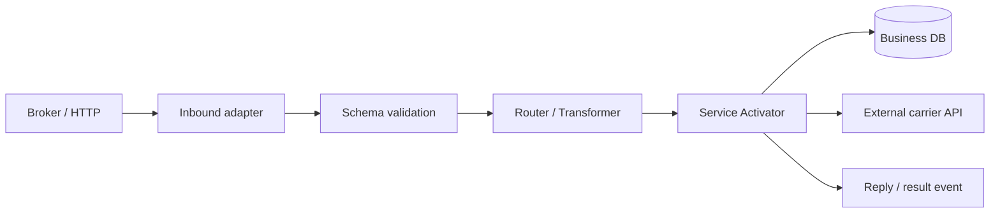
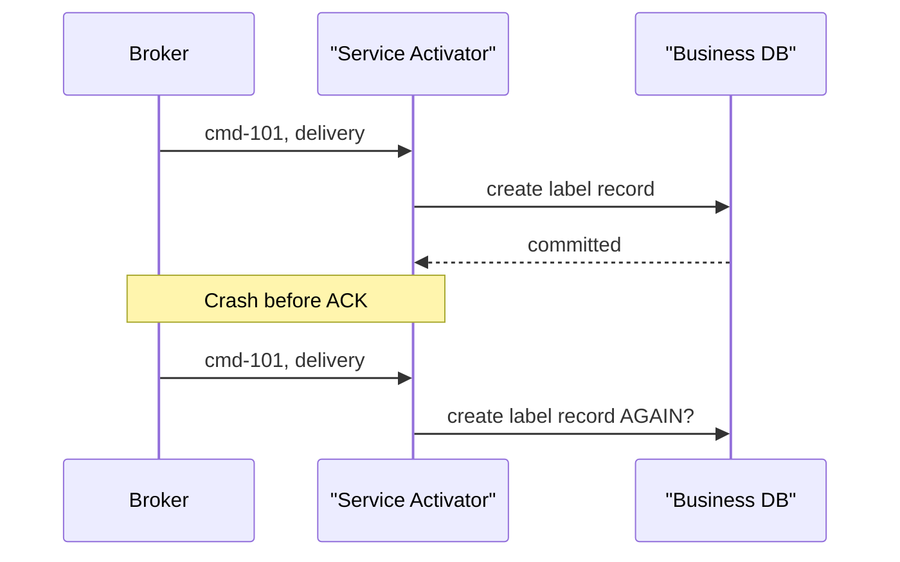
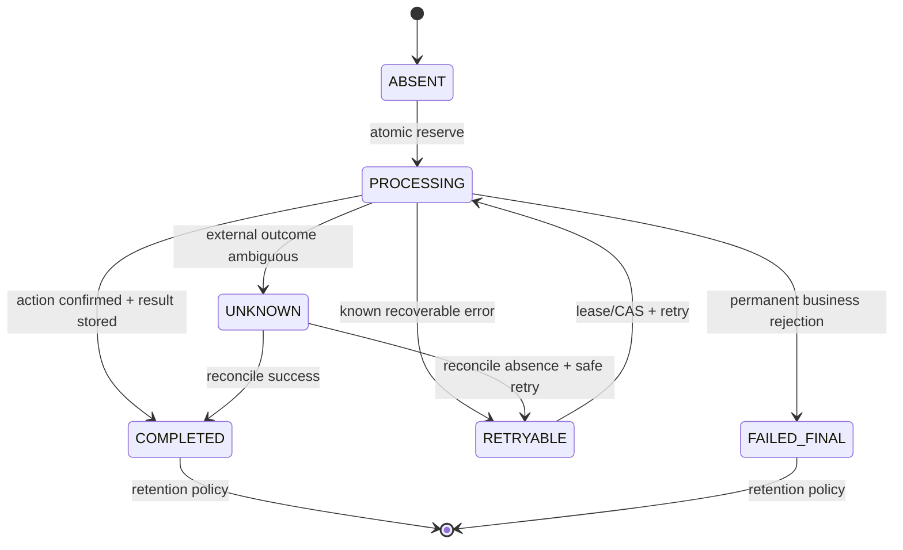
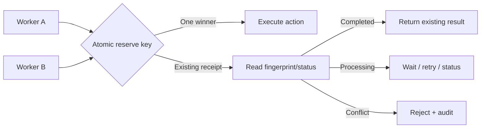
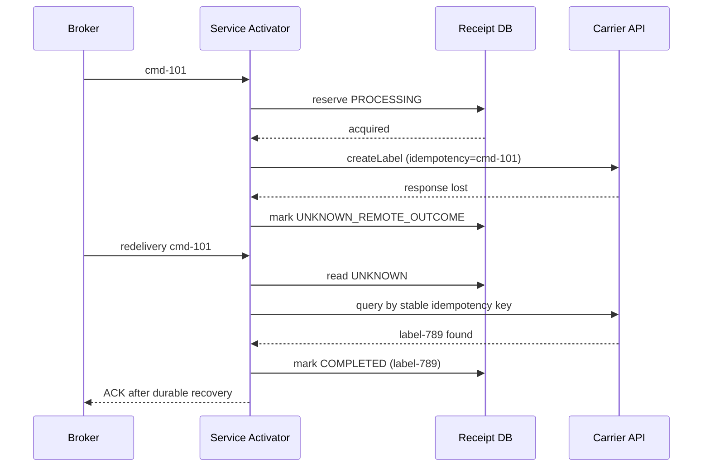
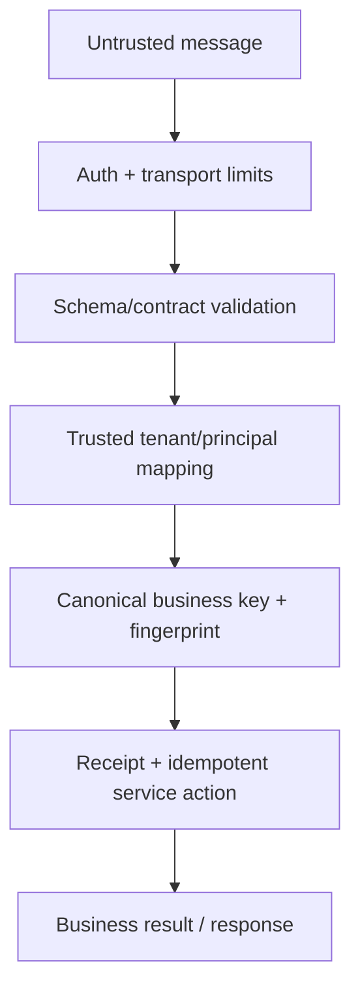
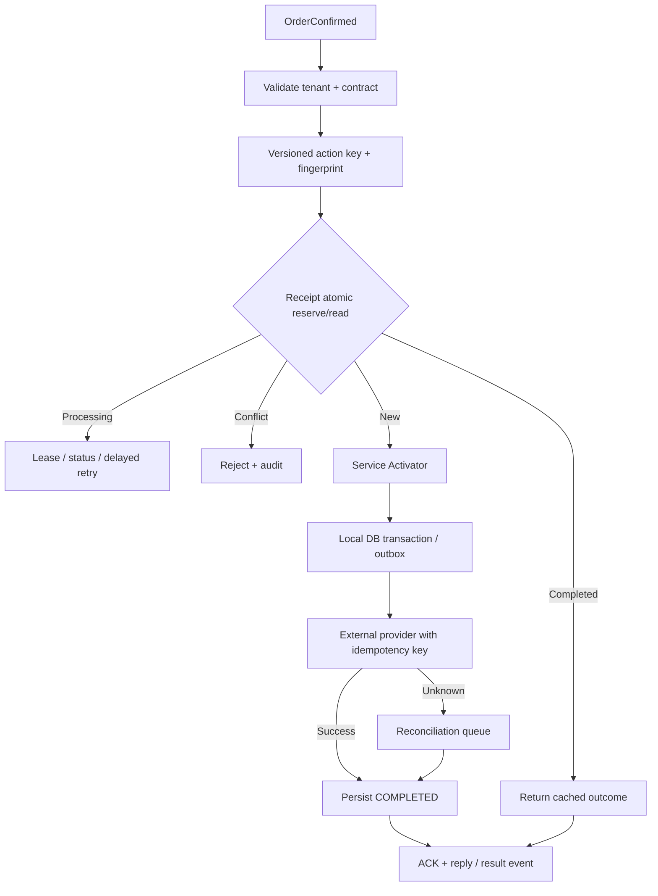

# Idempotency of Service Actions

A **Service Activator** in Spring Integration is an endpoint that connects a message to a method or service performing an action. It can invoke a business service to write to a database, generate a shipping label, reserve stock, submit a payment request, or emit a new event. Right here, a message turns into a **business side effect**, so duplicate message delivery is no longer solely a broker concern.

An event can be redelivered after the consumer finishes processing before sending an ACK; a Gateway can resend a request after a timeout; a Retry Advice can re-invoke the handler after a transient error; or an operator can replay from a dead-letter queue. If a Service Activator simply executes the action every time it is called, the application can **double-charge a customer, create two shipping labels, write two ledger entries, or send multiple commands to an external system**.

**Idempotency of service actions** means that when the same **stably identified business request** is passed into the service multiple times, the system preserves **the contracted outcome and side effects** without repeating disallowed mutations. This is the subject of this lesson in the **Service activator** chapter, module `SPRING_INTEGRATION_PATTERN`: learning to implement Enterprise Integration Patterns with Spring Integration to build loosely coupled, extensible message flows—coordinating Router, Filter, Transformer, Splitter, Aggregator, Gateway, retry, error channel, and correlation, while testing execution branches.

**After this lesson, you will be able to:**

- Distinguish **message delivery**, **handler invocation**, **business action**, **business result**, and **ACK**.
- Choose an **idempotency key** scoped to the unit of work rather than using an arbitrary technical UUID.
- Design a **receipt/inbox** with states `PROCESSING`, `COMPLETED`, retryable errors, and stored results.
- Use **unique constraints/atomic inserts**, DB transactions, and **business invariants** to stop two instances from producing duplicate side effects.
- Distinguish endpoint-level `IdempotentReceiverInterceptor` from **true service-action idempotency**.
- Write Spring Integration Java DSL, service-layer, and JUnit examples for duplicates, concurrency, and Gateway replies.
- Handle **external API side effects**: uncertain timeouts, leases, retries, outboxes, and reconciliation.
- Design ACKs, `errorChannel`, DLQs, audits, metrics, and retention without marking success prematurely.

## 1. At which boundary does a Service Activator sit?

A typical flow:



Spring Integration offers two familiar ways to trigger a service:

- **Annotation:** a method wired to a channel via `@ServiceActivator`.
- **Java DSL:** `.handle(...)` or a named endpoint handler configured inside an `IntegrationFlow`.

Both create an **action invocation point**; however, merely adding an endpoint **does not make the action idempotent**.

Example service:

```java
public ShippingLabel createLabel(ShippingCommand command) {
    // Call the carrier to create a label and store the result.
    return carrier.createLabel(command);
}
```

If this method is invoked twice with the same command and `carrier.createLabel()` generates a new label each time, the application is **not idempotent** even if the messages share the same `correlationId`.

### How a Service Activator differs from a pure Transformer

| Component | Primary purpose | Risk on re-invocation |
| --- | --- | --- |
| Pure Transformer | `f(payload) -> newPayload` with no side effects. | May cost CPU, yet normally recomputable. |
| Filter | Permits or drops messages by predicate/policy. | If the predicate writes state, it has side effects too. |
| Service Activator | Invokes a business action; may have side effects. | Can duplicate DB writes, remote commands, payments, emails. |
| Gateway | Request–reply with timeout/correlation. | Caller retries can trigger the same action again. |
| Aggregator | Collects a message group and emits one outcome. | Redeliveries/late messages can emit duplicate outcomes without policy. |

**Note:** Not every Service Activator has side effects. If a handler merely computes a value, it may be naturally idempotent. This lesson focuses on actions that **mutate state** or **call external systems**.

## 2. Defining idempotency accurately in business terms

In mathematics, an operation \(f\) is idempotent if:

\[
f(f(x)) = f(x)
\]

For service actions, a more practical phrasing is:

> Resending the same valid command with the **same idempotency identity** produces no new business effect beyond the permitted effect of the first execution.

Example:

```text
CreateShippingLabel(
  tenant=TENANT-A,
  commandId=cmd-101,
  parcelId=P-1
)
```

If the first run creates `label-789`, repeated runs for the same command must never create `label-790`, `label-791`, and so on. They may return the **same label** or report that the command is **in progress**, depending on the contract.

### Three levels that must be distinguished

1. **At-most-once invocation:** the handler runs at most once within a narrow scope. Does not guarantee business completion.
2. **At-least-once delivery:** the transport can redeliver until ACK/commit; the application must tolerate duplicates.
3. **Effectively-once business effect:** even when deliveries/handler invocations repeat, the domain effect happens once per **business key and protected boundary**.

Never claim **end-to-end exactly-once** when an action spans a database, a broker, and a remote HTTP API **outside a single transaction**.

### “Return the same result” vs. “succeed and indicate duplicate”?

Both strategies can be valid:

```text
Duplicate cmd-101 -> SAME_RESULT(label-789)
```

or:

```text
Duplicate cmd-101 -> ALREADY_COMPLETED(resultRef=label-789)
```

What matters is that the caller knows the outcome is **not a brand-new operation**. For Gateways/APIs, returning the cached business result is usually far more useful than silently dropping the message.

## 3. Why can a Service Activator run more than once?

Consider this timeline:



Common sources of repetition:

| Source | What happens | Boundary to protect |
| --- | --- | --- |
| **Consumer redelivery** | Worker commits DB before ACK/offset commit. | Service action receipt + transaction. |
| **Producer retry** | Broker may hold two records with the same event/command identity. | Consumer inbox/business key. |
| **HTTP/Gateway retry** | Client hits a timeout and resends an action. | API receipt **and** service action. |
| **Retry advice** | Exception triggers framework/caller re-invocation. | Do not repeat side effects when outcome is unknown. |
| **Manual replay/DLQ** | Operator replays an old event. | Durable receipt with sufficient retention. |
| **Multiple replicas** | Two instances receive the same business command nearly simultaneously. | Unique constraint/CAS on shared store. |
| **Scheduler/job restart** | Work is rescheduled after a crash. | Stable job/business identity. |

**A new Spring `MessageHeaders.id` does not prove this is new work.** Reconstructed messages during redelivery or transformation can get new IDs. Use a durable identity defined by the domain contract.

## 4. Choosing the right key for a service action

For a label-creation command, an idempotency key might be:

```text
(tenantId, operation, commandId)

(TENANT-A, CREATE_SHIPPING_LABEL, cmd-101)
```

If a `commandId` is only unique within one contract version, include `contractVersion` or `businessRevision` per design.

| Key candidate | Suitable? | Reason |
| --- | --- | --- |
| Stable `commandId` issued by ingress, scoped by tenant/operation | Usually suitable. | Stays constant when retrying the same action. |
| Domain `eventId` in an event consumer | Suitable for **event processing receipts**. | Must be scoped by consumer/operation. |
| `MessageHeaders.id` | Never as the sole business key. | Can change every time a Spring message is built. |
| Kafka offset/Rabbit delivery tag | Never replaces a business key. | Describes a record/delivery, not action intent. |
| `traceId` | No. | One trace can span multiple actions. |
| `correlationId` | Not by default. | The same workflow can trigger multiple actions. |
| `customerId` | Too broad. | A customer performs many valid actions. |
| `parcelId` alone | Depends on business rules. | Same parcel may get a new label after cancellation/revision. |
| `System.currentTimeMillis()` | No. | Every retry gets a different key. |

### Command-scoped keys vs. event-scoped keys

One command can emit multiple events:

```text
cmd-101
  -> evt-1001: ShippingLabelRequested
  -> evt-1002: ShippingLabelCreated
  -> evt-1003: NotificationQueued
```

If a consumer uses `commandId` globally to deduplicate **all event types**, it can mistakenly drop valid distinct events. Identify the **unit of idempotency at the action**, such as `(consumerName, eventId)` or `(tenant, operation, commandId)` depending on the service.

### When two payloads share the same key yet carry different data

```text
cmd-101, parcelId=P-1
cmd-101, parcelId=P-2
```

Never silently return `P-1`'s result and let the caller believe `P-2` succeeded. Store a **canonical request fingerprint** and reject with `IDEMPOTENCY_CONFLICT` when the same key carries a differing payload per contract.

## 5. Request fingerprints and hash limitations

A fingerprint should be computed from the fields that **define the meaning of the action**:

```text
canonical payload:
  operation = CREATE_SHIPPING_LABEL
  tenantId  = TENANT-A
  parcelId  = P-1
  carrier   = CARRIER-X
  revision  = 3

requestFingerprint = SHA-256(canonical bytes)
```

Do not hash raw JSON directly if insignificant whitespace or field order can vary. Use consistent canonicalization and version the rules.

**Be careful:**

- Hashing does not replace authentication or authorization.
- Hashing does not prevent replays by itself; you must store the key and state.
- If requests contain sensitive data, never log raw canonical payloads.
- For predictable fields, digests can be vulnerable to dictionary probing; never use fingerprints as a privacy mechanism for PII.
- If canonicalization changes across versions, replaying old data can trigger false conflicts. Store the fingerprint strategy version or preserve compatibility.

Store the receipt fingerprint **in the same transaction/lock** as the duplicate check to avoid check-then-act races.

## 6. Receipt store: “seen” does not mean “completed”

An implementation keeping only `Set<commandId>` falls into a classic trap:

```text
T1: add cmd-101 to seen
T2: call business service -> temporary failure
T3: broker redelivers cmd-101
T4: seen contains cmd-101 -> drop
```

Result: the command **never succeeded, yet every retry is dropped**.

Instead, define a receipt:

```text
ActionReceipt {
  tenantId
  operation
  commandId
  requestFingerprint
  status
  resultReference
  owner
  leaseUntil
  attemptCount
  createdAt
  updatedAt
  expiresAt
}
```

This is an **illustrative application data model**, not a built-in Spring Integration class.

### Action state machine



`UNKNOWN` is a **design-chosen state** for remote side effects; it is not a framework enum.

| Receipt status | Meaning | Behavior on duplicate command |
| --- | --- | --- |
| `ABSENT` | No receipt yet. | Attempt atomic reservation. |
| `PROCESSING` | A worker currently holds the action; outcome pending. | Wait/status/retry per lease; **do not run side effect in parallel**. |
| `COMPLETED` | Confirmed business result. | Return cached outcome or `ALREADY_COMPLETED`; create no new effect. |
| `RETRYABLE` | Error known to be safe to retry. | Acquire lease/CAS and re-execute. |
| `UNKNOWN` | Remote may have executed while local is unsure. | Reconcile with remote before retrying. |
| `FAILED_FINAL` | Permanently rejected by business rules. | Return the same rejection; never retry endlessly. |

Every state must have **explicit rules for persistence, ACK, lease, deadline, and response**. Never use a single `processed=true` boolean for all cases.

## 7. Never use check-then-act under concurrency

Two instances receive `cmd-101` simultaneously:

```text
Worker A: receipt.find(key) -> not found
Worker B: receipt.find(key) -> not found
Worker A: createLabel(...)
Worker B: createLabel(...)
Worker A: receipt.save(key, COMPLETED)
Worker B: receipt.save(key, COMPLETED)
```

Both can execute the side effect. You need an **atomic exclusivity decision**, such as:

- Database `PRIMARY KEY/UNIQUE` + `INSERT ... ON CONFLICT DO NOTHING`.
- `ConcurrentMetadataStore.putIfAbsent` within storage having proper atomic semantics.
- CAS/versioned update on an existing receipt.
- Locks/transactions scoped to the exact business key.
- Unique constraints on the **business table** when business rules permit only one matching action.



`synchronized`, `ReentrantLock`, or a local `ConcurrentHashMap` **does not protect across multiple JVMs** if they do not share state. Even a lock on a broker partition is insufficient against manual replays, rebalances, or duplicate commands arriving from another API.

## 8. Three protection layers and what each covers

| Layer | Examples | What it protects | What it does NOT protect |
| --- | --- | --- | --- |
| **Transport dedup** | Broker producer idempotence/offset policies. | Certain duplicate record/delivery cases. | HTTP retries, DB/remote business effects. |
| **Receiver/inbox** | `IdempotentReceiverInterceptor`, metadata store, event receipt. | Duplicate messages by event/consumer key. | Partially executed side effects, cached results, transactions outside the store. |
| **Service-action idempotency** | Business unique key + receipt + DB transaction + remote idempotency. | Business action side effects. | External systems outside the protected boundary unless coordinated. |

**Do not pick one layer in place of all others.** For example, an idempotent API may emit only one command, yet the broker can redeliver an event; an inbox blocks duplicate events, yet is not enough if a remote payment API times out after charging.

## 9. DB transactions: the easiest boundary to guarantee

When receipts and business rows **live in the same database**, the service can write both in **a single transaction**:

```text
BEGIN
  reserve receipt (unique key)
  if new:
      insert business row / update business state
      mark receipt COMPLETED with resultRef
  else:
      compare fingerprint
      read existing status/result
COMMIT
```

Scenarios:

- **Commit succeeds, broker ACK lost:** redelivery sees `COMPLETED` and does not repeat the business write.
- **Business insert fails and rolls back transaction:** the receipt reservation in the same transaction rolls back too, allowing retries.
- **Two transactions race on the same unique key:** the database arbitrates one winner per actual isolation/locking.
- **Same key, different payload:** returns conflict instead of rerunning or returning a stale cached result.

**Be careful:** a database transaction does not encompass an HTTP carrier API, object store, or message broker unless using a dedicated supported coordination mechanism. Never hold a DB transaction open for minutes waiting on a remote API assuming every side effect is atomic.

## 10. PostgreSQL: receipt schema and business uniqueness

Illustrative receipt table:

```sql
CREATE TABLE action_receipts (
    tenant_id           VARCHAR(80) NOT NULL,
    operation           VARCHAR(80) NOT NULL,
    command_id          VARCHAR(160) NOT NULL,
    request_fingerprint CHAR(64) NOT NULL,
    status              VARCHAR(32) NOT NULL,
    result_ref          VARCHAR(200),
    last_error_code     VARCHAR(80),
    owner_id            VARCHAR(120),
    lease_until         TIMESTAMPTZ,
    attempt_count       INTEGER NOT NULL DEFAULT 0,
    created_at          TIMESTAMPTZ NOT NULL,
    updated_at          TIMESTAMPTZ NOT NULL,
    expires_at          TIMESTAMPTZ,
    PRIMARY KEY (tenant_id, operation, command_id)
);
```

Action table in the same DB:

```sql
CREATE TABLE shipping_labels (
    label_id       VARCHAR(160) PRIMARY KEY,
    tenant_id      VARCHAR(80) NOT NULL,
    parcel_id      VARCHAR(160) NOT NULL,
    parcel_revision INTEGER NOT NULL,
    command_id     VARCHAR(160) NOT NULL,
    carrier_code   VARCHAR(80) NOT NULL,
    created_at     TIMESTAMPTZ NOT NULL,
    UNIQUE (tenant_id, command_id),
    UNIQUE (tenant_id, parcel_id, parcel_revision)
);
```

The second unique key is a **domain assumption of the example**: one parcel revision has only one label. If business rules allow multiple valid labels per carrier/service, adjust the unique key to match that rule; **never apply a schema without reviewing business policy**.

### Reserving keys atomically

```sql
INSERT INTO action_receipts (
    tenant_id,
    operation,
    command_id,
    request_fingerprint,
    status,
    created_at,
    updated_at
)
VALUES (
    :tenant_id,
    'CREATE_SHIPPING_LABEL',
    :command_id,
    :fingerprint,
    'PROCESSING',
    NOW(),
    NOW()
)
ON CONFLICT (tenant_id, operation, command_id)
DO NOTHING;
```

- **1 row inserted:** the first request wins atomic reservation.
- **0 rows inserted:** key already exists; read the receipt, compare fingerprints, and act per `status`.
- **SQL exception:** **never** treat as “already processed”; classify the DB error and recover.

Another transaction inserting the same key without committing yet can cause unique-conflict handling **to block**, depending on isolation/DB. Enforce bounded lock timeouts, deadlock handling, and race tests against a real DB.

### Protecting business invariants too

Receipt uniqueness `(tenant, operation, commandId)` only stops **the same command ID**. If a client accidentally creates **two different command IDs for the same intent**, business uniqueness on `shipping_labels` still enforces “one label per parcel revision” per domain rules. Two layers solve two different problems.

## 11. Java: action and outcome contracts

This service example uses Java 17+, Spring transactions, and **application-implemented** DAOs. `ActionReceiptRepository` is not a built-in Spring Integration interface.

```java
record ShippingCommand(
        String tenantId,
        String commandId,
        String parcelId,
        int parcelRevision,
        String carrierCode
) {}

enum ActionStatus {
    COMPLETED,
    ALREADY_COMPLETED,
    IN_PROGRESS,
    REJECTED_FINAL
}

record ActionOutcome(
        ActionStatus status,
        String labelId,
        String reasonCode
) {}

record StoredActionReceipt(
        String requestFingerprint,
        String status,
        String resultRef
) {}

interface ActionReceiptRepository {
    // Must insert atomically under the shared DB unique constraint.
    boolean insertIfAbsent(
            ShippingCommand command,
            String requestFingerprint);

    StoredActionReceipt findExisting(ShippingCommand command);

    void markCompleted(
            ShippingCommand command, String resultRef);
}

interface ShippingLabelRepository {
    // Must write to SAME transaction/DB as the receipt.
    String createLocalLabel(ShippingCommand command);
}

interface ShippingCommandFingerprint {
    // Canonical/validated fields and versioned hashing policy.
    String fingerprint(ShippingCommand command);
}
```

Repositories can be implemented with `JdbcTemplate`/JPA, provided they **do not open separate transactions** or write to a different DB when the design requires atomicity.

### Why does the outcome have explicit statuses?

If a service returns only a `boolean`, callers cannot distinguish:

```text
false = duplicate completed?
false = currently processing?
false = permanent reject?
false = timeout?
```

`ActionOutcome` states explicitly what happened. In production, add stable error codes, retry hints, or resource URIs per API contract without leaking raw SQL exceptions externally.

## 12. Service method with `@Transactional`

Use a service method as the **transaction boundary**:

```java
import java.util.Objects;

import org.springframework.stereotype.Service;
import org.springframework.transaction.annotation.Transactional;

@Service
class IdempotentShippingService {
    private static final String OPERATION =
            "CREATE_SHIPPING_LABEL";

    private final ActionReceiptRepository receipts;
    private final ShippingLabelRepository labels;
    private final ShippingCommandFingerprint fingerprints;

    IdempotentShippingService(
            ActionReceiptRepository receipts,
            ShippingLabelRepository labels,
            ShippingCommandFingerprint fingerprints) {
        this.receipts = receipts;
        this.labels = labels;
        this.fingerprints = fingerprints;
    }

    @Transactional
    public ActionOutcome execute(ShippingCommand command) {
        validate(command);

        String hash = fingerprints.fingerprint(command);
        boolean first = receipts.insertIfAbsent(command, hash);

        if (!first) {
            StoredActionReceipt prior =
                    receipts.findExisting(command);

            if (prior == null) {
                // Defensive: do not create side effect
                // from an ambiguous/conflicting read.
                throw new IllegalStateException(
                        "RECEIPT_READ_INCONSISTENT");
            }

            if (!Objects.equals(
                    prior.requestFingerprint(), hash)) {
                return new ActionOutcome(
                        ActionStatus.REJECTED_FINAL,
                        null,
                        "IDEMPOTENCY_CONFLICT");
            }

            if ("COMPLETED".equals(prior.status())) {
                return new ActionOutcome(
                        ActionStatus.ALREADY_COMPLETED,
                        prior.resultRef(),
                        null);
            }

            return new ActionOutcome(
                    ActionStatus.IN_PROGRESS,
                    null,
                    "ACTION_NOT_COMPLETED");
        }

        // Must modify same DB under this transaction.
        String labelId = labels.createLocalLabel(command);
        receipts.markCompleted(command, labelId);

        return new ActionOutcome(
                ActionStatus.COMPLETED,
                labelId,
                null);
    }

    private static void validate(ShippingCommand command) {
        if (command == null
                || blank(command.tenantId())
                || blank(command.commandId())
                || blank(command.parcelId())
                || blank(command.carrierCode())
                || command.parcelRevision() < 0) {
            throw new IllegalArgumentException(
                    "SHIPPING_COMMAND_INVALID");
        }
    }

    private static boolean blank(String value) {
        return value == null || value.isBlank();
    }
}
```

### Reading the code's boundaries accurately

- `@Transactional` works properly only when Spring proxies/transaction infrastructure and method invocation are configured right. Self-invocation bypassing the proxy can prevent the annotation from taking effect.
- `labels.createLocalLabel()` in this example **only writes to the same DB**; **never sneak an HTTP Carrier API call inside** and pretend it is atomic.
- `insertIfAbsent()` must be implemented with an **atomic DB statement + unique constraint**, never `select` before `insert`.
- `findExisting()` must retrieve the receipt scoped by tenant/operation/command ID—never query by `commandId` alone if it is only unique per tenant.
- `hash` is computed from the canonical request under controlled policy; never accept an arbitrary client-supplied hash as proof of payload.
- The example treats every status other than `COMPLETED` as `IN_PROGRESS`; production may need `RETRYABLE`, `UNKNOWN_REMOTE_OUTCOME`, `FAILED_FINAL`, leases, and detailed status queries.
- If the transaction rolls back after `labels.createLocalLabel`, **both the label and receipt** must roll back. Prove this with real DB integration tests.

**Never conclude `ALREADY_COMPLETED` implies the caller is authorized to see `labelId`.** When replying to a client/Gateway, authorization must still be verified against the authenticated principal/tenant.

## 13. Java DSL: wiring the Service Activator into a flow

An `IntegrationFlow` can invoke the service:

```java
import org.springframework.context.annotation.Bean;
import org.springframework.context.annotation.Configuration;
import org.springframework.integration.channel.DirectChannel;
import org.springframework.integration.channel.QueueChannel;
import org.springframework.integration.config.EnableIntegration;
import org.springframework.integration.dsl.IntegrationFlow;

@Configuration
@EnableIntegration
class ShippingActionFlowConfig {

    @Bean
    DirectChannel shippingActions() {
        return new DirectChannel();
    }

    @Bean
    QueueChannel shippingOutcomes() {
        return new QueueChannel();
    }

    @Bean
    IntegrationFlow shippingActionFlow(
            IdempotentShippingService shippingService) {
        return IntegrationFlow.from("shippingActions")
                .handle(ShippingCommand.class,
                        (command, headers) ->
                                shippingService.execute(command))
                .channel("shippingOutcomes")
                .get();
    }
}
```

**Explanation:**

1. Channel `shippingActions` receives `ShippingCommand`.
2. Service Activator `.handle(...)` invokes the transactional **Spring-managed service bean**.
3. The service returns `ActionOutcome` for the response message.
4. `shippingOutcomes` is a `QueueChannel` for testing; it is not a durable broker.

If the handler uses `DirectChannel`, execution happens on the **caller thread** in a synchronous topology. With `ExecutorChannel`, pollers, or broker adapters, exception semantics, transaction contexts, and ACKs can differ.

### `send()` does not prove remote side effects finished

`MessageChannel.send()` reports message dispatch per channel semantics, **not an end-to-end exactly-once guarantee across all downstream systems**. In the `DirectChannel` example, the synchronous handler may finish before `send()` returns, yet across async boundaries or outbound remote calls, observe explicit transactions, outcomes, and ACKs.

## 14. Alternative: `@ServiceActivator` annotation

Spring Integration also lets you wire a method to a channel via annotations:

```java
import org.springframework.integration.annotation.ServiceActivator;
import org.springframework.stereotype.Component;

@Component
class ShippingActionEndpoint {
    private final IdempotentShippingService service;

    ShippingActionEndpoint(IdempotentShippingService service) {
        this.service = service;
    }

    @ServiceActivator(
            inputChannel = "shippingActions",
            outputChannel = "shippingOutcomes")
    public ActionOutcome activate(ShippingCommand command) {
        return service.execute(command);
    }
}
```

This option **replaces the `.handle(...)` endpoint in section 13**; never register both as **two competing consumers** on the same channel when one action per message is intended.

### Why place `@Transactional` on the business service?

`ShippingActionEndpoint` should own only the **messaging boundary**. Placing transactions inside `IdempotentShippingService` ensures:

- The service can be invoked from HTTP/Gateways and brokers while passing through the exact same idempotency logic.
- Transactions/DAOs are easy to test independently of Spring Integration channels.
- Side effects are not hidden inside a hard-to-reuse lambda/adapter.
- Business logic stays cleanly separated from retry/ACK infrastructure.

Still, verify **transaction managers and invocation proxies** in the real application. Annotations never create transactions across external APIs.

## 15. Why isn't `IdempotentReceiverInterceptor` enough on its own?

Spring Integration includes abstractions such as:

- `MetadataStore`
- `ConcurrentMetadataStore`
- `MetadataStoreSelector`
- `IdempotentReceiverInterceptor`

They can help recognize already-seen keys at an endpoint/handler advice. However, **a marker existing in a metadata store does not prove the business action committed**.

Example:

```text
Interceptor:
  reserve key -> seen

Service Activator:
  external payment fails

Retry:
  interceptor sees key -> duplicate
```

If the advice is configured to **drop all duplicates**, retries may never enter the service again even though payment never completed.

### Three questions to verify when using advice

1. **When** is the key recorded: before the handler, after the handler, or in which transaction?
2. How does the handler see duplicates per **header/advice behavior**—invoked, discarded, or throwing an error?
3. When the handler fails, how is the marker **reset/rolled back**, and is an outcome retained so Gateways get the prior reply?

Never assume adding `IdempotentReceiverInterceptor` automatically makes a handler exactly-once. Duplicate behavior (marking headers, discarding, throwing/retrying) depends on configuration and Spring Integration version; verify actual API/semantics during Content QA and integration tests.

### `SimpleMetadataStore` works for demos, not production

An in-memory store can demonstrate `putIfAbsent` within one JVM, yet **loses state on restarts** and does not coordinate replicas. Use a persistent/shared store and business transactions whenever the contract requires surviving broker redeliveries or crashes.

## 16. Isolated demo: idempotent actions in a single JVM

To test wiring without PostgreSQL, you can build a **simulated** service using `ConcurrentHashMap.computeIfAbsent`. The outcome builder only increments a test counter and **performs no external side effects**.

```java
import java.util.concurrent.ConcurrentHashMap;
import java.util.concurrent.ConcurrentMap;
import java.util.concurrent.atomic.AtomicInteger;

final class InMemoryShippingDemo {
    private final ConcurrentMap<String, String> labels =
            new ConcurrentHashMap<>();
    private final AtomicInteger creations =
            new AtomicInteger();

    ActionOutcome execute(ShippingCommand command) {
        if (command == null
                || command.tenantId() == null
                || command.commandId() == null) {
            throw new IllegalArgumentException("INVALID_DEMO_KEY");
        }

        String key = command.tenantId() + "|"
                + "CREATE_SHIPPING_LABEL" + "|"
                + command.commandId();

        boolean existed = labels.containsKey(key);

        String labelId = labels.computeIfAbsent(key, ignored -> {
            creations.incrementAndGet();
            return "label-" + command.commandId();
        });

        return new ActionOutcome(
                existed ? ActionStatus.ALREADY_COMPLETED
                        : ActionStatus.COMPLETED,
                labelId,
                null);
    }

    int createdCount() {
        return creations.get();
    }
}
```

**Important:** This example has a **race specifically in status classification**: `containsKey` may return `false` to two threads before one `computeIfAbsent` completes, so both invocations can report `COMPLETED` even though **only one value was created**. Therefore, concurrency tests must assert **simulated label creation count and matching `labelId`**, rather than using first/duplicate status to prove atomicity. Production must place status and outcome inside **the same receipt transaction/CAS**—never copy this snippet to handle money.

Furthermore, `ConcurrentHashMap` is atomic **only within one JVM** and is not durable. It does not protect effects on an HTTP service. With multi-replica producers/consumers, use shared receipt storage.

## 17. Spring Integration demo flow with the simulated service

For a self-contained test without production DAOs:

```java
import org.springframework.context.annotation.Bean;
import org.springframework.context.annotation.Configuration;
import org.springframework.integration.channel.DirectChannel;
import org.springframework.integration.channel.QueueChannel;
import org.springframework.integration.config.EnableIntegration;
import org.springframework.integration.dsl.IntegrationFlow;

@Configuration
@EnableIntegration
class ShippingDemoFlowConfig {

    @Bean
    DirectChannel demoShippingInput() {
        return new DirectChannel();
    }

    @Bean
    QueueChannel demoShippingResults() {
        return new QueueChannel();
    }

    @Bean
    InMemoryShippingDemo inMemoryShippingDemo() {
        return new InMemoryShippingDemo();
    }

    @Bean
    IntegrationFlow demoShippingFlow(InMemoryShippingDemo action) {
        return IntegrationFlow.from("demoShippingInput")
                .handle(ShippingCommand.class,
                        (command, headers) ->
                                action.execute(command))
                .channel("demoShippingResults")
                .get();
    }
}
```

This flow demonstrates only **Service Activator invocation + idempotency concepts** in a test setting. `demoShippingResults` receives `ActionOutcome`, with no Kafka adapter, Postgres, policy/authorization, or external Carrier API.

## 18. JUnit integration test: command sent twice

```java
import static org.junit.jupiter.api.Assertions.*;

import org.junit.jupiter.api.Test;
import org.springframework.beans.factory.annotation.Autowired;
import org.springframework.beans.factory.annotation.Qualifier;
import org.springframework.integration.channel.QueueChannel;
import org.springframework.messaging.MessageChannel;
import org.springframework.messaging.support.MessageBuilder;
import org.springframework.test.annotation.DirtiesContext;
import org.springframework.test.context.junit.jupiter.SpringJUnitConfig;

@SpringJUnitConfig(ShippingDemoFlowConfig.class)
@DirtiesContext(classMode = DirtiesContext.ClassMode.AFTER_EACH_TEST_METHOD)
class ShippingDemoFlowTest {

    @Autowired
    @Qualifier("demoShippingInput")
    MessageChannel input;

    @Autowired
    @Qualifier("demoShippingResults")
    QueueChannel output;

    @Autowired
    InMemoryShippingDemo action;

    private ActionOutcome reply() {
        var message = output.receive(1_000);
        assertNotNull(message);
        return (ActionOutcome) message.getPayload();
    }

    @Test
    void repeatedCommandDoesNotCreateSecondLabel() {
        ShippingCommand command = new ShippingCommand(
                "TENANT-A", "cmd-101", "P-1",
                1, "CARRIER-X");

        assertTrue(input.send(
                MessageBuilder.withPayload(command).build()));
        assertTrue(input.send(
                MessageBuilder.withPayload(command).build()));

        ActionOutcome first = reply();
        ActionOutcome second = reply();

        assertEquals("label-cmd-101", first.labelId());
        assertEquals(first.labelId(), second.labelId());
        assertEquals(1, action.createdCount());

        assertNull(output.receive(0));
    }

    @Test
    void differentCommandsAreAllowedWhenTheyAreDistinct() {
        ShippingCommand first = new ShippingCommand(
                "TENANT-A", "cmd-201", "P-1",
                1, "CARRIER-X");
        ShippingCommand second = new ShippingCommand(
                "TENANT-A", "cmd-202", "P-2",
                1, "CARRIER-X");

        input.send(MessageBuilder.withPayload(first).build());
        input.send(MessageBuilder.withPayload(second).build());

        assertNotNull(reply());
        assertNotNull(reply());
        assertEquals(2, action.createdCount());
    }

    @Test
    void sameCommandIdFromDifferentTenantsIsDistinct() {
        input.send(MessageBuilder.withPayload(
                new ShippingCommand(
                        "TENANT-A", "cmd-300",
                        "P-1", 1, "CARRIER-X")).build());
        input.send(MessageBuilder.withPayload(
                new ShippingCommand(
                        "TENANT-B", "cmd-300",
                        "P-2", 1, "CARRIER-X")).build());

        assertNotNull(reply());
        assertNotNull(reply());
        assertEquals(2, action.createdCount());
    }
}
```

**Exact limits of this test suite:**

- `DirectChannel` is synchronous; `QueueChannel` is in-JVM.
- Proves **one fake creation** per key; does **not** prove DB rollback or restart durability.
- The fake does not compare fingerprints, so it **cannot** validate same-key different-payload handling.
- Separate tests are needed for authorization/tenant isolation in the real service.
- `@DirtiesContext` isolates state across tests at the cost of slower Spring context restarts.

## 19. JUnit concurrency: multiple threads with the same key

Within one JVM, two handler threads can execute concurrently. Verify `computeIfAbsent` does not create **two values** for one key in the demo.

```java
import static org.junit.jupiter.api.Assertions.*;

import java.util.ArrayList;
import java.util.List;
import java.util.concurrent.Callable;
import java.util.concurrent.CountDownLatch;
import java.util.concurrent.ExecutorService;
import java.util.concurrent.Executors;
import java.util.concurrent.Future;
import java.util.concurrent.TimeUnit;

import org.junit.jupiter.api.Test;

class ShippingDemoConcurrencyTest {

    @Test
    void oneCreationForEightConcurrentInvocations()
            throws Exception {

        InMemoryShippingDemo action = new InMemoryShippingDemo();
        ShippingCommand command = new ShippingCommand(
                "TENANT-A", "cmd-concurrent", "P-1",
                1, "CARRIER-X");

        int threadCount = 8;
        ExecutorService pool =
                Executors.newFixedThreadPool(threadCount);
        CountDownLatch start = new CountDownLatch(1);

        try {
            List<Callable<ActionOutcome>> calls =
                    new ArrayList<>();
            for (int i = 0; i < threadCount; i++) {
                calls.add(() -> {
                    start.await();
                    return action.execute(command);
                });
            }

            List<Future<ActionOutcome>> futures =
                    new ArrayList<>();
            for (var call : calls) {
                futures.add(pool.submit(call));
            }

            start.countDown();
            for (var future : futures) {
                assertEquals(
                        "label-cmd-concurrent",
                        future.get(3, TimeUnit.SECONDS).labelId());
            }

            assertEquals(1, action.createdCount());
        } finally {
            start.countDown();
            pool.shutdownNow();
        }
    }
}
```

This test proves **the demo property inside a single `ConcurrentHashMap` instance**; it does not prove distributed locking, receipt transactions, remote idempotency, or business uniqueness.

### Additional tests needed for real production

- Two Spring Boot instances sharing PostgreSQL/Testcontainers.
- Two concurrent requests with the **same business key**.
- Unique keys/transactions guaranteeing **one label row and one `COMPLETED` receipt**.
- One worker killed mid-processing and another worker recovering.
- Two requests sharing a key with different canonical fingerprints → conflict.
- Retry after restart still returns the same result without creating new rows.

## 20. Testing transactional rollbacks with a real DB

Suppose the service uses PostgreSQL and `@Transactional`.

An integration test can:

1. Send `cmd-rollback` with `ShippingLabelRepository` configured to throw **before commit**.
2. Verify the transaction rolls back both `shipping_labels` **and** `action_receipts`.
3. Resend the exact same `cmd-rollback`.
4. The second run succeeds; verify one label and one `COMPLETED` receipt.
5. Send a third time after commit; verify `ALREADY_COMPLETED` and **no extra row**.

### A transaction-testing pitfall

If the test method itself carries `@Transactional`, the service's transaction may join the **test's transaction**. You might read uncommitted rows and think the flow finished, while the test rolls everything back at the end. To simulate **broker redelivery after commit/crash**, commit at the right boundary or invoke across a real transaction boundary rather than running everything inside one test transaction.

### Testing contention on `INSERT ... ON CONFLICT`

Start two independent transactions with the same key and payload nearly simultaneously, and test:

- One transaction commits the business result successfully.
- The other transaction, after conflict, reads the committed outcome (or retries reading per isolation policy).
- No indefinite deadlocks/hangs; bounded lock/statement timeouts exist.
- Different fingerprint returns conflict.
- Rollback of the winning transaction lets the other transaction proceed when designed accordingly.

Never conclude a transaction implementation works solely from `@Transactional` annotations or in-JVM map tests.

## 21. Actions calling external APIs: the ambiguity zone with no shared transaction

Now replace `createLocalLabel()` with an HTTP Carrier API call:

```text
T1 local receipt -> PROCESSING, committed
T2 POST /labels -> carrier creates label-789
T3 carrier response lost / client timeout
T4 worker cannot know if external action happened
T5 broker redelivers cmd-101
```

If retry T5 uses a **new idempotency key**, the carrier can create a second label. If local code marks `COMPLETED` at T3 without confirmation, it may record a false success.



The diagram assumes the Carrier provides an appropriate **query/idempotency contract**. If the API lacks support, the application needs custom reconciliation/compensation and must explicitly accept remaining duplicate risks.

### Strategies for external side effects

1. **Provider-side idempotency key:** send a stable key derived from `(tenant, operation, commandId)` when supported by the API.
2. **Query-before-retry:** on uncertain timeouts, query by key/reference first.
3. **Local receipt state:** maintain `PROCESSING`/`UNKNOWN`/`COMPLETED` rather than a boolean `seen`.
4. **Lease/CAS/fencing:** stop two workers from executing or recording outcomes concurrently.
5. **Outbox:** when a local DB commit must trigger an outbound command/event, persist the intent durably in the DB transaction.
6. **Reconciliation:** reconcile uncertain states against provider APIs or settlement records.
7. **Compensation:** when unintended duplicate effects happen, run business procedures to handle them; compensation is not an atomic rollback.

**A database lock does not stop an old in-flight HTTP request from completing late.** The provider must understand idempotency/fencing, or the system must accept and reconcile the risk.

## 22. Transactional Outbox when a Service Activator must publish events

An action may both write to the business DB and publish:

```text
ShippingLabelCreated(label-789)
```

If the service performs:

```text
save business row
publish broker event
```

without a shared transaction, three failures arise:

- DB commits, publish fails → result event is never sent.
- Publish succeeds, DB rolls back → consumers see an event for non-existent state.
- Publish succeeds, producer ACK lost → republish creates duplicates.

The **Outbox pattern** places **business row + event intent** in the same DB transaction:

```text
DB transaction:
  reserve receipt
  insert label row
  mark receipt COMPLETED
  insert outbox event with stable eventId
COMMIT

Outbox relay:
  publish event to broker
  mark delivery progress
  retry if broker ACK ambiguous
```

The outbox relay can publish **at-least-once**; downstream still needs **Inbox/Idempotent Receiver**. Never generate a new `eventId` on each relay retry when downstream needs to recognize the same event.

### Duplicate commands after commit

When the service sees `COMPLETED` and returns the cached result, it **does not insert a new outbox event** merely because a caller/broker resent the command. If an old outcome must be resent to a caller, that belongs to a dedicated **response/replay policy**, rather than creating extra business events by default.

## 23. Leases, retries, and crashed workers

For long-running actions or remote APIs, a `PROCESSING` receipt can remain stuck forever if a worker crashes. Use a **lease**:

```text
receipt:
  commandId  = cmd-101
  status     = PROCESSING
  leaseOwner = worker-07
  leaseUntil = 2026-11-21T10:10:00Z
  version    = 18
```

Steps:

1. Worker atomically reserves the key and lease.
2. While executing, the worker may conditionally renew the lease.
3. Once the lease expires, another worker acquires it via CAS/versioned update.
4. The old worker may commit only if **it still holds valid ownership/version**.
5. For external APIs, use **provider idempotency/fencing** to guard against late effects from an old in-flight call.

### Illustrative CAS SQL

```sql
UPDATE action_receipts
SET owner_id      = :new_owner,
    lease_until   = :new_lease_until,
    attempt_count = attempt_count + 1,
    updated_at    = NOW()
WHERE tenant_id = :tenant_id
  AND operation = :operation
  AND command_id = :command_id
  AND status = 'PROCESSING'
  AND (lease_until IS NULL OR lease_until < NOW());
```

If the updated row count is 1, the worker holds the new lease at that update point. Production should add a **monotonic fencing token/version** to stop stale workers from writing state after losing their lease. For `UNKNOWN_REMOTE_OUTCOME`, never auto-retry the action on lease expiry if the remote side may already have executed.

### `RETRYABLE` vs. `UNKNOWN`

- `RETRYABLE`: the action is known **not to have caused an effect yet**, or the provider safely supports retrying with the same idempotency key.
- `UNKNOWN`: cannot verify whether remote executed; must query/reconcile rather than blindly launching a new attempt.

Collapsing these two states into one is a frequent source of double charges and double shipments.

## 24. ACKs, offset commits, and action outcomes

A Service Activator may be invoked by a Kafka/AMQP inbound adapter or a Gateway. Understand what each milestone proves:

| Milestone | What it proves | What it does NOT prove |
| --- | --- | --- |
| Message enters channel | Endpoint can receive the message per channel semantics. | Action committed. |
| Receipt `PROCESSING` | Processing ownership/key claimed. | Side effect completed. |
| Business DB `COMMIT` | Business rows and receipt in transaction are durable in DB. | Broker committed offset. |
| Remote API HTTP `200` | Provider returned success per contract. | Local DB committed result; provider did not emit duplicates. |
| Broker ACK/offset commit | Consumer acknowledged progress per adapter. | External side effects are atomic with broker. |
| Gateway reply delivered | Caller can receive the result. | Broker/other consumers finished if flow is async. |

### Recommended policies by receipt status

| Receipt | Broker redelivery | Gateway/API retry |
| --- | --- | --- |
| `COMPLETED` | Can ACK/commit without rerunning the action. | Return cached result/status after authorization. |
| `PROCESSING` | Wait/defer/retry with backoff; never ACK as success while work is unsafe. | Return `PENDING`/status query or wait with a bound. |
| `UNKNOWN` | Reconcile; never blindly create a new side effect. | Return pending/unknown per contract. |
| `RETRYABLE` | Retry when holding a valid lease and within deadline. | Report retrying or appropriate response. |
| `FAILED_FINAL` | Do not retry endlessly; ACK per business rejection policy. | Return cached final rejection. |
| Fingerprint conflict | Quarantine/audit; never drop silently. | Return conflict code. |

**There is no universal `ack()` command across all adapters.** Kafka offset commits, Rabbit ACKs, and Spring Integration pollers have distinct semantics; configure and test the actual transport instead of embedding ACK logic into service code as if they were identical.

## 25. Retry Advice and `errorChannel`: who owns the retry decision?

Spring Integration can attach retry advice to handlers or configure retries in adapters/listeners/containers. If **two independent retry layers** are uncoordinated, one transient glitch can trigger a **retry storm**.

Example:

```text
Broker redelivery up to N times
  x Spring Retry Advice M attempts
  x HTTP client internal retries K attempts
```

Total side-effect calls can explode far beyond expectations unless stable idempotency keys guard every boundary.

### Practical rules

1. **Choose one owner for retry budgets**: broker/container, advice, service, or remote client.
2. **Classify errors**:
   - Validation/permanent business rejections → never retry endlessly.
   - DB transient/deadlock → retry with backoff using a fresh transaction where needed.
   - External timeout with unknown outcome → reconcile before resending.
3. **Preserve the exact business key and fingerprint** across every retry.
4. **Never mark `COMPLETED`** simply because an error handler swallowed an exception.
5. **Never ACK and lose work** unless failed-message/audit state is durably saved per contract.
6. **Never log raw sensitive payloads** inside `ErrorMessage.failedMessage`.

### `errorChannel` is not automatically the sink for all errors

On a synchronous `DirectChannel`, exceptions can propagate straight back to the caller. With async endpoints/pollers/broker listeners, the framework may emit `ErrorMessage` per configuration. Tests must match the real topology rather than assuming every exception lands on `errorChannel`.

**Service action idempotency must hold regardless of which channel handles exceptions.**

## 26. Gateways: duplicates still need an answer

A common bug:

```text
Gateway call cmd-101
  -> idempotent filter sees duplicate
  -> message discarded
  -> Gateway times out waiting for reply
```

If the receipt is already `COMPLETED`, a retrying caller needs **the original result**, not a timeout.

A Gateway/service API should define a clear contract:

```text
cmd-101 new:
    -> PROCESSED(label-789)

cmd-101 repeated after completion:
    -> ALREADY_COMPLETED(label-789)

cmd-101 repeated while processing:
    -> IN_PROGRESS + stable command reference

cmd-101 repeated with different payload:
    -> IDEMPOTENCY_CONFLICT
```

If a synchronous API cannot wait for long-running work, return `202 Accepted` + a status URL and let callers query outcomes via correlation later.

### Cached replies must re-verify authorization

Knowing `commandId` does not automatically authorize a caller to read `labelId`, addresses, or payment details belonging to the owner. Verify the current caller's `tenantId`/authorization before returning any cached result.

### `replyChannel` is not a durable business identity

`replyChannel` can be an in-JVM object that vanishes across restarts or timeouts. Services should persist outcomes by business key in the receipt/business DB; retries must never depend on the first attempt's reply channel still existing.

## 27. How do Router, Filter, Splitter, and Aggregator interact?

### Router: key by operation

If a Router splits `CREATE_LABEL` and `CANCEL_LABEL`, both actions may target the same parcel legitimately. Never use `parcelId` alone as a global key where canceling gets treated as a duplicate of creation.

### Filter: do not drop `PROCESSING` like `COMPLETED`

A Filter using a `seen(key)` predicate can lose unfinished commands. To filter duplicates before an activator, use a **receipt-aware decision** with appropriate output/result branches.

### Splitter: each item needs its own action identity

```text
Batch B-101:
  parcel P-1 -> command B-101/P-1/CREATE_LABEL
  parcel P-2 -> command B-101/P-2/CREATE_LABEL
```

Using `batchId` alone across all items would cause subsequent items to be blocked mistakenly. Use `(batchId, itemId, operation)` or per-item command IDs.

### Aggregator: groups may need results from duplicates

If one item is already `COMPLETED` yet its reply to the Aggregator was lost, redelivery should have a policy to **return the cached `ItemResult`** instead of silently dropping it and stalling the group forever. `correlationId`, `sequenceNumber`, and `sequenceSize` handle grouping—they **do not replace** idempotency keys.

### Publish–Subscribe and Scatter–Gather

One event may drive multiple independent service actions. Never share **one global inbox key `eventId` across all subscribers**: the first subscriber would block all others. Scope receipts by `(consumerName, eventId)` or per business action.

## 28. Verifying key, tenant, and command before executing effects

An idempotent action that **skips authorization** can still execute unauthorized operations:

```text
attacker sends:
  tenantId = TENANT-A
  commandId = cmd-101
```

Schema validation only knows `tenantId` is a string; it **does not prove** the caller belongs to `TENANT-A`.

Proper order at ingress:



### Key principles

- Tenant must come from a trusted principal/adapter context or be verified against it.
- Never use raw `MessageHeaders.id`, `traceId`, `replyChannel`, or self-asserted headers to grant permissions.
- When the same key arrives with a changed fingerprint, reject as a conflict with audit; never overwrite the old receipt.
- If command IDs are guessable, receipt lookups must never leak cached results across tenants.
- If a command lacks a business key, never generate a new UUID on every retry and allow repeated side effects.
- If validation fails, never mark the business receipt `COMPLETED` or execute side effects.
- Never send raw requests/PII into unrestricted error logs or DLQs.

**Idempotency governs repeated actions, not identity security.**

## 29. Versioning and replaying after schema changes

An old event may be replayed after a service upgrades from schema V1 to V2. If canonicalization changes:

```text
V1: amountMinor = 30000
V2: totalMinor  = 30000
```

If semantically equivalent, the service needs **upcast/normalization** rules so the business key and fingerprint match per contract. If semantically different, never silently treat them as the same command.

### Decisions to document explicitly

1. Which event/command versions are supported?
2. Does the upcaster preserve command ID, tenant, operation, and amount units?
3. Which version of fingerprinting is stored in receipts, and how are cross-version comparisons handled?
4. Is a V1 replay allowed right now, or past retention?
5. Does a business policy upgrade require an old command to be **intentionally reprocessed**? If so, give it a new operation/reprocessing version rather than treating it as an accidental duplicate.
6. How long does an external provider retain old idempotency keys?

**Never mechanically append `schemaVersion` into the deduplication key.** The same event re-encoded from V1 to V2 could execute twice if version becomes part of the key, unless the contract deliberately distinguishes two separate actions.

## 30. Receipt retention, TTL, and tombstones

You cannot retain every receipt forever, yet deleting too early turns old events into brand-new commands:

```text
T0: cmd-101 COMPLETED
T0+1d: receipt expired/deleted
T0+7d: DLQ replay cmd-101
```

With no remaining trace, the service can execute a second business effect.

TTL must account for:

- Broker retention/redelivery window.
- Manual DLQ replay window.
- Client/Gateway retry deadline.
- Maximum processing time, leases, and recovery.
- Provider-side idempotency retention.
- Business/legal retention and data-erasure obligations.
- Whether outcomes can be reconstructed from the business DB.

### Never delete `PROCESSING` merely because `createdAt` is old

A buggy cleanup:

```sql
DELETE FROM action_receipts
WHERE created_at < :cutoff;
```

can wipe out the lease of an unfinished action, letting another worker claim the key as new and repeat side effects. Cleanup must be **status-aware**, avoid racing active workers, and retain **tombstones** for operations that must never be re-executed.

### Business uniqueness can outlive receipt TTL

If the policy is “one label per parcel revision,” the unique constraint on the business table continues guarding the action even after receipts expire. Still, the service should look up prior outcomes and resolve conflicts cleanly rather than surfacing opaque SQL errors.

## 31. Observability: seeing action effects, not just delivery counts

A dashboard counting handler invocations can make it look like the system processed high business volume when most calls were retries. Separate **delivery counts**, **first claims**, **duplicates**, **business effects**, and **recovery**.

| Illustrative metric | Meaning |
| --- | --- |
| `service_action_received_total{operation}` | Total Service Activator invocations. |
| `service_action_first_reserve_total` | New keys reserved. |
| `service_action_duplicate_total{status}` | Duplicate key arrivals by status. |
| `service_action_completed_total{operation}` | Actions completed per contract. |
| `service_action_conflict_total` | Same key with differing fingerprint. |
| `service_action_processing_age_seconds` | Age of in-progress receipts. |
| `service_action_unknown_outcome_total` | Remote calls with uncertain outcomes. |
| `service_action_reconcile_total{outcome}` | External API reconciliation outcomes. |
| `service_action_lease_expired_total` | Leases requiring recovery. |
| `service_action_db_transaction_rollback_total` | Rollbacks tied to actions. |
| `service_action_provider_retry_total` | Provider retries under retry policy. |
| `service_action_cached_reply_total` | Duplicates receiving stored results. |

Metric names are **application suggestions**, not automatically generated by Spring Integration. Never put `commandId`, `customerId`, tokens, emails, phone numbers, or raw payloads in metric labels: high cardinality and data-exposure risk.

Safe log:

```text
auditId=action-a100
operation=CREATE_SHIPPING_LABEL
decision=ALREADY_COMPLETED
receiptState=COMPLETED
traceRef=trace-a100
businessEffect=NOT_REPEATED
```

If business IDs must be logged, enforce audit/redaction policies and access controls rather than assuming every trace backend is cleared for personal data.

### Alerts to include

- `PROCESSING` exceeding lease/deadline.
- Sudden spike in `UNKNOWN_REMOTE_OUTCOME`.
- Duplicate surge after deployments/rebalances.
- DB unique conflicts rising above baseline.
- Receipt store unavailable or p99 latency spiking.
- Retries driving high remote requests while completions stay flat.
- Replays arriving past receipt TTL.
- Gateway timeouts despite actions already being `COMPLETED`.

## 32. Performance and controlling contention

Idempotency has costs: shared DB round trips, unique index contention, lock waits, result lookups, and cached replies. However, optimizing by **removing transactions or unique checks** breaks correctness.

Practical measures:

1. Design keys with sensible cardinality: avoid funneling every order of a tenant onto one hot key.
2. Index `(tenant, operation, commandId)` and needed status-query paths properly.
3. Keep DB transactions short; never make long HTTP calls inside a transaction.
4. Convert long-running work into **persist intent + async worker + receipt status**.
5. Apply backpressure/rate limiting at ingress to block command-ID floods.
6. Use batching carefully without mixing transaction semantics across unrelated business keys.
7. Cache reads of `COMPLETED` receipts only when authorization/consistency hold; shared DB remains source of truth.
8. Configure lock timeouts and deadlock retries instead of waiting forever.
9. Test duplicate storms: do 1,000 retries of the same key cause 1,000 external calls?
10. Ensure receipt cleanup/partitioning never erases traces prematurely.

**Watch out for cache failovers:** a Redis receipt using only `SETNX` can be evicted or lose non-durable writes; when business effects live in another DB, an atomic Redis write **does not bind the DB transaction**. Evaluate real guarantees, not just TPS benchmarks.

## 33. Failure matrix at the Service Activator

| Failure point | Risk | Desired behavior |
| --- | --- | --- |
| Before reserving receipt | Delivery retried. | Next attempt reserves as new. |
| Receipt DB unavailable | Unknown whether key is old or new. | Fail closed/retry; never run side effects blindly. |
| Reserve succeeds, crash before action | Stuck in `PROCESSING`. | Same-transaction rollback or lease/recovery. |
| Business insert fails inside same DB transaction | False completion if marker stays. | Roll back both receipt and business row. |
| Business commits, broker ACK lost | Redelivery. | Read `COMPLETED`; add no new row. |
| Two workers with same key | Double side effect. | Unique constraint/CAS picks one owner. |
| Same key, different payload | Wrong cached result. | Fingerprint conflict + audit. |
| Remote API succeeds, response lost | Unknown outcome. | Downstream query/idempotency; no blind new call. |
| Remote API temporarily unreachable | May not have executed. | Retry/reconcile per error taxonomy. |
| Worker A lease expires, worker B takes over | Stale worker writes late. | Versioning/fencing and provider idempotency. |
| Outbox relay publishes, ACK lost | Event republished. | Stable `eventId` and downstream inbox. |
| Error channel logger records `failedMessage` | Data leakage. | Safe error records, redaction, restricted quarantine. |
| Gateway duplicate dropped by Filter | Caller times out. | Cached reply/status branch. |
| Receipt cleaned up before DLQ replay | Old event looks “new.” | Retention/tombstone/business uniqueness. |
| Parser/schema version changes | False fingerprint mismatch. | Versioned canonicalization/upcasters. |
| Two tenants use same command ID | Cross-tenant record collision. | Tenant-scoped uniqueness/queries/authorization. |

**Failure injection** must exercise each crash/rollback point and verify **business rows, receipts, outbox, broker progress, and external provider outcomes**; unit tests checking only a result DTO are insufficient.

## 34. Case study: payment and shipping label creation

**Context:** An e-commerce system receives `OrderConfirmed` and uses a Service Activator to create a shipping label and submit a payment request. The broker delivers **at-least-once**, three consumer replicas run, and an API client may retry after timeouts. Payment provider and carrier are **two external systems**; `action_receipts` lives in PostgreSQL.



### Design tasks to complete

1. **Unit of idempotency:** label creation and payment are two separate operations; define keys for each action.
2. **Command identity:** one `OrderConfirmed` may spawn multiple domain commands; each action has an ID stable across retries.
3. **Fingerprint:** which payment amount/currency and parcel details must enter the canonical hash?
4. **Tenant authorization:** who verifies the tenant, and which data is accepted from broker headers/envelopes?
5. **Receipt schema:** choose states, `resultRef`, `lastError`, owner, lease, and `expiresAt`.
6. **DB transaction:** how are the business DB and receipt written in one transaction? How are downstream events emitted via outbox?
7. **Provider:** if the payment API times out after charging, which system knows for sure whether the charge happened?
8. **Retry policy:** who owns the retry budget—Spring Retry, Kafka listener, or HTTP client?
9. **Broker ACK:** for `COMPLETED`/`PROCESSING`/`UNKNOWN`, what is the ACK/requeue/delay policy?
10. **Gateway response:** what do retries return when completed vs. still processing?
11. **Concurrency:** two replicas receive the same `commandId`; which SQL unique/CAS guards them?
12. **Retention:** does receipt retention cover manual replays a week later?
13. **Splitter/Aggregator:** if an order has multiple parcels, key per parcel; how should duplicate results help the group finish?
14. **Observability:** separate delivery counts, business effects, and external unknown outcomes.
15. **Tests:** two service replicas, crashes before/after commit, remote timeouts, ACK loss, retries after restart, payload conflicts, late replays, and DLQ recovery.

### Self-assessment questions

**Question 1:** Does `@ServiceActivator` automatically prevent a handler from running twice for the same message ID? **No.** It wires messages to methods; idempotency must be designed explicitly.

**Question 2:** Using `MetadataStoreSelector` to mark “seen” before the handler—if the handler fails, the next attempt is dropped. Is that proper idempotency? **No.** That can cause **lost work**; proper state and recovery/rollbacks are needed.

**Question 3:** Does `@Transactional` on a service bring a Carrier API into the DB transaction? **No.** Downstream idempotency and reconciliation are required.

**Question 4:** Two workers both `SELECT` finding no key and both invoke the action; is `synchronized` on each JVM enough? **No.** Shared atomic reservation/unique constraints/CAS are needed.

**Question 5:** Broker redelivers after DB commit, receipt is `COMPLETED`. Should a new label row be created? **No.** Return the old result and ACK per contract.

**Question 6:** Same key with a different payload amount—should the cached first result be returned? **No.** Enforce a fingerprint conflict policy.

**Question 7:** Gateway retries after completion; a Filter drops duplicates without replying. Consequence? **The caller can time out** even though the action succeeded.

**Question 8:** Is a receipt TTL shorter than the DLQ replay window safe? **No**, unless the business action permits re-execution or lasting business uniqueness/tombstones protect it.

**Question 9:** Are two events sharing the same `correlationId` guaranteed to be duplicates? **No.** Correlation groups workflows; event/action identity is separate.

**Question 10:** Writing `COMPLETED` then publishing directly crashes before broker ACK. How does an outbox help? **It persists event intent inside the business transaction**, the relay retries with a stable `eventId`, and downstream uses an inbox to deduplicate.

## 35. Pre-production checklist

- [ ] Clearly define the **business action** and which side effects must occur only once per contract.
- [ ] Use a **stable key** scoped by tenant/operation/command, never transport/Spring message IDs.
- [ ] Compare fingerprints to catch same-key differing payloads.
- [ ] Receipts track states distinguishing `PROCESSING`, `COMPLETED`, `RETRYABLE`, `UNKNOWN`, and `FAILED_FINAL`.
- [ ] Atomic reservation uses unique constraints/put-if-absent with proper distributed semantics.
- [ ] Business unique constraints protect domain invariants wherever applicable.
- [ ] Business DB rows and receipts are written in the same transaction, with verified rollbacks.
- [ ] `@Transactional` runs through the right proxy/transaction manager without broken self-invocation.
- [ ] The Service Activator has **one intended endpoint** on the input channel; no unintended competing handlers.
- [ ] `IdempotentReceiverInterceptor`/Filters are not treated as proof of completed business actions.
- [ ] Remote APIs use stable idempotency keys or reconciliation when outcomes are uncertain.
- [ ] Leases/CAS/fencing and policies exist for stale workers.
- [ ] Outboxes use stable event IDs when emitting broker events after business commits.
- [ ] Broker ACK/retry/DLQ follows receipt states; never ACK unsafe unfinished work.
- [ ] Gateway duplicates receive cached replies/status instead of being dropped into timeouts.
- [ ] Splitter/Aggregator use accurate item identity, correlation, and release strategies.
- [ ] Tenant/principal is authenticated before returning cached results or running business effects.
- [ ] Receipt TTL covers broker/client/manual replay windows; cleanup is status-aware.
- [ ] Error channels/logs/traces exclude unauthorized raw PII or secrets.
- [ ] JUnit unit tests, Spring Integration flow tests, DB concurrency/rollback tests, and external failure-injection tests exist.
- [ ] Dashboards measure receipt states, duplicates, unknown remote outcomes, lease expiries, retries, and business effects.
- [ ] Content QA, version API verification, and Gradle/integration tests run in the next specialized step.

## Summary

- A **Service Activator** is where a message turns into a **business action**. Brokers, clients, advice, or operators can trigger re-invocation, so correctness can never depend on assuming single delivery.
- **Service-action idempotency** relies on **stable business keys, request fingerprints, shared atomic reservations, receipt state machines, and stored results**. A simple “seen” marker does not prove a side effect finished.
- When receipts and business effects share **the same database**, use **unique constraints + transactions** to commit/roll back together; test concurrency and crash windows against a real DB.
- When actions invoke **external APIs**, local DB transactions do not cover remote effects. Combine provider-side idempotency, `UNKNOWN` states, query/reconciliation, leases/fencing, and outbox/inbox at the right boundaries.
- **`IdempotentReceiverInterceptor`** helps recognize duplicates at endpoints, yet advice/discard/rollback behavior must be verified; it does not by itself guarantee exactly-once business effects or cached Gateway replies.
- **ACKs, retries, `errorChannel`, Gateways, Splitters, Aggregators, and correlation** must align with receipt states to avoid both **double effects** and **dropped unfinished commands**.
- Validate end-to-end with **JUnit, Spring Integration wiring tests, DB transaction/concurrency tests, external failure injection, TTL/replay tests, and observability**; only after verifying those boundaries can specific guarantees be claimed.
