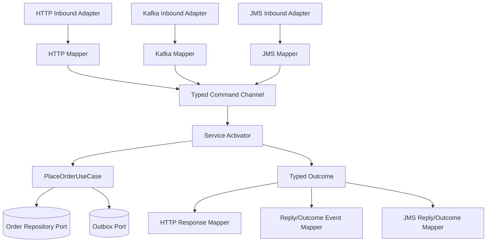
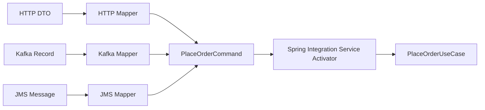
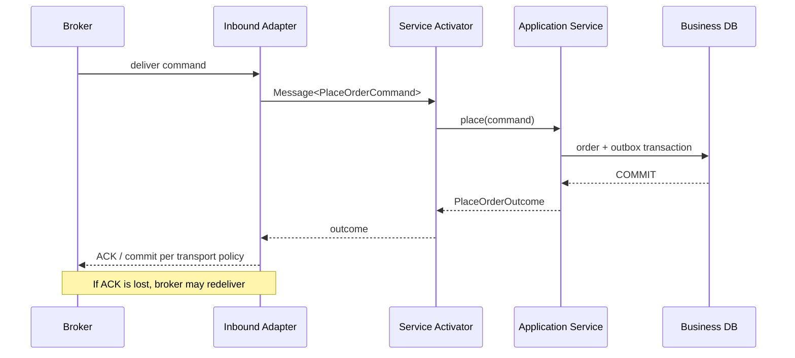
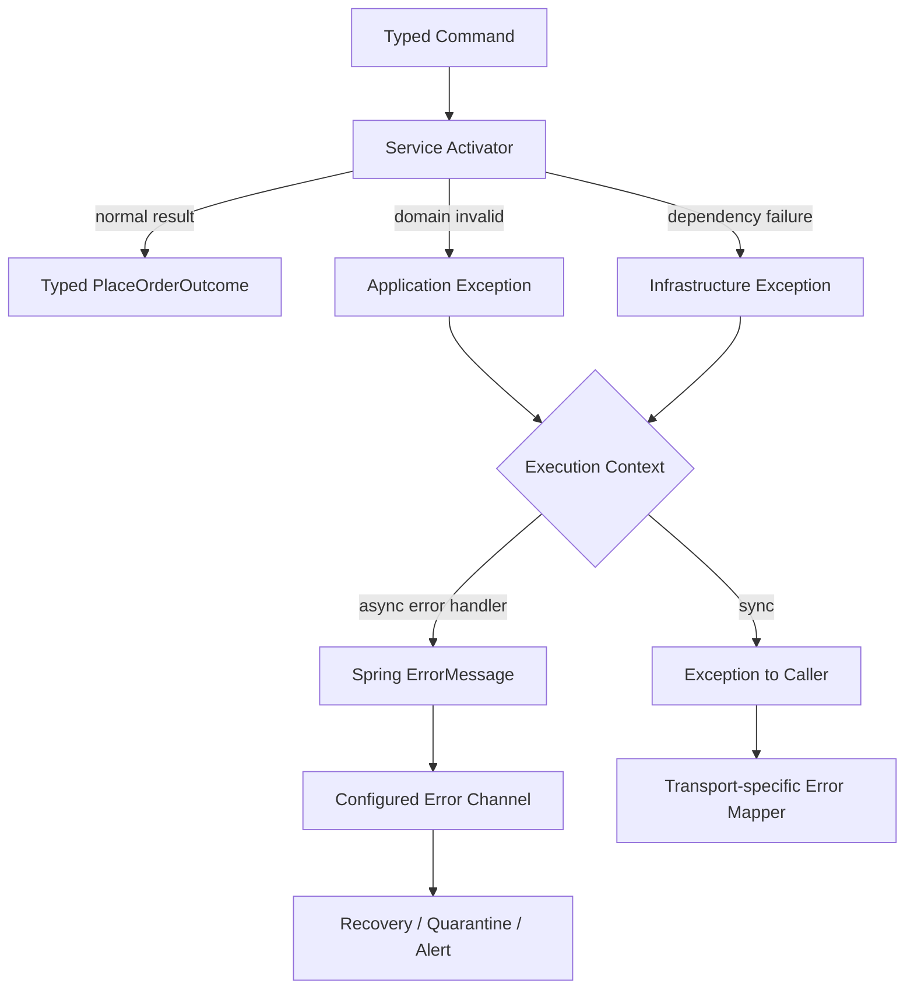
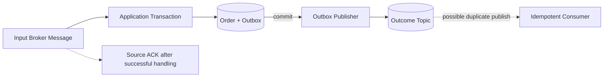
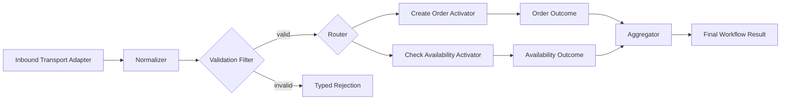
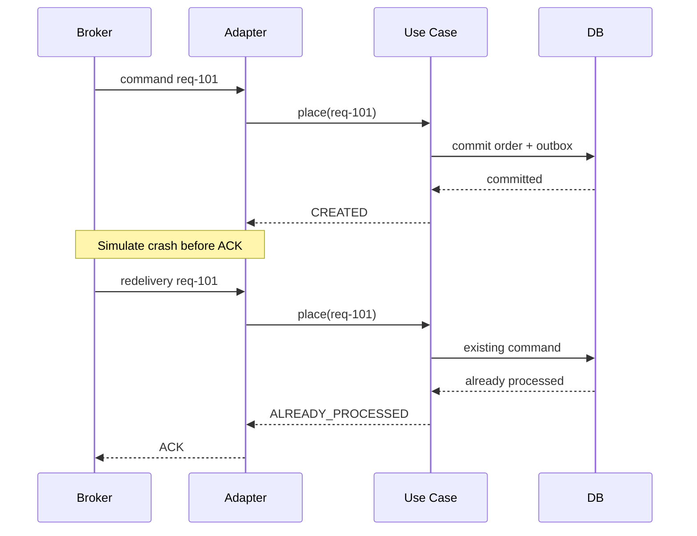
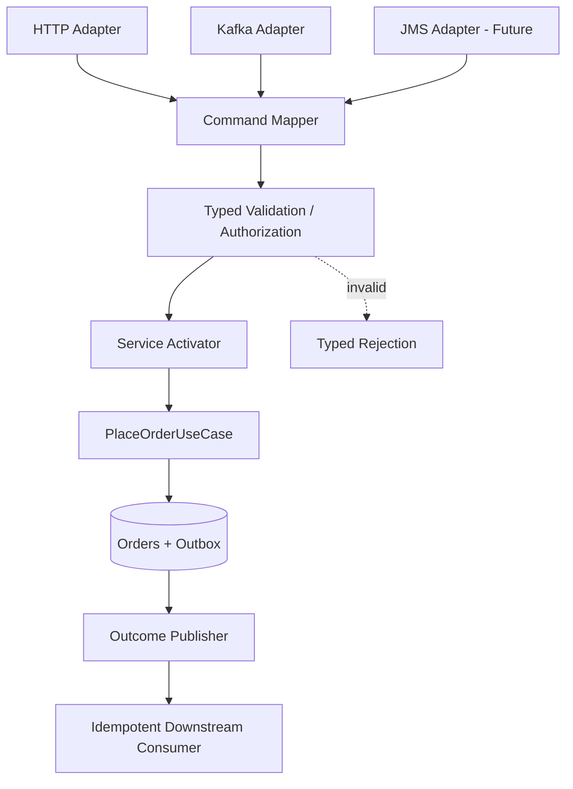

# Decoupling Service Activators from Transport

A **Service Activator** is an Enterprise Integration Pattern (EIP) that turns a message arriving at an endpoint into an application method invocation. In Spring Integration, it typically appears as `@ServiceActivator` or a `.handle(...)` endpoint in Java DSL. A well-designed Service Activator **does not need to know whether a command arrived over HTTP, Kafka, JMS, a file, or another Java application**: its job is to receive a command normalized to an internal contract, invoke the right use case, and return a result per the flow's contract.

That is the core idea of **“Decoupling Service Activators from Transport”**, part of the **Service activator** chapter of the **SPRING_INTEGRATION_PATTERN** module. The module aims to teach Enterprise Integration Patterns with Spring Integration to build loosely coupled, extensible message flows—practicing Router, Filter, Transformer, Splitter, Aggregator, Gateway, retry, error channel, and correlation, while testing and observing execution branches.

A common design mistake: `OrderService` accepts Kafka's `ConsumerRecord<?, ?>` directly, reads `HttpServletRequest`, ACKs JMS manually, inspects headers, and only then persists the order. When switching transports or invoking the business logic from a batch job, that class has to change or sprout `if (source == ...)` branches. Transport-specific retries, transactions, and security also leak into business methods.

This lesson designs an **application port** invoked by multiple inbound adapters, places a Service Activator at the messaging boundary, and verifies it with Java/Spring Integration tests. It emphasizes common pitfalls: identity and trust boundaries, sync/async contracts, ACK vs. business commit, idempotency, outboxes, exceptions/error channels, and transport replaceability.

**Learning outcomes:** explain the architecture's dependency direction; write domain commands/outcomes independent of Kafka/JMS/HTTP; wire them with `.handle(...)` or `@ServiceActivator`; classify errors at the right layer; and build tests ensuring swapping adapters does not alter business semantics.

## 1. When business services become coupled to transport

Imagine a handler processing order commands:

```java
// COUNTEREXAMPLE: domain logic mixed with HTTP/Kafka and transport ACKs.
class TransportCoupledOrderService {
    void process(
            org.apache.kafka.clients.consumer.ConsumerRecord<String, String> record) {
        String json = record.value();
        // Parse JSON, read Kafka headers, authenticate, run business logic,
        // and decide whether to seek/commit offsets inside the same method.
    }
}
```

Another variant accepts `HttpServletRequest` or `jakarta.jms.Message` and reads headers directly for business calculations. Such classes typically bring:

- Hard-to-write plain Java unit tests because Kafka/JMS/Servlet objects must be mocked or constructed.
- Duplicate implementations per protocol for the exact same business command.
- Domain services controlling ACK/offset without understanding broker transaction semantics.
- Wrong-layer retries: an HTTP response error triggers re-executing remote side effects.
- Correlation and idempotency tied to Kafka offsets or Spring Message IDs instead of business identity.
- Adding a new transport forces edits to stable business code.
- Confused error handling: every exception becomes `HTTP 500`, or every validation error gets retried via the broker.

**The goal is not to ban all transport APIs from the system.** Adapters must understand protocols to read bytes, map headers, and ACK. Simply confine them to the **transport/infrastructure boundary**, never letting those details become mandatory parameters of application use cases.

## 2. Target architecture: transport outside, use cases inside



**Desired dependency direction:**

```text
Transport adapter --> Canonical command / application port
Spring Integration flow --> Application port
Application service --> Domain + infrastructure ports
Database / external adapters --> Implement application ports

Avoid:
Application service --> Kafka ConsumerRecord / JMS Message / HttpServletRequest
Domain model --> Spring MessageHeaders / DirectChannel / Gateway annotation
```

The diagram shows a design model. There is no requirement for every command to leave through all three output adapters simultaneously; reply destinations depend on the source and whether the contract is request-reply or one-way.

### Three boundary layers

| Layer | Allowed to know | Should NOT need to know |
| --- | --- | --- |
| **Inbound transport adapter** | HTTP status, Kafka offsets, JMS ACKs, JSON/header/converters, producer identity | Detailed SQL or domain rules |
| **Messaging application adapter / Service Activator** | Typed commands, verified business metadata, routing, method invocation, reply mapping | Offsets or Servlet requests as business inputs |
| **Application use case/domain** | Commands, domain invariants, repositories/ports, outcomes, business permissions | Channel names, Spring `Message<?>`, ACKs, Kafka partitions |

**Decoupling does not mean losing needed information**: if tenant, actor, command identity, and business timestamp matter, put them into a **trusted application contract** instead of passing raw transport objects.

## 3. Invariants preserved when swapping transports

A decoupled design must preserve these properties:

1. **The same validated and normalized command** produces the same business decision whether from HTTP or Kafka.
2. Service method signatures do not change when adding a JMS transport.
3. Domain validation and uniqueness can be tested **without booting a Spring context**.
4. Data, authorization, and infrastructure errors have **stable classifications**.
5. HTTP timeouts or Kafka redeliveries do not turn the same command into a new command.
6. ACK/commit/offset belongs in the inbound adapter, not as a line inside a business method.
7. Raw client `replyChannel`/`errorChannel` headers are never copied into the messaging control plane.
8. Service Activators do not guarantee exactly-once on their own; unique constraints/idempotency still protect side effects.
9. Changing transports never alters monetary amounts, timezones, event IDs, or tenant scopes.
10. Tests can swap an adapter for an in-memory sender while still invoking the exact same use case.

If a transport change forces business logic edits just to “know this came from Kafka,” revisit the contract or where responsibilities live.

## 4. Transport identity vs. business identity

One command can be identified in several ways:

| Identity/metadata | Where it belongs | Should it be the business idempotency key? |
| --- | --- | --- |
| Stable `requestId` issued by caller per contract | Application command | Possible, with clear scope and authorization |
| `tenantId + operation + requestId` | Domain idempotency | Usually suitable when uniqueness contract is enforced |
| Kafka topic/partition/offset | Kafka adapter | Never replaces business identity across transports |
| Kafka record key | Transport routing | Only if verified to be a valid business key |
| `JMSMessageID` | JMS provider | Not guaranteed identical across republishes |
| HTTP connection ID | HTTP infrastructure | No |
| Spring `MessageHeaders.ID` | Spring message lifecycle | Not guaranteed stable across bridges/transforms |
| `traceId` | Observability | No |
| `correlationId` | Workflow/batch | Does not by itself represent a single side effect |

A redelivered Kafka record may keep its offset within a topic/partition, yet **the same command could also be resent as a new record or over HTTP**. Business-layer deduplication must rely on **operation identity**, not merely broker record position.

## 5. Internal contract: typed command and typed outcome

Let's use `PlaceOrder` with commands normalized before reaching the Service Activator:

```java
import java.util.List;

record OrderLine(String sku, int quantity) {}

record PlaceOrderCommand(
    String tenantId,
    String commandId,
    String orderId,
    String customerId,
    List<OrderLine> lines
) {
    PlaceOrderCommand {
        if (lines != null) {
            lines = List.copyOf(lines);
        }
    }
}

enum PlaceOrderStatus {
    CREATED,
    ALREADY_PROCESSED
}

record PlaceOrderOutcome(
    String tenantId,
    String commandId,
    String orderId,
    PlaceOrderStatus status
) {}
```

**Meaning:**

- `tenantId` has been mapped and verified against a principal or trusted source.
- `commandId` remains stable when a command is retried/replayed; never mint a new UUID each time an adapter receives the same command.
- `orderId` is the domain entity identity; **not automatically identical** to `commandId`.
- `customerId` and `lines` are business data; they contain no `ConsumerRecord` or `HttpServletRequest`.
- `PlaceOrderOutcome` is an application result, **containing no HTTP status, JMS destination, or Kafka offset**.

This is an illustrative contract, not a default Spring Integration schema. Security, business uniqueness, and versioning requirements must fit the real system.

### A command is not necessarily an event

`PlaceOrderCommand` is a **command requesting an action**. `OrderPlacedEvent` is an **event describing what occurred**. Upon success, an emitted event needs proper identity and causation; never blindly copy all command headers and treat them as a valid event.

## 6. Application port independent of messaging

Use an interface to express what the application can do:

```java
interface PlaceOrderUseCase {
    PlaceOrderOutcome place(PlaceOrderCommand command);
}
```

This port imports nothing from Spring Integration, Kafka, JMS, or Servlets. HTTP controllers, Kafka consumer adapters, messaging gateways, test fixtures, or scheduled tasks can all invoke it via a Service Activator or matching adapter.

A **business interface** does not eliminate coupling if its parameter is still `Message<ConsumerRecord<...>>`. Inspect **the types in the signature**, not just the interface's package name.

### Transport-neutral does not mean “no Spring anywhere”

A use case implementation may use Spring `@Transactional` as an infrastructure choice. However, the public use case interface should stay in **domain/application terms**, and the method should be unit-testable with fake repositories. The goal is **protocol isolation**, not forcing every project into a strictly framework-free dogma.

## 7. Domain validation and policy do not live in the Kafka listener

An application service can enforce invariants reused across every entrypoint.

```java
final class InvalidOrderCommand extends RuntimeException {
    private final String code;

    InvalidOrderCommand(String code) {
        super(code);
        this.code = code;
    }

    String code() {
        return code;
    }
}

final class IdempotencyConflict extends RuntimeException {
    IdempotencyConflict() {
        super("IDEMPOTENCY_KEY_CONFLICT");
    }
}

final class OrderRules {
    static void requireValid(PlaceOrderCommand cmd) {
        if (cmd == null || blank(cmd.tenantId())
                || blank(cmd.commandId())
                || blank(cmd.orderId())
                || blank(cmd.customerId())
                || cmd.lines() == null || cmd.lines().isEmpty()) {
            throw new InvalidOrderCommand("ORDER_REQUIRED_FIELDS");
        }
        for (OrderLine line : cmd.lines()) {
            if (line == null || blank(line.sku())
                    || line.quantity() <= 0) {
                throw new InvalidOrderCommand("ORDER_LINE_INVALID");
            }
        }
    }

    private static boolean blank(String value) {
        return value == null || value.isBlank();
    }
}
```

This code **does not decide between HTTP 422 and a Kafka DLT**. It raises a business error with a stable code. Adapters decide how to represent the error per transport contract.

### Do not validate only at ingress

Even when an HTTP controller runs `@Valid` and a Kafka adapter checks JSON Schema, the use case should still guard **critical invariants before side effects**. If tomorrow a new batch adapter calls the port without validation, the domain still refuses to create an order with negative quantity.

Domain validation does not replace caller authorization; an actor's tenant permissions must be verified at the security/application boundary.

## 8. Repository port and business uniqueness

Deduplication should be modeled around domain operations, not Kafka offsets.

```java
record OrderWriteResult(
    boolean inserted,
    boolean sameCommand
) {}

interface OrderWritePort {
    // Atomic on (tenantId, orderId) and/or command identity.
    // sameCommand=false when the existing key belongs to another command.
    OrderWriteResult saveIfAbsent(PlaceOrderCommand command);
}
```

Depending on the domain, two constraints may be needed:

- `(tenantId, commandId, operationType)` to identify the same command.
- `(tenantId, orderId)` to prevent creating the same order twice.

If the same `commandId` arrives with a **different payload**, return a conflict rather than treating it as a valid retry. If the same `orderId` arrives with a different command, policy may dictate `ORDER_ALREADY_EXISTS` or version conflict—never casually return `ALREADY_PROCESSED` as if it were the same message.

A good port exposes **enough outcomes** for the application service to distinguish these cases. Never hide multiple failure states behind a single boolean if the domain has more than two states.

## 9. Application service and outbox writes

Skeleton example placing the transaction on the use case implementation:

```java
import org.springframework.transaction.annotation.Transactional;

interface OrderOutboxPort {
    void enqueueOrderPlaced(PlaceOrderCommand command);
}

class PlaceOrderApplicationService implements PlaceOrderUseCase {
    private final OrderWritePort orders;
    private final OrderOutboxPort outbox;

    PlaceOrderApplicationService(
            OrderWritePort orders,
            OrderOutboxPort outbox) {
        this.orders = orders;
        this.outbox = outbox;
    }

    @Override
    @Transactional
    public PlaceOrderOutcome place(PlaceOrderCommand command) {
        OrderRules.requireValid(command);

        OrderWriteResult write = orders.saveIfAbsent(command);

        if (!write.sameCommand()) {
            throw new IdempotencyConflict();
        }

        if (write.inserted()) {
            // Write in the same DB transaction as the order if atomicity is needed.
            outbox.enqueueOrderPlaced(command);
        }

        return new PlaceOrderOutcome(
            command.tenantId(),
            command.commandId(),
            command.orderId(),
            write.inserted()
                ? PlaceOrderStatus.CREATED
                : PlaceOrderStatus.ALREADY_PROCESSED
        );
    }
}
```

**Key conditions of this example:**

1. `PlaceOrderApplicationService` must be a **Spring-managed bean invoked through a proxy/interceptor** (or wrapped by an equivalent transaction boundary) for `@Transactional` to take effect.
2. `OrderWritePort`/`OrderOutboxPort` must share the **same database and transaction manager** to achieve atomic commits as described.
3. `saveIfAbsent` must be **atomic**, backed by unique constraints and collision handling, rather than reading `exists` then inserting.
4. `sameCommand` must compare business identity/payload fingerprints under a canonical/versioned rule. The repository must accurately report both existing-command and existing-order collisions.
5. When outbox enqueueing fails, the transaction should roll back per policy; never commit an order while losing its outbound event.
6. This is an **educational skeleton**: JDBC/JPA implementations, SQL locking, transactional inbox, security, and infrastructure tests must be added in a real project.

Never call a Kafka producer directly inside a database transaction expecting Kafka publishing to roll back when the DB rolls back. Use an outbox/CDC or an appropriate coordinated transaction mechanism; publishers can replay, so consumers still need idempotency.

## 10. Service Activator as a thin adapter into the application port

The simplest form is a class accepting the typed command and invoking the use case:

```java
final class PlaceOrderActivator {
    private final PlaceOrderUseCase useCase;

    PlaceOrderActivator(PlaceOrderUseCase useCase) {
        this.useCase = useCase;
    }

    public PlaceOrderOutcome handle(PlaceOrderCommand command) {
        return useCase.place(command);
    }
}
```

This class has no `ConsumerRecord`, `HttpServletRequest`, or `jakarta.jms.Message`. If HTTP or Kafka adapters normalize inputs into `PlaceOrderCommand`, the exact same `handle` works for both.

**Responsibilities of the activator** should be:

- Translating typed messages into application calls.
- Attaching/extracting genuinely needed business metadata per input contract.
- Returning outcomes to the flow or mapping exceptions at the boundary.
- Never deciding broker offsets, HTTP statuses, or JMS ACKs.

Do not stuff SQL, retry drivers, JSON parsers, and payment rules into this adapter. It should be trivial to replace with a stub in unit tests.

## 11. Spring Integration Java DSL: typed channel to Service Activator

An illustrative flow using `DirectChannel` for synchronous request-reply and `QueueChannel` to observe outcomes in tests:

```java
import org.springframework.context.annotation.Bean;
import org.springframework.context.annotation.Configuration;
import org.springframework.integration.channel.DirectChannel;
import org.springframework.integration.channel.QueueChannel;
import org.springframework.integration.config.EnableIntegration;
import org.springframework.integration.dsl.IntegrationFlow;
import org.springframework.messaging.MessageChannel;
import org.springframework.messaging.PollableChannel;

@Configuration
@EnableIntegration
class OrderMessagingConfiguration {

    @Bean("orders.command.in")
    MessageChannel commandsInput() {
        return new DirectChannel();
    }

    @Bean("orders.outcomes")
    PollableChannel outcomes() {
        // Test/demo: in-RAM QueueChannel, not durable.
        return new QueueChannel();
    }

    @Bean
    PlaceOrderActivator placeOrderActivator(
            PlaceOrderUseCase useCase) {
        return new PlaceOrderActivator(useCase);
    }

    @Bean
    IntegrationFlow placeOrderFlow(
            PlaceOrderActivator activator) {
        return IntegrationFlow.from("orders.command.in")
            .handle(activator, "handle")
            .channel("orders.outcomes")
            .get();
    }
}
```

This snippet **requires a `PlaceOrderUseCase` bean** from application configuration in a real context. You can replace `.handle(activator, "handle")` with a typed handler lambda:

```java
@Bean
IntegrationFlow placeOrderFlowWithLambda(
        PlaceOrderUseCase useCase) {
    return IntegrationFlow.from("orders.command.lambda.in")
        .handle(PlaceOrderCommand.class,
            (command, headers) -> useCase.place(command))
        .channel("orders.command.lambda.out")
        .get();
}
```

Both examples are **alternative configurations**; the lambda snippet requires declaring its own channels. Never register two flows with the same bean name or same input channel accidentally while experimenting. Check DSL overloads against your project's Spring Integration version when building.

### What was decoupled

Not a single line in `PlaceOrderUseCase.place` needs to know whether input came from HTTP or Kafka. Infrastructure code can switch from one broker to another without editing order-creation logic.

## 12. The `@ServiceActivator` annotation preserves the same boundary

An annotation alternative to DSL:

```java
import org.springframework.integration.annotation.ServiceActivator;
import org.springframework.stereotype.Component;

@Component
class AnnotatedPlaceOrderEndpoint {
    private final PlaceOrderUseCase useCase;

    AnnotatedPlaceOrderEndpoint(PlaceOrderUseCase useCase) {
        this.useCase = useCase;
    }

    @ServiceActivator(
        inputChannel = "orders.annotation.in",
        outputChannel = "orders.annotation.out")
    public PlaceOrderOutcome handle(PlaceOrderCommand command) {
        return useCase.place(command);
    }
}
```

These channels must be declared. What matters is not annotation vs. DSL, but that **the method signature uses only application types**.

If you put `@ServiceActivator` directly on the use case method, the application service begins depending on framework annotations. That may be acceptable in small codebases, yet a **thin adapter layer** usually makes switching frameworks/transports and unit testing easier.

### Choose one style deliberately

| Case | Usually better choice |
| --- | --- |
| Multi-step decode/validate/route flow | Java DSL for clear topology |
| Single endpoint with a clear method | `@ServiceActivator` |
| Multiple transports triggering one use case | Multiple inbound adapters → shared typed flow/port |
| Transport-specific policy needed | Keep in adapter/inbound configuration |
| Need to reuse domain method outside Spring Integration | Use case interface + thin adapter |

## 13. HTTP inbound adapter: only do HTTP's job

For HTTP inbound, responsibilities typically are:

1. Authenticate the caller.
2. Validate content type, body size, JSON syntax, and schema.
3. Map DTO/raw input into `PlaceOrderCommand`.
4. Verify the request's tenant against the authenticated principal.
5. Send the command to a typed message channel or invoke an application gateway.
6. Map `PlaceOrderOutcome`/exceptions into a structured HTTP response.

Example wire JSON:

```json
{
  "requestId": "req-101",
  "tenantId": "tenant-a",
  "orderId": "ORD-101",
  "customerId": "CUS-9",
  "lines": [
    {"sku": "SKU-1", "quantity": 2}
  ]
}
```

An HTTP adapter **must never pass `HttpServletRequest`** into `PlaceOrderUseCase.place` merely to read `tenantId` or `requestId`.

### Java-level boundary pattern

```java
record HttpPlaceOrderRequest(
    String requestId,
    String tenantId,
    String orderId,
    String customerId,
    java.util.List<OrderLine> lines
) {}

interface VerifiedTenantResolver {
    // Must be obtained from an authenticated security context.
    String authenticatedTenant();
}

final class HttpOrderMapper {
    PlaceOrderCommand map(
            HttpPlaceOrderRequest request,
            String verifiedTenant) {
        if (request == null || verifiedTenant == null
                || !verifiedTenant.equals(request.tenantId())) {
            throw new InvalidOrderCommand("TENANT_NOT_AUTHORIZED");
        }
        return new PlaceOrderCommand(
            verifiedTenant,
            request.requestId(),
            request.orderId(),
            request.customerId(),
            request.lines());
    }
}
```

**This is only a boundary mapper**, not a complete Spring MVC controller. In production, distinguish authentication/authorization errors from validation errors; never return `422 INVALID_INPUT` for a command the caller is not authorized to send.

## 14. Kafka inbound adapter: keep offsets and broker headers outside

Kafka has topics, partitions, offsets, consumer groups, and acknowledgments/commits. Those belong to the **transport operations layer**.

A Kafka input record might contain:

```json
{
  "commandId": "req-101",
  "tenant": "tenant-a",
  "order": {
    "id": "ORD-101",
    "customer": "CUS-9",
    "lines": [{"sku": "SKU-1", "qty": 2}]
  }
}
```

The adapter must:

- Deserialize bytes with the right source schema/version.
- Verify producer identity and tenant scope per policy.
- Map source fields into `PlaceOrderCommand`.
- Attach internal business metadata onto envelopes/headers if needed.
- Send the command to the Service Activator.
- Map outcomes into events/replies/outcome stores, or ACK per contract.
- Handle retry/seek/DLT/offset commits via Kafka inbound adapter configuration.

**Never pass Kafka `ConsumerRecord` or acknowledgment objects into domain methods.** If business logic genuinely needs event ordering, define a verified business sequence/version field rather than using Kafka offsets as an order version across multiple topics/partitions.

### When are offsets still useful?

Offsets are useful for **debugging, transport replay, consumer lag, and ACK semantics**. Store them in audit metadata or access-controlled logs; never attach “order version” semantics unless the business contract explicitly defines them that way.

An event can be republished to another topic with a brand-new offset and still be **the exact same command**.

## 15. JMS inbound adapter: swap transport, keep command

JMS has destinations, delivery modes, message IDs, properties, reply-to, and session transactions/acknowledgments. A JMS adapter can read a JMS `TextMessage`/`BytesMessage`, decode it into `PlaceOrderCommand`, and send it to **the exact same channel** `orders.command.in`.



**`JMSMessageID` does not replace `commandId`** in the business contract. If a producer redelivers or rebuilds a message, the JMS identity can differ even when the business intent is unchanged.

Nor do a JMS transaction/session and a database business transaction automatically fuse into one atomic transaction just because the same method runs. Define resource commit/rollback, adapter container settings, and recovery mechanisms explicitly.

## 16. Which message metadata may cross the boundary?

You do not have to discard all metadata. Separate carefully:

| Metadata | Pass into use case? | Reason |
| --- | --- | --- |
| Verified tenant ID | Yes, as a field/application context | For authorization and domain isolation |
| Stable command/request ID | Yes | Idempotency and outcome lookup |
| Order ID, customer ID | Yes | Domain data |
| Causation/business correlation ID | When genuinely needed | Workflow/correlation |
| Source `occurredAt` | When business-meaningful | Do not substitute receive timestamps |
| Kafka offset/partition | Usually no | Transport operational data |
| JMS acknowledgment handle | No | Transport control plane |
| Servlet response object | No | HTTP response handling |
| Spring `replyChannel`/`errorChannel` | No | Internal channel control plane |
| Trace ID | Never as business key | Observability |
| Raw authentication principal object | Usually no | Map into needed verified actor/scope |

### Which data belongs in payload vs. headers?

- If a field is **mandatory for proper processing after serializing across a broker**, put it in the **versioned payload/envelope contract** or a guaranteed wire-header contract.
- If it is **internal control-plane metadata**, keep it in Spring headers and never copy it from client requests.
- If a field carries business/identity meaning, never rely solely on random `MessageHeaders.ID`.
- When using `@Header` in a Service Activator, verify its trustworthy source and presence rules.

Never assume header “transparency” across different transports. Message mappers/serializers can drop or rename headers; test them.

## 17. Constructing typed messages from a trusted boundary

Example helper used only after auth/validation:

```java
import org.springframework.messaging.Message;
import org.springframework.messaging.support.MessageBuilder;

final class TrustedCommandMessageFactory {
    Message<PlaceOrderCommand> toMessage(
            PlaceOrderCommand command,
            String verifiedTenant,
            String correlationId) {
        if (command == null || verifiedTenant == null
                || !verifiedTenant.equals(command.tenantId())) {
            throw new InvalidOrderCommand("TENANT_MISMATCH");
        }
        return MessageBuilder.withPayload(command)
            .setHeader("businessTenantId", verifiedTenant)
            .setHeader("businessCommandId", command.commandId())
            .setHeader("businessCorrelationId", correlationId)
            .build();
    }
}
```

This helper does not perform authentication; it **assumes** `verifiedTenant` came from a trusted security context. In production, also validate `commandId`/correlation scope and never let callers specify internal channel destinations.

A Service Activator can accept only the `PlaceOrderCommand` payload. If extra context is needed, construct a verified typed **application context** or use `@Header` in a thin adapter layer; never force domain services to accept `MessageHeaders` and scan raw client values.

## 18. Service Activator calling a use case with headers: when to use and when not to?

An adapter method can use:

```java
import org.springframework.messaging.handler.annotation.Header;
import org.springframework.messaging.handler.annotation.Payload;

final class HeaderAwarePlaceOrderActivator {
    private final PlaceOrderUseCase useCase;

    HeaderAwarePlaceOrderActivator(PlaceOrderUseCase useCase) {
        this.useCase = useCase;
    }

    public PlaceOrderOutcome handle(
            @Payload PlaceOrderCommand command,
            @Header("businessTenantId") String verifiedTenant) {
        if (!command.tenantId().equals(verifiedTenant)) {
            throw new InvalidOrderCommand("TENANT_MISMATCH");
        }
        return useCase.place(command);
    }
}
```

This signature works when the application wants to assert header/payload consistency. However, **two matching strings still do not prove authorization** if an attacker can forge both. Verified tenant must originate from a trust boundary, never copied verbatim from a client-supplied HTTP `X-Tenant-Id`.

### Headers are not an immutable application contract if they live only in the JVM

When inputs cross a Kafka/HTTP/JMS bridge, a Java-typed Spring header may be dropped. If `businessTenantId` is mandatory, define it in the wire envelope and **rebuild the trusted header after verification**, or place the verified info inside the command/context.

Tests must prove the same command round-tripping across a transport is still interpreted identically without accidentally losing identity.

## 19. Request-reply vs. one-way

A `PlaceOrderOutcome` can be returned directly to an HTTP caller via a Gateway, whereas Kafka/JMS consumers typically process events/commands asynchronously.

| Path | Contract | What the caller knows |
| --- | --- | --- |
| HTTP synchronous request-reply | Awaits `PlaceOrderOutcome` or error | Business outcome if request finishes cleanly |
| HTTP `202 Accepted` | Work accepted/scheduled | Does not mean the order is created yet |
| Kafka command consumer | ACKs record per policy, emits outcome event | Producer does not necessarily wait for immediate reply |
| JMS request-reply | Reply destination/correlation per protocol | Outcome once reply actually arrives |
| In-memory fire-and-forget | One-way handler | No normal reply |

### Do not confuse one-way with asynchronous

`void` or `return null` means the handler **emits no normal reply**. If the endpoint sits on a `DirectChannel`, it can still run **synchronously on the sender thread**; asynchronous processing requires an `ExecutorChannel`, poller, or appropriate async inbound adapter.

If a Gateway requires a reply while the endpoint returns `null`, callers wait until timeout or hit a required-reply error per config. Never use a reply timeout to signal an invalid field.

## 20. Gateway adapter for synchronous callers

A Spring Integration messaging gateway provides a Java interface:

```java
import org.springframework.integration.annotation.Gateway;
import org.springframework.integration.annotation.MessagingGateway;

@MessagingGateway
interface PlaceOrderGateway {
    @Gateway(requestChannel = "orders.gateway.in")
    PlaceOrderOutcome place(PlaceOrderCommand command);
}
```

The matching flow can be declared as:

```java
@Bean
IntegrationFlow gatewayOrderFlow(PlaceOrderUseCase useCase) {
    return IntegrationFlow.from("orders.gateway.in")
        .handle(PlaceOrderCommand.class,
            (command, headers) -> useCase.place(command))
        .get();
}
```

This is an **alternative configuration with its own channel**. Both `orders.gateway.in` and the gateway bean must be registered properly. Never attach a fixed output channel pointing away from the Gateway and still expect the call to receive a reply.

The HTTP controller layer can call `PlaceOrderGateway.place` and map `PlaceOrderOutcome` to 201/200/409 per API contract. HTTP status codes **do not belong in the domain `PlaceOrderOutcome` return value**.

### Timeout does not mean rollback

If the use case committed yet the reply never reached the HTTP caller, the caller may retry. That is why business command IDs and idempotency must stay stable **independently of transport**.

## 21. At which boundary do ACKs and transactions live?

There are three distinct milestones:

1. **Transport received:** the adapter read or received the message.
2. **Business committed:** the domain transaction committed the order/outbox.
3. **Transport acknowledged:** the broker/source is told it may advance offsets/delete the delivery or send the HTTP response.



The diagram shows a **desired policy**, not a guarantee that every inbound adapter ACKs after commit automatically. Some adapters/consumer modes auto-ACK early; others support manual ACKs or transactions. Configure and test real semantics.

**Never let the use case call Kafka `Acknowledgment.acknowledge()` or JMS `message.acknowledge()`.** The use case returns outcomes/exceptions; the adapter decides ACK or recovery per transport policy and committed result.

### Lost ACK after business commit

When an ACK is lost, the record may be redelivered. `PlaceOrderUseCase` must return an idempotent outcome without running the effect a second time. Without a shared atomic transaction across broker and database, never claim end-to-end exactly-once solely from a Service Activator.

## 22. Classifying errors by application contract

Maintain an explicit classification table:

| Error category | Example | Meaning | Retry the whole message? |
| --- | --- | --- | --- |
| `INVALID_COMMAND` | Negative quantity, missing order ID | Definitely bad data | Usually no |
| `UNAUTHORIZED` | Actor not allowed for tenant | Security failure | Never auto-retry |
| `IDEMPOTENCY_CONFLICT` | Same `commandId`, different payload | Request contract violated | No |
| `BUSINESS_REJECTED` | Ordering window closed | Business rule | Per contract; usually no |
| `DEPENDENCY_UNAVAILABLE` | Database unreachable | Transient error | Bounded retry allowed |
| `OUTCOME_UNKNOWN` | Remote payment succeeded, response lost | Commit state unknown | Reconcile before retrying |
| `BUG/INTERNAL_ERROR` | `NullPointerException` in code | Implementation defect | Alert; never blame client |

Application exceptions with stable codes/causes help adapters map results:

```text
INVALID_COMMAND
    HTTP -> 400/422 with field violations
    Kafka -> typed rejection event / quarantine / source ACK per policy
    JMS -> error reply / DLQ per contract

DEPENDENCY_UNAVAILABLE
    HTTP -> 503 or appropriate infrastructure error
    Kafka -> bounded retry/backoff
    JMS -> redelivery / recovery policy
```

These are **contract suggestions**, not default mappings built into Spring Integration, Kafka, or Spring MVC. What matters is preserving **consistent application error semantics**, even when transport representations differ.

## 23. Spring `ErrorMessage` vs. business outcomes

When a Service Activator throws an exception:

- On a synchronous `DirectChannel`, the exception can propagate back to the sender/Gateway, potentially wrapped in `MessagingException`.
- If caught by an async error handler, it **may** become a Spring `ErrorMessage` whose payload is `Throwable`.
- `errorChannel` is not “a channel holding every `PlaceOrderOutcome(REJECTED)`.”
- `ErrorMessage`/`failedMessage` can hold sensitive payloads/headers; never serialize raw exceptions into HTTP/Kafka replies.



Never assume an arbitrary `ExecutorChannel` automatically publishes to your named channel; inspect error handlers, headers, pollers/adapters, and configured framework versions.

## 24. Where should retries live?

Retries can happen at multiple layers, each with a different scope:

| Retry layer | What is repeated | Risk |
| --- | --- | --- |
| HTTP client retry | Entire request | Can create a new command if `requestId` changes |
| Kafka/JMS redelivery | Entire record/message | Steps prior to failure re-run |
| Spring Integration request handler advice | Service Activator invocation | Side effects before the exception can repeat |
| Application dependency retry | Single DB/API sub-call | Needs clear idempotency and timeouts |
| Outbox publisher retry | Emitting outcome event | Consumers can receive duplicates |

**Never wrap every error in a single blanket retry advice.** For deterministic validation failures, repeating the same input helps nothing. For transient outages, bounded retry/backoff works well. For `OUTCOME_UNKNOWN` after a remote side effect, **reconcile** instead of calling blindly again.

### Counterexample

```text
place():
  chargeRemotePayment()    <- provider already charged
  saveOrder()              <- database timeout
  throw DEPENDENCY_ERROR

retry whole activator:
  chargeRemotePayment()    <- could charge a second time
```

The fix lies in provider idempotency keys, outbox/command dispatch, reconciliation, and clear transaction boundaries—not in swapping `KafkaListener` for a Service Activator.

## 25. Idempotency does not depend on Kafka or HTTP

When accepting both HTTP and Kafka, the same request can arrive across **two different transports**. Deduplicating by Kafka offset fails to catch the HTTP request as a duplicate.

An application-level key can be:

```text
(tenantId, operationType, commandId)
```

For `PLACE_ORDER`, you may also enforce business uniqueness `(tenantId, orderId)`. Still distinguish **same command vs. same order with a different command**.

### Retention windows and replays

Whether using Idempotent Receiver or a metadata store, retain records long enough to cover broker redelivery, HTTP client retries, DLQ/manual replays, and callback horizons. If a record's TTL expires while an old command can still arrive, domain unique constraints/outcome lookups must block forbidden duplicate effects.

Never confuse a processing lease with idempotency retention. Never treat a fresh `MessageHeaders.ID` after retry as a new command.

## 26. Business transactions and broker transactions do not automatically merge

Suppose Kafka inbound receives a command, the domain DB commits the order, and then the adapter commits the offset. Those two commits are usually **not in the same ACID transaction**.



A common operational pattern:

- Inside the DB transaction, write the order + outbox row together.
- After commit, the outbox publisher emits the event.
- The publisher may retry; event IDs must stay stable.
- Downstream consumers deduplicate.
- The inbound adapter ACKs per policy once processing meets required criteria.
- On crash before ACK, the command redelivers while the use case stays idempotent.

**An outbox does not automatically guarantee exactly-once publishing**: it eliminates the “DB committed yet forgot to send event” gap, while duplicates can still occur if publish ACKs are lost.

If an application demands stricter guarantees, explicitly specify broker/DB transactions, failure models, and matching tests.

## 27. External side effects and provider idempotency

A use case may call a payment gateway, send an email, or book shipping. A database transaction cannot roll back an API in another organization.

Answer these questions:

- Does the provider support an idempotency key?
- How long does the provider retain the key?
- Is there an API to query outcome/transaction references?
- Can retries happen after the provider's key TTL expires?
- Can “persist intent” and “perform external effect” be split using an outbox/worker?
- When the outcome is unknown, is there a `REVIEW/PENDING` state for operators to handle?

A Service Activator should never treat a remote provider's HTTP response as **an absolute business certainty** if connections can time out after the remote side committed. Use reconciliation and explicit outcome states.

## 28. Backpressure and execution models belong to the topology

A transport-neutral use case can be triggered by:

- `DirectChannel`: handler usually runs on the caller thread.
- `ExecutorChannel`: dispatches via a task executor; can run concurrently and reorder completions.
- `QueueChannel` + poller: processes on a poll schedule.
- Kafka/JMS inbound adapters: own concurrency, batching, and session/partition semantics.

Switching transports can change **execution semantics** even when the business method stays untouched. Decoupling does not mean ignoring concurrency.

| Concern | Where controlled |
| --- | --- |
| HTTP request timeout | HTTP adapter/Gateway |
| Kafka consumer concurrency | Inbound Kafka configuration |
| JMS session concurrency | Inbound JMS configuration |
| Thread pool size/queue capacity | `ExecutorChannel`/executor |
| DB connection pool | Data infrastructure |
| Per-order serialization/version guard | Application/domain + storage |
| Dedup atomicity | Repository unique constraints/idempotency store |
| Remote call deadline/timeout | Outbound client/port |
| Business operation duration SLO | End-to-end observability and timeout policy |

A singleton use case must never hold `currentOrderId` in a mutable field; use immutable commands, local variables, or repository-synchronized state.

## 29. Ordering and correlation must not blindly rely on partitions/queues

Kafka partition order is useful **within one topic/partition**, yet:

- Two different transports share no offset or partition.
- Kafka republishing or changing partitioning strategies alters order.
- JMS queues or concurrent HTTP requests can arrive out of order.
- An `ExecutorChannel` can complete tasks in a different order than arrival.

If the domain requires “cancel only after create” or “payment revisions increase sequentially,” use a verified **business sequence/version** or optimistic locking with an explicit contract. When aggregating groups, use `(tenantId, batchId, generationId)` and unique part IDs instead of merely counting messages.

`correlationId` is not synonymous with an idempotency key; a workflow can contain multiple valid commands sharing one correlation ID.

## 30. Fan-out, Filter, and Aggregator still use the shared port

A flow might look like:



Each Service Activator invokes a **clear application port**. Results must preserve workflow identity/correlation; never collapse everything into one `process(Object)` method that has to guess message types.

If a Filter drops a message expected by an Aggregator, define a **rejected outcome, manifest adjustment, or fail-fast policy**. A one-way Service Activator returning `null` can also starve an Aggregator of replies. Those are flow-contract concerns, not transport implementation details.

When Publish-Subscribe/Recipient List delivers the same event to multiple subscribers, each consumer needs its **own idempotency scope** so every valid side effect still runs once.

## 31. Versioning wire contracts and application commands

When adding a new source, `PlaceOrderCommand` may not need to change at all if the adapter maps into it cleanly. When the application contract itself evolves, manage versions explicitly.

```text
HTTP request schema v2  -> HTTP mapper revision 4
Kafka order-command v1  -> Kafka mapper revision 8
JMS XML legacy v3       -> JMS mapper revision 2
                             |
                             v
                  PlaceOrderCommand v1
                             |
                             v
                    PlaceOrderUseCase
```

Different versions carry different meanings:

- **Wire schema version:** client/broker format of each source.
- **Adapter mapping revision:** translation logic from source → application command.
- **Application command version:** internal contract understood by use cases.
- **Business event version:** schema of emitted outcome events.
- **Idempotency generation:** identifier for an approved reprocessing pass.

Never change `commandId` merely because a mapper revision increments. If a new mapping previously corrupted monetary amounts or tenants, use golden fixtures, replay policies, and business reconciliation rather than just patching the parser and deploying.

## 32. Security and trust boundaries

Transport-specific authentication must happen at the matching adapter: JWT/mTLS for HTTP, credentials/ACLs for brokers, service producer identity. **Raw message metadata is not security proof.**

Attacker example:

```json
{
  "requestId": "req-evil",
  "tenantId": "tenant-victim",
  "orderId": "ORD-999",
  "customerId": "CUS-9",
  "lines": [{"sku": "SKU-1", "quantity": 1}]
}
```

The JSON may satisfy the schema while the caller has no permission to act on `tenant-victim`.

Mandatory tests:

1. Client A sends tenant B over HTTP → forbidden.
2. Kafka producer outside tenant B's allowlist claims B in a record → quarantine/deny.
3. JMS message properties spoof tenant ID → never copied as a trusted header without verification.
4. Client sends arbitrary `replyChannel`/`errorChannel` or bean/method names → never used to steer routing.
5. Two tenants share the same `commandId` → idempotency stores remain isolated.
6. Domain operation replayed after permissions changed → intentional replay/authorization policy.
7. Error handling never leaks raw PII, tokens, stack traces, or `failedMessage` externally.

**Decoupling transport from Service Activators does not mean removing permission checks.** Adapters must construct authenticated contexts; application services can also enforce critical permissions and domain invariants.

## 33. Cross-transport observability

A use case should emit metrics/traces keyed by **operation** rather than relying solely on topic/destination as identity.

Suggestions:

```text
order_place_total{transport="http",outcome="created"}
order_place_total{transport="kafka",outcome="already_processed"}
order_place_total{transport="jms",outcome="rejected"}
order_place_duration_seconds{operation="place_order"}
order_place_idempotency_conflict_total{operation="place_order"}
order_place_dependency_errors_total{operation="place_order"}
order_adapter_decode_errors_total{transport="kafka"}
order_adapter_ack_failures_total{transport="jms"}
order_outbox_publish_retries_total{event="order_placed"}
```

These metrics **are application-instrumented examples**, not default Spring Integration metric names. Never use `orderId`, `commandId`, tokens, or customer IDs as metric labels.

An application structured log:

```json
{
  "operation": "place_order",
  "commandId": "req-101",
  "tenantScope": "tenant-a",
  "outcome": "CREATED",
  "businessCorrelationId": "corr-77"
}
```

Adapters can attach `transport=http/kafka/jms` context to logs/spans outside domain methods. Layered observability reveals whether failures come from **source decoding**, **routing**, **application validation**, **transactions**, or **outbound publishing**.

## 34. Unit testing the application service completely without Spring Integration

A fake store for unit tests:

```java
import java.util.concurrent.ConcurrentHashMap;
import java.util.concurrent.ConcurrentMap;
import java.util.Objects;

final class FakeOrderStore implements OrderWritePort {
    private record Key(String tenantId, String orderId) {}
    private record Saved(
        String commandId,
        PlaceOrderCommand command
    ) {}

    private final ConcurrentMap<Key, Saved> rows =
        new ConcurrentHashMap<>();

    @Override
    public OrderWriteResult saveIfAbsent(PlaceOrderCommand command) {
        Key key = new Key(command.tenantId(), command.orderId());
        Saved candidate = new Saved(command.commandId(), command);
        Saved previous = rows.putIfAbsent(key, candidate);

        if (previous == null) {
            return new OrderWriteResult(true, true);
        }
        boolean same = previous.commandId()
            .equals(command.commandId())
            && Objects.equals(previous.command(), command);
        return new OrderWriteResult(false, same);
    }

    int size() {
        return rows.size();
    }
}

final class FakeOutbox implements OrderOutboxPort {
    int events;

    @Override
    public void enqueueOrderPlaced(PlaceOrderCommand command) {
        events++;
    }
}
```

`FakeOutbox` is only a **non-thread-safe, non-durable, non-transactional** test double. Use it in sequential unit tests; test concurrent transactions/outboxes on real infrastructure.

`FakeOrderStore` here checks only duplicate `(tenantId, orderId)` and compares the command written for that order. It **does not enforce an independent unique constraint on `(tenantId, operationType, commandId)`**: reusing a `commandId` for a different `orderId` would still pass this fake. When the business contract requires uniqueness on both scopes, the production repository must enforce **both constraints via atomic transactions/constraints**, with tests added for same `commandId` and different `orderId`. Never treat a simple fake as proof of production idempotency.

### Unit tests

```java
import static org.junit.jupiter.api.Assertions.*;
import java.util.List;
import org.junit.jupiter.api.Test;

class PlaceOrderApplicationServiceTest {
    private final FakeOrderStore orders = new FakeOrderStore();
    private final FakeOutbox outbox = new FakeOutbox();
    private final PlaceOrderUseCase useCase =
        new PlaceOrderApplicationService(orders, outbox);

    private PlaceOrderCommand command(String id) {
        return new PlaceOrderCommand(
            "tenant-a", id, "ORD-101", "CUS-9",
            List.of(new OrderLine("SKU-1", 2)));
    }

    @Test
    void createsOnceAndReturnsSameBusinessOutcomeOnRetry() {
        var first = useCase.place(command("req-101"));
        var duplicate = useCase.place(command("req-101"));

        assertEquals(PlaceOrderStatus.CREATED, first.status());
        assertEquals(
            PlaceOrderStatus.ALREADY_PROCESSED, duplicate.status());
        assertEquals(1, orders.size());
        assertEquals(1, outbox.events);
    }

    @Test
    void sameOrderWithDifferentCommandIsConflict() {
        useCase.place(command("req-101"));

        assertThrows(IdempotencyConflict.class,
            () -> useCase.place(command("req-102")));
        assertEquals(1, orders.size());
        assertEquals(1, outbox.events);
    }

    @Test
    void invalidQuantityIsRejectedWithoutSideEffect() {
        var invalid = new PlaceOrderCommand(
            "tenant-a", "req-103", "ORD-102", "CUS-9",
            List.of(new OrderLine("SKU-1", -1)));

        assertThrows(InvalidOrderCommand.class,
            () -> useCase.place(invalid));
        assertEquals(0, orders.size());
        assertEquals(0, outbox.events);
    }
}
```

**Test conclusion:** The service is verified in plain Java without Kafka brokers, JMS sessions, HTTP servers, or Spring channels. This test **does not prove `@Transactional` works**; fake ports lack transactions, so integration tests against a production-like DB are needed for atomic commits, uniqueness, and outboxes.

## 35. Testing the Service Activator invoking the use case via a Spring channel

Test the messaging wiring independently using a fake use case. A test-specific Spring Integration configuration avoids spinning up a database.

```java
import org.springframework.context.annotation.Bean;
import org.springframework.context.annotation.Configuration;
import org.springframework.integration.channel.DirectChannel;
import org.springframework.integration.channel.QueueChannel;
import org.springframework.integration.config.EnableIntegration;
import org.springframework.integration.dsl.IntegrationFlow;
import org.springframework.messaging.MessageChannel;
import org.springframework.messaging.PollableChannel;
import java.util.concurrent.atomic.AtomicInteger;

@Configuration
@EnableIntegration
class ServiceActivatorContractTestConfig {

    @Bean
    AtomicInteger invocationCount() {
        return new AtomicInteger();
    }

    @Bean
    PlaceOrderUseCase fakeUseCase(AtomicInteger calls) {
        return cmd -> {
            calls.incrementAndGet();
            return new PlaceOrderOutcome(
                cmd.tenantId(), cmd.commandId(),
                cmd.orderId(), PlaceOrderStatus.CREATED);
        };
    }

    @Bean("test.commands")
    MessageChannel testCommands() {
        return new DirectChannel();
    }

    @Bean("test.outcomes")
    PollableChannel testOutcomes() {
        return new QueueChannel();
    }

    @Bean
    IntegrationFlow testedActivator(PlaceOrderUseCase useCase) {
        return IntegrationFlow.from("test.commands")
            .handle(PlaceOrderCommand.class,
                (cmd, headers) -> useCase.place(cmd))
            .channel("test.outcomes")
            .get();
    }
}
```

A JUnit integration test:

```java
import static org.junit.jupiter.api.Assertions.*;
import java.util.List;
import java.util.concurrent.atomic.AtomicInteger;
import org.junit.jupiter.api.Test;
import org.springframework.beans.factory.annotation.Autowired;
import org.springframework.beans.factory.annotation.Qualifier;
import org.springframework.messaging.Message;
import org.springframework.messaging.MessageChannel;
import org.springframework.messaging.PollableChannel;
import org.springframework.messaging.support.MessageBuilder;
import org.springframework.test.context.junit.jupiter.SpringJUnitConfig;

@SpringJUnitConfig(ServiceActivatorContractTestConfig.class)
class ServiceActivatorContractTest {

    @Autowired @Qualifier("test.commands")
    MessageChannel input;

    @Autowired @Qualifier("test.outcomes")
    PollableChannel output;

    @Autowired
    AtomicInteger calls;

    @Test
    void invokesUseCaseAndSendsTypedOutcome() {
        PlaceOrderCommand cmd = new PlaceOrderCommand(
            "tenant-a", "req-101", "ORD-101", "CUS-9",
            List.of(new OrderLine("SKU-1", 2)));

        assertTrue(input.send(
            MessageBuilder.withPayload(cmd).build()));

        Message<?> reply = output.receive(1_000);
        assertNotNull(reply);

        PlaceOrderOutcome outcome =
            (PlaceOrderOutcome) reply.getPayload();

        assertEquals("req-101", outcome.commandId());
        assertEquals(PlaceOrderStatus.CREATED, outcome.status());
        assertEquals(1, calls.get());
        assertNull(output.receive(50));
    }
}
```

This test proves **messages truly traverse the channel and trigger the method**. It knows nothing about Kafka/JMS/HTTP adapters, so it immediately catches coupling if a method suddenly demands a transport object.

If a test suite shares an `ApplicationContext`/`QueueChannel`, reset counters and drain queues or isolate fixtures to avoid state leaking from prior tests; never run tests in parallel against one shared output queue.

## 36. Transport contract tests: swap adapters, outcome stays identical

Once the port and activator are stable, test that **each inbound adapter** builds the exact same internal command from the same business intent.

| Contract test | Input | What to verify |
| --- | --- | --- |
| Valid HTTP request | JSON v1 | Command ID, verified tenant, `orderId`, lines |
| Valid Kafka event | Kafka value/header/schema | Same canonical command semantics |
| Valid JMS message | `TextMessage`/`BytesMessage` | Same typed command; no JMS objects leaked into port |
| HTTP missing body | No payload | Ingress error; activator never called |
| Kafka invalid JSON/schema | Wrong type | Decode failure, recovery policy |
| JMS missing required property | Missing identity | Rejection/hold; never fabricate an ID |
| Forged tenant | Header/body differs from principal | Authorization denied |
| Redelivery | Same command with new transport ID | Application dedup still works |
| Timeout after commit | Lost HTTP reply/broker ACK | Retry keeps command ID; no duplicate created |
| Header mapping | Bridged across transport | Identity/correlation preserved |
| New transport | Added adapter | `PlaceOrderUseCase` unchanged |

### Testing mappers with shared fixtures

```java
import static org.junit.jupiter.api.Assertions.*;
import java.util.List;
import org.junit.jupiter.api.Test;

class HttpOrderMapperTest {
    @Test
    void mapsHttpDtoIntoApplicationCommand() {
        HttpPlaceOrderRequest raw = new HttpPlaceOrderRequest(
            "req-101", "tenant-a", "ORD-101", "CUS-9",
            List.of(new OrderLine("SKU-1", 2)));

        PlaceOrderCommand cmd = new HttpOrderMapper()
            .map(raw, "tenant-a");

        assertEquals("req-101", cmd.commandId());
        assertEquals("tenant-a", cmd.tenantId());
        assertEquals("ORD-101", cmd.orderId());
    }

    @Test
    void rejectsUnverifiedTenantClaim() {
        HttpPlaceOrderRequest raw = new HttpPlaceOrderRequest(
            "req-101", "tenant-b", "ORD-101", "CUS-9",
            List.of(new OrderLine("SKU-1", 2)));

        assertThrows(InvalidOrderCommand.class, () ->
            new HttpOrderMapper().map(raw, "tenant-a"));
    }
}
```

Separate Kafka/JMS adapters need corresponding tests. Never mock Kafka/JMS inside **business service unit tests** just to prove business logic works: that signals the domain contract has not been properly decoupled.

## 37. Testing ACK, retry, and crash boundaries

Tests requiring a live broker/DB or appropriate test containers:



Verify with **failure injection**, not just prose:

1. First message is processed and business state commits.
2. Simulate ACK failure or consumer restart before ACK.
3. Let the broker redeliver the same business command.
4. Assert side effects (order and semantic outbox event) do not duplicate.
5. Assert transport commit/offset advances only per defined policy.
6. If `commandId` matches with a different payload, assert conflict rather than silently accepting.
7. For deterministic decoder errors, assert no infinite retries; DLT/rejection has audit.
8. For transient DB errors, assert bounded retry/recovery instead of marking business success.

**Never claim ACK guarantees solely from a unit test calling `useCase.place`.**

## 38. Testing concurrency and ordering across multiple transports

A system may receive an HTTP retry and a Kafka redelivery for the same command simultaneously. Single-threaded tests miss races.

Use a real database with **unique constraints** and two workers receiving the same `(tenantId, commandId)`, synchronizing start with a `CountDownLatch` or test barrier. Assert **one effect**, not merely “no exception thrown.”

When using the in-memory fake in this lesson, `putIfAbsent` protects test-double state in one JVM but does not guarantee:

- Durability across restarts.
- Atomic business + outbox transactions.
- Exactly-once across multiple databases/instances.
- Kafka/JMS redelivery semantics.
- Correct idempotency if the same `commandId` arrives with a different payload without conflict checks.

If command order affects domain state, use optimistic versioning or a verified workflow sequence rather than arrival timestamps or offsets from one source to govern commands across all transports.

## 39. Migration: peeling transport off a Service Activator step by step

An existing “do-everything” Kafka handler can be migrated with minimal risk:

1. **Document current contracts**: topics, payload schemas, headers, ACKs, error mappings, business side effects.
2. **Extract application command/outcome** with clear semantic fields.
3. **Extract application port** and unit tests for business invariants.
4. **Extract Kafka mapper**: from records/properties into typed commands without losing identity.
5. **Place a thin Service Activator** invoking the port; keep inbound adapter and error policy separate.
6. **Add contract tests** for offsets/ACKs/retries/old schemas.
7. **Compare via shadow/dry-run** when data is sensitive; never trigger side effects twice.
8. **Shift traffic gradually**, watching duplicate/error metrics and rollback paths.
9. **Add new HTTP/JMS adapters** targeting the same command flow/port.
10. **Remove transport imports from the application module** and enforce architecture tests where appropriate.

No big-bang rewrite is required. What matters is **locking down side-effect and identity invariants first**. A refactor that accidentally ties `commandId` to a Kafka offset risks duplicates even if unit tests stay green.

### Architectural dependency tests

Add a CI rule: application/domain packages **must not depend on** `org.apache.kafka`, `jakarta.jms`, `jakarta.servlet`, or `org.springframework.messaging`. Enforce this with ArchUnit or module build rules. Do not forbid those packages inside inbound adapter modules where they belong.

## 40. Comprehensive testing matrix

| ID | Scenario | Expected outcome |
| --- | --- | --- |
| T01 | Plain Java use case invocation | No Spring context/broker required |
| T02 | Valid HTTP command | Canonical fields mapped accurately |
| T03 | Valid Kafka command | Same meaning as HTTP |
| T04 | Valid JMS command | Same application port |
| T05 | DTO missing `orderId` | Invalid domain command; no DB write |
| T06 | Wrong-type JSON | Decoder error; never reaches activator |
| T07 | HTTP principal differs from declared tenant | Denied |
| T08 | Kafka producer spoofs tenant | Quarantined/denied per policy |
| T09 | Missing stable `commandId` | Rejected; never generate ID per retry |
| T10 | Annotated Service Activator | Real endpoint subscribed to right channel |
| T11 | DSL `.handle(...)` | Method invoked once per delivery |
| T12 | Method returns outcome | Typed reply reaches output |
| T13 | One-way method returns `null` | No normal reply |
| T14 | Reply-requiring Gateway calls one-way handler | Clear timeout/required-reply behavior |
| T15 | Exception on `DirectChannel` | Propagates to caller with proper cause |
| T16 | Async exception | `ErrorMessage` reaches right error handler if configured |
| T17 | Replay of same command | No duplicate order/outbox effect |
| T18 | Same `commandId`, changed payload | Conflict |
| T19 | Same `orderId`, different `commandId` | Conflict/domain rule |
| T20 | Two tenants with same `commandId` | Isolated scopes |
| T21 | Business commit succeeds, ACK lost | Safe redelivery |
| T22 | DB failure before commit | Proper rollback/retry |
| T23 | Outbox failure | Order never commits without its event |
| T24 | Publisher retry | Stable event ID; downstream deduplicates |
| T25 | External provider timeout after effect | Reconcile instead of blind re-call |
| T26 | HTTP timeout after commit | Client retry creates no new command |
| T27 | Kafka backlog grows | Backpressure/consumer lag measured |
| T28 | JMS redelivery | Domain does not mistake it for a new event |
| T29 | Client-sent `replyChannel` header | Never controls internal reply channel |
| T30 | Trace ID changes | Business idempotency unaffected |
| T31 | HTTP schema v2 and Kafka schema v1 | Same valid application command |
| T32 | Adapter mapper changes revision | Golden fixtures detect drift |
| T33 | Two workers on same business key | Atomic constraint; single effect |
| T34 | Entity requires version ordering | Never rely on arbitrary arrival order |
| T35 | Splitter has rejected part | Aggregator releases/fails per contract |
| T36 | Security/PII in `ErrorMessage` | Raw payload never logged |
| T37 | Slow Service Activator | Explicit timeouts/retries/backpressure |
| T38 | Swap Kafka adapter for JMS | Application use case untouched |
| T39 | New adapter drops `businessEventId` | Contract test fails |
| T40 | Producer replays past idempotency TTL | Domain guard/hold policy works |

Split the suite into **application unit**, **Spring Integration endpoint**, **transport contract**, **database transaction**, **broker crash/retry**, and **security/performance**. Each group isolates its own boundary so failures point straight to the fix.

## 41. Common misconceptions

**“Changing a Kafka-record class into a `@ServiceActivator` method means it's decoupled.”** Not if the method still accepts `ConsumerRecord` or commits offsets itself.

**“A port interface is enough for clean architecture.”** Not if the interface parameter is `HttpServletRequest` or `Message<?>` wrapping provider-specific objects.

**“Switching transports keeps all Spring headers intact.”** No; wire mappings can strip or rename headers. Contract tests are needed.

**“HTTP `requestId` doesn't need to be stable because Kafka offsets already deduplicate.”** False when the same command arrives across multiple transports or gets republished.

**“Returning `null` from a Service Activator means it's asynchronous.”** False; one-way handlers can still run synchronously on `DirectChannel`.

**“Putting `@Transactional` on a service makes Kafka ACKs atomic with the DB.”** Not automatically.

**“A successful Kafka ACK means business processing finished.”** Not when adapters ACK before handler commits or in async flows.

**“An outbox guarantees zero duplicate events.”** No; publishers can retry and emit duplicates.

**“A Gateway timeout means the domain rolled back.”** No; the result may already have committed.

**“Just retry the entire Service Activator on any exception.”** Can repeat external side effects and wastefully retry invalid data.

**“Let clients set the `errorChannel` header to receive errors faster.”** No; internal control headers must never be controlled by untrusted sources.

**“Multiple consumer transports sharing a schema share the same security.”** No; principal/producer identities and authorization mappings can differ.

**“Adapter validation alone protects side effects.”** Not if the use case has multiple entrypoints.

**“A service unit test proves the endpoint is registered.”** No; Spring Integration channel tests are required.

**“Transport-neutral means stripping all observability metadata.”** No; keep needed fields in trusted contexts without coupling to transport APIs.

**“Adding consumer threads guarantees faster ordering.”** Concurrency can break ordering and corrupt entity state without version guards.

**“A valid `eventId` grants permission to execute.”** No; business identity and authorization are two distinct boundaries.

## 42. Exercise: the same command over HTTP and Kafka

An e-commerce platform receives `PlaceOrder` from two sources:

- Synchronous HTTP: callers expect `PlaceOrderOutcome`.
- Asynchronous Kafka: consumers commit offsets once policy confirms work is safely persisted; outcomes publish via outbox.
- A legacy JMS inbound adapter will be added soon.
- Commands carry `tenantId`, `commandId`, `orderId`, and line items.
- The same command may arrive twice across HTTP and Kafka.
- One database stores orders and outbox rows.
- A remote payment provider may time out after charging.
- Router, Filter, and Aggregator in another workflow consume outcome events.



**Practical tasks:**

1. Write `PlaceOrderUseCase.place(PlaceOrderCommand)` with zero HTTP/Kafka/JMS dependencies.
2. Design `PlaceOrderCommand` so Spring Message ID is never used as `commandId`.
3. Define separate mappers for HTTP JSON and Kafka records, with golden fixtures.
4. Decide which metadata lives in the payload vs. headers.
5. Build a `@ServiceActivator` or DSL `.handle(...)` adapter.
6. Configure a Gateway for HTTP replies without returning `ResponseEntity` from the domain.
7. Design Kafka ACKs after business/outbox persistence per policy; list failure modes.
8. Distinguish invalid quantity, unauthorized tenant, DB outage, and unknown payment outcome.
9. When the same command arrives from both transports, test that only one business effect occurs.
10. When the same `commandId` arrives with different lines, test conflict rather than silent deduplication.
11. Write unit tests without Spring and integration tests for channels.
12. Test two-worker races and DB unique constraints.
13. If the provider times out after charging, how do you query/reconcile before retrying?
14. Test that an HTTP timeout after commit creates no duplicate order.
15. When JMS is added later, which classes must change? Which classes must never change?
16. If the outbound error mapper fails after business commits, how are outcomes returned or queried?
17. Design metrics for transport decode errors, service duration, duplicates, and outbox backlog.
18. If an event is dropped by a Filter before an Aggregator, what outcome prevents missing replies?
19. Define an architecture test forbidding Kafka/JMS/Servlet imports in application/domain packages.
20. Specify a rollback plan when deploying a new mapper version that alters business identity.

**Completion criteria:** both transports invoke one use case with a clear contract, no control metadata mixes with domain logic, dedicated error mapping, appropriate transaction/outbox and idempotency, tests proving no double side effects, and adding JMS requires no changes to the business service.

## 43. Checklist for decoupling Service Activators from transport

- [ ] Use case accepts typed commands and returns typed outcomes, never Kafka/JMS/Servlet objects.
- [ ] Application/domain modules import no transport-specific packages.
- [ ] Service Activator is a thin endpoint adapter free of parsers, ACKs, and business SQL.
- [ ] Inbound adapters own deserialization, transport metadata, and error mapping.
- [ ] Source formats normalize into a canonical command with stable semantics.
- [ ] Business command IDs stay stable across retries, redeliveries, and republishes.
- [ ] Tenant/actor is verified from a trusted principal/producer identity.
- [ ] `MessageHeaders.ID` or offsets are never used as business idempotency keys.
- [ ] Critical domain validation is enforced in the application service.
- [ ] Adapter validation and application authorization are not conflated.
- [ ] Method selection in `@ServiceActivator`/`.handle(...)` is explicit with no ambiguous overloads.
- [ ] Endpoints subscribe to the right input channels without accidental competing subscribers.
- [ ] Returning outcomes and one-way/no-reply contracts are kept distinct.
- [ ] Gateway replies reach the right caller, and timeouts are not treated as rollbacks.
- [ ] HTTP statuses stay out of domain `PlaceOrderOutcome`.
- [ ] Kafka/JMS ACK/retry/offset logic stays out of use cases.
- [ ] Broker ACK policies are tested at the exact transaction boundary.
- [ ] Application transactions protect order/outbox writes when sharing a database.
- [ ] Outbox publisher retries create no duplicate domain side effects.
- [ ] Downstream consumers use properly scoped idempotency keys.
- [ ] External providers use idempotency/reconciliation for uncertain outcomes.
- [ ] Retries distinguish invalid, unauthorized, unavailable, and unknown states.
- [ ] `DirectChannel` exception propagation is tested separately.
- [ ] Async `ErrorMessage`/error channels are tested against real configured handlers.
- [ ] Control headers `replyChannel`/`errorChannel` are never client-controlled.
- [ ] Spring headers/wire metadata are allowlisted and round-trip tested.
- [ ] Concurrency, ordering, and backpressure have explicit policies.
- [ ] Fan-out consumers maintain independent idempotency per side-effect scope.
- [ ] Correlation/sequence/part identities stay intact for Splitter/Aggregator.
- [ ] Metrics/logs separate transport, application, and outbox failures.
- [ ] Raw payloads/`failedMessage` containing PII/secrets are never logged.
- [ ] Application service unit tests run completely without Spring/brokers.
- [ ] Spring Integration tests send real `Message<Command>`s and verify outcomes.
- [ ] Contract tests cover each transport and source schema version.
- [ ] DB/broker integration tests cover crashes after commit before ACK.
- [ ] Tests cover cross-transport HTTP/Kafka duplicates, conflicts, and multi-tenancy.
- [ ] Migration plans/golden fixtures exist when changing mappers or adding JMS.
- [ ] Spring Integration, converter, and adapter APIs verified for exact versions in STEP 6 QA.

## Key takeaways

**Decoupling Service Activators from transport** means keeping business operations tied to **application contracts** rather than infrastructure objects. Spring Integration can use `@ServiceActivator` or Java DSL `.handle(...)` to trigger `PlaceOrderUseCase`, while HTTP/Kafka/JMS adapters read bytes, authenticate producers, transform schemas, manage ACKs, and map replies/errors per protocol.

This independence only pays off when **command identity, tenant scope, and data semantics stay stable**, the application service enforces needed invariants, and retries/redeliveries are guarded by idempotency, transactions/outboxes, and unique constraints. Never let transport-specific concerns sneak into the domain via headers or exception types—and never expect a Service Activator to guarantee exactly-once processing or decide ACKs on behalf of an adapter.

**Proper testing spans three layers:** framework-free unit tests of the use case, integration tests proving the Service Activator invokes methods via Spring channels, and transport/DB/broker contract tests verifying mapping, security, ACKs, crashes, and duplicates. When these layers stay separate while honoring the same business contract, the system can swap transports without altering business behavior.
