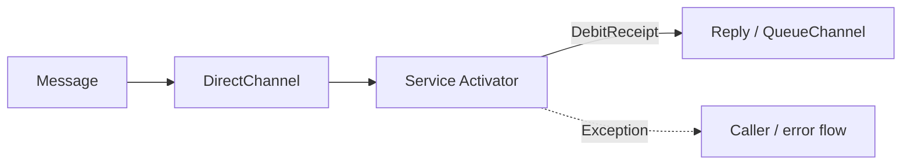
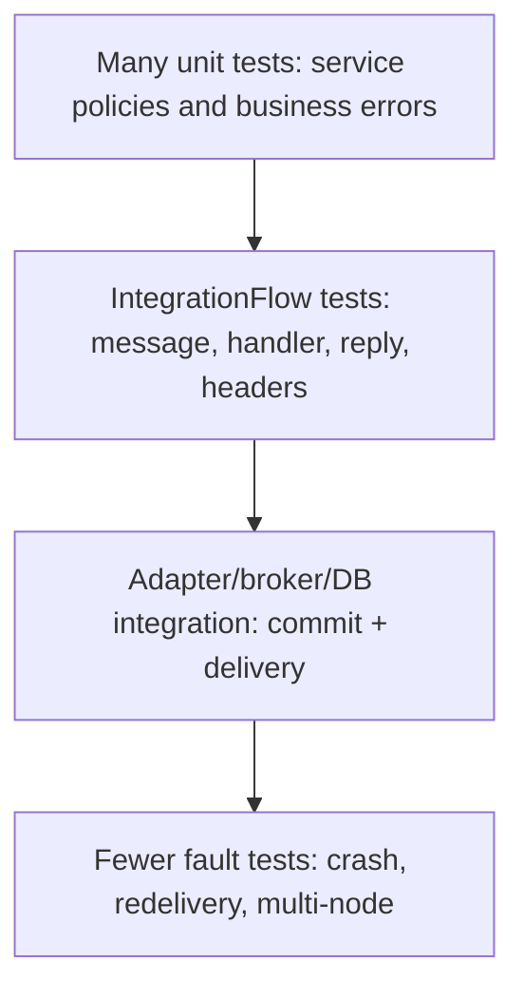
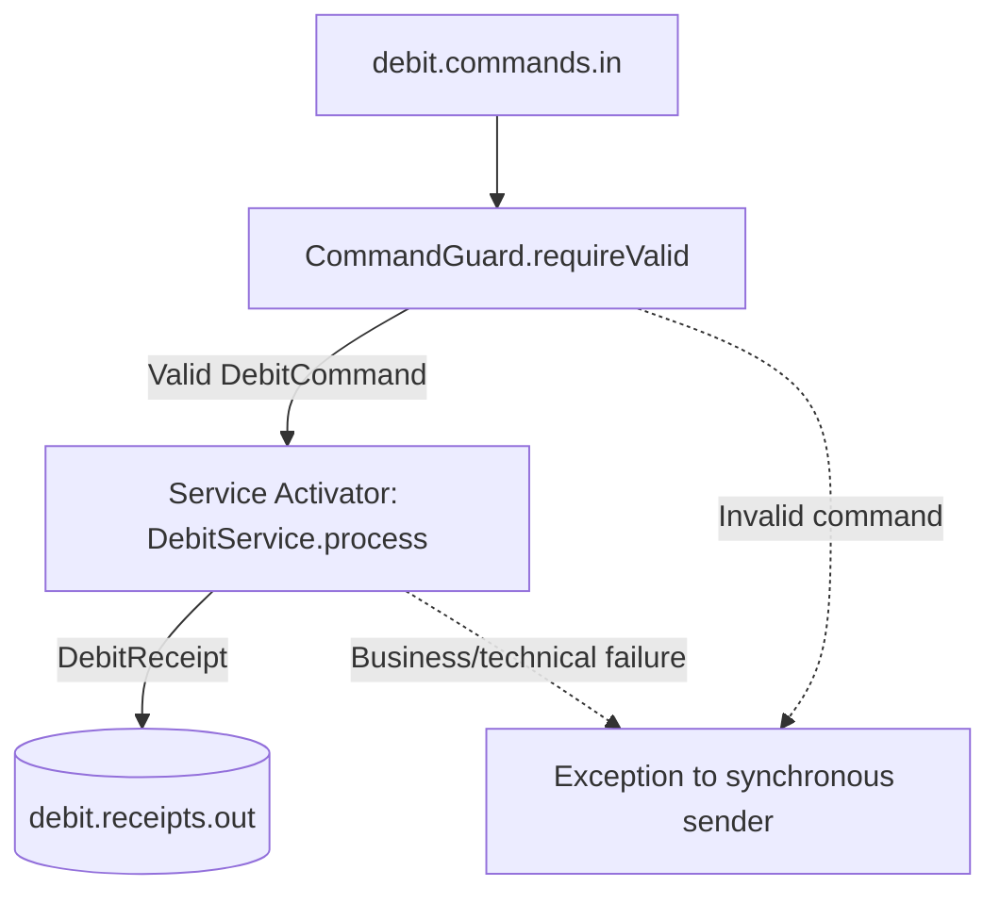
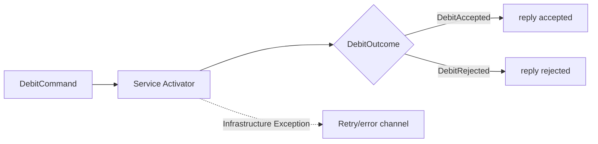
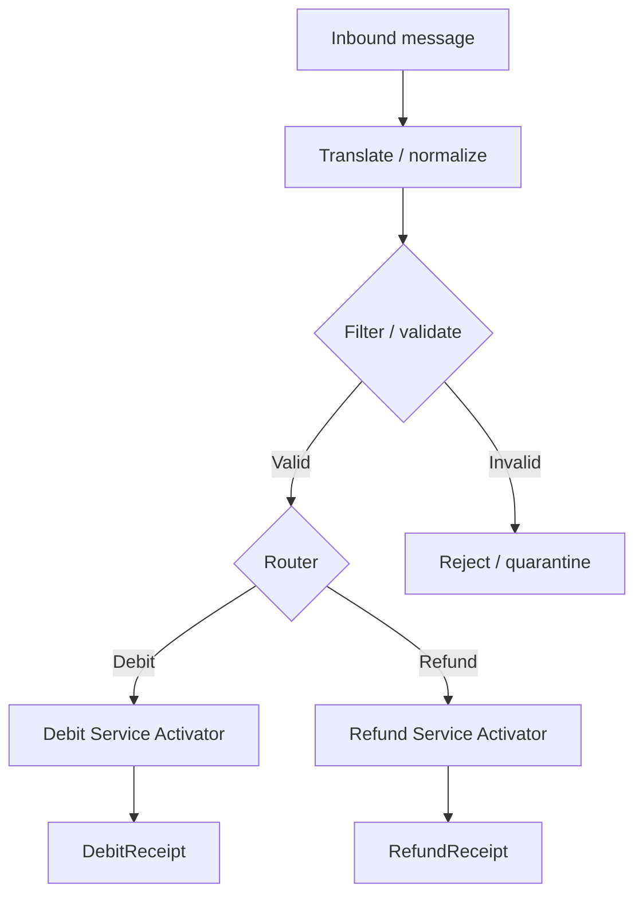

# Testing Input, Output, and Errors of Service Activators in Spring Integration

## Lesson objectives

A system receives a command to debit an account. A message arrives from an API or broker through Spring Integration and reaches a **Service Activator** that invokes a business service. On success, the handler returns a `DebitReceipt`; on invalid data, it must reject before any side effect occurs; when the account is closed, it returns a business error; when the ledger store is temporarily unavailable, it signals an infrastructure error so retry/error flows can handle it.

Testing only that `input.send(message)` returns `true` **does not prove** the handler processed anything properly. Checking only that an output queue holds one message **does not prove** the amount, tenant, and headers are right. Checking only that an exception was thrown **does not prove** the root cause, service invocation count, output state, side effects, or how errors cross sync/async boundaries.

This lesson designs a **multi-layered test suite** for Service Activators: **input → output → error**, using Java DSL, JUnit 5, and AssertJ examples along with extensions for Mockito, Gateways, `RequestHandlerRetryAdvice`, error channels, brokers, and databases.

This lesson belongs to the **Service activator** chapter of the **SPRING_INTEGRATION_PATTERN** module, supporting the goal of implementing Enterprise Integration Patterns with Spring Integration to build loosely coupled, extensible message flows. The module context covers Router, Filter, Transformer, Splitter, Aggregator, Gateway, retry, error channel, correlation, plus testing and observing branches. No supplementary notes outside the assigned topic are needed.

After this lesson, you will be able to:

1. Explain a Service Activator's contract: input types, headers, return values, reply mechanics, and exceptions.
2. Write **unit tests** for plain Java services and **integration tests** through a real `IntegrationFlow`.
3. Verify payloads and metadata arriving at an endpoint, distinguishing **validated input** from **trusted identity**.
4. Assert that outputs have the right type, values, correlation/trace metadata, and exact expected reply count.
5. Test validation failures, business rejections, transient infrastructure errors, and root causes when the framework wraps exceptions.
6. Distinguish a request-reply Service Activator from a **one-way/`void`/`null`** handler, and understand `requiresReply`, `replyChannel`, and Gateways.
7. Define async error-channel policies without confusing `DirectChannel` exceptions with `ErrorMessage`s.
8. Design additional tests for retries, redeliveries, idempotency, transactions/outboxes, concurrency, and Splitters/Aggregators.

---

## 1. Service Activator as the intersection between messaging and business services

In Enterprise Integration Patterns, a **Service Activator** connects a message channel to a service/POJO. In Spring Integration, it is an endpoint that receives a message from an input channel, extracts the appropriate payload or headers to invoke a method/handler, and optionally produces a reply.



Java DSL example:

```java
IntegrationFlow.from("debits.in")
    .handle(DebitCommand.class,
        (command, headers) -> debitService.process(command))
    .channel("debits.out")
    .get();
```

Here `handle(...)` is the hook into the business service. Even though the method call looks like plain Java, surrounding behavior depends on:

- Which **`MessageChannel`** dispatches the message?
- Did the message pass through a **Transformer/Filter/Router** before the handler?
- Does the handler return a **payload**, a full `Message<?>`, `null`, or `void`?
- Does the endpoint have an **output channel**, or must it use the inbound `replyChannel`?
- Does the handler run on **the sender's thread** or via an **`ExecutorChannel`/poller/broker**?
- Do exceptions propagate directly, go to an error handler, or get mapped into a reply?
- Are retry, transaction, advice, or idempotency layers configured?

**A service unit test cannot answer all of these questions.** That is why real flow tests are also required.

### Key reply behavior

Per the Spring Integration Reference:

- If a Service Activator returns a **non-null value**, it can send a reply to the configured output channel or, when none is configured, use the message's `replyChannel`.
- If the handler returns `null` or the method is `void`, no reply is sent by default.
- If the endpoint sets `requiresReply=true` and the handler returns no reply, the framework throws `ReplyRequiredException`.
- When you have a value-returning handler yet **deliberately discard its result**, you can route to `nullChannel`; do not conflate that with a one-way `void` Service Activator.

Whether a handler **was invoked** and whether **a reply was sent** are two distinct events: tests should observe each per contract.

## 2. Distinguishing which questions each test layer answers

| Test layer | Evidence gathered | Not sufficient to prove |
| --- | --- | --- |
| **Service unit test** | Method handles inputs, state, and exceptions properly | Channel routing / header propagation |
| **`IntegrationFlow` test** | Message reaches endpoint, reply routes, sync errors match flow | Real broker/DB, multi-instance |
| **Gateway test** | Request → reply/error/timeout behaves properly | End-to-end across network |
| **Async/error flow test** | Exceptions reach the right error channel/DLQ | Exactly-once DB side effects |
| **DB/service integration test** | Transactions, constraints, and committed state are right | Non-duplication on remote APIs |
| **Adapter/broker contract test** | Serialization/headers/ACK/NACK/redelivery work | Full business idempotency |
| **Fault-injection test** | Crashes before/after commit, retries, duplicates handled | Every production edge case |

Name tests after **the actual verified guarantee**. For instance, `validCommandProducesOneReceiptInThisFlow()` is far more accurate than `guaranteesExactlyOnce()` when no DB or broker is present.

### Suggested test pyramid



Unit tests verify data rules quickly. Integration tests verify Spring Integration wiring. Fault tests prove hard scenarios such as lost ACKs and post-commit retries.

## 3. Define input, output, and error contracts before coding

We use a simulated **account debit** domain. There is no real DB/payment connection in the example: the Service Activator simply increments a counter when a “simulated debit” succeeds.

### Input `DebitCommand`

```java
public record DebitCommand(
    String tenantId,
    String commandId,
    String accountId,
    long amountMinor
) {}
```

Conventions:

- `tenantId` identifies the tenant in the model and must match an authenticated identity.
- `commandId` identifies a business operation stably across retries.
- `accountId` is the target account to debit.
- `amountMinor` is an integer in minor currency units, strictly positive and within the demo limit.
- Messages may carry `traceId`/`businessCorrelationId` for observability; they **never prove authorization by themselves**.

### Output `DebitReceipt`

```java
public record DebitReceipt(
    String tenantId,
    String commandId,
    String accountId,
    long amountMinor,
    String status
) {}
```

The `status` field uses `ACCEPTED` in this example, which **does not mean** a real bank transferred money. In production, distinguish `RECEIVED`, `COMMITTED`, `SETTLED`, and approved business states.

### Failure contract

| Scenario | Detection point | Expected error | Simulated side effect |
| --- | --- | --- | --- |
| Valid command | Service Activator | None; returns `DebitReceipt` | Increments by 1 |
| Amount ≤ 0 | Validation gate before handler | `INVALID_DEBIT_COMMAND` | Increments by 0 |
| Tenant mismatches verified context | Validation gate | `INVALID_DEBIT_COMMAND`/security policy | Increments by 0 |
| Account closed | Business service | `ACCOUNT_CLOSED` | Increments by 0 |
| Temporary dependency failure | Business service | `LEDGER_UNAVAILABLE` | Increments by 0 in demo |
| Handler yields no reply when required | Messaging endpoint | `ReplyRequiredException` | Handler-dependent; never infer from exception alone |
| Unparseable JSON input | Adapter/decoder | Decode/schema failure | Never reaches handler |
| Retry after DB commit | Broker/consumer boundary | Return cached result per idempotency | Never duplicates real effect |

### Separating “handler invoked” from “side effect succeeded”

An `invocations` counter increments right at the start of the service method. A `committedEffects` counter increments only after simulated rules succeed:

```text
invalid input before handler:
  invocations = 0, committedEffects = 0

account closed inside handler:
  invocations = 1, committedEffects = 0

valid input:
  invocations = 1, committedEffects = 1
```

Two counters prevent tests from mistakenly claiming “the handler was not called” when it actually ran and threw an exception. In this example, `committedEffects` is purely a **fake counter**, not a real database commit.

## 4. Topology used for testing



We choose `DirectChannel` for **synchronous** testing and `QueueChannel` for output. This lets JUnit send one message, read one reply, and assert zero extra replies **without using `Thread.sleep(...)`**.

Test scope:

- **One** Spring context.
- No real broker/DB/HTTP.
- A controlled simulated service to test success, business failure, and transient failure.
- `@DirtiesContext` isolates queues/counters between test methods.
- No overlapping keys across parallel tests.

You do not need an `ExecutorChannel` to prove a synchronous handler returns output. For async errors, write a **separate test** because the sender cannot catch exceptions directly once the message has been handed off to a worker thread.

## 5. Java DSL: complete configuration for a reply-producing Service Activator

The configuration below targets Java 17+ and standard Spring Integration 6.x/7.x DSL APIs.

### Domain, validation, service, and channels

```java
import java.util.concurrent.atomic.AtomicInteger;
import java.util.regex.Pattern;

import org.springframework.context.annotation.Bean;
import org.springframework.context.annotation.Configuration;
import org.springframework.integration.channel.DirectChannel;
import org.springframework.integration.channel.QueueChannel;
import org.springframework.integration.config.EnableIntegration;
import org.springframework.integration.dsl.IntegrationFlow;
import org.springframework.messaging.MessageChannel;
import org.springframework.messaging.PollableChannel;

@Configuration
@EnableIntegration
public class DebitServiceActivatorConfig {

    public record DebitCommand(
        String tenantId,
        String commandId,
        String accountId,
        long amountMinor
    ) {}

    public record DebitReceipt(
        String tenantId,
        String commandId,
        String accountId,
        long amountMinor,
        String status
    ) {}

    public static final class InvalidDebitCommand
            extends RuntimeException {
        public InvalidDebitCommand(String code) {
            super(code);
        }
    }

    public static final class BusinessRuleViolation
            extends RuntimeException {
        public BusinessRuleViolation(String code) {
            super(code);
        }
    }

    public static final class TemporaryLedgerFailure
            extends RuntimeException {
        public TemporaryLedgerFailure(String code) {
            super(code);
        }
    }

    public static final class CommandGuard {
        private static final Pattern SAFE_ID =
            Pattern.compile("[A-Za-z0-9_-]{1,80}");

        // Trusted fixture used strictly in demo/test.
        private final String verifiedTenant = "tenant-a";

        private static boolean validId(String value) {
            return value != null
                && SAFE_ID.matcher(value).matches();
        }

        public DebitCommand requireValid(DebitCommand command) {
            if (command == null
                    || !verifiedTenant.equals(command.tenantId())
                    || !validId(command.commandId())
                    || !validId(command.accountId())
                    || command.amountMinor() <= 0L
                    || command.amountMinor() > 1_000_000L) {
                throw new InvalidDebitCommand(
                    "INVALID_DEBIT_COMMAND");
            }

            return command;
        }
    }

    public static final class DebitService {
        private final AtomicInteger invocations =
            new AtomicInteger();

        private final AtomicInteger committedEffects =
            new AtomicInteger();

        public DebitReceipt process(DebitCommand command) {
            invocations.incrementAndGet();

            // Error detected by the domain service.
            if (command.commandId().startsWith("BUSINESS-")) {
                throw new BusinessRuleViolation(
                    "ACCOUNT_CLOSED");
            }

            // Infrastructure error that may require retries in production.
            if (command.commandId().startsWith("TRANSIENT-")) {
                throw new TemporaryLedgerFailure(
                    "LEDGER_UNAVAILABLE");
            }

            // This is strictly a SIMULATED side effect in the test suite.
            committedEffects.incrementAndGet();

            return new DebitReceipt(
                command.tenantId(),
                command.commandId(),
                command.accountId(),
                command.amountMinor(),
                "ACCEPTED");
        }

        public int invocations() {
            return invocations.get();
        }

        public int committedEffects() {
            return committedEffects.get();
        }
    }

    @Bean
    CommandGuard commandGuard() {
        return new CommandGuard();
    }

    @Bean
    DebitService debitService() {
        return new DebitService();
    }

    @Bean("debit.commands.in")
    MessageChannel input() {
        return new DirectChannel();
    }

    @Bean("debit.receipts.out")
    PollableChannel output() {
        // Test sink, no background consumer.
        return new QueueChannel();
    }

    @Bean
    IntegrationFlow debitProcessingFlow(
        CommandGuard guard,
        DebitService service
    ) {
        return IntegrationFlow.from("debit.commands.in")
            // Reject invalid data BEFORE the Service Activator.
            .transform(DebitCommand.class, guard::requireValid)

            // Service Activator: invoke a business POJO.
            .handle(DebitCommand.class,
                (command, headers) -> service.process(command))

            // Service Activator reply goes to the test sink.
            .channel("debit.receipts.out")
            .get();
    }
}
```

### Analyzing actual behavior

1. `debit.commands.in` receives `Message<DebitCommand>`.
2. The Transformer invokes `guard.requireValid(...)`. If invalid, an exception is thrown on the active thread; `DebitService` is never reached.
3. The Service Activator extracts `DebitCommand` and calls `service.process(...)`.
4. If the service returns `DebitReceipt`, the framework builds a reply message and sends it to `debit.receipts.out`.
5. If the service throws `BusinessRuleViolation` or `TemporaryLedgerFailure`, the synchronous flow halts at the handler; no success reply is sent.
6. `traceId` and appropriate application headers can ride along with the reply in this internal topology. Never treat them as authentication.
7. `input.send(...)` returning `true` means **the channel delivered the message to its subscriber under synchronous semantics**, not proof that “money was debited in the DB.”

**No `@ServiceActivator` annotation is needed** when using Java DSL `.handle(...)` as shown above. These are two ways to configure endpoints with the same pattern semantics.

### Why does the guard sit ahead of the service?

To demonstrate that invalid inputs are blocked before the handler runs. Checks that **can vary under concurrency** (balances, limits, object locks) must still be enforced inside the business transaction, not only at the validation stage.

### Why does the service branch on `commandId` prefixes for errors?

Purely to **trigger deterministic faults in the demo**, not as a real business design. In production, never use command ID prefixes to check whether an account is closed or simulate database outages. Production tests should use fake repositories, stub providers, or Mockito.

---

## 6. Service unit tests: verifying business logic without booting Spring

This is the fastest layer. We call `DebitService.process` directly to check success, business failure, and transient failure. No channels, headers, serialization, or queues exist in unit tests.

```java
import static org.assertj.core.api.Assertions.assertThat;
import static org.assertj.core.api.Assertions.assertThatThrownBy;

import org.junit.jupiter.api.Test;

class DebitServiceUnitTest {

    private final DebitServiceActivatorConfig.DebitService service =
        new DebitServiceActivatorConfig.DebitService();

    private DebitServiceActivatorConfig.DebitCommand command(
        String commandId
    ) {
        return new DebitServiceActivatorConfig.DebitCommand(
            "tenant-a", commandId, "ACC-01", 12_500L);
    }

    @Test
    void validCommandProducesExactReceiptAndOneFakeEffect() {
        var receipt = service.process(command("CMD-01"));

        assertThat(receipt.tenantId()).isEqualTo("tenant-a");
        assertThat(receipt.commandId()).isEqualTo("CMD-01");
        assertThat(receipt.accountId()).isEqualTo("ACC-01");
        assertThat(receipt.amountMinor()).isEqualTo(12_500L);
        assertThat(receipt.status()).isEqualTo("ACCEPTED");

        assertThat(service.invocations()).isEqualTo(1);
        assertThat(service.committedEffects()).isEqualTo(1);
    }

    @Test
    void businessRuleFailureDoesNotProduceFakeEffect() {
        assertThatThrownBy(
            () -> service.process(command("BUSINESS-01")))
            .isInstanceOf(
                DebitServiceActivatorConfig.BusinessRuleViolation.class)
            .hasMessage("ACCOUNT_CLOSED");

        assertThat(service.invocations()).isEqualTo(1);
        assertThat(service.committedEffects()).isZero();
    }

    @Test
    void temporaryFailureDoesNotProduceFakeEffect() {
        assertThatThrownBy(
            () -> service.process(command("TRANSIENT-01")))
            .isInstanceOf(
                DebitServiceActivatorConfig.TemporaryLedgerFailure.class)
            .hasMessage("LEDGER_UNAVAILABLE");

        assertThat(service.invocations()).isEqualTo(1);
        assertThat(service.committedEffects()).isZero();
    }
}
```

### Testing the guard separately

```java
import static org.assertj.core.api.Assertions.assertThat;
import static org.assertj.core.api.Assertions.assertThatThrownBy;

import org.junit.jupiter.api.Test;

class DebitCommandGuardTest {

    private final DebitServiceActivatorConfig.CommandGuard guard =
        new DebitServiceActivatorConfig.CommandGuard();

    @Test
    void validCommandCanPassWithoutBeingChanged() {
        var raw = new DebitServiceActivatorConfig.DebitCommand(
            "tenant-a", "CMD-02", "ACC-02", 100L);

        assertThat(guard.requireValid(raw)).isSameAs(raw);
    }

    @Test
    void wrongTenantIsRejectedEvenWithValidLookingId() {
        var wrong = new DebitServiceActivatorConfig.DebitCommand(
            "tenant-b", "CMD-02", "ACC-02", 100L);

        assertThatThrownBy(() -> guard.requireValid(wrong))
            .isInstanceOf(
                DebitServiceActivatorConfig.InvalidDebitCommand.class)
            .hasMessage("INVALID_DEBIT_COMMAND");
    }

    @Test
    void zeroAmountIsRejectedBeforeService() {
        var wrong = new DebitServiceActivatorConfig.DebitCommand(
            "tenant-a", "CMD-03", "ACC-03", 0L);

        assertThatThrownBy(() -> guard.requireValid(wrong))
            .isInstanceOf(
                DebitServiceActivatorConfig.InvalidDebitCommand.class);
    }
}
```

**What was tested?** Plain Java logic returns the right values and exceptions. **What was NOT tested?** Whether Spring Integration actually invokes the method, preserves headers, wraps exceptions, or routes replies to the right channel.

---

## 7. Integration test: sending real input and reading the reply

This is the centerpiece: boot the Spring context containing `IntegrationFlow`, send a message through the input channel, and observe the output.

```java
import static org.assertj.core.api.Assertions.assertThat;
import static org.assertj.core.api.Assertions.catchThrowable;

import org.junit.jupiter.api.Test;
import org.springframework.beans.factory.annotation.Autowired;
import org.springframework.beans.factory.annotation.Qualifier;
import org.springframework.messaging.Message;
import org.springframework.messaging.MessageChannel;
import org.springframework.messaging.PollableChannel;
import org.springframework.messaging.support.MessageBuilder;
import org.springframework.test.annotation.DirtiesContext;
import org.springframework.test.context.junit.jupiter.SpringJUnitConfig;

@SpringJUnitConfig(DebitServiceActivatorConfig.class)
@DirtiesContext(
    classMode = DirtiesContext.ClassMode.AFTER_EACH_TEST_METHOD)
class DebitServiceActivatorFlowTest {

    @Autowired
    @Qualifier("debit.commands.in")
    MessageChannel input;

    @Autowired
    @Qualifier("debit.receipts.out")
    PollableChannel output;

    @Autowired
    DebitServiceActivatorConfig.DebitService service;

    private DebitServiceActivatorConfig.DebitCommand command(
        String tenant,
        String commandId,
        long amount
    ) {
        return new DebitServiceActivatorConfig.DebitCommand(
            tenant, commandId, "ACC-01", amount);
    }

    private boolean send(
        DebitServiceActivatorConfig.DebitCommand command
    ) {
        return input.send(
            MessageBuilder.withPayload(command)
                .setHeader("traceId", "trace-test")
                .setHeader(
                    "businessCorrelationId",
                    "tenant-a|ACC-01|run-1")
                .build());
    }

    private DebitServiceActivatorConfig.DebitReceipt receiveReceipt() {
        Message<?> reply = output.receive(2_000);

        assertThat(reply).isNotNull();
        assertThat(reply.getPayload()).isInstanceOf(
            DebitServiceActivatorConfig.DebitReceipt.class);

        return (DebitServiceActivatorConfig.DebitReceipt)
            reply.getPayload();
    }

    private static Throwable rootCause(Throwable error) {
        Throwable current = error;

        while (current.getCause() != null
                && current.getCause() != current) {
            current = current.getCause();
        }

        return current;
    }

    @Test
    void validInputGetsOneExactReply() {
        assertThat(send(
            command("tenant-a", "CMD-101", 12_500L)))
            .isTrue();

        var receipt = receiveReceipt();

        assertThat(receipt.tenantId()).isEqualTo("tenant-a");
        assertThat(receipt.commandId()).isEqualTo("CMD-101");
        assertThat(receipt.accountId()).isEqualTo("ACC-01");
        assertThat(receipt.amountMinor()).isEqualTo(12_500L);
        assertThat(receipt.status()).isEqualTo("ACCEPTED");

        assertThat(service.invocations()).isEqualTo(1);
        assertThat(service.committedEffects()).isEqualTo(1);
        assertThat(output.receive(0)).isNull();
    }

    @Test
    void replyCarriesExpectedInternalTrackingHeaders() {
        var request = MessageBuilder
            .withPayload(command("tenant-a", "CMD-102", 1L))
            .setHeader("traceId", "trace-102")
            .setHeader(
                "businessCorrelationId",
                "tenant-a|ACC-01|run-1")
            .build();

        assertThat(input.send(request)).isTrue();

        Message<?> reply = output.receive(2_000);
        assertThat(reply).isNotNull();

        assertThat(reply.getHeaders().get("traceId"))
            .isEqualTo("trace-102");
        assertThat(
            reply.getHeaders().get("businessCorrelationId"))
            .isEqualTo("tenant-a|ACC-01|run-1");

        assertThat(service.invocations()).isEqualTo(1);
    }

    @Test
    void invalidPayloadStopsBeforeServiceActivator() {
        Throwable failure = catchThrowable(() ->
            send(command("tenant-a", "CMD-103", 0L)));

        assertThat(failure).isNotNull();
        assertThat(rootCause(failure))
            .isInstanceOf(
                DebitServiceActivatorConfig.InvalidDebitCommand.class)
            .hasMessage("INVALID_DEBIT_COMMAND");

        assertThat(service.invocations()).isZero();
        assertThat(service.committedEffects()).isZero();
        assertThat(output.receive(0)).isNull();
    }

    @Test
    void wrongTenantIsNotSilentlyAccepted() {
        Throwable failure = catchThrowable(() ->
            send(command("tenant-b", "CMD-104", 100L)));

        assertThat(failure).isNotNull();
        assertThat(rootCause(failure))
            .isInstanceOf(
                DebitServiceActivatorConfig.InvalidDebitCommand.class);

        assertThat(service.invocations()).isZero();
        assertThat(output.receive(0)).isNull();
    }

    @Test
    void businessRuleFailureIsObservableWithNoSuccessReply() {
        Throwable failure = catchThrowable(() ->
            send(command("tenant-a", "BUSINESS-105", 100L)));

        assertThat(failure).isNotNull();
        assertThat(rootCause(failure))
            .isInstanceOf(
                DebitServiceActivatorConfig.BusinessRuleViolation.class)
            .hasMessage("ACCOUNT_CLOSED");

        assertThat(service.invocations()).isEqualTo(1);
        assertThat(service.committedEffects()).isZero();
        assertThat(output.receive(0)).isNull();
    }

    @Test
    void temporaryDependencyFailureIsDistinctFromBusinessRule() {
        Throwable failure = catchThrowable(() ->
            send(command("tenant-a", "TRANSIENT-106", 100L)));

        assertThat(failure).isNotNull();
        assertThat(rootCause(failure))
            .isInstanceOf(
                DebitServiceActivatorConfig.TemporaryLedgerFailure.class)
            .hasMessage("LEDGER_UNAVAILABLE");

        assertThat(service.invocations()).isEqualTo(1);
        assertThat(service.committedEffects()).isZero();
        assertThat(output.receive(0)).isNull();
    }

    @Test
    void twoDifferentCommandsYieldTwoReplies() {
        assertThat(send(
            command("tenant-a", "CMD-107", 10L))).isTrue();
        assertThat(send(
            command("tenant-a", "CMD-108", 20L))).isTrue();

        var first = receiveReceipt();
        var second = receiveReceipt();

        assertThat(first.commandId()).isEqualTo("CMD-107");
        assertThat(second.commandId()).isEqualTo("CMD-108");
        assertThat(service.invocations()).isEqualTo(2);
        assertThat(service.committedEffects()).isEqualTo(2);
        assertThat(output.receive(0)).isNull();
    }
}
```

### Why choose `@DirtiesContext`?

`DebitService` holds `AtomicInteger`s and `debit.receipts.out` is a queue inside the Spring context. `@DirtiesContext(AFTER_EACH_TEST_METHOD)` isolates test cases, preventing one test from reading leftover replies from another. It carries context-restart overhead; in larger suites, reset state/fixtures explicitly **as long as resetting does not mask concurrency bugs that need detection**.

### Exact conclusions from this test suite

- For a valid message, the handler is invoked once in this synchronous topology; output has the right values and type.
- For input rejected by the validation gate, the Service Activator is never called.
- For errors inside the service, the handler was invoked yet produced no simulated side effect and no success reply.
- Tracking headers propagate through the configured flow.
- Do not infer transaction commits, broker ACKs, database rollbacks, or exactly-once effects from this test alone.

### Be careful with `receive(0)`

`QueueChannel.receive(0)` checks **at the instant of invocation**. Here the input channel and handler run synchronously, so checking “no remaining reply” after `send` finishes is valid. In async tests, `receive(0)==null` **does not prove** no late reply will arrive; use bounded timeouts and event/condition synchronization.

---

## 8. How to assert exceptions accurately when Spring Integration wraps errors

If the plain service throws `BusinessRuleViolation`, the integration endpoint may wrap it in `MessageHandlingException`, `MessagingException`, or another exception depending on handler/topology.

Do not write identical assertions in unit and integration tests:

```java
// Too brittle if the framework wraps exceptions:
assertThatThrownBy(() -> input.send(message))
    .isExactlyInstanceOf(BusinessRuleViolation.class);
```

A more resilient check:

1. Catch the `Throwable` from `input.send(...)`.
2. Assert an exception occurred.
3. Walk the `getCause()` chain or use root-cause assertions.
4. Assert **root cause type + business error code**.
5. Assert **handler invocations and outputs/effects**.
6. If needed, inspect `MessagingException.getFailedMessage()` without assuming every adapter includes the same metadata.

```java
Throwable failure = catchThrowable(() -> input.send(message));

assertThat(failure).isNotNull();
assertThat(rootCause(failure))
    .isInstanceOf(BusinessRuleViolation.class)
    .hasMessage("ACCOUNT_CLOSED");
```

When an app distinguishes multiple error kinds, use **exception types or stable codes**, never English substrings of stack traces.

### Distinguishing endpoint errors from domain errors

| Error | Source | What to test |
| --- | --- | --- |
| `InvalidDebitCommand` | Gate/contract validation | Service never called |
| `BusinessRuleViolation` | Domain service | Handler may be called, zero side effects |
| `TemporaryLedgerFailure` | Repository/provider | Retry/fault tests per contract |
| `MessageDeliveryException` | Channel/destination | Wiring/routing tests |
| `ReplyRequiredException` | Handler yields no reply when required | `requiresReply` tests |
| `MessageConversionException` | Converter/serialization/binding | Adapter contract tests |
| `TimeoutException` at Gateway | No reply within deadline | Request-reply integration tests |

Because an exception can be wrapped across multiple layers, testing **semantics** and **failure origin** matters more than asserting the exact top-level wrapper class in every environment.

---

## 9. When a Service Activator returns no reply: `void`, `null`, and `requiresReply`

Not every Service Activator is request-reply. An audit or notification handler may simply execute an operation and finish.

```java
import org.springframework.integration.annotation.ServiceActivator;

public final class AuditConsumer {

    @ServiceActivator(inputChannel = "audit.events.in")
    public void record(AuditEvent event) {
        // Record audit/metrics per application contract.
    }
}
```

Here `AuditEvent` and the bean/channel must be defined in the application. This is an **annotation-driven example**; do not register it concurrently on `debitProcessingFlow` from earlier.

In Spring Integration, if a method returns `void` or `null`, the Service Activator **sends no reply** by default. If `requiresReply=true`, producing no reply throws `ReplyRequiredException`.

### What to test?

| Handler style | Expected input | Expected output | What tests must prove |
| --- | --- | --- | --- |
| `void record(AuditEvent)` | Valid event | **No reply** | Handler called, audit effect executed |
| `DebitReceipt process(DebitCommand)` | Valid command | One `DebitReceipt` | Correct payload, headers, invocation count |
| Method conditionally returning `null` | Special command | No reply if contract permits | Never mistake `null` for success |
| Method returning `null` with `requiresReply=true` | Valid command | **Exception** | Response is never silently dropped |
| Method returns value routed to `nullChannel` | Fire-and-forget request | No reply observed | Deliberate **reply discard** |

### Java DSL `requiresReply` configuration (alternative example)

```java
.handle(
    DebitCommand.class,
    (command, headers) -> debitService.process(command),
    endpoint -> endpoint.requiresReply(true))
```

**This is a replacement configuration snippet** at the `.handle(...)` step of a flow, not a standalone runnable flow. Verify the `requiresReply` endpoint option for your project's DSL version and test the case where the handler deliberately returns `null`.

### Why is testing “no reply” harder than testing a reply?

In a synchronous flow, once a `void` handler finishes, you can assert the audit counter incremented and the destination queue is empty. Yet `output.receive(0)==null` is only a point-in-time snapshot; in async flows, wait for explicit proof the handler completed before concluding no reply exists.

Never test “no reply sent” by sleeping arbitrarily with `Thread.sleep(100)` and claiming certainty. Use a `CountDownLatch` signaling handler completion, an explicit timeout, and an isolated test sink.

### Why do Gateways easily time out?

If a `MessagingGateway` expects to return `DebitReceipt` while the downstream handler is `void`, the gateway waits until reply timeout. The bug is not in the monetary amount, but in a **request-reply contract mismatch**. Pick one explicitly:

- Synchronous-result command: service must return an appropriate reply/error.
- Asynchronous command: Gateway/API returns an acknowledgement or request ID, and results arrive via another channel/event.

---

## 10. Gateway tests: checking the return address rather than only `QueueChannel`

The flow in section 5 has an explicit output channel. With a Gateway, replies are typically routed via the `replyChannel` attached by the framework to the inbound message.

### Dedicated configuration example

```java
import org.springframework.context.annotation.Bean;
import org.springframework.integration.annotation.Gateway;
import org.springframework.integration.annotation.MessagingGateway;
import org.springframework.integration.dsl.IntegrationFlow;

@MessagingGateway
interface DebitGateway {

    @Gateway(requestChannel = "debit.gateway.in")
    DebitServiceActivatorConfig.DebitReceipt debit(
        DebitServiceActivatorConfig.DebitCommand command);
}
```

A flow for the Gateway:

```java
@Bean
IntegrationFlow debitGatewayFlow(
    DebitServiceActivatorConfig.CommandGuard guard,
    DebitServiceActivatorConfig.DebitService service
) {
    return IntegrationFlow.from("debit.gateway.in")
        .transform(
            DebitServiceActivatorConfig.DebitCommand.class,
            guard::requireValid)
        .handle(
            DebitServiceActivatorConfig.DebitCommand.class,
            (command, headers) ->
                service.process(command))
        .get();
}
```

These two snippets form an **independent illustrative configuration** that must live in a Spring context with `@EnableIntegration` and matching bean registration; do not reuse the same bean methods/channels from the previous demo without adjustment. Key difference: the flow omits `.channel("debit.receipts.out")` at the end so replies route back to the Gateway's `replyChannel`.

### Required assertions

1. Gateway invoked with a valid command → returns `DebitReceipt` with matching ID, amount, and status.
2. Invalid command → caller gets an exception or typed rejection per contract, without waiting uselessly for a timeout.
3. Service returns `null` when API requires a reply → failure/timeout is observed and mapped explicitly.
4. Handler throws business error → caller receives classified exception/error response.
5. Timeout due to slow async downstream → never confused with `INVALID_DEBIT_COMMAND`.
6. Reply sent to wrong channel → caught by destination/timeout assertions.
7. Two interleaved requests → never return command A's reply to request B.

### Gateways do not automatically turn domain errors into HTTP 4xx

`@MessagingGateway` performs request-reply messaging. If an external API uses REST/HTTP, a controller/inbound adapter must map `InvalidDebitCommand`, `BusinessRuleViolation`, and timeouts to appropriate HTTP errors. Naming a class `BusinessRuleViolation` does not automatically produce HTTP status codes.

### Avoid testing “error = null”

If a Gateway returns `null` after a timeout and callers treat it as “succeeded,” the system can lose work. Contracts should define terminal outcomes or acknowledgements carrying a request ID and queryable status.

---

## 11. Testing error channels: synchronous vs. asynchronous

This is the part most often written wrong when testing Service Activators.

### Synchronous `DirectChannel` path

```text
Test thread
  -> input.send(message)
     -> DirectChannel dispatcher
        -> Service Activator throws
  <- exception propagates back to test thread
```

In a synchronous topology, exceptions normally return to the caller; **do not assume** an `ErrorMessage` lands on global `errorChannel`. Unit/integration tests should use `catchThrowable(...)` or `assertThatThrownBy(...)`.

### Asynchronous `ExecutorChannel` path

```text
Test thread
  -> input.send(message)
  <- send may return before handler runs

Worker thread
  -> Service Activator throws
  -> MessagePublishingErrorHandler / configured error handling
  -> ErrorMessage sent to selected errorChannel
```

In Spring Integration, executor-backed channels can use `MessagePublishingErrorHandler`. Under async execution, exceptions cannot “jump back” onto the caller's old thread. Depending on adapter/channel configuration, errors route to the `errorChannel` header or global `errorChannel`.

**The right test awaits error messages on the configured error channel**, rather than asserting `input.send(...)` throws a business exception like `DirectChannel`.

### Illustrative async configuration

```java
import org.springframework.context.annotation.Bean;
import org.springframework.context.annotation.Configuration;
import org.springframework.core.task.SimpleAsyncTaskExecutor;
import org.springframework.integration.channel.ExecutorChannel;
import org.springframework.integration.channel.QueueChannel;
import org.springframework.integration.config.EnableIntegration;
import org.springframework.integration.dsl.IntegrationFlow;
import org.springframework.messaging.MessageChannel;
import org.springframework.messaging.PollableChannel;

@Configuration
@EnableIntegration
class AsyncDebitErrorConfig {

    @Bean("debit.async.in")
    MessageChannel input() {
        return new ExecutorChannel(
            new SimpleAsyncTaskExecutor("debit-test-"));
    }

    @Bean("debit.async.errors")
    PollableChannel errors() {
        return new QueueChannel();
    }

    @Bean
    IntegrationFlow alwaysFails() {
        return IntegrationFlow.from("debit.async.in")
            .handle(String.class, (commandId, headers) -> {
                throw new IllegalStateException(
                    "LEDGER_UNAVAILABLE");
            })
            .get();
    }
}
```

**This configuration intentionally simulates an async failure** without transferring money or calling a database. `SimpleAsyncTaskExecutor` keeps the example simple, and is not a recommended production pool/backpressure policy.

### JUnit for `ErrorMessage` at an async boundary

```java
import static org.assertj.core.api.Assertions.assertThat;

import org.junit.jupiter.api.Test;
import org.springframework.beans.factory.annotation.Autowired;
import org.springframework.beans.factory.annotation.Qualifier;
import org.springframework.messaging.Message;
import org.springframework.messaging.MessageChannel;
import org.springframework.messaging.MessageHeaders;
import org.springframework.messaging.PollableChannel;
import org.springframework.messaging.support.ErrorMessage;
import org.springframework.messaging.support.MessageBuilder;
import org.springframework.test.context.junit.jupiter.SpringJUnitConfig;

@SpringJUnitConfig(AsyncDebitErrorConfig.class)
class AsyncDebitErrorFlowTest {

    @Autowired
    @Qualifier("debit.async.in")
    MessageChannel input;

    @Autowired
    @Qualifier("debit.async.errors")
    PollableChannel errors;

    @Test
    void asynchronousFailureIsPublishedAsErrorMessage() {
        Message<?> request = MessageBuilder
            .withPayload("CMD-ASYNC-1")
            .setHeader(MessageHeaders.ERROR_CHANNEL, errors)
            .build();

        assertThat(input.send(request)).isTrue();

        // Await event with timeout instead of Thread.sleep.
        Message<?> received = errors.receive(5_000);
        assertThat(received).isInstanceOf(ErrorMessage.class);

        Throwable error =
            ((ErrorMessage) received).getPayload();

        assertThat(error).isNotNull();
        assertThat(rootCause(error))
            .isInstanceOf(IllegalStateException.class)
            .hasMessage("LEDGER_UNAVAILABLE");
    }

    private static Throwable rootCause(Throwable error) {
        Throwable current = error;
        while (current.getCause() != null
                && current.getCause() != current) {
            current = current.getCause();
        }
        return current;
    }
}
```

With other Spring Integration channel/error-handler implementations, explicitly configure error publishers/handlers rather than assuming every executor behaves identically. **This tests `ExecutorChannel` with the framework's default error publication**, not every Kafka/JMS/HTTP inbound adapter.

### Additional error checks

- `ErrorMessage.payload` holds the expected cause.
- `ErrorMessage` arrives at the `errorChannel` header or global fallback per topology.
- If `originalMessage`/`failedMessage` is present, correlation IDs and source metadata are permitted for investigation.
- Errors are never swallowed or routed to a queue with no consumer.
- No infinite duplicate error events from hot retries.
- No success reply is emitted after a handler fails before commit.
- Error handlers themselves can fail—include fallback logging/alerts and dedicated fault tests.

**Never serialize a raw `ErrorMessage` with a `Throwable` payload into a broker DLQ** without controlling sensitive info and serializability. Convert it to a safe `FailureRecord` holding `errorCode`, `requestId`, `timestamp`, and a protected payload reference.

---

## 12. Another approach: return a typed outcome instead of throwing for business rejections

Not every business rejection should be modeled as an infrastructure error. If a service returns “account closed,” a Gateway may want an immediate response while infrastructure errors still route to retry/error flows.

An outcome type:

```java
public sealed interface DebitOutcome
    permits DebitAccepted, DebitRejected {}

public record DebitAccepted(
    DebitServiceActivatorConfig.DebitReceipt receipt
) implements DebitOutcome {}

public record DebitRejected(
    String commandId,
    String reasonCode
) implements DebitOutcome {}
```

Flow:



### Advantages

- Business rejection is a **terminal business outcome** callers can receive directly.
- Avoids polluting logs with infrastructure stack traces for expected business rejections.
- Gateways respond quickly and avoid timeouts from Filter drops.
- Consumers can distinguish `REJECTED` outcomes from unprocessed transactions caused by outages.

### Drawbacks and caveats

- If existing APIs expect business rejections as exceptions, preserve the contract or version it.
- Never catch every exception into `DebitRejected("UNKNOWN")`, or outages get treated as bad input.
- A `DebitRejected` does not imply side effects rolled back; if the service called an external provider before detecting failure, reconciliation is still required.

### Required tests

1. Rule rejection → `DebitRejected(reasonCode)`.
2. Infrastructure failure → exception/error flow, **never** `DebitRejected`.
3. Valid → `DebitAccepted(receipt)`.
4. Each request gets **one** terminal outcome.
5. Rejection emits no success event and writes no unauthorized side effects.

---

## 13. Mockito and `MockIntegrationContext`: where should you mock?

Spring Integration provides `spring-integration-test` and `spring-integration-test-support` for flow tests. With `@SpringIntegrationTest`, you can inject `MockIntegrationContext` to substitute registered message sources or handlers **by bean/endpoint ID**, calling `resetBeans()` afterward.

### When verifying only that the Service Activator calls the right dependency

Use Mockito for fake repositories/providers **beneath the service**:

```java
import static org.mockito.Mockito.*;

DebitRepository repository = mock(DebitRepository.class);
DebitService service = new DebitService(repository);

// Illustrates the idea; both types belong to a real application.
when(repository.store(any())).thenReturn("RESULT-42");
service.process(validCommand);

verify(repository, times(1)).store(any());
verifyNoMoreInteractions(repository);
```

**This is Java pseudocode for project-specific dependencies**; it will not compile directly against the fake `DebitService` from section 5 (which takes no repository constructor argument). Key rule: to verify which dependencies a handler calls and how often, mock the **dependency**, never mock away the behavior you are trying to measure.

### When testing routing around a handler

You can replace a handler with `MockIntegrationContext.substituteMessageHandlerFor(endpointId, mockHandler)` to observe which endpoint receives messages. Assign an explicit endpoint ID in config—such as `.handle(..., endpoint -> endpoint.id("debitServiceActivator"))`—and verify the API for your Spring Integration version.

**Never substitute the Service Activator itself** in a test meant to prove the business method returns the right output—that would only test your mock.

### Guidelines for test doubles

| Goal | Use | Avoid |
| --- | --- | --- |
| Service input/output logic | Real POJO and fake/in-memory repository | Mocking the whole service and asserting the mock's own output |
| Spring message/header handling | Real `IntegrationFlow` with Direct/Queue channels | Calling method directly and claiming header propagation passed |
| Dependency failures | Stub/Mockito intentionally throwing | `sleep` or randomness to force failures |
| Async error channel | Async flow + real error sink | Expecting direct synchronous exceptions |
| Broker ACK/NACK | Real broker/adapter tests | Relying solely on `input.send(...)` |
| DB transactions | DB transaction integration tests | Relying solely on fake `AtomicInteger`s |
| External provider idempotency | Sandbox/provider mock with stable keys | Assuming `RetryAdvice` guarantees exactly-once |

---

## 14. Deeper input tests: payload types, missing fields, and headers

A Service Activator may accept a DTO payload, `Message<DTO>`, or header-bound parameters. Verify the exact method contract in use.

### Unit tests for invalid DTOs

Example cases:

- `tenantId` null/blank/mismatched with authenticated tenant.
- `commandId` null, oversized, or containing disallowed delimiters.
- `accountId` null or malformed.
- `amountMinor=0`, negative, or over limit.
- Account exists yet is closed.
- Duplicate command ID with a changed amount between submissions.
- Interleaved inputs across two tenants.
- Invalid or spoofed headers/metadata.

Never send an ordinary `Message` with a `null` payload to simulate a “missing field”: Spring Messaging generally forbids null payloads. To test missing JSON fields, go through the **decoder/binding layer** with incomplete JSON, or construct a DTO with null fields.

### Payload type mismatches

If a channel receives `String` instead of `DebitCommand` while `.handle(DebitCommand.class,...)` expects a DTO, the framework may attempt conversion or throw depending on converter config. Tests must:

1. Verify whether a converter/transformer sits ahead of the handler.
2. Assert wrong-type inputs follow the contract.
3. Never catch type mismatches and call the service with a default command.
4. Never confuse decoder/serialization errors with business rules inside the Service Activator.

### Header trust

A `tenantId=tenant-b` header may be client-supplied rather than from an authenticated principal. The demo guard in section 5 compares against a `tenant-a` fixture; production needs a real identity provider at ingress and resource-level authorization in the service.

If a Service Activator has signature:

```java
@ServiceActivator(inputChannel = "orders.in")
public OrderReceipt process(
    OrderCommand command,
    @org.springframework.messaging.handler.annotation.Header(
        "businessCorrelationId") String correlationId
) { ... }
```

…then `businessCorrelationId` is convenient metadata for routing/auditing, **not access permission by itself**. This snippet is illustrative; `OrderReceipt`/`OrderCommand` are application DTOs distinct from the debit demo.

### Which headers must be tested?

| Header | Integration test |
| --- | --- |
| `traceId` | Propagated across internal flows per policy |
| `businessCorrelationId` | Preserved or derived from trusted source |
| `replyChannel` | Reply reaches the right caller/Gateway |
| `errorChannel` | Error flow/adapter uses it properly |
| `sequenceNumber`/`sequenceSize` | Preserved when part of a Splitter |
| `contentType` | Converters/adapters interpret format properly |
| Untrusted `tenantId` | Rejected/stripped or checked against principal |
| `idempotencyKey` | Stable per business operation, never Message ID |

---

## 15. Deeper output tests: beyond `assertNotNull`

A thorough output test verifies **right data, right timing, and right count** within the flow under test.

### Payload contract

```java
assertThat(receipt.commandId()).isEqualTo("CMD-101");
assertThat(receipt.accountId()).isEqualTo("ACC-01");
assertThat(receipt.amountMinor()).isEqualTo(12_500L);
assertThat(receipt.status()).isEqualTo("ACCEPTED");
```

### Reply channel contract

```java
Message<?> reply = output.receive(2_000);
assertThat(reply).isNotNull();
assertThat(output.receive(0)).isNull();
```

The second assertion makes sense in a **synchronous `DirectChannel` demo**. In async topologies, wait for all workers to finish or observe across an SLA-appropriate window.

### Header contract

```java
assertThat(reply.getHeaders().get("traceId"))
    .isEqualTo("trace-102");
```

Do not require output `MessageHeaders.ID` to match input ID if the framework creates new messages. Assert the **business identities and correlation** required by contract.

### Error output contract

On business or infrastructure errors:

- Emit no fake success receipt.
- Perform no fake `committedEffects` update.
- Preserve exact error code/cause.
- Produce either one error or one typed rejection per policy.
- Never emit both a success reply and a rejection reply for the same request.

### Side-effect contract

If a Service Activator writes to a DB, a `"SUCCESS"` reply could be created **before commit** or after an uncertain external call depending on code. In production, verify transaction/repository state rather than trusting the reply DTO alone.

### When a Service Activator returns a complete `Message<?>`

There is an important difference worth testing between **Service Activator** and **Transformer**:

- Service Activator returns a **payload** → framework builds a reply message and copies inbound headers per handler semantics.
- Service Activator returns a **`Message<?>`** → inbound headers **not already in the returned message** may still be added by the framework. Omitting a header inside the method **does not guarantee** it stays off the reply.
- Transformer returns a **`Message<?>`** → Transformer code owns the outbound message headers. Do not extrapolate Service Activator behavior to Transformers.

Therefore, if the goal is to **strip sensitive tokens/headers** from replies, place an explicit `HeaderFilter` on the output path instead of assuming building a new `Message<?>` with fewer headers removes them. Tests must confirm sensitive headers are **actually absent** at the final endpoint.

### Future-based replies and `async(true)`

Spring Integration supports Service Activators returning `CompletableFuture<?>`. Depending on configuration:

- Without async mode enabled on the handler, a future can become the **reply payload itself** instead of awaiting its inner result.
- With `async(true)` on a reply-producing handler, the framework can emit the reply once the future completes; if the future completes **exceptionally**, errors must route to appropriate error handling.

Tests should distinguish **returning a future object** from **completing the business reply**, covering future success, exceptional completion, timeouts, and header/error-channel propagation. This is distinct from `ExecutorChannel` in section 11, since async replies and async message dispatch are not the same thing.

---

## 16. Testing retries: where advice is placed changes the result

A Service Activator can be wrapped with `RequestHandlerRetryAdvice` to retry on errors. However:

- Retries increase the **service method invocation count**, even for a single input message.
- If the handler performed side effects before throwing, retries can repeat side effects.
- If an Idempotent Receiver advice claimed the key on attempt 1, advice ordering can affect whether in-process retries get treated as duplicates.
- Validation/permanent business errors must never be retried like transient DB timeouts.
- When retries exhaust, where the exception goes depends on recoverers, error channels, and adapters.

### Expectation matrix

| Error | Retry policy | Expectation |
| --- | --- | --- |
| `INVALID_DEBIT_COMMAND` | No retry | Service never called |
| `ACCOUNT_CLOSED` | No hot retry | Clear domain rejection, no extra side effects |
| `LEDGER_UNAVAILABLE` before commit | Bounded retry | At most N attempts, clear backoff |
| Timeout after external provider call | No blind retry | Reconcile with same provider idempotency key |
| Duplicate redelivery after DB commit | Do not re-run business write | Result replay/ledger |
| Invalid poison message | Quarantine/terminal rejection | No infinite NACK loop |

### Retry test pseudocode

```text
Given a fake ledger:
  attempt 1 -> transient failure before commit
  attempt 2 -> transient failure before commit
  attempt 3 -> success

When one command enters Service Activator
Then:
  serviceInvocationCount == 3
  committedBusinessEffects == 1
  successReplyCount == 1
  no permanent validation retries
```

Implement this scenario using **Spring Retry/`RequestHandlerRetryAdvice` tests** matching your configuration. Never assert `invocations==1` when 3-attempt retries are enabled.

### Test exhausted retries as well

```text
Given all 3 attempts fail with transient error
Then:
  invocationCount == 3
  successReplyCount == 0
  terminal error published/mapped once according to policy
  no fake effect committed
```

Do not assume Spring Integration retries three times by default: **attempt counts are application configuration**. Assert against your actual retry policy and Spring Retry version.

---

## 17. Database transactions and exactly-once effects are separate tests

A real Service Activator might do:

```text
Receive debit command
  -> Read account
  -> Debit balance
  -> Store ledger row
  -> Publish event
  -> Return receipt
```

This is a chain of side effects. If `debit balance` committed while `Publish event` failed, a test checking only the exception could mislead the author into thinking “nothing happened.”

### Why isn't the demo counter enough?

The `committedEffects` counter is just an in-JVM variable. It does not prove:

- Transactions committed.
- Rollbacks worked.
- Unique constraints blocked duplicates.
- Downstream services received events.
- Broker ACKs happened.
- A remote payment provider charged once vs. twice.

### What should transaction tests do?

1. Set up a test DB with account balance and ledger tables.
2. Send a valid command, wait for commit, and inspect balance/ledger rows.
3. Send the **same `commandId`** again; verify balance does not decrease further.
4. Have two workers send the same key concurrently; unique indexes/locks block double commits.
5. Crash after DB commit before broker ACK; broker redelivery creates no second debit.
6. With an outbox, debit row + outbox record commit atomically.
7. Inject errors mid-transaction to verify real rollbacks.
8. Inject errors after uncertain external API responses and reconcile by provider idempotency key.

### Illustrative SQL ledger

```sql
CREATE TABLE debit_command (
    tenant_id    VARCHAR(100) NOT NULL,
    command_id   VARCHAR(120) NOT NULL,
    account_id   VARCHAR(120) NOT NULL,
    amount_minor BIGINT NOT NULL,
    status       VARCHAR(24) NOT NULL,
    result_ref   VARCHAR(160),
    PRIMARY KEY (tenant_id, command_id)
);
```

This key represents one operation per tenant. If the same command ID can span multiple operations, include `operation`/generation. With the same key and a different amount, detect a **key-reuse conflict** rather than silently returning another request's result.

### ACKs are not transactions

`input.send(...) == true` or a broker ACK does not prove the DB and outbound events committed. For an effectively-once business guarantee within a defined boundary, use real transactions, unique ledgers, idempotency, and reconciliation—not just Java DSL endpoint tests.

---

## 18. When the Service Activator is a one-way consumer

In message-driven event processing, a Service Activator may not need to return a payload:

```text
Kafka event -> decoder -> Service Activator(void) -> DB update
```

Appropriate test suite:

- Handler was invoked with the right event ID and schema version.
- Invalid input causes no side effects.
- Business state commits properly.
- Transient exceptions trigger retry/NACK per adapter policy.
- Permanently invalid events go to quarantine/DLQ without infinite loops.
- Duplicate events cause no extra side effects.
- Offset/ACK policies are verified in broker integration tests.
- Never expect a `DebitReceipt` on `replyChannel` from a one-way handler.

### Why do one-way tests differ from Gateway tests?

Gateways normally **await responses**. Event consumers may only ACK at the broker layer without a business reply payload. Applying a “must receive receipt” test to a `void` handler enforces **the wrong contract**.

### Batch/poller

When consumers are pollers reading `QueueChannel`, JDBC, SFTP, or other sources, tests must cover poll timing, concurrency limits, and exceptions on worker threads. Never use `DirectChannel` semantics to explain how a poller pulls from a durable queue.

---

## 19. Router/Filter/Transformer ahead of the Service Activator

A complex flow:



### Testing upstream routing

- Debit commands must reach the **debit handler**, never the refund handler.
- Invalid inputs reach neither handler.
- Routing headers/metadata must be verified, never trusted blindly.
- Unknown routes follow explicit default/reject policies.
- Translators must never silently alter amounts/currencies ahead of the handler.
- Every branch produces an outcome type callers understand.

### Filter discards and Gateways

If a Filter returns `false` and drops a message, a Gateway can time out. Tests should not merely assert “`DebitService` was not called,” but verify an **error response/rejection** when the request requires a response.

### Header propagation

A Transformer returning a payload usually lets the framework propagate headers, whereas returning a full `Message<?>` leaves header management to the developer. Output tests must verify correlation/trace and critical control headers rather than assuming every adapter preserves them.

---

## 20. Splitter, Aggregator, and per-part Service Activators

A three-command batch:

```text
Batch request B-1
  -> Splitter emits 3 parts
  -> Service Activator processes each part
  -> Aggregator combines 3 terminal outcomes
```

If an invalid part is dropped by a Filter without producing an outcome, the Aggregator may receive only 2/3 and hang forever.

### Testing per-part terminal outcomes

| Part | Result | Forwarded to Aggregator? |
| --- | --- | --- |
| #1 | `SUCCEEDED` | Yes |
| #2 | `REJECTED_INVALID_INPUT` | Yes, if policy requires a full summary |
| #3 | `FAILED_BUSINESS_RULE` | Yes, if policy requires a full summary |

If policy is fail-fast and stops processing remaining parts, the batch contract must explicitly define **partial results** and cancellation. Never rely on Filter discards as a whole-batch failure mechanism.

### Key assertions

1. One outcome exists per **`partId`/`sequenceNumber`** required by policy.
2. `correlationId` groups the right batch/workflow without mixing tenants or runs.
3. Duplicate parts never cause early release based solely on counts.
4. Aggregator produces the right summary, including failed/rejected states.
5. Missing parts have deadline/timeout policies so groups never wait forever.
6. Summary consumers are idempotent under retries/redeliveries.

### Service Activator returning `null` inside a batch

If part #2's handler returns `null` while the Aggregator expects 3 replies, the group can stall. Emit explicit `RejectedPart`/`FailedPart` terminal outcomes or adjust expected counts intentionally per contract.

---

## 21. Concurrency: one synchronous integration test does not verify multi-node execution

Suppose two workers receive the same `commandId` simultaneously:

```text
Worker A: command not seen -> process
Worker B: command not seen -> process
```

If the Service Activator only tracks an in-JVM counter, single-threaded tests miss the race. Production requires:

- DB unique constraints or atomic claims.
- Idempotency state tied to transactions or recovery.
- Distributed locks/partition ownership where appropriate.
- Stable external provider idempotency keys.
- Proper `MessageGroupStore`/`LockRegistry` for multi-node Aggregators/Resequencers.

### Testing concurrency

A test can use `CountDownLatch` to start two workers simultaneously and assert **one committed effect**; avoid `Thread.sleep(...)` hoping a race happens. Without DB/fault injection, never call this proof of production exactly-once.

### Never share uncontrolled mutable fake service state

An `AtomicInteger` makes incrementing one variable atomic, not a multi-step business transaction. Two steps (`read balance` and `write balance`) still race even if a counter is atomic. Business tests must use the storage/transaction semantics of the real design.

---

## 22. Testing exception classification instead of catching every `Throwable`

Do not write:

```java
try {
    service.process(command);
} catch (Exception ex) {
    return new DebitReceipt(
        command.tenantId(), command.commandId(),
        command.accountId(), 0L, "ACCEPTED");
}
```

This is an **anti-pattern**: returning success after an error corrupts data and blinds operators to incidents.

A clear policy:

| Failure type | Retry? | Response/error flow |
| --- | --- | --- |
| Invalid input | Never retry same payload | Validation rejection; client fixes |
| Unauthorized | Never retry like DB outage | Deny + audit |
| Permanent business rule | No hot retry | Business rejection / 4xx per protocol |
| Temporary DB/network | Bounded retry/backoff | Error flow after exhaustion |
| Unknown external effect | Reconcile | Never blind-retry creating new effects |
| Programming bug | Alert/fail | Never mislabel as `BAD_INPUT` |
| Completed duplicate request | Do not re-run effect | Cached receipt / idempotency result |

### Asserting specific errors

```java
Throwable error = catchThrowable(() -> input.send(message));

assertThat(error).isNotNull();
assertThat(rootCause(error))
    .isInstanceOf(TemporaryLedgerFailure.class)
    .hasMessage("LEDGER_UNAVAILABLE");
```

In HTTP request-reply, a mapper must decide 4xx/5xx statuses and safe error bodies; a Java exception never maps to HTTP statuses just from its class name.

---

## 23. Testing correlation and message history across multi-branch flows

A message may carry:

```text
businessCorrelationId = tenant-a|ACC-01|run-1
traceId = trace-42
commandId = CMD-101
messageId = random UUID
```

These IDs serve different purposes:

- **Business correlation:** links messages belonging to one workflow.
- **Trace ID:** links timing spans.
- **Message ID:** identifies one Spring message instance; can change on reconstruction.
- **Idempotency key:** links repeat submissions of the same command to prevent duplicate side effects.

A test should not assert `outputMessage.getHeaders().getId() == inputMessage.getHeaders().getId()` if the flow contains endpoints that build new messages. Assert the **business IDs required by contract**.

### Message history

Spring Integration supports Message History for tracked components when enabled. It helps reveal which endpoints a message traversed, yet:

- Does not replace durable audit logs.
- Does not prove DB commits.
- Does not automatically cross every HTTP/Kafka/JMS adapter.
- Carries overhead and sensitive-metadata exposure risks.
- Does not prove AuthN/AuthZ merely because headers propagated.

History tests should check component paths within the Spring context, while cross-service tracing requires dedicated observation/distributed-tracing tests.

---

## 24. Testing Service Activators at security boundaries

Suppose a message arrives with headers:

```text
tenantId = tenant-b
role = ADMIN
replyChannel = chosen-by-client
```

These values cannot be assumed verified. A Service Activator could accidentally query `tenant-b`'s account if it trusts raw headers.

### Essential security tests

1. Client `tenant-a` sends header `tenantId=tenant-b` → denied/stripped per policy.
2. `tenant-b`'s `accountId` cannot be debited by a `tenant-a` principal.
3. Replies go only to valid channels/destinations, never arbitrary external client return addresses.
4. Validation errors never leak account balances, tokens, SQL exceptions, or PII.
5. `ErrorMessage`/DLQ never serializes raw security contexts or credentials.
6. Retry/idempotency keys are scoped by tenant and operation.
7. Audits record actor/source, result, and correlation properly.
8. In async workers, identity context is restored from trusted tokens/service identities rather than assuming sender thread-locals carry over.

### Why isn't `@NotBlank` on tenant enough?

The string `"tenant-b"` is syntactically valid, yet the current actor may lack access to it. Format validation and authorization are two distinct checks. Tests for **Service Activator side effects** must verify domain-level authorization at the write point, even after an upstream Filter ran.

---

## 25. Observability: metrics showing what tests and production actually see

Suggested metrics:

| Application-defined metric | Meaning |
| --- | --- |
| `service_activator_received_total{operation}` | Messages delivered to handler |
| `service_activator_validated_total{operation}` | Messages passing input gate |
| `service_activator_invoked_total{operation}` | Business method invocation count |
| `service_activator_success_total{operation}` | Successful outcomes |
| `service_activator_business_rejected_total{reason}` | Business rejections |
| `service_activator_infrastructure_failed_total{reason}` | DB/network errors |
| `service_activator_duration_seconds{operation}` | Processing duration |
| `service_activator_reply_sent_total{channel}` | Actual replies sent |
| `service_activator_reply_timeout_total` | Callers missing timely replies |
| `service_activator_async_error_published_total` | Errors published to error flow |
| `service_activator_retry_attempt_total{operation}` | Total retry attempts |
| `service_activator_effect_replayed_total` | Result replays from duplicates |
| `service_activator_commit_rollback_total` | Business transaction rollbacks |
| `service_activator_dead_letter_total{reason}` | Errors routed to DLQ |

These are **suggested custom metrics**, not all automatically emitted by Spring Integration under these exact names. Combine Micrometer, Observation, tracing, structured logs, and business audit stores. Never use high-cardinality raw `commandId`, `accountId`, or `traceId` as metric labels.

### Example structured logs

```text
event=debit_received
operation=debit commandRef=<redacted>
correlationRef=<redacted> stage=service_activator

event=debit_rejected
operation=debit errorCode=ACCOUNT_CLOSED
serviceInvocations=1 effectCommitted=false

event=debit_failed
operation=debit errorCode=LEDGER_UNAVAILABLE
retryable=true attempt=2 traceId=<redacted>

event=debit_completed
operation=debit status=ACCEPTED
resultRef=<redacted> effectCommitted=true
```

Never log raw account identifiers, payment secrets, or full `originalMessage` from exceptions if they hold sensitive data.

### Watching “send=true” can mislead

If a dashboard counts “message accepted by channel” without counting “business commits,” it can report 100% delivery success while the service is failing. Separate both tests and metrics along:

```text
received -> validated -> invoked -> committed -> replied
```

With retries, one business command can have multiple `invoked` events; with partial failures, `committed` and `replied` can diverge. The goal is **seeing exactly what happened**.

---

## 26. Testing anti-patterns to avoid

### Anti-pattern 1: asserting only that `send` returns `true`

```java
assertThat(input.send(message)).isTrue();
// Never checks output, side effects, or errors.
```

Add assertions for receipts, service invocations, and failure paths.

### Anti-pattern 2: asserting only that output is non-null

```java
assertThat(output.receive(2_000)).isNotNull();
// Never verifies amount, currency, status, or commandId.
```

Verify **business content**, not just message presence.

### Anti-pattern 3: expecting async errors to throw on the sender thread

```java
assertThatThrownBy(() -> executorChannel.send(message))
    .isInstanceOf(BusinessRuleViolation.class);
```

This is **wrong across many async topologies**. Await error events from the error channel/adapter instead of sender exceptions.

### Anti-pattern 4: testing a Service Activator by mocking itself

```text
Mock service.process(...) -> expectedReceipt
Call mock
Assert expectedReceipt
```

This only proves the stub works, not real logic.

### Anti-pattern 5: using `sleep` instead of synchronization

```java
Thread.sleep(100);
assertThat(output.receive(0)).isNull();
```

Fails flakily depending on CPU, CI load, or scheduling. Use bounded queue polling, latches, futures, or Awaitility.

### Anti-pattern 6: equating “one call” with exactly-once

```text
JUnit direct send -> invocations == 1
=> Exactly-once payment? NO.
```

A single call in a JVM test never exercises broker redeliveries after crashes or provider idempotency.

### Anti-pattern 7: catching all errors and returning success

```text
catch Exception -> return Receipt(status=ACCEPTED)
```

Masks DB errors and fabricates success. Classify and preserve failure signals.

### Anti-pattern 8: using the same correlation for every command

```text
correlationId="DEFAULT"
```

When multiple workflows interleave, Aggregators/logs mix groups. Generate stable keys per tenant/workflow/generation.

### Anti-pattern 9: forgetting negative side-effect assertions

Testing validation failures without asserting `service.invocations()==0` or DB state lets “gate wired after handler” bugs slip through.

### Anti-pattern 10: computing expected values with the code under test

If the expected receipt is built by the same helper running inside the service, a bug can make actual and expected equally wrong. Use literal expectations or an independent business-verified oracle.

---

## 27. Troubleshooting table

| Symptom | Possible cause | Check / fix |
| --- | --- | --- |
| `input.send(...)` true yet no receipt | Handler `void`/`null`; wrong output channel; async unfinished | Verify reply contract and endpoint wiring |
| Gateway times out though service ran | Missing `replyChannel`/reply destination or no reply | Test request-reply and `requiresReply` |
| Handler runs on invalid input | Gate placed after handler or exception swallowed | Negative integration tests on invocations/effects |
| Reply has wrong `amountMinor` | Wrong money mapping or `double` math | Assert exact fields with independent oracle |
| Output status `ACCEPTED` after exception | Catch-all returning default success | Separate outcomes from errors |
| Business error treated as DB outage | Broken exception classifier | Test root causes and error codes |
| `DirectChannel` sends no `ErrorMessage` | Sync exception propagates to caller | Assert thrown at `send`, not global channel |
| `ExecutorChannel` throws nothing at `send` | Handler runs on worker thread | Assert error sink/`MessagePublishingErrorHandler` |
| Async test passes falsely | `receive(0)` called too soon | Bounded waits + completion signals |
| Tests flake in parallel | Shared context/queue/fake state | Isolate or reset cleanly |
| Service runs twice for one command | Retry or redelivery | Count attempts; enforce business idempotency ledger |
| Fake `AtomicInteger` passes yet DB fails | Fake does not model transactions | DB integration and fault tests |
| Reply goes to wrong request | Broken correlation/return address | Concurrent Gateway request tests |
| Invalid-filter drop stalls Aggregator | Part dropped without terminal outcome | Emit rejection part / release policy |
| Error log lacks correlation | Metadata lost in Transformer/broker | Propagation tests and structured logs |
| Root cause deeply wrapped | `MessagingException`/adapters | Walk cause chain; check stable codes |
| Broker redelivery repeats effect | ACK lost after commit, no ledger | Unique keys + transaction/outbox |
| Duplicate event gets no reply | Idempotent Receiver dropped before Gateway | Cached result / typed response |
| External provider times out yet succeeded | No reconciliation | Same provider key + status query |
| Spoofed tenant header trusted | AuthN/AuthZ used raw header | Verify principal/service identity |
| Output queue fills up | Missing consumer/backpressure | Queue capacity, draining, DLQ/retention |
| Metrics show “success” while DB fails | Counting sends instead of commits | Separate accepted/invoked/committed/replied |

---

## 28. Practice exercises

### Exercise 1 — Unit test a Service Activator

Write `DebitService.process` with input/output DTOs. Create a success test verifying **every field** of the receipt, service invocation count, and fake side effect.

### Exercise 2 — Send messages through a Spring Integration channel

Use `DebitServiceActivatorConfig` and `DebitServiceActivatorFlowTest`. Assert valid input produces exactly one reply and no leftover messages.

### Exercise 3 — Validation before the handler

Test amount `0`, negative, and over-limit. Assert the guard raises `INVALID_DEBIT_COMMAND`, the Service Activator is never called, and output stays empty.

### Exercise 4 — Business rule exception

Use a fake closed account. Assert root cause `ACCOUNT_CLOSED`, handler attempt recorded, and zero fake committed effects.

### Exercise 5 — Transient exception

Have a fake repository throw `LEDGER_UNAVAILABLE`. Assert no success reply, distinguishing it from input rejections and business rejections.

### Exercise 6 — Metadata

Include `traceId`/`businessCorrelationId` on the message. Test reply header propagation in the internal flow; test altering headers in a Transformer and fix per policy.

### Exercise 7 — Reply-required

Write a Service Activator returning `null`. Enable `requiresReply=true` and assert `ReplyRequiredException`; disable the flag and verify one-way behavior.

### Exercise 8 — Messaging Gateway

Register a request-reply Gateway and a flow without a fixed output channel. Assert the Gateway receives the right `DebitReceipt`, and errors/timeouts map properly.

### Exercise 9 — Async error channel

Run `AsyncDebitErrorConfig`. Send a message with `errorChannel` pointing to the test sink; await `ErrorMessage` and inspect root cause and correlation.

### Exercise 10 — Mockito dependency

Replace the fake repository with a mock beneath the service. Verify `save(...)` is called once on success and zero times on validation failure.

### Exercise 11 — Advice ordering

Attach `RequestHandlerRetryAdvice` retrying only transient errors. Assert invocation count, successful effect count, and error handling when exhausted.

### Exercise 12 — Database idempotency

Use a test DB with unique constraint `(tenantId, commandId)`. Send the same command twice and verify only one debit row/effect commits and the second returns the stored result.

### Exercise 13 — Concurrency

Start two workers with the same command via a latch. Verify unique business keys block duplicate side effects, not just atomic counters.

### Exercise 14 — Broker redelivery

Simulate commit succeeding while ACK is lost. Resend the message with a different Message ID and the same business `commandId`. Test business result replay instead of debiting again.

### Exercise 15 — Splitter/Aggregator

Split 3 debit commands with one invalid. Replace dropping with `PartOutcome(REJECTED)` so the Aggregator builds a full summary; test `correlationId` and unique part keys.

### Exercise 16 — Fault inside error handler

Trigger an infrastructure error in the handler while the error sink also fails storage. Define fallback alert/DLQ handling to avoid lost info and infinite redeliveries.

### Exercise 17 — Security

Send a message with `tenantId=tenant-b` from a `tenant-a` principal. Test that zero cross-tenant side effects occur even if headers include a fake role.

### Exercise 18 — Observability

Add metrics/logs for `received`, `validated`, `invoked`, `committed`, `replied`, and `errorCode`. Prove a retried request shows multiple invocations yet only one business commit.

---

## 29. Pre-production testing checklist for Service Activators

1. Are **input payload types**, required fields, and schema versions defined?
2. Is invalid data rejected before the handler wherever possible?
3. Does the handler re-verify **stateful invariants** at the transaction boundary?
4. Is it clear which metadata comes from trusted principals vs. untrusted external headers?
5. Do unit tests assert every reply field, not merely non-null?
6. Do unit tests cover business rules and infrastructure failures separately?
7. Do integration tests send messages through **real input channels**?
8. Are handler invocations and side effects verified in every scenario?
9. Are reply type, values, channel, and count verified?
10. Is propagation/derivation of correlation and trace metadata tested?
11. Are `replyChannel`, output channel, and no-reply behaviors distinguished?
12. For `requiresReply=true`, is a non-replying handler tested?
13. Do Gateways receive clear replies/rejections without timing out on Filter drops?
14. Do `DirectChannel` tests assert caller exceptions rather than expecting `errorChannel`?
15. Do async tests assert `ErrorMessage` on the error sink with bounded timeouts?
16. Does the error flow protect sensitive payloads instead of forwarding raw `Throwable`s?
17. Are invalid input, permanent business rules, transient outages, and unknown provider effects separated?
18. Does retry policy bound attempts, backoff, recoverers, and exception classification?
19. Is failing after N retries tested without fabricating fake successes?
20. Does the handler use idempotency keys and a ledger under at-least-once delivery?
21. Do unique-constraint/DB transaction tests include fault injection before and after commit?
22. For external APIs, are provider idempotency keys and reconciliation in place?
23. Are single-threaded tests never misrepresented as exactly-once proof?
24. Are interleaved/concurrent requests tested for accurate reply correlation?
25. In Splitter/Aggregator flows, do invalid parts have terminal outcomes or timeout policies?
26. In Filter/Router flows, do unknown/invalid inputs have contracted rejection paths?
27. Are adapter binding/serialization and broker header mappings tested on real transports?
28. Do tests control clocks, randomness, and queue state to prevent flakiness?
29. Do metrics/logs separate **received, invoked, committed, replied**?
30. Are tenant isolation, authorization, header allowlists, and redaction enforced?
31. Post-deploy, do dashboards/alerts track error codes, latency, duplicates, and DLQ?
32. Is the contract confirmed with consumers: is the reply a terminal result or just an acknowledgement?

### Key takeaways

**Testing Service Activators** requires treating **input, output, and errors as three independent contracts**. A `send(...)` returning `true` does not prove a business effect committed; a non-null reply does not prove values are right; a thrown exception does not prove the handler created no side effect.

With Spring Integration, combine:

- **POJO service unit tests** to verify business semantics.
- **`IntegrationFlow` tests** with `DirectChannel`/`QueueChannel` to verify message wiring, replies, header propagation, and synchronous errors.
- **Async error tests** with explicit error sinks when using `ExecutorChannel`/pollers/brokers.
- **Gateway tests** to verify callers receive replies, rejections, or expected timeouts.
- **DB/broker/fault tests** to verify transactions, ACK/NACK, retries, idempotency, and real side effects.

A Service Activator can return a payload, `Message`, `null`, or `void`; `requiresReply` and return addresses determine whether a reply is required. On errors, distinguish validation rejections, business rejections, and infrastructure failures. Under retries or redeliveries, counting **how many times the handler ran** is not enough—verify **how many business effects committed**.

A strong test suite answers: **“Which message entered the handler, what did the handler actually return, where did errors go, and what changed in business state?”** That is the foundation for integration flows that are maintainable, observable, and safe to operate.

### References

- [Enterprise Integration Patterns — Service Activator](https://www.enterpriseintegrationpatterns.com/patterns/messaging/MessagingAdapter.html)
- [Spring Integration Reference — Service Activator](https://docs.spring.io/spring-integration/reference/service-activator.html)
- [Spring Integration Reference — Testing](https://docs.spring.io/spring-integration/reference/testing.html)
- [Spring Integration Reference — Error Handling](https://docs.spring.io/spring-integration/reference/error-handling.html)
- [Spring Integration Reference — Message Channels](https://docs.spring.io/spring-integration/reference/channel/configuration.html)
- [Spring Integration Reference — Messaging Gateway](https://docs.spring.io/spring-integration/reference/gateway.html)
- [Spring Integration Reference — Message](https://docs.spring.io/spring-integration/reference/message.html)
- [Spring Integration Reference — Request Handler Advice](https://docs.spring.io/spring-integration/reference/handler-advice.html)
- [Spring Integration Reference — Aggregator](https://docs.spring.io/spring-integration/reference/aggregator.html)
- [Spring Integration API — GenericHandler](https://docs.spring.io/spring-integration/api/org/springframework/integration/handler/GenericHandler.html)
- [Spring Integration API — ServiceActivatingHandler](https://docs.spring.io/spring-integration/api/org/springframework/integration/handler/ServiceActivatingHandler.html)
- [JUnit 5 User Guide](https://junit.org/junit5/docs/current/user-guide/)
