# Request-Reply Gateway

## 1. A Java Call Passing Through Multiple Message Endpoints and Returning

Suppose a sales application has a shipping quote function:

```java
ShippingQuoteResult result = quoteGateway.quote(
    new ShippingQuoteRequest("Q-204", "HCM", 1500));
```

To the caller, this looks like an ordinary Java method. Behind the scenes, however, the request may travel through:

```text
Java caller
   ↓ Messaging Gateway
Message<ShippingQuoteRequest>
   ↓ request channel
Filter / Transformer / Router
   ↓ Service Activator
ShippingQuoteResult
   ↓ reply channel
Messaging Gateway
   ↓
Java caller receives ShippingQuoteResult
```

That is a **Request-Reply Gateway**: a method-call-style entry point that performs a messaging exchange and waits for a corresponding response.

The lesson **"Request-Reply Gateway"** belongs to the **Messaging gateway** chapter of the **SPRING_INTEGRATION_PATTERN** module. The module teaches implementing Enterprise Integration Patterns with Spring Integration to build loosely coupled, extensible message flows; practicing Router, Filter, Transformer, Splitter, Aggregator, Gateway, retry, error channel, correlation, as well as testing and observing processing branches.

After this lesson, learners will be able to:

1. Explain the **request-reply** nature of a Messaging Gateway and how it differs from sending one-way messages.
2. Create a `@MessagingGateway` interface with a synchronous method returning a typed result.
3. Understand how a request is converted into a Spring `Message<?>` and how the reply is returned to the caller.
4. Distinguish `requestChannel`, `replyChannel`, reply headers, correlation, and timeouts.
5. Use Spring Integration Java DSL to connect a Gateway to a Service Activator.
6. Analyze scenarios with **no reply, late reply, failing handler, and full channel**.
7. Recognize timeout limitations in a synchronous `DirectChannel` versus across an executor or broker.
8. Decouple domain services from messaging metadata while protecting tenant isolation and idempotency.
9. Write JUnit tests verifying success, validation failure, independent requests, and the reply contract.
10. Design observability, retry, error channel, production checklists, and hands-on exercises.

## 2. Messaging Gateway in Enterprise Integration Patterns

In EIP, **Messaging Gateway** encapsulates message sending/receiving behind a familiar interface for application code.

The caller wants:

```java
QuoteResult quote(QuoteRequest request);
```

Yet the messaging infrastructure must:

- Create a message from method arguments.
- Select the request channel.
- Set necessary reply and correlation metadata.
- Send the message.
- Wait for or coordinate receiving the reply.
- Convert the reply into a return value or failure per the contract.

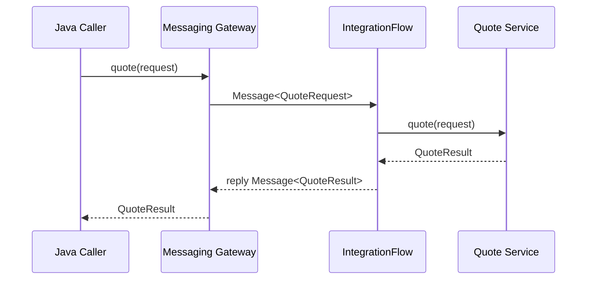

An application can swap its messaging topology while callers keep the same interface. However, **a synchronously returning API is still a waiting contract**, bringing timeouts, errors, and latency; it does not turn all messaging into fire-and-forget.

### What Does the Gateway Not Do Automatically?

A Gateway **does not** automatically:

- Guarantee exactly-once business side effects.
- Create a distributed transaction across broker, database, and HTTP.
- Preserve every header across all adapters.
- Prevent duplicates when callers retry.
- Turn a request–reply into a reliable protocol across every remote service.
- Guarantee the handler will reply before the deadline.
- Decide authorization, error formatting, or SLAs on its own.

Those responsibilities must be designed in the flow and its adapters.

## 3. Comparing Request-Reply and One-Way

| Criterion | One-Way | Request-Reply |
| --- | --- | --- |
| Caller expectation | Send request, do not wait immediately for business result | Receive result/exception per contract |
| Gateway method | Usually `void` or an appropriate fire-and-forget form | Usually returns a DTO/value or asynchronous result |
| Messaging flow | Producer → handler, possibly no reply | Producer → handler → reply path |
| Visible failures | May only be send failure or asynchronous failure | Can be send failure, handler error, or reply timeout |
| Timeouts | Send/publish deadline may apply | Send deadline and reply deadline must be distinguished |
| Success condition | Message sent/accepted per contract | Valid reply reached caller (not necessarily business committed) |
| When to use | Audit, event notification, background job | Quotes, status lookups, requests needing an immediate result |

**Common pitfall:** a `void` method sending a command to a broker **does not prove** downstream succeeded. Conversely, a request-reply method receiving an `ACCEPTED` reply does not by default prove a long-running task completed. You must define *what the reply means*: received, validated, committed, or merely queued.

### When Should You Avoid Request-Reply?

A task taking several minutes, requiring approval, or depending on multiple systems likely to exceed timeouts should use **202 Accepted + `operationId`, a durable command, and status/event notifications** rather than blocking a Java/HTTP thread. A request-reply Gateway fits operations with clear deadlines, bounded cost, and explicit semantics.

## 4. Gateway Differs from Service Activator

These are the two ends of a common interaction:

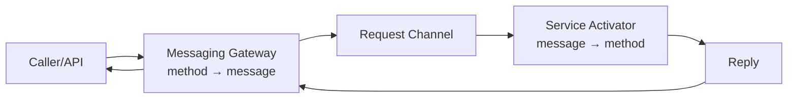

- **Messaging Gateway:** lets code call a flow like a method; responsible for call ↔ messaging translation.
- **Service Activator:** lets a flow invoke a service/method; responsible for message ↔ invocation translation.
- **Transformer:** changes payload schema/type.
- **Filter:** accepts or rejects messages.
- **Router:** selects branches.
- **Aggregator:** groups multiple messages by group/correlation with a release strategy.
- **Idempotent Receiver:** protects business operations from duplicates.
- **Error Channel:** handles errors per endpoint/adapter configuration.

A flow may pass through several Transformers/Routers before reaching a Service Activator. Even so, the Gateway still needs a reply path that can find its way back to the matching caller.

## 5. Core Components of Request-Reply

### 5.1. Request

The message carrying the command/query emitted by the Gateway. The payload can be a DTO or primitive; headers may include request ID, trusted context, correlation, and reply destination.

### 5.2. Request Channel

The channel into which the Gateway sends the message. It can be a `DirectChannel`, `QueueChannel`, or another structure. The channel type partly dictates synchronicity, backpressure, storage capability, and failure model.

### 5.3. Handler

The endpoints that receive, process, route, and ultimately produce a result or error. A Service Activator returning a payload is the simplest example.

### 5.4. Reply Channel or Reply Destination

Where the reply is sent so the Gateway receives it. For an in-JVM Gateway, the framework can attach a **temporary reply channel** in request headers to route replies back to the right caller. Across a broker, you need a transport-compatible reply destination/correlation contract.

### 5.5. Timeout and Error Path

If sending fails to complete, no reply arrives, the reply carries an error, or the reply has the wrong type, the caller must receive a handleable outcome. A timeout does not prove with certainty that the **business operation did not occur**.

### 5.6. Correlation

A reply must be matched back to the **exact request**. This can rely on a dedicated reply channel, correlation ID, or reply-to metadata depending on topology. Never assume two messages having equal payloads are enough to correlate them.

## 6. Two Perspectives on Request-Reply in Spring Integration

**Java interface Gateway** uses `@MessagingGateway`: the client calls an interface, and the framework builds a proxy that sends the message and receives the reply.

**Gateway endpoint inside a flow**: an endpoint that sends a message to a request/reply subflow or external system, waits for the reply, and feeds the result back into the flow. The DSL provides gateway components appropriate to the version.

This lesson uses the **Java interface Gateway** as its primary example because it is easy to see:

```java
ShippingQuoteResult quote(ShippingQuoteRequest request);
```

A later section on cross-flow/outbound gateways highlights the differences. Do not confuse this with an **HTTP API Gateway** (reverse proxy, HTTP routing, edge authentication). Same word "gateway," different function.

## 7. Example Domain Contract

We use a simulated shipping quote request. This is a pure *query* with no payment deduction or inventory reservation.

```java
record ShippingQuoteRequest(
    String quoteRequestId,
    String zoneCode,
    int weightGrams) {}

record ShippingQuoteResult(
    String quoteRequestId,
    String zoneCode,
    long totalVnd,
    String currencyCode,
    String rateVersion) {}
```

Example contract:

- `quoteRequestId` is a valid ID used for matching and observing the request; it is not a broker message ID.
- `zoneCode` has two demo values: `HCM` or `HN`.
- `weightGrams` is an integer from 1 to 20,000.
- Quotes use **whole VND** to avoid ambiguous monetary rounding.
- Base fee: HCM = 16,000 VND, HN = 22,000 VND.
- Each 1,000 g block (rounded up) adds 5,000 VND.
- Service returns `rateVersion="demo-v1"`.
- The demo calls no external carrier and performs no money or inventory side effects.

Example `zone=HCM, weight=1500g`: number of blocks = 2, fee = 16,000 + 2 × 5,000 = **26,000 VND**.

### Separating Business Data from Transport

The records do not contain `replyChannel`, `KafkaHeaders.RECEIVED_TOPIC`, HTTP status, trace spans, or broker offsets. An integration adapter may use those, but the pricing service does not need them.

## 8. Pure Java Pricing Service

```java
import java.util.concurrent.atomic.AtomicInteger;

final class ShippingQuoteService {

    private final AtomicInteger calculations =
        new AtomicInteger();

    ShippingQuoteResult quote(ShippingQuoteRequest request) {
        if (request == null
                || request.quoteRequestId() == null
                || !request.quoteRequestId()
                    .matches("[A-Z0-9-]{1,40}")
                || request.zoneCode() == null
                || request.weightGrams() <= 0
                || request.weightGrams() > 20_000) {
            throw new IllegalArgumentException(
                "Invalid quote request");
        }

        long baseVnd = switch (request.zoneCode()) {
            case "HCM" -> 16_000L;
            case "HN" -> 22_000L;
            default -> throw new IllegalArgumentException(
                "Unsupported zone");
        };

        // Cast to long before adding to avoid integer overflow.
        long blocks =
            (request.weightGrams() + 999L) / 1000L;

        long total = baseVnd + blocks * 5_000L;

        calculations.incrementAndGet();

        return new ShippingQuoteResult(
            request.quoteRequestId(),
            request.zoneCode(),
            total,
            "VND",
            "demo-v1");
    }

    int calculations() {
        return calculations.get();
    }
}
```

Java's `switch` on a `String` throws `NullPointerException` if `zoneCode=null`. Therefore the method checks `zoneCode == null` **before entering the switch**, turning missing data into `IllegalArgumentException` per the input contract. If the zone is neither `HCM` nor `HN`, the `default` branch explicitly rejects instead of picking a default rate table.

**This service is not a Service Activator:** it is a plain Java business collaborator. When invoked from Spring Integration, a Service Activator endpoint handles bridging the message to the method.

## 9. Defining the `@MessagingGateway` Interface

Spring Integration supports generating a **Messaging Gateway proxy** from an interface.

```java
import org.springframework.integration.annotation.MessagingGateway;

@MessagingGateway(
    defaultRequestChannel = "shipping.quote.requests",
    defaultRequestTimeout = "1000",
    defaultReplyTimeout = "2000")
public interface ShippingQuoteGateway {

    ShippingQuoteResult quote(
        ShippingQuoteRequest request);
}
```

The caller does not need to build a `Message<?>`:

```java
ShippingQuoteResult result = gateway.quote(
    new ShippingQuoteRequest(
        "Q-204", "HCM", 1500));
```

The Gateway proxy maps arguments → request message, sends to the channel, and waits for a reply per the method return contract.

### Do the Two Timeout Attributes Share the Same Unit?

In the annotation, timeouts are usually expressed as **strings in milliseconds or property expressions** per the Spring Integration API in use. In the demo code, `"1000"` means 1,000 ms and `"2000"` means 2,000 ms. Verify the exact types/semantics of your dependency and never treat them as an absolute end-to-end deadline.

### Registering the Gateway Interface

An annotated interface only gets a proxy when Spring Integration scans/registers it. The following configuration uses `@IntegrationComponentScan` to register the Gateway interface.

Not every standard `@ComponentScan` handles Gateway interfaces as expected. The `ApplicationContext` test must actually see the `ShippingQuoteGateway` bean.

## 10. Java DSL: Request Channel → Service Activator → Reply

Here is the main topology:

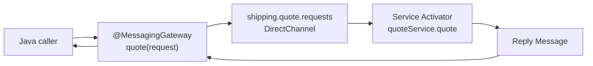

Configuration:

```java
import org.springframework.context.annotation.Bean;
import org.springframework.context.annotation.Configuration;
import org.springframework.integration.annotation.IntegrationComponentScan;
import org.springframework.integration.channel.DirectChannel;
import org.springframework.integration.config.EnableIntegration;
import org.springframework.integration.dsl.IntegrationFlow;

@Configuration
@EnableIntegration
@IntegrationComponentScan(
    basePackageClasses = ShippingQuoteGateway.class)
public class ShippingQuoteFlowConfig {

    @Bean
    ShippingQuoteService shippingQuoteService() {
        return new ShippingQuoteService();
    }

    @Bean("shipping.quote.requests")
    DirectChannel quoteRequests() {
        return new DirectChannel();
    }

    @Bean
    IntegrationFlow shippingQuoteFlow(
            ShippingQuoteService service) {

        return IntegrationFlow
            .from("shipping.quote.requests")
            .handle(
                ShippingQuoteRequest.class,
                (request, headers) ->
                    service.quote(request))
            .get();
    }
}
```

**Key point:** the flow **does not hardcode** `.channel("some.queue")` at the end. A reply-producing handler can send the result to the reply channel attached to the request (provided by the Gateway) per framework semantics. For an in-JVM Gateway, this is the simplest way for the caller to receive the reply to its own request.

If you try to send all replies to a shared `QueueChannel` without a proper consumer/correlation mechanism, callers can time out, replies can be read by the wrong caller, or nothing delivers the reply back to the Gateway.

### Why Is No Global Reply Channel Declared?

The Gateway normally provides a reply-to context per request, matched to each invocation. The Service Activator returns `ShippingQuoteResult`, and the reply is routed back by the framework. With a **remote broker**, requirements change: you cannot send a Spring `MessageChannel` object over the network; you must use a serializable reply destination and correlation.

### How Does the Domain Stay Independent?

- The Gateway interface is the integration-facing API.
- The flow knows the payload class, headers, and channel.
- `ShippingQuoteService.quote()` only knows `ShippingQuoteRequest`/`ShippingQuoteResult`.
- If the request channel switches from `DirectChannel` to an async transport, the pricing calculation never needs to import Kafka or AMQP.

**This is a synchronous in-JVM example.** It does not prove broker durability, remote reply correlation, or end-to-end timeouts.

## 11. Anatomy of a Successful Call

Suppose the caller executes:

```java
ShippingQuoteResult r = gateway.quote(
    new ShippingQuoteRequest("Q-204", "HCM", 1500));
```

Sequence:

1. Java calls the `ShippingQuoteGateway` proxy.
2. The proxy converts the argument into a request `Message<ShippingQuoteRequest>`.
3. The Gateway attaches the needed reply context and sends to `shipping.quote.requests`.
4. `DirectChannel` passes the message to the subscribed endpoint.
5. The Service Activator extracts the typed payload.
6. `ShippingQuoteService.quote(...)` returns `ShippingQuoteResult`.
7. The reply-producing handler emits the reply using the reply context.
8. The Gateway receives the result and returns `ShippingQuoteResult` to the caller.

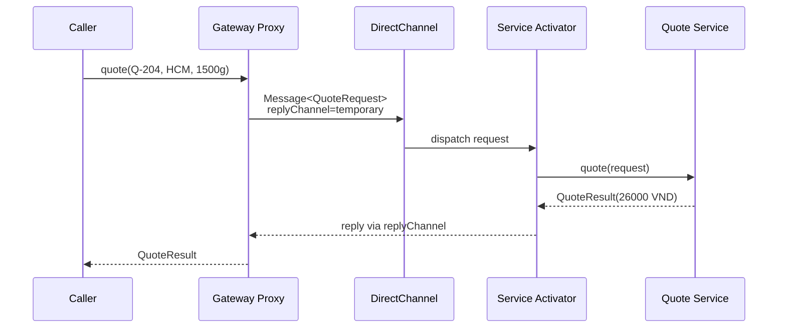

In this in-memory example, the Gateway can use a temporary reply channel instead of a shared reply queue. This is a common mechanism; consult your Spring Integration version's internals if you plan to depend on specific internal classes.

## 12. JUnit 5: Testing Request-Reply End-to-End

The test uses Spring Test context, JUnit 5, and AssertJ.

```java
import static org.assertj.core.api.Assertions.assertThat;
import static org.assertj.core.api.Assertions.assertThatThrownBy;

import org.junit.jupiter.api.Test;
import org.springframework.beans.factory.annotation.Autowired;
import org.springframework.test.context.junit.jupiter.SpringJUnitConfig;

@SpringJUnitConfig(ShippingQuoteFlowConfig.class)
class ShippingQuoteGatewayTest {

    @Autowired
    ShippingQuoteGateway gateway;

    @Autowired
    ShippingQuoteService service;

    @Test
    void methodCallReturnsTypedReply() {
        int before = service.calculations();

        ShippingQuoteResult result = gateway.quote(
            new ShippingQuoteRequest(
                "Q-204", "HCM", 1500));

        assertThat(result).isNotNull();
        assertThat(result.quoteRequestId())
            .isEqualTo("Q-204");
        assertThat(result.zoneCode())
            .isEqualTo("HCM");
        assertThat(result.totalVnd())
            .isEqualTo(26_000L);
        assertThat(result.currencyCode())
            .isEqualTo("VND");
        assertThat(result.rateVersion())
            .isEqualTo("demo-v1");
        assertThat(service.calculations() - before)
            .isEqualTo(1);
    }

    @Test
    void twoRequestsReturnTheirOwnResults() {
        ShippingQuoteResult hcm = gateway.quote(
            new ShippingQuoteRequest(
                "Q-205", "HCM", 1000));

        ShippingQuoteResult hn = gateway.quote(
            new ShippingQuoteRequest(
                "Q-206", "HN", 1000));

        assertThat(hcm.quoteRequestId())
            .isEqualTo("Q-205");
        assertThat(hcm.totalVnd())
            .isEqualTo(21_000L);

        assertThat(hn.quoteRequestId())
            .isEqualTo("Q-206");
        assertThat(hn.totalVnd())
            .isEqualTo(27_000L);
    }

    @Test
    void invalidRequestDoesNotBecomeSuccessfulReply() {
        int before = service.calculations();

        assertThatThrownBy(() ->
            gateway.quote(
                new ShippingQuoteRequest(
                    "Q-207", "HCM", -1)))
            .isInstanceOf(RuntimeException.class);

        assertThat(service.calculations() - before)
            .isZero();
    }

    @Test
    void unsupportedZoneIsRejected() {
        assertThatThrownBy(() ->
            gateway.quote(
                new ShippingQuoteRequest(
                    "Q-208", "UNKNOWN", 1000)))
            .isInstanceOf(RuntimeException.class);
    }
}
```

### What Is This Test Verifying?

- The `@MessagingGateway` interface is created as a Spring bean.
- The method argument is sent into the request channel.
- The Service Activator returns a typed payload.
- The Gateway receives the right reply and returns it to the Java caller.
- Domain validation failures do not turn into successful quotes.
- Two distinct requests get their own results without cross-wiring responses.

### Do Not Over-Extrapolate from This Test

The test runs in **a single JVM with `DirectChannel`**. It does not prove:

- Replies arriving after timeout are handled properly.
- Broker reply-to/correlation works over the network.
- Queues survive restarts.
- Multiple concurrent processes do not receive the wrong reply.
- Caller cancellation actually stops the handler.
- Timeout guarantees no side effects occurred.
- Retries have idempotency or transactions.

Those scenarios require dedicated integration/failure tests for the real topology.

## 13. Unit Testing the Domain Without a Spring Context

Because the pricing service does not import Spring Integration, its logic can be tested independently:

```java
import static org.assertj.core.api.Assertions.assertThat;
import static org.assertj.core.api.Assertions.assertThatThrownBy;

import org.junit.jupiter.api.Test;

class ShippingQuoteServiceTest {

    private final ShippingQuoteService service =
        new ShippingQuoteService();

    @Test
    void oneToOneThousandGramsCountAsOneBlock() {
        assertThat(service.quote(
            new ShippingQuoteRequest(
                "Q-301", "HCM", 1)).totalVnd())
            .isEqualTo(21_000L);

        assertThat(service.quote(
            new ShippingQuoteRequest(
                "Q-302", "HCM", 1000)).totalVnd())
            .isEqualTo(21_000L);
    }

    @Test
    void oneThousandAndOneGramsCountAsTwoBlocks() {
        assertThat(service.quote(
            new ShippingQuoteRequest(
                "Q-303", "HCM", 1001)).totalVnd())
            .isEqualTo(26_000L);
    }

    @Test
    void invalidWeightCannotBeCalculated() {
        assertThatThrownBy(() ->
            service.quote(
                new ShippingQuoteRequest(
                    "Q-304", "HCM", 0)))
            .isInstanceOf(IllegalArgumentException.class);
    }
}
```

You do not need a Gateway proxy or `MessageHeaders` to test pricing rules. The integration tests in the previous section focus solely on **method-to-message-to-reply wiring**.

## 14. Request Channel: Successfully Sending Does Not Mean Processing Finished

`DirectChannel` dispatches to the subscriber on the same call thread, per `DirectChannel` semantics. Usually the handler finishes before `send` returns.

`QueueChannel` is a pollable channel; the Gateway can enqueue the request, yet a separate poller/consumer must pull it, process it, and emit the reply.

`ExecutorChannel` can hand off handling to another thread. The Gateway sends and then waits independently for the reply if the method return type is synchronous.

| Channel | Characteristics | Risks in Request-Reply |
| --- | --- | --- |
| `DirectChannel` | Invokes subscriber synchronously | Handler blocks caller thread; timeout does not interrupt a running handler |
| `ExecutorChannel` | Dispatches via executor | Queue full, thread pool exhaustion, late replies, lost context |
| `QueueChannel` | Pollable, requires consumer/poller | No poller → Gateway waits until timeout |
| Broker adapter | Remote/durable depending on config | Reply destination, correlation, ACK, retry, reordering |
| `PublishSubscribeChannel` | Fans out to subscribers | Multiple replies for one request unless policy is clear |

**Important:** Never just change `DirectChannel` to `QueueChannel` assuming the flow will work asynchronously. You need a poller/consumer endpoint reading the queue, and reply metadata must be preserved across steps.

## 15. `requestTimeout` and `replyTimeout` Are Two Different Things

A request-reply Gateway usually configures two timeouts:

- **Request/send timeout:** time allowed to finish **sending** the message to the request channel, depending on channel semantics.
- **Reply timeout:** time the Gateway **waits for the reply** through the reply mechanism.

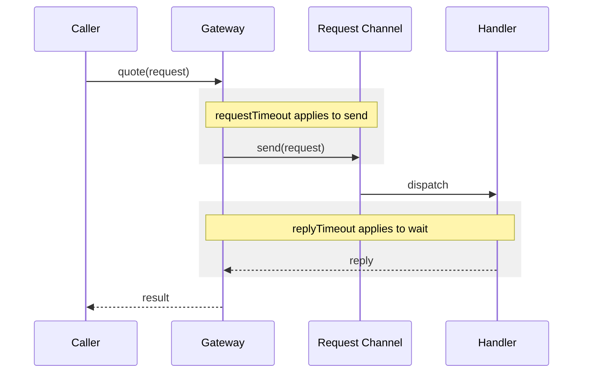

### Request Timeout Scenario

If the request channel has bounded capacity and cannot accept more messages, sending may block or fail. The Gateway needs a send deadline. However, exact semantics vary among `DirectChannel`, `QueueChannel`, broker adapters, and custom channels.

### Reply Timeout Scenario

The request was sent, yet no reply arrives within the expected window. Examples:

- The handler returns no result.
- A Filter discards the message without sending a rejection.
- A remote service is slow.
- Reply channel/correlation was lost.
- The executor pool is saturated.
- A reply exists, but has a schema error or went to the wrong destination.

**A timeout does not prove the handler did not run.** The sender may time out even while downstream already committed, if the reply is lost or arrives late.

### With `DirectChannel`, Does Timeout Interrupt an Overlong Handler?

**Do not treat `replyTimeout` as a hard deadline for a synchronous service call hogging the thread.** With `DirectChannel`, the `send` call itself can run the handler longer than the configured timeout before ever reaching the reply-waiting phase.

If you need a hard end-to-end deadline, design the layers separately:

- HTTP client / remote provider timeouts.
- Execution or executor deadlines/timeouts.
- Supported cancellation / cooperative interruption.
- Operation-level recovery when outcomes are ambiguous.
- Gateway send/reply timeouts.
- Overall retry budget, not just per-attempt limits.

A Gateway timeout **does not automatically roll back transactions** and does not guarantee downstream requests are canceled.

## 16. No Reply: Distinguishing Filter Discard from `void` Service Activator

Suppose a Filter rejects a request:

```text
Gateway quote(request)
  ↓ Filter: invalid → false
  ↓ No reply
Gateway waits ...
```

If the Filter simply discards without emitting a rejection message, the caller can wait until reply timeout. A `void` or `null`-returning Service Activator can also create a **no-reply path**.

Contract-aligned solutions:

1. For request–reply, produce a **typed rejection reply** (e.g., `QuoteRejected`) or throw a mapped exception.
2. For one-way, change the Gateway method to a model that does not wait for a business response.
3. If async is needed, return an operation ID immediately and use status/events later.
4. Never let validation errors turn into silence.
5. Test both reply timeouts and fail-fast error mapping.

### `null` Reply or Exception on Timeout?

Timeout behavior can depend on return type, interface method, error handling, and Spring Integration version/configuration. Some calls return `null`/empty results while some flows throw a messaging exception. **Do not rely on defaults if your business API requires clear fail-fast behavior.**

Define an application wrapper policy, for example:

```java
// Application facade pseudocode:
ShippingQuoteResult quoteOrFail(ShippingQuoteRequest request) {
    ShippingQuoteResult reply = gateway.quote(request);

    if (reply == null) {
        throw new QuoteUnavailableException(
            "No reply before deadline");
    }

    return reply;
}
```

`QuoteUnavailableException` is an application-defined exception. This example demonstrates an **error contract**, not that all Spring versions always return `null`.

## 17. Reply Channel: Mechanism for Returning to the Right Caller

A request from a Gateway typically carries metadata like:

```text
payload = ShippingQuoteRequest(...)
headers:
  replyChannel = temporaryReplyChannel
  errorChannel = ... (depending on config)
  requestRef   = Q-204
```

A reply-producing handler can send the result to `replyChannel`. If multiple Java threads call the Gateway concurrently, each invocation can have its own reply path.

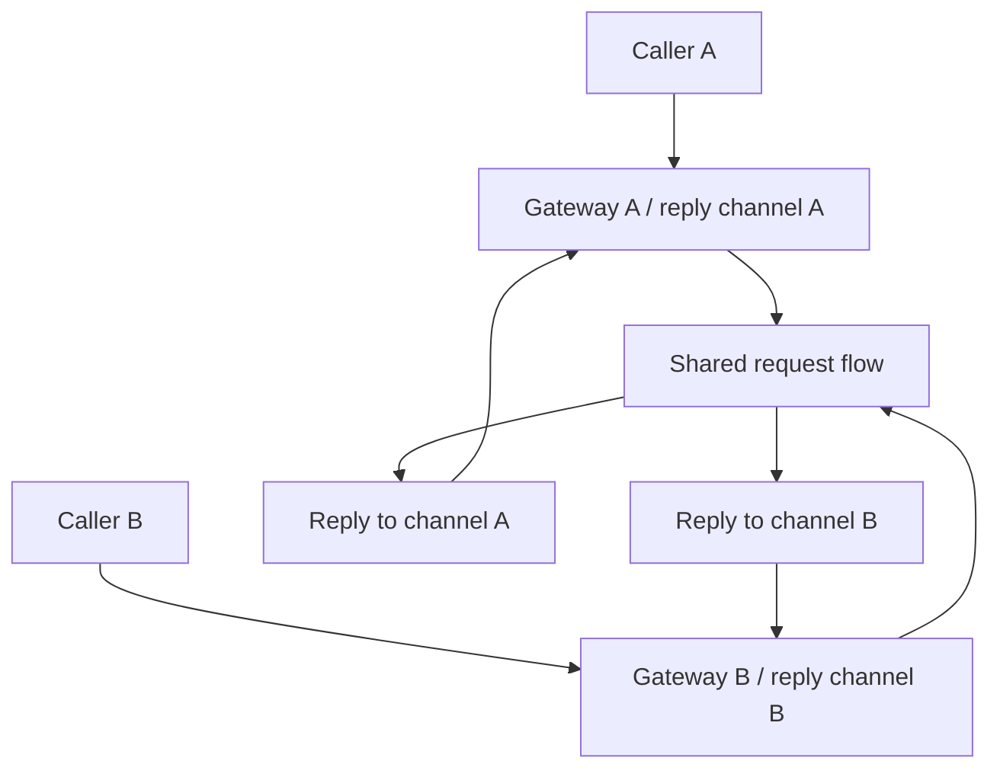

In simple flows, framework-managed reply context removes the need to hand-write queue/correlation logic. When a message is serialized over Kafka/HTTP, however:

- You cannot pass a `MessageChannel` object directly over the wire.
- You need a real reply-to destination or topic/queue.
- You need a correlation ID contract between sender and receiver.
- You need a consumer/reply listener matching replies to pending requests.
- You need retention, timeout, late-reply, and duplicate-reply policies.

Do not merely copy the raw `replyChannel` header into JSON expecting a remote service to use it.

## 18. Correlation: Equal Payloads Do Not Mean the Same Request

Suppose the same user queries the same zone/weight twice:

```text
Request A: quoteRequestId=Q-301, HCM, 1500g
Request B: quoteRequestId=Q-302, HCM, 1500g
```

The two economic payloads look nearly identical, yet they are **two distinct invocations**. If a broker delivers replies out of order—B before A—correlation must rely on the proper ID/destination, not payload equality or naive FIFO.

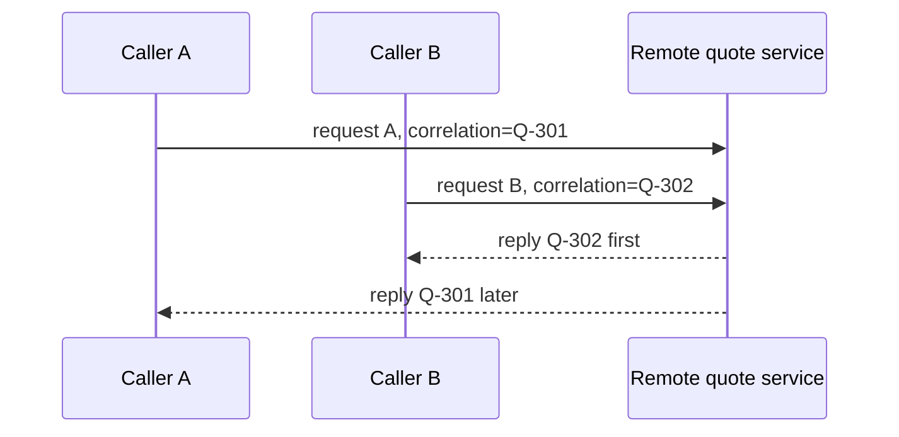

IDs to distinguish:

| ID | Purpose | Stable Across Retries? |
| --- | --- | --- |
| `MessageHeaders.ID` | Identifies a Spring message instance | Not guaranteed |
| Broker delivery ID/offset | Delivery/record mechanics | Not guaranteed on republish |
| Request/reply correlation ID | Matches reply to invocation | Per conversation/attempt contract |
| Business operation ID | Identifies the same business action | **Yes** when retrying the same operation |
| Logical event ID | Identifies an event across redelivery | **Yes** for the same event |
| Trace ID | Observability | Depends on tracing/attempt |

A system can use a business ID for correlation if the contract allows it and uniqueness is guaranteed across pending requests. Yet **never assume every correlation ID is also an idempotency key**.

## 19. Gateways with Multiple Methods and Per-Method `@Gateway`

An interface can serve multiple use cases:

```java
import org.springframework.integration.annotation.Gateway;
import org.springframework.integration.annotation.MessagingGateway;

@MessagingGateway
public interface OrderQueryGateway {

    @Gateway(
        requestChannel = "orders.quote.requests",
        replyTimeout = "2000")
    ShippingQuoteResult quote(
        ShippingQuoteRequest request);

    @Gateway(
        requestChannel = "orders.status.requests",
        replyTimeout = "1500")
    OrderStatusResult status(
        OrderStatusRequest request);
}
```

`OrderStatusRequest` and `OrderStatusResult` are separate application DTOs in this example; they must be defined in your project if used.

Meaning:

- `@MessagingGateway`: declares the proxy interface.
- `@Gateway`: tunes request channel and reply timeout per method.
- Return type reflects each method's reply contract.
- Service Activators/flows behind each channel must produce compatible results.

**Putting two methods in one interface does not force them to share a channel.** Each method needs a clear flow/protocol; if one method has no responder, the Gateway will not invent a result.

## 20. Passing Headers from Gateway Parameters into the Request

An interface can map method arguments into payload and headers:

```java
import org.springframework.integration.annotation.MessagingGateway;
import org.springframework.messaging.handler.annotation.Payload;
import org.springframework.messaging.handler.annotation.Header;

@MessagingGateway(
    defaultRequestChannel = "shipping.secure-quote.requests")
public interface SecureQuoteGateway {

    ShippingQuoteResult quote(
        @Payload ShippingQuoteRequest request,
        @Header("verifiedTenantId") String verifiedTenantId);
}
```

In the flow, a Service Activator or Mapper reads the header injected into the `Message`:

```java
// Integration boundary example, not token authentication.
.handle(ShippingQuoteRequest.class, (request, headers) -> {
    Object tenant = headers.get("verifiedTenantId");

    if (!(tenant instanceof String id) || id.isBlank()) {
        throw new IllegalArgumentException(
            "Missing verified tenant");
    }

    return quoteApplicationService.quoteForTenant(
        id, request);
})
```

`quoteApplicationService` is a hypothetical application collaborator in the snippet, not a class defined in the main configuration.

**Crucial:** passing `verifiedTenantId` as a Gateway argument does not make it trusted by itself. Only an authenticated adapter/controller may invoke the interface with an authoritative tenant. If public callers choose the string themselves, that is spoofing. Domain/application logic must verify resource permissions at execution time.

### When Are Header Arguments Unnecessary?

If the Gateway method already receives a `QuoteCommand` carrying tenant and actor context **authenticated at the application boundary**, use a typed DTO. Do not add `@Header` to every field just because the framework supports it.

## 21. Gateway, Transformer, and Normalizer

A Gateway may receive requests in an external schema that must be converted into a canonical command:

```text
Caller: LegacyQuoteRequest
   ↓ Gateway
Message<LegacyQuoteRequest>
   ↓ Transformer / Normalizer
Message<ShippingQuoteRequest>
   ↓ Service Activator
ShippingQuoteResult
   ↓ Gateway reply
Caller
```

However, **the Gateway does not normalize schemas automatically**. Payload conversion belongs in an adapter/Transformer, tested separately.

If one partner sends V1 with `weightKg` and V2 with `weightGrams`, a Normalizer can map both into `ShippingQuoteRequest`. The Gateway return type stays stable even as source representations change.

### Reply Type Mismatch

If a handler returns `Map<String,Object>` while the Gateway method expects `ShippingQuoteResult`, the framework needs an appropriate converter or it will fail. Do not assume arbitrary auto-casting/deserialization just because field names match.

A contract test should verify the typed reply, header mapping, and conversion errors.

## 22. Gateway and Filter: Rejections Must Have a Reply Path

Suppose the route is:

```text
Gateway → Filter(eligible?) → Service Activator → reply
```

If the Filter drops messages without replying:

- The Gateway may wait until timeout.
- Callers get `null`/exception depending on contract.
- Monitoring only sees "timeout," hiding the rejection rule.
- Caller retries can amplify load even on permanently invalid inputs.

Better design:

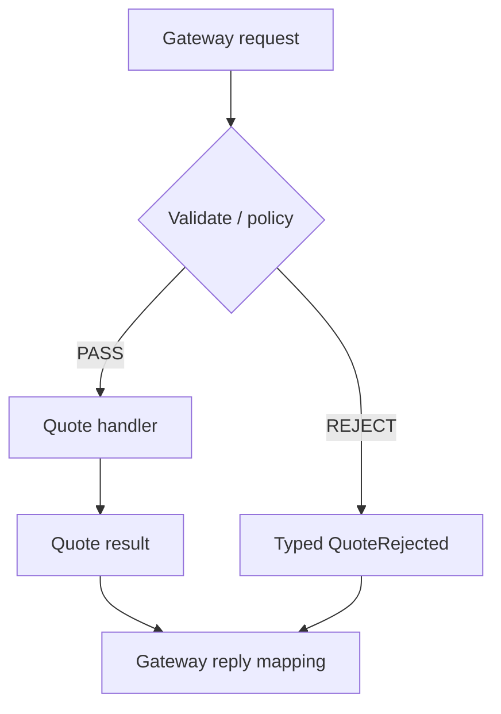

Two common approaches:

1. **Application result envelope:** return a sealed result/status typed as Success/Rejected; callers handle it per contract.
2. **Typed exception:** validation/policy errors are thrown or routed through a configured error flow and mapped to API errors.

Do not send a `QuoteRejected` object back to a Gateway method rigidly returning `ShippingQuoteResult` without a converter/type mapping; either update the return contract or map the rejection to an exception.

## 23. Gateway and Router: Never Lose Reply Context

A Router can direct requests to:

```text
Shipping Quote Gateway
   ↓
Router by zone/service level
   ├── HCM handler
   └── HN handler
       ↓
  Reply to original Gateway
```

Every branch must return the right reply type and preserve needed reply/correlation metadata. If one branch sends to a channel with no responder or builds a new `Message` that drops `replyChannel`, the Gateway may time out even though the branch executed.

### What to Test?

- HCM and HN select the right branch.
- Each branch produces a compatible result.
- Reply/context headers are preserved.
- Unknown zones return a rejection/exception instead of silently discarding.
- Processing latency stays within SLA.
- Two branches never both emit replies for one request unless an aggregation policy exists.

## 24. Aggregator/Scatter-Gather Before Gateway Reply

Sometimes a quote must query multiple carriers and return **one best quote**:

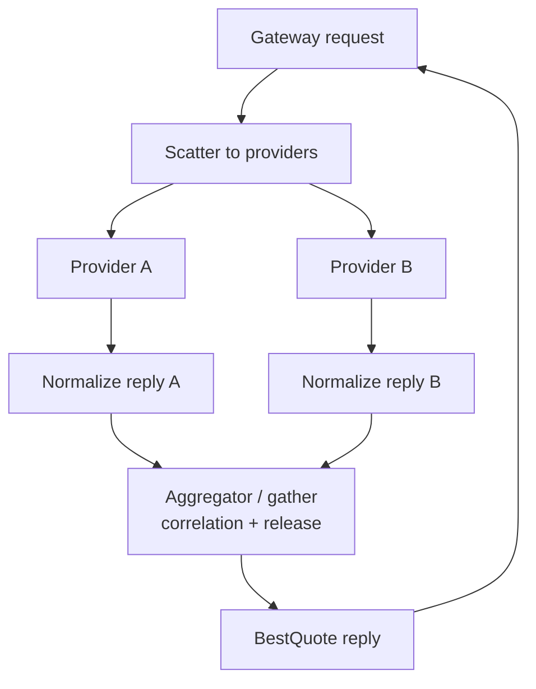

The Gateway wants only **one final reply**. The Aggregator must:

- Use a trusted correlation/group ID.
- Know the expected responders / unique part IDs.
- Not count a duplicate reply from Provider A as Provider B.
- Have a release timeout, partial-result, and failure policy.
- Handle idempotency when a remote provider replies multiple times.
- Preserve the original request's reply destination for the output.

**Just because the Gateway expects one reply does not mean the framework merges multiple replies automatically.** If a route produces multiple reply messages, you need an aggregator/gatherer or a clear selection policy.

## 25. Late Replies: Caller Timed Out, Yet Handler Continues

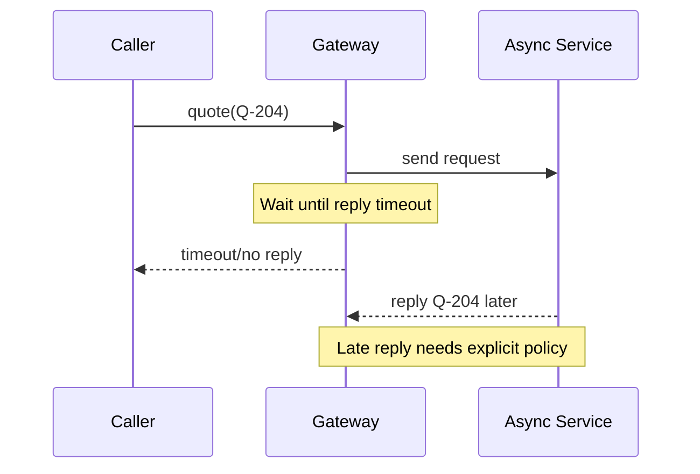

Do not confuse a timeout with successful cancellation:

- The handler may still be running.
- A remote provider may have already committed.
- A reply sent to a temporary channel after the caller left may be dropped, fail, or have no consumer.
- The caller might retry with a new request ID and trigger a second business operation if this is a side-effecting command.
- Threads, queues, or reply correlation stores may still retain pending state.

You must define:

1. Does the caller receive an error or an `operationId` upon expiry?
2. How is pending request state cleaned up?
3. Are late replies logged, stored as results, reconciled, or discarded in a controlled way?
4. How do retries preserve stable business operation identity?
5. Is a durable reply store needed if responses must survive restarts?
6. Does remote timeout/cancellation actually stop side effects?

**A timeout is an outcome for the waiter, not proof the action did not occur.**

## 26. Deadlock Problem When Request-Reply Uses a Bounded Executor

A classic bug:

```text
Executor pool = 1 thread

Task A on executor:
  calls request-reply Gateway
  sends request to queue
  waits for reply

Task B needs that same executor to:
  pick up request
  process
  emit reply

Result: Task B has no thread to run.
Task A waits until timeout.
```

Small thread pools, nested synchronous gateways, or flows looping back onto an already-blocked executor can cause **topology-induced thread starvation/deadlock**.

Mitigations:

- Separate executors for blocking callers and workers/responders.
- Never wait synchronously for a reply inside the same thread pool that processes requests.
- Bound concurrency, queue capacity, and backpressure.
- Use bounded deadlines and circuit breakers where appropriate.
- For long tasks, switch to async jobs/status events.
- Write load/failure tests for thread-pool saturation.

Setting `replyTimeout=2000` is not a fix for a starved executor. It only caps one wait; the structural cause remains.

## 27. Why Gateways Tempt Callers into Thinking It Is Normal RPC

The interface:

```java
ShippingQuoteResult quote(ShippingQuoteRequest request);
```

looks like an in-process method call. Yet key differences exist:

| Plain Java Method Call | Request-Reply Gateway |
| --- | --- |
| Direct invocation | Message may traverse multiple endpoints/threads/processes |
| Nearly synchronous exceptions | Errors can occur in adapters, handlers, brokers, or reply mapping |
| Return type enforced directly by method | Return type also depends on converters/reply routing |
| No send/reply channels | Has channel semantics and timeouts |
| One call runs once | Retries/redeliveries can invoke business effects multiple times |
| Caller holds stack until return | Async boundaries have independent lifecycles |
| No network correlation needed | Remote replies must be matched |
| Language-level cancellation semantics | Cancellation does not auto-rollback business actions |

Keep the API convenient, yet **document distributed behavior in the contract**: timeouts, retryability, operation identity, error types, and response meaning.

## 28. Error Handling: Send Errors, Handler Errors, Reply Errors

| Location | Example | Appropriate Response |
| --- | --- | --- |
| Gateway proxy | Method/argument mapping fails | Fail fast, validation/contract error |
| Request channel | Channel full, no subscriber | Send error/timeout, topology alert |
| Transformer | JSON/DTO fails conversion | Permanent input rejection |
| Filter | Invalid data | Typed error/rejection reply |
| Router | Unknown route | Explicit reject/error flow |
| Service Activator | Domain rule rejects | Business error |
| Outbound provider | HTTP 503 | Bounded retry/backoff |
| Provider timeout | Unclear if committed | Reconciliation, no new operation |
| Reply channel | Lost reply / bad correlation | Timeout + investigate |
| Reply conversion | Payload wrong type | Contract failure, never report success |
| Gateway deadline | Late reply | Late-reply cleanup/reconcile |
| Store unavailable | Ledger/correlation store error | Fail safe, retry per policy |

**Do not assume every exception routes to the global `errorChannel`.** In synchronous `DirectChannel`, exceptions can propagate back to the sender and be wrapped in `MessagingException`. With executors, pollers, and brokers, error channel/recovery semantics differ.

A Gateway configured with an error channel, advice, or error flow can turn errors into replies or exceptions. Test the actual mode and prevent callers from misreading an error reply as a successful business result.

## 29. Header Propagation Across Steps

A Gateway request may carry:

```text
payload: ShippingQuoteRequest
headers:
  replyChannel
  errorChannel
  requestRef
  correlationId
  traceparent
  verifiedTenantId
```

Inside an internal flow, many transformers/handlers preserve context headers when returning a payload, yet not all ways of building a new `Message` behave identically.

Ways context gets lost:

- Manually calling `MessageBuilder.withPayload(...).build()` without copying required headers.
- Outbound adapters mapping only a subset of headers.
- Serializing a JVM `replyChannel` object over an unsupported transport.
- A Header Enricher overwriting correlation.
- An Aggregator producing output missing the original reply destination.
- A security boundary stripping headers without injecting trusted context.

**Recommendation:** test meaningful headers—especially reply/correlation and business event IDs—at every network boundary. Never trust a client-supplied `replyChannel` to force replies to an arbitrary unauthorized destination.

## 30. Authentication, Authorization, and Tenant in a Gateway

A Messaging Gateway maps method arguments to message headers/payload; **it does not verify caller identity**.

If an interface exposes:

```java
QuoteResult quote(
    @Payload QuoteRequest req,
    @Header("tenantId") String tenantId);
```

and a public API lets clients pick `tenantId`, that can be a vulnerability.

Trusted workflow:

1. HTTP/mTLS/JWT or broker ACLs authenticate the actor/producer.
2. The adapter builds server-owned trusted tenant/scope metadata.
3. The Gateway is only called by services/applications that already verified permissions.
4. The Service Activator/domain verifies resource ownership when needed.
5. Error replies do not leak another tenant's data.
6. Correlation/reply destinations are access-scoped.
7. Tracing and headers keep tokens/secrets out of logs.

**Never use `requestId` or correlation ID as an authentication token.** They exist for matching and observability, not authorization.

## 31. Request-Reply Gateway and Idempotency

The quote demo is a side-effect-free query. Yet the exact same pattern might be used to send:

```java
PaymentReceipt capture(CapturePayment command);
```

If the caller times out and retries, a payment provider may already have committed on the first attempt. The Gateway does not block duplicate execution automatically.

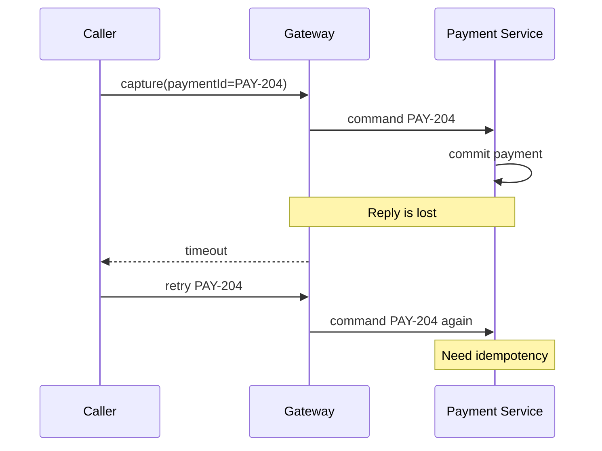

To handle this properly:

- Use a stable business operation ID across retries: `paymentRequestId`/`reservationId`.
- Never use `MessageHeaders.ID` or broker delivery ID as a business key.
- Keep a ledger with unique constraints / atomic claims and states `PROCESSING`/`COMPLETED`/`UNKNOWN`.
- Same key with different business data must signal **conflict**.
- If the remote provider supports an idempotency key, forward the same key.
- If outcome is unknown after timeout, reconcile before creating a new operation.
- Callers can receive the stored result from the first attempt rather than re-running side effects.
- Retain records long enough to cover retries, broker redeliveries, and DLQ replays.

A request-reply Gateway solves **communication**; an Idempotent Receiver and transactions solve **effect safety**. Never conflate the two responsibilities.

## 32. Request-Reply Over a Broker: Need an Explicit Protocol

A Gateway can connect through an outbound adapter to a remote service. That requires a **wire protocol** with request/reply semantics:

```text
Caller Gateway
  → request topic / queue
  → Remote consumer
  → reply topic / queue
  → Reply listener + correlation
  → Caller Gateway
```

Key fields:

```text
request:
  correlationRef = req-204
  replyTo = quote.replies.instance-A
  operationRef = Q-204
  messageType = SHIPPING_QUOTE_REQUEST

reply:
  correlationRef = req-204
  messageType = SHIPPING_QUOTE_RESULT
  payload = ...
```

Decisions to align on:

1. Who generates the correlation ID, and what is its uniqueness scope?
2. Which reply queue/topic is used, with what TTL and ACLs?
3. When a request has multiple attempts, is correlation per attempt or per logical operation?
4. Where are pending requests stored, and do they survive process restarts?
5. What if a reply arrives before the listener/lookup is ready or after timeout?
6. How are duplicate replies handled?
7. If the responder rejects an unsupported schema/version, what typed error does the caller get?
8. When is the request ACKed, and does sending the reply use a transaction/outbox?
9. How is trace context mapped across the transport?
10. When scaling multiple Gateway instances, does reply routing reach the right instance/pending state?

**Never serialize a Spring `MessageChannel` object** and never assume a shared reply queue without correlation suffices. The transport plan must be tested separately.

## 33. Long-Running Operations: Decouple Gateway Response from Completion

For a shipment-creation workflow taking several minutes:

```text
HTTP request
   ↓ API accepts command
202 Accepted + operationId
   ↓ durable command / queue
Worker / partner fulfillment
   ↓ event/DB state update
Client polls GET /operations/{id}
   or receives webhook/event
```

A synchronous Gateway can be used to **quickly validate/accept** and return an operation ID rather than blocking until the entire workflow finishes.

Distinguish:

- **Accepted:** command passed validation and entered infrastructure per contract.
- **Processing:** work is still underway.
- **Completed:** business action finished.
- **Failed:** business action ended in failure.
- **Unknown:** external outcome unconfirmed; reconciliation needed.

If returning `"OK"` right after enqueueing, never let callers believe shipment succeeded. API documentation and event schemas must state exact semantics.

## 34. Performance, Timeout Budgets, and Backpressure

In request-reply, the Gateway holds resources while waiting. Under high traffic:

- Blocking callers can exhaust servlet threads or application executors.
- Full queues slow down or fail sends.
- Short timeouts trigger retry storms.
- Late replies create orphaned work and stale correlation state.
- Remote service and gateway concurrency become imbalanced.
- Multiple hop timeouts sum up past the SLA.
- Retries at multiple layers multiply requests unexpectedly.

An illustrative timeout budget:

| Stage | Illustrative Budget |
| --- | --- |
| Ingress parse/validate | 50 ms |
| Queue/dispatch | 100 ms |
| Business handler | 300 ms |
| Remote lookup | 500 ms |
| Reply mapping | 50 ms |
| Headroom | 100 ms |
| **Total** | **1,100 ms** |

This table is for SLA design practice only; real timings depend on deployment. With a 1,100 ms caller deadline, do not give **every hop** 1,100 ms and allow three retries. Use an **overall deadline and retry budget**.

### Bounded Concurrency

- Size queue capacity to real processing throughput.
- Configure timeouts on provider clients.
- Use circuit breakers/bulkheads where appropriate.
- Separate executors for nested blocking calls.
- Rate-limit if callers can cause retry storms.
- Track pending counts, success/timeout rates, and latency percentiles.
- Degrade gracefully or switch to async responses if SLA cannot be met.

A Gateway does not replace backpressure design.

## 35. Observability: Tracking Both Send and Reply

Sample log:

```text
event=gateway_request_sent
gateway=ShippingQuoteGateway.quote
requestRef=Q-204
requestChannel=shipping.quote.requests
payloadType=ShippingQuoteRequest
traceRef=trace-801
```

On success:

```text
event=gateway_reply_received
gateway=ShippingQuoteGateway.quote
requestRef=Q-204
replyType=ShippingQuoteResult
outcome=SUCCESS
elapsedMs=83
```

On timeout:

```text
event=gateway_reply_timeout
gateway=ShippingQuoteGateway.quote
requestRef=Q-204
timeoutMs=2000
outcome=UNKNOWN
```

This is a **recommended event schema**; not all fields are emitted out of the box by the framework. Never log raw tokens, PII, or secrets in headers.

| Suggested Metric | Question Answered |
| --- | --- |
| `gateway.calls.total{method}` | How many calls occurred? |
| `gateway.requests.sent.total{channel}` | Which channels received sends? |
| `gateway.request.send.errors.total{reason}` | Why did requests fail to send? |
| `gateway.replies.total{resultType}` | Which reply types are returning? |
| `gateway.reply.timeouts.total{method}` | How often did callers exceed reply deadlines? |
| `gateway.latency{method}` | End-to-end P50/P95/P99 |
| `gateway.pending.requests` | How many calls are currently waiting? |
| `gateway.late.replies.total` | Replies arriving after deadline? |
| `gateway.correlation.mismatches.total` | Missing/mismatched correlation on replies |
| `gateway.reply.mapping.errors.total` | Return type/serializer mismatches |
| `gateway.handler.errors.total{type}` | Business/infrastructure errors |
| `gateway.idempotency.hits.total` | Duplicate business commands recognized |

Do not use arbitrary high-cardinality IDs like `requestId`, `userId`, or `tenantId` as metric labels. Use access-controlled traces/logs to look up individual requests.

## 36. Troubleshooting

| Symptom | Likely Cause | Where to Check |
| --- | --- | --- |
| Gateway bean missing | Missing `@IntegrationComponentScan` | Check scan annotations and Spring context |
| Gateway throws no-subscriber exception | Wrong channel name / missing endpoint | Check flow wiring |
| Gateway times out though handler ran | Reply channel lost/wrong | Check reply metadata |
| Quote returns `null` after timeout | No reply path | Typed rejection or deadline/timeout policy |
| Handler runs longer than configured `replyTimeout` | Synchronous `DirectChannel` | Bound handler/provider, async architecture |
| Request channel full | Queue capacity/backpressure | Bounded queue, pool sizing |
| Reply reaches wrong caller | Shared reply channel without correlation | Correlation/destination mapping |
| Reply arrives after timeout | Slow remote, caller stopped waiting | Late-reply handling/recovery |
| Invalid request causes timeout | Filter silently discards | Return typed rejection |
| Reply payload has wrong type | Adapter/Transformer schema mismatch | Explicit reply conversion/contract test |
| Multi-instance remote replies fail | Reply routed to wrong instance | Reply listener/registry/destination design |
| Threads blocked | Nested Gateway on single executor | Separate pools, avoid blocking loops |
| Retried request duplicates side effects | Timeout then retry with new ID | Stable operation ID, ledger |
| Error does not reach global `errorChannel` | Synchronous exception / adapter semantics | Error flow per channel/thread |
| Handler is `void` while method returns DTO | No reply emitted | Fix one-way/reply contract |
| Correlation lost after Transformer | New `Message` built without metadata | Test headers and mapping |
| `DirectChannel` tests pass, Kafka fails | Different serialization/reply protocol | Transport integration tests |
| Transaction commits, Gateway times out | Reply/ACK lost after commit | Stored outcome/reconciliation |
| Timeouts rise after deploy | Pool saturation or routing | P95, pending, queue, thread dumps |
| Request handled by two branches | Wrong Router/recipient list topology | Single reply/aggregation strategy |
| Spoofed tenant header | Gateway args not authorized | Trusted ingress and resource authorization |

## 37. Production Test Matrix

| Test Case | Expectation |
| --- | --- |
| Valid request through Gateway | Receives expected typed reply |
| Two distinct requests | Each reply reaches its own request |
| Wrong payload type | Clear conversion/validation error |
| Handler throws business exception | Does not return successful reply |
| Gateway interface not scanned | Context test fails fast |
| Request channel has no subscriber | Observable send failure/timeout |
| Lost reply | Caller gets deadline/timeout outcome |
| Filter discard | Explicit rejection path, no pointless wait |
| `void` handler | Clear one-way contract |
| Wrong return payload type | Reply mapping failure |
| Request timeout when `QueueChannel` full | Send budget verified |
| Reply timeout when async handler slow | Caller expires, late-reply policy runs |
| Slow `DirectChannel` handler | Proves gateway timeout does not preempt handler |
| Starved executor | Nested gateway test, no deadlock |
| Wrong correlation | Does not send reply to another caller |
| Reply over broker | Proper topic/`replyTo`/correlation |
| Gateway scaled to multiple replicas | Replies still reach right pending request |
| Broker redelivery | Idempotent consumer when required |
| Caller retries after unknown outcome | Uses stable operation ID |
| Provider commits then ACK/reply lost | Reconcile/return stored result |
| Payload contains PII/token | Not dumped in raw logs |
| Spoofed tenant header | Rejected before domain |
| Gateway shutdown with pending calls | Cleanup/metrics/recovery |
| Reply arrives past deadline | Never mixed into a newer invocation |
| V1/V2 schema | Contract/migration test |
| Router/Scatter-Gather replies | Releases only with expected unique responders |

## 38. Hands-On Exercises

### Exercise 1 — Draw Request–Reply

Draw the sequence caller → Gateway → request channel → Service Activator → reply channel → caller. Mark who builds the `Message`, who produces the reply, and where correlation/reply-to are carried.

### Exercise 2 — Run the Java DSL Demo

Register `ShippingQuoteGateway` and `ShippingQuoteFlowConfig`. Call `quote("Q-204","HCM",1500)` and verify 26,000 VND. Switch zone to HN and verify 32,000 VND for 1500g.

### Exercise 3 — Verify Method Return Type

Change the Gateway return type to `String` while the handler still returns `ShippingQuoteResult`. Inspect conversion/exceptions for your version, then fix with an explicit converter or keep the typed return.

### Exercise 4 — RequestTimeout vs. ReplyTimeout

Configure a bounded request channel with no consumer; observe the send error. Then use a slow async handler where send succeeds, and observe the reply timeout. Distinguish both causes and never collapse them into one metric.

### Exercise 5 — DirectChannel Does Not Create a Hard Deadline

In the synchronous demo, make the handler sleep longer than `defaultReplyTimeout` and observe elapsed time. Explain why a Gateway timeout cannot interrupt a method executing on the same thread. Do not use sleep in production code.

### Exercise 6 — Filter and Typed Rejection

Add a zone-checking Filter; instead of silently discarding, define a typed `QuoteRejected` or exception mapping. Test that callers get a meaningful error instead of waiting until deadline just to learn input is invalid.

### Exercise 7 — Gateway with Two Methods

Use `@Gateway(requestChannel=...)` to separate quote and status. Design each flow to return the proper DTO and test routing and timeouts independently.

### Exercise 8 — Argument-to-Header Mapping

Use `@Payload` and `@Header("verifiedTenantId")` on a Gateway method. Prove the header reaches the Service Activator; design trusted ingress so clients cannot self-select tenants.

### Exercise 9 — Out-of-Order Correlation

Send two requests A/B through an async worker where reply B arrives before A. Use proper correlation IDs / reply destinations so each caller gets its own result. Test missing and duplicate replies.

### Exercise 10 — Scatter-Gather

Send one quote to two providers. The Aggregator must only release upon receiving unique expected responses or hitting an explicit timeout policy. Test that a duplicate Provider A reply is never counted as Provider B.

### Exercise 11 — One-Way vs. Request–Reply

Pair a `void` Service Activator with a synchronous DTO-returning Gateway. Describe the timeout; refactor to a one-way Gateway or return a receipt/`operationId`.

### Exercise 12 — Timeout After Side Effect

Replace `QuoteService` with a side-effecting reservation command. Simulate a commit followed by a lost reply and caller retry. Build an idempotency ledger and return the stored result; never use `MessageHeaders.ID`.

### Exercise 13 — Broker Reply Protocol

Design the request topic, reply topic, `correlationRef`, `replyTo`, and pending registry/TTL for three Gateway instances. Explain late replies and instance crashes.

### Exercise 14 — Load Test and Backpressure

Simulate 1,000 concurrent calls, a small thread pool, and rising remote latency. Measure P95, pending count, and error rate; tune concurrency, queues, and overall deadlines instead of just raising timeouts.

### Exercise 15 — Error Channel and DLQ

Separate validation errors, provider HTTP 503, DB unavailable, unknown outcome, and wrong reply type. Give each an appropriate retry/error contract. Verify exception routing in both `DirectChannel` and executor-backed flows.

### Exercise 16 — Async API Design

Convert a slow shipment-creation operation to `202 Accepted + operationId` plus a status endpoint / event callback. Explain when a request–reply Gateway returning accepted makes sense and when waiting for completion does not.

**Completion criteria:** learners can build a Gateway proxy, trace the request/reply path, measure and distinguish send/reply timeouts, test no-reply/error paths, preserve correlation, and explain why a Gateway does not automatically guarantee idempotency or completion.

## 39. Pre-Production Checklist

- [ ] Gateway interface and method return contracts are clearly defined.
- [ ] `@MessagingGateway` interface is scanned/registered in `ApplicationContext`.
- [ ] Request channel exists and has an appropriate subscriber/consumer.
- [ ] Reply-producing handler has a reply path back to the Gateway.
- [ ] Flow does not end at a shared `QueueChannel` without reply relay/correlation.
- [ ] `defaultRequestTimeout` and `defaultReplyTimeout` semantics are properly understood.
- [ ] Overall business deadline does not rely solely on Gateway timeout.
- [ ] With `DirectChannel`, handlers/remote clients have their own timeouts.
- [ ] With `ExecutorChannel`/`QueueChannel`, pools/pollers and capacities are sized accordingly.
- [ ] Nested blocking Gateways cannot cause thread starvation.
- [ ] Every Filter rejection in request–reply has an explicit error/reply policy.
- [ ] `void` methods are not paired with reply-requiring APIs unless a separate reply path exists.
- [ ] Return payload types/serializers/converters are tested.
- [ ] Reply channel and correlation metadata are preserved across the internal flow.
- [ ] Across brokers, serializable reply-to destinations and correlations are used.
- [ ] Late/missing/duplicate replies have cleanup/recovery policies.
- [ ] Multi-instance Gateways have per-instance reply routing / pending registries.
- [ ] Error channels/advice match the sync/async execution model.
- [ ] Authentication/authorization never trust client-supplied header names/values.
- [ ] Domain services receive typed commands/queries without needing transport headers.
- [ ] Retries never generate a new business operation ID per attempt.
- [ ] Side-effect handlers have idempotency, transaction/outbox, and reconciliation as needed.
- [ ] Tests cover sync, async, timeout, error, correlation, retry/redelivery, and multi-instance cases.
- [ ] Metrics cover calls/sends/replies/errors/timeouts/P95 with no PII in logs.
- [ ] Schema versions and failure mappings follow compatibility contracts.
- [ ] Verify exact APIs/overloads for your Spring Integration version before deploying.

## 40. Summary

A Request-Reply Gateway connects a **method call** to a **message exchange**:

```text
Java interface
    ↓ Gateway builds Message
Request Channel
    ↓ Filter / Transformer / Router / Service Activator
Reply Message
    ↓ replyChannel / correlation
Gateway maps result
    ↓
Java return value
```

Key points to remember:

1. **Gateway** shields callers from the Messaging API; **Service Activator** invokes application logic inside the flow.
2. A **valid reply path** must exist; a handler returning a result does not mean the caller receives it automatically if headers/channels are lost.
3. **Request timeout** and **reply timeout** bound two distinct stages. With `DirectChannel`, they do not replace handler-level timeouts.
4. **No reply**, **late reply**, and **error reply** each need explicit contracts instead of silent defaults.
5. Over a broker, never pass `MessageChannel` objects; use serializable reply destinations and correlation.
6. A timeout does not prove the business operation did not run, so side-effect retries must keep stable IDs and idempotency.
7. When workflows run long, operation IDs and async completion beat blocking the caller.

**Treat the Gateway as a communication boundary with explicit deadlines and failure contracts, not magic that turns asynchronous messaging into an always-succeeding synchronous method.**

## References

- [Enterprise Integration Patterns — Messaging Gateway](https://www.enterpriseintegrationpatterns.com/patterns/messaging/MessagingGateway.html)
- [Enterprise Integration Patterns — Request-Reply](https://www.enterpriseintegrationpatterns.com/patterns/messaging/RequestReply.html)
- [Enterprise Integration Patterns — Correlation Identifier](https://www.enterpriseintegrationpatterns.com/patterns/messaging/CorrelationIdentifier.html)
- [Enterprise Integration Patterns — Return Address](https://www.enterpriseintegrationpatterns.com/patterns/messaging/ReturnAddress.html)
- [Enterprise Integration Patterns — Service Activator](https://www.enterpriseintegrationpatterns.com/patterns/messaging/MessagingAdapter.html)
- [Spring Integration Reference — Messaging Gateways](https://docs.spring.io/spring-integration/reference/gateway.html)
- [Spring Integration Reference — Java DSL](https://docs.spring.io/spring-integration/reference/dsl.html)
- [Spring Integration Reference — Service Activator](https://docs.spring.io/spring-integration/reference/service-activator.html)
- [Spring Integration Reference — Message Channels](https://docs.spring.io/spring-integration/reference/channel.html)
- [Spring Integration Reference — Message Routing](https://docs.spring.io/spring-integration/reference/router.html)
- [Spring Integration Reference — Error Handling](https://docs.spring.io/spring-integration/reference/error-handling.html)
- [Spring Integration Reference — Aggregator](https://docs.spring.io/spring-integration/reference/aggregator.html)
- [Spring Integration Reference — Idempotent Receiver](https://docs.spring.io/spring-integration/reference/handler-advice/idempotent-receiver.html)

Examples use Java 17+ (`record`, switch expressions), Spring Integration Java DSL, `@MessagingGateway`/`@Gateway`, and JUnit 5/AssertJ with a simulated `QuoteService`. They do not implement authentication, remote broker ACKs, a durable correlation store, or real side effects. Verify annotation attributes, DSL overloads, timeout/error behavior, async cancellation, and header mapping against your project's dependencies before deploying. This lesson belongs to STEP 4 NEW; build, infrastructure testing, and specialized Content QA rounds are performed in separate steps.
