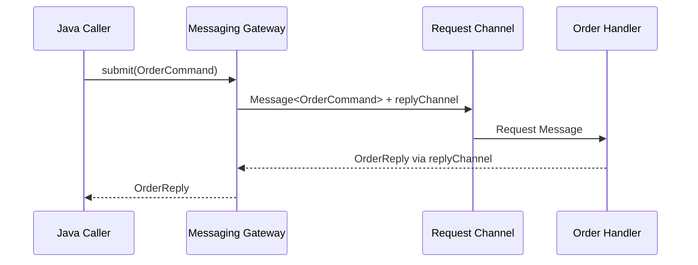
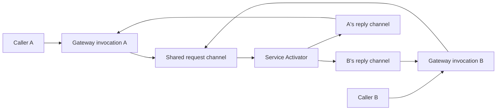
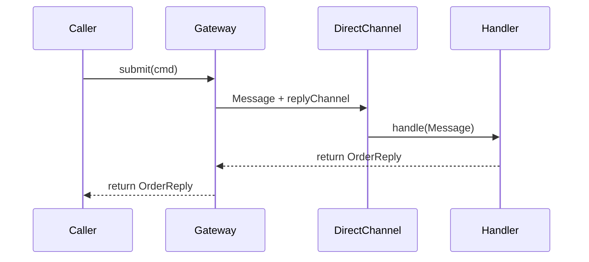
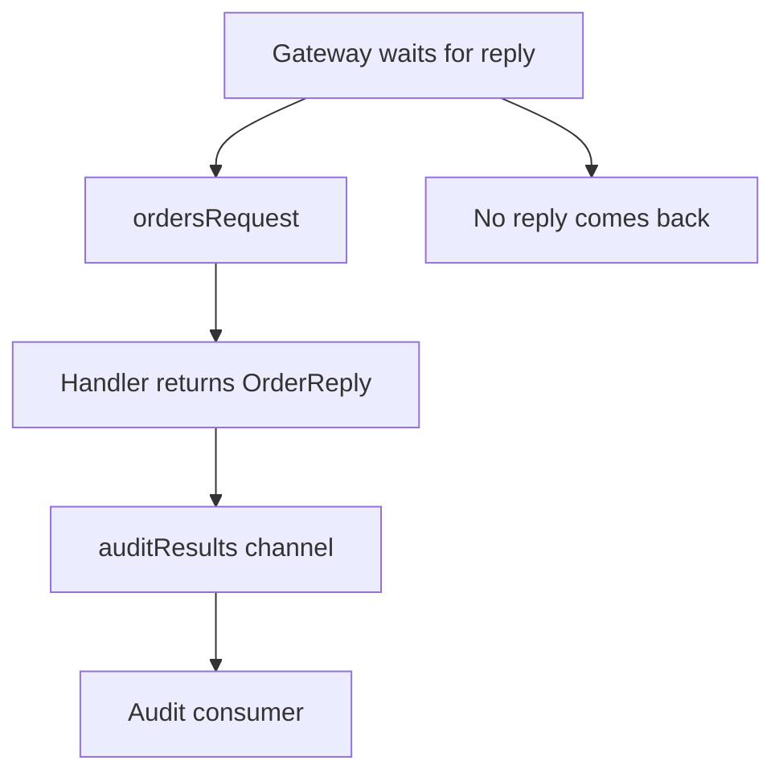
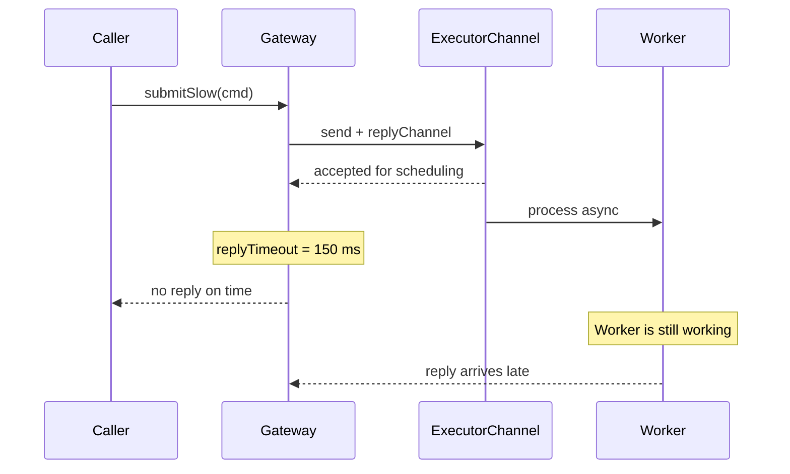
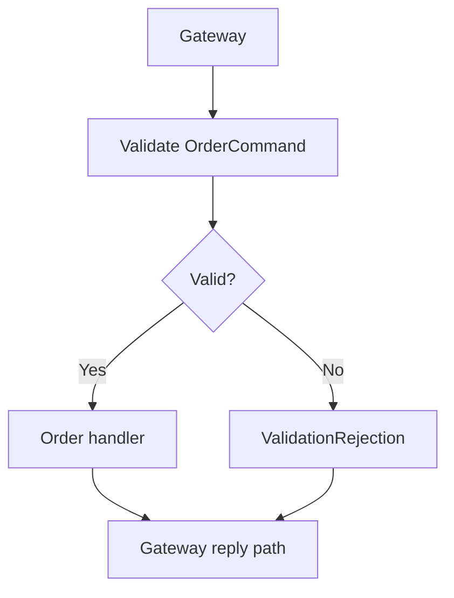
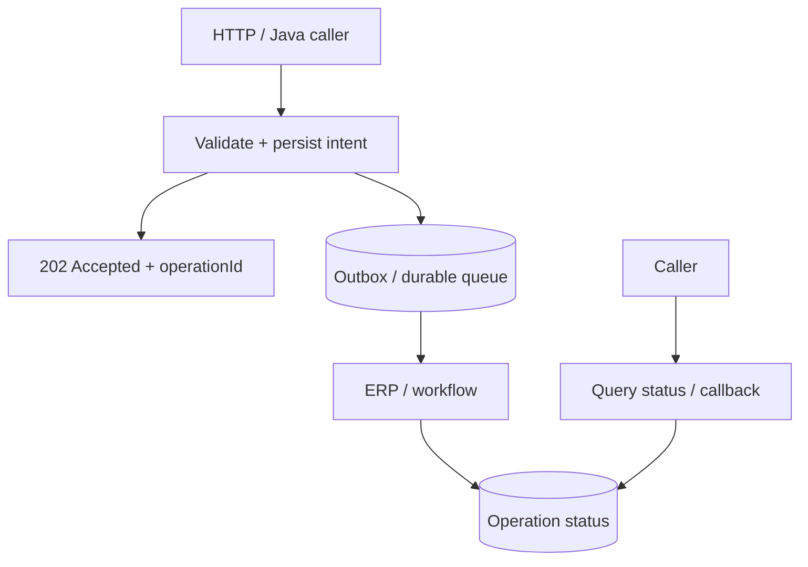
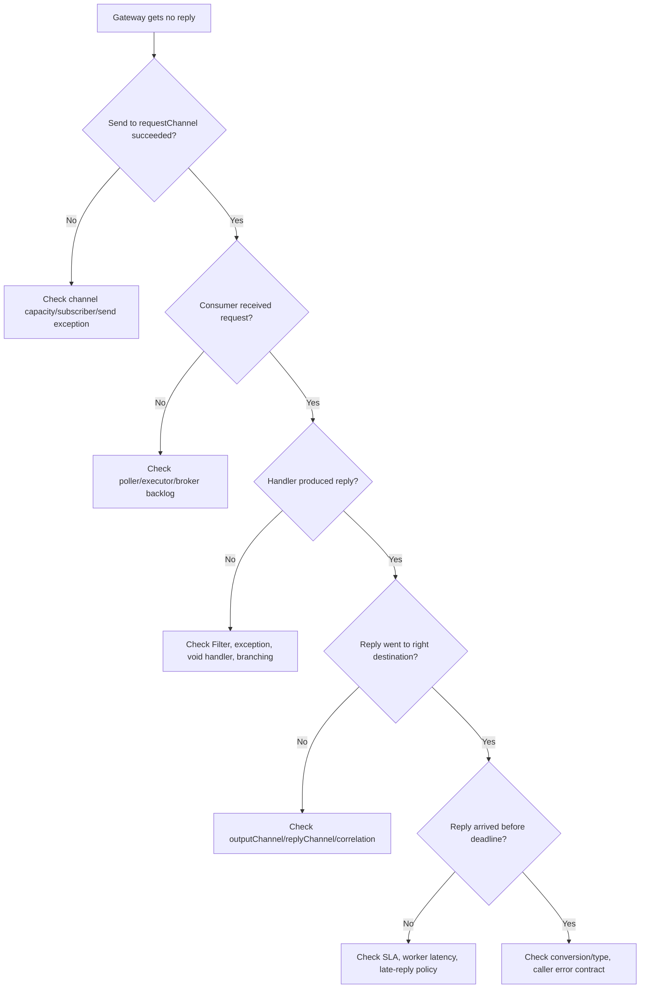

# Gateway Timeout and Reply Channel

A Java application calls `orderGateway.submit(command)` expecting an `OrderReply`, yet behind that call sits a Spring Integration chain of Message Channels, Transformers, Service Activators, and sometimes Executors, brokers, or an ERP system. When processing is fast, the method behaves like an ordinary Java call. When a handler returns no result, a filter drops the Message, a worker is slow, or the reply is routed to the wrong channel, the caller can **wait until timeout even though the request was received**. That is why understanding **Gateway timeouts** and **reply channels** is essential instead of merely adding an annotation and hoping request–reply works on its own.

**Messaging Gateway** is an Enterprise Integration Patterns (EIP) pattern that lets business code call a **method-oriented interface** while Spring Integration translates the call into a Message, sends it through a channel, and maps the reply Message back to the return type. For request–reply, the Gateway needs to know **where to send the request**, **where the reply comes back**, **how long to wait at most**, and **what to do if no reply arrives**.

The lesson **Gateway Timeout and Reply Channel** belongs to the **Messaging gateway** chapter of the `SPRING_INTEGRATION_PATTERN` module. The module teaches implementing EIP with Spring Integration to build loosely coupled, extensible Message flows; practicing Router, Filter, Transformer, Splitter, Aggregator, Gateway, retry, error channel, and correlation, along with testing and observing processing branches. This lesson walks from the request–reply model to Java 17 code, `@MessagingGateway`, `@Gateway`, `replyChannel`, `requestTimeout`, `replyTimeout`, timeouts in synchronous/asynchronous flows, testing, infrastructure failures, late replies, correlation, and reliability when connecting brokers/ERPs.

## 1. The Story: Sending a Request Successfully Does Not Mean Receiving a Reply

Suppose an application calls:

```java
OrderReply reply = orderGateway.submit(
        new OrderCommand("tenant-7", "req-1001", "ORD-1001"));
```

The Gateway sends the Message to `ordersRequest`. A handler checks the order and builds an `OrderReply`. The expected path:



Yet several things can happen:

- No subscriber/consumer pulls Messages from the request channel.
- A Filter drops the Message and **does not create a rejection reply**.
- The handler receives the Message yet returns no value.
- The handler sends the reply to an output channel not connected back to the Gateway.
- An executor/broker processes more slowly than the Gateway's wait limit.
- A reply is emitted, but arrives after the caller already timed out.
- A technical error occurs on another thread; the Gateway waits for a reply while the error goes to an error flow.

When diagnosing, distinguish **whether the request was sent successfully**, **whether the request was processed**, **whether a reply was produced**, **whether the reply reached the right channel**, and **whether the caller was still waiting when the reply arrived**.

## 2. Four Concepts Not to Conflate

| Concept | Meaning | What It Does Not Guarantee |
| --- | --- | --- |
| `requestChannel` | Channel where the Gateway sends the request | That the consumer finished processing |
| `requestTimeout` | Wait time when **sending the request** to a potentially blocking channel | Overall deadline for database/HTTP handlers |
| `replyChannel` | Destination carrying results back to the Gateway | That every branch automatically produces a reply |
| `replyTimeout` | Time the Gateway **waits for a reply** after a suitable send | Canceling or rolling back downstream work on expiry |

**Especially avoid:** `replyTimeout=500` **does not mean** "the entire command runs for at most 500 ms." With a synchronous request channel like `DirectChannel`, handler code can execute on the caller thread during `send`, so handler execution is not necessarily bounded by `replyTimeout`.

### 2.1. Request Timeout Differs from HTTP Client Timeout

If the handler calls an ERP over HTTP, HTTP client timeouts also exist:

```text
Gateway requestTimeout  -> send into Spring MessageChannel
Gateway replyTimeout    -> wait for Message reply
HTTP connectTimeout     -> establish connection to ERP
HTTP response/read timeout -> wait for ERP to return response
Broker delivery timeout -> separate transport mechanism
```

They have **different targets and scopes**. Never use a single `replyTimeout` value as a substitute for adapter connect/read timeouts.

### 2.2. Timeout Units

Numeric string timeout attributes on Gateway annotations are typically interpreted in **milliseconds**, depending on the API/version contract and expression mechanism configured. For instance, `replyTimeout="1500"` represents a 1.5-second wait limit in this example. When applying to a specific version, check the exact annotation and runtime configuration.

## 3. How Does a Gateway Turn a Method Call into a Message?

A Messaging Gateway can be declared as an interface:

```java
package example.integration.gateway;

import org.springframework.integration.annotation.Gateway;
import org.springframework.integration.annotation.MessagingGateway;

@MessagingGateway(
        name = "orderGateway",
        defaultRequestChannel = "ordersRequest",
        defaultRequestTimeout = "500",
        defaultReplyTimeout = "1500")
public interface OrderGateway {

    @Gateway
    OrderReply submit(OrderCommand command);
}
```

When the caller invokes `submit()`:

1. The Gateway proxy turns the argument into the **payload of a Spring Message**.
2. The Gateway attaches metadata needed for request–reply, including the path for receiving replies where appropriate.
3. The Message is sent to `ordersRequest`.
4. The downstream Message handler runs, synchronously or asynchronously depending on the channel.
5. If a reply arrives, the Gateway converts the reply payload into `OrderReply` per the method contract.
6. If no reply arrives within the wait conditions/limit, the caller receives a **timeout outcome** according to how the Gateway API, return type, and error configuration handle it; never assume the ERP did not perform side effects.

Gateway interfaces can be registered via `@IntegrationComponentScan`, appropriate Spring Integration configuration, or creating proxy beans through the corresponding Gateway mechanism. The Java examples use `@IntegrationComponentScan`.

### 3.1. Request–Reply Does Not Mean Every Endpoint Replies

A Messaging Gateway can have `void` methods for **fire-and-forget**; a method returning `OrderReply` implies the caller expects **a result**. Never use a `void` method expecting the Gateway to automatically synchronize completion of all async workers.

### 3.2. A Gateway Is Not a Broker

A Gateway does not automatically persist every request durably, provide exactly-once delivery, or guarantee a transaction from caller to ERP. Those properties depend on the channels, endpoints, adapters, transactions, and idempotency of the entire flow.

## 4. Where Does `replyChannel` Live in the Message?

Spring Messaging defines the technical header `MessageHeaders.REPLY_CHANNEL`. When the Gateway handles a request–reply call, it can supply a **temporary reply channel** pointing directly to the waiting invocation.

```text
Request Message:
  payload = OrderCommand(...)
  headers:
    id = <framework message id>
    timestamp = ...
    replyChannel = <temporary reply channel for this invocation>
```

This `replyChannel` differs from business `orderId`, `requestId`, or `eventId`. It is typically runtime metadata to route the response back to the waiting invocation; **never serialize a JVM channel object to JSON or a broker**.



The diagram above depicts **two logical reply paths**, not that the handler manually reads `requestId` and picks a channel by name. In ordinary internal request–reply, the framework and reply headers must be preserved so endpoints send results to the right place.

### 4.1. Temporary Reply Channel vs. Fixed Reply Channel

| Type | Description | Risks to Know |
| --- | --- | --- |
| Per-invocation temporary reply channel | Gateway creates a dedicated receive path for the waiting call | Late reply after invocation has ended |
| Fixed / named reply channel | A configured named channel for replies | Must manage routing/correlation across multiple callers |
| Broker reply destination | External transport queue/topic/reply address | Requires correlation ID, timeout, consumer, and state storage |

**Do not infer** that having a `QueueChannel` named `replies` means all waiting Gateways automatically know which reply belongs to which caller. A shared reply destination needs a real correlation/reply-routing mechanism matching your Gateway/adapter version.

### 4.2. Never Overwrite `replyChannel` Arbitrarily

A Transformer or Enricher can construct a new Message. If it drops `replyChannel`, the final handler may **not know where to send the reply back to the Gateway**. If it replaces it with another channel, the Gateway can wait until timeout even though the Message was processed.

When transforming Messages, verify the **header propagation** policy. Across a transport that does not support channel objects, design a suitable **reply destination + correlation** mechanism instead of expecting a Java header object to cross the network intact.

## 5. Basic Demo: Producing Replies Automatically with a Service Activator

First build a **self-contained** synchronous example to see the Gateway receive a reply without manually sending Messages.

### 5.1. Java 17 Models

```java
package example.integration.gateway;

public record OrderCommand(
        String tenantId,
        String requestId,
        String orderId) {
}
```

```java
package example.integration.gateway;

public record OrderReply(
        String requestId,
        String orderId,
        String status) {
}
```

The example uses the status string `"ACCEPTED"` as an internal decision. In production, clearly specify how accepted, committed, and fulfilled differ.

### 5.2. Gateway Interface

```java
package example.integration.gateway;

import org.springframework.integration.annotation.Gateway;
import org.springframework.integration.annotation.MessagingGateway;

@MessagingGateway(
        name = "orderGateway",
        defaultRequestChannel = "ordersRequest",
        defaultRequestTimeout = "500",
        defaultReplyTimeout = "1500")
public interface OrderGateway {

    @Gateway
    OrderReply submit(OrderCommand command);
}
```

### 5.3. Spring Integration Configuration

```java
package example.integration.gateway;

import org.springframework.context.annotation.Bean;
import org.springframework.context.annotation.Configuration;
import org.springframework.integration.annotation.IntegrationComponentScan;
import org.springframework.integration.annotation.ServiceActivator;
import org.springframework.integration.channel.DirectChannel;
import org.springframework.integration.config.EnableIntegration;
import org.springframework.messaging.Message;
import org.springframework.messaging.MessageChannel;
import org.springframework.messaging.MessageHeaders;

@Configuration
@EnableIntegration
@IntegrationComponentScan(basePackageClasses = OrderGateway.class)
public class GatewayReplyConfiguration {

    @Bean
    public MessageChannel ordersRequest() {
        return new DirectChannel();
    }

    @ServiceActivator(inputChannel = "ordersRequest")
    public OrderReply handleOrder(Message<OrderCommand> message) {
        OrderCommand command = message.getPayload();

        // Shows the Gateway already provided the reply destination.
        Object replyTo = message.getHeaders()
                .get(MessageHeaders.REPLY_CHANNEL);
        if (replyTo == null) {
            throw new IllegalStateException(
                    "Missing gateway reply channel");
        }

        return new OrderReply(
                command.requestId(),
                command.orderId(),
                "ACCEPTED");
    }
}
```

Key point: `handleOrder(...)` **returns `OrderReply`**, rather than spawning a thread and calling `send` on some arbitrary channel. The Service Activator builds a reply Message and sends it to the **request's reply channel** per standard Spring Integration request–reply mechanics when no fixed output channel hijacks the reply path.

### 5.4. Running the Gateway

```java
package example.integration.gateway;

import org.springframework.context.annotation.AnnotationConfigApplicationContext;

public class GatewayReplyDemo {

    public static void main(String[] args) {
        try (var context = new AnnotationConfigApplicationContext(
                GatewayReplyConfiguration.class)) {

            OrderGateway gateway = context.getBean(OrderGateway.class);
            OrderReply reply = gateway.submit(
                    new OrderCommand(
                            "tenant-7", "req-1001", "ORD-1001"));

            System.out.println(reply.status()); // ACCEPTED
            System.out.println(reply.requestId()); // req-1001
        }
    }
}
```

This demo uses a **synchronous** path through `DirectChannel`; there is no broker, durable queue, or ERP network. It illustrates the reply path and how the Gateway hides Message/channel details from callers, **not** durability across process crashes.

## 6. Why Doesn't the Basic Example Specify `replyChannel` Explicitly?

In an ordinary synchronous call, the Gateway already provides a reply destination for the invocation. When the Service Activator returns a value, the endpoint uses the reply information on the request to send the result back to the caller.



**It is not necessary to configure**:

```text
outputChannel = "someReplies"
```

just so the Gateway receives a reply. An unsuitable fixed `outputChannel` can route results elsewhere so the Gateway never receives them. When a named reply channel is needed, design **the contract bridging back to the Gateway**, rather than merely naming a channel.

### 6.1. A Reply Header Does Not Prove the Request Committed

The header's presence only shows **a return path was supplied**. It does not guarantee the handler ran, committed the database, or durably emitted the result. After a timeout, a handler may still finish on another thread.

### 6.2. Can You Return a `Message` Instead of a Payload?

Yes. A handler can return `Message<OrderReply>` when it needs to attach controlled headers explicitly. However, understand the endpoint's header propagation policy; never copy arbitrary client headers or credentials onto replies. When only a payload is needed, returning `OrderReply` is simpler.

## 7. `requestTimeout`: What Is Being Waited On?

`requestTimeout` relates to **sending** the Message to the request channel, especially when the channel may have to wait for free capacity or consumer resources.

Example of a full request `QueueChannel`:

```text
Gateway
  -> QueueChannel(capacity = 1)
      slot #1: currently holds Message X
      Message Y: waiting for space to send
```

While `QueueChannel` still has capacity, `send` can complete quickly even though **no consumer has processed the Message yet**. When capacity is full, `send` may block; `requestTimeout` sets the wait limit for the send operation per channel semantics.

### 7.1. Do Not Confuse Send Timeout with Work Timeout

Example:

```text
10:00:00.000 Gateway sends to queue successfully
10:00:00.010 Gateway begins waiting for reply
10:00:05.000 Poller finally takes request from queue
10:00:05.020 Handler finishes processing
```

If `replyTimeout` is shorter than queue wait + processing time, the Gateway can expire **even though enqueue succeeded**. Increasing `requestTimeout` does not fix this.

### 7.2. How Is `DirectChannel` Different?

With `DirectChannel`, the subscriber typically handles the request **on the caller thread** during send. If the handler blocks on a slow 10-second DB call, `requestTimeout` is not a switch that automatically aborts the running method after 500 ms. You need timeouts on the API client, database, or processing logic itself, and you must know whether cancellation is genuinely supported.

## 8. `replyTimeout`: Waiting for an Answer, Not Canceling Side Effects

`replyTimeout` governs how long the Gateway waits for a reply when the flow has an asynchronous reply path or reply-waiting phase. Upon expiry, the call can end with a timeout result/exception according to Gateway configuration and return type. **Never infer that the handler was stopped or the transaction rolled back.**

A timeline:

```text
0 ms       Gateway sends request
10 ms      ExecutorChannel accepts and schedules worker
100 ms     Gateway stops waiting per replyTimeout
250 ms     Worker completes and attempts to send reply
```

The **late reply** at 250 ms may have no receiver left. Observe runtime/adapter error handling, drops, and expiry, and never assume late replies are automatically saved for the caller.

### 8.1. Do Not Equate Reply Timeout with Business Error

Different conclusions:

| Observation | Can You Conclude with Certainty? |
| --- | --- |
| Gateway received no reply within deadline | Caller did not receive a reply in time |
| Gateway received no reply within deadline | **Cannot** conclude with certainty that ERP did not create the order |
| ERP returns business `REJECTED` | Business rejection exists if contract is verified |
| Adapter reports connection refused before send | Request likely did not reach ERP, depending on stage |
| HTTP read timeout after send | Remote outcome may be unknown |

When a timeout happens after a remote side effect, retrying without idempotency can create duplicate orders. This is a major reason Gateways and Idempotent Receivers are designed together.

## 9. `DirectChannel`, `ExecutorChannel`, and `QueueChannel` Affect Timeouts Differently

| Channel | Typical Send/Receive Behavior | Impact on Gateway |
| --- | --- | --- |
| `DirectChannel` | Subscriber runs on sender's thread | Slow handler can block caller inside send |
| `ExecutorChannel` | Hands Message to executor; handler runs on another thread | Gateway can wait for reply independently and time out before worker |
| `QueueChannel` | Message held until poller/consumer pulls it | Slow reply due to backlog or missing poller |
| Broker adapter | Across network / out-of-process consumer | Requires correlation, destination, retry/ACK, and separate timeouts |

### 9.1. Missing Consumer Fails Differently from Slow Reply

With no subscriber on `DirectChannel`, sending can fail immediately with an exception, **not necessarily** waiting for `replyTimeout`. If a `QueueChannel` has a consumer that fails to return a reply, the request can be consumed while the Gateway still times out.

### 9.2. `QueueChannel` Does Not Run Handlers by Itself

When using a `QueueChannel` as the request channel, a **poller** or consumer is normally needed to read the queue. Merely declaring:

```java
@Bean
public QueueChannel ordersQueue() {
    return new QueueChannel(100);
}
```

does not mean Spring Integration will automatically pull Messages and invoke a handler. You must wire a polling endpoint or consuming component.

### 9.3. Timeouts Are Not a Complete Backpressure Mechanism

Setting a short `requestTimeout` prevents callers from waiting too long when a queue is full, yet it does not by itself limit in-flight requests, backlog size, or remote retry storms. You need proper capacity limits, worker concurrency, rate limiting, circuit breakers, and metrics.

## 10. Named Reply Channel: When Is It Really Needed?

In direct internal flows, a **temporary reply channel** is usually enough. A named reply channel is helpful when:

- A specific adapter receives replies from an external system.
- A shared reply route needs to bridge back to the Gateway.
- A broker reply queue/topic or application response dispatcher exists.
- Replies must be observed and coordinated across multiple steps.

A method configuration can specify the channel name:

```java
@MessagingGateway(defaultRequestChannel = "ordersRequest")
public interface NamedReplyGateway {

    @Gateway(
            requestChannel = "ordersRequest",
            replyChannel = "ordersReplies",
            replyTimeout = "2000")
    OrderReply submit(OrderCommand command);
}
```

**The snippet above is only the Gateway-side declaration, not a complete flow.** You must define the `ordersReplies` channel, an endpoint actually sending replies to it, and configure the Gateway to handle/correlate replies per your Spring Integration version. Never share one `QueueChannel` across concurrent requests without **verifying** the Gateway's correlation/reply-routing mechanism.

### 10.1. Do Not Add a Named Reply Channel Just "For Clarity"

If there is no need to share a reply destination, adding another channel introduces an extra hop, subscriber/poller, and failure point. Pick the simplest reply path that satisfies the contract.

### 10.2. Treat `replyChannel` as a Technical Address with a Lifecycle

A temporary reply channel created by the Gateway is not an eternal resource; once an invocation times out, the return path may no longer be valid. For long-lived broker reply queues, TTL/expiry and completion-state management are separate responsibilities.

## 11. Why Sending Replies to an Arbitrary Output Channel Causes Gateway Timeouts

Broken example:

```java
@ServiceActivator(
        inputChannel = "ordersRequest",
        outputChannel = "auditResults")
public OrderReply handle(OrderCommand command) {
    return new OrderReply(
            "req-1001", command.orderId(), "ACCEPTED");
}
```

The handler builds `OrderReply`, yet **its `outputChannel` is fixed to `auditResults`**. Unless a route leads from `auditResults` back to the Gateway's reply destination, the caller may never receive the Message.



**The fix** is not always adding more wait time:

1. If the handler replies directly, **remove the fixed `outputChannel`** so the endpoint uses the reply destination from the request when configuration allows.
2. If intermediate processing steps exist, continue forwarding the Message to the **final endpoint that actually returns the reply** to the Gateway.
3. If auditing is a secondary side effect, use a separate audit branch with an explicit contract so it **does not hijack the Gateway's reply path**.
4. For async/brokers, build a reply dispatcher/correlation mechanism and verify with integration tests.

**Successful `send()` and a `"handler returned"` log do not prove the Gateway received the reply.** Test directly at the caller or the corresponding reply destination.

## 12. Async Example: Worker Finishes After `replyTimeout`

To see the difference from `DirectChannel`, use `ExecutorChannel`: the Gateway sends the request, the executor accepts the task, and a worker processes it on another thread while the caller waits for the reply.



### 12.1. Dedicated Gateway Interface for the Async Demo

The async classes below use a separate package to avoid bean/channel/name collisions if you run them alongside the earlier synchronous example:

```java
package example.integration.gateway.async;

import org.springframework.integration.annotation.Gateway;
import org.springframework.integration.annotation.MessagingGateway;

import example.integration.gateway.OrderCommand;
import example.integration.gateway.OrderReply;

@MessagingGateway(
        name = "slowOrderGateway",
        defaultRequestChannel = "slowOrders",
        defaultRequestTimeout = "500",
        defaultReplyTimeout = "150")
public interface SlowOrderGateway {

    @Gateway
    OrderReply submitSlow(OrderCommand command);
}
```

### 12.2. Handler Using a Latch for Testing Instead of Pretending `sleep` Is Real Work

```java
package example.integration.gateway.async;

import java.util.concurrent.CountDownLatch;
import java.util.concurrent.TimeUnit;
import java.util.concurrent.atomic.AtomicBoolean;

import org.springframework.integration.annotation.ServiceActivator;

import example.integration.gateway.OrderCommand;
import example.integration.gateway.OrderReply;

public final class SlowOrderHandler {

    private final CountDownLatch started = new CountDownLatch(1);
    private final CountDownLatch allowCompletion =
            new CountDownLatch(1);
    private final AtomicBoolean completed = new AtomicBoolean();

    @ServiceActivator(inputChannel = "slowOrders")
    public OrderReply process(OrderCommand command) {
        started.countDown();
        try {
            if (!allowCompletion.await(5, TimeUnit.SECONDS)) {
                throw new IllegalStateException(
                        "DEMO_WORKER_WAIT_EXPIRED");
            }
        } catch (InterruptedException ex) {
            Thread.currentThread().interrupt();
            throw new IllegalStateException(
                    "DEMO_WORKER_INTERRUPTED", ex);
        }
        completed.set(true);
        return new OrderReply(
                command.requestId(),
                command.orderId(),
                "ACCEPTED");
    }

    public boolean awaitStarted() throws InterruptedException {
        return started.await(2, TimeUnit.SECONDS);
    }

    public void release() {
        allowCompletion.countDown();
    }

    public boolean isCompleted() {
        return completed.get();
    }
}
```

### 12.3. `ExecutorChannel` Configuration

```java
package example.integration.gateway.async;

import org.springframework.context.annotation.Bean;
import org.springframework.context.annotation.Configuration;
import org.springframework.integration.annotation.IntegrationComponentScan;
import org.springframework.integration.channel.ExecutorChannel;
import org.springframework.integration.config.EnableIntegration;
import org.springframework.messaging.MessageChannel;
import org.springframework.scheduling.concurrent.ThreadPoolTaskExecutor;

@Configuration
@EnableIntegration
@IntegrationComponentScan(basePackageClasses = SlowOrderGateway.class)
public class SlowGatewayConfiguration {

    @Bean
    public ThreadPoolTaskExecutor gatewayWorkerExecutor() {
        var executor = new ThreadPoolTaskExecutor();
        executor.setCorePoolSize(2);
        executor.setMaxPoolSize(2);
        executor.setQueueCapacity(10);
        executor.setThreadNamePrefix("gateway-demo-");
        executor.setWaitForTasksToCompleteOnShutdown(true);
        return executor;
    }

    @Bean
    public MessageChannel slowOrders(
            ThreadPoolTaskExecutor gatewayWorkerExecutor) {
        return new ExecutorChannel(gatewayWorkerExecutor);
    }

    @Bean
    public SlowOrderHandler slowOrderHandler() {
        return new SlowOrderHandler();
    }
}
```

Once `ExecutorChannel` accepts the Message for processing, the Gateway waits for a reply up to roughly `150 ms` **per the example configuration**, while the worker remains held by the latch. When the Gateway stops waiting, that does not release the latch, cancel the task, roll back a database, or delete a command already sent to a broker.

**This demo is for observing timeouts, not for holding worker threads in production.** Production needs pool sizing, backpressure, monitoring, and dedicated stuck-task handling.

## 13. JUnit: Synchronous Request–Reply Receives the Expected DTO

Before testing timeouts, write a happy-path test:

```java
package example.integration.gateway;

import static org.junit.jupiter.api.Assertions.*;

import org.junit.jupiter.api.Test;
import org.springframework.context.annotation.AnnotationConfigApplicationContext;

class GatewayReplyIntegrationTest {

    @Test
    void gatewayReceivesReplyFromServiceActivator() {
        try (var context = new AnnotationConfigApplicationContext(
                GatewayReplyConfiguration.class)) {

            OrderGateway gateway = context.getBean(OrderGateway.class);

            OrderReply response = gateway.submit(
                    new OrderCommand(
                            "tenant-7", "req-1001", "ORD-1001"));

            assertNotNull(response);
            assertEquals("req-1001", response.requestId());
            assertEquals("ORD-1001", response.orderId());
            assertEquals("ACCEPTED", response.status());
        }
    }
}
```

This test verifies **from the Gateway interface to the handler and back to the caller**. Testing only that `handleOrder()` returns `OrderReply` is insufficient, because the reply could be misconfigured to go to the wrong channel.

### 13.1. Checking `replyChannel` in the Handler

`GatewayReplyConfiguration.handleOrder()` read:

```java
message.getHeaders().get(MessageHeaders.REPLY_CHANNEL)
```

and rejected requests without a reply destination. This illustrates that metadata exists when the Gateway builds the request. In practice, not every Message entering `ordersRequest` comes from a Gateway; if a producer sends a Message without a reply channel, the handler needs a clear contract: treat as fire-and-forget, route to an error flow, or reject. **Do not enforce a reply requirement on producers that only send one-way.**

### 13.2. This Is an Integration Test, Not a Transport Contract Test

An in-JVM test does not prove responses over Kafka/AMQP/HTTP have the right schema, preserve correlation IDs, or avoid leaking headers. Real adapters require separate tests.

## 14. JUnit: Gateway Expires Before Worker Completes

Async tests should verify **observation order**, rather than just calling `Thread.sleep(300)` and hoping CI runs at the same speed as a local machine.

```java
package example.integration.gateway.async;

import static org.junit.jupiter.api.Assertions.*;

import java.util.concurrent.Callable;
import java.util.concurrent.Executors;
import java.util.concurrent.TimeUnit;

import org.junit.jupiter.api.Test;
import org.springframework.context.annotation.AnnotationConfigApplicationContext;

import example.integration.gateway.OrderCommand;

class SlowGatewayIntegrationTest {

    @Test
    void replyTimeoutDoesNotMeanWorkerWasCancelled()
            throws Exception {
        try (var context = new AnnotationConfigApplicationContext(
                SlowGatewayConfiguration.class)) {

            SlowOrderGateway gateway =
                    context.getBean(SlowOrderGateway.class);
            SlowOrderHandler worker =
                    context.getBean(SlowOrderHandler.class);

            var callerPool = Executors.newSingleThreadExecutor();
            try {
                Callable<Object> invokeGateway = () -> {
                    try {
                        // Some Gateway contracts return null when
                        // replyTimeout expires; other configurations may
                        // convert timeout into an exception/error reply.
                        return gateway.submitSlow(
                                new OrderCommand(
                                        "tenant-7", "req-slow",
                                        "ORD-1001"));
                    } catch (RuntimeException ex) {
                        return ex;
                    }
                };

                var invocation = callerPool.submit(invokeGateway);
                assertTrue(worker.awaitStarted());

                // Gateway finishes waiting within short deadline,
                // but the worker latch has not been released yet.
                Object observed = invocation.get(2, TimeUnit.SECONDS);
                assertTrue(observed == null
                        || observed instanceof RuntimeException);
                assertFalse(worker.isCompleted());
            } finally {
                worker.release();
                callerPool.shutdownNow();
            }
        }
    }
}
```

This test intentionally focuses on **the Gateway not waiting forever for the worker and the worker not yet being finished when the invocation returns**; it does not prescribe one identical exception class across all versions/configurations. A production test must pin dependency versions, timeout/error configuration, and **assert the exact response or exception contract** the application promises.

### 14.1. Why Check Multiple Shapes for `observed`?

A Gateway may signal no reply via `null` on some call paths or throw an error depending on policy/configuration. What matters from an EIP perspective is: **not receiving a reply on time does not mean the business operation was canceled**. API consumers need an explicit public contract, such as `TIMEOUT/UNKNOWN_OUTCOME`, instead of relying on framework exception internals.

### 14.2. Do Not Use This Test as Proof of Financial Safety

`SlowOrderHandler` only waits on a latch and creates a DTO. If a real worker calls an ERP/DB, a Gateway timeout does not prove the transaction rolled back. You need fault-injection tests with real resources plus remote state/idempotency checks.

## 15. Filters Can Cause "Lost Replies" Even When Data Was Validated

A `Message Filter` returning `false` can discard a Message:

```text
Gateway -> Validation Transformer -> Filter
                                    |
                               false (discard)
                                    |
                                no reply
```

If the Gateway method returns `OrderReply`, the caller may wait until expiry while the Filter behaves **correctly** according to its predicate. This is a **request–reply contract** bug, not evidence that the Filter is broken.

### 15.1. Anti-Pattern

```java
@Filter(inputChannel = "ordersRequest")
public boolean hasOrderId(OrderCommand order) {
    return order.orderId() != null
            && !order.orderId().isBlank();
}
```

If the Filter drops the Message without a path producing a rejection reply, the Gateway may have no result to return.

### 15.2. The Right Approach Under the Business Contract



For request–reply, ensure **every valid terminal branch produces a response**: `Accepted`, `Rejected`, `Pending`, or an exception contract. You do not have to use a `Filter` when a Router or Service Activator returning a sealed business result expresses it more clearly.

### 15.3. `discardChannel` Does Not Automatically Become a Reply

A Filter can route rejected Messages to `discardChannel`, yet **the discard branch handler must still build a reply** and preserve the return path. If the discard handler only logs an audit entry and returns `void`, the Gateway still receives no response.

## 16. Technical Errors Can Go to an Error Flow Instead of Reply

A handler may throw an exception:

```java
@ServiceActivator(inputChannel = "ordersRequest")
public OrderReply process(OrderCommand command) {
    throw new IllegalStateException(
            "ORDER_SERVICE_TEMPORARILY_UNAVAILABLE");
}
```

In a synchronous flow over `DirectChannel`, exceptions can usually propagate back to the Gateway caller. When using executors, pollers, inbound adapters, or brokers, errors may be handled on another thread or sent to a configured error channel.

| Scenario | Signal | Meaning |
| --- | --- | --- |
| Valid Filter rejection | Business result / discard | Input failed business rule |
| Synchronous handler throws | Exception may reach caller | Execution failure |
| Async handler throws | Error flow / log per config | Error on another thread |
| Gateway wait expires | Timeout / absence of reply | No response received in time |
| ERP returns business `REJECTED` | ERP reply with status | Remote business outcome |
| ERP times out after send | Unknown remote outcome | Side effects may have occurred |

**`errorChannel` is not synonymous with `replyChannel`.** An `ErrorMessage` carrying a `Throwable` should not be returned blindly on a public API as an arbitrary payload, as it can expose stack traces, data, or internal endpoints.

### 16.1. When a Gateway Has Its Own Error Channel

Spring Integration supports configuring error handling for Messaging Gateways and their endpoints. Decide:

- Which exceptions map to a **technical error response**?
- Which business rejections are returned as business data?
- When should exceptions propagate?
- Does the error flow reply to the caller or only write dead-letter/audit records?
- What result does the caller receive once timeout has elapsed?

An error handler that merely logs and drops the Message is not a complete request–reply error contract.

## 17. Reply Channels Must Live Long Enough, Yet Never Accumulate Unboundedly

A temporary reply channel belongs to one invocation. Once the caller stops waiting:

- A late reply may never be received.
- An endpoint may error when sending a reply to a channel with no remaining consumer.
- Parts of the framework may drop the response or route to error handling depending on configuration.
- An external resource may still continue processing because it does not know the Gateway timed out.

With a fixed reply queue on a broker, the issue is different:

```text
Request expired at caller
Reply queue still exists
ERP publishes late reply
Reply consumer sees no pending request
```

You need **TTL, correlation-store cleanup, and dead-letter/late-reply handling** policies so stale Messages do not pile up forever.

### 17.1. Do Not Manually Send Replies to a Request Channel Header Without Understanding Its Lifecycle

An example requiring caution:

```java
Object value = message.getHeaders()
        .get(MessageHeaders.REPLY_CHANNEL);
if (value instanceof MessageChannel channel) {
    channel.send(MessageBuilder
            .withPayload(result)
            .build());
}
```

This snippet only illustrates that the header sometimes holds a channel object. It is **not** a universal reply algorithm: the reply destination might be represented by name, adapters may map it differently, and a late manual send may have no receiver. In basic flows, letting `@ServiceActivator` return the reply for the framework to route is less error-prone.

### 17.2. Do Not Wire a Reply Channel Unboundedly to an Audit Queue

A reply queue lacking a consumer or completion tracking can accumulate data/PII. Auditing has its own retention policy; replies carry data back to a request with a finite lifecycle. Avoid sharing one channel for both without clear ownership and cleanup.

## 18. Correlation Across Multiple Concurrent Callers

Suppose two users submit simultaneously:

```text
Caller A: requestId=req-A, orderId=ORD-1
Caller B: requestId=req-B, orderId=ORD-2
```

If each invocation uses its own temporary reply path, the framework routes replies back to the right invocation as long as **reply headers are preserved**. Over Kafka/JMS/AMQP, however, a JVM `replyChannel` object cannot simply be shipped to a consumer in another process.

An out-of-process contract might require:

```json
{
  "requestId": "req-A",
  "correlationId": "corr-A",
  "replyDestination": "orders.replies",
  "data": {
    "orderId": "ORD-1"
  }
}
```

Corresponding response:

```json
{
  "correlationId": "corr-A",
  "result": {
    "orderId": "ORD-1",
    "status": "ACCEPTED"
  }
}
```

`correlationId` and `replyDestination` must be **controlled**, never letting clients arbitrarily direct sensitive data to destinations they are unauthorized to access. The sender must track pending requests, TTLs, duplicate replies, and authorization.

### 18.1. Correlation ID Is Not Message ID or Order ID

| ID | Role | Why Different? |
| --- | --- | --- |
| `MessageHeaders.ID` | Specific Message object | Can change on transform/redelivery |
| `orderId` | Business entity | Multiple requests may target the same order |
| `requestId` | One logical request attempt | May arrive multiple times on retry |
| `correlationId` | Matches reply to request/workflow | Must be unique across pending replies |
| `eventId` | Logical event for dedupe | Not necessarily a request/reply key |

Never use `orderId` as the reply correlation key when **two concurrent requests for the same order** are possible. They risk receiving each other's replies or overwriting pending state.

### 18.2. Cross-Process Request–Reply Is More Complex Than an Internal Gateway

A Java Gateway proxy lives in a single process. If requests cross a broker, you need an outbound adapter, an inbound reply adapter, correlation mapping / reply dispatcher, or the transport's native request–reply mechanism. Never assume a `replyChannel` object crosses the network.

## 19. Avoid Confusing `replyTimeout` with Transaction/ACK Timeouts

Events that can occur in a real system:

```text
00 ms  Gateway sends input to broker
50 ms  Broker confirms producer send
100 ms Consumer receives input
200 ms Consumer starts DB transaction
400 ms Gateway replyTimeout
700 ms Consumer DB COMMIT succeeds
750 ms Consumer publishes reply
800 ms Consumer ACKs input
```

Even though the caller timed out at 400 ms, the command **can still succeed** at 700 ms. If the caller immediately sends a new command with a new ID, the ERP can create duplicate side effects.

### 19.1. Three Completion Milestones

| Milestone | What It Means |
| --- | --- |
| Gateway method returns / times out | Caller received or failed to receive a result within the deadline |
| Input ACK | Consumer/adapter acknowledged per transport semantics |
| Business COMMIT | Business data committed in the appropriate resource |

These three milestones do not necessarily happen together. Setting `replyTimeout` does not directly control ACK timing and does not automatically roll back a remote database.

### 19.2. Early Input ACK Is a Separate Problem

If a broker ACKs immediately upon enqueueing into RAM and the process crashes before DB commit, the request can be lost even though the Gateway sent it successfully. Design durability and ACK policies at the inbound adapter rather than relying on the reply channel to decide message safety.

## 20. Timeouts and Retries: Preserving the Logical Operation

Suppose the Gateway times out while sending `CreateOrder`:

```text
requestId = req-1001
sourceEventId = evt-1001
orderId = ORD-1001
```

A safe retry must use a **stable logical operation ID** instead of generating a new ID on each attempt:

```text
idempotencyKey =
  tenantId + ":" + sourceSystem + ":" + sourceEventId
  + ":" + operationType
```

Practical solutions may include:

1. ERP/receiver supports an idempotency key.
2. Dedupe marker and business update within an appropriate transaction.
3. Remote state lookup by external business reference on timeout.
4. Transactional outbox so commands are not lost after local commit.
5. Completion/reconciliation jobs handling late outcomes.

**Gateway timeouts do not create exactly-once semantics.** Unless the system guarantees idempotency/reconciliation, never blindly retry payment, order-creation, or inventory-reservation commands just because the caller received no reply.

### 20.1. Retry Advice Can Re-Run the Entire Flow

When placing retry advice around a Gateway or handler, determine which segments re-execute. Pure mapping can repeat safely; remote ERP calls, emails, or inventory deductions require idempotency and clear side-effect boundaries.

### 20.2. Duplicate Replies Must Also Be Handled

A broker can redeliver a reply. The pending-request store must know whether the request already finished; duplicate replies must not trigger two business completions or two HTTP responses. `correlationId` locates the pending request, yet does not perform deduplication by itself.

## 21. Choosing Timeouts by SLA and Load Capacity

No single value fits every system. Base timeouts on **caller SLA, real load, queue backlog, and side-effect type**.

Hypothetical example:

| Component | Illustrative Range | Role |
| --- | --- | --- |
| Send to request channel | 0–50 ms | Inbound capacity/backpressure |
| Queue wait | 0–300 ms | Backlog/consumer concurrency |
| Business processing | 50–500 ms | DB, pricing, validation |
| ERP network call | 100–1000 ms | Connect/read/remote |
| Reply mapping/delivery | 0–100 ms | Outbound response |

These numbers are **illustrative only**, not Spring Integration default SLAs. If the caller target is 800 ms while the ERP path p99 exceeds 2 seconds, raising `replyTimeout` indefinitely only **increases waiting callers** and risks thread exhaustion.

### 21.1. One End-to-End Deadline Beats Many Disjoint Timeouts

In complex systems, propagate a trusted deadline / remaining budget across steps so each adapter does not wait its full local timeout and exceed the total budget. For example, if a caller needs a result within 2 seconds, the application service allocates budget across queue, DB, and ERP; once budget is exhausted, downstream stops waiting indefinitely.

Deadlines carry operational/business meaning; never trust client-declared deadlines if they can exhaust resources. Enforce a maximum system budget and explicit cancellation/compensation policies.

### 21.2. Short Timeouts Do Not Automatically Improve Performance

If the Gateway frequently times out while workers keep running, active tasks pile up, replies get dropped, and retries add even more load. Inspect queue depth, active workers, latency, and timeout rates before picking values.

## 22. Checking `replyChannel` After Transformers and Enrichers

A Transformer can change the payload:

```text
OrderCommand
  -> toErpCommand
  -> ERP adapter
  -> fromErpResponse
  -> OrderReply
```

Yet if a new Message is constructed and drops or alters the reply header needed by the framework, the caller may still fail to receive the response even with the right payload.

### 22.1. Comparing Two Ways to Return Results

**Usually simplest:** return the payload:

```java
@ServiceActivator(inputChannel = "ordersRequest")
public OrderReply handle(OrderCommand command) {
    return new OrderReply(
            command.requestId(),
            command.orderId(),
            "ACCEPTED");
}
```

**When business headers are needed:** return a `Message` with selected headers:

```java
@ServiceActivator(inputChannel = "ordersRequest")
public Message<OrderReply> handle(Message<OrderCommand> request) {
    OrderCommand command = request.getPayload();
    OrderReply reply = new OrderReply(
            command.requestId(),
            command.orderId(),
            "ACCEPTED");

    return MessageBuilder.withPayload(reply)
            .setHeader("result.code", "ORDER_ACCEPTED")
            .build();
}
```

The second snippet illustrates **creating a reply Message**; the endpoint must be configured to route it per the request's reply destination. Never assume building a new Message automatically keeps all prior headers, nor blindly copy all raw client headers onto the response "to be safe."

### 22.2. Endpoint with Explicit `outputChannel` vs. Returning via Header

A request–reply endpoint may be configured with `outputChannel`. When an output channel is specified, replies generally flow to that channel rather than implicitly back to the Gateway. Across chained endpoints, only the final endpoint—or an appropriate bridge/reply router—should return to the caller.

### 22.3. Header Mapping Across Boundaries

Across Kafka, HTTP, AMQP, JMS, or serialization, each adapter has **its own header mapper and limits**. `replyChannel` may be a runtime object unsuitable for serialization. At outbound boundaries:

- Export only needed transport headers.
- Use `correlationId`, reply destinations, and TTLs per the external protocol.
- Never export credentials, raw exceptions, or Spring channel objects.
- Test JSON/bytes/headers with the real adapter.

A passing `@Transformer` unit test does not prove a broker preserves the reply path.

## 23. One Gateway with Multiple Methods and Different Timeouts

Within one interface, operations may have different SLAs. Method annotations let you set dedicated request channels and timeouts:

```java
package example.integration.gateway;

import org.springframework.integration.annotation.Gateway;
import org.springframework.integration.annotation.MessagingGateway;

@MessagingGateway(
        defaultRequestChannel = "ordersRequest",
        defaultRequestTimeout = "500",
        defaultReplyTimeout = "1500")
public interface MultiOperationGateway {

    @Gateway
    OrderReply submit(OrderCommand command);

    @Gateway(
            requestChannel = "orderStatusRequest",
            requestTimeout = "250",
            replyTimeout = "700")
    OrderReply queryStatus(OrderCommand command);
}
```

This is a **configuration-illustration interface**, not a complete runnable example: running it requires the `orderStatusRequest` endpoint, reply path, and status query data. Avoid declaring two gateway interfaces with the same bean name when combining demo snippets in one Spring context.

### 23.1. Why Do Methods Have Different Timeouts?

- `submit` may need validation and workflow dispatch.
- `queryStatus` only reads cache/database and can commit to a faster response.
- A batch operation may not fit a synchronous Gateway; use `202 Accepted` / an async completion API instead of holding an HTTP caller for minutes.

### 23.2. Timeout Config Belongs to the Integration Contract, Not Domain Rules

Changing `replyTimeout` from 700 ms to 1200 ms is an **operational characteristic** change. It should not change the business definition of `ACCEPTED` or `REJECTED`. Likewise, a domain policy should not swap `replyChannel` just to force callers to wait.

## 24. When to Choose Request–Reply vs. Switching to an Async Workflow

A synchronous Gateway fits when:

- The handler usually replies within a short, fairly stable SLA.
- The caller needs the result immediately to continue an action.
- Failure/timeout contracts can be clearly defined.
- No thread needs to be held waiting on a long process.

For tasks like ERP posting, manual approval, or multi-partner aggregation, a **command + async result** model is often better:



The caller receives an **operation ID** and polls status or receives a callback upon completion instead of setting huge `replyTimeout` values to wait on ERP. That is an **API contract change**, not just tweaking a Gateway parameter.

### 24.1. `202 Accepted` Is Not Yet a Business Commit

When returning `202`, the server must genuinely hold **durable intent** or a sufficiently reliable mechanism to proceed. If it only enqueues into an in-RAM `QueueChannel` and returns `202`, a process crash can lose the job while the caller assumes the request was durably accepted.

### 24.2. Gateways Can Still Be Used Inside Async Workflows

An async worker can use an internal Gateway for short request–reply calls to another service. You do not have to abandon the Gateway pattern altogether; what matters is **not using a synchronous wait in place of workflow completion state**.

## 25. Logging and Metrics for Diagnosing Timeouts

When a Gateway times out, operators usually ask "where did the request go?" Instrument each stage instead of logging only at the caller.

| Recommended Metric | What to Observe |
| --- | --- |
| `gateway.request.attempts` | Number of Gateway invocations |
| `gateway.request.send_failures` | Failed sends to request channel |
| `gateway.request.send_wait` | Send wait duration |
| `gateway.reply.success` | Replies reaching caller on time |
| `gateway.reply.timeout` | Callers failing to receive reply on time |
| `gateway.reply.latency` | Request–reply duration |
| `gateway.reply.late` | Replies received/observed after deadline |
| `gateway.reply.unmatched` | Replies with no pending correlation |
| `gateway.handler.error` | Errors inside handler |
| `gateway.request.queue_depth` | Request backlog |
| `gateway.worker.active` | Active workers |
| `gateway.correlation.pending` | Pending waiting requests |
| `gateway.correlation.expired` | Expired pending requests |

These names are **application-instrumented suggestions**, not all metrics exposed by default by Spring Integration/Micrometer.

### 25.1. Structured Logging

```json
{
  "stage": "order-gateway",
  "requestId": "req-1001",
  "operation": "CREATE_ORDER",
  "requestChannel": "ordersRequest",
  "outcome": "REPLY_TIMEOUT",
  "elapsedMs": 150
}
```

Never log full `Message.toString()` when Messages carry customer payloads, tokens, or credential headers. Logging runtime `replyChannel` objects can also expose internal topology and bloat logs.

### 25.2. Cardinality

Metric tags can include `gatewayOperation`, `resultCode`, `channelType`, and `sourceSystem` when their value sets are bounded. Never attach `requestId`, `orderId`, email, or `correlationId` as metric labels because they create high cardinality. Those IDs belong in access- and retention-controlled logs/traces.

### 25.3. Trace ID Does Not Replace Reply Correlation

Distributed tracing stitches workflow spans together, yet a trace ID **does not automatically** route a reply back to a pending Gateway invocation. Reply routing still needs an actual channel/correlation mechanism. Conversely, routing to the right reply channel does not automatically preserve full trace context unless tracing propagation is configured.

## 26. Diagnosing Gateway Timeouts Step by Step

Instead of raising `replyTimeout` immediately, ask a verifiable sequence of questions:



### 26.1. Checkpoint 1: Request Send

Check whether the channel name matches, subscribers exist, the queue is full, or the executor rejected the task. An immediate send failure needs different handling than a Message sitting unconsumed in a queue.

### 26.2. Checkpoint 2: Consume

With `DirectChannel`, the handler usually runs immediately during send. With `QueueChannel`, you need a poller. With `ExecutorChannel`, inspect the thread pool, task queue, and rejection policy.

### 26.3. Checkpoint 3: Reply Creation

Ensure every normal branch returns a value: valid, invalid, not found, business reject. Check whether a Filter discards; if so, whether the discard handler replies; and whether exceptions go into a log-only error flow.

### 26.4. Checkpoint 4: Reply Routing

Verify that the request's `replyChannel` is preserved, no fixed `outputChannel` hijacks the reply path, any named reply channel has a consumer/correlation, and adapters have proper header mappings.

### 26.5. Checkpoint 5: Deadline

If replies arrive after timeout, evaluate queue delay, handler execution, external ERP latency, and overall deadlines. **Never** default to retrying with a new business event ID when the remote outcome is unknown.

## 27. Essential Gateway Test Matrix

| Test Case | What Must Be Proven |
| --- | --- |
| Fast `DirectChannel` reply | Gateway returns exact `OrderReply` |
| Handler receives Gateway request | Reply destination exists per contract |
| No subscriber | Send failure handled, not confused with reply timeout |
| `QueueChannel` full | Request send timeout/backpressure handled clearly |
| `QueueChannel` without poller | No reply even though request enqueued |
| Slow `ExecutorChannel` worker | Gateway times out while worker may keep running |
| Filter discards Message | Rejection reply or error contract, no infinite wait |
| Handler returns `void` | Gateway does not expect reply or timeout handled explicitly |
| Misconfigured `outputChannel` | Test detects reply never returns to Gateway |
| Two concurrent callers | Responses do not cross between requests A/B |
| Late reply | Late reply observed and cleaned up |
| Duplicate reply | Workflow does not complete twice |
| Synchronous handler throws | Caller receives error per contract |
| Async handler throws | Error flow operates/explains outcome clearly |
| Broker reply correlation | Reply matches pending request, not merely `orderId` |
| Broker consumer restart | Pending state/expiry handled by design |
| ERP timeout after remote success | No duplicate side effects on retry |
| Gateway timeout under peak load | Queue/pool/latency metrics suffice for diagnosis |
| Outbound header mapper | Never serializes `replyChannel` objects or credentials |

### 27.1. Avoid Flaky Timing Tests

Do not write:

```java
Thread.sleep(170);
assertTrue(gatewayTimedOut);
```

and assume it will always pass on CI. Use `CountDownLatch`, `CompletableFuture`, mock transports / virtual clocks where appropriate, and bounded test timeouts. The test in Section 14 proves **the caller finishes waiting before the worker is released**, using a latch rather than CPU-speed assumptions.

### 27.2. Unit Tests Do Not Replace Integration Tests

Calling the handler directly:

```java
assertEquals("ACCEPTED", handler.process(command).status());
```

does not prove the Gateway proxy was registered, `replyChannel` works, `outputChannel` does not hijack replies, or the executor handles tasks. Test at the **Gateway interface**, not just the handler class.

### 27.3. Real Broker Tests Must Differ from In-JVM Tests

If deploying over Kafka/JMS/AMQP, add contract tests for correlation headers, serialization, expiry, reply queues, redelivery, unknown outcomes, acknowledgments, and restarts. This STEP 4 lesson only illustrates APIs and test code without running those broker tests.

## 28. Common Design Mistakes

| Symptom | Possible Cause | Remedy |
| --- | --- | --- |
| Gateway waits though handler logged "done" | Reply sent to another channel | Check `outputChannel`/`replyChannel` |
| Handler produces no reply | `void` method, Filter discard, audit-only branch | Emit explicit reply/error result |
| Gateway does not wait until timeout | `DirectChannel` lacks subscriber or send threw | Distinguish send failure |
| Handler slower than `replyTimeout`, caller still waits | `DirectChannel` runs synchronously inside send | Timeouts on handler/external client or async design |
| Increasing `requestTimeout` does not fix issue | Queue delay or lost reply | Check poller/reply path |
| Gateway times out yet ERP created order | Remote side effect continued past deadline | Idempotency/reconciliation |
| Reply A reaches caller B | Shared reply destination lacks proper correlation | Pending-request mapping, per-request reply |
| `replyChannel` disappears | Transformer/adapter dropped header | Test propagation and transport correlation |
| Late replies fill logs with errors | Temporary reply receiver expired | Late-reply handling and metrics |
| Request queue balloons | Missing poller/worker or overload | Capacity/backpressure/worker scaling |
| Timeouts explode at peak | Retries amplify load | Bounded retries, circuit breaker |
| Gateway uses client-supplied `replyChannel` | Trusting unverified external headers | Strip untrusted headers |
| `ErrorMessage` leaked over HTTP | Serialized internal `Throwable` | Safe error mapping |
| Gateway timeout treated as business reject | Mixing technical errors and business rules | Clear error taxonomy |
| Event created twice on retry | New event ID every attempt | Stable idempotency key |
| Logs/metrics flooded with unique IDs | Tagging by `requestId`/`orderId` | Low cardinality, separate tracing |
| Returns `202`, job lost on crash | Queue only in RAM | Durable intent/outbox |

## 29. Checklist for Implementing Gateway Timeout and Reply Channel

- **Define the method contract:** one-way or request–reply? What return type and error result?
- **Choose the right `requestChannel` type:** Direct, Executor, Queue, or transport adapter.
- **Distinguish `requestTimeout` from `replyTimeout`:** waiting to send differs from waiting for reply.
- **Never treat `replyTimeout` as an execution deadline for a `DirectChannel` handler.**
- **Preserve reply destination:** never drop or misroute `replyChannel`.
- **Never attach a fixed `outputChannel` if it diverts replies away from the Gateway.**
- **Ensure replies exist for valid business branches:** accepted, rejected, not found, pending.
- **Separate technical exceptions, `errorChannel`, and Filter discards.**
- **Never let Gateways wait indefinitely when workflows can run long.**
- **Ensure proper correlation across concurrent callers or over brokers.**
- **Distinguish request ID, event ID, order ID, correlation ID, and Spring Message ID.**
- **Set TTL/cleanup for pending requests and late replies.**
- **Never serialize `replyChannel` objects, credentials, or raw exceptions over transports.**
- **Configure appropriate separate HTTP/DB/broker timeouts.**
- **Define end-to-end SLAs, backpressure, thread pools, and queue capacities.**
- **Never blindly retry remote commands solely because of a Gateway timeout.**
- **Use stable idempotency keys, outboxes, or reconciliation whenever side effects exist.**
- **Design ACK/transaction boundaries around real resources.**
- **Test the Gateway from its interface**, not just the handler's return value.
- **Test `ExecutorChannel` with latches and `QueueChannel` with/without a poller.**
- **Test reply routing, concurrent requests, late replies, and error paths on real adapters.**
- **Monitor send failures, reply timeouts, latency, pending correlations, and worker backlogs.**
- **Keep PII and high-cardinality IDs out of shared logs/metrics.**

## 30. Hands-On Exercise: Three Gateways, Three Failure Modes

A team deploys three endpoints:

```text
Endpoint A:
  Gateway -> DirectChannel -> handler calls ERP for 5 seconds
  requestTimeout = 200 ms
  replyTimeout = 500 ms

Endpoint B:
  Gateway -> ExecutorChannel -> worker takes 800 ms
  requestTimeout = 200 ms
  replyTimeout = 500 ms

Endpoint C:
  Gateway -> QueueChannel(capacity=10)
      -> Filter drops orders missing ID
      -> discardChannel only writes audit log
  replyTimeout = 500 ms
```

Answer the following:

1. In **A**, why is `replyTimeout=500 ms` not enough to guarantee the caller returns after half a second?
2. In **B**, is the worker canceled when the Gateway stops waiting? How will the 800 ms reply be handled?
3. In **C**, is any reply produced for invalid orders? Why might the Gateway keep waiting even after the Filter ran?
4. If you add `outputChannel="auditResults"` to A's handler, how can that affect the reply path?
5. If two callers both send the same `orderId` over a broker, what correlation key is needed so their responses do not mix?
6. When the ERP creates an order and the Gateway times out, what risk arises from retrying with a new `eventId`?
7. In production, which metrics should distinguish **send failure**, **slow handler**, and **misrouted reply**?
8. If the ERP workflow normally takes minutes, should you raise `replyTimeout` to one hour or switch to a durable async workflow?

**Answer hints:** A has a handler running synchronously on the caller thread, so timeouts are needed on the external call itself or via architectural change; B needs late-reply handling and must not assume the worker was canceled; C needs a rejection branch producing a response for the Gateway. Correlation must track the **logical request**, not merely `orderId`. Remote side effects need stable idempotency keys/reconciliation; long-running workflows should use durable intent and operation status instead of holding callers indefinitely.

---

**Gateway timeout and reply channel form a coordination contract among the caller, Message Channel, and processing endpoints—not just two annotation attributes.** `requestTimeout` bounds waiting to send on potentially blocking channels; `replyTimeout` bounds waiting for a response under suitable conditions; `replyChannel` guides the result back to the right invocation. If a reply is discarded, diverted to another output channel, arrives late, or loses correlation across a broker, the Gateway can time out even though the handler did the work. Sound design requires explicit reply paths on all branches, an error taxonomy, SLA-aligned timeouts, safe correlation, and idempotency/reconciliation for side effects—backed by synchronous, asynchronous, and real transport-boundary tests.
