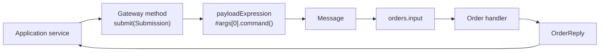
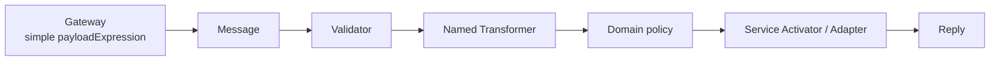
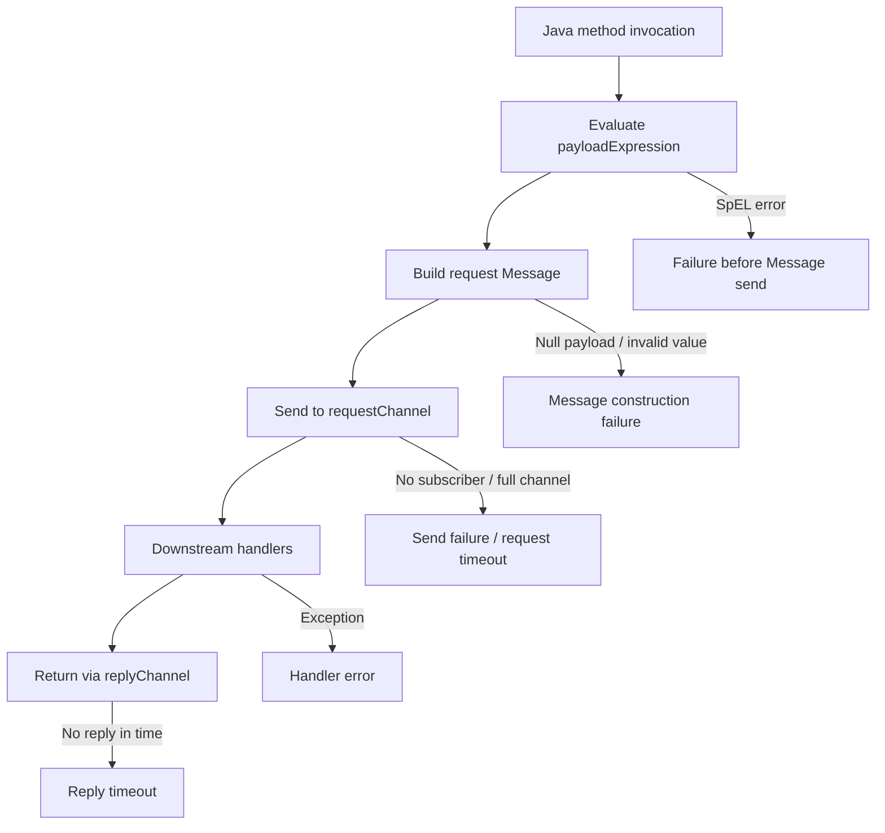
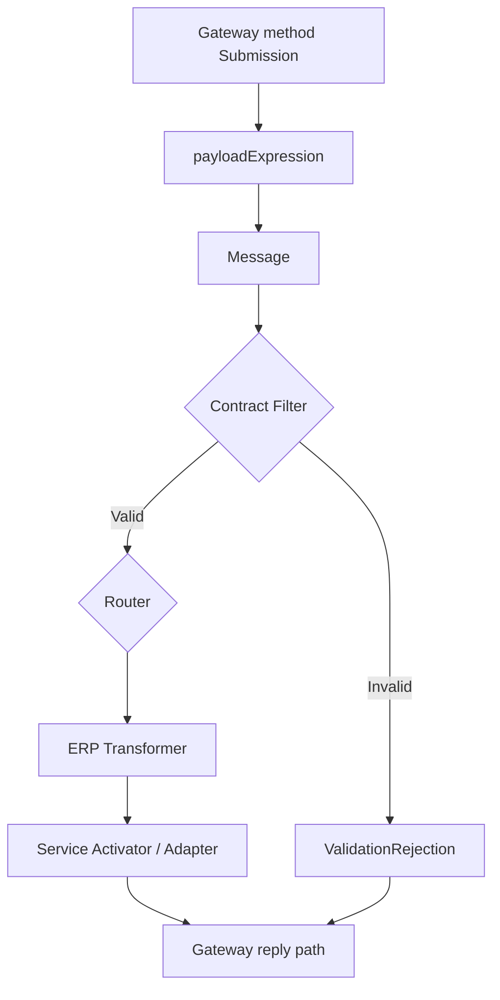
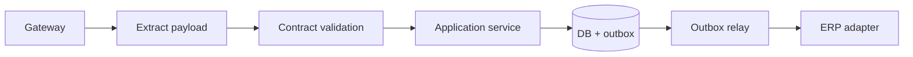
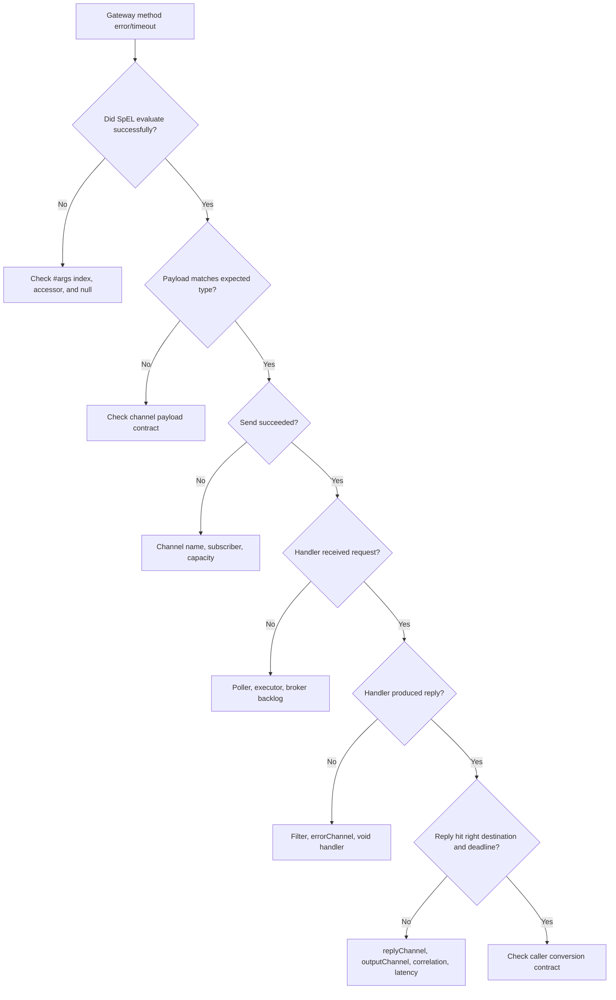

# Gateway Payload Expression

A Java service receives a `Submission(requestId, orderCommand)` request and needs to call the order-processing system via Spring Integration. Business code wants to call a clean method like `gateway.submit(submission)`, whereas the downstream handler expects **the payload to be `OrderCommand`**, not the entire `Submission` object. Forwarding the wrapper object as-is forces downstream Service Activators, Transformers, or Routers to know API-layer request structures, creating unnecessary coupling.

**Messaging Gateway `payloadExpression`** lets you specify a **Spring Expression Language (SpEL)** expression to extract or build the **inbound Message payload** from the Gateway method's arguments. For example, `#args[0].command()` extracts `OrderCommand` from the first argument; a separate `@GatewayHeader` can place `requestId` into a header for tracing or workflow tracking. The Gateway thus becomes the boundary between **method invocation** and **Message contract** without forcing handlers to accept controller-specific DTOs.

The lesson **Gateway Payload Expression** belongs to the **Messaging gateway** chapter of the `SPRING_INTEGRATION_PATTERN` module. The module aims to teach Enterprise Integration Patterns (EIP) with Spring Integration to build loosely coupled, extensible message flows; practicing Router, Filter, Transformer, Splitter, Aggregator, Gateway, retry, error channel, and correlation, along with testing and observing processing branches. This lesson focuses on `payloadExpression` syntax and evaluation context, combining `@MessagingGateway`, `@Gateway`, header expressions, validation, request–reply, error handling, correlation, security, and testing across a concrete flow.

## 1. Which Boundary Does Messaging Gateway Address?

In an integration architecture, business code usually wants to invoke a method and receive ordinary Java types, while Spring Integration operates on `Message<?>` over channels:

```text
Business code:
  OrderReply reply = gateway.submit(submission);

Integration:
  Message<OrderCommand>
       |
       v
  orders.input -> Service Activator -> replyChannel
```



The Gateway proxy converts a method call into a request Message, sends it to the channel, and maps the reply Message back to the method's return type. It is **not a broker** and does not automatically guarantee durability, retries, or exactly-once delivery; those properties depend on the channels, endpoints, and adapters behind it.

`payloadExpression` solves only one piece: **how the payload is constructed from method-call arguments**. It does not choose routing, produce replies, or replace transactions or authentication.

### 1.1. Why Pick the Payload Right at the Gateway?

When a method receives a metadata-rich wrapper:

```java
Submission(requestId, command)
```

yet downstream only needs:

```java
OrderCommand(orderId, amount, currency)
```

you can extract the payload at the boundary. Handlers do not need to know the API wrapper's `command` field name; if the wrapper changes, **Gateway contract/mapping** is where the difference is handled.

### 1.2. Not Every Gateway Needs an Expression

For a method with a single parameter already matching the payload type:

```java
OrderReply submit(OrderCommand command);
```

A standard Gateway automatically uses that argument as the payload **without** needing `payloadExpression`. Only add an expression when it clarifies the contract or genuinely needs to extract/construct another value.

## 2. `@MessagingGateway` and `@Gateway` Have Distinct Roles

Both annotations are commonly used together:

| Annotation | Role | Example |
| --- | --- | --- |
| `@MessagingGateway` | Declares Gateway interface and default settings | `defaultRequestChannel="orders.input"` |
| `@Gateway` | Customizes a specific method | `payloadExpression="#args[0].command()"` |
| `@GatewayHeader` | Declares a header on the request Message | `app.requestId` from argument |
| `@IntegrationComponentScan` | Registers Gateway interfaces in Spring context | Scans package containing Gateway |
| `@ServiceActivator` | Handles Message at downstream endpoint | Receives `OrderCommand`, returns `OrderReply` |

Example interface:

```java
@MessagingGateway(defaultRequestChannel = "orders.input")
public interface OrderSubmissionGateway {

    @Gateway(payloadExpression = "#args[0].command()")
    OrderReply submit(Submission submission);
}
```

**Do not confuse a Gateway method's `payloadExpression` with an expression inside a downstream Transformer.** Gateway expressions execute when the application **calls the method and prepares the request Message**; Transformer expressions execute when a **Message already exists in the flow**.

### 2.1. Configuration Scope

`@MessagingGateway` typically carries interface-wide defaults such as request channel, reply channel, and timeouts. `@Gateway` can override request channel, reply channel, and timeouts, and specify `payloadExpression`/`headers` for a single method.

When reading code, determine the **effective configuration per method**, not just the interface-level annotation. One interface can send one method to `orders.input` and another to `orders.audit`.

## 3. Gateway SpEL: What Is `#args`?

At method-call time, the Gateway holds the **argument list**. SpEL expressions in `payloadExpression` can reference them via the **`#args`** variable, for example:

| Expression | Meaning | Expected Result Type |
| --- | --- | --- |
| `#args[0]` | First argument | Method-dependent |
| `#args[0].command()` | Calls `command()` accessor on first arg | `OrderCommand` |
| `#args[0].orderId()` | Calls accessor on an order record | `String` |
| `#args[1]` | Second argument | Method-dependent |
| `#args[0].command().orderId()` | Deeply extracts order ID from wrapper | `String` |

`#args[0]` is the **zero-based position in the method call**, not a message's position in a queue or a `correlationId` header.

Example:

```java
Submission submission = new Submission(
        "req-1001",
        new OrderCommand("ORD-1001", new BigDecimal("49.95"), "USD"));

gateway.submit(submission);
```

Expression:

```spel
#args[0].command()
```

returns `OrderCommand("ORD-1001", 49.95, "USD")`, which becomes the payload received by the handler.

### 3.1. Why Use `command()` with Java Records?

Java 17 records expose a `command()` accessor. `#args[0].command()` invokes the method cleanly. For JavaBeans, you can use the corresponding property/getter if supported by SpEL for that object structure.

Avoid writing expressions against non-public internal field layouts or unnecessary reflection. Keep expressions readable, testable, and aligned with the DTO contract.

### 3.2. Common Context Mistake

```text
Gateway payloadExpression: #args[0].command()
Transformer inside flow: payload / #root / expression per Message context
```

Before the Gateway method has even built the request Message, do not assume a `payload` variable exists containing a Message payload as inside a Transformer. Use the method-invocation context provided by the Gateway.

### 3.3. When the Expression Returns the Wrong Type

If the handler expects `OrderCommand` while the expression is:

```spel
#args[0].command().orderId()
```

the Gateway builds a `String` payload from the expression result. The endpoint expecting `OrderCommand` can hit a type mismatch, method-invocation failure, or conversion error; **just because SpEL parses cleanly does not mean the Message matches the contract**.

## 4. When Should You Use `payloadExpression`?

Useful scenarios:

1. **Extracting payload from a request wrapper:** `Submission → OrderCommand`.
2. **Multi-argument methods:** choosing one argument as payload while placing metadata into headers.
3. **Simplifying downstream contracts:** handlers avoid controller-tier DTOs.
4. **Small, stable representation tweaks:** e.g., reading a schema-stable property.
5. **Adapting a Java method to an input channel with a fixed payload contract.**

Things you **should not** stuff into expressions:

- Calculating prices, discounts, credit limits, or checking customer permissions.
- Calling databases, HTTP, brokers, or external APIs.
- Opening transactions, placing orders, reserving inventory, or sending emails.
- Parsing complex raw JSON, multi-version schema migrations, or heavy object mapping.
- Generating random event IDs on every retry to use as idempotency keys.

Those larger responsibilities belong in **explicitly named Transformers, domain services, application services, or adapters** with their own tests.

## 5. Data Example: Wrapper at API Layer, Command Inside Message

We use Java 17 records in a single demo module:

```java
package example.gateway;

import java.math.BigDecimal;

public final class GatewayPayloadModel {

    private GatewayPayloadModel() {
    }

    // Payload understood by downstream.
    public record OrderCommand(
            String orderId,
            BigDecimal amount,
            String currency) {
    }

    // Gateway method wrapper, not passed wholesale into the flow.
    public record Submission(
            String requestId,
            OrderCommand command) {
    }

    public record OrderReply(
            String requestId,
            String orderId,
            String status) {
    }
}
```

Internal contract:

```text
Gateway Java method:
  submit(Submission)

request Message created:
  payload = OrderCommand
  header  = app.requestId

Service Activator:
  input  = Message<OrderCommand>
  output = OrderReply
```

`requestId` here serves **request correlation/observation in the demo**, not proof that the client is authorized to act on the order. When an authenticated tenant/actor is required, derive context from a trusted security boundary instead of trusting self-declared strings in the request.

## 6. Gateway Interface Using `payloadExpression` and Header Expression

```java
package example.gateway;

import org.springframework.integration.annotation.Gateway;
import org.springframework.integration.annotation.GatewayHeader;
import org.springframework.integration.annotation.MessagingGateway;

import example.gateway.GatewayPayloadModel.*;

@MessagingGateway(
        name = "orderSubmissionGateway",
        defaultRequestChannel = "orders.input",
        defaultRequestTimeout = "500",
        defaultReplyTimeout = "1500")
public interface OrderSubmissionGateway {

    @Gateway(
            payloadExpression = "#args[0].command()",
            headers = @GatewayHeader(
                    name = "app.requestId",
                    expression = "#args[0].requestId()"))
    OrderReply submit(Submission submission);

    @Gateway(
            payloadExpression = "#args[0]",
            headers = @GatewayHeader(
                    name = "app.requestId",
                    expression = "#args[1]"))
    OrderReply submitSeparate(
            OrderCommand command,
            String requestId);
}
```

In `submit(...)`, `#args[0]` is `Submission`, and the expression extracts `OrderCommand`. Independently, the header expression extracts `requestId` from the **same argument**.

In `submitSeparate(...)`, the Gateway takes **two parameters**; the expressions specify `OrderCommand` as payload and `requestId` as header. That avoids relying on implicit defaults for multi-argument methods.

### 6.1. Header and Payload Are Two Separate Contracts

| From Method | Gateway Mapping | Handler Receives |
| --- | --- | --- |
| `submission.command()` | `payloadExpression` | `Message.getPayload(): OrderCommand` |
| `submission.requestId()` | `@GatewayHeader.expression` | `app.requestId` |
| `command` in `submitSeparate` | `#args[0]` | `OrderCommand` |
| `requestId` in `submitSeparate` | `#args[1]` | `app.requestId` |

Never place the entire `Submission` in the payload while expecting the handler to automatically unwrap `OrderCommand`. Always test the **actual Message** payload type.

### 6.2. Literal Headers Differ from Expression Headers

For headers whose values do not depend on method arguments, use a literal value **with the appropriate annotation attribute**. For argument-derived headers, use `expression`:

```java
@GatewayHeader(
        name = "app.requestId",
        expression = "#args[0].requestId()")
```

Do not put `"#args[0].requestId()"` into the literal `value` field expecting the framework to always evaluate it as SpEL. The `value` and `expression` attributes have different semantics.

### 6.3. Expressions Must Be Governed Like Code

Expressions are **developer-written configuration**, not caller-submitted scripts. Letting clients pick a SpEL string and feeding it straight to an evaluator is a severe risk: SpEL can access methods/beans/types depending on the evaluation context and configuration.

**Never** accept arbitrary expressions from HTTP payloads and pass them into `payloadExpression` or an unrestricted `SpelExpressionParser`.

## 7. Spring Integration Configuration with `DirectChannel`

We create a `DirectChannel` request channel and a Service Activator returning `OrderReply`. Because the Gateway already extracted `OrderCommand` as payload, the Service Activator **never sees `Submission`**.

```text
OrderSubmissionGateway.submit(Submission)
   -> payloadExpression="#args[0].command()"
   -> Message<OrderCommand>
   -> orders.input (DirectChannel)
   -> OrderSubmissionHandler.process(Message<OrderCommand>)
   -> OrderReply via Gateway's replyChannel
```

In Spring, the request channel name must match the **bean name**, not automatically be inferred from a method name unless aligned. For example, `@Bean(name = "orders.input")` creates a bean with the exact name the Gateway references. A method `ordersInput()` without an explicit bean name defaults to `ordersInput`, which **differs** from `orders.input`.

For simple request–reply flows, the handler can **return the `OrderReply` payload** so the endpoint delivers it to the request's reply destination; there is no need to spawn threads or manually send Messages to arbitrary channels. If the handler needs state/counters or service dependencies, inject them via constructor on a separate component. Section 8 gives the **single runnable configuration** used in subsequent examples and tests.

### 7.1. Why Not Cram Everything into One Annotated Method?

A Service Activator method is invoked by the framework under the message-handling contract, not as an arbitrary constructor injecting every bean as extra parameters. To avoid wrong assumptions about method parameter resolution, use a handler class with explicit **constructor injection**, leaving `process(Message<OrderCommand>)` to accept just one `Message`.

## 8. Recommended Practical Config: Separate Handler Class, Explicit DI

To avoid injection ambiguity and simplify testing, use an `OrderSubmissionHandler` with constructor injection:

```java
package example.gateway;

import java.math.BigDecimal;
import java.util.concurrent.atomic.AtomicInteger;

import org.springframework.integration.annotation.ServiceActivator;
import org.springframework.messaging.Message;

import example.gateway.GatewayPayloadModel.*;

public final class OrderSubmissionHandler {

    private final AtomicInteger handledCount;

    public OrderSubmissionHandler(AtomicInteger handledCount) {
        this.handledCount = handledCount;
    }

    @ServiceActivator(inputChannel = "orders.input")
    public OrderReply process(Message<OrderCommand> message) {
        OrderCommand command = message.getPayload();
        Object value = message.getHeaders().get("app.requestId");

        if (!(value instanceof String requestId)
                || !requestId.matches("[A-Za-z0-9_-]{1,80}")) {
            throw new IllegalArgumentException("INVALID_REQUEST_ID");
        }

        if (command == null
                || command.orderId() == null
                || !command.orderId()
                    .matches("[A-Za-z0-9_-]{1,80}")
                || command.amount() == null
                || command.amount().signum() < 0
                || !"USD".equals(command.currency())) {
            throw new IllegalArgumentException("INVALID_ORDER_COMMAND");
        }

        handledCount.incrementAndGet();
        return new OrderReply(
                requestId, command.orderId(), "ACCEPTED");
    }

    public int processedCount() {
        return handledCount.get();
    }
}
```

In Spring configuration, register `OrderSubmissionHandler` as a bean and ensure **only one** Service Activator in this flow listens on `orders.input`. The runnable configuration below implements Section 7's diagram:

```java
package example.gateway;

import java.util.concurrent.atomic.AtomicInteger;

import org.springframework.context.annotation.Bean;
import org.springframework.context.annotation.Configuration;
import org.springframework.integration.annotation.IntegrationComponentScan;
import org.springframework.integration.channel.DirectChannel;
import org.springframework.integration.config.EnableIntegration;
import org.springframework.messaging.MessageChannel;

@Configuration
@EnableIntegration
@IntegrationComponentScan(
        basePackageClasses = OrderSubmissionGateway.class)
public class RunnableGatewayPayloadConfiguration {

    @Bean(name = "orders.input")
    public MessageChannel ordersInput() {
        return new DirectChannel();
    }

    @Bean
    public OrderSubmissionHandler orderSubmissionHandler() {
        return new OrderSubmissionHandler(new AtomicInteger());
    }
}
```

**The code snippets in Sections 5, 6, and 8 form the runnable example set used in the tests below.** Section 7 explains the Message path, channel bean name, and dependency injection; Section 8 provides the matching configuration. Do not register a second competing Service Activator on the same `DirectChannel` when the flow expects one handler per request.

### 8.1. Why Separate the Handler?

- No assumptions about extra `@ServiceActivator` parameters being container-injected.
- Easy to unit test `process(...)` with hand-built Messages.
- Easy to count how many Messages actually reached the handler.
- Easy to swap in a real service without changing the Gateway's `payloadExpression`.

### 8.2. `payloadExpression` Evaluates Before the Handler

If SpEL fails to extract `command()` (null, wrong type, missing method), failure can occur **during request Message construction**, before the handler is ever invoked. Testing the handler alone cannot catch that failure; you must call the **Gateway interface**.

## 9. Demo: One Gateway Method, One Canonical Message Payload

```java
package example.gateway;

import java.math.BigDecimal;

import org.springframework.context.annotation.AnnotationConfigApplicationContext;

import example.gateway.GatewayPayloadModel.*;

public class GatewayPayloadDemo {

    public static void main(String[] args) {
        try (var context = new AnnotationConfigApplicationContext(
                RunnableGatewayPayloadConfiguration.class)) {

            OrderSubmissionGateway gateway =
                    context.getBean(OrderSubmissionGateway.class);
            OrderSubmissionHandler handler =
                    context.getBean(OrderSubmissionHandler.class);

            var request = new Submission(
                    "req-1001",
                    new OrderCommand(
                            "ORD-1001",
                            new BigDecimal("49.95"),
                            "USD"));

            OrderReply reply = gateway.submit(request);
            System.out.println(reply.requestId()); // req-1001
            System.out.println(reply.orderId());   // ORD-1001
            System.out.println(reply.status());    // ACCEPTED
            System.out.println(handler.processedCount()); // 1
        }
    }
}
```

Here `Submission` is passed to the Gateway method, yet **the handler receives `Message<OrderCommand>`**. That is the contract transformation performed by `payloadExpression`, while `app.requestId` travels in its own header.

### 9.1. Why Does the Demo Not Prove Security?

`requestId` is still caller-supplied; regex matching only validates format. If tenant/authorization checks are required, the application or inbound adapter must authenticate the principal/ACL and attach trusted metadata. **Never assume a header populated from a Gateway argument is security-trusted.**

## 10. `payloadExpression` with Multiple Parameters

The second method in the interface:

```java
@Gateway(
        payloadExpression = "#args[0]",
        headers = @GatewayHeader(
                name = "app.requestId",
                expression = "#args[1]"))
OrderReply submitSeparate(
        OrderCommand command,
        String requestId);
```

Keeps `OrderCommand` as payload and `requestId` as header. This avoids relying on default multi-argument resolution rules when converting method arguments into a request Message.

However, index-based expressions are **fragile when developers reorder parameters**:

```java
// Dangerous if SpEL is not updated:
OrderReply submitSeparate(String requestId, OrderCommand command);
```

`#args[0]` is now `String`, no longer `OrderCommand`. Even though Java compiles, the Gateway sends the wrong payload type. Prefer a clear request record as parameters grow, and back expressions with integration tests.

### 10.1. Never Use `payloadExpression` to Concatenate Every Parameter into One String

Avoid writing:

```spel
#args[0] + ':' + #args[1] + ':' + #args[2]
```

when downstream actually needs a structured object. Ad-hoc string concatenation loses type safety, creates escaping bugs, risks delimiter collisions, and can leak metadata. Use a tested DTO/Transformer when the input contract spans multiple fields.

## 11. Header Expressions and Payload Expressions Have Different Jobs

A request Message might contain:

```text
payload:
  OrderCommand(orderId=ORD-1001, amount=49.95, currency=USD)

headers:
  app.requestId = req-1001
  id            = <Spring Messaging message id>
  timestamp     = <framework timestamp>
  replyChannel  = <runtime reply destination>
```

`app.requestId` is an **application header** created by Gateway mapping. `replyChannel` can be supplied by the Gateway/framework so the Service Activator returns the result to the waiting invocation. These two headers **are not the same**.

### 11.1. Can `requestId` Live in the Payload?

Yes, when `requestId` is part of the business contract or wire schema. If it is only for tracing or internal routing, a header can fit well. Across brokers or processes, account for **header mappers and serialization**; critical metadata for audit/replay should not live solely in a fragile JVM header.

### 11.2. Do Not Assume Headers Survive Every Endpoint

Transformers/Enrichers, endpoint output channels, HTTP/Kafka/AMQP adapters, or constructing a new `Message` can affect header propagation. `payloadExpression` defines the payload **at ingress**; it does not guarantee headers survive the entire flow or cross networks intact.

### 11.3. Never Put Raw Security Contexts into Arbitrary Headers

Never put tokens, passwords, full principal objects, or raw `Authorization` headers into `@GatewayHeader` "for downstream convenience." If verified claims are needed, pass minimal scoped metadata; outbound adapters require strict allowlists.

## 12. When Should You Move from SpEL to a Dedicated Transformer?

An extraction like:

```spel
#args[0].command()
```

fits well because it is short and side-effect-free. By contrast, an expression like:

```text
parse JSON -> lookup customer -> convert currency
  -> calculate discount -> choose ERP route -> send HTTP
```

is a clear signal to **separate the logic**. Better design:



| Keep in Gateway Expression | Move to Dedicated Component |
| --- | --- |
| Extracting a field from a wrapper | Multi-schema/version mapping |
| Selecting one argument | Fetching reference data via API |
| Reading a schema-stable accessor | Pricing, discounts, credit limits |
| Building a simple I/O-free payload | Retries, transactions, outbound HTTP |
| Minimal header metadata mapping | Complex error taxonomy |

**SpEL is not inherently bad.** The risk is hiding an entire business program inside an annotation expression: hard to review, untested in isolation, and prone to unexpected side effects.

## 13. JUnit 5: Verifying the Gateway Extracts Payload and Header Properly

To confirm `payloadExpression` works, do not just call `OrderSubmissionHandler.process(...)` directly. Call the **real Gateway interface** inside a Spring context, because that is where the expression evaluates and the Message is built.

```java
package example.gateway;

import static org.junit.jupiter.api.Assertions.*;

import java.math.BigDecimal;

import org.junit.jupiter.api.Test;
import org.springframework.context.annotation.AnnotationConfigApplicationContext;

import example.gateway.GatewayPayloadModel.*;

class GatewayPayloadIntegrationTest {

    private static OrderCommand validCommand() {
        return new OrderCommand(
                "ORD-1001",
                new BigDecimal("49.95"),
                "USD");
    }

    @Test
    void extractsNestedCommandAsPayloadAndRequestIdAsHeader() {
        try (var context = new AnnotationConfigApplicationContext(
                RunnableGatewayPayloadConfiguration.class)) {

            OrderSubmissionGateway gateway =
                    context.getBean(OrderSubmissionGateway.class);
            OrderSubmissionHandler handler =
                    context.getBean(OrderSubmissionHandler.class);

            OrderReply reply = gateway.submit(
                    new Submission("req-1001", validCommand()));

            assertNotNull(reply);
            assertEquals("req-1001", reply.requestId());
            assertEquals("ORD-1001", reply.orderId());
            assertEquals("ACCEPTED", reply.status());
            assertEquals(1, handler.processedCount());
        }
    }

    @Test
    void choosesFirstArgumentAsPayloadAndSecondAsHeader() {
        try (var context = new AnnotationConfigApplicationContext(
                RunnableGatewayPayloadConfiguration.class)) {

            OrderSubmissionGateway gateway =
                    context.getBean(OrderSubmissionGateway.class);
            OrderSubmissionHandler handler =
                    context.getBean(OrderSubmissionHandler.class);

            OrderReply reply = gateway.submitSeparate(
                    validCommand(), "req-2002");

            assertNotNull(reply);
            assertEquals("req-2002", reply.requestId());
            assertEquals("ORD-1001", reply.orderId());
            assertEquals(1, handler.processedCount());
        }
    }
}
```

**What this test proves:** the Gateway creates a request Message whose payload the handler consumes as `OrderCommand`, with `app.requestId` populated from the expression. If `payloadExpression` were changed to `#args[0].requestId()`, the handler would fail to receive the right type and the test would catch it.

### 13.1. Why Not Test Only the Business Outcome?

If a handler accepts `Object` and inspects runtime types itself, it can accidentally "mask" a broken Gateway mapping. When testing expressions, enforce a **strict `Message<OrderCommand>` contract** on the handler and verify the associated metadata.

### 13.2. This Is an In-JVM Integration Test

The tests use `DirectChannel` with no broker or external API. They do not yet prove HTTP/Kafka adapters serialize the payload properly, preserve headers, or meet real-world SLAs.

## 14. JUnit: Expression Returns `null` or Invalid Input

When `Submission.command()` is `null`, SpEL can evaluate to `null`. However, **a Spring Messaging `Message` cannot have a `null` payload**, so request Message construction can fail before the Service Activator is ever called.

```java
// Add this method to GatewayPayloadIntegrationTest.
@Test
void nullNestedPayloadFailsBeforeOrderHandlerRuns() {
    try (var context = new AnnotationConfigApplicationContext(
            RunnableGatewayPayloadConfiguration.class)) {

        OrderSubmissionGateway gateway =
                context.getBean(OrderSubmissionGateway.class);
        OrderSubmissionHandler handler =
                context.getBean(OrderSubmissionHandler.class);

        assertThrows(RuntimeException.class, () ->
                gateway.submit(new Submission("req-null", null)));

        assertEquals(0, handler.processedCount());
    }
}
```

The exact error may be wrapped by the Messaging Gateway, SpEL, or framework. In this lesson, the test pins the **technical behavior**: no `OrderReply` is produced and the handler is not invoked. In a real project, verify the exact exception class and error code for your dependency version and add an API-boundary response contract.

### 14.1. When the First Argument Itself Is `null`

If the caller runs:

```java
gateway.submit(null);
```

`#args[0].command()` will also fail trying to invoke an accessor on `null`, before Message construction even completes. Never catch all exceptions and return `OrderReply(ACCEPTED)` to paper over a contract violation.

### 14.2. A Syntactically Extracted Command Can Still Carry Invalid Data

Example:

```java
new Submission(
        "req-invalid",
        new OrderCommand(
                "ORD-1001",
                new BigDecimal("-10.00"),
                "USD"))
```

The expression **still extracts an `OrderCommand` cleanly**. Yet the handler/validator must reject negative amounts per the demo contract; an expression can succeed while the request remains invalid.

```java
// Add this method to GatewayPayloadIntegrationTest.
@Test
void validExtractionDoesNotBypassPayloadValidation() {
    try (var context = new AnnotationConfigApplicationContext(
            RunnableGatewayPayloadConfiguration.class)) {

        OrderSubmissionGateway gateway =
                context.getBean(OrderSubmissionGateway.class);
        OrderSubmissionHandler handler =
                context.getBean(OrderSubmissionHandler.class);

        assertThrows(RuntimeException.class, () ->
                gateway.submit(new Submission(
                        "req-invalid",
                        new OrderCommand(
                                "ORD-1001",
                                new BigDecimal("-10.00"),
                                "USD"))));

        assertEquals(0, handler.processedCount());
    }
}
```

With synchronous `DirectChannel`, handler errors can propagate back to the caller, making `assertThrows` appropriate for the demo. With `ExecutorChannel` or brokers, `send()` and handler errors happen on different threads; observe `errorChannel`/reply error contracts instead of assuming a synchronous exception.

## 15. Testing the Handler Independently of the Gateway

Because the handler is a separate class, you can verify its payload and header contract directly on a `Message`:

```java
package example.gateway;

import static org.junit.jupiter.api.Assertions.*;

import java.math.BigDecimal;
import java.util.concurrent.atomic.AtomicInteger;

import org.junit.jupiter.api.Test;
import org.springframework.messaging.support.MessageBuilder;

import example.gateway.GatewayPayloadModel.*;

class OrderSubmissionHandlerTest {

    @Test
    void handlesTypedPayloadAndSafeRequestHeader() {
        var handler = new OrderSubmissionHandler(
                new AtomicInteger());

        var message = MessageBuilder.withPayload(
                new OrderCommand(
                        "ORD-1001",
                        new BigDecimal("49.95"),
                        "USD"))
                .setHeader("app.requestId", "req-1001")
                .build();

        OrderReply reply = handler.process(message);

        assertEquals("ACCEPTED", reply.status());
        assertEquals("req-1001", reply.requestId());
        assertEquals(1, handler.processedCount());
    }

    @Test
    void rejectsMessageWithMissingRequestHeader() {
        var handler = new OrderSubmissionHandler(
                new AtomicInteger());

        var message = MessageBuilder.withPayload(
                new OrderCommand(
                        "ORD-1001",
                        new BigDecimal("49.95"),
                        "USD"))
                .build();

        var ex = assertThrows(
                IllegalArgumentException.class,
                () -> handler.process(message));
        assertEquals("INVALID_REQUEST_ID", ex.getMessage());
        assertEquals(0, handler.processedCount());
    }
}
```

**Both test levels complement each other:** handler unit tests verify downstream Message processing, while Gateway integration tests verify `payloadExpression` and header expressions actually build **that Message**.

### 15.1. Direct Tests Alone Cannot Verify the Gateway Proxy

Calling `handler.process(...)` alone still passes even if `@Gateway(payloadExpression=...)` is deleted or broken. Always keep tests through the Gateway interface as in Section 13.

## 16. At Which Stage Do SpEL Failures Occur?

A request typically follows these steps:



| Stage | Example | Has the Request Reached the Handler Yet? |
| --- | --- | --- |
| Evaluate expression | `#args[0].wrongMethod()` | No, if evaluation fails |
| Build Message | Expression returns `null` | No, if payload is rejected |
| Send channel | No `DirectChannel` subscriber | Likely no handler ran |
| Handler | Negative amount per contract | Yes, handler was invoked |
| Reply | Handler processes yet returns `void` | May have processed, yet no reply |
| Async worker | Reply arrives past deadline | Request may already have finished |

This distinction matters for retries: a pre-send error differs from a timeout **after a remote side effect may already have executed**. Never retry an entire operation under a new ID solely because the Gateway did not receive a result.

### 16.1. `errorChannel` Does Not Automatically Catch Every Expression Error

`errorChannel` handles `ErrorMessage`s emitted by configured endpoints/adapters. A `payloadExpression` evaluation error happens on the caller thread **before any Message is sent**; it can surface directly as a Gateway exception instead of routing to a downstream error channel.

**Test the exact boundary**: what exception the API caller catches, where it logs, what error JSON is returned, and whether retries make sense.

### 16.2. SpEL Evaluation Failure Is Not a Business Rejection

An expression failing because a developer renamed an accessor is not proof that an order was rejected by domain policy. Classify cleanly:

```text
SPEL_EVALUATION_FAILURE -> Gateway mapping/configuration bug
INVALID_COMMAND         -> Data contract error
BUSINESS_REJECTED       -> Domain policy outcome
REMOTE_TIMEOUT          -> Unknown remote outcome
```

These codes are application suggestions, **not default error codes emitted by Spring Integration**.

## 17. `payloadExpression` and `replyChannel` Do Not Replace Each Other

They sit at opposite ends of request–reply:

```text
Caller
  |
  v
Gateway:
  payloadExpression => Message payload
  header expression => app.requestId
  replyChannel      => where response is received for the call
  |
  v
orders.input -> Handler -> replyChannel -> Gateway -> Caller
```

`payloadExpression` **does not choose the reply destination**. When a method returns `OrderReply`, the Gateway/handler needs a valid return path. In internal flows, the Gateway normally supplies a temporary reply channel for the invocation; if the handler returns a payload and no fixed output channel hijacks the path, Spring Integration routes the reply back to the caller.

### 17.1. If the Handler Sends Results to Another Channel Explicitly

Example:

```java
@ServiceActivator(
        inputChannel = "orders.input",
        outputChannel = "audit.results")
public OrderReply process(OrderCommand command) {
    return new OrderReply(
            "req-1001", command.orderId(), "ACCEPTED");
}
```

If `audit.results` does not connect back to the Gateway's reply path, callers can **time out even though the handler returned an object**. Increasing `replyTimeout` cannot fix a misrouted reply path.

### 17.2. Handler Returns No Reply

If a `@ServiceActivator` returns `void`, or a Filter drops the Message with no rejection-reply branch, a Gateway method expecting `OrderReply` can wait until timeout. For request–reply, ensure **every valid branch emits a response** or follows an explicit exception contract instead of merely logging audit entries and dropping the Message.

### 17.3. Never Serialize Runtime `replyChannel` Objects

Over HTTP/Kafka/AMQP, `replyChannel` can be an in-JVM channel object. Never push that object onto a broker by serializing all `MessageHeaders`. Cross-process request–reply requires **transport-level reply destinations and correlation IDs**.

## 18. Request Timeout and Reply Timeout When Using Expressions

`payloadExpression` evaluates during **request preparation**. Between that and the result lie several deadlines:

| Timeout | What It Limits | What It Does Not Directly Limit |
| --- | --- | --- |
| `requestTimeout` | Wait time when sending to a potentially blocking channel | Total execution time of a `DirectChannel` handler |
| `replyTimeout` | Wait time for reply under matching request–reply conditions | Canceling work after the caller stops waiting |
| HTTP connect/read timeout | Establishing connection, waiting for remote response | Scheduling of other consumers |
| Broker request/reply TTL | Expiry of messages / pending requests | ERP business commit |

With `DirectChannel`, the handler usually runs **on the caller thread** during send. If the handler takes 5 seconds, `replyTimeout="1500"` does not force the caller to exit after 1.5 seconds; configure timeouts/cancellation on the handler or external client itself, or move to an async design.

### 18.1. `payloadExpression` Runs Fast, Yet Reply Still Times Out

`#args[0].command()` runs in microseconds/milliseconds; afterward, the handler may call a slow ERP or a Filter may drop the reply. Tweaking the expression or raising `requestTimeout` will not solve that root cause.

### 18.2. Slow Expressions Also Delay the Caller

If a SpEL expression invokes a slow method or performs I/O, the caller gets stalled **before the Message is even sent**. This is another reason to restrict expressions to brief data extraction rather than service orchestration.

## 19. When Using `ExecutorChannel` or `QueueChannel`

Synchronous flow in the example:

```text
Gateway -> DirectChannel -> handler -> reply
```

If switched to:

```text
Gateway -> ExecutorChannel -> worker -> reply
```

The Gateway can send the Message successfully and then wait for a reply; the worker executes on another thread and may finish after `replyTimeout`.

| Channel | Intake Mechanism | Caveats |
| --- | --- | --- |
| `DirectChannel` | Subscriber runs synchronously | Handler duration can sit inside send |
| `ExecutorChannel` | Executor runs task on another thread | Late replies, pool capacity, rejections |
| `QueueChannel` | Buffers Messages for consumer/poller | Backlog, missing poller, slow replies |
| Broker adapter | Across external transport | Serialization, correlation, TTL/ACK, transactions |

### 19.1. `QueueChannel` Does Not Run Handlers Automatically

Declaring only:

```java
@Bean
public QueueChannel ordersQueue() {
    return new QueueChannel(20);
}
```

creates no consumer. You need a poller or queue-reading component; otherwise the Gateway enqueues requests and **never receives a reply**.

### 19.2. Late Replies Are Not Canceled Automatically

After the caller times out, the worker can keep executing. If it later sends a reply to a temporary channel with no waiting invocation, the reply may be dropped, log an error, or enter error handling depending on configuration. With a shared broker reply queue, implement TTLs and pending-request cleanup.

### 19.3. Each Timeout Has Its Own Error Contract

Do not equate "Gateway received no reply" with "ERP did not create the order." Callers may need an `UNKNOWN_OUTCOME` or `PENDING` status to re-query, especially for critical side effects like payments, stock reservations, or order creation.

## 20. Correlation and Idempotency Are More Than `app.requestId`

`app.requestId` in the demo helps link logs and replies, yet it is not automatically a **durable, verified idempotency key**.

| ID | Meaning | Can It Change on Retry? |
| --- | --- | --- |
| `requestId` | Logical request ID chosen by contract | Should stay stable if retrying the same request |
| `eventId` | Logical event from source | Should stay stable across redeliveries |
| `correlationId` | Links workflow / request–reply | Can follow invocation or logical request |
| `orderId` | Business entity | Many events can target the same order |
| `MessageHeaders.ID` | Spring Message object ID | Changes whenever a new Message is built |
| `idempotencyKey` | Prevents duplicate side effects | Must stay stable within operation scope |

Example server-constructed idempotency key:

```text
tenantId + ":" + sourceSystem + ":" + sourceEventId
    + ":" + operationType

tenant-7:PARTNER_API:evt-1001:CREATE_ORDER
```

A Gateway method can accept a caller-supplied `requestId`, yet **never let a SpEL expression decide authorization or idempotency based solely on an unverified header**. The application boundary needs authentication, authorization, and stable ID rules.

### 20.1. Retry After Timeout and Duplicate Side Effects

```text
0 ms    Gateway sends CreateOrder(evt-1001)
500 ms  Gateway times out
800 ms  ERP commits order
900 ms  Caller retries
```

If the retry generates a new event ID, the ERP treats it as **a separate command** and creates a second order. Preserving a stable key, using an idempotent receiver, remote lookups, or reconciliation are **application/adapter** responsibilities, not `payloadExpression`'s job.

### 20.2. Correlation Across Brokers

A temporary reply channel only has meaning inside the local runtime. When request/reply crosses Kafka/JMS/AMQP, you need properly scoped correlation keys, reply queues/adapters, a pending-request store, and expiry. Never assume `app.requestId` automatically activates correlation on every adapter.

## 21. Header Expressions and Data Safety

`@GatewayHeader(expression=...)` can read metadata from arguments, yet that does not make the metadata **authenticated**.

An untrusted caller could send:

```json
{
  "requestId": "req-1001",
  "tenantId": "tenant-admin",
  "isAdmin": true,
  "command": {
    "orderId": "ORD-1001",
    "amount": "49.95"
  }
}
```

If Gateway mapping sets `headers.isAdmin=true` and a Router/Filter trusts it to bypass authorization, that is an architectural vulnerability.

**Recommendations:**

1. Authenticate producers/callers at inbound HTTP/broker adapters.
2. Validate tenant/permissions against authenticated principals/ACLs.
3. Map only necessary metadata with length and type bounds.
4. Never let callers choose SpEL expressions or arbitrary internal header names.
5. Never place tokens, passwords, or raw security principals in outbound payloads/headers.
6. Test that forged headers cannot steer sensitive routes or policies.

### 21.1. Expression Injection vs. Ordinary Malicious Payloads

If `payloadExpression` is a **developer-declared constant** like `#args[0].command()`, an input string `"T(java.lang.Runtime)..."` inside `orderId` remains harmless **data** as long as the application never parses/evaluates it again.

Severe risk occurs when an app **takes a SpEL string from user input** and executes it with elevated evaluation rights, or calls sensitive methods/beans inside an expression. Never turn external input into executable SpEL.

### 21.2. Restrict Logging

When expression evaluation fails, log the Gateway method name, error code, and sanitized request ID; never dump entire source objects containing PII, tokens, or payment details. SpEL exception messages can include fragments of expressions or object data; control what reaches public API responses.

## 22. Payload Type, Schema Versions, and Contract Evolution

An expression working today can break when a DTO evolves:

```java
public record Submission(
        String requestId,
        OrderCommand command) {
}
```

Changed to:

```java
public record SubmissionV2(
        String requestId,
        OrderData payload) {
}
```

while the Gateway still uses:

```spel
#args[0].command()
```

breaks the accessor. This is a **Gateway mapping contract** error, not a Service Activator or ERP bug.

### 22.1. Safe Versioning Practices

- Provide Gateway interfaces/methods or mappers matching the new DTO.
- Keep integration tests calling the **real proxy method** to catch stale expressions.
- Keep internal payload contracts stable when possible.
- For complex mappings, move to a versioned Transformer class.
- Never parse schema v2 as v1 just because field names look similar.

### 22.2. Never Rely on `toString()` as a Wire Contract

An expression like:

```spel
#args[0].toString()
```

produces an unstable Java debug string that may contain PII. It does not replace schema-governed JSON/Avro/Protobuf serialization over brokers or APIs.

### 22.3. Type Conversion Does Not Perform Business Mapping

SpEL can return `String`, `Integer`, or other objects. The framework having converters between types **does not prove** semantic conversions like `"49.95" USD → 4995 cents` are right. For money, timezones, enums, and critical schemas, use typed DTOs/Transformers with explicit rules and unit tests.

## 23. Combining Gateway Expressions with Router, Filter, and Transformer

`payloadExpression` runs **at the Gateway boundary**. Downstream Enterprise Integration Patterns operate on the resulting Message:



### 23.1. Routers Must Match the Post-Mapping Payload Type

Before the Gateway, the request has `submission.command().currency()`. After `#args[0].command()`, the payload is `OrderCommand`, so Routers/Filters must access **`command.currency()`**, no longer `payload.command()`. Whenever you change a Gateway expression, re-test downstream endpoints that depend on payload type.

### 23.2. Filters Do Not Automatically Return Rejections

If a Filter drops a Message and only writes an audit log, a Gateway awaiting `OrderReply` can time out. Valid rejection branches need a **business rejection reply** or matching error contract; `discardChannel` does not automatically reply to the caller.

### 23.3. Keep Business Mapping Transformations in a Dedicated Step

If the ERP expects `ErpCreateOrder`, build a unit-tested Transformer from `OrderCommand` to the target schema. Never stuff a 50-field mapping table, customer lookup, pricing calculation, and ERP call into `payloadExpression`.

### 23.4. Splitter and Aggregator

A Gateway can extract `#args[0].orders()` as a `List<OrderCommand>` payload. A Splitter splits each order and an Aggregator gathers results; **correlation keys, `sequenceSize`, release strategy, and group timeouts** must still be designed separately. Extracting a list via SpEL does not create that metadata. If a Filter drops one child without a rejection reply, the Aggregator can stall waiting for missing parts.

## 24. Transactions and Side Effects Do Not Belong in Expressions

A Gateway may orchestrate:

```text
submit(Submission)
  -> payloadExpression
  -> validate
  -> application service
  -> database transaction / outbox
  -> ERP adapter
  -> OrderReply
```

Writing a SpEL expression like:

```spel
@orderService.placeOrder(#args[0].command())
```

when the service has side effects executes that call **while the Gateway is building the request**, even before sending to the request channel. Retries or later failures can repeat the operation outside proper transaction boundaries.

### 24.1. Boundaries Should Be Clear



Expressions must never query databases, make network calls, send emails, reserve stock, or call `Instant.now()` to make business decisions. Given identical arguments and mapping version, a **pure-data** expression is far easier to test and replay.

### 24.2. Timeouts Do Not Cancel the ERP

The Gateway can hit `replyTimeout` after the ERP created an order yet before the caller sees the reply. Retries must never mint a different logical event ID; use stable idempotency keys, remote lookups, outboxes, or reconciliation. **`payloadExpression` does not provide exactly-once semantics.**

### 24.3. Choose an Async Workflow for Long Jobs

If ERP posting takes several minutes, instead of holding a synchronous Gateway caller, persist **durable intent** and return `PENDING + operationId`. Workers process asynchronously while callers poll or receive callbacks. That is an API contract change, not merely raising `replyTimeout`.

## 25. Observability: Measure Mapping, Send, Handler, and Reply Separately

An application log:

```json
{
  "stage": "gateway-payload-mapping",
  "gatewayMethod": "submit",
  "requestChannel": "orders.input",
  "requestId": "req-1001",
  "payloadType": "OrderCommand",
  "result": "MAPPED"
}
```

This is a **recommended log schema**, not a default log emitted automatically by Spring Integration. Never print whole `Submission` or `MessageHeaders` objects if they contain PII or tokens.

| Suggested Metric | Tracks |
| --- | --- |
| `gateway.payload_mapping.success` | Valid payload constructions |
| `gateway.payload_mapping.failure` | Expression evaluation errors |
| `gateway.payload_mapping.null` | Expressions returning `null` |
| `gateway.payload_type.invalid` | Handler receiving wrong type |
| `gateway.request.send_failure` | Failures sending to channel |
| `gateway.reply.success` | Replies reaching caller on time |
| `gateway.reply.timeout` | Missing replies within deadline |
| `gateway.handler.technical_error` | Downstream errors |
| `gateway.reply.unmatched` | Replies with no pending correlation |
| `gateway.queue.depth` | Request backlog |

These metric names are **application-instrumented suggestions**, not guaranteed out-of-the-box framework metrics. Tags should have bounded cardinality such as Gateway method, payload type, channel type, and result code; never use request ID, order ID, or correlation ID as high-cardinality labels.

### 25.1. One Timeout Log Does Not Prove SpEL Failed

Seeing only `"Gateway timed out"` can stem from many causes: no subscriber on request channel, slow worker, Filter discard, or misrouted reply. Log/trace the checkpoints **mapped → sent → consumed → processed → replied → delivered**.

### 25.2. Trace IDs Do Not Replace Reply Correlation

A trace ID links logs across services, yet it does not route replies back to a pending Gateway invocation. Reply routing still requires the channel/transport's reply destination and correlation mechanism.

## 26. Step-by-Step Troubleshooting



**Before send:** if an accessor was renamed or is `null`, the expression fails before the Service Activator runs. **After send:** if the handler received a valid `OrderCommand` yet the caller timed out, inspect the reply path, handler latency, and external transport rather than editing SpEL.

For error classification:

```text
SPEL_EVALUATION_FAILURE -> Gateway mapping/configuration
INVALID_ORDER_COMMAND   -> Request contract validation
BUSINESS_REJECTED       -> Domain decision
REMOTE_TIMEOUT          -> Unknown outcome after remote call
REPLY_ROUTING_FAILURE   -> Reply path/correlation
```

These codes are application-chosen examples, **not default Spring Integration error codes**.

## 27. Pre-Production Test Matrix

| Scenario | Expectation |
| --- | --- |
| Valid `Submission` | Handler receives `OrderCommand`, not wrapper |
| `Submission.requestId` | Header `app.requestId` matches |
| Two-argument method | `#args[0]` payload, `#args[1]` header |
| Parameter order swapped | Gateway integration test catches mismatch |
| `null` `Submission` | SpEL error; handler does not run |
| `null` `Submission.command()` | No null-payload Message constructed |
| Negative amount | Handler/validator rejects |
| Unsupported currency | Contract validation failure |
| DTO `command()` renamed to `payload()` | Test catches stale expression |
| Expression extracts `orderId` `String` | Payload type mismatch caught |
| Client sends SpEL-like string | Treated strictly as data |
| Client spoofs privilege header | AuthN/AuthZ never trusts raw headers |
| `DirectChannel` without subscriber | Send failure distinguished from reply timeout |
| `QueueChannel` without poller | Backlog builds with no reply |
| Slow `ExecutorChannel` worker | Timeout does not imply worker canceled |
| Filter drops request | Rejection reply or error contract runs |
| Output channel altered | Gateway test catches lost reply |
| Two concurrent callers | Replies/correlations never cross |
| Late reply | TTL/cleanup/late-reply handling |
| ERP timeout after commit | Retry keeps stable idempotency key |
| HTTP/Kafka/AMQP adapter | Wire schema and header allowlist verified |

### 27.1. Testing from the Gateway Interface Is Mandatory for This Topic

Calling the handler directly does not evaluate `payloadExpression`. Therefore the essential test is **`gateway.submit(...)` building the right Message and receiving the right reply**. Handler-only tests prove only downstream behavior.

### 27.2. Different Test Layers Serve Different Purposes

**Unit tests** check handlers/DTOs and pure mappings. **Gateway integration tests** exercise the Gateway proxy and channels. **Adapter contract tests** check serialization, headers, and correlation across transports. **Failure-injection tests** cover timeouts, retries, ACK loss, crashes, and late replies. STEP 4 examples do not execute builds/JUnit; those run during project QA/testing.

## 28. Common Pitfalls

| Symptom | Cause | Fix |
| --- | --- | --- |
| Handler receives whole wrapper | Missing/wrong `payloadExpression` | Extract `#args[0].command()` |
| Handler receives `String` instead of DTO | Expression picked `orderId()` | Verify payload type |
| Reordering method args breaks flow | `#args[n]` depends on index | Use wrapper or update tests/annotations |
| Null payload throws exception | Missing input checks | Add validation/error contract |
| Missing `app.requestId` | Wrong header expression | Test header mapping |
| Gateway times out though handler finished | Wrong `replyChannel`/`outputChannel` | Inspect reply path |
| Expression calls HTTP/database | Mixing orchestration into SpEL | Extract component/port |
| Client supplies expression | SpEL injection | Only developer-controlled SpEL |
| Spoofed `isAdmin` header trusted | Missing authn/authz | Verify at ingress |
| Retry creates two ERP orders | Unstable ID | Idempotency/reconciliation |
| DTO v2 breaks v1 expression | Accessor renamed | Versioning + integration tests |
| `DirectChannel` slower than `replyTimeout` | Handler runs inside send | External timeouts or async design |
| Queue holds requests yet returns no reply | Missing poller/consumer | Configure consumer |
| Two callers receive each other's responses | Shared reply channel lacks correlation | Per-request reply/dispatcher |
| Broker receives tokens / `replyChannel` objects | Missing header allowlist | Adapter contract tests |
| Metric cardinality explodes | Tagging by request ID | Use bounded-value tags |

## 29. Implementation Checklist

- Clearly define the **payload contract** of the input channel and handler.
- Use `payloadExpression` only when the Gateway method must extract or build a different payload.
- Understand zero-based `#args` indexing; verify on signature changes.
- Prefer clean accessors/DTOs with short, side-effect-free expressions.
- Never call databases, HTTP, brokers, or domain policies inside SpEL.
- Use `@GatewayHeader(expression=...)` for metadata separated from the payload.
- Distinguish request ID, event ID, correlation ID, `replyChannel`, and Message ID.
- Never trust caller metadata as proof of authorization.
- Never accept expression strings from untrusted input.
- Define error contracts for null arguments, null payloads, and type mismatches.
- Add versioning/tests when changing DTO records/accessors.
- Configure the request channel with the exact bean name and right channel type.
- Ensure every valid request–reply branch produces a reply or business rejection.
- Never alter or lose the Gateway's reply destination.
- Understand `requestTimeout` vs. `replyTimeout`; never treat timeout as rollback.
- Use stable idempotency keys whenever downstream executes remote side effects.
- Use transactions/outbox/reconciliation if SLA requires durability.
- Test the real Gateway, handler, adapters, and timeout/failure windows.
- Govern outbound header mappers, PII, and secret redaction.
- Monitor mapping failures, send failures, handler errors, and reply timeouts separately.

## 30. Exercise: Changing a Method Signature Shifts `#args`

A team writes:

```java
@Gateway(
        payloadExpression = "#args[0]",
        headers = @GatewayHeader(
                name = "app.requestId",
                expression = "#args[1]"))
OrderReply submitSeparate(OrderCommand command, String requestId);
```

After refactoring:

```java
OrderReply submitSeparate(String requestId, OrderCommand command);
```

Answer the following:

1. Does `#args[0]` have the same type before and after the refactor?
2. What will a `Message<OrderCommand>` handler receive if the annotations are not updated?
3. What wrong value might `@GatewayHeader(expression="#args[1]")` hold?
4. Why won't a test calling `OrderSubmissionHandler` directly catch the bug?
5. If `Submission.command()` is `null`, at which step can the error happen?
6. If the Gateway times out after the ERP received the command, can you conclude the ERP has not processed it?
7. Should discount logic, credit limits, or customer lookups live inside the expression?
8. Which tests and metrics distinguish SpEL errors, wrong payload types, handler errors, and misrouted replies?

**Solution guide:** After refactoring, `#args[0]` becomes `String requestId` instead of `OrderCommand`, while `#args[1]` holds the command object. A Gateway integration test invoking the real method is needed to catch this. Null errors can occur pre-send; timeouts do not prove remote side effects did not happen. Complex mappings and business policies belong in separate, tested components.

---

**`Gateway payload expression` is a tool for defining the exact Message payload at the boundary between a Java call and a Spring Integration flow.** Use `#args` to extract the right DTO, header expressions for needed metadata, keep SpEL concise and side-effect-free, and test directly through the Gateway interface. By clearly separating payload mapping from validation, domain policies, reply channels, timeouts, correlation, and idempotency, an application can evolve its API wrappers while keeping channel contracts stable—avoiding hard-to-debug issues like wrong payload types, lost replies, or retries creating duplicate business actions.
