# Gateway Error Channel in Spring Integration

> **Chapter:** Messaging gateway  
> **Lesson:** Gateway error channel  
> **Module:** `SPRING_INTEGRATION_PATTERN` — implementing Enterprise Integration Patterns with Spring Integration to build loosely coupled, extensible message flows. This lesson connects Messaging Gateway with Router, Filter, Transformer, Splitter, Aggregator, retry, error channel, and correlation, along with how to test and monitor each branch.
>
> **Scope:** Spring Integration / Spring Messaging with Java 17+, Java DSL, and `@MessagingGateway`. Examples present technical and business contracts; exact API details must be verified against your actual dependency version when practicing.

## 1. Scenario: Caller Invokes Gateway, Backend Fails

An application wants its API layer to invoke order processing through a clean Java interface:

```java
OrderResult result = orderGateway.submit(
    new SubmitOrder(
        "shop-01", "ORD-101", "REQ-901", 125_000L));
```

Behind this call, the Messaging Gateway turns a Java invocation into a message sent through a Spring Integration flow:

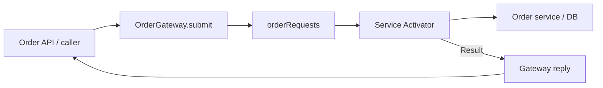

When everything succeeds, the handler returns `OrderResult` and the Gateway returns that value to the caller. Yet when a database times out, a message finds no route, or a handler throws an exception, the questions become:

- Does the caller receive a **Java exception**?
- Is an **`ErrorMessage`** created?
- Which channel receives the error message?
- Can the error be converted into a **typed `OrderResult`** so the Gateway still replies?
- What happens to the caller if the error flow fails or produces no reply?
- Does a Gateway timeout mean the backend did not process the command?
- Does an async adapter automatically report errors back to the right caller?

**Gateway error channel** is a configuration point for coordinating errors handled by the Messaging Gateway, **not a magic switch that catches every exception on every message, logs it, and turns it into a successful outcome**.

## 2. Learning Objectives

After this lesson, you will be able to:

1. Distinguish a Gateway's request channel, reply channel, and error channel.
2. Explain the roles of `ErrorMessage` and `MessagingException`.
3. Understand how synchronous errors differ from errors raised past an async boundary.
4. Configure `@MessagingGateway(errorChannel = "...")` and an error-handling flow.
5. Return a structured business result or decide to propagate an exception to the caller.
6. Distinguish a **domain rejection** from a technical error, retryable error, and unknown outcome.
7. Never confuse reply timeout, request send timeout, and downstream operation timeout.
8. Handle correlation, request IDs, reply channels, and late replies.
9. Test success, handler exceptions, error-channel replies, missing replies, filter/drops, timeouts, and concurrency.
10. Place retry, error channel, DLQ, idempotency, and transactions at the right boundaries.
11. Know when to use a synchronous Gateway and when to return `ACCEPTED`/`PENDING`.
12. Set up observability that identifies whether a failure happened at the Gateway, flow, or adapter.

## 3. Messaging Gateway Hides Message Infrastructure

**Messaging Gateway** is an EIP allowing callers to use a familiar interface while underlying logic communicates via messages.

```java
@MessagingGateway(
    defaultRequestChannel = "orderRequests")
public interface OrderGateway {

    OrderResult submit(SubmitOrder command);
}
```

The caller does not need to build `Message<SubmitOrder>`, set a reply channel, subscribe to channels, or wait on a response queue directly. The Gateway proxy handles translating between method invocation and message exchange.

### Basic Request-Reply Lifecycle

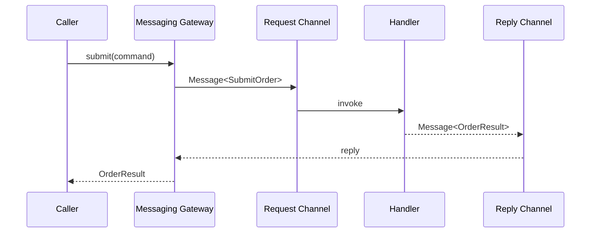

### How Does a Gateway Differ from a Service Activator?

| Component | Primary Direction | Role |
| --- | --- | --- |
| **Messaging Gateway** | Java method ↔ Spring `Message` | Entry/exit gate for a message flow |
| **Service Activator** | Spring `Message` → service method | Executes business logic and may produce a reply |
| **Transformer** | `Message`/payload → another `Message`/payload | Transforms data |
| **Router** | `Message` → selected channel | Chooses branch |
| **Filter** | `Message` → pass/reject | Screens messages |
| **Error flow** | `ErrorMessage` → logging/handling/reply | Handles failures per policy |

A Gateway does not replace services, transactions, or error handlers. It only provides an abstraction over invocation and reply.

## 4. Three Channels Often Confused: Request, Reply, Error

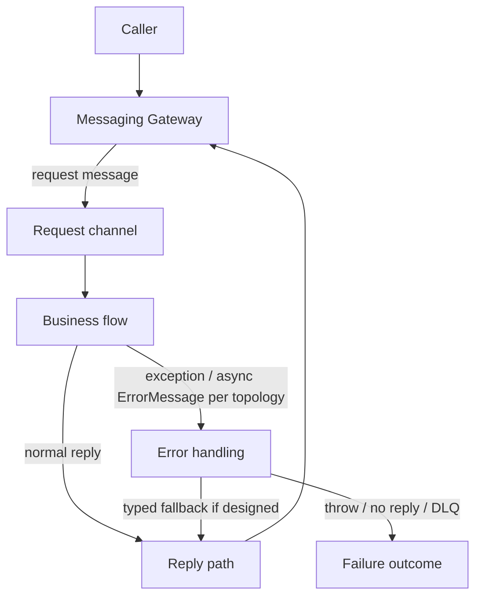

### Request Channel

Where the Gateway sends messages to start the pipeline, e.g., `orderRequests`.

### Reply Channel

Where a reply-producing endpoint sends its result. It can be declared explicitly, or the Gateway can attach a **temporary reply channel** to the message to match the reply back to the waiting call.

### Error Channel

Where errors are routed for error handling. A Gateway can declare `errorChannel`; an underlying message can also carry an `errorChannel` header; an inbound adapter can use its own error channel; an application may have a global `errorChannel`.

**They are not automatically the same channel or the same error-catching scope.**

| Channel / Setting | Effect | What Must Not Be Inferred |
| --- | --- | --- |
| `defaultRequestChannel` | Target where Gateway sends requests | That the handler definitely committed |
| `defaultReplyChannel` or reply header | Gateway's reply destination | That every handler produces a reply |
| Gateway `errorChannel` | Error-handling path scoped to the Gateway | That every subsequent async error returns to caller |
| `errorChannel` header | Per-message error-routing hint, endpoint-dependent | That it always overrides every other config |
| Global `errorChannel` | Default error path for components using it | That every synchronous exception passes through it |
| Adapter-specific error channel | Handles send/receive errors on an adapter | That it automatically returns a business reply |

**Always identify which thread/boundary raised the error, which endpoint catches it, and who is responsible for producing a response.**

## 5. `ErrorMessage` in Spring Messaging

Spring Messaging represents errors with a specialized message:

```java
org.springframework.messaging.support.ErrorMessage
```

`ErrorMessage` is essentially a `Message<Throwable>`. Its payload is typically a `Throwable` such as `MessagingException`, which may carry the failed message for diagnostics.

```text
ErrorMessage
  payload:
    Throwable / MessagingException
      message: "DB timeout"
      cause: ...
      failedMessage: Message<SubmitOrder> (if present)
  headers:
    framework/error metadata
  originalMessage:
    may be present
```

### Do Not Assume `failedMessage` Is Always Present

Errors can occur before the request is fully built, inside an adapter, during payload conversion, or after a message is no longer attached to the exception. Therefore:

- `MessagingException.getFailedMessage()` may be `null`.
- `ErrorMessage.getOriginalMessage()` may be missing.
- The `Throwable` may be wrapped multiple times.
- The failed message's payload may be a different DTO than expected.
- Never log raw failed payloads if they contain PII or credentials.

### Defensive Error Inspection

```java
import org.springframework.messaging.Message;
import org.springframework.messaging.MessagingException;
import org.springframework.messaging.support.ErrorMessage;

public final class ErrorInspection {

    public static String failedEventId(ErrorMessage error) {
        Throwable failure = error.getPayload();

        if (failure instanceof MessagingException messaging) {
            Message<?> failed = messaging.getFailedMessage();

            if (failed != null
                    && failed.getPayload()
                        instanceof SubmitOrder order) {
                return order.requestId();
            }
        }

        Message<?> original = error.getOriginalMessage();
        if (original != null
                && original.getPayload() instanceof SubmitOrder order) {
            return order.requestId();
        }

        return "unavailable";
    }
}
```

This is an illustrative helper, not a default Gateway API. It only extracts the request ID if the original data is actually present. For systems needing reliable correlation, design a message envelope/tracing context built to survive every boundary.

## 6. Having an Error Does Not Mean the Caller Receives an `ErrorMessage`

If a synchronous Service Activator throws an exception, the Gateway caller typically expects a **Java exception at the call site** or a structured **business result**, not to handle an `ErrorMessage` object itself.

```text
Caller:
  gateway.submit(command)

Possible outcome A:
  returns OrderResult

Possible outcome B:
  throws Gateway/Message handling exception

Possible outcome C:
  returns a typed fallback/rejection after error flow mapping

Possible outcome D:
  reply timeout / no reply

Possible outcome E:
  void/one-way gateway, no result expected
```

The error channel is **an internal path within integration infrastructure**. Callers do not automatically receive an `ErrorMessage` as a Java return value. If the method declares `OrderResult`, an error flow returning an incompatible object can trigger a type-conversion or reply-conversion failure.

### Two Contract Options

**Option 1: Errors are exceptions**

```java
OrderResult result = gateway.submit(command);
// on failure: exception propagates / is rethrown by contract
```

**Option 2: Errors are mapped to a typed result**

```java
OrderResult result = gateway.submit(command);
// result.status() = FAILED_RETRYABLE / REJECTED / COMPLETED
```

The second option requires the error flow to **produce a properly typed reply along the right reply route**. Configuring an error channel name alone is not enough.

## 7. Domain Rejections and Infrastructure Failures Are Not the Same

Suppose an API receives an order with a negative amount:

```text
SubmitOrder(amount=-1)
  -> business validation rejects
```

That is a **predictable** business failure/branch. It can be expressed as `OrderResult(status=REJECTED, reason=INVALID_AMOUNT)` without going through the framework error channel.

By contrast:

```text
SubmitOrder(amount=125000)
  -> database connection timeout
```

This may be a transient failure whose outcome is uncertain. If it committed before the connection dropped, blind retries risk creating duplicates.

### Policy Matrix

| Scenario | Category | Reasonable Outcome |
| --- | --- | --- |
| Negative amount | Domain validation | `REJECTED / INVALID_AMOUNT` |
| Unauthorized tenant | Security | Reject + audit; leak no data |
| Unsupported schema | Protocol/data contract | Structured error, quarantine if needed |
| DB connection refused before effect | Transient infrastructure | Bounded retry |
| DB commit outcome undetermined | Uncertain outcome | Reconcile by idempotency key |
| Service Activator returns `null` despite reply required | Contract error | Reply-required failure / timeout per config |
| Gateway wait expires | Timing/reply failure | Timeout; never assume rollback |
| Reply arrives after timeout | Late reply | Discard/reconcile per policy |
| Duplicate already completed | Idempotency | Replay stored result / acknowledge |
| Error flow throws exception | Error-handling failure | Fail fast/fallback per contract; no infinite loop |

### Layering Principles

- **Domain result:** callers can handle as a business state.
- **Technical exception:** system failures outside normal domain states.
- **`ErrorMessage`:** middleware-level error envelope.
- **DLQ record:** data for recovery/investigation, not a synchronous response for an API caller.

## 8. Synchronous and Asynchronous Errors Take Different Paths

### Synchronous Flow via `DirectChannel`

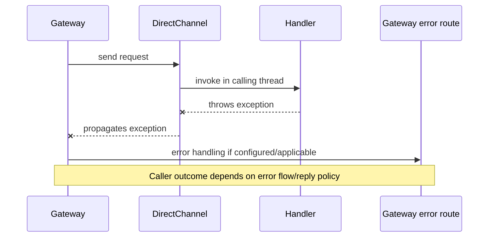

Under synchronous dispatch, exceptions can return down the Gateway's call stack. Configuring an error channel on the Gateway handles that case according to your version/framework's error-routing contract.

### Asynchronous Flow via Executor/Broker

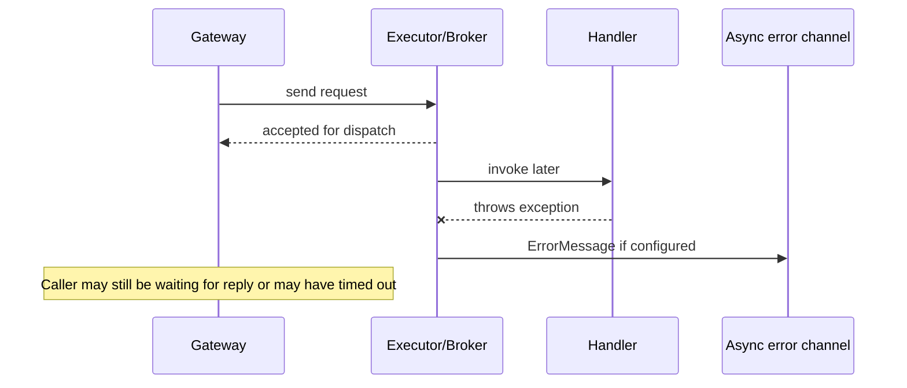

An error occurring after the Gateway thread sent the request may no longer sit on the original call stack. Whether the error message returns to the right Gateway depends on:

- How far endpoints/channels/adapters support error propagation.
- Whether the `errorChannel` header survived or was dropped on serialization.
- Whether the reply context is still alive or already timed out.
- Whether middleware persisted a correlation ID.
- Whether the error flow builds a matching reply or reports errors per contract.

**Never infer "a gateway `errorChannel` is configured, so every async exception will reach the right caller."**

## 9. A Gateway Reply Timeout Is Not a Downstream Rollback

A synchronous Gateway can time out while a handler is still running, or just after a result committed yet the reply was lost.

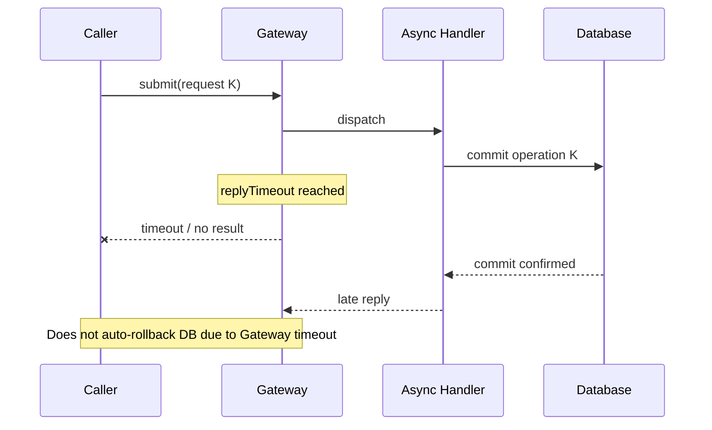

### Three Common Timeouts

| Timeout | What It Bounds | What It Cannot Assert |
| --- | --- | --- |
| Request/send timeout | Time attempting to send message to request channel | Whether handler finished or not |
| Reply timeout | Time Gateway waits for reply | That business effects did not commit |
| Downstream I/O timeout | Time calling DB/API/middleware | That external effects did not happen |

These timeouts can be configured at different layers; never use one number for all meanings.

### A Safer Design

When a caller retries after a timeout, send the **same idempotency key** and check operation state before executing new side effects. If the operation already completed, return the stored result; if the outcome is unknown, return pending/reconcile per contract.

## 10. An Error Handler Receiving Errors Needs a Reply Contract Too

When implementing a Gateway error channel, the team must answer:

1. Will the error handler **return a typed business result** or throw an exception?
2. For an `ErrorMessage` lacking a failed message, can the request ID still be found?
3. Can this failure scenario be **retried**?
4. If retried, who owns the retry budget and backoff?
5. Does the error flow write audits or cause side effects?
6. If the error flow throws another exception, where does it go?
7. If the error flow returns `null`, will the Gateway time out?
8. If the error flow returns the wrong type, will the Gateway hit a conversion error?
9. If the caller already timed out, who cleans up **late replies**?
10. When transactions exist, could a commit have succeeded before the error surfaced?

An error flow is not a "trash bin" for every error; it is a **pipeline branch with its own inputs, outputs, and policies**.

## 11. Running Domain Example: `SubmitOrder` and `OrderResult`

We design an example with three states:

- `COMPLETED`: business action confirmed complete.
- `REJECTED`: invalid input per business rules.
- `FAILED_RETRYABLE`: a classified technical error occurred; callers can query/retry by policy.

These states serve as **simulated outcomes** in this lesson. For real-system side effects, never return `FAILED_RETRYABLE` if the outcome is genuinely unknown; you may need `PENDING_RECONCILIATION`.

### `SubmitOrder.java`

```java
package example.integration;

public record SubmitOrder(
    String tenantId,
    String orderId,
    String requestId,
    long amountMinorUnits
) {
    public SubmitOrder {
        if (tenantId == null || tenantId.isBlank()
                || orderId == null || orderId.isBlank()
                || requestId == null || requestId.isBlank()) {
            throw new IllegalArgumentException(
                "Missing order identity");
        }
    }
}
```

### `OrderResult.java`

```java
package example.integration;

public record OrderResult(
    String requestId,
    String status,
    String reasonCode
) {
    public OrderResult {
        if (requestId == null || requestId.isBlank()
                || status == null || status.isBlank()) {
            throw new IllegalArgumentException(
                "Missing order result fields");
        }
    }

    public static OrderResult completed(String requestId) {
        return new OrderResult(
            requestId, "COMPLETED", null);
    }

    public static OrderResult rejected(
            String requestId,
            String reasonCode) {
        return new OrderResult(
            requestId, "REJECTED", reasonCode);
    }

    public static OrderResult retryableFailure(
            String requestId) {
        return new OrderResult(
            requestId, "FAILED_RETRYABLE",
            "DEPENDENCY_UNAVAILABLE");
    }
}
```

### Why Is a Unified Result Type Useful?

The Gateway declares:

```java
OrderResult submit(SubmitOrder command);
```

Every success or business rejection returns `OrderResult`. If the error flow intentionally turns technical errors into results, it must also return this exact type. Callers then never have to cast an `ErrorMessage` or `Throwable` into a business object.

However, it is **not mandatory** to turn every technical failure into a successful Java return. For severe failures, many APIs choose to throw an exception and let the HTTP/API boundary map it to an appropriate 5xx response.

## 12. An Explicit Error Channel Contract Beats a Broad `catch(Exception)`

A naive implementation might catch every exception and return `FAILED_RETRYABLE`:

```java
// Anti-pattern: do not apply as-is.
try {
    return orderService.process(command);
} catch (Exception any) {
    return OrderResult.retryableFailure(command.requestId());
}
```

This snippet is dangerous because:

- Validation/authorization errors get mistaken for transient failures.
- Programming bugs (`NullPointerException`, `ClassCastException`) get hidden.
- Callers may retry even though the operation already committed.
- There is no specific error reason code.
- It is unclear whether the transaction rolled back or committed.
- Abnormal errors lack alerts/traces.
- Infinite retries can flood the system with requests.

Good design starts with an **error taxonomy** and **reply policy**, then chooses handlers, channels, and advice.

## 13. Simulated Service: Separating Business Errors from Infrastructure Errors

To test the Gateway error channel without relying on a real database, build a service branching on input data:

- `amountMinorUnits < 0` → returns `REJECTED`.
- `orderId` starting with `DB-DOWN-` → throws a classifiable technical error.
- Everything else → returns `COMPLETED`.

### `DependencyUnavailableException.java`

```java
package example.integration;

public final class DependencyUnavailableException
        extends RuntimeException {

    public DependencyUnavailableException(String message) {
        super(message);
    }
}
```

### `OrderApplicationService.java`

```java
package example.integration;

import java.util.concurrent.atomic.AtomicInteger;

public final class OrderApplicationService {

    private final AtomicInteger invocations =
        new AtomicInteger();

    public OrderResult process(SubmitOrder command) {
        invocations.incrementAndGet();

        if (command.amountMinorUnits() < 0) {
            return OrderResult.rejected(
                command.requestId(),
                "INVALID_AMOUNT");
        }

        if (command.orderId().startsWith("DB-DOWN-")) {
            throw new DependencyUnavailableException(
                "Simulated dependency outage");
        }

        return OrderResult.completed(
            command.requestId());
    }

    public int invocationCount() {
        return invocations.get();
    }
}
```

This is a **test double**, not a real repository. There is no DB commit, transaction, broker ACK, or external API. The goal is deterministic branches separating **return values** from **exceptions**.

### Why Not Throw an Exception on Negative Amounts?

Under this example's contract, a negative amount is invalid business input that callers can handle as `REJECTED`. We do not need to send every domain outcome through the error channel.

Another API might choose to throw `OrderValidationException` and map it at the application/API boundary. What matters is **classifying by business meaning**, not treating "any status other than `COMPLETED`" as an infrastructure failure.

## 14. Declaring `@MessagingGateway` with an Error Channel

Spring Integration supports interface-level Messaging Gateways via `@MessagingGateway`.

### `OrderGateway.java`

```java
package example.integration;

import org.springframework.integration.annotation.MessagingGateway;

@MessagingGateway(
    name = "orderGateway",
    defaultRequestChannel = "orderRequests",
    errorChannel = "orderGatewayErrors",
    defaultReplyTimeout = "2000")
public interface OrderGateway {

    OrderResult submit(SubmitOrder command);
}
```

### Reading the Annotation

- `name="orderGateway"`: name of the Gateway bean.
- `defaultRequestChannel="orderRequests"`: where requests are sent.
- `errorChannel="orderGatewayErrors"`: error-handling path designated for the Gateway.
- `defaultReplyTimeout="2000"`: default reply wait duration in the units/parameters defined by the API version; in common configs, timeout values represent milliseconds.
- `submit(...)`: synchronous Java request-reply contract returning `OrderResult`.

**Note:** attributes, timeout expression interpretation, and exception handling can vary across Spring Integration versions. In a real project, verify against your dependency's annotation API and run integration tests to confirm behavior. Never rely solely on attribute names to assume every error branch is caught automatically.

### A Gateway Is Not an Error Handler

Declaring `errorChannel` only **routes errors within the Gateway's scope**. You still need a matching subscriber/error flow on `orderGatewayErrors`. Without a subscriber, or if the error handler throws or produces no reply, callers will not get the desired business result.

## 15. An `ErrorMessage` Can Hold a Wrapped Exception

When the service throws `DependencyUnavailableException`, the Gateway or endpoint may receive a throwable wrapped in `MessagingException`.

```text
ErrorMessage.payload
  -> MessagingException
       -> cause: DependencyUnavailableException
       -> failedMessage: Message<SubmitOrder>
```

Or depending on where the error happened:

```text
ErrorMessage.payload
  -> DependencyUnavailableException
```

Avoid writing:

```java
// Anti-pattern: assumes exact type and failedMessage.
DependencyUnavailableException failure =
    (DependencyUnavailableException) error.getPayload();

SubmitOrder command =
    (SubmitOrder) ((MessagingException) failure)
        .getFailedMessage().getPayload();
```

That code gets both type and nullability assumptions wrong. A production error handler should:

1. Walk the cause chain with a depth limit to classify the exception.
2. Locate `failedMessage` or `originalMessage` if provided.
3. Check payload types before casting.
4. If correlation is missing, log a reason code and handle safely.
5. Never deserialize arbitrary objects from raw error headers.
6. Never leak raw exception messages containing credentials or SQL into responses.

## 16. Writing `GatewayErrorMapper`: Mapping Known Errors to `OrderResult`

### `GatewayErrorMapper.java`

```java
package example.integration;

import org.springframework.messaging.Message;
import org.springframework.messaging.MessagingException;
import org.springframework.messaging.support.ErrorMessage;

public final class GatewayErrorMapper {

    public OrderResult toResult(ErrorMessage error) {
        Throwable failure = error.getPayload();

        if (!hasCause(
                failure, DependencyUnavailableException.class)) {
            throw new IllegalStateException(
                "UNEXPECTED_GATEWAY_ERROR", failure);
        }

        SubmitOrder command = findSubmitOrder(error);

        if (command == null) {
            // Cannot fabricate a fake OrderResult with a guessed
            // requestId, as it could be routed to the wrong caller.
            throw new IllegalStateException(
                "MISSING_REQUEST_CONTEXT", failure);
        }

        // In this example, this is a simulated service error
        // known not to have committed. With real DB/network,
        // the outcome may need UNKNOWN/REVIEW state.
        return OrderResult.retryableFailure(
            command.requestId());
    }

    private static boolean hasCause(
            Throwable throwable,
            Class<? extends Throwable> expected) {

        Throwable current = throwable;
        int depth = 0;

        while (current != null && depth++ < 20) {
            if (expected.isInstance(current)) {
                return true;
            }
            current = current.getCause();
        }

        return false;
    }

    private static SubmitOrder findSubmitOrder(
            ErrorMessage error) {

        Message<?> original = error.getOriginalMessage();

        if (original != null
                && original.getPayload() instanceof SubmitOrder order) {
            return order;
        }

        Throwable current = error.getPayload();
        int depth = 0;

        while (current != null && depth++ < 20) {
            if (current instanceof MessagingException messaging) {
                Message<?> failed = messaging.getFailedMessage();

                if (failed != null
                        && failed.getPayload()
                            instanceof SubmitOrder order) {
                    return order;
                }
            }

            current = current.getCause();
        }

        return null;
    }
}
```

### Why Not Return `"FAILED"` for Every Error?

A `ClassCastException` in mapping code, an unsupported schema error, or a `SecurityException` should not automatically be retried. `toResult` handles only a known set of errors. Unexpected errors are **surfaced explicitly** instead of disguised as ordinary business states.

### Why Does `requestId` Matter?

Two concurrent Gateway calls can share the same order ID while having different request IDs. If the error handler cannot find the current request, it must never fabricate an `OrderResult` tied to a random request. **Accurate correlation is a prerequisite for meaningful replies.**

### Why Set a Depth Limit?

Normal cause graphs are finite chains, yet error-handling code should avoid unbounded traversal on pathological throwable chains. The limit of 20 in the example is an illustrative engineering safeguard, not a Spring Integration requirement.

## 17. Creating `IntegrationFlow`s for Requests and Errors

### `OrderGatewayConfiguration.java`

```java
package example.integration;

import org.springframework.context.annotation.Bean;
import org.springframework.context.annotation.Configuration;
import org.springframework.integration.annotation.IntegrationComponentScan;
import org.springframework.integration.channel.DirectChannel;
import org.springframework.integration.config.EnableIntegration;
import org.springframework.integration.dsl.IntegrationFlow;
import org.springframework.messaging.MessageChannel;

@Configuration
@EnableIntegration
@IntegrationComponentScan(
    basePackageClasses = OrderGateway.class)
public class OrderGatewayConfiguration {

    @Bean
    public MessageChannel orderRequests() {
        return new DirectChannel();
    }

    @Bean
    public MessageChannel orderGatewayErrors() {
        return new DirectChannel();
    }

    @Bean
    public OrderApplicationService orderApplicationService() {
        return new OrderApplicationService();
    }

    @Bean
    public GatewayErrorMapper gatewayErrorMapper() {
        return new GatewayErrorMapper();
    }

    @Bean
    public IntegrationFlow processOrders(
            OrderApplicationService service) {

        return IntegrationFlow.from("orderRequests")
            .handle(service, "process")
            .get();
    }

    @Bean
    public IntegrationFlow handleGatewayErrors(
            GatewayErrorMapper errorMapper) {

        return IntegrationFlow.from("orderGatewayErrors")
            .handle(errorMapper, "toResult")
            .get();
    }
}
```

### Two Flows with Distinct Roles

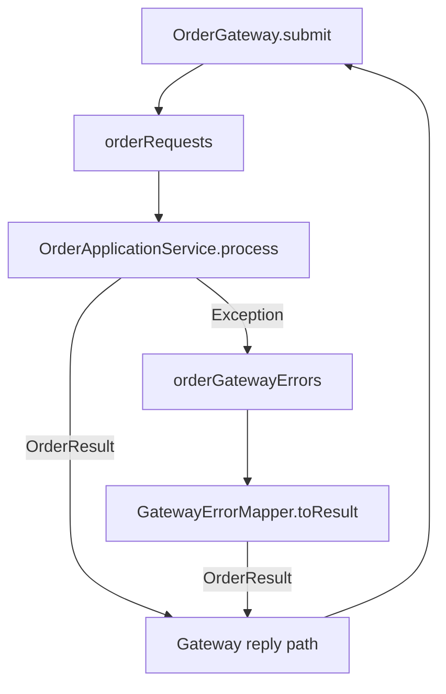

This is a **target architecture that must be verified with integration tests** on the Spring Integration version in use. The error reply path may receive a framework-attached temporary reply context or require additional routing configuration in certain endpoint/adapter variants. Never add a fixed output channel assuming it will automatically return to the right Gateway.

### Example Assumptions

- The Gateway and handlers live in the same application context.
- Requests flow through a synchronous `DirectChannel`.
- The service throws before any business commit (since it is simulated).
- The error flow builds `OrderResult` for known failures.
- The Gateway method returns `OrderResult`, not a `Throwable`.
- There are no HTTP/Kafka/AMQP adapters or real transactions in the demo.
- The Gateway interface resides in a package scanned by `@IntegrationComponentScan`.

If `orderRequests` switches to a broker or `ExecutorChannel`, exception/error routing behavior must be re-verified: you cannot keep assuming "synchronous exceptions return directly to the Gateway."

## 18. An Error Flow Is a Reply-Producing Endpoint, Not Just a Logger

Compare these two approaches:

### Approach A: Logger-Only

```java
public void log(ErrorMessage error) {
    logFailureSafely(error);
}
```

It produces no reply payload. If the Gateway is waiting for a result and no other branch answers, the caller can face no-reply/timeout or an error per Gateway policy.

### Approach B: Returning a Typed Result

```java
public OrderResult toResult(ErrorMessage error) {
    // classify + recover request ID
    return OrderResult.retryableFailure(requestId);
}
```

It has an object to send down the reply path **when the error flow and gateway are wired properly**.

### Approach C: Throwing Errors to the Caller

```java
public OrderResult rethrow(ErrorMessage error) {
    throw new IllegalStateException(
        "ORDER_PROCESSING_FAILED",
        error.getPayload());
}
```

This fits when the caller contract expects exceptions. However, throwing inside an error flow can trigger other error handling, so design against **recursive error routing** and apply a terminal failure policy.

### A Branch Can Log and Return a Result

```java
public OrderResult logAndMap(ErrorMessage error) {
    safeLogger.logCode("DEPENDENCY_UNAVAILABLE");
    return toResult(error);
}
```

Avoid logging raw payloads/headers containing tenant data, tokens, or PII. Auditing can use message references and reason codes.

## 19. Unit Testing the Business Service Before Testing the Gateway

You do not need a Spring context to test Service Activator service logic:

```java
package example.integration;

import static org.junit.jupiter.api.Assertions.*;

import org.junit.jupiter.api.Test;

class OrderApplicationServiceTest {

    private final OrderApplicationService service =
        new OrderApplicationService();

    @Test
    void validCommandProducesCompletedResult() {
        OrderResult result = service.process(
            new SubmitOrder(
                "shop-01", "ORD-101", "REQ-901", 125_000L));

        assertEquals("REQ-901", result.requestId());
        assertEquals("COMPLETED", result.status());
        assertNull(result.reasonCode());
        assertEquals(1, service.invocationCount());
    }

    @Test
    void domainValidationReturnsRejectedResult() {
        OrderResult result = service.process(
            new SubmitOrder(
                "shop-01", "ORD-102", "REQ-902", -1L));

        assertEquals("REQ-902", result.requestId());
        assertEquals("REJECTED", result.status());
        assertEquals(
            "INVALID_AMOUNT", result.reasonCode());
        assertEquals(1, service.invocationCount());
    }

    @Test
    void simulatedDependencyOutageThrows() {
        SubmitOrder command = new SubmitOrder(
            "shop-01", "DB-DOWN-103",
            "REQ-903", 10_000L);

        assertThrows(
            DependencyUnavailableException.class,
            () -> service.process(command));

        assertEquals(1, service.invocationCount());
    }
}
```

### Three Assertions Serving Three Goals

1. Normal service calls produce the right reply.
2. Domain rejections are typed results requiring no error infrastructure.
3. Dependency outages throw exceptions for the Gateway/error flow to handle.

Separating unit tests from integration tests ensures that if a Gateway test fails, you immediately know whether the bug is in **gateway wiring/error routing** or **domain service** logic.

## 20. Unit Testing `GatewayErrorMapper` with an `ErrorMessage` Containing a Failed Message

We deliberately build a `MessagingException` with a failed message and wrap it in an `ErrorMessage`.

```java
package example.integration;

import static org.junit.jupiter.api.Assertions.*;

import org.junit.jupiter.api.Test;
import org.springframework.messaging.Message;
import org.springframework.messaging.MessagingException;
import org.springframework.messaging.support.ErrorMessage;
import org.springframework.messaging.support.MessageBuilder;

class GatewayErrorMapperTest {

    private final GatewayErrorMapper mapper =
        new GatewayErrorMapper();

    @Test
    void knownDependencyErrorMapsToTypedReply() {
        SubmitOrder request = new SubmitOrder(
            "shop-01", "ORD-101",
            "REQ-901", 125_000L);

        Message<SubmitOrder> failed =
            MessageBuilder.withPayload(request).build();

        MessagingException wrapped =
            new MessagingException(
                failed,
                "Processing error",
                new DependencyUnavailableException(
                    "Simulated outage"));

        ErrorMessage error = new ErrorMessage(wrapped);

        OrderResult result = mapper.toResult(error);

        assertEquals("REQ-901", result.requestId());
        assertEquals(
            "FAILED_RETRYABLE", result.status());
        assertEquals(
            "DEPENDENCY_UNAVAILABLE",
            result.reasonCode());
    }
}
```

### This Test Does Not Prove the Gateway Routed the Exception

This is a mapper unit test. It proves that **given an `ErrorMessage` carrying `failedMessage`**, the mapper classifies the failure and extracts the request ID. Integration tests are still required to verify the Gateway error channel actually receives such an `ErrorMessage`.

### What If `failedMessage` Is Missing?

That is a critical negative-test branch; never assume every error path attaches the original command.

## 21. Unit Test: Never Fabricate a Reply When Request Context Is Missing

```java
@Test
void knownErrorWithoutRequestContextIsNotGuessed() {
    ErrorMessage error = new ErrorMessage(
        new DependencyUnavailableException(
            "Simulated outage"));

    IllegalStateException exception =
        assertThrows(
            IllegalStateException.class,
            () -> mapper.toResult(error));

    assertEquals(
        "MISSING_REQUEST_CONTEXT",
        exception.getMessage());
}
```

Place this method in `GatewayErrorMapperTest`.

### Why Fail Instead of Returning `OrderResult("UNKNOWN", ...)`?

A Gateway may have multiple waiting callers. A result lacking request identity can break reconciliation or tie audits to the wrong request. Under a contract requiring an ID, **missing context is a distinct error condition**.

In production, if the system still holds a temporary reply channel despite losing the payload, it can return an error result without a request ID under a dedicated API protocol. However, that must be **explicitly defined and tested**; never invent a request ID from timestamps or thread names.

## 22. Unit Test: Unexpected Errors Must Not Silently Become Retryable

```java
@Test
void unexpectedErrorIsNotMisclassifiedAsRetryable() {
    ErrorMessage error = new ErrorMessage(
        new IllegalArgumentException(
            "Bug in downstream mapping"));

    IllegalStateException exception =
        assertThrows(
            IllegalStateException.class,
            () -> mapper.toResult(error));

    assertEquals(
        "UNEXPECTED_GATEWAY_ERROR",
        exception.getMessage());
}
```

### Why Does This Matter?

If every error maps to `FAILED_RETRYABLE`:

- Programming bugs can stay hidden for hours.
- Unlimited client retries overload the system.
- Security errors get treated like network blips.
- An already committed transaction can be re-executed.
- Dashboards can report "API returning normal results" while the backend is broken.

Maintain a clear exception taxonomy and dedicated logs/metrics for `UNEXPECTED_GATEWAY_ERROR`.

## 23. Integration Test: Gateway Returns `OrderResult` on Success

Using the context declared in `OrderGatewayConfiguration`:

```java
package example.integration;

import static org.junit.jupiter.api.Assertions.*;

import org.junit.jupiter.api.Test;
import org.springframework.beans.factory.annotation.Autowired;
import org.springframework.test.annotation.DirtiesContext;
import org.springframework.test.context.junit.jupiter.SpringJUnitConfig;

@SpringJUnitConfig(OrderGatewayConfiguration.class)
@DirtiesContext(
    classMode = DirtiesContext.ClassMode.AFTER_EACH_TEST_METHOD)
class OrderGatewayIntegrationTest {

    @Autowired
    private OrderGateway gateway;

    @Autowired
    private OrderApplicationService service;

    @Test
    void gatewayReturnsCompletedBusinessResult() {
        OrderResult result = gateway.submit(
            new SubmitOrder(
                "shop-01", "ORD-101",
                "REQ-901", 125_000L));

        assertNotNull(result);
        assertEquals("REQ-901", result.requestId());
        assertEquals("COMPLETED", result.status());
        assertNull(result.reasonCode());
        assertEquals(1, service.invocationCount());
    }
}
```

In this example's synchronous flow, a successful request passes through `orderRequests`, the service returns an object, and the Gateway converts the reply into a Java `OrderResult`.

**Yet this test still says nothing about the error channel:** a dedicated test intentionally throwing an exception is needed.

## 24. Integration Test: Domain Rejections Need Not Pass Through the Error Channel

Add this method to `OrderGatewayIntegrationTest`:

```java
@Test
void businessRejectionIsNormalTypedReply() {
    OrderResult result = gateway.submit(
        new SubmitOrder(
            "shop-01", "ORD-102",
            "REQ-902", -10L));

    assertNotNull(result);
    assertEquals("REQ-902", result.requestId());
    assertEquals("REJECTED", result.status());
    assertEquals(
        "INVALID_AMOUNT", result.reasonCode());
    assertEquals(1, service.invocationCount());
}
```

### Why Not Throw an Exception for Every Rejection?

In this lesson, `REJECTED` is a valid domain state. The Gateway error channel is for failures that integration/application chooses to handle along the error route. Another project might split differently, yet the contract must be consistent so consumers never have to guess whether `REJECTED` means timeout or validation failure.

### Checking That the Error Handler Was Not Invoked

A deeper test can add a counter to `GatewayErrorMapper` and assert it was not invoked for `REJECTED`. The lesson omits state from the illustrative mapper to keep code pure; in practice, use a Mockito spy or a dedicated meter.

## 25. Integration Test: Backend Errors Are Mapped to a Typed Reply

This is the centerpiece test for **Gateway error channel** in this example. Building on `OrderGatewayConfiguration` from Section 17, send a request that causes the service to throw `DependencyUnavailableException`:

```java
@Test
void dependencyFailureUsesGatewayErrorFlow() {
    SubmitOrder command = new SubmitOrder(
        "shop-01",
        "DB-DOWN-103",
        "REQ-903",
        125_000L);

    OrderResult result = gateway.submit(command);

    assertNotNull(result);
    assertEquals("REQ-903", result.requestId());
    assertEquals(
        "FAILED_RETRYABLE", result.status());
    assertEquals(
        "DEPENDENCY_UNAVAILABLE",
        result.reasonCode());

    // Service is invoked once in this example,
    // with no retry advice.
    assertEquals(1, service.invocationCount());
}
```

Place this method inside `OrderGatewayIntegrationTest` from Section 23.

### What This Test Verifies

1. The Gateway sends the command into `orderRequests`.
2. The Service Activator actually throws a technical error.
3. The error is handled via the Gateway's error configuration.
4. `GatewayErrorMapper` classifies the failure and extracts `requestId`.
5. A matching `OrderResult` returns to the exact Gateway invocation.
6. The test does not turn the outcome into a `Throwable` or wrong type.

### If the Test Fails to Return `OrderResult`

Inspect the **actual runtime**, instead of blindly tweaking `replyTimeout`:

- Was the Gateway interface actually registered as a proxy?
- Is `errorChannel` on the Gateway genuinely set to `orderGatewayErrors`?
- Does the error flow have a subscriber?
- Is the service method running **synchronously**?
- What is the `ErrorMessage` payload type and cause chain?
- Does `failedMessage` or `originalMessage` still contain the command?
- Does the error handler return `OrderResult` or rethrow?
- Was the reply destination propagated properly across the error flow by the framework?
- Is a fixed output channel intercepting the path back to the Gateway?
- Did an `ExecutorChannel`, broker, or transaction boundary drop synchronous error context?

**Never claim every version/configuration behaves like the diagram by inspection alone.** This test is the contract to satisfy and catches API or topology mismatches before production.

## 26. Testing When the Error Flow Produces No Reply

Suppose the error flow only logs:

```java
public void logOnly(ErrorMessage error) {
    auditLogger.record(
        "GATEWAY_ERROR",
        error.getPayload().getClass().getSimpleName());
}
```

A `void` handler like this produces no business reply. If the Gateway method requires `OrderResult`, another branch must answer or the caller will encounter timeout, no-result, or an exception per the error-handling contract.

### Case Outline

```java
// Pseudocode: run with a test configuration whose
// errorFlow only calls void logOnly(error).
//
// @Test
// void loggerOnlyErrorFlowDoesNotProduceOrderResult() {
//     OrderResult result = gateway.submit(DB_DOWN_COMMAND);
//
//     // Do not assert a success result;
//     // check the timeout/error outcome per your version
//     // and configured defaultReplyTimeout.
// }
```

### Why Not Assert That It Always Throws?

Depending on the Messaging Gateway, error handling, reply timeout, and method signature, the caller may observe an exception or a no-reply outcome handled per API/framework. In certain architectures, an exception inside an error flow may also propagate directly.

What remains invariant is that a **`void` logger does not create an `OrderResult`**. Therefore, when the contract expects a result, a log-only error handler is **not enough**.

### Do Not Fix It by Returning the String `"FAILED"`

If the Java method declares `OrderResult`, an error flow returning a `String` can cause type-conversion or cast failures. Use a typed `OrderResult` or an explicit exception policy.

## 27. When the Error Flow Itself Throws: Avoiding Loops

A secondary failure can happen inside the error handler itself:

```text
Business handler throws DependencyUnavailableException
    |
    v
Gateway error channel
    |
    v
Error handler tries to save audit
    |
    v
Audit database is also down
```

If errors from the error handler are routed unconditionally back into the same error channel, the system can enter error loops, build backlogs, or lose the root cause.

### Safe Policy

- Keep error handlers **small, bounded, and low-dependency**.
- Separate non-essential logging/metrics from reply-construction logic.
- For terminal failures, report/throw a structured exception; never loop infinitely.
- Never make error mapping depend on a service that may itself be failing.
- If durable auditing is needed, use a separate channel or outbox with its own retry/backpressure.
- Preserve the original failure code and correlation reference when throwing a secondary exception.
- Add rate limiting/alerts if one error source floods errors.

### Diagram for Avoiding Recursive Error Handling

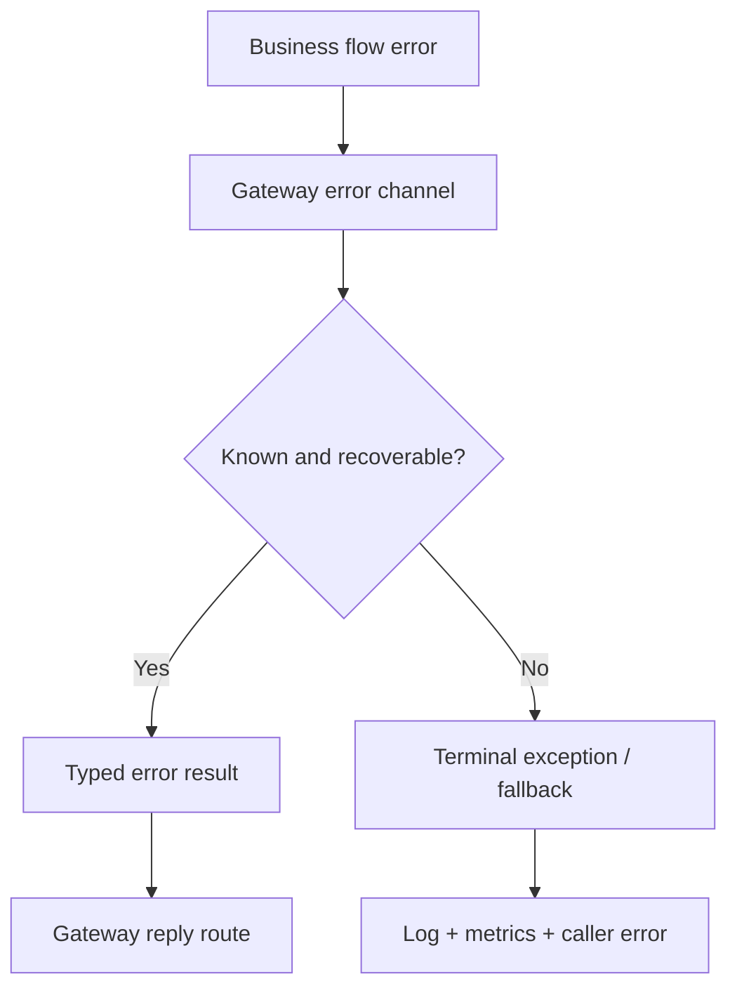

Never turn a failure into a success result just "so the Gateway stops throwing." That corrupts observability and retry policies.

## 28. Errors from Router and Filter Differ from Service Activator Errors

Not every error is a Java exception thrown by a database service.

### Router Fails to Resolve a Channel

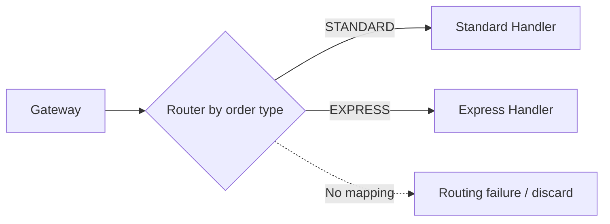

Two configurations yield different outcomes:

- The Router requires a target channel and **throws** when none matches.
- The Router/Filter is configured to **drop** the message without producing a reply.

In the second case, the error channel is not necessarily invoked because **no exception occurred**. The Gateway may wait until reply timeout.

### Filter Rejects a Message

```text
Gateway -> Filter -> (reject)
                   -> no Service Activator
                   -> no normal reply
```

If "invalid input" must be reported immediately to the API, do not simply discard. You can:

1. Return `ValidationResult(REJECTED)` as a normal reply.
2. Route `discardChannel` to an endpoint that builds a typed rejection result along the right reply path.
3. Throw a validation exception and map it per error policy.
4. Run validation in the API layer before calling the Gateway.

### Comparison Table

| Downstream Outcome | Has Throwable? | Guaranteed to Hit Error Channel? | Gateway Reply? |
| --- | --- | --- | --- |
| Handler returns `OrderResult` | No | Not needed | Yes |
| Handler throws synchronously | Yes | Depends on Gateway/error config | Exception or mapped result |
| Filter discards without throwing | No | Not automatically | May time out |
| Router resolution failure throws | Yes | Depends on error boundary | Exception or mapped result |
| Router picks no route and discards | No | Not automatically | May time out |
| Handler returns `null` | Not necessarily | Not automatically | No normal reply |
| Handler returns wrong type | Likely conversion error | Depends on boundary | Error / conversion failure |

**A Gateway error channel does not replace designing meaningful outcomes on every route.**

## 29. `requiresReply` and Gateway: Two Different Mechanisms

A reply-producing endpoint can configure **`requiresReply`** to treat `null` as a violation.

```text
Service Activator returns null
  -> requiresReply=false
       => no normal reply; Gateway may wait
  -> requiresReply=true
       => reply-required exception at endpoint
       => error handling can classify it
```

### When to Use?

If a `submitOrder` API must always return a result, requiring a reply catches programming bugs early instead of waiting for the Gateway timeout.

### When Not to Use?

A one-way Service Activator performing side effects and returning no result is a valid contract. Enabling `requiresReply` there can turn valid completion into an error.

### `requiresReply` Placement Matters

Place the setting on the **endpoint** responsible for producing the result. It will not force upstream Filters to reply or make async workers send replies. Test **no-output branches**, not just handlers returning valid results.

### Choosing Exception Mapping

If a missing reply is a flow bug, do not map it to `FAILED_RETRYABLE` encouraging callers to retry. If the cause is a Filter dropping invalid input, return `REJECTED` with a clear reason code.

## 30. Request Send Timeout vs. Reply Timeout: Test Both Separately

### Send / Request Timeout

A request channel can block because a queue is full, a dispatcher is busy, or a broker adapter refuses messages.

```text
Gateway request
  -> channel.send(message, timeout)
  -> send cannot complete in policy window
```

This is a failure while **putting the message into the pipeline**; the business handler may never have received it, or transport outcome may be uncertain depending on the adapter.

### Reply Timeout

```text
Gateway request successfully dispatched
  -> downstream does not produce reply in time
```

The handler may already have processed, may still be processing, or the result may have been lost on the return path.

### Test Plan

| Test | Setup | Key Assertion |
| --- | --- | --- |
| Request channel has no subscriber | `DirectChannel` lacking handler | Dispatch/send failure, no commit |
| Bounded queue full | Producer cannot send within timeout | Configured send timeout honored |
| Handler produces no reply | `void` or Filter discard | No-reply/timeout per Gateway policy |
| Handler slower than reply timeout | Async handler holds work | Caller expires; worker outcome tracked separately |
| Handler replies on time | Reply-producing endpoint | Caller gets exact result |
| Reply arrives after timeout | Delayed async response | Never assigned to another caller |

How timeouts surface through method return/exceptions depends on `@MessagingGateway`, request/reply types, and version. Never write tests asserting exception classes from memory without running them against real dependencies.

## 31. Async Boundaries Complicate Error Routing

### `ExecutorChannel`

If the request flow uses `ExecutorChannel`, the handler runs on an executor thread. Handler exceptions **do not automatically become synchronous exceptions** on the thread calling the Gateway.

Async error handling can be wired, yet verify:

- Is the `errorChannel` header propagated?
- Does the executor route errors to the configured error channel?
- Does the original request still carry reply/correlation info?
- Is the Gateway still waiting for a reply, and for how long?
- Can the error handler produce a reply before the deadline?
- Is the thread pool saturated or the error queue lacking backpressure?

### Queue / Broker Boundary

When a request is published to Kafka/AMQP, another system processes it later. The calling app's Gateway error channel **cannot directly intercept** exceptions inside another JVM.

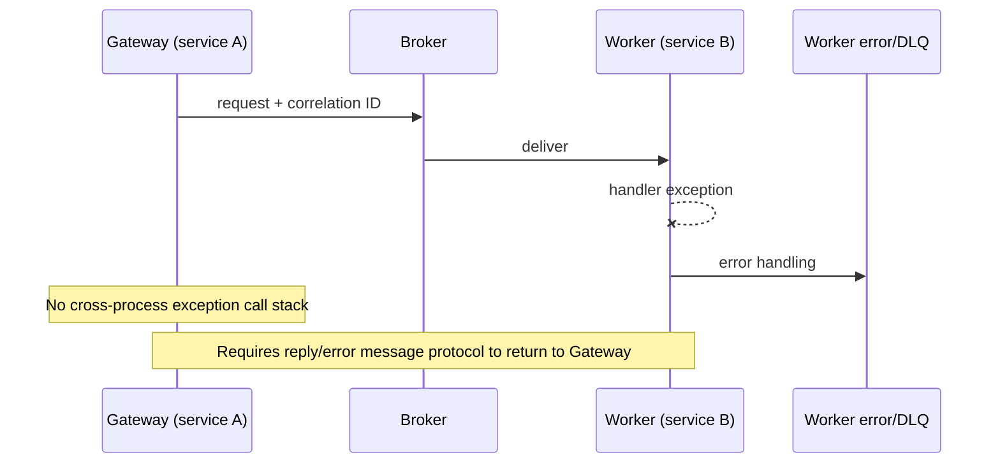

**If the caller needs errors from a remote worker**, design a response message (e.g., `OrderProcessingReply` with status) or an error response event, with a reply topic/destination, correlation, and timeouts. Never just give both services the same `errorChannel` name expecting two channel objects to wire across processes automatically.

## 32. Gateway Correlation ID Differs from Business Correlation

One order can have multiple requests:

```text
Request A: submit order ORD-101
Request B: get status ORD-101
Request C: retry status check ORD-101
```

All three can share:

```text
businessCorrelationId = order:shop-01:ORD-101
```

yet the Gateway invocations have **different request IDs**:

```text
REQ-901
REQ-902
REQ-903
```

### Why Distinguish Them?

If two callers wait for replies simultaneously and downstream routes replies solely by `orderId`, request A's result can get matched to caller B.

### Header Namespaces

| Metadata | Scope |
| --- | --- |
| `requestId` | One Gateway invocation / logical request |
| `businessCorrelationId` | Entire workflow / order |
| `MessageHeaders.id` | One Spring `Message` instance |
| `replyChannel` | Reply destination at current runtime/boundary |
| `errorChannel` | Error-handling destination per endpoint/adapter |
| `sourceEventId` | Logical event identity from producer |
| `idempotencyKey` | Non-repeatable business operation |
| `correlationId` of Aggregator | Groups child messages in one Aggregator |

**Never use one key for all of these purposes.**

### Preserve Correlation Across Transformers

If a Transformer builds a new Spring `Message` and drops internal `replyChannel`/`errorChannel`, the Gateway may lose replies or errors. When crossing a broker, pass **portable protocol fields** like allowlisted request IDs and reply destinations instead of serializing `MessageChannel` objects.

## 33. Splitter/Aggregator Can "Stall" Gateway Error Handling

Gateway invokes batch processing:

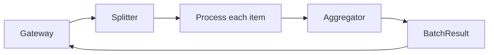

If one child throws or is dropped by a Filter:

- The Aggregator may lack enough logical parts.
- The error flow may receive an exception from one child.
- Meanwhile the Gateway is still waiting for the final `BatchResult`.
- If the error handler only logs, the Gateway can time out.
- If the error handler builds a reply for the wrong group/request, another caller can receive the wrong result.

### Sensible Batch Contracts

**Fail-fast:**

```text
Any child invalid -> fail entire batch
                  -> reply BatchFailure to Gateway
                  -> cleanup/cancel group by policy
```

**Aggregate outcomes:**

```text
Each child returns PartOutcome(success|failure)
  -> Aggregator waits N unique outcomes
  -> BatchResult(success/partial/failure)
```

**Asynchronous job:**

```text
Gateway -> ACCEPTED(jobId)
Children processed later
Status store tracks partial/results
```

Never assume `Gateway errorChannel` makes an Aggregator release its group automatically. Those are two EIPs with different responsibilities and lifecycles.

### `ErrorMessage` Can Lose Sequence Context

When a child fails, `failedMessage` may carry correlation/sequence headers, yet not every adapter/version preserves them. Production flows need explicit group IDs, part IDs, request IDs, and policies for late/missing children.

## 34. Idempotency When Callers Retry After a Gateway Timeout

Suppose on the first attempt:

```text
Gateway request K
  -> handler commits order
  -> reply lost
  -> Gateway times out
```

Caller retries:

```text
Gateway request K again
  -> without idempotency: duplicate order
  -> with idempotency: load stored result
```

### Choosing a Key

An example idempotency key:

```text
(tenantId, requestId, operationType)
= (shop-01, REQ-901, SUBMIT_ORDER)
```

If `requestId` is minted **fresh on every HTTP retry**, it cannot deduplicate the same logical operation. You need a client-stable idempotency key or true business operation identity.

### Completed Outcomes

```text
IdempotencyRecord:
  key=K
  state=COMPLETED
  result=OrderResult(REQ-901, COMPLETED)
```

When `K` is retried with the same fingerprint, return the **stored result**. When the same key arrives with a different amount or order, report a conflict instead of writing a new operation.

### Never Treat the Gateway Error Channel as an Idempotency Store

An error channel receives and routes errors; it does not persist completion state, provide transactions, or prevent duplicate effects on its own.

## 35. Retry Advice and Error Channel: Ordering Changes Behavior

A pipeline may look like:

```text
Gateway
  -> RequestHandlerRetryAdvice
  -> Service Activator
  -> Gateway error channel (if still failing)
```

Yet retry scope depends on **which endpoint's advice chain** wraps the call.

### Retrying Before Reporting Failure

A typical policy wants:

1. Service throws a transient exception.
2. Retry advice executes up to N attempts with backoff.
3. If an attempt succeeds, return `OrderResult`.
4. If the budget is exhausted, the exception reaches Gateway error handling.
5. Error flow returns a typed error or lets the caller receive the exception.

### Risk of Retrying After Commit

If the first attempt already committed to the DB before throwing/timing out on the response, retries can duplicate the operation. You need business-side idempotency, unique transaction constraints, or reconciliation.

### Risk of Retry Advice + Idempotent Advice

Advice order determines whether the selector checks the key on every retry or only once before retrying the inner handler. A setup that claims the key before the effect and then blocks all subsequent attempts can drop the operation if attempt 1 fails.

**Never configure retries by slapping on an annotation and assuming every state is safe.** Test fault injection before and after commit, reply dispatch, and broker ACK.

## 36. DLQ/Quarantine Does Not Replace a Reply to the Caller

A worker can move a message to a Dead Letter Queue after exhausting its retry budget. That handles **failed background work**, yet a synchronous Gateway still needs a reply contract.

```text
Gateway caller:
  submitOrder(REQ-901)

Async worker:
  processing fails
  -> retry exhausted
  -> DLQ

Caller:
  must receive timeout/pending/failure result
  or query status later
```

### What Should a DLQ Record Contain?

- Stable business/request ID.
- Authenticated tenant/source metadata.
- Reason code and exception category.
- Actual retry count and last attempt timestamp.
- Source schema version and raw message reference.
- Idempotency key and processing-state reference.
- Correlation/group ID if part of a batch.
- Replay owner and deadline/SLA info.

Never dump raw credential headers, PII payloads, or full Java stack traces into a channel readable by many consumers.

### Never Retry Infinitely in the Error Flow

A poison message with a bad schema will keep failing as long as the input stays the same. The error channel should separate deterministic input failures from transient infrastructure failures, apply **bounded retries**, and quarantine according to policy.

## 37. Decision Flow for a Gateway Error Policy

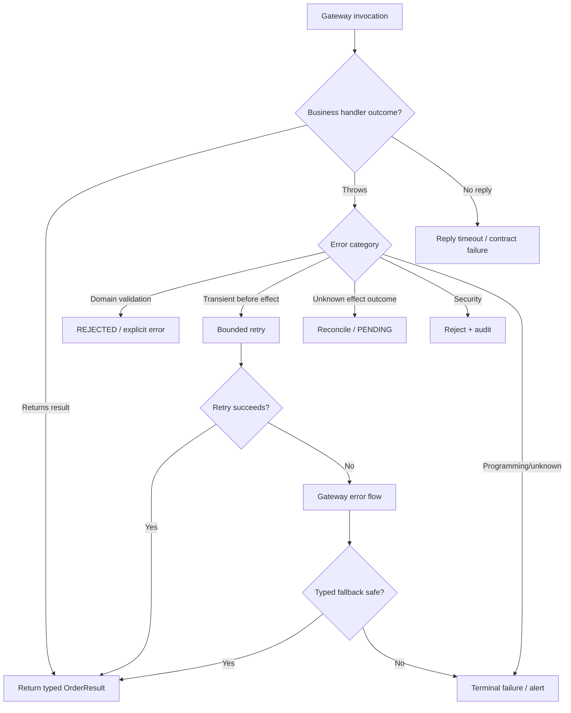

### Quick Checklist When Choosing an Error Channel

- Is a caller waiting for a **business reply**?
- Does the error flow have enough request context to reply to the right caller?
- Can you determine whether effects **have not committed** or are unknown?
- Should it return a typed result or throw?
- If returning a typed result, does it match the Gateway return type?
- Does an async/broker boundary prevent errors from returning to the Gateway automatically?
- Does the error channel have a subscriber and terminal failure policy?
- Are recursive error handling and retry storms prevented?
- Do metrics/reason codes show which branch fails most often?

## 38. Testing Concurrent Gateway Calls: Never Misroute Errors

An API system routinely has multiple callers invoking the same Gateway proxy. When several requests fail concurrently, **the error flow must preserve each request's identity**.

For example, three requests simulating a dependency outage simultaneously:

```text
Caller A -> REQ-A -> Error A -> Reply A
Caller B -> REQ-B -> Error B -> Reply B
Caller C -> REQ-C -> Error C -> Reply C
```

Must never produce:

```text
Caller A receives result for REQ-C
Caller B receives result for REQ-A
```

### JUnit 5 Concurrency Test

Add this method to `OrderGatewayIntegrationTest` from Section 23:

```java
@Test
void concurrentGatewayErrorsPreserveRequestIdentity()
        throws Exception {

    var commands = java.util.List.of(
        new SubmitOrder(
            "shop-01", "DB-DOWN-A", "REQ-A", 100L),
        new SubmitOrder(
            "shop-01", "DB-DOWN-B", "REQ-B", 200L),
        new SubmitOrder(
            "shop-02", "DB-DOWN-C", "REQ-C", 300L)
    );

    var pool = java.util.concurrent.Executors
        .newFixedThreadPool(commands.size());

    var ready = new java.util.concurrent.CountDownLatch(
        commands.size());

    var start = new java.util.concurrent.CountDownLatch(1);

    var futures = new java.util.ArrayList<
        java.util.concurrent.Future<OrderResult>>();

    try {
        for (SubmitOrder command : commands) {
            futures.add(pool.submit(() -> {
                ready.countDown();

                if (!start.await(5,
                        java.util.concurrent.TimeUnit.SECONDS)) {
                    throw new IllegalStateException(
                        "Start gate timeout");
                }

                return gateway.submit(command);
            }));
        }

        assertTrue(ready.await(
            5, java.util.concurrent.TimeUnit.SECONDS));

        start.countDown();

        var replies = new java.util.HashMap<
            String, OrderResult>();

        for (var future : futures) {
            OrderResult reply = future.get(
                5, java.util.concurrent.TimeUnit.SECONDS);

            assertNotNull(reply);

            assertNull(replies.put(
                reply.requestId(), reply));
        }

        assertEquals(
            java.util.Set.of("REQ-A", "REQ-B", "REQ-C"),
            replies.keySet());

        for (OrderResult reply : replies.values()) {
            assertEquals(
                "FAILED_RETRYABLE", reply.status());

            assertEquals(
                "DEPENDENCY_UNAVAILABLE",
                reply.reasonCode());
        }

        assertEquals(
            commands.size(), service.invocationCount());
    } finally {
        start.countDown();
        pool.shutdownNow();
    }
}
```

### What Does This Test Verify?

- Concurrent invocations do not share a global mutable `currentRequestId`.
- The error handler pulls request identity from **each invocation's** message/error context.
- One failure is never returned to the wrong caller.
- Gateway response types stay consistent with `OrderResult`.
- Test futures have bounded timeouts so tests cannot hang forever.

### What This Test Does Not Prove

- Inter-process reply correlation over Kafka/AMQP.
- Persistent idempotency state across pods.
- Correct DB commit/rollback behavior under timeout.
- Reply ordering across independent requests.
- Error messages surviving restarts or worker crashes.

Those are distinct properties requiring separate tests on production-like infrastructure.

## 39. One-Way Gateways Need No Reply, Yet Still Need an Error Policy

Not every Gateway is synchronous request-reply. A method may simply dispatch a command:

```java
void submitAudit(AuditCommand command);
```

When designed as one-way, there is no `OrderResult` to wait for. However, that **does not mean errors are ignored**.

### Under Synchronous Dispatch

If a one-way Service Activator throws on the same call stack, the caller or error infrastructure can receive the error per configuration.

### Under Asynchronous Dispatch

The Gateway may return before the handler even starts. Subsequent errors must go to an error flow, DLQ, retry state, or operation status store.

### Comparison Table

| Gateway Contract | Waits for Reply? | What Error Handling Is Needed? |
| --- | --- | --- |
| `OrderResult submit(...)` | Yes | Properly typed reply or exception |
| `void submitAudit(...)` | No business result | Error channel / observability / ack policy |
| `CompletionStage<OrderResult> ...` | Async reply per API/support | Completion, timeout, error propagation |
| `String submitAndGetJobId(...)` | Returns acceptance/job ID | Persistent job status and retries |
| Publishes command via broker | Usually one-way | Broker ACK + consumer DLQ; does not equal effect success |

**Never attach commit-success semantics to a `void` method** when callers truly need to know whether an operation committed.

## 40. Gateway Error Channel Differs from Inbound HTTP Error Handling

An HTTP Inbound Gateway receives external HTTP requests and builds internal Spring Messages. An annotated `@MessagingGateway` is a **Java interface proxy** for application code. They are related, not the same endpoint.

```text
HTTP Client
    |
    v
HTTP Inbound Gateway / REST Controller
    |
    v
Java @MessagingGateway proxy
    |
    v
IntegrationFlow
    |
    v
Service Activator
```

### At Which Boundaries Can Errors Occur?

- HTTP parsing/authentication **before** calling the Java Gateway.
- Java Gateway dispatch/request/reply.
- Transformer/Router/Filter/Service Activator inside the flow.
- External DB/API.
- Gateway's error flow.
- HTTP response serialization **after** the Gateway.

### Why Does This Distinction Matter?

A JSON parse exception in an HTTP controller **does not go through `@MessagingGateway(errorChannel=...)`** because the Java Gateway was never even called.

Similarly, if the Gateway returns a valid `OrderResult` yet the HTTP response converter throws during serialization, the Gateway's error channel cannot fix an error in the downstream HTTP layer.

### HTTP Response Mapping

When using typed results, the API boundary can map:

| `OrderResult` Status | Illustrative HTTP Outcome |
| --- | --- |
| `COMPLETED` | 200/201 per contract |
| `REJECTED / INVALID_AMOUNT` | 400 or 422 per API |
| `FAILED_RETRYABLE` | 503 or dedicated operation status |
| `PENDING_RECONCILIATION` | 202 + operation ID if supported |
| `UNKNOWN/SECURITY` | 401/403/5xx depending on failure and trust policy |

These are **application contract examples**, not HTTP status codes automatically inferred by Spring Integration from `OrderResult.status()`.

## 41. `ErrorMessage` and Information Security

An `ErrorMessage` may contain:

- Exception messages from DB/APIs.
- Failed message payload.
- Original Spring Message headers.
- Request ID, tenant, correlation.
- Internal application server details.
- Sometimes sensitive data if placed into payloads/headers by the application.

### What Must Never Appear in Replies to Callers

- Raw SQL queries or credentials.
- Access tokens, cookies, authorization headers.
- Internal connection strings.
- Full stack traces.
- Another tenant's payload.
- Spring `MessageChannel` objects or internal topology.
- Implementation-detail metadata outside the API contract.

### Designing Error Responses

A public response should expose a stable reason code:

```json
{
  "requestId": "REQ-903",
  "status": "FAILED_RETRYABLE",
  "reasonCode": "DEPENDENCY_UNAVAILABLE"
}
```

Internal logs/traces can record error class, sanitized cause, operation stage, and a reference to original data in protected storage.

### Tenant Validation and Error Context

Never trust `tenantId` from a failed message as verified proof. When an error handler decides whether to disclose resource existence, it needs an authenticated principal/context properly preserved. Without trusted context, return a safe generic error rather than guessing permissions from an untrusted payload.

## 42. Avoiding Lost Errors When `errorChannel` Has No Subscriber

If a Gateway points to `orderGatewayErrors` yet the channel has no handler:

```text
Gateway sends ErrorMessage to orderGatewayErrors
    |
    v
No subscriber / no processing endpoint
    |
    v
Error routing failure or no mapped reply
```

Verify:

- Channel bean name is spelled accurately.
- The error flow is actually registered in the context.
- For `DirectChannel`, a subscriber exists.
- Two handlers are not competing on the same channel when both are expected to receive events.
- The error handler returns the expected reply type if required.
- A `QueueChannel` is not used without a consumer, trapping errors in the queue forever.
- Logs are not written while forgetting request completion.
- Startup health checks or tests catch missing wiring.

### A Useful Configuration Test

```java
// Contract integration test outline:
@Test
void errorFlowIsRegisteredAndCanReturnTypedResult() {
    OrderResult actual = gateway.submit(
        new SubmitOrder(
            "shop-01", "DB-DOWN-999",
            "REQ-999", 1L));

    assertNotNull(actual);
    assertEquals(
        "FAILED_RETRYABLE", actual.status());
}
```

It does not inspect private channel internals; it verifies **end-to-end behavior**. If the error handler is never invoked or misrouted, the test fails.

## 43. Shared Error Channel vs. Per-Gateway Error Channel?

Suppose an application has three Gateways:

```text
OrderGateway
PaymentGateway
ShipmentGateway
```

### One Shared Error Channel

```text
sharedGatewayErrors
  -> classify error
  -> resolve request type
  -> map to proper result
```

Pros: easy to centralize metrics, rate limiting, and common error policies.

Cons: must distinguish request/result types, exception taxonomies, and reply routing; returning the wrong reply type causes failures.

### Dedicated Error Channel per Bounded Context

```text
orderGatewayErrors
paymentGatewayErrors
shipmentGatewayErrors
```

Pros:

- Clean, typed error handlers.
- Prevents returning `OrderResult` to a Gateway expecting `PaymentResult`.
- Allows domain-specific retry/reconciliation policies.
- Isolates failures to one subsystem.

Cons: requires shared infrastructure helpers to avoid duplicating classification logic and metrics.

### Pragmatic Recommendation

For applications with multiple Gateways having distinct return types, consider **splitting error channels by domain/protocol** while sharing helpers for exception classification, sanitized logging, and correlation extraction.

Never cram everything into one giant handler just to have "one place handling all errors."

## 44. Gateway Error Channel and Transaction Boundaries

This is one of the easiest areas to misunderstand in DB-backed business systems.

### Crash Before DB Transaction Commit

```text
Receive request
Begin DB transaction
Write business data
Exception
Rollback
Error channel receives failure
```

If rollback is certain, retries may be permitted per policy.

### Crash After DB Commit, Before Reply

```text
Receive request
Write business data
Commit
Exception / network error before reply
Gateway sees failure or timeout
```

Returning `FAILED_RETRYABLE` here so the caller retries without idempotency creates duplicate effects.

### Single-DB Transaction Example

```text
BEGIN
  INSERT orders (...) ON CONFLICT (...) DO NOTHING
  INSERT idempotency_record (...)
  INSERT outbox_event (...)
COMMIT
```

Writes must use unique business constraints, proper isolation, row-count checks, and right transaction boundaries. This is an **illustrative pattern**, not standalone production SQL.

### External Side Effects

If the handler calls an external payment API:

- A timeout does not prove the API failed to capture.
- The error channel may see an `IOException` without knowing the outcome.
- You need a provider idempotency key and reconciliation.
- You may need `UNKNOWN_OUTCOME`/`PENDING_REVIEW` instead of `FAILED_RETRYABLE`.

**Never let an error mapper authorize replay based solely on exception class** when side effects may already have committed.

## 45. Observability: Measure Lost Replies Too, Not Just Error Channel Messages

A system counting only `gateway.error.messages` misses scenarios **that produce no `ErrorMessage`**:

- Filter drops the message.
- `void` handler succeeds while Gateway is waiting.
- Router picks no route and discards.
- Late reply arrives past timeout.
- Error flow returns `null`.
- Reply channel is misconfigured.

### Suggested Metrics

| Metric | Meaning |
| --- | --- |
| `gateway.requests.received` | Total Gateway invocations |
| `gateway.requests.completed` | Calls returning a typed result |
| `gateway.requests.failed` | Calls ending in an exception |
| `gateway.error.messages` | `ErrorMessage`s entering the error flow |
| `gateway.error.mapped` | Errors mapped to typed results |
| `gateway.error.unexpected` | Errors outside the allowlist |
| `gateway.error.no_context` | `ErrorMessage`s missing request context |
| `gateway.request.send_timeout` | Sends failing on timeout |
| `gateway.reply.timeout` | Gateways missing replies within deadline |
| `gateway.reply.late` | Replies arriving after caller deadline |
| `gateway.reply.wrong_type` | Replies incompatible with method return type |
| `gateway.router.unresolved` | Messages with no required route |
| `gateway.filter.discarded` | Messages dropped by Filters |
| `gateway.retries.attempted` | Actual retry counts |
| `gateway.idempotency.duplicates` | Recognized logical duplicates |
| `gateway.error.dlq_backlog` | Errors awaiting later handling |
| `gateway.error_handler.failures` | Failures inside the error flow itself |

Metric names are **application-level suggestions**, not guaranteed out-of-the-box Spring Integration defaults.

### Structured Logs

```text
stage=GATEWAY_REQUESTED
gateway=OrderGateway
requestId=REQ-903
tenant=shop-01

stage=BUSINESS_HANDLER_FAILED
gateway=OrderGateway
requestId=REQ-903
errorCategory=DEPENDENCY_UNAVAILABLE
outcome=NOT_COMMITTED_KNOWN_IN_DEMO

stage=GATEWAY_ERROR_MAPPED
requestId=REQ-903
returnStatus=FAILED_RETRYABLE
reasonCode=DEPENDENCY_UNAVAILABLE
```

With real DBs/networks, never log `NOT_COMMITTED_KNOWN` without transaction evidence. Use `UNKNOWN_OUTCOME` when unverified.

### Cardinality and Privacy

Never use `requestId`, `orderId`, raw tenant tokens, or exception messages as high-cardinality metric labels. Use access-, retention-, and sanitization-controlled structured logs/traces.

## 46. Troubleshooting: Why Isn't the Gateway Error Channel Working?

When someone reports "Gateway timed out even though `errorChannel` is configured," investigate in order:

1. Was the Gateway interface actually scanned/registered as a proxy?
2. Which request channel is the Gateway method calling?
3. Did the request reach the handler, or did a Filter/Router drop it earlier?
4. Is the channel `DirectChannel`, `ExecutorChannel`, `QueueChannel`, or a broker?
5. Was the failure really an exception, or merely **no reply**?
6. Did the exception occur on the Gateway thread or across an async boundary?
7. Was `errorChannel` configured on the Gateway, an adapter, or a message header?
8. Does the error channel bean/subscriber exist with the exact name?
9. Was an `ErrorMessage` created, and what throwable type is its payload?
10. Do `getFailedMessage()`/`getOriginalMessage()` still retain the command/correlation?
11. Does the error handler return a reply or is it a `void` logger?
12. Does the reply type match the Gateway's Java return type?
13. Is a fixed `outputChannel` stealing the normal or error reply path?
14. Did the Gateway time out before the error handler returned?
15. Could a late reply be misrouted to another caller?
16. Is `requiresReply` enabled on the right endpoint?
17. Is retry advice holding the exception until the retry budget runs out?
18. Could side effects have committed before the error?
19. Are there idempotency key conflicts/duplicates when callers retry?
20. Are metrics/traces present for gateway, business, error mapping, and outbound reply?

### Decision Tree

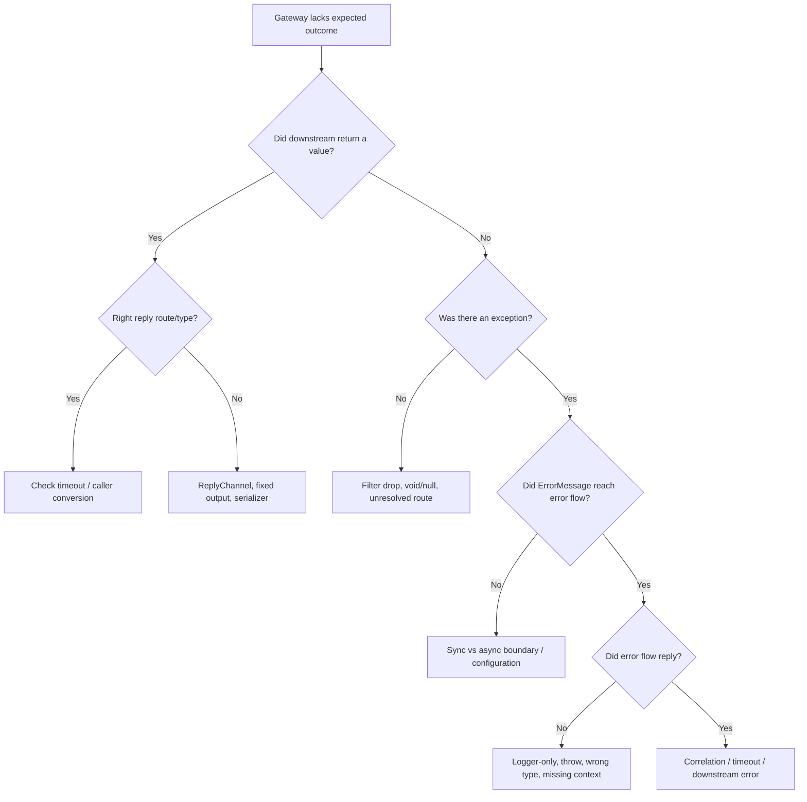

### Debug by Phase, Not by Guesswork

Never just sprinkle `Thread.sleep(...)` into integration tests or bump timeouts to 60 seconds. That masks wiring bugs and inflates API latency. Measure each event: request accepted, handler invoked, error routed, result produced, reply dispatched, and caller completed.

## 47. Common Anti-Patterns

### 47.1. Assuming Every Exception Automatically Appears on `errorChannel`

Sync errors, async errors, HTTP parse errors, and errors in out-of-process workers cross different boundaries.

### 47.2. Logging Only in the Error Flow When the Gateway Needs `OrderResult`

A `void` logger emits no reply. Callers can time out or get error/no-result outcomes.

### 47.3. Treating `ErrorMessage` as the Gateway's Java Return Value

Gateway methods require the contract's return type; `ErrorMessage` is integration infrastructure metadata.

### 47.4. Returning `"FAILED"` for a Method Declaring `OrderResult`

Wrong reply types cause converter/cast failures.

### 47.5. Catching Every Exception and Returning `FAILED_RETRYABLE`

Bugs, security errors, and unknown transaction outcomes get masked, triggering retry storms or duplicate effects.

### 47.6. Assuming Timeout Means Transaction Rollback

False. Handlers can commit and lose the reply. You need idempotency/result lookup.

### 47.7. Using `businessCorrelationId` to Route Replies to Every Caller

Concurrent requests for the same order need separate request/reply correlation.

### 47.8. Copying Java `replyChannel` Objects Over Kafka/HTTP

Channel objects are not portable across JVMs, processes, or restarts.

### 47.9. Error Handlers Assuming `getFailedMessage()` Is Always Non-Null

Many error origins have no request payload. Null-safe classification is mandatory.

### 47.10. Retrying Directly After Unknown External API Outcomes

Can double-charge payments. Reconcile or use provider idempotency keys.

### 47.11. Dropping in a Filter While Expecting the Error Channel

Without an exception, no `ErrorMessage` is created automatically. Use an explicit rejection result.

### 47.12. Enabling `requiresReply` on Every `void` Endpoint

Valid one-way handlers turn into failures. Constraints must match the contract.

### 47.13. Using Error Channels as Consumer-Less Global DLQs

Without a terminal handler or replay policy, errors accumulate or vanish.

### 47.14. Sending Error-Handler Exceptions Back into the Same Error Channel Infinitely

Recursive errors overload the system and hide original failures. Define a terminal failure path.

### 47.15. Running One Happy-Path Gateway Test and Assuming Error Paths Work

Test throwing services, error mappers, correlation, timeouts, and negative cases.

### 47.16. Using `MessageHeaders.id` as an Idempotency Key

Redeliveries can generate fresh Message IDs; use a logical business operation ID.

### 47.17. Treating `FAILED_RETRYABLE` as a Verified Rollback Business Result

When outcomes are unknown, that status can be wrong. Use a dedicated policy.

### 47.18. Skipping Concurrent Invocation Tests

Error responses can bleed across requests if correlation or temporary channels are mishandled.

## 48. Hands-On Exercise: Gateway Error Channel from Simple to Production

### Part A — Build the Request/Reply Contract

1. Create `SubmitOrder` with tenant, `orderId`, `requestId`, and amount.
2. Create `OrderResult` with `COMPLETED`/`REJECTED`/`FAILED_RETRYABLE` states.
3. Build `OrderApplicationService.process` returning valid results.
4. Add a negative-amount branch → `REJECTED`, without throwing.
5. Add a `DB-DOWN-` branch throwing `DependencyUnavailableException`.
6. Configure `@MessagingGateway(defaultRequestChannel="orderRequests")`.
7. Test Gateway success and domain rejection.

### Part B — Gateway Error Flow

8. Configure `errorChannel="orderGatewayErrors"`.
9. Create a `DirectChannel` and `IntegrationFlow.from("orderGatewayErrors")`.
10. Build `GatewayErrorMapper.toResult(ErrorMessage)`.
11. Classify exceptions along the cause chain.
12. Extract `requestId` from `failedMessage`/`originalMessage` when available.
13. Map only known dependency outages to typed failures.
14. Test the error mapper with hand-crafted `ErrorMessage`s.
15. Test missing `failedMessage` producing an explicit error.
16. Test unexpected exceptions not being misclassified as retryable.
17. Test the Gateway exception path through `IntegrationFlow`.
18. If tests fail, inspect reply routes and API version behavior.

### Part C — Missing Reply / Timeout / Correlation

19. Add a log-only error handler returning `void`.
20. Prove the Gateway does not magically get an `OrderResult`.
21. Test a handler returning `null` with `requiresReply`.
22. Create a Filter that discards without throwing.
23. Compare missing replies against handler exceptions.
24. Test bounded reply timeouts and late replies.
25. Send two Gateway requests for the same order with different request IDs.
26. Test concurrent Gateway calls never swap results.
27. Route requests through `ExecutorChannel` and verify async error routing.
28. If using a broker, build an explicit reply topic/ID protocol.

### Part D — Retries and Production Reliability

29. Add a local retry policy with bounded attempts and backoff.
30. Test transient errors succeeding on the second attempt.
31. Test exhausting budget and the error flow producing a typed result.
32. Simulate a successful DB commit followed by a lost reply.
33. Retry with the same idempotency key and assert no duplicate order.
34. Use a unique constraint or persisted operation record.
35. Simulate an external API timeout with unknown outcome; reconcile.
36. Design a DLQ with `requestId`, `reasonCode`, tenant reference, and owner.
37. Test a Splitter/Aggregator batch with a failing child.
38. Design `PENDING_RECONCILIATION` results where needed.
39. Instrument metrics for gateway timeouts, mapped errors, and late replies.
40. Write a runbook distinguishing no-reply, synchronous exceptions, and async errors.

### Acceptance Criteria Table

| Scenario | Expectation |
| --- | --- |
| Valid `SubmitOrder` | `OrderResult(COMPLETED)` |
| Negative amount | `OrderResult(REJECTED, INVALID_AMOUNT)` |
| Known dependency outage, error flow maps cleanly | Typed failure result with matching `requestId` |
| `ErrorMessage` lacking request context | Never fabricates a fake request ID |
| Exception outside allowlist | Terminal error / alert |
| Logger-only error flow | Produces no reply automatically |
| Filter drops without throwing | Creates no `ErrorMessage` automatically |
| Handler returns `null` + `requiresReply` | Reply-required failure |
| Gateway reply timeout | Does not prove rollback |
| Async handler throws | Follows configured async error route, not necessarily same call stack |
| Two calls for same order ID | Replies match each distinct request identity |
| Three concurrent failures | Never swaps `requestId`s |
| Out-of-process worker throws | Does not return directly to Java Gateway proxy |
| Caller retries after commit | No duplicate side effect added |
| Unknown external outcome | Reconcile rather than blindly retrying |
| DLQ receives poison message | Failure record exists; does not substitute for reply |
| Error flow throws again | Terminal policy; no recursive loop |

## 49. Self-Assessment Questions

**Question 1.** Is a Gateway error channel the same as a reply channel?

*No. The error channel is the error-handling path; the reply channel is where callers receive normal replies. An error flow can produce a typed reply if properly wired back into the Gateway reply path.*

**Question 2.** What payload does `ErrorMessage` carry?

*A `Throwable`, often a `MessagingException`; `failedMessage`/`originalMessage` may be present, yet must never be assumed always non-null.*

**Question 3.** If a Filter drops a request without throwing, does the Gateway error channel automatically receive an error?

*No. No throwable or error signal is created automatically; callers may wait for a reply until timeout.*

**Question 4.** Why can't a `void`-returning error handler satisfy `OrderResult submit(...)`?

*Because `void` produces no `OrderResult` reply. You need a reply-producing handler or an exception contract.*

**Question 5.** Must domain rejections go through the error channel?

*No. Validation rejections can be normal typed business results, provided the contract is clear.*

**Question 6.** Does a Gateway reply timeout prove the DB did not commit?

*No. Timeouts only show the caller received no reply within the wait window; effects may already have committed.*

**Question 7.** Why not return `FAILED_RETRYABLE` for all exceptions?

*Because security errors, bugs, and unknown outcomes require different policies; blind retries hide failures and duplicate side effects.*

**Question 8.** Can a Gateway error channel automatically catch exceptions from a worker on another pod?

*Not automatically. You need an error reply protocol, destination, request ID, and correlation across the broker.*

**Question 9.** How do `requestId` and `businessCorrelationId` differ?

*`requestId` identifies a single invocation; `businessCorrelationId` links the entire workflow. Multiple requests for the same order can share one `businessCorrelationId`.*

**Question 10.** What problem does `requiresReply` solve?

*It turns a missing normal reply on an endpoint required to return a result into an early failure; it does not create a reply itself.*

**Question 11.** What should you do if an `ErrorMessage` has no `failedMessage`?

*Never cast blindly; look up original context safely or apply a terminal error policy, avoiding replies attached to the wrong request.*

**Question 12.** What happens if an error flow returns the wrong payload type?

*The Gateway method may hit conversion/cast failures; all branches must return the right type or throw explicitly.*

**Question 13.** Why should two concurrent Gateway calls be tested?

*To catch mixed-up request identities, reply destinations, or shared mutable state.*

**Question 14.** When a child in a Splitter fails, does the Gateway error channel automatically release the Aggregator?

*No. The Aggregator has its own group/release policies; you must fail the batch or return per-part outcomes per contract.*

**Question 15.** Is a DLQ a reply for the Gateway caller?

*No. A DLQ stores errors for recovery; callers still need a status/response per the API contract.*

**Question 16.** How do you make caller retries after timeouts safer?

*Use a stable idempotency key, business uniqueness, stored results, and reconciliation when outcomes are unknown.*

## 50. Production Deployment Checklist

- **Gateway contract:** know whether each method is one-way or request-reply and its return type.
- **Request channel:** verify wiring, dispatch semantics, and send timeouts.
- **Reply channel:** avoid conflicts between fixed outputs and temporary Gateway replies.
- **Error channel:** configure at the right scope with an active subscriber and error flow.
- **Exception taxonomy:** separate domain, security, transient, uncertain-outcome, and programming errors.
- **`ErrorMessage`:** inspect cause chains, `failedMessage`, and `originalMessage` null-safely.
- **Typed mapping:** error flow returns the exact Gateway return type or throws explicitly.
- **No-reply:** handle Filter/Router/`void`/`null` per contract rather than simply stretching timeouts.
- **`requiresReply`:** apply to the right endpoints; never put it on legitimate one-way handlers.
- **Timeouts:** distinguish request send, reply, and external I/O timeouts.
- **Async:** errors past `ExecutorChannel`/brokers have dedicated routes and late-reply policies.
- **Cross-process:** request/reply protocols use portable correlation; never serialize `MessageChannel`.
- **Idempotency:** stable business keys and persisted completion states whenever side effects exist.
- **Transactions:** know commit/rollback/unknown outcomes before allowing retries.
- **Retry:** bounded attempts, backoff, proper advice ordering, and error handling after exhaustion.
- **DLQ:** reason codes, ownership, retention, replay policies, and access controls.
- **Splitter/Aggregator:** separate group completion/failure outcomes from Gateway error routing.
- **Router/Filter:** unknown routes and discard policies never cause pointless timeouts.
- **Security:** never log raw exceptions/credentials; never trust unverified tenants.
- **Observability:** measure requests, typed replies, mapped errors, unexpected errors, timeouts, and late replies.
- **Concurrency:** tests verify request IDs never mix when multiple callers wait simultaneously.
- **QA:** unit tests for service/error mapper, integration tests for Gateway/error flow, async/broker/DB fault injection.
- **Version:** verify `@MessagingGateway` and Java DSL APIs against actual dependencies.
- **Runbook:** explicit fail-fast/retry/reconcile decisions for every error category.

## 51. Conclusion

**Gateway error channel** is a vital mechanism for organizing failure branches of a Messaging Gateway in Spring Integration, yet its role must be understood accurately: it routes errors into **a configured error-handling flow**, rather than **automatically turning every exception into a business reply**, catching out-of-scope errors, or replacing transactions, idempotency, and recovery.

A sound design separates **normal typed results**, **business rejections**, **technical exceptions**, **no-reply paths**, **Gateway timeouts**, and **asynchronous failures**. With `@MessagingGateway(errorChannel="...")`, you can build an error flow that consumes `ErrorMessage`, classifies `Throwable`s, and returns `OrderResult` when safe—provided reply context is preserved and integration tests confirm the behavior on your Spring Integration version.

When combining Gateways with Router, Filter, Splitter, Aggregator, Service Activator, retry, and error channels, test both **happy paths and every failure branch**, especially post-commit failures, late replies, and concurrent callers. That turns the Gateway into a predictable, observable request/reply boundary and reduces "caller thought it failed while backend already processed" incidents in EIP systems.
