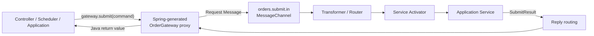
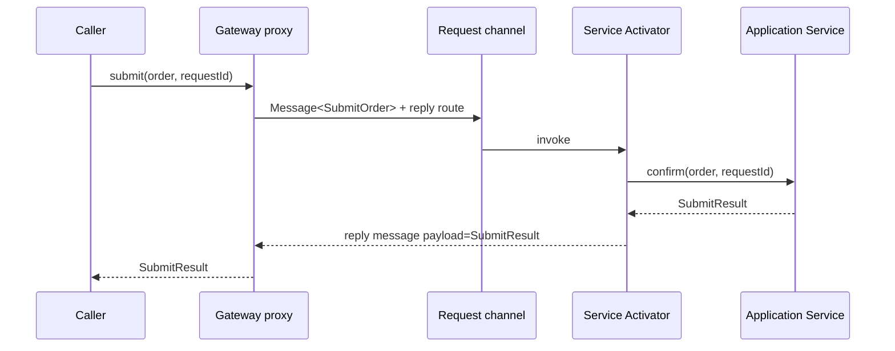
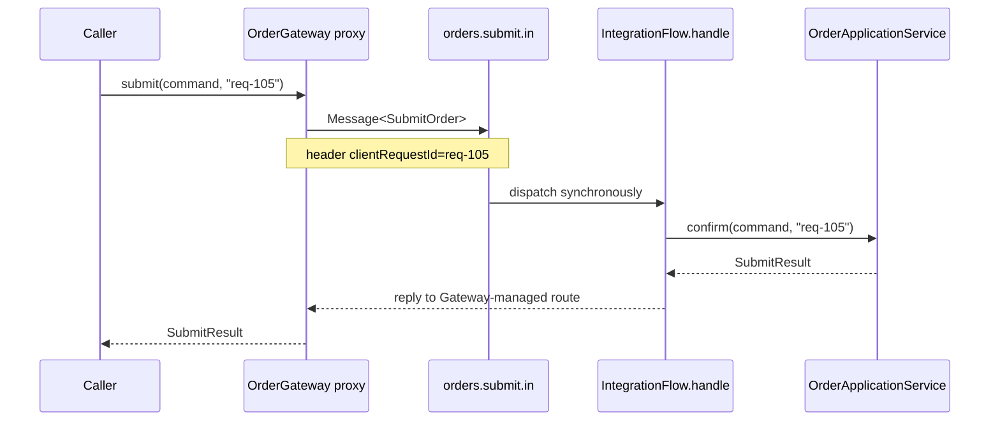
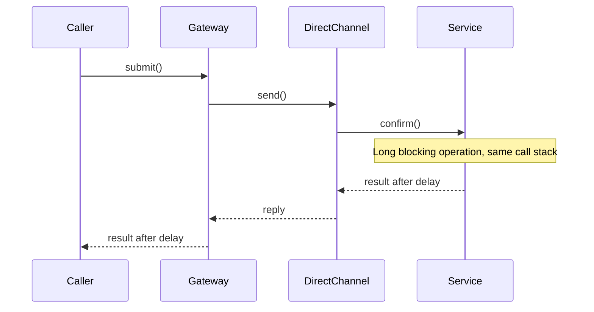
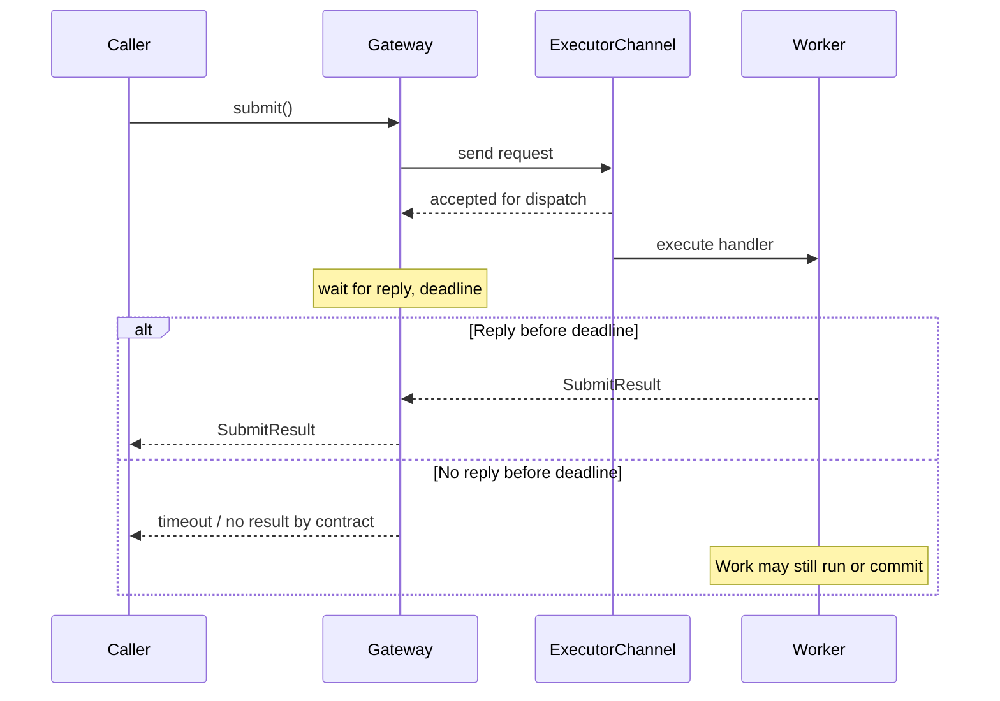
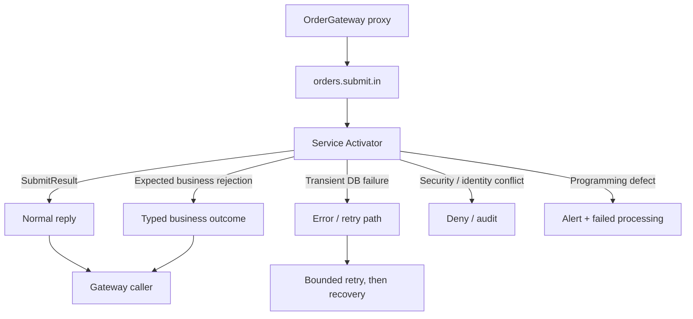
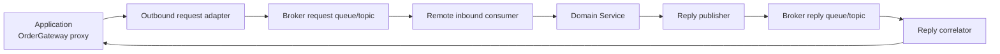
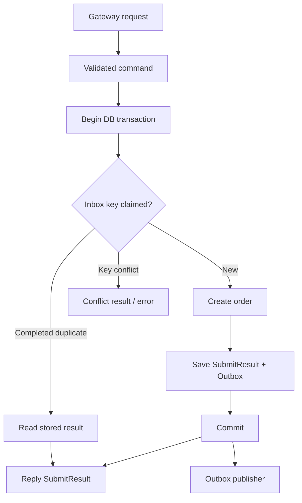
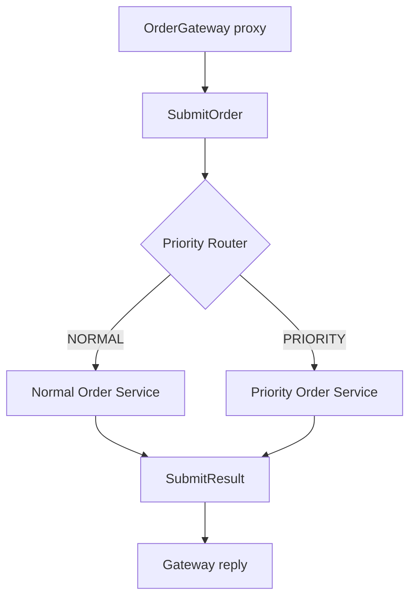
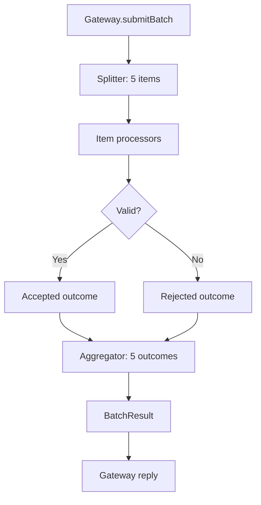

# Gateway with Interface Proxy

## 1. Why Use a Gateway Instead of Calling `MessageChannel` Directly?

Suppose an ordering module provides a use case to the application layer: submit an order request and receive a confirmation code. Internally, this logic runs through Spring Integration endpoints: a Transformer normalizes data, a Filter validates input, a Service Activator invokes the application, and a branch returns the result.

If every caller had to work directly with `MessageChannel`, callers would need to know channel names, `Message<?>` structure, `replyChannel`, timeout handling, and how to extract the payload from replies:

```java
// Infrastructure-level messaging call; should not leak across all callers.
Message<SubmitOrder> message = MessageBuilder
        .withPayload(command)
        .setHeader("clientRequestId", "req-105")
        .build();
requests.send(message);
// No contract to return SubmitResult to the caller here.
```

A much cleaner usage:

```java
SubmitResult result = orderGateway.submit(
        new SubmitOrder("tenant-a", "evt-105", "ORD-105", 2),
        "req-105");
```

`orderGateway` looks like an ordinary Java interface. Under the hood, Spring Integration creates a **proxy** for that interface: every method call becomes a request message sent into an integration flow, and the reply is converted into the return value.

**Messaging Gateway** is an Enterprise Integration Pattern (EIP) offering application code a familiar API entry point while hiding messaging details behind it. The lesson **"Gateway with Interface Proxy"** belongs to the **Messaging gateway** chapter of the **SPRING_INTEGRATION_PATTERN** module—learning to implement Enterprise Integration Patterns with Spring Integration to build loosely coupled, extensible message flows combining Router, Filter, Transformer, Splitter, Aggregator, Gateway, retry, error channel, correlation, testing, and branch monitoring.



**Core point:** an interface proxy is a **communication adapter**, not an automatic networked RPC call, and it does not automatically provide transactions, retries, durability, or exactly-once delivery. Those properties depend on the channels, endpoints, and adapters connected behind the Gateway.

## 2. Distinguishing Gateway Interface, Proxy, Channel, and Service

An application Gateway has four layers of responsibility:

| Component | Definition | Managed By |
| --- | --- | --- |
| **Gateway interface** | Methods callers are allowed to invoke | API design team |
| **Gateway proxy** | Runtime object turning method invocations into request/reply messages | Spring Integration |
| **Message channel & integration flow** | Routes requests and runs Transformers/Routers/handlers | Spring Integration |
| **Application/domain service** | Business checks, transactions, and side effects | Application |

For example:
- `OrderGateway.submit(command, clientRequestId)` is the caller's API.
- `orders.submit.in` is the channel receiving messages built by the proxy.
- `.handle(...)` or `@ServiceActivator` converts payloads into service calls.
- `OrderApplicationService.confirm(...)` is the business method without Spring Messaging imports.

### 2.1. What Is the Proxy in This Context?

Given a Java interface, Spring can generate a dynamic object fulfilling that interface contract at runtime. Callers inject the interface type directly without writing an `implements OrderGateway` class to construct messages manually.

```text
Java caller                         Spring IoC context
    |                                     |
    | @Autowired OrderGateway             |
    |------------------------------------>|
    |                                     |
    |                        Gateway proxy bean
    |                                     |
    | gateway.submit(...)                |
    |------------------------------------>|
    |         request channel, reply      |
    |<------------------------------------|
    |        SubmitResult                 |
```

Unlike an ordinary service implementation, the proxy does not execute ordering logic inside the interface method body; it sends a message to the configured flow. Therefore, merely having the interface on the classpath **is not enough**: Spring must register the proxy bean and find the matching request channel and subscriber.

### 2.2. Messaging Gateway Differs from Service Activator

- **Gateway:** Entry point from a Java method call into a messaging flow.
- **Service Activator:** Connector from a messaging flow into an application method.

They commonly work in pairs yet stand on **opposite sides**:

```text
Caller --Java API--> Gateway --Message--> Channel/Flow
                                          |
                                          v
                                    Service Activator
                                          |
                                     Java service
                                          |
                        reply Message <--+-- return value
                                          |
Caller <--Java return value-- Gateway <--+
```

Do not put entire business logic inside a Gateway proxy. When authorization, deduplication, business validation, and transactions are needed, place them at the appropriate boundaries and services.

### 2.3. Messaging Gateway Differs from HTTP API Gateway

The word "gateway" does not necessarily mean a reverse proxy, load balancer, cloud API Gateway, or REST endpoint. Here, a Spring Integration Gateway is a **Java method interface** opening into an integration flow. Behind it, the flow may talk to HTTP, JMS, Kafka, or external systems, yet the interface proxy itself does not pick a transport.

### 2.4. One Interface Can Represent Multiple Use Cases

You can declare methods returning results, methods needing no reply, or methods targeting different request channels. However, define **each method's semantics** clearly instead of cramming dozens of unrelated use cases into one "god gateway."

## 3. Request–Reply: What Happens When Calling an Interface Method?

Suppose the caller executes:

```java
SubmitResult receipt = gateway.submit(order, "req-105");
```

Conceptually, a synchronous request–reply Gateway performs:

1. Selects the Gateway method mapping.
2. Builds a Spring `Message<?>` with payload `order`.
3. Maps method parameters—such as `clientRequestId`—into declared headers.
4. Creates/sets the reply-routing context for the call.
5. Sends the message to the request channel.
6. Waits for or receives a reply per channel/handler and timeout policies.
7. Converts the reply payload to the method's `SubmitResult` return type.
8. If an error or timeout occurs, handles it per Gateway contract and error-flow config—**never faking success**.



**No broker or network is required:** if the request channel is a `DirectChannel` and the handler is synchronous, everything can run on the caller's own call stack.

### 3.1. What Is the Reply Channel Used For?

The Gateway needs to know which invocation a reply belongs to. Spring Integration can attach a reply destination to the request so handlers or endpoints return messages to the right caller. Most simple request–reply setups do not need callers to create a `QueueChannel`; the proxy manages reply reception under Gateway mechanics.

```text
Request:
  payload = SubmitOrder(...)
  headers = {
    clientRequestId = "req-105",
    replyChannel = gateway-managed destination,
    ...
  }

Reply:
  payload = SubmitResult(...)
  route -> original Gateway invocation
```

**Avoid overwriting `replyChannel`** in a Transformer or Router without knowing the contract. If a message crosses a broker, an in-JVM channel object cannot magically become a durable cross-process reply address; configure transport-specific request/reply with correlation IDs, reply destinations, and timeouts.

### 3.2. A Synchronous Gateway Does Not Mean the Backend Is Always Synchronous

A Gateway method can expose a synchronous API while the backing flow uses `ExecutorChannel`, JMS request–reply, an HTTP outbound gateway, or broker replies. What matters is **whether a reply reaches the right destination before the deadline**, and whether the handler produces a valid reply.

### 3.3. Difference Between Reply Results and Errors

| Event | What the Gateway Caller Receives |
| --- | --- |
| Handler returns valid `SubmitResult` | Value per contract |
| Handler throws exception | Exception may propagate or be mapped by error flow |
| Handler returns `null` or emits no reply | Cannot assume a result exists |
| Reply arrives past deadline | Timeout / late-reply policy |
| Reply payload differs from method type | May hit conversion / type-mismatch error |
| Caller cancels waiting | Backend may keep processing |

Never treat a timeout as proof that the DB rolled back. Nor does a successful request send prove business state committed unless the receipt contract defines—and the handler truly guarantees—it.

## 4. Defining Payloads and Domain Ports Before Creating the Gateway

We use a simple use case with real business identity to illustrate.

### 4.1. Commands and Results as Java Records

```java
record SubmitOrder(
        String tenantId,
        String eventId,
        String orderId,
        int quantity) {

    SubmitOrder {
        if (tenantId == null || tenantId.isBlank()
                || eventId == null || eventId.isBlank()
                || orderId == null || orderId.isBlank()
                || quantity <= 0) {
            throw new IllegalArgumentException(
                    "INVALID_SUBMIT_ORDER");
        }
    }
}

record SubmitResult(
        String eventId,
        String orderId,
        String confirmationId,
        String status) {}
```

In a real application, `status` should be an enum or versioned result type; the record uses `String` for brevity. A structurally valid command **does not prove** the caller is authorized to place orders for that `tenantId`.

### 4.2. Application Port Independent of Spring Messaging

```java
interface OrderApplicationService {

    SubmitResult confirm(
            SubmitOrder command,
            String clientRequestId);
}
```

Domain/application services can enforce authentication/authorization, transactions, idempotency, pricing, and order persistence. The signature has no `Message<?>`, `MessageHeaders`, channels, or broker metadata. `clientRequestId` here correlates requests and **must not automatically be treated as a trusted idempotency key**.

### 4.3. A Simulated Implementation for the Demo

```java
import org.springframework.stereotype.Service;

@Service
class DemoOrderApplicationService
        implements OrderApplicationService {

    @Override
    public SubmitResult confirm(
            SubmitOrder command,
            String clientRequestId) {
        // Only for illustrating request -> reply.
        // Production requires authorization, transactional
        // idempotency, and dedicated business validation.
        return new SubmitResult(
                command.eventId(),
                command.orderId(),
                "CONF-" + command.orderId(),
                "ACCEPTED");
    }
}
```

This implementation **writes no DB**, reserves no inventory, and proves no exactly-once guarantees. It clearly shows how the Gateway proxy connects to a handler and receives a deterministic typed result.

## 5. Declaring `@MessagingGateway` on an Interface

The standard Spring Integration approach is placing `@MessagingGateway` on a Java interface:

```java
import org.springframework.integration.annotation.Gateway;
import org.springframework.integration.annotation.MessagingGateway;
import org.springframework.messaging.handler.annotation.Header;
import org.springframework.messaging.handler.annotation.Payload;

@MessagingGateway(
        name = "orderGateway",
        defaultRequestChannel = "orders.submit.in",
        defaultReplyTimeout = "5000")
public interface OrderGateway {

    @Gateway
    SubmitResult submit(
            @Payload SubmitOrder command,
            @Header("clientRequestId") String clientRequestId);
}
```

**Explaining each element:**

- `@MessagingGateway`: marks the interface for Spring Integration to generate a proxy bean.
- `name = "orderGateway"`: explicit bean name distinguishing Gateways.
- `defaultRequestChannel = "orders.submit.in"`: default channel receiving messages built from methods.
- `defaultReplyTimeout = "5000"`: configures reply wait limit in milliseconds when actually waiting for replies; see limitations in Section 10.
- `@Gateway`: allows per-method Gateway overrides; this method uses interface defaults.
- `@Payload`: selects `SubmitOrder` as the payload.
- `@Header("clientRequestId")`: maps the second parameter into a Spring Message header.
- `SubmitResult`: expects a reply payload compatible with this type.

**Java file layout:** Since this is a `public interface`, place example code in `OrderGateway.java`, in the same package as application configuration or in a package explicitly configured for component scanning.

### 5.1. Not a Hand-Written Implementation

Avoid writing:

```java
// ANTI-PATTERN: callers have to know messaging details.
class HandWrittenOrderGateway implements OrderGateway {
    private final MessageChannel channel;

    @Override
    public SubmitResult submit(
            SubmitOrder order, String requestId) {
        channel.send(MessageBuilder.withPayload(order)
                .setHeader("clientRequestId", requestId)
                .build());
        return null; // No reply contract!
    }
}
```

You can write a manual adapter if truly specialized logic is required, yet when using Messaging Gateway interface proxies, let Spring provide the bean from metadata; hand-implementing the interface without reply handling defeats the purpose of a Gateway.

### 5.2. Proxies Do Not Need Business Logic Inside the Interface

The interface declares the API without needing `default` methods executing business logic. Transporting to `orders.submit.in` belongs to the proxy. If pre-send validation is needed, use a facade/service at the boundary and enforce checks at the consumer; never confuse method validation with security authorization or gateway invocation.

## 6. Registering the Interface Proxy in a Spring Context

Putting `@MessagingGateway` on an interface alone **may not suffice** if the context does not scan that interface's package. Illustrative configuration:

```java
import org.springframework.context.annotation.Configuration;
import org.springframework.integration.annotation.IntegrationComponentScan;
import org.springframework.integration.config.EnableIntegration;

@Configuration
@EnableIntegration
@IntegrationComponentScan(
        basePackageClasses = OrderGateway.class)
class GatewayProxyRegistration {
    // Proxies of @MessagingGateway in the scanned package
    // will be registered by Spring Integration as beans.
}
```

`@EnableIntegration` enables required Spring Integration infrastructure; `@IntegrationComponentScan` discovers Gateway interfaces within the specified scope. Spring Boot may provide auto-configuration for this, yet standalone examples should declare prerequisites explicitly.

**With different package layouts**, adjust base packages accordingly. Never assume that because a service class has `@Service`, a Gateway interface is automatically registered by `@ComponentScan`; context tests must actually find the `OrderGateway` bean.

### 6.1. Verifying the Bean via Dependency Injection

```java
import org.springframework.stereotype.Component;

@Component
class OrderSubmissionUseCase {

    private final OrderGateway gateway;

    OrderSubmissionUseCase(OrderGateway gateway) {
        this.gateway = gateway;
    }

    SubmitResult submit(SubmitOrder command) {
        return gateway.submit(
                command,
                "req-" + command.eventId());
    }
}
```

In production, request IDs should be minted at the inbound boundary or taken from a trusted request context alongside correlation rules. `"req-" + eventId` is illustrative only; **it does not replace** authenticated identity sources or business event uniqueness policies.

### 6.2. Never Instantiate Interfaces Directly or Bypass IoC

```java
// Invalid:
OrderGateway gateway = new OrderGateway(); // Interface.

// Wrong usage:
OrderGateway gateway = new DemoOrderApplicationService(); // Different contract.
```

Obtain the bean from Spring DI or the `ApplicationContext` for the use case. If multiple beans share a Gateway type, disambiguate with bean names/qualifiers or separate interfaces rather than relying on component-scan ordering.

## 7. Connecting the Gateway Proxy with Spring Integration Java DSL

For `gateway.submit(...)` to produce a reply, a flow must consume `orders.submit.in` and return `SubmitResult`. The configuration below uses `DirectChannel` and `.handle(...)` as a Service Activator.

```java
import org.springframework.context.annotation.Bean;
import org.springframework.context.annotation.Configuration;
import org.springframework.integration.channel.DirectChannel;
import org.springframework.integration.dsl.IntegrationFlow;
import org.springframework.messaging.MessageChannel;

@Configuration
class OrderGatewayFlowConfiguration {

    @Bean("orders.submit.in")
    MessageChannel submitRequests() {
        return new DirectChannel();
    }

    @Bean
    IntegrationFlow submitOrderFlow(
            OrderApplicationService service) {

        return IntegrationFlow.from("orders.submit.in")
                .handle(SubmitOrder.class, (command, headers) -> {
                    String clientRequestId =
                            (String) headers.get("clientRequestId");

                    return service.confirm(
                            command, clientRequestId);
                })
                .get();
    }
}
```

**Full call path:**



When `.handle(...)` returns an object, the endpoint sends the result as a reply to the destination carried by the request message. Callers do not need to create a `QueueChannel` in simple Gateway interface examples.

### 7.1. Prerequisites for the Example to Run

Required:
1. Java 17 or newer for records and sealed types used in this lesson.
2. Spring Integration and Spring Messaging dependencies.
3. `GatewayProxyRegistration` or equivalent scan config.
4. `OrderGatewayFlowConfiguration` declaring the channel and `IntegrationFlow`.
5. A bean implementing `OrderApplicationService`, e.g., `DemoOrderApplicationService`.
6. The `OrderGateway` interface located in a scanned package.
7. No unintended competing subscriber handler on `orders.submit.in`.

**Topology note:** `DirectChannel` generally dispatches each message to a single subscriber. Accidentally registering both `@ServiceActivator(inputChannel="orders.submit.in")` and `submitOrderFlow` on the same channel does not make both run; they compete. Pick one topology for the request/reply path.

### 7.2. Why Not Put All Business Logic Inside the DSL Lambda?

The example uses a lambda only to forward `SubmitOrder` and one selected header to the application service. Never cram inventory checks, DB writes, manual retries, or serialization into a hundred-line DSL lambda. Unit testing and versioning stay clean when business services remain independent of wiring.

### 7.3. If the App Already Has `@ServiceActivator`

You can replace `IntegrationFlow.handle(...)` with a `@ServiceActivator`-annotated method taking `SubmitOrder` and returning `SubmitResult`. Never **register both simultaneously** as competing subscribers on the same request channel. A Gateway proxy only cares that one valid processing path returns replies per contract.

## 8. Per-Method Gateway Configuration

One interface can have multiple methods, each with its own use case and request channel. `@MessagingGateway` supplies defaults, while `@Gateway` sets channels/timeouts per method.

### 8.1. Example of Two Request Types with Different Contracts

```java
import org.springframework.integration.annotation.Gateway;
import org.springframework.integration.annotation.MessagingGateway;
import org.springframework.messaging.handler.annotation.Payload;

record AuditNotice(
        String eventId,
        String description) {}

@MessagingGateway
interface OperationsGateway {

    @Gateway(
            requestChannel = "orders.priority.in",
            replyTimeout = "3000")
    SubmitResult submitPriority(@Payload SubmitOrder order);

    @Gateway(requestChannel = "audit.events.in")
    void publishAudit(@Payload AuditNotice notice);
}
```

`submitPriority` is request–reply: it needs a handler producing a result. `publishAudit` is a one-way command/event: callers should not depend on a receipt not guaranteed by the contract.

**Important:** To run this example, the app must define `orders.priority.in` and `audit.events.in`, register their endpoints, and scan `OperationsGateway`. This is an **additional** Gateway interface example, not an automatic replacement for `orders.submit.in` from Section 7.

### 8.2. Be Careful with `void` Methods

A `void` Gateway only indicates **no reply payload is expected**. It does not mean:
- The message was durably written to a broker.
- The domain service committed its transaction.
- Every consumer finished.
- Worker-thread errors automatically propagate back to the caller.
- Delivery is exactly-once.

If confirmation that work completed is needed, define a status-carrying return type or a separate query/status event; never write `void` and claim request–reply semantics.

### 8.3. When to Split into Multiple Gateway Interfaces?

Split interfaces when:
- Business groups have different access permissions.
- One group is synchronous request–reply and another is event-driven fire-and-forget.
- Groups require distinct timeout, retry, or error policies.
- Different teams evolve contracts independently.
- Tests should not boot the entire system just to test one use case.

Avoid one massive interface with a hundred methods sharing one `defaultRequestChannel` routed through tangled untested conditions.

### 8.4. Method Overloads and Payload Types

If two overloaded methods share a name yet take different payload types, the Gateway still builds messages from signatures. However, avoid overloads where resolution depends on `Object`, `null`, or erased generics, as endpoints struggle to distinguish them. Prefer descriptive use-case names, typed payloads, and explicit request channels.

## 9. Mapping Arguments and Headers Through the Interface Proxy

One benefit of a Gateway proxy is exposing routing fields as normal Java parameters instead of forcing callers to build Spring Messages manually.

### 9.1. `@Payload` and `@Header`

In `OrderGateway` from Section 5:

```java
SubmitResult submit(
        @Payload SubmitOrder command,
        @Header("clientRequestId") String clientRequestId);
```

The Gateway builds a request with:
- Payload `SubmitOrder`.
- Header `clientRequestId` holding the caller-supplied value.
- Reply/error routing metadata managed by the framework per invocation and configuration.

When a method takes multiple parameters, annotate each parameter's role explicitly. Never expect the proxy to guess that a second `String` is an idempotency key or correlation header unless declared in the contract.

### 9.2. Headers Differ from Business Fields

| Value | Where It Belongs | Note |
| --- | --- | --- |
| `SubmitOrder.orderId` | Command payload | Business entity ID |
| `SubmitOrder.eventId` | Payload and/or controlled header | Stable logical event ID |
| `clientRequestId` | Tracing / request context header | Not automatically an `eventId` |
| `tenantId` | Verified identity + command | Never trust caller self-declaration |
| `replyChannel` | Gateway / framework routing | Never alter arbitrarily |
| `errorChannel` | Internal error routing | Never let clients pick arbitrary channels |
| `CORRELATION_ID` | Group / request correlation | Do not confuse with idempotency |
| `traceparent` | Tracing context | Per trust/propagation policy |
| Broker delivery tag | Transport adapter | Keep out of domain APIs |

**Security boundary:** A header passed via `@Header` is simply a caller-supplied value. It **does not authenticate the tenant**, does not turn a client request ID into a trustworthy idempotency key, and must never allow specifying arbitrary channel names.

### 9.3. Stable Header Naming

Key guidelines:
- Pick consistent names, e.g., `clientRequestId`, regardless of source.
- Separate durable `eventId` from `traceId` and `MessageHeaders.ID`.
- Ensure Routers/Filters only inspect headers with explicit contracts.
- Validate and sanitize headers arriving from external sources before use.
- Use serializable representations across transports or databases.
- Never put raw credentials or PII into headers unless strictly necessary and protected by policy.

### 9.4. Does a Gateway Enforce `@Valid` Automatically?

Do not assume adding Bean Validation constraints to a DTO or `@Valid` to a Gateway method automatically validates like a Spring MVC HTTP controller. Method validation depends on providers, AOP/proxy setup, annotation placement, and call paths. To keep trust boundaries clear, validate commands at ingress or inside application services rather than relying on the messaging proxy for business authorization.

### 9.5. Null Arguments and Reply Types

Some API versions support diverse method arguments, header maps, and payload expressions. Nonetheless, a Spring Messaging request message **should not carry a `null` payload** without an explicit contract. If `SubmitOrder` is mandatory, reject `null` before invocation or at the application boundary rather than hitting late, cryptic conversion errors.

**Reply types matter too:** if the Gateway declares `SubmitResult` while a handler returns `String` or `ErrorMessage`, never assume the framework turns it into a valid business receipt automatically.

## 10. Timeouts: Request Timeout Differs from Reply Timeout

This is the most frequently misunderstood part of Gateway proxies.

### 10.1. Two Timeouts with Different Responsibilities

| Timeout | Meaning | Example |
| --- | --- | --- |
| **Request/send timeout** | Wait limit when sending a request to a potentially blocking channel | Low-capacity channel, full `QueueChannel` |
| **Reply timeout** | Wait limit for a reply on a potentially blocking receive path | Async backend hasn't returned result |
| **Business deadline** | Business deadline or use-case SLA | Order must be confirmed within 10 seconds |
| **HTTP/broker timeout** | External adapter/transport limit | Remote response or broker request–reply |
| **Transaction timeout** | Configured DB transaction limit | Overlong DB operation |

Never pick a single number assuming it governs every type of timing at once.

### 10.2. Trap with `DirectChannel` and Slow Handlers

With `DirectChannel`, the Gateway sends the request and the synchronous handler executes on the **same thread**. If `OrderApplicationService.confirm(...)` blocks for 20 seconds, that thread can stay blocked for 20 seconds before `send` finishes. In that case, setting `defaultReplyTimeout="5000"` **does not guarantee the method aborts after 5 seconds**: reply timeout does not interrupt a synchronously executing handler.



If total operation duration must be bounded, add timeouts on services/remote clients, propagate cancellation/deadlines where supported, or move processing to an async path—never treat `replyTimeout` as a circuit breaker for every call.

### 10.3. In Async Flows, Reply Timeout Bounds Waiting for Results

With `ExecutorChannel`, the Gateway can dispatch the request to a worker and then wait for a reply:



**Expiring `replyTimeout` does not prove the backend rolled back.** A late reply may find no waiting consumer; handling late replies, idempotency, and status queries must be part of your reliability design.

### 10.4. Request Send Failures

Some channels enforce send timeouts or reject messages when capacity or subscribers are missing. Errors and exception types vary by implementation. Never treat `gateway.submit(...)` returning `null` as "out of stock" when the actual failure was an undelivered request, and never catch every exception to retry under a brand-new `eventId`.

### 10.5. Never Hardcode a Timeout and Call It an SLA

`"5000"` in the annotation illustrates 5 seconds. Production must consider:
- P95/P99 latency of handlers and downstream dependencies.
- Remaining time budget from caller/API Gateway.
- Retry attempts/backoff inflating total duration.
- Transaction and remote HTTP timeouts.
- Concurrency limits, queue saturation, and backpressure.
- Behavior when callers disconnect or cancel requests.
- Cases where replies committed yet got lost in transit.

Configure and monitor timeouts against real SLAs rather than copying demo numbers into every system.

## 11. Error Flow: Handler Exceptions Do Not Automatically Become Business Replies

When a Service Activator calls a domain method and throws an exception, several paths exist depending on topology.



### 11.1. Synchronous: Exceptions Can Propagate to the Caller

On `DirectChannel`, the Gateway call and handler generally share the call stack. If the service throws `OutOfStockException`, the Gateway may throw that exception or a messaging wrapper whose cause holds it, depending on version/configuration. In tests, inspect **the error type in the cause chain** instead of asserting one hardcoded wrapper class.

An exception does not automatically generate an `ErrorMessage` on the global `errorChannel` in every synchronous topology.

### 11.2. Asynchronous: `ErrorMessage` Requires Explicit Configuration

On `ExecutorChannel`, pollers, or async adapters, errors can route to `ErrorMessage`/`errorChannel` via configured error-handling strategies. Yet `errorChannel`:
- Does not durably persist messages automatically.
- Does not send broker ACK/NACKs automatically.
- Does not build a typed `SubmitResult` automatically.
- Does not reply to a waiting Gateway automatically.
- Does not reopen a rolled-back transaction.
- Does not prevent duplicates by default.

When configuring a Gateway error channel to emit fallback replies, ensure the handler returns the **exact method return contract type** and never masks infrastructure failures as successes.

### 11.3. When Business Rejection Is an Expected Outcome

For example, insufficient stock is an expected business result. You can define a contract distinct from success-only `SubmitResult`:

```java
sealed interface SubmitOutcome
        permits AcceptedOrder, RejectedOrder {}

record AcceptedOrder(SubmitResult result)
        implements SubmitOutcome {}

record RejectedOrder(
        String eventId,
        String reasonCode)
        implements SubmitOutcome {}

final class OutOfStockException extends RuntimeException {
    OutOfStockException() {
        super("OUT_OF_STOCK");
    }
}
```

The Gateway must then declare **`SubmitOutcome`** as its return type, and a handler explicitly translates business rejections into `RejectedOrder`. Never declare `SubmitResult` on the method while returning `RejectedOrder` as a surprise reply that callers cannot cast.

### 11.4. An Adapter Translating Business Exceptions into Outcomes

```java
final class OrderOutcomeAdapter {

    private final OrderApplicationService service;

    OrderOutcomeAdapter(OrderApplicationService service) {
        this.service = service;
    }

    SubmitOutcome confirm(
            SubmitOrder command,
            String requestId) {
        try {
            return new AcceptedOrder(
                    service.confirm(command, requestId));
        } catch (OutOfStockException knownBusinessRejection) {
            return new RejectedOrder(
                    command.eventId(),
                    "OUT_OF_STOCK");
        }
    }
}
```

**Catch only explicitly documented business exceptions.** An unexpected `DataAccessException`, `SecurityException`, or `NullPointerException` must follow the failure policy. Never write `catch (Exception) { return new RejectedOrder(...); }`, which could falsely ACK an unprocessed transaction.

### 11.5. Never Turn a Gateway Timeout into a Business Rejection

A timeout can mean:
- The handler was never dispatched.
- The handler is still processing.
- The handler committed yet the reply was lost.
- The reply arrived past deadline.
- `replyChannel`/correlation was misconfigured.

Never return `RejectedOrder("TIMED_OUT")` as a final business verdict before verifying the outcome. Return `PENDING`/`UNKNOWN` and let callers query status using a stable business event ID.

## 12. Gateway Proxies and Asynchronous Call Patterns

### 12.1. Synchronous API: Easy to Use, Holds Threads

```java
SubmitResult submit(SubmitOrder command, String requestId);
```

This creates a call-and-wait experience in Java. Inside web controllers, request threads remain held until the Gateway returns or throws. Use when flows are fast and SLAs are predictable.

### 12.2. `void` API: Does Not Wait for a Reply Payload

```java
void publishAudit(AuditNotice notice);
```

This API has different semantics. Callers get no typed business result; if durability is required, use a broker or outbox rather than trusting the `void` keyword.

### 12.3. `Future`/`CompletableFuture`/Reactive Return Types

Spring Integration versions support various async Gateway return types such as `Future`, `CompletableFuture`, or reactive types under matching configurations. **Never just swap `SubmitResult` to `CompletableFuture<SubmitResult>` assuming every endpoint, version, timeout, and error policy keeps working unchanged.**

When adopting an async Gateway, check your version's docs and run integration tests for:
- Whether the call returns early or still blocks during send.
- How exceptions complete the future or reactive pipeline.
- Whether cancellation affects the worker.
- Deadlines and late replies.
- Tracing/correlation propagation.
- Backpressure, thread-pool exhaustion, and graceful shutdown.

### 12.4. A Java Interface Proxy Is Not an Automatic Remote Service Stub

A Gateway proxy can send messages into an integration flow that uses outbound HTTP, JMS, AMQP, or Kafka internally. Yet **the interface does not know** network destinations, serializers, retries, or authentication on its own. Configure adapters explicitly; across process boundaries, build explicit wire protocols and reply correlation.

## 13. Architecture When a Gateway Calls a Flow Across a Broker

A system may want a synchronous Java API backed by broker processing. Process A's Gateway proxy then needs a request channel/outbound adapter, while Process B has the consumer and reply path.



### 13.1. Correlation and Reply Routing

Distinguish:
- **Business event ID:** Used for idempotency and business auditing.
- **Request correlation ID:** Matches a reply to one specific Gateway invocation.
- **Message ID:** Envelope ID that can change across hops.
- **Broker delivery/offset:** Transport metadata, not business identity.
- **Trace/span IDs:** Distributed observability.

If two concurrent requests receive replies out of order, the correlator must deliver each to the right caller. Never correlate solely by `orderId` when multiple operations on the same order can run concurrently.

### 13.2. One JVM's `replyChannel` Does Not Replace a Broker Reply Destination

A header holding a `MessageChannel` object in Process A is not a serializable, addressable destination in Process B. Use metadata/headers that the broker protocol and Spring Integration outbound/inbound adapters can transmit and correlate; specify reply topics/queues, routing keys, timeouts, and retention.

### 13.3. Late Replies and Duplicate Replies

If the Gateway caller times out and a broker reply arrives afterward, decide:
- Drop late replies with logs/metrics rather than delivering them to newer requests.
- Persist outcomes so callers can query by business event ID.
- Deduplicate replies if the broker redelivers.
- Never mint a new business event just to "match" an old request correlation.

Never assume two sends with the same `orderId` are identical calls if event IDs or revisions differ.

### 13.4. Limits of Synchronous Facades

Returning a Java result from a Gateway does not make multi-minute workflows suitable for synchronous HTTP requests. For long-lived business processes like payments, approvals, or fulfillment, design:
- Submit returns `PENDING` / an accepted tracking ID.
- Backend runs asynchronously and emits status events.
- Callers query status or receive callbacks.
- Idempotent results served from a store instead of waiting indefinitely on workers.

**Messaging Gateways remain useful** for providing clean Java facades over "submit request" or "get current result," while the sync/async choice follows actual SLAs.

## 14. Security, Validation, and Sensitive Data at the Gateway

A Gateway proxy provides a clean abstraction for callers, yet **it is not automatically a security boundary**.

### 14.1. Caller-Supplied Headers Are Not Trusted Identity

If a method declares:

```java
SubmitResult submit(
        @Payload SubmitOrder command,
        @Header("tenantId") String tenantId);
```

`tenantId` is merely a value passed by the caller. Verify it against the authenticated security principal and tenant scope from upper layers. Never let a caller pass `tenantId="other-tenant"` and have domain services trust it just because the parameter has `@Header`.

### 14.2. Validation Must Occur at Explicit Boundaries

Core rules:
- Non-null payload, positive quantities, valid ID formats.
- Verified tenant and source.
- Stable idempotency keys.
- Bounded field lengths and message sizes.
- Allowlisted headers when sending to brokers.
- Business authorization inside the proper service boundary.
- Validation failures mapped to error contracts, never silently dropped.

If using Bean Validation `@Valid`, verify method-validation/AOP configuration and test it; never assume `@MessagingGateway` methods automatically inherit HTTP controller validation semantics.

### 14.3. Avoid Logging Entire Messages

Spring Messaging exceptions sometimes hold a `failedMessage` reference with payload and headers. Never print raw `Exception.toString()` or `MessageHeaders` when they contain credentials, PII, or payment details. Log trusted tracking IDs, exception categories, and trace references; store recovery data in secured quarantine with ACLs and retention.

### 14.4. Internal Gateway Interfaces Still Require Authorization

Just because another Spring bean in the same JVM can inject the Gateway does not mean it is authorized for every business command. Especially in multi-tenant applications, check permissions at entrypoints/application services and re-verify event scope at consumers if messages traverse untrusted brokers.

## 15. Retries, Transactions, and Idempotency When Calling a Gateway

A Gateway proxy makes calling convenient, yet **it does not guarantee the backend runs only once**. Requests can time out, callers can retry, brokers can redeliver, or Service Activators can be wrapped in retry advice.

### 15.1. Stable Business `eventId` Differs from Request Attempts

Suppose a caller creates an order:

```text
tenantId = tenant-a
eventId  = evt-105
orderId  = ORD-105

Attempt 1:
  gateway.submit(command, "request-attempt-1")
  backend commits order
  reply lost -> caller sees timeout

Attempt 2:
  gateway.submit(command, "request-attempt-2")
  backend sees same business eventId
  returns saved SubmitResult without duplicate side effect
```

`clientRequestId` may vary across attempts to trace each call; `eventId` must remain stable when two attempts represent **the same logical operation**. If callers change `eventId` after every timeout, the Idempotent Receiver treats them as two separate orders.

### 15.2. Designing an Idempotent Receiver on the Service Side

Example key:

```java
record OrderEventKey(
        String consumerName,
        String tenantId,
        String eventId) {}

OrderEventKey keyFor(SubmitOrder command) {
    return new OrderEventKey(
            "order-creator",
            command.tenantId(),
            command.eventId());
}
```

If each producer has its own event ID namespace, include the authenticated `sourceSystem`. Same key + same business content returns the saved result; **same key + different content** is a conflict requiring policy handling, never treated as a valid duplicate.

### 15.3. Choosing Transaction Boundaries

A DB-backed service can execute:
1. Check authorization and contract.
2. Start DB transaction.
3. Atomically claim inbox/idempotency key.
4. Create order or detect duplicate/conflict.
5. Persist receipt and outbox event in the same transaction.
6. Commit.
7. Gateway returns result or adapter ACKs per transport rules.



A transaction rollback cannot "unsend" emails, payment calls, or already-published broker events. Use an outbox for events tied to DB state, and external provider idempotency keys for remote transactions.

### 15.4. Retries Need Budgets and Classifiers

| Error | Should Retry Same Request? | Reason |
| --- | --- | --- |
| DB connection timeout | Bounded | Recoverable |
| Service temporarily unavailable | Bounded, with backoff | Prevent overload |
| Payload violates contract | No hot-retry | Same payload still fails |
| Unauthorized tenant | No | Security issue |
| Out of stock | Usually no; depends on backorder policy | Business decision |
| Same event ID, different payload | No | Identity conflict |
| Gateway timeout after uncertain commit | Query result/status then retry same key if allowed | Prevent double effects |
| Programming error | Alert/fix | Hot retries do not fix bugs |

Never stack unbounded retries across multiple layers. If Gateway callers, Service Activator advice, and broker listeners all retry, total attempts explode. Enforce an overall deadline and stable idempotency.

### 15.5. Timeouts Do Not Automatically Cancel Transactions

In async flows, callers may expire after 5 seconds while workers proceed to commit. If cancellation is required, implement explicit signal/deadline propagation and safe cancellation checks in services; never rely on `replyTimeout` to abort DB transactions.

## 16. Combining Gateways with Router, Filter, Splitter, and Aggregator

The Messaging Gateway is the **entry point**, with other patterns placed behind it. Whenever a branch emits no reply, explicitly design Gateway liveness.

### 16.1. Router Selecting Priority vs. Standard Processing



Both branches **must obey the reply contract** if `submit` expects `SubmitResult`. If one branch lacks a handler or returns another type, callers face timeouts or conversion errors.

### 16.2. Filters Dropping Messages: Silent Discards Are Dangerous

If a Filter rejects a `SubmitOrder` without emitting a rejection reply:

```text
Gateway submit() -> Filter(valid=false) -> message discarded
Gateway waits ... timeout (no explicit validation error)
```

Users cannot tell immediately whether the order was rejected for an invalid quantity or the system stalled. For request–reply, choose one of:
- Return a typed `RejectedOrder(reasonCode)`.
- Throw a validation exception clearly mapped at the API boundary.
- Route to a rejection branch capable of replying.

Never use silent `filter(false)` as a business error protocol.

### 16.3. Splitter and Aggregator Inside One Gateway Call

Suppose a Gateway sends a 5-item batch command. A Splitter generates 5 child messages; an Aggregator combines 5 outcomes into one `BatchResult` returned by the Gateway.



If 2 invalid items are silently dropped by a Filter, the Aggregator waiting for `sequenceSize=5` may never release. Fix by collecting **all accepted and rejected outcomes**, or using verified completion markers / expected counts. Never replace `correlationId` with `eventId` when the group is a batch.

### 16.4. Correlation Must Survive Transformers

A Transformer returning a new payload normally preserves routing headers; however, code building a brand-new `Message<?>` that drops `replyChannel`, `correlationId`, or sequence headers can break Gateways and Aggregators. Test on **actual post-transformation messages**, especially across brokers and serialization.

### 16.5. Publish–Subscribe Cannot Pick One Arbitrary Reply Automatically

If a Gateway request broadcasts to three subscribers, three results may be produced. Never assume the framework picks one valid reply arbitrarily. Design clearly:
- Designate one subscriber as the reply owner.
- Or combine multi-branch results via an Aggregator/Coordinator into one reply.
- Keep audit/telemetry branches one-way so they do not emit competing replies.

A Gateway method returning a single `SubmitResult` needs **one clearly defined valid outcome**.

## 17. Unit Testing Gateway Contracts and Integration Testing Real Proxies

The most important test for this topic **invokes the Gateway interface itself**, rather than just sending messages directly to channels. That verifies the proxy bean was created, arguments were mapped, handlers received messages, and callers received typed replies.

### 17.1. Integration Test with JUnit 5, Spring Test, and Mockito

This test assumes classes from Sections 4–7 are placed in an appropriate package, and integration scanning registers only the intended gateway interfaces into the context. `OrderApplicationService` is mocked to avoid DB side effects.

```java
import org.junit.jupiter.api.AfterEach;
import org.junit.jupiter.api.Test;
import org.springframework.beans.factory.annotation.Autowired;
import org.springframework.context.ApplicationContext;
import org.springframework.context.annotation.Bean;
import org.springframework.context.annotation.Configuration;
import org.springframework.test.context.junit.jupiter.SpringJUnitConfig;

import static org.junit.jupiter.api.Assertions.*;
import static org.mockito.Mockito.*;

@SpringJUnitConfig(classes = {
        GatewayProxyRegistration.class,
        OrderGatewayFlowConfiguration.class,
        OrderGatewayIT.TestDependencies.class
})
class OrderGatewayIT {

    @Autowired
    OrderGateway gateway;

    @Autowired
    OrderApplicationService service;

    @Autowired
    ApplicationContext context;

    private final SubmitOrder command =
            new SubmitOrder(
                    "tenant-a", "evt-105", "ORD-105", 2);

    @AfterEach
    void clearMocks() {
        reset(service);
    }

    @Test
    void gatewayInterfaceIsRegisteredAsSpringBean() {
        assertNotNull(gateway);
        assertTrue(context.containsBean("orderGateway"));
    }

    @Test
    void methodArgumentsAreMappedAndReplyIsTyped() {
        var expected = new SubmitResult(
                "evt-105", "ORD-105",
                "CONF-105", "ACCEPTED");

        when(service.confirm(command, "req-105"))
                .thenReturn(expected);

        SubmitResult reply =
                gateway.submit(command, "req-105");

        assertEquals(expected, reply);
        verify(service, times(1))
                .confirm(command, "req-105");
    }

    @Test
    void serviceExceptionIsNotSilentlyConvertedToSuccess() {
        when(service.confirm(command, "req-105"))
                .thenThrow(new OutOfStockException());

        RuntimeException failure = assertThrows(
                RuntimeException.class,
                () -> gateway.submit(command, "req-105"));

        assertTrue(hasCause(
                failure, OutOfStockException.class));
        verify(service).confirm(command, "req-105");
    }

    private static boolean hasCause(
            Throwable failure,
            Class<? extends Throwable> expected) {
        Throwable current = failure;
        for (int i = 0; i < 12 && current != null; i++) {
            if (expected.isInstance(current)) {
                return true;
            }
            current = current.getCause();
        }
        return false;
    }

    @Configuration
    static class TestDependencies {

        @Bean
        OrderApplicationService orderApplicationService() {
            return mock(OrderApplicationService.class);
        }
    }
}
```

### 17.2. What Does the Test Above Prove?

| Test | Verified Behavior |
| --- | --- |
| Spring bean exists | Gateway interface proxy is registered in context |
| Mock `confirm` receives full params | Payload and `@Header("clientRequestId")` mapped properly |
| `SubmitResult` returned accurately | Reply channel and return-type mapping work |
| Exceptions never become success | Service failures surface along synchronous flow |
| Call count equals one | No retries configured in this test case |

**Do not over-extrapolate:** a call count of one in a synchronous test does not prove a broker handles exactly-once. This test has no DB, message broker, async Gateway, or retries. Nor does it prove token/tenant authentication; that belongs to dedicated ingress/security boundary tests.

### 17.3. Why Not Test Only `MessageChannel.send()`?

Sending `MessageBuilder.withPayload(...).build()` directly into `orders.submit.in` bypasses:
- Spring creating the Gateway proxy.
- Interface signatures and method mapping.
- `@Header` argument mapping.
- Gateway-managed reply routes.
- Return-type conversion.
- Timeout and error behavior of `gateway.submit(...)`.

Channel tests remain useful for endpoints, yet **never replace** integration tests through the interface proxy.

### 17.4. Testing Annotation Scanning and Bean Naming

Add test cases for:
- `OrderGateway` excluded from scan → context lacks bean or fails injection.
- Two distinct gateway interfaces → check bean names/qualifiers.
- Channel `orders.submit.in` renamed → Gateway startup/invocation fails.
- Competing handlers on `DirectChannel` → test catches inconsistent replies.
- New unrouted Gateway method → test fails rather than silently falling back.
- Caller passes wrong payload type/`null` → contract error verified.

Never "fix" a missing bean by instantiating a fake Gateway manually: the test might pass while skipping the entire proxy mechanism under study.

## 18. Testing Timeouts, Async Replies, Errors, and Correlation

### 18.1. Testing Timeouts Against the Right Topology

To test `replyTimeout`, you need a scenario with a **genuinely blockable reply-waiting path**, typically an async request channel or transport. A blocking `DirectChannel` handler cannot be tested as if `replyTimeout` interrupts the method at second 5.

Example test-design scenario:

```text
Given:
  Gateway request channel -> ExecutorChannel
  Gateway replyTimeout = bounded value
  Backend waits on CountDownLatch
  No reply before deadline

When:
  gateway.submit(...)

Then:
  Caller observes timeout/no-reply behavior
  Worker may continue after caller has stopped waiting
  Late reply follows defined policy
  Stable eventId remains same on retry
```

Use `CountDownLatch`/controlled futures and bounded deadlines. Never use `Thread.sleep(...)` to guess executor scheduling, and never assert tight wall-clock timings on noisy CI machines.

### 18.2. Testing Business Errors and Infrastructure Errors Separately

| Case | Assertion |
| --- | --- |
| Handler returns `SubmitResult` | Gateway gets typed result |
| Stock unavailable has typed outcome | Gateway gets `RejectedOrder` when contract is `SubmitOutcome` |
| DB timeout | Error/retry path; never turns into `ACCEPTED` |
| Security failure | Deny + audit; never retried like DB |
| Handler returns `null` | No fake receipt appears |
| Reply has wrong payload type | Test catches conversion/type mismatch |
| Missing reply channel | Clear timeout/error |
| Gateway timeout after domain commit | Status query returns committed result |
| Retry after timeout with same `eventId` | Idempotent receiver avoids creating order twice |
| Same `eventId`, different payload | Conflict instead of duplicate |
| Async error channel lacks subscriber | Never assume failure was persisted |
| Transport ACK lost | Broker redelivery does not repeat side effects |

### 18.3. Correlation Under Two Concurrent Requests

Trigger two Gateway calls simultaneously, each with unique request correlation, and have the backend return replies in reverse order. Assert:
- Caller A gets reply A.
- Caller B gets reply B.
- No reply gets attached to the wrong `eventId`/`orderId`.
- Late replies never reach newer invocations.
- Tracing still links request and reply.

If the backend crosses a broker, also test adapter header serialization, reply destination routing, and transport-level reply correlation. Sharing `orderId` is not enough when two events or attempts run in parallel.

### 18.4. Testing Restarts and Recovery

An in-memory `DirectChannel` loses messages on crashes. When durability is required, test:
1. Message published to broker or outbox.
2. Process restarts after DB commit yet before ACK.
3. Broker redelivers.
4. Inbox recognizes the event already completed.
5. Caller/status query reads the saved result.
6. No duplicate order, payment, or email is created.

Do not try to test everything in one unit test. Separate **Gateway proxy integration tests** (API mapping), **transport tests** (correlation/ACK/reply), **transaction tests** (DB/inbox/outbox), and **business tests** (logic).

## 19. Observability and Troubleshooting for Gateway Interface Proxies

When callers only see timeouts, diagnosis must not stop at "service is slow." Trace every hop:

```text
caller
 -> proxy method mapping
 -> request channel
 -> router/filter/transformer
 -> service activator
 -> business service/transaction
 -> reply creation
 -> reply routing
 -> proxy return
```

### 19.1. Metrics to Track

| Suggested Metric | Meaning |
| --- | --- |
| `gateway.requests.total` | Interface invocations by method/use case |
| `gateway.success.total` | Successful typed replies |
| `gateway.business.reject.total` | Typed business rejections |
| `gateway.errors.total` | Failures by exception category |
| `gateway.request.send.fail.total` | Failed request sends |
| `gateway.reply.timeout.total` | Calls exceeding reply wait |
| `gateway.reply.late.total` | Replies arriving past deadline |
| `gateway.duration` | End-to-end P50/P95/P99 latency |
| `gateway.request.channel.queue.depth` | Channel backpressure when queued |
| `gateway.reply.type.mismatch.total` | Contract-violating replies |
| `gateway.correlation.missing.total` | Unmatched replies |
| `gateway.duplicate.request.total` | Duplicate logical operations |
| `gateway.idempotency.conflict.total` | Same key with differing business facts |
| `gateway.outbox.backlog` | Unpublished downstream events |

These names are **application metric suggestions**, not all automatically exported by Spring Integration. Metric labels should stick to small bounded sets like method name, stage, error category, and version; **never put `eventId`, `tenantId`, `clientRequestId`, or raw headers into high-cardinality labels**.

### 19.2. Troubleshooting Matrix

| Symptom | Likely Cause | Where to Check |
| --- | --- | --- |
| Cannot inject `OrderGateway` | Interface not scanned/registered | `@IntegrationComponentScan`, packages, bean name |
| Gateway method runs, never hits handler | Wrong request channel or missing subscriber | Channel name, startup logs, wiring |
| Caller gets wrong reply type | Handler returns mismatched type | Return contract / conversion |
| Some requests time out at Filter | Silent drop on rejected branch | Emit explicit rejection outcome |
| Gateway times out at 5s while worker keeps running | Async deadline bounds only reply wait | Worker status, cancellation policy |
| `DirectChannel` takes longer than timeout | Handler blocks sender thread | Remote I/O timeouts, channel semantics |
| Gateway gets wrong reply | Broken reply correlation | Request IDs, transport headers |
| Two consumers process same request | Duplicate subscribers/retries | `DirectChannel` dispatch, Inbox keys |
| DB error returned as business rejection | Broad catch-all exception | Typed classifiers and transactions |
| Tokens appear in error logs | Logging raw `Message`/headers | Redaction, allowlists |
| Broker reply never arrives | Wrong reply queue/topic/ACL | Transport adapter, correlation |
| Restart loses requests | In-memory channel used as durable queue | Broker/outbox design |
| Domain logic runs twice on retry | Missing stable `eventId`/idempotency | Inbox, unique constraints |
| Handler returns `null`, Gateway gets nothing | One-way handler in request–reply | Return typed reply |
| Duplicate Gateway beans created | Duplicate config/scanning | Bean registration boundaries |
| New Gateway method fails in production | Missing method-level routing test | Per-method contract tests |

### 19.3. Procedure for Investigating a Request

1. Identify which Gateway bean/method the caller invoked and its return-type contract.
2. Check which request channel `@MessagingGateway`/`@Gateway` selected.
3. Verify message payload type and mapped headers.
4. Verify source/tenant identity if crossing a trust boundary.
5. Check whether a Filter silently dropped or a Router missed a branch.
6. Confirm the handler produced a properly typed reply rather than unexpected `null`.
7. If async, verify reply destinations and correlation IDs across hops.
8. Separate request-send timeouts from reply-wait timeouts.
9. Check business commits/inbox/outbox before assuming failure.
10. When callers retry, keep the same `eventId` and check duplicate/conflict state.
11. Inspect `ErrorMessage`/error channels/recovery paths when services fail.
12. Compare metrics and traces per stage to find where the reply vanished.

**Never rely solely on caller-side Gateway logs** to conclude whether the backend committed. For critical operations, business ledgers and status endpoints are the authoritative source of truth.

## 20. Common Anti-Patterns

1. **Forgetting `@IntegrationComponentScan`**, leaving the interface without a proxy bean.
2. **Hand-implementing the Gateway and omitting reply routing**, causing methods to return `null` even when services reply.
3. **Instantiating Gateway implementations directly with `new`**, bypassing the IoC proxy.
4. **Misnaming the Gateway request channel** or omitting a subscriber.
5. **Attaching competing subscribers to `DirectChannel`** expecting both to run.
6. **Declaring `SubmitResult` while returning `RejectedOrder`**, breaking return contracts.
7. **Pairing a synchronous Gateway with a `void`/`null`-returning handler**, forcing timeouts.
8. **Treating `replyTimeout` as an interrupt for `DirectChannel` handlers**, miscalculating SLAs.
9. **Assuming Gateway timeout equals DB rollback**, causing duplicate side effects on retry.
10. **Minting a new `eventId` per attempt**, defeating Idempotent Receivers.
11. **Using `MessageHeaders.ID` as a business idempotency key** across broker redeliveries.
12. **Forwarding raw request headers downstream without allowlists**, leaking tokens/PII.
13. **Trusting `@Header` `tenantId` as authenticated**, enabling cross-tenant spoofing.
14. **Letting Filters silently drop invalid requests**, leaving callers to time out.
15. **Mutating `replyChannel` inside Transformers carelessly**, stranding replies.
16. **Dropping correlation across brokers**, mixing replies between callers.
17. **Using `PublishSubscribeChannel` with multiple replies and no aggregator/owner**, yielding nondeterminism.
18. **Catching every exception as a business rejection**, hiding transient DB outages.
19. **Wrapping long retry loops in one transaction**, risking aborts and lock contention.
20. **Treating `void` method returns as durable commits** while workers still run.
21. **Omitting timeout and retry budgets**, saturating thread pools and queues.
22. **Returning generic `Object` everywhere**, losing type-safe contracts.
23. **Testing only Service Activators with `MessageChannel.send`**, skipping Gateway proxy mapping.
24. **Testing `DirectChannel` timeouts expecting exact 5-second cutoffs**, misunderstanding call stacks.
25. **Treating in-JVM `ErrorMessage`s as durable DLQs**, losing failures on crashes.
26. **Skipping late-reply and concurrency tests**, hitting correlation bugs under production load.
27. **Failing to reconcile returned statuses with DB state**, reporting success before commit.
28. **Switching `DirectChannel` to `ExecutorChannel` without updating error/transaction tests**, introducing silent failures.

## 21. Hands-On Exercise and Self-Assessment

**Exercise:** Build a `ReserveInventory` command-processing module. A REST controller invokes a Java `InventoryGateway` interface to send reservation commands through Spring Integration. The service can accept orders, reject for insufficient stock, fail with transient DB errors, or reply slowly.

1. Create an immutable `ReserveInventoryCommand` with `tenantId`, `eventId`, `orderId`, `sku`, and `quantity`.
2. Create typed results / closed outcomes for business success and rejection.
3. Annotate `InventoryGateway` with `@MessagingGateway` and a dedicated request channel.
4. Use `@Gateway` where a method overrides timeouts or channels.
5. Use `@Payload` and `@Header` to map command and `clientRequestId`.
6. Register the interface proxy with `@IntegrationComponentScan` and `@EnableIntegration`.
7. Connect `DirectChannel` to a Service Activator via Java DSL `.handle(...)`.
8. Inject `InventoryGateway` into the controller/application service without writing a manual adapter.
9. Test that the interface bean exists and the handler receives all headers.
10. Test receiving a typed success result from the Gateway, not just `send()`.
11. Test a handler returning wrong type/`null`; observe errors or timeouts per contract.
12. Return typed business rejection replies instead of silent Filter drops.
13. Throw a DB timeout and verify it does not turn into business `REJECTED`.
14. Switch request channel to `ExecutorChannel` and test `replyTimeout` with a latch-held worker.
15. Explain why `replyTimeout` does not automatically interrupt a synchronous service.
16. Preserve a stable `eventId` across post-timeout retries and implement an Idempotent Receiver.
17. Simulate DB commit succeeded while the reply was lost; status lookup must return the saved result.
18. Design a Gateway sending over a broker with correlation IDs returning replies to the right caller.
19. Have two requests sharing `orderId` with different `eventId`s return replies out of order without cross-wiring.
20. Integrate a priority Router, validation Filter, Splitter, and Aggregator for batch orders.
21. Test that one invalid child does not leave the Aggregator stuck waiting on `sequenceSize`.
22. Enforce header allowlists so callers cannot spoof tenant/security contexts.
23. Instrument metrics for timeouts, error classifications, latency, queue depth, and duplicate rates.
24. Write a runbook for Gateway timeouts where business state is `UNKNOWN`.
25. Design contract versioning for Gateway methods and reply payloads when producers and consumers deploy independently.

**Self-check questions:** How is a Gateway interface turned into a proxy? Why can a bean still be missing even with `@MessagingGateway`? When is `@Gateway` used on a method? Does `@Header("clientRequestId")` make the value a trusted identity? How does a Service Activator differ from a Gateway? Why might `defaultReplyTimeout="5000"` fail to interrupt a `DirectChannel` handler blocked for 20 seconds? How does a silently dropping Filter impact request–reply? When the backend commits yet the reply is lost, which `eventId` should the caller retry with? How do an error channel and a DLQ differ? Why can't handler unit tests replace integration tests of the interface proxy?

**Gateway with interface proxy** lets applications use messaging through strongly typed Java methods rather than dealing directly with channels, headers, and reply plumbing. In Spring Integration, `@MessagingGateway` with `@IntegrationComponentScan` generates the proxy bean; `@Gateway`, `@Payload`, and `@Header` define how method invocations become messages; Service Activators/Java DSL process them and return typed replies. High-quality Gateway design requires clear timeouts, error contracts, correlation, idempotency, security, and transport boundaries—paired with tests exercising **the interface proxy itself** across synchronous and asynchronous flows so callers get accurate results without duplicate side effects.
