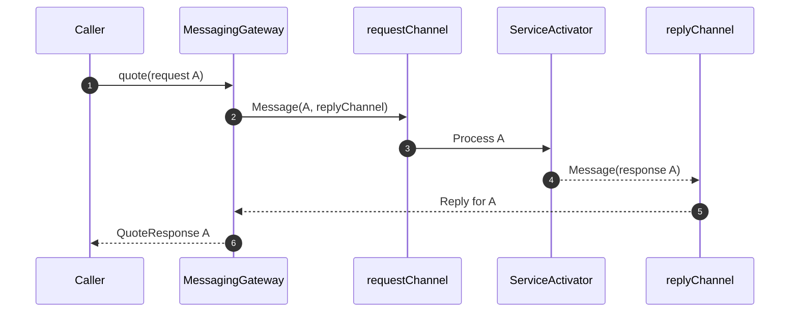

# Request–Reply Pattern: Matching Requests with Responses in Spring Integration

## Lesson Objectives

After this lesson, you can:

- Explain why a request message must receive its exact corresponding reply message, even when multiple requests execute concurrently.
- Identify the roles of `requestChannel`, `replyChannel`, `errorChannel`, message ID, and correlation ID.
- Build a Request–Reply flow using `@MessagingGateway` and `@ServiceActivator` in Spring Integration.
- Distinguish between the synchronous in-process case and the asynchronous or message-broker case.
- Design timeouts, error handling, correlation testing, and message flow observability.

In the **SPRING_INTEGRATION_PATTERN** module, we practice *Enterprise Integration Patterns* to create loosely coupled, extensible message flows. Request–Reply is foundational for understanding how a Gateway communicates with a Service Activator, how Routers/Transformers preserve routing metadata, and how a system handles errors or retries while still returning results to the right caller.

## 1. The Problem: Which Reply Belongs to Which Request?

Suppose a quoting service receives two requests almost simultaneously:

| Request | Content | Correct Reply |
| --- | --- | --- |
| A | Quote for 2 copies of `BOOK-01` | Quote of `BOOK-01` for A |
| B | Quote for 5 pens of `PEN-02` | Quote of `PEN-02` for B |

If service B finishes before service A, the system must still return B's result to caller B and A's result to caller A. You cannot rely on arrival order or completion order for matching.

**Request–Reply** is an exchange pattern in which a sender emits a *request* and expects to receive a *reply* associated with that request. Compared to a *fire-and-forget* flow (send without waiting for a result), this pattern requires a mechanism for routing replies, correlating them, and defining what to do when a reply does not arrive.

In Spring Integration, `Message<T>` contains a **payload** (business data) and **headers** (orchestration metadata). Headers allow the system to transport requests and replies across channels without forcing business logic to know who the caller is.



The diagram illustrates a single invocation. When multiple requests run concurrently, each call must have a reply path or correlation key sufficient to prevent replies from being delivered to the wrong caller.

## 2. The Components That Actually Match Requests with Replies

| Component | Meaning | Implementation Notes |
| --- | --- | --- |
| `requestChannel` | Entry point for request messages | Can use `DirectChannel`, `ExecutorChannel`, broker adapter, etc., depending on how processing is handled |
| `replyChannel` / `replyChannel` header | Destination where the reply must be sent | A Gateway typically attaches a temporary reply channel per invocation; the handler does not need to locate the caller itself |
| `errorChannel` | Target for error messages in flows that support error routing | Synchronous exceptions may propagate directly back to the caller instead of creating an `ErrorMessage` |
| Message `id` | Identifies **one specific message** | A reply is usually a new message with a new ID; do not use this ID as a cross-system business key |
| `correlationId` | Key linking messages belonging to the same activity | Essential with brokers, distributed processing, and multiple replies; also used by Splitter/Aggregator for grouping |
| Business `requestId` | System-designed request identifier | Useful for tracing, idempotency, and auditing across processes |

**Two matching approaches to distinguish:**

1. **Per-call reply channel (in-process):** The Gateway creates or manages a reply-receiving channel and waits for the exact reply of that call. In the basic case, the application does not need to generate a `correlationId` manually.
2. **Cross-service correlation ID:** When requests and replies travel through queues/topics or separate processes, the sender writes a stable key into the envelope/header; the receiver preserves that key in the reply; the sender looks up a *pending requests* table to complete the matching request.

A `correlationId` is merely data if no component actually uses it to map request → reply. Conversely, setting a `replyChannel` per invocation can already be sufficient within the same application. **Do not assume every reply automatically carries an appropriate correlation ID**, and do not confuse the grouping correlation used by an Aggregator with the correlation used to answer an RPC.

## 3. A Runnable Example in Spring Integration: Order Quoting

Build a Java API `QuoteGateway.quote(...)` that lets a controller/service invoke it like a normal method. Behind the scenes, Spring Integration turns the call into a message, sends it to a Service Activator, and returns the result to the caller.

The example uses Java 17+, Spring Framework/Spring Integration 6.x, and the required Spring Integration dependencies. The Java classes in the code blocks below belong in the **same package** and in their respective files.

### 3.1. Request and Response DTOs

```java
// QuoteRequest.java
public record QuoteRequest(String sku, int quantity) {}

// QuoteResponse.java
import java.math.BigDecimal;

public record QuoteResponse(
        String sku,
        int quantity,
        BigDecimal unitPrice,
        BigDecimal total
) {}
```

### 3.2. Declaring the Channel and Enabling Gateway Scanning

```java
import org.springframework.context.annotation.Bean;
import org.springframework.context.annotation.Configuration;
import org.springframework.integration.annotation.IntegrationComponentScan;
import org.springframework.integration.channel.DirectChannel;
import org.springframework.integration.config.EnableIntegration;
import org.springframework.messaging.MessageChannel;

@Configuration
@EnableIntegration
@IntegrationComponentScan
public class QuoteIntegrationConfig {
    @Bean
    public MessageChannel quoteRequests() {
        return new DirectChannel();
    }
}
```

`DirectChannel` invokes the handler on the sender's execution thread. This approach is convenient for clearly observing request → handler → reply and for short-running processing. `@IntegrationComponentScan` discovers interfaces annotated with `@MessagingGateway` within the appropriate component scan scope.

### 3.3. Gateway: Method-Style Entry Point

```java
import org.springframework.integration.annotation.MessagingGateway;

@MessagingGateway(defaultRequestChannel = "quoteRequests")
public interface QuoteGateway {
    QuoteResponse quote(QuoteRequest request);
}
```

The application can inject `QuoteGateway` and call `quote(...)`. Spring Integration generates a proxy that converts arguments into a request message, sets up the reply mechanism, and converts the reply payload back into `QuoteResponse`. The caller does not have to create a channel for each request manually.

### 3.4. Service Activator: Processing Business Logic and Returning the Result

```java
import java.math.BigDecimal;
import org.springframework.integration.annotation.ServiceActivator;
import org.springframework.stereotype.Component;

@Component
public class QuoteService {

    @ServiceActivator(inputChannel = "quoteRequests")
    public QuoteResponse handle(QuoteRequest request) {
        if (request.quantity() <= 0) {
            throw new IllegalArgumentException("quantity must be positive");
        }

        BigDecimal unitPrice = switch (request.sku()) {
            case "BOOK-01" -> new BigDecimal("120000");
            case "PEN-02"  -> new BigDecimal("15000");
            default -> throw new IllegalArgumentException("Unknown SKU");
        };

        return new QuoteResponse(
                request.sku(),
                request.quantity(),
                unitPrice,
                unitPrice.multiply(BigDecimal.valueOf(request.quantity()))
        );
    }
}
```

The handler returns an object instead of manually sending a message to a fixed channel name. In a standard request–reply flow, Spring Integration wraps the return value in a reply and uses the request's reply routing information to return it to the Gateway. That is loose coupling in practice: `QuoteService` does not need to know which REST controller or job invoked it.

### 3.5. Caller Using the Gateway

```java
import org.springframework.stereotype.Service;

@Service
public class CheckoutService {
    private final QuoteGateway quoteGateway;

    public CheckoutService(QuoteGateway quoteGateway) {
        this.quoteGateway = quoteGateway;
    }

    public QuoteResponse preview() {
        return quoteGateway.quote(new QuoteRequest("BOOK-01", 2));
        // unitPrice = 120000, total = 240000
    }
}
```

**Flow:** `CheckoutService` calls the gateway → the gateway sends the request to `quoteRequests` → `QuoteService` processes it → the gateway receives the reply → the method returns `QuoteResponse`. If request B finishes before A, Spring Integration still uses the reply path tied to each invocation rather than relying on reply arrival order.

## 4. Observing the `replyChannel` Header Without a Gateway

To see the underlying mechanism, a sender can specify `replyChannel` explicitly. The snippet below uses the `quoteRequests` bean declared above and the `QuoteService` handler subscribed to it:

```java
import org.springframework.integration.channel.QueueChannel;
import org.springframework.messaging.Message;
import org.springframework.messaging.MessageChannel;
import org.springframework.messaging.MessageHeaders;
import org.springframework.messaging.support.MessageBuilder;

public QuoteResponse requestManually(MessageChannel quoteRequests) {
    QueueChannel replies = new QueueChannel();

    Message<QuoteRequest> request = MessageBuilder
            .withPayload(new QuoteRequest("PEN-02", 5))
            .setHeader(MessageHeaders.REPLY_CHANNEL, replies)
            .build();

    if (!quoteRequests.send(request)) {
        throw new IllegalStateException("Cannot send quote request");
    }

    Message<?> answer = replies.receive(3_000);
    if (answer == null) {
        throw new IllegalStateException("Timed out waiting for quote");
    }
    return (QuoteResponse) answer.getPayload();
}
```

Here, `QueueChannel` acts as a mailbox receiving one reply, while `DirectChannel` dispatches the request to the handler. The `receive(3_000)` method waits at most 3,000 ms **at the receiving point**. In the synchronous example, the handler executes inside `send()`; if the handler blocks for a very long time, `receive()` has not been reached yet, and the timeout on `receive()` does not bound the handler's execution time.

This demonstrates the mechanism, not a reason to rebuild a Gateway manually in production applications. When routing through a Router, Filter, or Transformer, reply information must be preserved; constructing a brand-new message that drops the reply header can prevent the reply from returning to the caller. When returning a payload from an endpoint managed by Spring Integration, the framework typically handles forwarding headers/reply routing according to the flow configuration.

## 5. Synchronous and Asynchronous Request–Reply

| Scenario | How Replies Are Matched and Received | Points to Control |
| --- | --- | --- |
| `DirectChannel` + `@MessagingGateway` | Gateway waits for the result via the framework's reply mechanism; handler runs on the same call stack | A slow or hung handler slows down the caller; a reply timeout does not automatically cancel in-flight I/O |
| `ExecutorChannel` / internal async flow | Request is handed off to an executor; Gateway can wait for the reply on the caller thread | Thread pool, wait bounds, errors thrown on another thread, late replies |
| RabbitMQ/Kafka/JMS or external services | Use a reply destination and a clearly agreed correlation ID or request ID | Serialization, persisting pending requests, duplicates, out-of-order delivery, timeouts, retries |
| One request producing multiple results | Aggregate all results by key and completion condition before replying | `Splitter`/`Aggregator`, group correlation ID, sequence number, partial results |

**Notes on timeouts:**

- *Request timeout* relates to how long sending tries to place the request into a channel when sending can block.
- *Reply timeout* relates to how long the Gateway waits for a reply after sending. Exact values are configured on the Gateway or endpoint depending on how they are declared.
- A timeout does not mean downstream processing has been canceled. Late replies must be handled deliberately; never automatically attach a late reply to a new request.
- With synchronous `DirectChannel`, total method blocking time can depend directly on handler execution time; set explicit timeouts on actual I/O calls.

When you only need to report "request accepted" and process later, consider an asynchronous flow that returns an **acknowledgment** and publishes the result on another channel. That is a different contract from waiting for the final business outcome within the same invocation.

## 6. Correlating Replies Across Processes with a Correlation ID

When requests and replies traverse a message broker, an in-memory Java object `replyChannel` reference cannot be transmitted as-is to another process. You need a wire-compatible exchange protocol:

```text
Service A                              Broker                        Service B
  | publish request                     |                              |
  | {requestId:"q-204",                 |                              |
  |  replyTo:"quotes.reply",            |                              |
  |  payload:{sku:"BOOK-01"}}           |----------------------------->|
  |                                      |                              | compute price
  |<-------------------------------------|<-----------------------------|
  | reply {correlationId:"q-204",       |                              |
  |        payload:{total:120000}}      |                              |
  |                                      |                              |
  | lookup pending["q-204"]             |                              |
  | -> complete request q-204           |                              |
```

This example is an **illustrative protocol**. Actual header names, how reply destinations are set, correlation mechanisms, and queue durability depend on the adapter/broker. You must implement all of the following steps:

1. The sender generates a system-wide unique `requestId` and records the pending request along with its deadline and reply destination.
2. The receiver processes the request, copies the correlation key into the response, and sends the response to the agreed destination.
3. The sender inspects the correlation ID, looks up the pending request, and completes the matching promise/future or updates business state.
4. Upon expiration, mark the request as timed out; late replies are handled under a dedicated policy (log and discard, store for reconciliation, or update state if business rules allow).
5. If the broker redelivers a message, use an idempotency key to avoid processing or triggering side effects twice; retry only with a clear strategy.

Do not use a shared reply queue and take the "first message" for the "first request." When multiple callers wait concurrently, this easily mismatches replies when processing speeds vary. In multi-instance deployments, also account for reply consumption partitioning, where pending requests are stored, and what happens if the instance awaiting a reply restarts.

## 7. Errors, Retries, and Responsibility Boundaries

A request has at least four outcomes that must be designed for:

| Outcome | Example | Typical Handling |
| --- | --- | --- |
| Success | Valid SKU, price returned | Return the matching reply to the caller |
| Business error | Unknown SKU, invalid quantity | Return a structured error or throw an exception per the Gateway contract |
| Transient infrastructure error | Temporary DB/message broker disconnect | Bounded retries with backoff; ensure idempotency before retrying |
| No reply in time | Hung consumer or lost reply | Time out, record trace/correlation ID, decide how to handle late replies |

With `DirectChannel` and a synchronous handler, exceptions from `QuoteService` normally propagate back to the Gateway call. When a flow runs over an executor or messaging transport, errors may route to `errorChannel` as an `ErrorMessage` if an error flow is configured. **Do not assume every exception automatically appears on `errorChannel`**; error propagation depends on endpoint types and async boundaries.

If you add a `Filter`, clearly define behavior when a message is dropped: a filtered request with neither a reply nor an error signal can force the caller to wait until timeout. If you use a `Router`, every branch obligated to return a result must have a valid reply path. If you use a `Splitter`, do not return an arbitrary item as if it were the final result; use an `Aggregator` with a completion condition when the business flow expects a single consolidated reply.

## 8. Testing and Observing Correlation

A basic integration test can verify that the gateway receives the expected payload:

```java
import static org.assertj.core.api.Assertions.assertThat;

import org.junit.jupiter.api.Test;
import org.springframework.beans.factory.annotation.Autowired;
import org.springframework.boot.test.context.SpringBootTest;

@SpringBootTest
class QuoteFlowTest {
    @Autowired
    private QuoteGateway gateway;

    @Test
    void replyMatchesRequest() {
        QuoteResponse book = gateway.quote(new QuoteRequest("BOOK-01", 2));
        QuoteResponse pen = gateway.quote(new QuoteRequest("PEN-02", 5));

        assertThat(book.sku()).isEqualTo("BOOK-01");
        assertThat(book.total()).isEqualByComparingTo("240000");
        assertThat(pen.sku()).isEqualTo("PEN-02");
        assertThat(pen.total()).isEqualByComparingTo("75000");
    }
}
```

To verify correctness under load, test these additional scenarios:

- **Concurrency and out-of-order completion:** send multiple requests with distinct request IDs, intentionally delaying one request; verify each reply returns to the right caller.
- **Delays and missing replies:** simulate an unresponsive handler and verify timeouts trigger without leaking pending entries.
- **Asynchronous errors:** ensure errors reach the right invocation or are recorded according to the error-handling contract.
- **Duplicates or late replies:** verify a request cannot complete twice and stale results are never assigned to another request.
- **Transformation/routing:** verify required headers or correlation keys remain intact across endpoints.

In production monitoring, log/trace by `requestId` or `correlationId` alongside status, send timestamp, reply timestamp, latency, and timeout outcome. Avoid logging full payloads if they contain sensitive data. A dashboard can track pending request count, timeout rate, p95/p99 latency, and unmatched replies.

## 9. Common Mistakes and Self-Check

**Mistake 1: Using reply arrival order for matching.** Two parallel consumers can finish in any order. Use the Gateway's reply mechanism or an explicit correlation key.

**Mistake 2: Assuming message ID always equals request ID.** A new message created after processing can have a new ID. Use a business key or correlation ID preserved between request and reply when tracing across systems.

**Mistake 3: Setting only a reply timeout and assuming the whole execution has a deadline.** With a synchronous I/O-blocking handler, the caller thread can still block during sending. Set deadlines on individual dependency calls and bound processing resources.

**Mistake 4: Switching channels while losing reply metadata.** When building a `Message` manually, check whether routing headers are preserved; when crossing processes, map them into a wire-transmittable message format.

**Mistake 5: Retrying requests with side effects without deduplication.** A request may succeed while its reply is lost; retrying could execute business logic twice. Use an idempotency key and appropriate processing state.

Answer three questions before finalizing your design:

1. If 100 requests complete in reverse order, which component guarantees each reply returns to the exact matching request?
2. If a request times out even though it actually succeeded, which key will caller and server use to reconcile?
3. If the flow includes a Router, Filter, Splitter, or Aggregator, does every branch produce the promised reply type or error outcome?

## Conclusion

Request–Reply pairs a request with the reply that belongs to it. In Spring Integration, **Messaging Gateway + Service Activator + reply channel** implements this pattern cleanly within a single application; when crossing process boundaries, add **reply destination + correlation/request ID + timeout, retry, and idempotency management**. Getting correlation right is essential so flows with Routers, Transformers, Gateways, and Aggregators can scale while still returning accurate results to callers.
