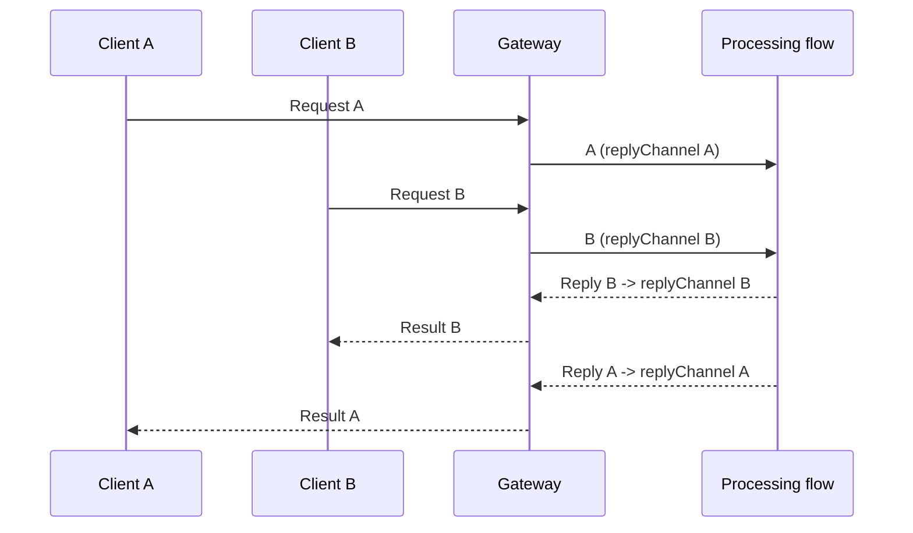
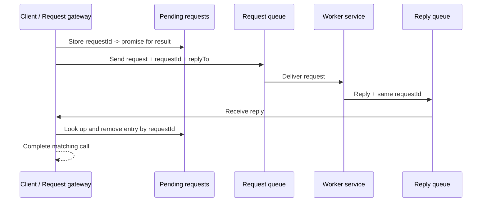

# Message Correlation in Request-Reply

In the **Request reply** chapter of the **SPRING_INTEGRATION_PATTERN** module, a request is sent into a message flow and the caller needs to receive the exact corresponding reply. This is an essential part of Enterprise Integration Patterns when building loosely coupled Spring Integration flows where you can add Routers, Filters, Transformers, Gateways, retries, or error channels while still tracking each individual request.

**Message correlation** is the mechanism for identifying the relationship between a request and a reply (or among child messages belonging to the same task). When multiple requests execute concurrently, reply order may differ from send order. If an application relies solely on order, it might return customer A's result to customer B.

After this lesson, you can:

- Distinguish between a reply destination, a correlation key, and a distributed tracing ID.
- Explain how a Spring Integration Gateway matches a reply with the right invocation.
- Design cross-process correlation, including when replies arrive late, duplicated, or not at all.
- Identify when `correlationId`, `sequenceNumber`, and `sequenceSize` serve Splitter/Aggregator rather than a single request-reply.
- Test success, timeout, and error branches without relying on processing order.

## 1. Why Is Correlation Needed?

Suppose a sales system sends two quote requests nearly at the same time:

| Time | Event | Meaning |
| --- | --- | --- |
| T1 | Client A sends request `requestId=R-101`, item code A | A starts waiting |
| T2 | Client B sends request `requestId=R-102`, item code B | B starts waiting |
| T3 | Service replies to `R-102` first | Only B may receive this reply |
| T4 | Service replies to `R-101` later | Only A may receive this reply |

Arrival order is not a matching criterion. You need a mechanism to identify *which request this reply belongs to* and a place to deliver the result back to the right waiting party.



In the example above, per-invocation reply channels allow the Gateway to return the right result even when processing order changes.

## 2. Distinguishing Identifiers and Headers

Not every field with "ID" in its name is used to match a request with a reply. In Spring Integration, separate three responsibilities:

| Component | Purpose | Notes |
| --- | --- | --- |
| `replyChannel` | Indicates the channel receiving a message's reply. A Gateway usually creates/sets a temporary reply channel for a synchronous call. | This is routing metadata; it may be an in-JVM `MessageChannel` object, which is not inherently transmittable over a broker. |
| `correlationId` | Groups related messages, especially when a Splitter breaks one message into parts for an Aggregator to recombine. | Not required on every request-reply; do not assume a Gateway relies solely on this header to return results. |
| `requestId` (custom header) | Unique key for a business request when matching replies across two processes or two services. | The responder must return the exact same key; the receiver must track pending requests. |
| `sequenceNumber`, `sequenceSize` | Position and total count of parts in a message group. | Useful for Splitter/Aggregator; does not replace an exchange's `requestId`. |
| `id` in `MessageHeaders` | Identifier of one specific *message*. | Recreating/transforming a message can produce a new ID; do not use it as a long-lived business key. |
| `traceId` (from tracing system) | Links spans/logs of a distributed transaction. | Useful for observability; does not automatically determine where to send a reply or maintain a pending-requests table. |

**Design rule:** For in-application exchanges via a Messaging Gateway, prefer the `replyChannel` mechanism already provided by the Gateway. For asynchronous exchanges over a broker or across processes, define an explicit correlation contract, such as `requestId` + reply destination + timeout. For Splitter/Aggregator flows, use an appropriate group correlation key and preserve the original request's reply context.

## 3. Automatic Correlation via Spring Integration Gateway

Example of a Java application using Spring Integration Java DSL to handle quotes:

```java
import java.math.BigDecimal;

import org.springframework.context.annotation.Bean;
import org.springframework.context.annotation.Configuration;
import org.springframework.integration.annotation.IntegrationComponentScan;
import org.springframework.integration.annotation.MessagingGateway;
import org.springframework.integration.dsl.IntegrationFlow;

record QuoteRequest(String sku, int quantity) {}
record QuoteReply(String sku, BigDecimal amount) {}

@MessagingGateway(
    defaultRequestChannel = "quotes.requests",
    defaultReplyTimeout = "5000"
)
interface QuoteGateway {
    QuoteReply quote(QuoteRequest request);
}

@Configuration
@IntegrationComponentScan
class QuoteIntegrationConfig {

    @Bean
    IntegrationFlow quoteFlow() {
        return IntegrationFlow.from("quotes.requests")
            .handle(QuoteRequest.class, (request, headers) -> {
                // Fixed unit price solely to illustrate request-reply.
                BigDecimal unitPrice = new BigDecimal("42.00");
                return new QuoteReply(
                    request.sku(),
                    unitPrice.multiply(BigDecimal.valueOf(request.quantity()))
                );
            })
            .get();
    }
}
```

On the caller side:

```java
QuoteReply result = quoteGateway.quote(new QuoteRequest("SKU-01", 3));
// Example: QuoteReply[sku=SKU-01, amount=126.00]
```

Processing flow:

1. Calling `quote(...)` creates a request message sent to `quotes.requests`. The Gateway prepares a reply receiver corresponding to **that specific invocation**.
2. The Service Activator inside `handle(...)` computes and returns a `QuoteReply` payload.
3. Spring Integration's request-reply mechanism routes the result to the appropriate reply channel so the Gateway can complete the call.
4. If two calls execute concurrently, each receives its own reply; there is no need to hardcode "first request gets first reply."

The example uses a handler that returns a value directly, so Spring Integration can construct the reply message and manage flow headers. If you manually create a new message mid-flow, take special care to preserve the reply destination and meaningful headers; a custom Transformer/Router that drops `replyChannel` can cause the Gateway to wait until timeout.

**Limitation:** `defaultReplyTimeout` is how long to wait for a reply; it does not cancel the task already running downstream. The calling application must define behavior upon timeout (e.g., null result, exception, or fallback depending on configuration), and must never assume downstream work has stopped.

## 4. When Requests and Replies Traverse a Broker or Multiple Processes

An internal Gateway can route via temporary in-memory channels. When sending requests through RabbitMQ, Kafka, or an external protocol, you cannot assume an in-JVM `MessageChannel` object crosses the network boundary. You must design correlation as transmittable data, typically including:

- **`requestId`**: generated uniquely per request (e.g., UUID), stable across processing steps and retries of the same request.
- **`replyTo`**: reply queue/topic name or endpoint, if the protocol and design require specifying the address.
- **Payload and status**: success result or error, attached to that same `requestId`.
- **Deadline/timeout**: policy for ending the wait, cleaning up state, and handling late replies.

Example contract at the transport boundary (JSON is illustrative; how it maps to broker headers depends on the adapter):

```json
{
  "requestId": "77a3c49b-08b5-4a4c-a247-922b9dff102a",
  "replyTo": "quotes.replies",
  "payload": {
    "sku": "SKU-01",
    "quantity": 3
  }
}
```

```json
{
  "requestId": "77a3c49b-08b5-4a4c-a247-922b9dff102a",
  "status": "OK",
  "payload": {
    "sku": "SKU-01",
    "amount": 126.00
  }
}
```

The two messages may have different `MessageHeaders.ID` values yet share the *same* `requestId`. That key allows the receiver to match the reply with the original request.



An in-memory waiting registry can be sketched in Java as follows. This is an **illustration of correlation logic**, not including actual sending/receiving through a real adapter:

```java
import java.util.UUID;
import java.util.concurrent.CompletableFuture;
import java.util.concurrent.ConcurrentHashMap;
import java.util.concurrent.ConcurrentMap;
import java.util.concurrent.TimeUnit;
import org.springframework.messaging.Message;

class PendingQuotes {
    private final ConcurrentMap<String, CompletableFuture<QuoteReply>> pending =
        new ConcurrentHashMap<>();

    CompletableFuture<QuoteReply> register(String requestId) {
        var future = new CompletableFuture<QuoteReply>();
        if (pending.putIfAbsent(requestId, future) != null) {
            throw new IllegalArgumentException("Duplicate requestId");
        }

        future.orTimeout(5, TimeUnit.SECONDS)
            .whenComplete((value, error) -> pending.remove(requestId, future));
        return future;
    }

    void onReply(Message<QuoteReply> reply) {
        Object value = reply.getHeaders().get("requestId");
        if (!(value instanceof String requestId)) {
            // Log reply missing key; do not guess recipient.
            return;
        }

        var waiter = pending.remove(requestId);
        if (waiter != null) {
            waiter.complete(reply.getPayload());
        } else {
            // Late reply, duplicate, or unknown requestId.
        }
    }
}

// On the sending flow:
// String requestId = UUID.randomUUID().toString();
// CompletableFuture<QuoteReply> reply = registry.register(requestId);
// Send request to broker with requestId and replyTo.
// If sending fails, complete the future exceptionally and remove entry immediately.
```

In a multi-instance system, an in-memory registry on a single instance is insufficient if the reply can arrive at a different instance. You must ensure replies return to the originating instance, or use coordination/shared state suited to your reliability requirements. An adapter with built-in request-reply support may already provide part of this mechanism; leverage the adapter's contract and configuration before maintaining your own registry.

## 5. Correlation When Splitter and Aggregator Are Involved

In Enterprise Integration Patterns, "correlation" also means **grouping messages that belong to the same unit of work**. For example, a cart-total calculation request is split by a Splitter into three line items:

```text
Request CART-7
       |
       v
    Splitter
       |
       +--> item A: correlationId=CART-7, sequenceNumber=1, sequenceSize=3
       +--> item B: correlationId=CART-7, sequenceNumber=2, sequenceSize=3
       +--> item C: correlationId=CART-7, sequenceNumber=3, sequenceSize=3
       |
       v
    Aggregator (grouped by correlationId; meets release condition)
       |
       v
    Consolidate one reply for CART-7
```

In Spring Integration, a Splitter can supply sequence information; an Aggregator typically uses correlation information and a group completion strategy to build the result. The release condition depends on configuration and flow characteristics: knowing `sequenceSize=3` does not guarantee all three parts will always arrive, especially when filters, errors, or retries exist.

A key distinction: `correlationId` tells the Aggregator *which parts belong to the same group*; `replyChannel` or the external reply contract tells the flow *where the final result must be returned*. If one request spawns multiple subgroups, you may need two key layers: an internal group key and the original transaction's `requestId`.

## 6. Timeouts, Retries, Errors, and Duplicate Replies

| Scenario | Required Behavior | Consequence if Ignored |
| --- | --- | --- |
| Reply arrives out of order | Find the pending request using the correlation key or matching reply channel. | Wrong result returned to client. |
| Reply arrives after timeout | Clean up pending state on time; detect and log late replies. | Memory leaks, delivering results to an already-finished call. |
| Reply sent twice after retry | Complete a request at most once; handle duplicate replies idempotently. | Repeated business side effects. |
| Reply missing ID or unknown ID | Never guess the request; route to appropriate error handling/observability. | Broken correctness under concurrent requests. |
| Worker returns an error | Preserve the correlation key in the error response or route through a clearly configured `errorChannel`. | Sender can only wait until timeout; hard to investigate failures. |
| A part after Splitter is lost | Define group timeout, release/expiry strategy, and how to report error or partial result. | Aggregator holds the group indefinitely or returns incomplete data. |
| Service restarts | Define where pending state is stored and how requests are recovered/canceled. | Reply remains on the broker with no waiting caller. |

**Retrying does not mean creating a new request.** When re-attempting an operation for the same request, you usually must keep the same `requestId` to identify and deduplicate it; only a genuinely new business request gets a new key. If you send parallel attempts or need to measure individual tries, you can add a separate `attemptId`.

For aggregation flows, review the Aggregator's `groupTimeout`, release strategy, and group expiry policy. Settings such as emitting partial results upon expiration can alter business semantics, so decide explicitly: return partial, return error, or retry.

## 7. How to Test Correlation

Proper testing must create **real contention** among multiple requests and assert results by key rather than assuming order:

1. Send A and B concurrently; intentionally make B reply before A; verify A only receives A's reply and B only receives B's reply.
2. Submit two requests with identical payloads but different `requestId`s; verify they remain independent.
3. Send a reply missing `requestId`, with an invalid ID, or with a duplicate ID; verify error/duplicate handling rules.
4. Make the service slower than the timeout; verify the sender stops waiting and the registry is cleaned up.
5. Enable retries and verify attempts preserve the business key without completing the request multiple times.
6. If using Splitter/Aggregator, return parts in random order and drop one part; verify release conditions and timeouts behave as designed.

In production monitoring, log `requestId`, send/receive state, latency, retry count, error channel branch, and `traceId` (if available). Avoid logging entire payloads containing sensitive data. Useful metrics include pending request count, timeout rate, unmatched replies, duplicate replies, and completion latency.

## 8. Common Design Mistakes

- **Relying on FIFO:** Ordered sending on a queue does not mean services process and reply in the same order.
- **Using `MessageHeaders.ID` as a durable business ID:** A new message may be created by a Transformer/handler; pass an explicit correlation key across process boundaries.
- **Assuming `correlationId` is always generated by the Gateway and used to match replies:** For internal Gateways, `replyChannel` and the gateway request-reply mechanism are what matter.
- **Losing `replyChannel` when building replies manually:** The Gateway loses its path to receive results; preserve context or redesign reply routing.
- **Failing to evict timed-out requests:** The registry grows unbounded and late replies become undefined behavior.
- **Confusing correlation with tracing:** Traces help investigate execution, whereas correlation and reply routing decide which invocation owns a reply.

## Conclusion

Message correlation keeps request-reply accurate as Spring Integration flows scale into concurrency, branching, external service calls, and retries. Within an application, a Messaging Gateway typically manages a reply channel per call. Across process boundaries, explicitly design the `requestId` key, reply destination, timeout, deduplication, and state cleanup mechanism. When adding a Splitter/Aggregator, distinguish the group `correlationId` from the original request key so both **correct aggregation** and **returning to the right caller** are guaranteed.
