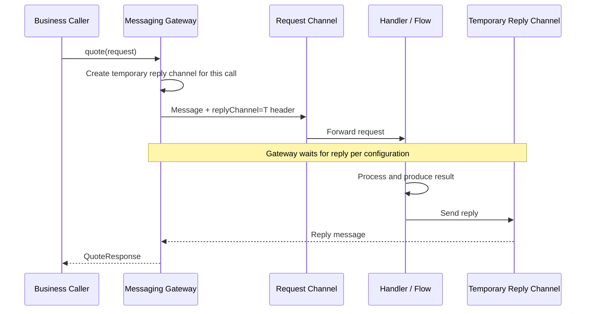
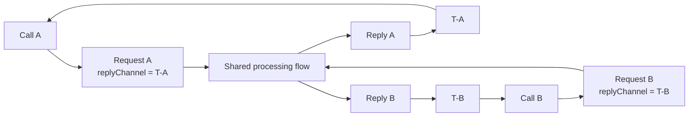

# Temporary Reply Channel in Request–Reply with Spring Integration

## 1. Context and Objectives

In the **Request–Reply** model, a component sends a request and needs to receive the exact corresponding result. With Spring Integration, a processing flow may pass through a Gateway, Channel, Filter, Router, Transformer, Service Activator, or several other components before producing a result.

**Temporary reply channel** answers the question: *How does the Gateway know which reply belongs to which waiting call, especially when multiple calls happen concurrently?*

After this lesson, you can:

- Explain why a Gateway creates a temporary reply channel for each invocation.
- Trace the role of the `replyChannel` header throughout the journey of a `Message`.
- Build a Gateway that receives results from a Service Activator without manually declaring a shared reply channel.
- Distinguish between request send timeout and reply receive timeout.
- Identify scenarios involving lost headers, missing replies, late replies, or multiple replies.

This lesson belongs to the **SPRING_INTEGRATION_PATTERN** module: applying Enterprise Integration Patterns to build loosely coupled, extensible, and testable message flows. A temporary reply channel is an infrastructure mechanism that realizes **Request–Reply**, commonly appearing alongside Messaging Gateways and other message-processing components.

## 2. What Is a Temporary Reply Channel?

When an application calls a Gateway method that expects a return value, Spring Integration can perform this lifecycle:

1. Create a temporary reply channel for the **current invocation**.
2. Place a reference to that channel in the `replyChannel` header of the request message.
3. Send the request to `requestChannel`.
4. Wait for a reply message sent to the temporary channel.
5. Extract the reply payload, convert it to the expected return type, and complete the Gateway call.

The temporary channel is an internal mechanism of the request–reply invocation; it **does not require being defined as a named bean**. Along standard processing paths, Spring Integration uses the `replyChannel` metadata preserved in the message to route the reply back to the exact waiting caller.

> **Distinction:** `requestChannel` is the request entry point shared across multiple calls. A temporary reply channel is the reply receiver bound to one specific send–receive invocation.

### Flow Diagram



In the diagram, the Handler does not need to know which Gateway is calling. It only needs to produce a reply conforming to the flow contract. The framework's reply mechanism uses the destination carried with the request.

## 3. Participating Components

| Component | Role |
|---|---|
| **Messaging Gateway** | Turns a Java method call into sending a message and receiving a result. |
| **Request channel** | Where the Gateway sends requests into the flow; typically declared explicitly. |
| **`replyChannel` header** | Indicates where the reply must be sent. The value can be a channel reference; the framework also supports resolving channel names in appropriate setups. |
| **Temporary reply channel** | Reply receiver dedicated to a single send–receive invocation. |
| **Service Activator / Transformer / Flow** | Processes the request and produces the reply message or payload. |
| **Reply timeout** | Limit on how long to wait for a reply in the receive phase, depending on the sending mechanism and execution model. |

### Why Not Always Use a Fixed Reply Channel?

A fixed `replyChannel` can be useful when integrating with a specific topology, but if multiple Gateway calls wait on one shared channel, the designer must handle dispatching and matching the right reply to each call.

A temporary reply channel lets the Gateway manage where each invocation receives its result automatically. This is the usual choice for Java method-style request–reply, especially when the caller does not need to know the internal reply topology.

A temporary channel **does not replace** correlation in every problem. If the flow includes a Splitter, Aggregator, parallel processing, or exchanges with external systems, you still must manage correlation keys across intermediate messages so a single request ultimately produces the right result.

## 4. Complete Example: Quote Calculation Gateway

Suppose an application needs a `quote(...)` method returning a price for a given product quantity. The request goes through `quoteRequests`, a Service Activator calculates the price, and the result is sent back to the Gateway.

The example uses Java 17 or later, Spring Boot with Spring Integration, and JUnit 5.

### 4.1. Request and Response DTOs

```java
// QuoteRequest.java
package com.example.integration;

public record QuoteRequest(String productId, int quantity) {
}
```

```java
// QuoteResponse.java
package com.example.integration;

import java.math.BigDecimal;

public record QuoteResponse(String productId, BigDecimal total) {
}
```

### 4.2. Declaring the Request Channel

```java
// IntegrationChannels.java
package com.example.integration;

import org.springframework.context.annotation.Bean;
import org.springframework.context.annotation.Configuration;
import org.springframework.integration.channel.DirectChannel;
import org.springframework.messaging.MessageChannel;

@Configuration
public class IntegrationChannels {

    @Bean
    public MessageChannel quoteRequests() {
        return new DirectChannel();
    }
}
```

Here only the **request channel** is declared. No bean such as `temporaryReplyChannel` is created because the Gateway manages the per-call reply channel automatically when needed.

### 4.3. Declaring the Messaging Gateway

```java
// QuoteGateway.java
package com.example.integration;

import org.springframework.integration.annotation.MessagingGateway;

@MessagingGateway(
    defaultRequestChannel = "quoteRequests",
    defaultReplyTimeout = "5000"
)
public interface QuoteGateway {

    QuoteResponse quote(QuoteRequest request);
}
```

When `quote(request)` is called, the Gateway builds a message and sends it to `quoteRequests`. For a call that expects a return value without another explicit reply channel configured, the Gateway uses the temporary reply channel mechanism to receive the result.

`defaultReplyTimeout = "5000"` specifies the reply wait timeout in milliseconds per Gateway configuration. It is **not** an absolute five-second bound on the entire operation across every topology; see the timeout section below.

### 4.4. Service Activator Producing the Reply

```java
// QuoteService.java
package com.example.integration;

import java.math.BigDecimal;

import org.springframework.integration.annotation.ServiceActivator;
import org.springframework.stereotype.Component;

@Component
public class QuoteService {

    private static final BigDecimal UNIT_PRICE = new BigDecimal("12.50");

    @ServiceActivator(inputChannel = "quoteRequests")
    public QuoteResponse calculate(QuoteRequest request) {
        if (request == null || request.productId() == null
                || request.productId().isBlank()
                || request.quantity() <= 0) {
            throw new IllegalArgumentException("Invalid quote request");
        }

        BigDecimal total = UNIT_PRICE.multiply(
            BigDecimal.valueOf(request.quantity())
        );
        return new QuoteResponse(request.productId(), total);
    }
}
```

The `calculate` method returns a payload; Spring Integration builds the appropriate reply and uses the reply destination from the active message context. We neither need to pass a `TemporaryReplyChannel` object into `QuoteService` nor write logic to look up the right client when returning results.

### 4.5. Enabling Gateway Scanning

```java
// Application.java
package com.example.integration;

import org.springframework.boot.SpringApplication;
import org.springframework.boot.autoconfigure.SpringBootApplication;
import org.springframework.integration.annotation.IntegrationComponentScan;
import org.springframework.integration.config.EnableIntegration;

@SpringBootApplication
@EnableIntegration
@IntegrationComponentScan
public class Application {

    public static void main(String[] args) {
        SpringApplication.run(Application.class, args);
    }
}
```

`@IntegrationComponentScan` registers `@MessagingGateway` interfaces within scanned packages. Other beans and components continue to be managed by Spring as usual.

### 4.6. Calling the Gateway and Testing

```java
// QuoteFlowTest.java
package com.example.integration;

import static org.junit.jupiter.api.Assertions.assertEquals;

import java.math.BigDecimal;

import org.junit.jupiter.api.Test;
import org.springframework.beans.factory.annotation.Autowired;
import org.springframework.boot.test.context.SpringBootTest;

@SpringBootTest
class QuoteFlowTest {

    @Autowired
    private QuoteGateway gateway;

    @Test
    void replyReturnsToTheCallingGateway() {
        QuoteResponse actual = gateway.quote(
            new QuoteRequest("SKU-01", 3)
        );

        assertEquals(
            new QuoteResponse("SKU-01", new BigDecimal("37.50")),
            actual
        );
    }
}
```

For this request, the expected result is `3 × 12.50 = 37.50`. The test confirms from the caller's perspective that the Gateway returns the value produced by the Service Activator; creating and using the reply channel happens inside the infrastructure.

**Run requirements:** compatible Spring Boot, Spring Integration, and Spring Boot Test/JUnit 5 dependencies; place the classes above in a package scanned by the application. The example illustrates an internal flow over `DirectChannel`, without connecting to a broker or external service.

## 5. How Does a Reply Reach the Right Invocation?

Suppose two invocations occur concurrently:

- Call A sends `QuoteRequest("A", 2)` and waits on temporary channel `T-A`.
- Call B sends `QuoteRequest("B", 4)` and waits on temporary channel `T-B`.

Each message carries its corresponding `replyChannel`. Even if B finishes before A, B's reply still goes to `T-B` and will not be swapped with A's result.



The diagram shows reply routing based on the channel attached to the request; it does not imply branches finish in order. With asynchronous steps or split–aggregate patterns, preserving the link between request and reply also depends on flow design and correlation metadata.

### The `replyChannel` Header Must Be Preserved Across Steps

Standard Spring Integration components normally preserve essential headers along the processing chain. However, if you build a brand-new `Message` manually and send it yourself, you may accidentally drop the `replyChannel` header.

For example, inside a handler that constructs messages manually:

```java
import org.springframework.messaging.Message;
import org.springframework.messaging.support.MessageBuilder;

// "incoming" is the Message<?> received from the upstream flow.
// "newPayload" is the transformed result.
Message<?> outgoing = MessageBuilder.withPayload(newPayload)
    .copyHeaders(incoming.getHeaders())
    .build();
```

This snippet shows how to preserve headers when manual message construction is required. Do not blindly copy all headers across to external systems: decide which headers truly need to be transmitted, how to map them, and what security rules apply. When you only need to transform the payload inside a standard Transformer, prefer letting the framework handle creating and forwarding the message.

### Who Sends the Reply?

In the example, we return a `QuoteResponse` object from the Service Activator. The framework performs the reply-sending step. In more complex configurations, if a component sends a `Message` manually instead of returning a value, it must determine the proper reply destination according to the flow contract. You cannot assume that sending arbitrarily to another channel will automatically return to the Gateway.

## 6. Timeouts and Synchronous Boundaries

Two easily confused concepts:

| Setting | What It Controls |
|---|---|
| **Request timeout** | How long sending waits to place a request onto a channel when the send operation can block, such as on bounded-capacity channels. |
| **Reply timeout** | How long the Gateway waits for a reply after the request has been sent, per the semantics of the Gateway and channel type used. |

Pay special attention to `DirectChannel`: the Handler can run **directly on the Gateway caller thread**. If the Handler takes 10 seconds to return, the call can remain blocked inside the synchronous send and processing phase. Therefore, setting `replyTimeout = 5000` does not guarantee total execution stops after 5 seconds.

If the flow hands off execution to another thread via an asynchronous channel, the Gateway can begin waiting for the reply while work continues in the background. In that setup, reply timeout becomes especially critical.

When the timeout expires without a reply, the application must have an explicit handling contract: empty/`null` result, mapped error, caller-level retry, or fallback response, depending on how the Gateway and error handling are defined. **Do not assume** every Gateway configuration throws the exact same exception type on timeout.

### Replies Arriving After Timeout

Once the caller stops waiting, a late reply may no longer have a valid receiving destination per the temporary channel's lifecycle, causing a send failure or being routed to the flow's error/monitoring mechanism, depending on configuration and version.

Designing for late handling requires attention to:

- Setting deadlines and timeouts aligned with actual processing capacity.
- Having an idempotency policy if clients can resend the same request.
- Logging business/tracing IDs to locate related requests and replies.
- Never using a temporary reply channel as a durable result queue.

If results must be received minutes or hours later, or after the calling application disconnects, design **asynchronous request–reply** using a transaction identifier and persistent result storage. A single waiting call's temporary reply channel is unsuitable for that problem.

## 7. Interaction with Other Enterprise Integration Patterns

The temporary reply channel is part of Gateway infrastructure. How replies are produced still depends on the patterns inside the flow.

| Pattern / Component | What Must Be Guaranteed |
|---|---|
| **Transformer** | Transform payload while preserving reply-routing header context. |
| **Filter** | If a message is dropped, decide whether the Gateway should time out or receive a business response via a discard branch. |
| **Router** | Selected branch must lead to a result or a defined error handler. |
| **Splitter / Aggregator** | Attach proper correlation and release strategy so **one** final reply is produced per call. |
| **Service Activator** | Return an appropriate payload/message; producing no output may leave the caller without a reply. |
| **Retry / Error channel** | Define how errors return to the caller, avoiding infinite waits or retries after the deadline expires. |
| **Gateway** | Configure appropriate timeouts and return type contracts. |

One notable case is **multiple branches sending replies to one temporary reply channel**. A standard request–reply Gateway expects one result per call. If a publish–subscribe flow or splitter produces multiple independent replies, do not treat the temporary channel as a collector for all of them; use an Aggregator or an intentional collection mechanism before returning to the Gateway.

## 8. Common Errors and How to Diagnose Them

### Gateway Sends the Request but Receives No Reply

**Symptom:** Caller waits until timeout, receives an unexpected outcome, or receives nothing.

**Checks:**

1. Did the final handler actually return a value, or did it return `null`/produce no message?
2. Did a Filter or Router direct the request into a branch that produces no reply?
3. Did the flow fail before reaching the step that produces the result?
4. After constructing a new message, was the `replyChannel` header preserved?
5. With asynchronous steps, did the reply arrive before the deadline?

### Reply Delivered to the Wrong Place

**Possible cause:** A handler manually sends to a hardcoded channel outside the design, or code overwrites the `replyChannel` header. Inspect message construction steps and output/reply channel settings rather than blaming the temporary channel by default.

### Blocking Despite Configuring Reply Timeout

**Possible cause:** `DirectChannel` is executing the Service Activator synchronously, or sending the request blocks before entering the reply wait phase. Identify synchronous–asynchronous boundaries and apply timeouts at the business-processing, I/O, or HTTP/database client level.

### Multiple Replies for One Request

**Possible cause:** Multiple branches complete independently and each sends to `replyChannel`. Clearly define a single final result, using an Aggregator when multiple messages truly need to be combined.

### Errors on an Asynchronous Flow Not Returned to Caller

**Possible cause:** The error only traverses an error-handling path the caller does not observe. Build an error flow capable of replying per contract or returning an explicit error status; do not treat `errorChannel` and `replyChannel` as the same concept.

## 9. Testing and Observability Strategy

In a lesson or production project, verify behavior across layers:

| Scenario | What to Verify |
|---|---|
| Valid request | Gateway receives the exact payload produced by the Handler. |
| Multiple parallel requests | Each caller receives the result matching its input, even when completion order differs. |
| Handler produces no reply | Application handles timeout or missing result per the agreed contract. |
| Slow handler | Timeouts are evaluated at the right execution boundary rather than inferred solely from `replyTimeout`. |
| Router/Filter drops message | An intentional reply branch or error handling executes. |
| Splitter/Aggregator | Messages correlate accurately and produce only one final reply. |
| Late reply | Logs, metrics, and expiration/error-handling policies behave properly. |

When debugging, log the business `requestId` or `correlationId`, send timestamp, processing start timestamp, and completion timestamp. Do not print full temporary channel objects or payloads with sensitive data. For multi-branch flows, inspect handlers, channels, and error flows using Spring Integration monitoring tools suitable for your application version.

A concurrency test can dispatch dozens of `QuoteRequest`s with varying product IDs and quantities, then assert `productId` and `total` on every result. What needs proving is **no cross-talk between callers' replies**, not that requests always finish in send order.

## 10. When Should You Use It?

**Good fit:** a Gateway with a clear call–return contract, one request producing exactly one reply, and a caller that remains alive while waiting. This lets Java applications stay close to normal method calls while structuring processing as message flows.

**Needs a different or extended design:** results require durable persistence, replies may arrive very late, each request yields multiple independent results, workflows must survive application restarts, or distributed communication needs system-wide correlation. In those cases, add an explicit reply protocol, correlation IDs, storage/broker, and expiration rules.

## 11. Self-Check Questions

1. Why can two concurrent Gateway calls share a `requestChannel` while needing separate reply destinations?
2. Which message header ensures the reply returns to the exact place the Gateway is waiting?
3. Why does `defaultReplyTimeout = "5000"` not always cap the entire call at five seconds when using `DirectChannel`?
4. If a Filter drops a request without producing a reply, what might the caller observe?
5. Why does a Splitter producing multiple results usually need an Aggregator before completing a Gateway call?
6. When manually creating a new message, what must you do to avoid losing reply routing metadata?

**Key takeaway:** A temporary reply channel is a transient reply address for a single request–reply exchange. Spring Integration can create and manage it automatically for a Messaging Gateway; the processing flow simply needs to preserve message context and produce a result matching the contract. Timeouts, asynchronous execution, and correlation across complex branches still must be explicitly designed and tested.
