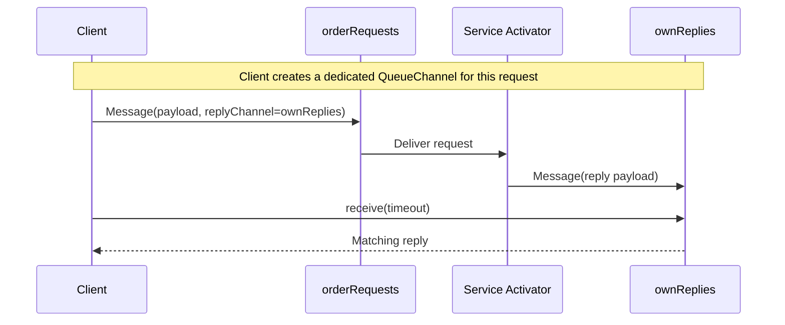

# Request Reply — Explicit Reply Channel in Spring Integration

## Learning Objectives

After this lesson, you can:

- Explain why a request message needs to specify where to receive its reply, and distinguish `replyChannel` from the request channel.
- Set an explicit reply channel via the `replyChannel` header, read replies with `PollableChannel`, and choose between a per-request channel or a fixed channel model.
- Understand how `outputChannel`, `@MessagingGateway`, `DirectChannel`, asynchronous channels, timeouts, and correlation affect the reply path.
- Write tests proving replies are routed to the right channel; recognize missing replies, mismatched replies, and processing errors.

This lesson belongs to the **Request reply** chapter of **SPRING_INTEGRATION_PATTERN**. It is part of Enterprise Integration Patterns in Spring Integration: instead of calling an object directly and receiving a return value via the Java call stack, the sender publishes a `Message` to a channel, components such as a Router, Filter, Transformer, or Service Activator process it, and another message is sent back to the reply destination. Decoupling these steps makes flows loosely coupled and extensible, but requires defining the reply path explicitly.

## 1. What Is an Explicit Reply Channel?

In the **Request–Reply** model, the sender needs to know where the corresponding reply will arrive. An **explicit reply channel** is an explicitly specified reply-receiving channel, usually via the standard `replyChannel` header on the *request message*, rather than relying on an implicit reply path.

A request has two main parts:

| Component | Role |
| --- | --- |
| `payload` | Business data, such as the order code to check. |
| `headers.replyChannel` | Address the processor can use to send the reply message. The value is usually a `MessageChannel` or a channel name resolved by Spring Integration. |
| `headers.errorChannel` (optional) | Address for error messages in flows supporting channel-based error routing; not equivalent to a success reply. |
| Correlation ID (when needed) | Key used to match a request with its reply, especially under concurrent requests or a shared reply channel. |

Example: a client sends a quote request to `quoteRequests` while attaching `replyChannel = customerAReplies`. The Service Activator processes the request and publishes `QuoteResponse` to `customerAReplies`. Another client can use the same request channel while receiving results via `customerBReplies`.



Key point: **`replyChannel` is routing metadata on the request**, not the channel where the request is sent. The handler can return a Java value; Spring Integration converts it into a reply message and routes it through the valid reply channel.

## 2. How Spring Integration Chooses the Reply Path

For a handler capable of producing a reply, keep these practical rules in mind:

1. If the endpoint has an **explicit `outputChannel`** configured (for example `@ServiceActivator(outputChannel = "fixedReplies")` or a `.channel("fixedReplies")` step after the handler in an IntegrationFlow), the reply follows that output path.
2. If no output channel is configured on the result emission path, the handler typically uses **`replyChannel` from the request's headers**.
3. If no valid reply destination exists, the result cannot find the caller automatically. Depending on endpoint type/configuration, sending the reply may fail or the caller may wait until timeout.
4. If the handler returns `null`, there is no reply payload to emit; this is a common cause of timeouts.

The name `replyChannel` is a standard constant: `MessageHeaders.REPLY_CHANNEL` in Spring Messaging. Example setting the channel directly:

```java
Message<String> request = MessageBuilder.withPayload("ORD-104")
    .setHeader(MessageHeaders.REPLY_CHANNEL, myReplyChannel)
    .build();
```

When `myReplyChannel` is a `MessageChannel` object, the handler can send the reply to that exact channel within the same application. A `String` channel name can also be resolved from Spring Integration configuration. However, a channel object is not an address that can be carried intact across Kafka, HTTP, or another process; across system boundaries, design a dedicated reply destination and correlation mechanism.

**Important distinction:** `replyChannel` is the address the sender proposes for a *specific request*, whereas `outputChannel` is the routing configuration of the *processing endpoint*. If a flow sets a fixed output channel, do not assume a per-request header will override that configuration.

## 3. Complete Example: Each Request Owns a Reply Channel

Problem: multiple components send order codes to `orderRequests`; each invocation must receive the exact string `ACCEPTED:<order code>`. We use a `DirectChannel` for requests and create a dedicated `QueueChannel` for each invocation.

### 3.1. Request-Processing Configuration

The example uses Spring Integration Java DSL and Spring configuration. Spring Integration dependencies are required in the application.

```java
import org.springframework.context.annotation.Bean;
import org.springframework.context.annotation.Configuration;
import org.springframework.integration.annotation.EnableIntegration;
import org.springframework.integration.channel.DirectChannel;
import org.springframework.integration.dsl.IntegrationFlow;
import org.springframework.messaging.MessageChannel;

@Configuration
@EnableIntegration
public class ReplyChannelConfig {

    @Bean("orderRequests")
    public MessageChannel orderRequests() {
        return new DirectChannel();
    }

    @Bean
    public IntegrationFlow orderProcessingFlow() {
        return IntegrationFlow.from("orderRequests")
            .handle(String.class, (orderCode, headers) -> {
                if (orderCode.isBlank()) {
                    throw new IllegalArgumentException("Order code is required");
                }
                return "ACCEPTED:" + orderCode;
            })
            .get();
    }
}
```

In this example, the handler produces a `String` result and **declares no fixed output channel**. Spring Integration can route that result based on the `replyChannel` header on the incoming request.

`DirectChannel` invokes subscribers on the sender's execution thread unless another asynchronous mechanism exists in the flow. Therefore, `send()` can wait until the handler finishes. This differs from an executor-backed channel, where `send()` may return before the reply is created.

### 3.2. Client Specifying Where to Receive the Reply

```java
import java.util.UUID;

import org.springframework.beans.factory.annotation.Qualifier;
import org.springframework.integration.channel.QueueChannel;
import org.springframework.messaging.Message;
import org.springframework.messaging.MessageChannel;
import org.springframework.messaging.MessageHeaders;
import org.springframework.messaging.support.MessageBuilder;
import org.springframework.stereotype.Component;

@Component
public class OrderClient {
    private final MessageChannel orderRequests;

    public OrderClient(@Qualifier("orderRequests") MessageChannel orderRequests) {
        this.orderRequests = orderRequests;
    }

    public String submitAndAwait(String orderCode) {
        // Each request has its own reply mailbox.
        QueueChannel ownReplies = new QueueChannel(1);

        Message<String> request = MessageBuilder.withPayload(orderCode)
            .setHeader(MessageHeaders.REPLY_CHANNEL, ownReplies)
            .setHeader("businessCorrelationId", UUID.randomUUID().toString())
            .build();

        boolean sent = orderRequests.send(request, 2_000);
        if (!sent) {
            throw new IllegalStateException("Cannot dispatch order request");
        }

        Message<?> reply = ownReplies.receive(3_000);
        if (reply == null) {
            throw new IllegalStateException("Timed out waiting for order reply");
        }

        return (String) reply.getPayload();
    }
}
```

Calling `submitAndAwait("ORD-104")` returns `"ACCEPTED:ORD-104"`. The pieces forming the request–reply path are:

- `MessageBuilder` attaches the `ownReplies` **object** to `MessageHeaders.REPLY_CHANNEL`.
- `orderRequests.send(...)` sends the request into the processing flow.
- The handler returns a result; Spring Integration routes the reply to the `ownReplies` specified by the caller.
- `ownReplies.receive(3_000)` waits up to 3 seconds for the reply **starting from when `receive` is called**. If no reply arrives, it returns `null`.

`QueueChannel(1)` fits here because each call expects exactly **one** reply. There is no need to declare `ownReplies` as a Spring bean or attach a poller for manual `receive()`. Allocating a dedicated channel per request also prevents multiple callers from accidentally consuming from a shared queue.

**Timeout limitation:** with `DirectChannel`, synchronous processing happens inside `send()`. The `send()` timeout parameter does not bound total handler execution time; if the handler is slow, significant time may elapse before reaching `receive()`. To bound the entire operation, configure appropriate deadlines/timeouts on downstream calls and execution points. In an asynchronous flow, `receive(timeout)` is what bounds client reply waiting.

## 4. Testing That Replies Reach the Right Channel

This is a small integration test verifying **actual routing** rather than merely asserting that a handler method returns the right string. The test assumes `ReplyChannelConfig` from the previous section is on the test classpath, along with JUnit 5 and `spring-test`.

```java
import static org.junit.jupiter.api.Assertions.assertEquals;
import static org.junit.jupiter.api.Assertions.assertNotNull;
import static org.junit.jupiter.api.Assertions.assertTrue;

import org.junit.jupiter.api.Test;
import org.springframework.beans.factory.annotation.Autowired;
import org.springframework.beans.factory.annotation.Qualifier;
import org.springframework.integration.channel.QueueChannel;
import org.springframework.messaging.Message;
import org.springframework.messaging.MessageChannel;
import org.springframework.messaging.MessageHeaders;
import org.springframework.messaging.support.MessageBuilder;
import org.springframework.test.context.junit.jupiter.SpringJUnitConfig;

@SpringJUnitConfig(ReplyChannelConfig.class)
class ReplyChannelIntegrationTest {

    @Autowired
    @Qualifier("orderRequests")
    MessageChannel orderRequests;

    @Test
    void returnsReplyToRequestedChannel() {
        QueueChannel replyA = new QueueChannel(1);
        QueueChannel replyB = new QueueChannel(1);

        assertTrue(orderRequests.send(MessageBuilder.withPayload("A-001")
            .setHeader(MessageHeaders.REPLY_CHANNEL, replyA)
            .build()));

        assertTrue(orderRequests.send(MessageBuilder.withPayload("B-002")
            .setHeader(MessageHeaders.REPLY_CHANNEL, replyB)
            .build()));

        Message<?> resultA = replyA.receive(1_000);
        Message<?> resultB = replyB.receive(1_000);

        assertNotNull(resultA);
        assertNotNull(resultB);
        assertEquals("ACCEPTED:A-001", resultA.getPayload());
        assertEquals("ACCEPTED:B-002", resultB.getPayload());
    }
}
```

Here the same request channel processes both messages, while each reply returns to its dedicated channel. For production systems, also test slow handlers, handlers throwing exceptions, requests missing `replyChannel`, and multiple concurrent requests.

## 5. Comparing Reply Configuration Approaches

| Approach | Routing | Best Fit When | What Must Be Managed |
| --- | --- | --- | --- |
| `replyChannel` header as dedicated channel | Each request provides its own reply address | In-app callers actively send/receive messages | Timeouts, queue lifecycle, one reply per request |
| `replyChannel` header as channel name | Caller sends a registered channel name | Internal flows use known reply endpoints | Name resolution, access control, avoiding caller collisions |
| Fixed output channel | Endpoint always sends results to a configured channel | A central consumer/dispatcher collects all replies | Correlation and dispatching back to callers |
| `@MessagingGateway` | Gateway manages sending and receiving replies per configuration | You want a typed Java API like `submit(): Response` | Timeouts, errors, gateway contract |

### 5.1. When to Choose a Fixed Output Channel?

A flow can explicitly specify the reply channel at the **handler output**, instead of relying on per-request headers. The example below is an **independent** alternative to Section 3, using separate `fixedRequests` and `fixedReplies` channels:

```java
@Bean("fixedRequests")
public MessageChannel fixedRequests() {
    return new DirectChannel();
}

@Bean("fixedReplies")
public QueueChannel fixedReplies() {
    return new QueueChannel();
}

@Bean
public IntegrationFlow fixedReplyFlow() {
    return IntegrationFlow.from("fixedRequests")
        .handle(String.class, (code, headers) -> "ACCEPTED:" + code)
        .channel("fixedReplies")
        .get();
}
```

All replies pass through `fixedReplies` because the flow specifies an output channel. If multiple callers call `fixedReplies.receive()`, caller A may pull B's reply: `QueueChannel` does not partition by correlation ID automatically. To use a shared channel safely, a **single consumer/dispatcher** must read replies, look up the correlation key, and route each reply to the right pending request.

The `businessCorrelationId` value in the client example is a header intentionally set for business tracking; never assume a correlation ID is auto-generated or preserved across every step. If Transformers, Routers, Splitters, or Aggregators are present, verify the correlation key remains intact throughout the flow. If a request splits into multiple branches, you usually must aggregate results with an Aggregator before returning **one** reply to the caller.

### 5.2. Relationship to Messaging Gateway

`@MessagingGateway` provides a strongly typed Java interface, for example:

```java
@MessagingGateway(defaultRequestChannel = "orderRequests")
public interface OrderGateway {
    String submit(String orderCode);
}
```

When the gateway is registered via appropriate Spring Integration scanning/declaration configuration, the caller simply calls `gateway.submit("ORD-104")`. The Gateway coordinates sending the request and receiving the reply; normally it manages the invocation's reply path automatically. Hence there is no need to create a `QueueChannel` manually just to make a standard Java request–reply call.

**Explicit reply channel** is especially useful when working directly with the `MessageChannel` API, when you want a deterministic output channel, or when designing reply paths between independent components. A Gateway is a caller-side abstraction; it does not eliminate the need to understand reply routing in the underlying flow.

## 6. Timeouts, Errors, and Common Pitfalls

| Symptom | Common Cause | How to Check / Handle |
| --- | --- | --- |
| `receive(timeout)` returns `null` | Handler returned `null`, message was filtered out, hasn't executed yet, or reply went elsewhere | Trace request ID; inspect output channel and `replyChannel` header; verify result-producing step |
| Request succeeds but client receives nothing | Flow defines a fixed output channel overriding the header; or header was dropped/modified | Inspect final routing path and header-mutating steps |
| Caller receives wrong result | Multiple callers calling `receive()` on a shared queue | Use a per-request channel or a correlation dispatcher |
| `send()` throws an exception | Synchronous handler failed over `DirectChannel` | Catch and handle the exception at the caller; do not expect a normal reply that was never created |
| Asynchronous flow fails with no normal reply | Error may be sent as an `ErrorMessage` via error channel mechanism | Explicitly design error channel, timeouts, and business error reply policy |
| Sending reply to a `DirectChannel` with no subscriber | Reply channel requires a subscribed handler | Use `QueueChannel` for active `receive()`, or subscribe a handler before emitting replies |
| Reply arrives after timeout | Slow handler or job finished after caller stopped waiting | Enforce deadlines, monitor late replies, clean up pending state, and decide safe retry policy |
| Channel info lost over broker/HTTP | In-memory `MessageChannel` object cannot be used directly in another process | Use transport reply addresses and correlation IDs, configuring header serialization/resolution where appropriate |

### Distinguishing Error Replies from the Error Channel

When a handler fails, separate two cases:

- **Synchronous errors**: with `DirectChannel`, handler exceptions usually propagate back to `send()`. You cannot assume a normal reply will appear on `replyChannel`.
- **Asynchronous errors**: depending on adapter/endpoint, errors may be wrapped in an `ErrorMessage` and sent to a configured error channel. The client must observe it or transform it into a business error response with a clear schema.

A good design can return `OrderResponse(status, errorCode, correlationId)` for expected business errors while reserving the error channel for infrastructure and technical failures. Never rely on `receive()` timing out as your sole way to classify errors.

### Correlation and Header Preservation

The `replyChannel` header says **where to send**; the correlation ID says **which request the reply belongs to**. With a per-request channel, channel identity physically separates streams so you may not need correlation lookup to receive a single reply. Still, keep a business correlation ID for logging, tracing, and linking request–reply across services.

When building a new message manually, take care to preserve allowed headers for downstream forwarding. For example:

```java
Message<String> forwarded = MessageBuilder
    .withPayload("normalized-" + originalRequest.getPayload())
    .copyHeaders(originalRequest.getHeaders())
    .build();
```

This copies existing headers, including `replyChannel` (system headers like ID/timestamp follow their own rules), except headers explicitly updated or stripped by another component. Never call `MessageBuilder.withPayload(...)` without `copyHeaders(...)` step by step and accidentally lose reply routing and correlation metadata.

## 7. Channel Selection and Operational Limits

**DirectChannel** works well to run a handler immediately on the send call; it is easy to follow and needs little synchronization. However, a slow dependency call inside the handler can block the caller thread. **ExecutorChannel** decouples sending from execution time; the caller must then wait for the reply and prepare for late arrivals. **QueueChannel** is a `PollableChannel` for receivers that want to actively call `receive(timeout)`.

A few design rules:

1. For internal calls expecting exactly one reply, create a per-request `QueueChannel(1)` or let a Messaging Gateway manage it.
2. If replies produce multiple messages, do not blindly use a capacity-1 queue; define an explicit multi-reply contract or combine results with an Aggregator.
3. When multiple callers share a channel, use a single correlation-based dispatcher rather than letting callers race on `receive()`.
4. Place timeouts at the right layers: network/client, request processing, reply waiting, and retry handling. Retries can resend the same request; business logic needs idempotency where appropriate.
5. Monitor key metrics: requests sent, successful replies, timeouts, channel errors, late replies, processing latency, and correlation IDs. Avoid logging full sensitive payloads.

## 8. Practice Exercise

Extend the `OrderClient` example with these steps:

1. Replace the `String` payload with `OrderRequest(orderId, customerId)` and return `OrderResponse(orderId, accepted, message)`.
2. Add a `Filter` rejecting requests missing `orderId`. Explicitly decide whether rejected requests produce a business error reply or route to a discard channel, rather than leaving the caller to time out.
3. Send at least 20 concurrent requests with distinct codes, each owning a `QueueChannel`; verify no reply is misrouted.
4. Try a flow with `ExecutorChannel` and intentionally slow down the handler to distinguish `send()` duration from `receive()` duration.
5. Try a fixed output channel and build a simple correlation-ID dispatcher; prove two clients never receive each other's replies.

**Completion criteria:** explain the path of a specific reply from handler to caller, identify which channel or header determines that path, and demonstrate with tests covering both success and timeout/error cases.

## 9. Key Takeaways

- Attaching `MessageHeaders.REPLY_CHANNEL` to a request specifies the **result-receiving channel**; it can be a `MessageChannel` or an application-resolved channel name.
- A reply-producing handler without a fixed output channel can reply via this header. An explicit output channel on the endpoint governs the emission path.
- Per-request channels prevent reply mix-ups across callers, whereas shared channels require proper correlation and dispatching.
- Timeouts alone do not reveal root cause: a reply might have been filtered, returned `null`, arrived late, been sent to the wrong channel, or failed in the handler.
- `@MessagingGateway` is usually the cleanest option for typed request–reply APIs; understanding explicit reply channels remains essential for designing, testing, and debugging Spring Integration message flows.
