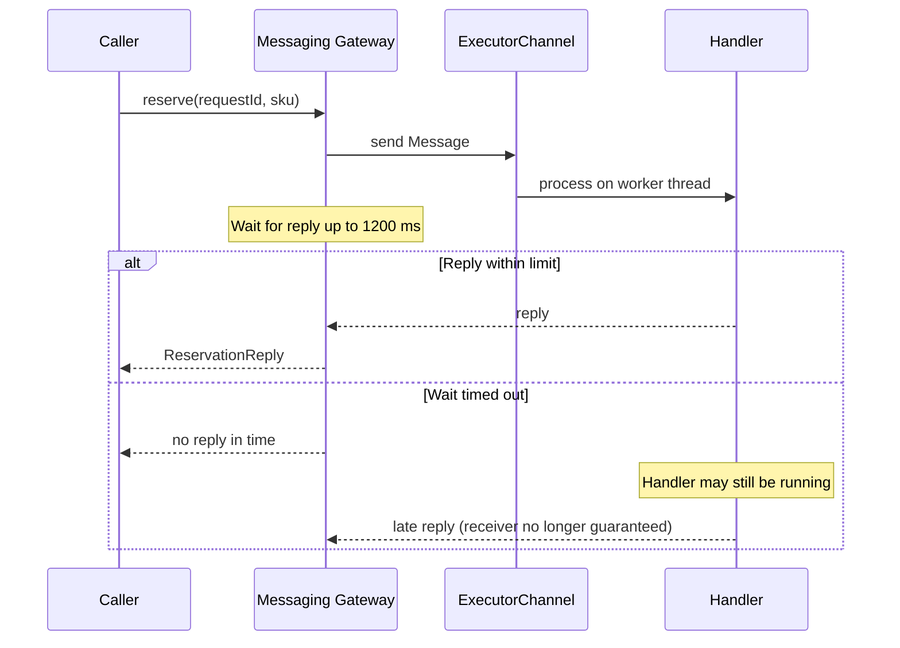

# Reply Timeout and Expiration Handling in Spring Integration

## 1. Why Does Request–Reply Need a Wait Time Limit?

In the **Request reply** chapter of the **SPRING_INTEGRATION_PATTERN** module, a component sends a request message and expects a reply message back. This model decouples the caller from the processor, but raises an important question: **what should the caller do if the reply never arrives?**

For example, an ordering API sends a stock-reservation request into a Spring Integration flow. The inventory service might respond quickly, respond slowly due to an overloaded database, or fail to respond because of an outage. If the API waits indefinitely, resources and user experience suffer. If the API concludes "order failed" the moment the wait expires while the inventory service still finishes reserving stock, the two sides end up out of sync on business state.

**Reply timeout** is how long a request–reply component is willing to wait for a reply. When it expires, the waiting side must make a clear decision: return an indeterminate status, return an error with proper semantics, use a fallback result, or trigger a lookup/compensation workflow.

After this lesson, you can:

- Distinguish between timeouts when **sending a request**, waiting for a **reply**, and the overall **business deadline**.
- Configure reply timeout on a Spring Integration messaging gateway.
- Explain why timing out **does not mean** downstream work has stopped.
- Design handling for late replies, retries, idempotency, correlation, and observability.
- Test fast, slow, error, and near-timeout-boundary scenarios.

## 2. Where Do Timeouts Occur in a Message Flow?

A typical request–reply flow consists of these steps:

1. Caller invokes a gateway method with business data.
2. Gateway wraps the data in a `Message`, sends it to the request channel, and sets up a `replyChannel` to receive the reply.
3. Handler processes the request, possibly calling a database or external system.
4. Handler sends the result to the reply channel; the gateway converts it into the caller's return value.



Setting `replyTimeout = 1200 ms` means the gateway bounds how long it waits *after the request has been sent per the channel's mechanics*. It does **not** automatically enforce a deadline on every downstream operation, does not guarantee canceling an SQL query, and does not revoke a request already accepted by another system.

### Three Easily Confused Concepts

| Concept | Start and End | Purpose |
| --- | --- | --- |
| **Request timeout** (`requestTimeout`) | Time allowed waiting to send a message into the request channel when sending can block | Prevent getting stuck at the request handoff step |
| **Reply timeout** (`replyTimeout`) | Time the gateway waits for a reply after the send step | Bound how long the caller waits for a result |
| **Business deadline** | Business timestamp respected by all components | Avoid processing a request that is no longer valid |

Additionally, timeouts for HTTP clients, JDBC, transactions, message brokers, or downstream APIs can differ completely from reply timeout. Each timeout protects a slice of execution; gateway settings do not replace settings at the remaining layers.

> **Key point about `DirectChannel`:** a `DirectChannel` handler typically runs directly on the sending thread. If the handler blocks for two seconds, the caller may block for two seconds inside `send`, even if `replyTimeout` is configured as one second. To observe reply wait time independently of handler execution time, the example below uses `ExecutorChannel`.

## 3. Example: Gateway Waiting Up to 1.2 Seconds to Reserve Stock

Suppose an inventory application receives stock-reservation requests. If a reply arrives in time, the caller gets a reservation code; if it times out, the caller must treat the outcome as **indeterminate**, since the handler may still complete afterward.

The example uses Spring Integration with Java 17+ and annotation-based configuration. The classes reside in the same package (or a Spring-scanned subpackage); place each `public` type in its own Java file when bringing it into a project.

### Step 1 — Offload Processing to an Executor

```java
import org.springframework.context.annotation.Bean;
import org.springframework.context.annotation.Configuration;
import org.springframework.integration.annotation.IntegrationComponentScan;
import org.springframework.integration.channel.ExecutorChannel;
import org.springframework.integration.config.EnableIntegration;
import org.springframework.messaging.MessageChannel;
import org.springframework.scheduling.concurrent.ThreadPoolTaskExecutor;

@Configuration
@EnableIntegration
@IntegrationComponentScan
public class ReservationIntegrationConfig {

    @Bean
    public ThreadPoolTaskExecutor reservationExecutor() {
        ThreadPoolTaskExecutor executor = new ThreadPoolTaskExecutor();
        executor.setCorePoolSize(4);
        executor.setMaxPoolSize(8);
        executor.setQueueCapacity(100);
        executor.setThreadNamePrefix("reservation-");
        executor.initialize();
        return executor;
    }

    @Bean("reservationRequests")
    public MessageChannel reservationRequests(
            ThreadPoolTaskExecutor reservationExecutor) {
        return new ExecutorChannel(reservationExecutor);
    }
}
```

`ExecutorChannel` shifts handler invocation onto a worker thread. Once the request is accepted for processing, the gateway can wait for the reply while the handler executes independently. This is **asynchronous handler execution**, even though the gateway method still presents a synchronous call signature to the caller.

The executor in the example has a bounded queue. Under overload, a request can be rejected immediately on send; this is a **handoff/overload error**, which must be distinguished from a successfully sent request that receives no reply in time. `requestTimeout` does not force every executor to wait for queue capacity: waiting behavior depends on the channel type and how the executor accepts tasks.

### Step 2 — Configure the Gateway with Two Separate Timeouts

```java
import org.springframework.integration.annotation.Gateway;
import org.springframework.integration.annotation.MessagingGateway;

@MessagingGateway(
    defaultRequestChannel = "reservationRequests",
    defaultRequestTimeout = "200",
    defaultReplyTimeout = "1200"
)
public interface ReservationGateway {

    @Gateway
    ReservationReply reserve(ReservationRequest request);
}
```

These timeout values are in **milliseconds**: `200` for sending the request (when the channel supports blocking sends) and `1200` for waiting on the reply. The `@Gateway` annotation can also override settings per method when an application handles multiple request types.

For a method returning an object as in this example, if no reply arrives within the wait window, the gateway typically returns `null`. Send failures, handler exceptions, or error-flow configurations can raise separate exceptions. Thus the caller must handle **both missing replies and errors**; never assume every failure surfaces as a timeout exception.

### Step 3 — Handler Producing the Reply

```java
public record ReservationRequest(
    String requestId,
    String sku,
    int quantity,
    long simulatedDelayMs
) {}

public record ReservationReply(
    String requestId,
    String reservationId,
    String state
) {}
```

```java
import org.springframework.integration.annotation.ServiceActivator;
import org.springframework.stereotype.Component;

@Component
public class ReservationHandler {

    @ServiceActivator(inputChannel = "reservationRequests")
    public ReservationReply reserve(ReservationRequest request) {
        try {
            // Simulate delay solely to observe timeouts.
            Thread.sleep(request.simulatedDelayMs());
        } catch (InterruptedException ex) {
            Thread.currentThread().interrupt();
            throw new IllegalStateException("Reservation was interrupted", ex);
        }

        return new ReservationReply(
            request.requestId(),
            "RSV-" + request.requestId(),
            "RESERVED"
        );
    }
}
```

Spring Integration uses the reply channel metadata attached to the message to route the result from the service activator back to the gateway. In this basic example, there is no need to declare a fixed output channel. In a real system, replace `Thread.sleep` with transactional stock reservation, inventory checks, and duplicate-request protection.

### Step 4 — Interpreting Two Calls

```java
ReservationReply fast = gateway.reserve(
    new ReservationRequest("req-101", "SKU-01", 2, 100)
);
// Normally receives a reply with state = RESERVED.

ReservationReply slow = gateway.reserve(
    new ReservationRequest("req-102", "SKU-01", 2, 2000)
);
if (slow == null) {
    // No reply within 1200 ms.
    // Record requestId=req-102 and check status later.
    // DO NOT conclude with certainty that the reservation failed.
}
```

The illustrative timings are approximate: scheduler jitter, executor load, and host hardware can cause measured times to differ from configured values. The second example intentionally lets the handler run longer than the gateway wait time. **Gateway stops waiting** and **handler stops processing** are two distinct events.

## 4. What Happens When a Reply Arrives Late?

Suppose the flow unfolds as follows:

| Relative Time | Event | Observation |
| --- | --- | --- |
| `t = 0 ms` | Caller sends `req-102` | Gateway creates a reply-waiting session |
| `t ≈ 1200 ms` | No reply yet | Gateway times out; caller receives absent result |
| `t ≈ 2000 ms` | Handler completes reservation | Inventory state may already have changed |
| Afterward | Handler attempts to send reply | Original caller already timed out |

Gateways normally use a temporary reply channel for synchronous calls. Once the call expires, never assume a late reply still has a consumer. Depending on channel and configuration, a late reply may go undelivered, be discarded, or trigger a send error. Verify exact behavior for your version and topology, especially if you add an aggregator, queue, or broker.

If the system must **preserve late results**, design a result flow independent of the temporary wait session:

```text
Client --requestId--> Gateway --> Reservation processing
   |                                  |
   |--- wait timed out ---------------|
   |                                  v
   |                         Persist state by requestId
   |
   +-- GET /reservations/{requestId} --> PENDING / RESERVED / REJECTED
```

In this design, `requestId` is the stable business key for lookups, deduplication, and reconciliation. Do not treat a temporary `replyChannel` header as a result store, and do not assume some endpoints' correlation headers automatically equal your business request ID. When tracing across services or brokers, proactively pass `requestId` (or an application-defined `correlationId`) with messages and logs.

### Which HTTP Response Makes Sense?

- For read-only queries, the caller can return an appropriate timeout error or fall back to cached data if stale reads are acceptable.
- For state-changing operations (reservations, payments, order placement), **an absent reply does not prove the operation failed**. You can return `202 Accepted` with `requestId` when the system **has confirmed acceptance, persisted state, and supports status lookup**. If there is no proof the request was received, express the indeterminate status honestly.
- If the application supports asynchronous notifications, provide webhooks or completion events instead of forcing callers to wait too long.

Choose the response pattern based on business SLAs and actual state-persistence capabilities, not solely on a `replyTimeout` number.

## 5. Designing an Expiration Policy

### 5.1. Budgeting Time End-to-End

Define an **overall deadline** from request intake (for example, an API allows 3 seconds), then allocate budgets to each stage. One illustrative breakdown:

| Stage | Illustrative Budget |
| --- | ---: |
| Request validation and normalization | 150 ms |
| Dispatch to integration channel | 100 ms |
| Gateway reply wait | 1800 ms |
| Margin for network, serialization, and response | 450 ms |
| **Total allocated** | **2500 ms** |

The remaining margin within the overall deadline absorbs scheduler and infrastructure jitter. These numbers are examples only; choose real timeouts from service SLOs and latency distributions (especially p95/p99). An outer timeout shorter than the sum of inner timeouts cuts off responses before components can finish.

For multi-hop processing, propagate an absolute `deadlineAt` timestamp or `remainingBudgetMs` so later hops do not start work that is already stale. Keep in mind clocks across machines can drift; enforce a consistent policy when passing deadlines across services.

### 5.2. Classify Outcomes Instead of Collapsing into One Generic Error

| Outcome | What Is Known | Recommended Response |
| --- | --- | --- |
| Success reply | Result received in time | Return data, record success metric |
| Business error reply | Handler returned an explicit rejection status | Return matching business code; usually do not retry blindly |
| Request send failure | Handoff step failed | Apply backpressure or send retries with deduplication policy |
| Reply wait timed out | Caller received no result in time | Record indeterminate state, poll status, or receive result later |
| Handler threw exception | Processing error reported via error path | Classify error, handle via error flow |
| Late reply | Processing finished after caller stopped waiting | Reconcile by `requestId`; never update a different wait session |

**A timeout does not automatically generate a `FAILED` business reply.** To standardize API contracts, the application layer should map `null`, exceptions, and datastore states into distinct result types such as `SUCCESS`, `REJECTED`, `PENDING`, and `UNKNOWN`.

### 5.3. Retries Are Safe Only with Idempotency

A classic failure mode:

1. Caller sends stock-reservation request `req-102`.
2. Gateway times out at 1.2 seconds.
3. Caller automatically retries with a brand-new request ID.
4. Both the first and second attempts succeed in reserving stock.

To avoid duplicate execution:

- Assign one unique `requestId` or `idempotencyKey` per **business intent** and keep that exact key across retries.
- At the state-changing step, check the key atomically in storage (e.g., unique constraint or proper transaction); return the prior result for an already-processed request.
- Separate transient retryable errors from business rejections; bound retry count, add backoff and jitter, and never retry infinitely.
- Check remaining deadline budget before retrying. If the caller does not know the outcome of the prior attempt, prefer querying status by key before sending a new command.

`RequestHandlerRetryAdvice` or client-side retries help with transient errors, but retrying is merely re-invocation. It does **not** by itself guarantee an exactly-once effect for business operations.

### 5.4. Cancellation, Compensation, and Data Durability

Timing out at the gateway does not automatically kill a worker thread, roll back a committed transaction, or undo a request sent to an external system. If business rules require stopping expired work, have the handler check deadlines/cancellation at safe points, configure downstream client timeouts, and manage transactions carefully. Thread interruption works only when underlying code and libraries honor it.

When an operation may already have completed, a "cancel" command must itself be a controlled business operation: check current state, use an idempotency key, and run compensation if needed (such as releasing reserved inventory). For work that must survive restarts, use a message broker or persistent store; `ExecutorChannel` in the example only holds an in-memory queue.

## 6. Combining with Other Spring Integration Patterns

Reply timeout commonly appears alongside these patterns:

| Pattern | Role in Timeout Handling |
| --- | --- |
| **Gateway** | Synchronous request–reply facade with `requestTimeout` and `replyTimeout` |
| **Router / Filter** | Routes expired or invalid requests away from normal processing |
| **Transformer** | Normalizes `requestId`, deadlines, and error payloads before forwarding |
| **Splitter / Aggregator** | Combines multiple replies; requires its own correlation and timeout/partial-result strategy |
| **Error channel** | Receives and processes execution failures converted into error messages per config |
| **Retry advice** | Retries transient failures within limits; requires idempotency and time budgeting |

Notably, **aggregator** timeouts (e.g., waiting for all fragments after a split) and **gateway** timeouts are distinct mechanisms. An aggregator may emit partial results or expire a group; the gateway only knows whether it received a reply in time. Likewise, the error channel handles exceptions; failing to receive a reply before a deadline does not necessarily become an error message automatically.

## 7. Observability and Testing

A system with reply timeouts needs enough evidence to separate "not yet received" from "failed." Useful logs and metrics include:

- `requestId`/`correlationId`, operation type, channel, send timestamp, deadline, and processing completion timestamp.
- Duration from send to reply, successful request count, gateway timeouts, send failures, handler exceptions, and late replies.
- Queue depth, active workers, executor rejections, and p95/p99 latency by operation type.
- Final business state to investigate timed-out requests that later completed.

When logging, avoid putting sensitive payloads or tokens into log messages; log only fields needed for correlation and diagnostics.

### Recommended Test Matrix

| Scenario | Expectation |
| --- | --- |
| Handler replies before `replyTimeout` | Gateway returns the expected reply content |
| Handler slower than `replyTimeout` | Caller does not wait until handler exits; result is treated as indeterminate |
| Latency near threshold | Do not rely on exact wall-clock precision; test boundaries and race behavior |
| Executor full or rejects task | Send/overload error is classified separately from reply timeout |
| Handler throws exception | Error-handling path is verified independently |
| Reply arrives after gateway times out | Result is never assigned to another request; reconciliation works if needed |
| Retry with same `requestId` | At most one business side effect occurs, returning the appropriate result |
| Worker or application restart | Recovery behavior matches data-durability requirements |

When testing timeouts, control handlers with latches/futures or virtualized clocks at the right layer whenever possible; avoid relying purely on `Thread.sleep` and exact millisecond timing in CI. In the `ExecutorChannel` example, verify the handler actually runs on a different thread, because accidentally switching back to `DirectChannel` changes the semantics of `replyTimeout` tests.

## 8. Design Mistakes to Avoid

**Assuming `replyTimeout` always caps total execution time.** In a synchronous flow over `DirectChannel`, handler blocking time can occur outside the gateway's reply wait. Inspect the actual topology, not just annotations.

**Equating timeout with business failure.** A write operation can still succeed after the caller stops waiting. Design indeterminate states, request keys, and reconciliation capabilities.

**Retrying with a new request ID.** Without idempotency, a single timeout can produce duplicate writes or duplicate orders.

**Ignoring failures prior to reply waiting.** Executor rejections, channel send errors, handler exceptions, or message conversion failures must each be handled according to their source.

**Logging only gateway errors.** Without `requestId` and handler completion status, it is hard to tell whether a timed-out request actually caused business side effects.

**Using an in-memory queue for work that must survive process crashes.** `ExecutorChannel` is great for decoupling threads; durable delivery requires persistent storage or a broker.

## 9. Self-Check Practice Exercise

1. Run the example with `simulatedDelayMs = 100`, then `2000`; record what the caller receives, when the handler finishes, and the `requestId`.
2. Switch `ExecutorChannel` to `DirectChannel`; compare total caller blocking time and explain why reply timeout no longer behaves the same way.
3. Add a `requestId`-indexed state store with states `PENDING`, `RESERVED`, and `REJECTED` so the caller can query status after timing out.
4. Send the same `requestId` twice while simulating one delayed reply; verify inventory is reserved only once.
5. Saturate the executor and confirm overload errors are reported separately from reply timeouts.

To evaluate your work, answer: *"If the caller stops waiting at 1.2 seconds while the handler succeeds at 2 seconds, what data proves the final outcome, and what must the client do to avoid creating duplicate commands?"* A resilient request–reply design must have a clear answer to that scenario.

## Key Takeaways

- `requestTimeout` governs the **send** step; `replyTimeout` governs the **wait-for-reply** step; business deadlines must be enforced across components.
- Use an appropriate asynchronous processing boundary when you want the gateway to stop waiting while the handler continues running.
- Late replies and timeouts create an **uncertain state** for callers, especially for state-mutating operations.
- `requestId`, idempotency, state persistence, controlled retries, and observability turn hard-to-diagnose timeouts into reconcilable flows.
