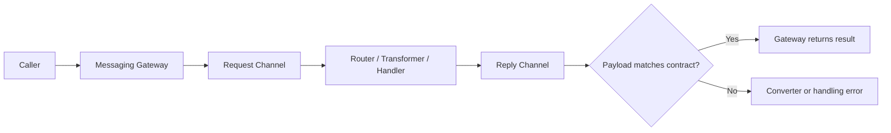
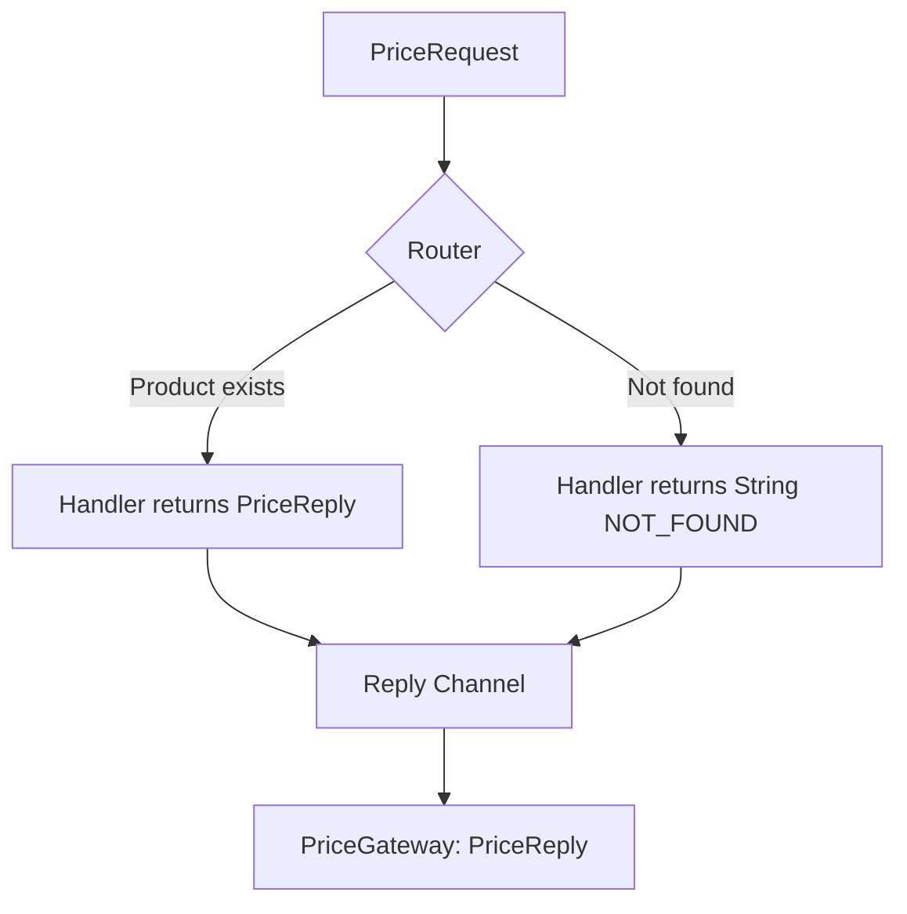

# Reply Message Has the Wrong Type

In the **Request reply** chapter of the **SPRING_INTEGRATION_PATTERN** module, a Gateway sends a request into a Spring Integration flow and waits for a result to return to the caller. When implementing Enterprise Integration Patterns with Routers, Filters, Transformers, Service Activators, Splitters/Aggregators, and external connectors, the reply may traverse several components before returning to the Gateway. A common failure is **a reply whose payload does not match the data type expected by the caller**.

This error can happen even after the request finishes processing, the reply reaches the right channel, and correlation is intact. The goal of this lesson is to pinpoint the root cause, standardize data contracts, and test reply branches in loosely coupled, extensible message flows.

After this lesson, you can:

- Identify the **Gateway's return type** and the **actual reply payload type**.
- Distinguish data type mismatches, serialization format mismatches, conversion failures, and replies sent to the wrong channel.
- Design Transformers/adapters to produce replies conforming to the contract.
- Handle conversion errors, timeouts, and error channels without losing diagnostic information.
- Test payload types across different processing branches.

## 1. What Does "Wrong Reply Type" Mean?

Suppose the application API declares:

```java
PriceReply quote(PriceRequest request);
```

To the caller, a valid result is a `PriceReply`. Yet the final handler in the flow returns the string `"OK"`, a `Map`, an older DTO version, or an error object. When the Gateway receives the reply, it must satisfy the declared return type. Without an appropriate conversion, the call can fail due to type incompatibility or failure to convert the message.

Do not assume every `String` reply is a bug: if the contract genuinely expects `String`, then `String` is right. The issue lies in **the mismatch between the receiver's contract and the sender's actual data**.

| Contract / Condition | Actual Reply | Assessment |
| --- | --- | --- |
| Gateway returns `PriceReply` | Well-formed `PriceReply` | Matches |
| Gateway returns `PriceReply` | `String "OK"` | Wrong type, unless a configured converter produces a valid conversion |
| Gateway returns `PriceReply` | JSON as `String` | Requires deserialization into `PriceReply`; valid JSON does not mean the Java type already matches |
| Gateway returns `Message<PriceReply>` | Message with `PriceReply` payload | Matches, and the caller can also access headers |
| Gateway returns `PriceReply` | `ErrorMessage`/exception entering the business reply path | Contract violation; needs a clearly defined error-handling path |
| Gateway returns `PriceReply` | No reply before timeout | Missing/delayed reply failure, **not** a wrong-type error |

### Easy-to-Spot Symptoms

- Gateway call throws a conversion/casting exception after the processor already returned data.
- Messages on the reply channel carry a `String` or `Map` payload while the Java method returns a DTO type.
- The flow works on one Router branch but fails on another because the two branches return different types.
- The failure only occurs when payloads arrive from a broker, HTTP, or JSON with fields differing from the internal DTO.
- After a Splitter/Aggregator, the returned data is a `List` of elements while the Gateway expects a single aggregated object.

**Note:** The exact exception reported may be a message conversion failure, a handling error, or a caller cast error depending on the declared type, converter configuration, and where the failure occurs. Never conclude solely from an exception class name.

## 2. Pinpointing Where the Type Mismatch Happens

A request-reply flow can be pictured as follows:



In Spring Integration, separate the **Message envelope** from the **payload**:

```text
Message<PriceReply>
  headers
    id
    replyChannel
    errorChannel  (if any)
    contentType   (if any)
    ...custom headers
  payload
    PriceReply(...)
```

- `Message<?>.getPayload()` returns business data, whose runtime type may be `PriceReply`, `String`, `byte[]`, `Map`, etc.
- `Message<?>.getHeaders()` holds reply channel metadata, identifiers, content type, and other metadata. The `contentType` header describes representation; it **does not automatically turn** a JSON string into a DTO without a corresponding conversion step.
- A Gateway method returning `PriceReply` typically needs a payload compatible with `PriceReply`; a method returning `Message<PriceReply>` carries the full message. Choose the method signature based on what the caller truly needs.
- `replyChannel` determines **where the reply is sent**; correlation determines **which request the reply belongs to**. Neither mechanism guarantees the payload has the right type.

Example of safe diagnostic logging at a reply-handling boundary:

```java
void inspectReply(org.springframework.messaging.Message<?> message) {
    Object payload = message.getPayload();
    String actualType = payload.getClass().getName();
    Object contentType = message.getHeaders().get("contentType");

    log.info("replyPayloadType={}, contentType={}", actualType, contentType);
    // You can also log correlation/request IDs; avoid logging sensitive data.
}
```

Do not log only `payload.toString()`. A `String` containing `"{\"amount\":100}"` and a `PriceReply` may look similar in logs while being completely different Java types.

## 3. Spring Integration Example: Handler Returning the Wrong Type

Suppose the system requests a quote and the Gateway must return `PriceReply`. In the Java 17+ example below, two `record`s define the contract:

```java
package example.pricing;

import java.math.BigDecimal;

record PriceRequest(String sku, int quantity) {}
record PriceReply(String sku, BigDecimal total) {}
```

Gateway:

```java
package example.pricing;

import org.springframework.integration.annotation.MessagingGateway;

@MessagingGateway(
    defaultRequestChannel = "pricing.requests",
    defaultReplyTimeout = "3000"
)
interface PriceGateway {
    PriceReply quote(PriceRequest request);
}
```

**Typical mistake:** a handler in `IntegrationFlow` processes the request but returns a status string:

```java
// Handler snippet INCOMPATIBLE with Gateway return type PriceReply:
.handle(PriceRequest.class, (request, headers) -> "PRICE_OK")
```

In business terms, this string might mean "processed," yet it lacks `sku` and `total` to build a quote. Without a suitable converter, the Gateway cannot fulfill its `PriceReply` return contract.

**Fix at the reply source:** return the computed data packaged in the exact DTO.

```java
package example.pricing;

import java.math.BigDecimal;

import org.springframework.context.annotation.Bean;
import org.springframework.context.annotation.Configuration;
import org.springframework.integration.annotation.IntegrationComponentScan;
import org.springframework.integration.dsl.IntegrationFlow;

@Configuration
@IntegrationComponentScan
class PricingFlowConfiguration {

    @Bean
    IntegrationFlow pricingFlow() {
        return IntegrationFlow.from("pricing.requests")
            .handle(PriceRequest.class, (request, headers) -> {
                if (request.quantity() <= 0) {
                    throw new IllegalArgumentException("quantity must be > 0");
                }

                BigDecimal unitPrice = new BigDecimal("19.90");
                BigDecimal total = unitPrice.multiply(
                    BigDecimal.valueOf(request.quantity())
                );

                return new PriceReply(request.sku(), total);
            })
            .get();
    }
}
```

Invocation:

```java
PriceReply reply = priceGateway.quote(new PriceRequest("SKU-01", 3));
// reply.sku()   == "SKU-01"
// reply.total() == 59.70
```

Here, the Service Activator always returns `PriceReply` on success; invalid input follows the flow's exception mechanism. Avoid "fixing" this by changing the Gateway return type to `Object` just to hide inconsistency; callers would have to guess result types and errors would surface much later.

## 4. When Type Conversion Is Needed: Convert Deliberately at the Boundary

Not every external system returns an internal Java DTO directly. REST may return JSON, a broker may deliver `byte[]`, and another service may return a DTO with currency strings. The proper approach is to **define the external schema, validate, and convert once at the boundary**.

For example, an external service returns:

```json
{
  "sku": "SKU-01",
  "total": "59.70",
  "currency": "VND"
}
```

Whereas the application uses `PriceReply(String sku, BigDecimal total)`. We can define a dedicated DTO for the external contract:

```java
record ExternalPriceReply(String sku, String total, String currency) {}

static PriceReply normalize(ExternalPriceReply external) {
    if (external == null || external.sku() == null ||
        external.total() == null || !"VND".equals(external.currency())) {
        throw new IllegalArgumentException("Invalid external reply");
    }

    try {
        return new PriceReply(
            external.sku(),
            new java.math.BigDecimal(external.total())
        );
    } catch (NumberFormatException exception) {
        throw new IllegalArgumentException(
            "total in reply is not a valid number", exception
        );
    }
}
```

The step order should be:

1. Adapter receives bytes/JSON per the external service contract.
2. Deserializer converts to `ExternalPriceReply` (or a validated intermediate form).
3. Transformer validates required fields, business rules, numeric format, and currency unit.
4. Transformer builds `PriceReply` for the rest of the flow.
5. Gateway returns `PriceReply` to the caller.

In the example, `currency` is checked to be VND with no FX conversion; production systems should include currency in the DTO or perform explicit conversion rules if multiple currencies exist. Converting JSON into a DTO can use the adapter's converter/serializer or a custom Transformer. A `contentType=application/json` header alone does not replace configuring that conversion.

### Options and Trade-Offs

| Approach | When Appropriate | Points to Watch |
| --- | --- | --- |
| Handler returns exact DTO | All processing runs in-JVM under the same contract | Simple, easy to type-check |
| Transformer before reply | External party returns a different representation or needs normalization | Must validate formats, nulls, and schema mismatches |
| Message converter | Adapter/gateway supports configurable conversion | Verify which converter actually applies; do not assume automatic support for every type |
| Gateway returns `Message<PriceReply>` | Caller needs both payload and headers | Payload must still match the contract |
| Return `Object` | Only when the API is explicitly designed for multiple types | Must document and test the result type set; never use it to avoid normalization |

**Do not cast blindly:**

```java
// Fragile when actual payload is String, byte[], or Map:
PriceReply reply = (PriceReply) message.getPayload();
```

If you are not sure data has passed through a Transformer, check the type deliberately:

```java
static PriceReply requirePriceReply(Object payload) {
    if (payload instanceof PriceReply reply) {
        return reply;
    }
    throw new IllegalArgumentException(
        "Unexpected reply payload type: " +
        (payload == null ? "null" : payload.getClass().getName())
    );
}
```

With `Message<?>.getPayload()`, Spring Messaging generally requires non-null payloads; returning `null` from a handler needs special care because in some configurations it means **produce no reply**. Never use `null` to represent an "error reply" when the caller expects a success DTO.

## 5. Router, Filter, Splitter/Aggregator, and Multiple Reply Types

When a flow has multiple branches, inspect **every path leading to the reply channel**:



In the diagram above, the success branch is valid, but the not-found branch returns a `String`, causing the Gateway to encounter a mismatched reply type. There are two clean designs:

- **Errors as exceptions:** the error branch throws an intentional exception (e.g., `ProductNotFoundException`) and is handled on the corresponding error path.
- **Errors as business results:** define a unified contract, such as `PriceResult` with status and data, and have *both branches* return `PriceResult`.

Example of an explicit result contract:

```java
sealed interface PriceResult permits PriceSuccess, PriceNotFound {}

record PriceSuccess(String sku, java.math.BigDecimal total)
    implements PriceResult {}

record PriceNotFound(String sku, String reason)
    implements PriceResult {}

// Gateway must declare: PriceResult quote(PriceRequest request);
```

The core principle is choosing one model and applying it consistently. Never let the success branch return a DTO, the error branch return an ad-hoc string, and hope the Gateway infers the meaning.

Other patterns carry similar risks:

- **Filter:** dropped messages may yield no reply; that symptom is typically a timeout or absent result, not a type mismatch. If a rejection reply is needed, design an explicit rejection payload.
- **Transformer:** easily turns `PriceReply` into `String`/JSON or vice versa. Verify output types after transformation steps.
- **Splitter/Aggregator:** Splitter emits multiple parts; Aggregator may return a `Collection`, list, or consolidated result depending on strategy. If the Gateway expects one DTO, transform the aggregated result into that DTO before replying.
- **Gateway calling another service:** nested gateways or outbound adapters may return responses of a different type; map between the two boundary contracts.

## 6. Distinguishing Type Errors from Timeouts, Correlation, and Error Channels

To troubleshoot accurately, observe each stage:

| Symptom | Diagnostic Question | Direction to Fix |
| --- | --- | --- |
| No reply received | Did the handler return a result? Did a Filter drop it? Did it reach `replyChannel`? | Inspect routing path and timeouts |
| Reply for a different request | Do correlation/reply-to values match the waiting request? | Fix matching or routing |
| Reply arrived at right place but wrong type | What is `payload.getClass()`? What return type does the Gateway declare? | Normalize payload, inspect converters |
| Valid JSON/bytes still failing | Did the adapter deserialize it? Do schemas/versions match? | Add/adjust converter and validation |
| Exception received as business reply | Did the flow send an `ErrorMessage`/exception to the normal reply channel? | Separate success and error contracts |
| Failure on one branch only | Do all Router/Aggregator branches return the same result contract? | Unify output contracts |

**Timeout:** `defaultReplyTimeout` is the Gateway's reply-wait limit. Returning a wrong-typed payload and returning no reply at all are distinct failure modes. Increasing the timeout will not fix a type mismatch.

**Correlation:** a reply carrying the right `requestId` or traveling to the right `replyChannel` can still contain a `String` instead of a `PriceReply`. Do not alter correlation IDs trying to "fix" conversion errors.

**Error channel:** exceptions in handlers/converters may propagate to the caller or turn into an `ErrorMessage` via the error-handling mechanism, depending on flow type and sync/async configuration. An `ErrorMessage` is an error message, not a normal success reply DTO. When retries are enabled, distinguish transient exceptions (retryable) from invalid schemas (retrying unchanged usually fails again).

In production, log at minimum:

```text
requestId=REQ-2048
stage=reply-validation
expectedType=example.pricing.PriceReply
actualType=java.lang.String
contentType=application/json
route=external-price-adapter
outcome=TYPE_MISMATCH
```

When possible, also include trace ID, processing duration, retry count, and channel name. Never log financial data or customer PII solely to identify payload types.

## 7. Testing and Verifying the Reply Contract

Good tests check both **values** and **payload types**, while covering every branch capable of returning a result. Given the corrected handler config in Section 3, you can write an application-level test (e.g., using Spring Boot Test and JUnit):

```java
package example.pricing;

import static org.assertj.core.api.Assertions.assertThat;

import org.junit.jupiter.api.Test;
import org.springframework.beans.factory.annotation.Autowired;
import org.springframework.boot.test.context.SpringBootTest;

@SpringBootTest
class PriceGatewayIntegrationTest {

    @Autowired
    PriceGateway gateway;

    @Test
    void returnsExpectedPriceReply() {
        PriceReply reply = gateway.quote(
            new PriceRequest("SKU-01", 3)
        );

        assertThat(reply).isInstanceOf(PriceReply.class);
        assertThat(reply.sku()).isEqualTo("SKU-01");
        assertThat(reply.total()).isEqualByComparingTo("59.70");
    }
}
```

This test is a **reference example** for a project with Spring Boot Test, JUnit, and AssertJ dependencies; this article does not execute tests. For real flows, also test:

1. **Correct reply type:** handler returns `PriceReply`, Gateway returns full data.
2. **Wrong reply type:** intentionally configure a handler to return `String` or `Map`; verify the system fails clearly or applies the designed converter. Do not hardcode assertions on specific exception names when multiple conversion layers exist.
3. **Reply from every Router branch:** both success and error branches adhere to the chosen contract.
4. **Reply from a broker:** bytes/JSON payloads are deserialized, validated, and converted before reaching the Gateway.
5. **Malformed data:** missing required fields, wrong `contentType`, unparseable numbers, or outdated schema versions have deterministic handling.
6. **No reply:** Filter/timeout behavior differs from type mismatch; avoid collapsing them into one error category.
7. **Concurrent replies:** multiple requests completing out of order still route to the right caller with the right payload type.
8. **Aggregator:** final aggregated output matches the Gateway return type, even upon group expiration or partial release.

At the unit-test level, `normalize(...)` can be tested without booting a full Spring context. At the integration-test level, inspect the real endpoints and reply channels. For broker-backed systems, add contract tests between producers and consumers to catch schema drift before deployment.

## 8. Quick Investigation Checklist on Failure

When a caller reports "received wrong reply type," go step by step:

1. Check the **Gateway method signature**: does it return a DTO, primitive, `Message<T>`, `Collection<T>`, or something else?
2. Identify **the exact object sent to the reply channel**: what are its runtime payload type and content type?
3. Inspect **Transformers, Routers, Filters, Service Activators, and Aggregators** upstream of the reply; which branch emits a different type?
4. If passing through an adapter or broker, verify **serialization/deserialization rules**, schema, field names, and API version.
5. Check which **converter** is actually configured and invoked where; never assume automatic conversion exists.
6. Inspect **error channels, timeouts, and correlation** to rule out routing bugs or missing replies.
7. Fix at the **data-creation/normalization point**, document the reply contract, and add a test for the failing branch.

## Conclusion

In Spring Integration, a Gateway can receive a reply on the right channel yet still fail to return a result because **the payload does not match the caller's declared type**. Prevent this by unifying data contracts, converting at boundaries, checking every Router/Aggregator branch, and separating business errors from success payloads. When investigating, inspect the actual runtime payload type and where converters execute; that pinpoints the faulty stage and lets you extend message flows without undermining request-reply correctness.
